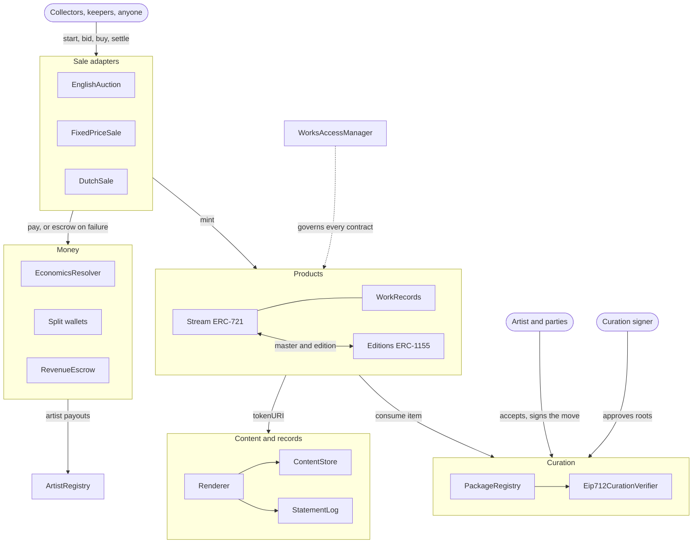

# 6529 Works

[](https://github.com/6529-Collections/6529-works/actions/workflows/ci.yml)

6529 Works is the 6529 network's art protocol. It holds two products: **6529 Stream**, one
shared ERC-721 for curated 1/1 artworks, and **6529 Editions**, one shared ERC-1155 whose
editions are each anchored by a Stream master. Works are approved by TDH-weighted votes in
6529 waves and attested by a curation signer; every party named in a work signs before it
can be sold. Anyone may start a work's 24-hour English auction, and anyone may settle it.
Money moves by pull: proceeds and royalties collect in immutable split wallets that payees
release from, with an escrow for payments that fail. Content is addressed by hash and stored on
Arweave and IPFS, and anyone can put a work's files on-chain. One OpenZeppelin `AccessManager`
governs every contract behind delays that guardians can veto.

> **Status: pre-audit.** Do not use this code to custody value. It has had an internal
> adversarial review by AI agents, not an external audit. A rehearsal runs on Sepolia; there
> is no mainnet deployment. See [Status](#status).

## Architecture



A work's path: the artist's package is voted on and attested, each party accepts it, the lead
artist signs "move to Stream", anyone starts the auction (which mints the token into auction
custody and consumes the item), bids extend the clock near the end, and anyone settles. A master
work's edition opens once its auction has settled. By default, primary sales of both products
pay 75% to the artist's side and 25% to the network, and royalties are 6.529% (ERC-2981, out of
100,000); a work keeps the terms it was minted with. The
[protocol specification](docs/spec/README.md) describes every flow; the
[architecture overview](docs/architecture.md) shows how the contracts fit together.

## Modules

| Contract | Purpose | nSLOC |
| --- | --- | ---: |
| [`Stream`](src/stream/README.md) | The shared ERC-721: mints consumed items, locks terms, royalties, the edition link | 555 |
| [`WorkRecords`](src/stream/README.md) | Each work's record, license, locators, preferred location, finalize and renderer pin | 619 |
| [`Editions`](src/editions/README.md) | The shared ERC-1155, linked to Stream masters | 332 |
| [`PackageRegistry`](src/curation/README.md) | Package roots, party consent, the move signature, consume-once items, content uniqueness | 360 |
| [`Eip712CurationVerifier`](src/curation/README.md) | Accepts curation signers' EIP-712 approvals | 103 |
| [`EnglishAuction`](src/sales/README.md) | Stream's primary sale: anti-snipe clock, pull refunds, pending claims, dispute pause | 763 |
| [`FixedPriceSale`](src/sales/README.md), [`DutchSale`](src/sales/README.md), on [`MintSaleBase`](src/sales/README.md) | Edition sales: allowlist phases, permits, a descending price | 306 + 144 + 377 |
| [`EconomicsResolver`](src/economics/README.md), [`AssetAllowlist`](src/economics/README.md) | Terms for new works, fee recipients, currencies and increment floors | 192 + 122 |
| [`SplitFactory`](src/economics/README.md), [`SplitWallet`](src/economics/README.md) | Immutable pull-payment wallets at predicted addresses | 100 + 143 |
| [`RevenueEscrow`](src/economics/README.md), [`ClaimRouter`](src/economics/README.md), [`ReleaseVerifier`](src/economics/README.md) | Failed-payment escrow, batch claims, signed releases | 89 + 99 + 41 |
| [`ArtistRegistry`](src/identity/README.md), [`ConsolidationAdapter`](src/identity/README.md) | Artist identity and payouts; 7-day recovery and 180-day overrides through 6529 consolidations | 561 + 133 |
| [`ContentStore`](src/content/README.md), [`DependencyRegistry`](src/content/README.md) | Content-addressed on-chain chunks and shared libraries | 240 + 66 |
| [`Renderer`](src/content/README.md) | `tokenURI` and `fullTokenURI` for works and editions | 769 |
| [`StatementLog`](src/records/README.md) | Append-only signed statements: dispute outcomes, curation evidence, manifests | 314 |
| [`VrfEntropyModule`](src/entropy/README.md) | Optional Chainlink VRF seed per work, delivered before the start | 218 |
| [`WorksAccessManager`](src/governance/README.md), [`GovernanceConfigurator`](src/governance/README.md) | One AccessManager for everything; guardians cancel any scheduled operation and can suspend operational keys | 71 + 43 |

nSLOC counts non-blank lines without comments. The [audit scope](docs/audit/scope.md) lists every
file, its bytecode size and how the figures are measured; `tools/check_docs_facts.py` keeps
both pages in step with the code. Shared code lives in internal
[libraries](src/libraries/README.md) and the [interfaces](src/interfaces/README.md); nothing is
linked, proxied or `delegatecall`ed. 6529 Stream Federated (artist-owned contracts from the
network's templates) is [v1.1, only if needed](src/federated/README.md).

## Status

| | |
| --- | --- |
| Maturity | **Pre-audit.** Not production-ready. An internal adversarial review, carried out by AI agents in October 2026, found no Critical or High issues; its fixes are merged ([report](docs/security/internal-review-2026-10.md)). No external audit has started. |
| Scope | Fixed by [ADR 0001](docs/adr/0001-v1-scope.md), amended by ADRs [0002](docs/adr/0002-access-manager-hardening.md), [0003](docs/adr/0003-build-time-decisions.md) and [0004](docs/adr/0004-gas-budgets-under-glamsterdam.md). |
| Code | Every v1 module is on `main`, with about 2,250 unit, fuzz and integration tests in 129 test files, and 62 stateful invariants in 12 invariant suites ([invariants](docs/audit/invariants.md)). |
| Testnet | Sepolia rehearsal **r2**, deployed on 11 October 2026 from `400f96d` with throwaway signers in the mainnet Safe structure: [addresses](docs/integrators/addresses.md), [deployment record](deployments/11155111/README.md), [flows and their gas](deployments/11155111/flows.md). It predates the review fixes. |
| Mainnet | Not deployed. It follows an external audit ([delivery plan](ops/DELIVERY_PLAN.md)). |
| Gas | Budgets are in Prague gas: a steady-state ETH auction start costs at most 350K and writes at most 6 new storage slots, `tokenURI` at most 8M. Sepolia runs Glamsterdam, which prices new state higher ([ADR 0004](docs/adr/0004-gas-budgets-under-glamsterdam.md)). |
| Known limits | Listed with their sources in [known limitations and accepted risks](docs/audit/known-limitations.md). |

## Quickstart

You need [Foundry](https://book.getfoundry.sh/) (CI pins v1.7.1) and Python 3.12 or later. The
Python tools use only the standard library.

```bash
git clone --recurse-submodules https://github.com/6529-Collections/6529-works.git
cd 6529-works
forge build
forge test
```

The first build compiles about 350 files and takes a few minutes. If you cloned without
submodules, run `git submodule update --init` first. To run the gas report with its exact
new-slot counts:

```bash
forge test --match-test test_Gas_Table -vv
```

The CI gates, Slither and the other checks are in
[Build, test and budgets](docs/audit/build-and-test.md); coverage, mutation testing and the
Halmos proofs, which run on `main` and on a schedule, are in [Testing](docs/testing/README.md).
The code is Solidity 0.8.37 on the `prague` EVM, with OpenZeppelin 5.7.0 and forge-std 1.17.0
in `lib/`.

## Where to go next

| You are | Start with |
| --- | --- |
| New to the protocol | The [specification](docs/spec/README.md) and the [glossary](docs/glossary.md) |
| Integrating: a marketplace, wallet, indexer or front end | The [integrator guide](docs/integrators/README.md): reading a work, events, ABIs, buying and settling, storage |
| Auditing or reviewing security | The [auditor pack](docs/audit/README.md): scope, trust, roles, threat model, invariants, limitations |
| Contributing code | [CONTRIBUTING.md](CONTRIBUTING.md); automated agents also read [AGENTS.md](AGENTS.md) |
| Deploying or operating | The [deploy runbook](script/README.md) and the [genesis configuration](config/README.md) |
| Looking for why a decision was made | The [ADRs](docs/adr/README.md) |

Everything else is indexed in [docs/README.md](docs/README.md).

## Repository layout

```
src/         contracts, one folder per module, with interfaces/ for the shared surfaces
test/        unit, fuzz, invariant, integration and review-regression tests
script/      the deploy library, deploy and verify scripts, the Sepolia flow driver
config/      the committed genesis policy and the Sepolia instances' copies
deployments/ deployment records and measured flows, per chain
tools/       standard-library Python: CI gates, the role matrix and the uploader
docs/        specification, auditor pack, integrator guide, glossary, ADRs, architecture
ops/         the delivery plan
lib/         git submodules: OpenZeppelin Contracts and forge-std
```

## Security

Report vulnerabilities privately through
[GitHub private vulnerability reporting](https://github.com/6529-Collections/6529-works/security/advisories/new),
as [SECURITY.md](SECURITY.md) describes. Do not open public issues for exploitable bugs, and
never include keys or secrets.

## License

The code is MIT ([LICENSE](LICENSE)). Artworks minted on 6529 Stream and 6529 Editions
default to CC0 ([ADR 0001 §8](docs/adr/0001-v1-scope.md#8-works-content-and-storage)).
