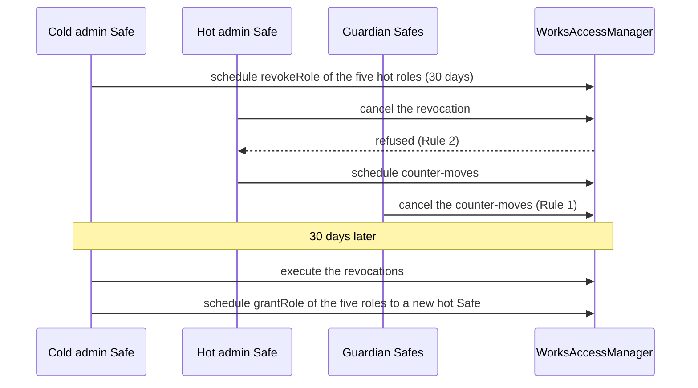

# Trust assumptions

Who and what 6529 Works trusts, written for an audit team starting an engagement. For each
governance role, each operational key, each external dependency and each link between the
protocol's own contracts, this page says what it is trusted to do, the worst it can do if it is
malicious or its key is compromised, what the code stops it from doing, and how the system
recovers. Per-selector detail (every restricted function, its role and its delay) is in the
generated [role and permission matrix](roles.md). The attacker's view of the same system is the
[threat model](threat-model.md).

> **Status.** Pre-audit. This page describes `main` at `c4b3355` (15 October 2026). The ADRs
> record how the design was decided; this page is how it works now. Where they differ, this
> page follows the code and says so under [Differences from the ADRs](#differences-from-the-adrs).

## How to read this page

- **Delay classes.** Immediate; standard, 48 hours; funds, 14 days; successor, 30 days
  (`Roles.STANDARD`, `Roles.FUNDS`, `Roles.SUCCESSOR` in
  [`Roles.sol`](../../src/governance/Roles.sol)). A holder of a delayed role schedules the call on
  the `WorksAccessManager`, waits the delay, then executes it within one week
  (`expiration()`), or the operation dies.
- **Who can cancel a scheduled operation.**
  [`WorksAccessManager._canCancel`](../../src/governance/WorksAccessManager.sol) adds two rules to
  OpenZeppelin 5.7.0's `AccessManager`:
  - Rule 1: any GUARDIAN holder can cancel any scheduled operation.
  - Rule 2: nobody but its scheduler can cancel an operation that revokes one of the
    canceller's own roles.

  OpenZeppelin's own rule still lets the scheduler and any ADMIN holder cancel. "Guardian
  veto" below therefore covers every governed action that is not immediate.
- **Holders.** [`config/genesis.example.json`](../../config/genesis.example.json) is the committed
  policy. It names each holder by label, and a deployment may change only the addresses
  ([script README, step 3](../../script/README.md#3-the-genesis-configuration)).
- **Worst case** assumes that an attacker fully controls the key or Safe in question and that
  every other party is honest, unless the row says otherwise.

## The model in brief

- **No upgrades.** Every contract is immutable and nothing in `src/` uses `delegatecall`,
  except the `Multicall` self-call inherited by `WorksAccessManager`
  ([ADR 0002](../adr/0002-access-manager-hardening.md#security-impact)). Governance changes
  parameters, pins and role holders, never the code at an address.
- **Every governed change waits its class, in public.** The immediate powers are the
  guardians' tightening actions (pauses, vetoes, revocations, deprecations) and the operational
  keys' bounded duties (collections, locators, edition sales at the package terms, statements,
  storage preferences). Nothing that moves funds, recipients, verifiers or renderers is
  immediate ([role matrix](roles.md)).
- **What a work locks, governance cannot reach.** At its start a Stream work locks its seller
  wallet, fee recipient, fee share and royalty rate (`Stream.mint`, `_quote`, `_store` in
  [`Stream.sol`](../../src/stream/Stream.sol)). Afterwards only every party's signature plus a
  governed action changes the rate or the license (`WorkRecords.setRoyaltyRate`, `relicense`),
  and nothing changes the payees. A finalized work's record is fixed, and its renderer pin moves
  only with the lead artist's signature plus a 30-day action (`WorkRecords.repinRenderer`).
- **Money is pulled or escrowed.** Split wallets have no owner and no governance
  ([`SplitWallet`](../../src/economics/SplitWallet.sol)). A failed push goes to the
  `RevenueEscrow`, whose governed `recover` moves a credit only to an equivalent wallet or to the
  replacement its holder named ([`RevenueEscrow`](../../src/economics/RevenueEscrow.sol)).
- **Off-chain trust is explicit.** Until the 6529 chain exists, curation rests on the curation
  signer and the evidence it publishes; disputes and contested recoveries rest on an off-chain
  TDH vote that PLATFORM records and the admin Safe executes; display rests on Arweave and IPFS
  until a work is on-chain complete
  ([ADR 0001, accepted risks](../adr/0001-v1-scope.md#accepted-risks)).
- **The veto needs live, independent guardians.** Safety needs at least two honest guardians
  online at all times
  ([governance README](../../src/governance/README.md#operating-procedures)). The recovery
  paths below also assume that the hot admin Safe and a guardian Safe are not compromised at the
  same time.

## Governance roles

The hot admin Safe holds ADMIN, UNPAUSER and the three setter roles; the cold recovery admin
Safe holds ADMIN only; the guardian Safes hold GUARDIAN and PAUSER only
([`config/genesis.example.json`](../../config/genesis.example.json)). The code enforces only part
of this: `GovernanceConfig.validate` in [`GovernanceConfig.sol`](../../src/governance/GovernanceConfig.sol)
requires at least two guardians holding nothing but GUARDIAN and PAUSER, a holder for ADMIN,
PAUSER and UNPAUSER, and no account holding both PAUSER and UNPAUSER. The admin split is policy.

### What each role can do

Each worst case below happens only after the role's delay, and any guardian can cancel it during
that delay.

| Role | Delay (grant delay) | Trusted to | Worst case if its holder is hostile | Cannot (enforced by) |
| --- | --- | --- | --- | --- |
| ADMIN | 30 days (30 days) | Grant and revoke roles, map selectors to roles, set target admin delays, onboard targets; the one deferred bind, `ArtistRegistry.bindFederationRegistry` (v1.1) | Grant any role to any account (30 days, then the role's grant delay); remap a selector or close a target; move a target to another authority (`updateAuthority`, or `setAuthority` scheduled on the target); cancel any operation another account scheduled | Act faster than 30 days: every ADMIN operation waits ADMIN's 30-day execution delay, every target's admin delay is 30 days, and a role's grant delay is never shorter than its class delay (`Roles.executionDelay`, `Roles.grantDelay`; `test_MetaGovernanceIsNeverFasterThanTheSlowestClass` in [`Hardening.t.sol`](../../test/governance/Hardening.t.sol)); cancel its own revocation scheduled by another admin (Rule 2, `test_CompromisedAdminCannotCancelItsOwnRevocation` in [`GuardianCancel.t.sol`](../../test/governance/GuardianCancel.t.sol)) |
| UNPAUSER | 48 hours (48 hours) | Lift an adapter's emergency pause; resume a dispute-paused auction | Resume a disputed auction, after which an upheld `cancel` can no longer land (one pause per auction) | Act earlier than 48 hours after the pause, even with an operation scheduled before it (GOV-5, `EnglishAuction._requireUnpausable`, `MintSaleBase.unpause`; [`Gov5Regression.t.sol`](../../test/adv/Gov5Regression.t.sol)) |
| PARAMETER_SETTER | 48 hours (48 hours) | Sale parameters and defaults for new works; upheld disputes (`EnglishAuction.cancel`, `Stream.releaseContent`); recovery overrides (`ArtistRegistry.stageOverride`); relicensing with consent; dependency registration; the VRF lane and subscription | Stage a recovery override against any artist: from the staging, an override that moves the authority restrains the artist and one that moves the payout freezes it, for the 180-day notice. A payout-only override needs no consent from the artist and executes unless a captured wallet contests it or a guardian vetoes it (`test_Override_PayoutOnlyNeedsNoAcceptance` in [`ArtistRegistry.t.sol`](../../test/identity/ArtistRegistry.t.sol)). Set the royalty rate and default license that later works take. Change the auction duration, anti-snipe window and increment within bounds, and the opening bid up to 1,000 increment floors (`EnglishAuction.OPENING_BID_FLOORS`). Point the entropy module at another subscription | Change a minted work's license without every party (`WorkRecords._checkConsents`; `test_relicense_rejectsMissingOrBadConsent` in [`WorkRecords.t.sol`](../../test/stream/WorkRecords.t.sol)); leave CC0 (`LicenseIrrevocable`); cancel an auction a guardian did not pause, or cite an outcome recorded before the pause (LIFECYCLE-4, `EnglishAuction.cancel`); release the content of a work that is not burned (`NotBurned`); lower the VRF callback gas limit (`BoundedParameter`) |
| FUNDS_SETTER | 14 days (14 days) | Network fee terms for new works; a minted work's royalty rate, with every party's consent (`WorkRecords.setRoyaltyRate`); the currency allowlist and default currencies; escrow recovery; the marketplace `owner()` | Redirect the network fee of every work started afterwards, and raise its share to just under 100% (`EconomicsResolver._validate` requires `feeShare < 100,000`). This includes works already approved but not yet started, because fee terms are read at the start. Admit a hostile ERC-20 (`AssetAllowlist.admitAsset` probes only code, EIP-7702 delegation and balance against supply). Change Stream's and Editions' marketplace owner | Change a minted work's rate without every party (`WorkRecords._checkConsents`). Reach a minted work's fee terms: they are stored at mint (`Stream._store`; `test_ChangesApplyToNewWorksOnly` in [`EconomicsResolver.t.sol`](../../test/economics/EconomicsResolver.t.sol)); move an escrow credit except to an equivalent wallet or the replacement its holder named (MONEY-2, `RevenueEscrow.recover`); re-admit a deprecated currency within 14 days of the deprecation (`ReadmissionTooEarly`) |
| SUCCESSOR_SETTER | 30 days (30 days) | Verifier, default renderer, consolidation source, VRF coordinator, artist resolver and federation registry swaps; admitting sale adapters; the errata repin; re-enabling a curation signer; resolving contested overrides; governance manifests | Install a curation verifier that approves anything (`PackageRegistry.setVerifier`); install a default renderer that misrepresents every work not yet finalized (`Stream.setDefaultRenderer`); admit a sale adapter that takes custody of every work it starts (`setAdmittedMinter`); install a consolidation source that grants or denies standing (`ArtistRegistry.setConsolidationSource`); install an artist resolver that vouches for anyone (`StatementLog.setArtistResolver`); swap the VRF coordinator; uphold or void a contest, citing an outcome PLATFORM recorded (`resolveContested`) | Repin a finalized work without the lead artist's signature (`WorkRecords.repinRenderer`); reinstall a retired curation verifier (`test_setVerifier_refusesARetiredVerifier` in [`PackageRegistry.t.sol`](../../test/curation/PackageRegistry.t.sol)); install a dependency that is an EIP-7702 account, lacks its ERC-165 interface or differs from the reviewed code hash; uphold a contest with an outcome recorded before it (`OutcomePredatesContest`); change a delivered seed |
| GUARDIAN, PAUSER | immediate (30 days, 48 hours) | Veto: cancel scheduled operations, pause, revoke, disable, deprecate | See [Guardian Safes](#guardian-safes) | See [Guardian Safes](#guardian-safes) |

Every governed function is non-payable, because `AccessManager.execute` forwards `msg.value`
(`test_EveryGovernedSelectorIsNonPayable` in [`Hardening.t.sol`](../../test/governance/Hardening.t.sol)).
Setters for funds, recipients, verifiers and renderers are compare-and-set, so an operation
scheduled against a stale value reverts (`test_StaleCompareAndSetOperationReverts`).

### Admin Safes

| Safe | Holds | Trusted to | If compromised | Recovery |
| --- | --- | --- | --- | --- |
| Hot admin Safe | ADMIN, UNPAUSER, PARAMETER_SETTER, FUNDS_SETTER, SUCCESSOR_SETTER | Every governed change, each at its class delay, executing the network's decisions (including off-chain TDH votes) | Everything in the table above, each after its delay and each cancellable by any guardian. It can also cancel any operation another account schedules, except its own revocation (Rule 2) | The cold admin schedules `revokeRole` for all five roles (30 days). The hot Safe cannot cancel them; the guardians cancel its counter-moves; after execution the cold admin grants the roles to a new Safe ([script README, admin recovery](../../script/README.md#admin-recovery); `test_ColdAdminRecoversFromACompromisedHotAdmin` in [`Hardening.t.sol`](../../test/governance/Hardening.t.sol), `test_ColdAdminRemovesTheHotAdmin` in [`Genesis.t.sol`](../../test/integration/Genesis.t.sol)) |
| Cold recovery admin Safe | ADMIN only; kept offline; 3-of-5 recommended | Replace a compromised hot admin and nothing else ([ADR 0003, owner decision 2](../adr/0003-build-time-decisions.md#owner-decisions-11-october-2026)) | As ADMIN: grants, remaps and authority moves after 30 days, guardian-vetoable. It can also cancel the hot admin's operations, which stalls governance | The hot admin schedules `revokeRole(ADMIN, cold)`, which the cold Safe cannot cancel (Rule 2). Without a second admin, a compromised sole admin can be vetoed forever but never removed ([ADR 0002, decision 5](../adr/0002-access-manager-hardening.md#decision)) |

The admin topology is checked once, at deployment: off a local chain the deploy requires two
admin Safes and refuses a signer that two admin Safes share, or that an admin Safe shares with a
guardian Safe (`DeployGuards.checkHolders` in [`DeployGuards.sol`](../../script/DeployGuards.sol);
`test_OffAnvilNeedsTwoAdminSafes`, `test_OffAnvilAdminSafesShareNoSigner` in
[`DeployScript.t.sol`](../../test/deploy/DeployScript.t.sol)).

### Guardian Safes

Three Safes, 2-of-3 each, signers independent of the admin Safes
([ADR 0003, owner decision 3](../adr/0003-build-time-decisions.md#owner-decisions-11-october-2026)).
They hold GUARDIAN and PAUSER and nothing else.

| | |
| --- | --- |
| Trusted to | Watch every scheduled operation and cancel hostile ones; pause a disputed auction; veto identity changes; revoke bad package roots; disable a compromised curation signer; deprecate a misbehaving currency; pause the sale adapters in an emergency |
| Worst case, one compromised guardian Safe | Cancel every scheduled operation except its own removal, so governance stalls until it is removed. Pause each live auction once, for up to 7 days (`EnglishAuction.MAX_PAUSE`); its high bidder may withdraw, and the auction then runs for at least the governed duration again (LIFECYCLE-1). Pause the three sale adapters: no new auction starts, edition sales or purchases, until an unpause 48 hours later, which it may follow with another pause. Veto every pending identity change and override (`ArtistRegistry.vetoChange`). Revoke any package root, registered or not, for good (`PackageRegistry.revokePackage`): its unconsumed items need a new root. Disable every curation signer (`disableSigner`), halting curation until a 30-day re-enable or a new grant. Deprecate any currency, ETH included (`AssetAllowlist.deprecateAsset`): live auctions in it freeze and fixed-price and Dutch sales in it halt; re-admission waits 14 days from the deprecation, and after 30 days frozen anyone may end a frozen auction unsold, crediting the bid back and giving the work to the artist (MARKET-2). Deprecate a dependency-registry version (a flag only) |
| Cannot | Schedule anything or hold another role (`GovernanceConfig.validate`; `test_GuardianCannotSchedule`, `test_GuardiansHoldOnlyGuardianAndPauser` in [`Hardening.t.sol`](../../test/governance/Hardening.t.sol)). Cancel or resume an auction. Redirect funds or identities: a veto only deletes (`test_Attack_GuardianCannotRedirect` in [`ArtistRegistry.t.sol`](../../test/identity/ArtistRegistry.t.sol)). Block refunds and withdrawals: `withdrawBid` works while paused or frozen, claims work while an adapter is paused, and split wallets and the escrow never read the allowlist (`test_DeprecatedAndNeverAdmittedAssetsStayWithdrawable` in [`SplitWallet.t.sol`](../../test/economics/SplitWallet.t.sol)). Cancel its own removal (Rule 2, `test_GuardianCannotCancelItsOwnReplacement` in [`GuardianCancel.t.sol`](../../test/governance/GuardianCancel.t.sol)) |
| Recovery | An admin schedules `revokeRole(GUARDIAN, g)` and `revokeRole(PAUSER, g)` (30 days), which the compromised guardian cannot cancel. Revoke first, then grant a replacement: a guardian still in office can cancel the grant (Rule 1) |
| Residual | All guardians colluding can shield each other from removal (`test_Residual_ColludingGuardiansCanShieldEachOther`). With only one honest guardian online, a compromised admin removes it in 30 days and then nothing stops a target takeover (`test_Residual_LivenessNeedsTwoHonestGuardiansOnline`). Both are in [`GuardianCancel.t.sol`](../../test/governance/GuardianCancel.t.sol) |

### Operational keys

| Holder (role) | Trusted to | Worst case if compromised | Cannot (enforced by) | Recovery |
| --- | --- | --- | --- | --- |
| Curation signer keys (CURATION_SIGNER, at least two; never a caller) | Sign `PackageApproval` only for roots the 6529 wave approved, after checking every declared SHA-256 against the decoded bytes and simulating `openRecord` for every item ([curation README](../../src/curation/README.md), [stream README](../../src/stream/README.md)) | Approve any root, including a package that copies another artist's content, until disabled. A root registered before the disable stays usable (`test_disabledSigner_registeredRootsStayUsable` in [`PackageRegistry.t.sol`](../../test/curation/PackageRegistry.t.sol)) | Mint on its own: a start also needs every party's acceptance and the lead artist's move signature (`PackageRegistry.consume`). Revive an approval after a disable, a re-enable or a re-grant: approvals bind the signer's epoch (SIGS-2, `Eip712CurationVerifier.signerEpoch`; `test_isApproved_reEnablingDoesNotReviveOlderApprovals` in [`Eip712CurationVerifier.t.sol`](../../test/curation/Eip712CurationVerifier.t.sol)). Approve on another chain or deployment (EIP-712 domain). Sign while its role carries a delay (`isSignerActive`) | A guardian disables it at once (`disableSigner`, one-way) and revokes each root it wrongly approved (`revokePackage`, per root). Re-enabling is a 30-day action that starts a new epoch; a fresh key is preferred. Content already minted goes through the dispute flow |
| Curator key (CURATOR) | Append `CURATION_EVIDENCE` statements (`StatementLog.appendCurator`) | Append misleading curation evidence, which is permanent | Approve packages; write another reserved kind, or an ARTIST or OWNER statement (`ReservedKind`; `test_Curator_CannotWriteArtistOrOwner` in [`StatementLog.t.sol`](../../test/records/StatementLog.t.sol)); write with a delayed role (`test_Curator_DelayedRoleCannotWriteDirectlyOrByRelay`) | An admin revokes the role (30 days). A later entry cites the false one in `supersedes`; readers decide whose corrections to honor |
| Platform key (PLATFORM) | Create collections; add locators (the only one who can after finalize); open FIXED edition sales at the package terms and close them; record dispute outcomes and TDH votes as `DISPUTE_OUTCOME` statements (`StatementLog.appendPlatform`) | Record false dispute outcomes, which metadata shows as the work's dispute status and which governed dispute actions cite ([records README](../../src/records/README.md)). Register junk content addresses as locators (8 per file before finalize, all 16 after). Open FIXED edition sales at the package price at a time it chooses, and close sales it opened alone; while an artist is restrained, close any of that artist's sales. Create collections | Price below or above the package, or open an OPEN edition, without the artist's signed approval (MARKET-6, `FixedPriceSale.openSale`; [`Market6Regression.t.sol`](../../test/adv/Market6Regression.t.sol)); cancel an auction; remove, change or prefer a locator; write an ARTIST statement | An admin revokes the role (30 days). The artist (the creator) can close any sale. A new platform key's outcome supersedes a false one. The storage operator sets file preferences away from junk locators |
| Storage operator key (STORAGE_OPERATOR) | Choose the preferred copy, globally, per collection or per file, among registered copies, serving only copies the off-chain monitor verified ([stream README](../../src/stream/README.md#records-satellite)) | Point works at a registered copy that is missing or wrong, so wallets show broken media until it is switched back; every switch emits ERC-4906 | Add, remove or change a locator; prefer a locator registered for another file (`WorkRecords.setFilePreference`; `testFuzz_preferredLocator_staysWithinFile` in [`PreferredLocation.t.sol`](../../test/stream/PreferredLocation.t.sol)); override inline media: an on-chain complete file under the inline threshold is inlined whatever the preference ([content README](../../src/content/README.md#media)) | An admin revokes the role (30 days); a new operator restores the preferences |

### Deployment and upkeep

| Actor | Trusted to | Worst case | Cannot (enforced by) | Recovery |
| --- | --- | --- | --- | --- |
| Genesis deployer (operator EOA, the configurator's `deployer`) and `GovernanceConfigurator` | Deploy every contract with the reviewed constructor parameters and call `configure` once, with the committed policy and the owner's holders ([governance README](../../src/governance/README.md#deploying-and-configuring)) | Bypass the script's checks and configure other holders, another policy or substituted dependencies. Nothing is hidden: `GovernanceConfigured` carries the configuration and wiring hashes. Front-running the configurator's creation on mainnet only spends the namespace (`ConfiguratorAddressTaken`) | Keep a role: the configurator renounces ADMIN in the configuring transaction (`test_ConfiguratorEndsWithNoRoleAfterWiring` in [`GenesisWiring.t.sol`](../../test/governance/GenesisWiring.t.sol)). Configure twice, or let another account configure (`test_ConfigureIsOneShot`, `test_OnlyDeployerCanConfigure` in [`GovernanceConfigurator.t.sol`](../../test/governance/GovernanceConfigurator.t.sol)). Make any genesis call outside the allow-list, such as a zero-delay verifier swap (`GovernanceConfig.isGenesisSelector`, at most 64 calls; `test_RejectsZeroDelaySwapsThroughWiring`) | After the manager's 5-day `minSetback`, `Verify.s.sol` checks every address, code hash and constructor parameter, the CC0 text, the manifest, roles, selectors, wiring, every `RoleGranted` and every pending delay change against the chain and the committed policy ([script README, step 11](../../script/README.md#11-verify-after-5-days)). A deployment that fails Verify is not adopted. Not yet built: a verifier that rebuilds the bytecode ([script README](../../script/README.md)) |
| Keepers and relayers (no role; KEEPER is unused in v1) | Nothing for safety; liveness only. `settle`, `executeChange`, `expireContest`, `refreshStanding`, `syncOnChain`, `attestBase64`, VRF repeats, escrow flushes and claim-router batches are permissionless | Withhold or delay calls. Choose the order of signed payloads it relays: the first acceptance relayed sets a new identity's profile (`test_acceptPackage_relayOrderPicksProfile`). A hostile item in a continue-mode claim batch can revert the batch ([economics README](../../src/economics/README.md#batch-claims-and-gas)) | Alter anything signed: it can submit only the exact payload a digest binds. Push an artist's share anywhere: artist payees are pull-only (`SplitWallet.release`). Starve a call into a worse outcome: settlement needs its delivery and ERC-20 payout gas in full (`DeliveryInsufficientGas`, `PaymentInsufficientGas`), and consolidation reads need their full stipend (IDENTITY-4, `BoundedCall`) | Anyone else makes the call |

### Accounts with no role

| Account | Trusted to | If lost, blocked or hostile | Recovery |
| --- | --- | --- | --- |
| Network fee recipient | Receive the network fee and the network share of royalty wallets; an existing account that accepts ETH from a 100,000-gas call ([script README](../../script/README.md#the-network-fee-recipient-must-exist)) | Every existing work locks it at mint. A refused ETH payment is escrowed; a token that blocks it escrows its fees; its royalty shares stay in each royalty wallet | It names a replacement with `RevenueEscrow.consentToRecovery`, then FUNDS_SETTER runs `recover` (14 days); it releases royalty shares with `releaseTo`; `setFeeTerms` helps only new works ([economics README](../../src/economics/README.md#escrow-recovery)) |
| Marketplace owner (`Stream.owner()`, `Editions.owner()`) | Administer the collections on marketplaces | Change marketplace settings off-chain. It gates nothing on-chain | FUNDS_SETTER `setOwner` (14 days, compare-and-set) |
| VRF subscription owner | Keep a dedicated subscription funded, with the entropy module its only consumer | Remove the module as a consumer or withdraw the balance, under Chainlink's rules: VRF works cannot draw seeds and so cannot start. Nothing is in custody, so nothing strands | Fund a new subscription and point the module at it with `setConfig` (PARAMETER_SETTER, 48 hours) |

The MINTER and KEEPER roles exist in `Roles.sol` but no v1 selector maps to them and no holder is
granted them ([`config/genesis.example.json`](../../config/genesis.example.json), `unusedRoles`).
Sale adapters mint through each token's admitted-minter mapping instead
(see [Admitted sale adapters](#admitted-sale-adapters)).

Artists, collaborators, collectors and copiers are not trusted beyond their own works and funds;
their capabilities are in the [threat model](threat-model.md#actors).

## External dependencies

| Dependency | Trusted to | If it fails or is hostile | Bounded by (code) | Recovery |
| --- | --- | --- | --- | --- |
| 6529 delegation contract `0x2202CB9c00487e7e8EF21e6d8E914B32e709f43d`, read by `ConsolidationAdapter` | Report two-way, all-collections, use-case-999 consolidations with their registration and expiry dates. The adapter assumes a revocation deletes every registration of a pair, so a stored registration has been live since its date | It decides which wallets can stage a STANDARD change and which can cancel or contest one. The account's own key and any use-case-998 sub-delegate control its delegate list ([identity README](../../src/identity/README.md#consolidation-standing)) | A wallet counts only when both directions are at least 30 days old and unexpired (`ConsolidationAdapter.MIN_AGE`), read from the raw getters rather than `checkConsolidationStatus`. Walks are bounded (32 entries, 4 registrations, 16 wallets). Each getter gets exactly 200,000 gas (`READ_GAS`) or the call reverts. Reads fail closed (`DelegationReadFailed`), never as "not consolidated". The sticky standing snapshot strips a recorded wallet only after a public 30-day grace. The registry pins the adapter's code hash and checks it at every use. On mainnet the deploy accepts only the canonical address and records its code hash (`DeployGuards.CANONICAL_DELEGATION_CODEHASH`) | In an outage, staging, heartbeats and refreshes revert, while registration and execution proceed and emit `StandingRefreshSkipped`. Swap the adapter with `setConsolidationSource` (30 days), then refresh every skipped artist ([script README, step 12](../../script/README.md#12-standing-refresh-refreshstanding)) |
| Chainlink VRF v2.5 coordinator and subscription | Deliver an unbiased random word for each request; the subscription stays funded | No delivery delays a VRF work, which cannot start without its seed; nothing is in custody. A hostile coordinator could choose the word: the module stores it unchanged and does not verify the proof, which anyone can check off-chain | Only the coordinator delivers. Its code hash is pinned at install and checked at every request and delivery (`CodeHashMismatch`; `test_Pin_ACoordinatorWhoseCodeChangedIsRefused` in [`VrfEntropyModule.t.sol`](../../test/entropy/VrfEntropyModule.t.sol)). Requests are keyed by coordinator, one draw per content hash, and the first delivery is final. Only approved, unconsumed VRF items may request | Repeat after `retryDelay` (at least 3 days, `MIN_RETRY_DELAY`). Change coordinators with `setCoordinator` (30 days) and `setConfig` (48 hours) executed together; never use Chainlink's `migrate` ([entropy README](../../src/entropy/README.md#operations-the-subscription-and-a-coordinator-change)) |
| Permit2 `0x000000000022D473030F116dDEE9F6B43aC78BA3` | Enforce the payer's signature over token, maximum amount, spender, nonce, deadline and witness, and spend each nonce once | A broken Permit2 could move a signer's tokens beyond its intent; only PERMIT2 payments use it | Each adapter fixes the address at construction, and on mainnet the deploy accepts only the canonical one. Adapters check the deadline themselves and both balance deltas after the call (`TokenBalanceMismatch`). The witness binds the sale, the recipient, the amount and the deadline; at an auction start it also binds the token and the mint data (`Typehashes.START_BID_WITNESS`). Its code hash is not pinned | None in place: the address is immutable in each adapter. ETH, DIRECT and EIP-2612 payments do not use Permit2 |
| Safe wallets (admin and guardian Safes) | Execute only what a threshold of independent owners signs | The Safe's role, as above | Off a local chain the deploy refuses an ADMIN or GUARDIAN holder with no code, an EIP-7702 delegated EOA, or one without a nonzero `getThreshold()` and a `getOwners()` list; it requires two admin Safes and three guardians, and refuses a signer shared by two admin Safes or by an admin Safe and a guardian Safe (`DeployGuards.checkHolders`). These checks run once, at deployment; afterwards the protocol relies on each Safe's owners to keep its configuration independent and sound | The role recoveries above |
| Admitted ERC-20 tokens, including blocklisting tokens such as USDC | Standard transfer semantics. Admission is a 14-day governance judgement; the probe in `admitAsset` is not proof | Fee-on-transfer, rebasing, no-return and false-returning tokens fail closed on exact balance deltas (`TokenTransfer`). A token that blocks a wallet: the payment goes to the escrow. Blocks the escrow too: a fixed-price or Dutch purchase reverts; an auction settlement credits the payout in the auction and still delivers the work (MONEY-1), payable later with `claimFor`. Blocks a payee: its release reverts and it redirects with `releaseTo`. A negative rebase freezes releases (`ObservedDecreased`). An issuer can freeze or seize balances any contract holds | Exact deltas on every move ([`HostileTokens.t.sol`](../../test/economics/HostileTokens.t.sol), [`EnglishAuctionHostile.t.sol`](../../test/sales/auction/EnglishAuctionHostile.t.sol)); the ERC-20 payout frame (`EnglishAuction._ERC20_PAYOUT_GAS`, 1,000,000) | A guardian deprecates the token at once. Escrow recovery moves blocked credits. Withdrawals never read the allowlist |
| Arweave, IPFS and the off-chain storage monitor | Keep the bytes each locator names. The monitor verifies copies, re-pins or re-uploads them and posts fixity statements; the storage operator serves only verified copies ([ADR 0001 §8](../adr/0001-v1-scope.md#8-works-content-and-storage)) | A lost copy shows missing media in wallets. Content hashes, file IDs and records do not change | Locators are bare content addresses in one canonical spelling (CONTENT-3, `WorkRecords._checkUri`), at most 16 per file. The preference chooses only among a file's registered copies. On-chain complete media under the inline threshold is inlined whatever the preference | Register another copy (the artist before finalize, PLATFORM after), switch the preference, or upload the chunks and `syncOnChain` (permissionless; on-chain bytes are permanent). A `Gzip` or `Base64` file needs a copy of its encoded stream, because its file ID commits to the encoded bytes ([content README](../../src/content/README.md#the-model)) |
| 6529 waves and the TDH vote (off-chain) | Decide which packages are approved, dispute outcomes and contested overrides | The chain sees only the curation signer's attestation and evidence hash, PLATFORM's `DISPUTE_OUTCOME` statement and the governed action that cites it. The v1 verifier trusts the key, not the vote, and the admin Safe is trusted to execute the vote's result ([ADR 0003, owner decision 1](../adr/0003-build-time-decisions.md#owner-decisions-11-october-2026)) | `cancel` must cite the token's own latest outcome, recorded after the pause (LIFECYCLE-4); `resolveContested` must cite the artist subject's latest outcome, recorded after the contest. Both wait their class and any guardian can cancel them | Guardian veto; a later statement that supersedes |
| The CC0 1.0 legal text | Be the official CC0 1.0 Universal legal code: 7,048 bytes, SHA-256 `0xa2010f343487d3f7618affe54f789f5487602331c0a8d03f49e9a7c547cf0499` (`DeployV1.CC0_LEGALCODE_SHA256`). Its legal effect is for counsel ([ADR 0001 §8](../adr/0001-v1-scope.md#8-works-content-and-storage)) | A wrong text would be the license every CC0 work names, for good | Deploy and Verify refuse any other text off a local chain (`test_ReviewPoC_TheCc0TextMustBeTheCanonicalOne` in [`DeployScript.t.sol`](../../test/deploy/DeployScript.t.sol)). `WorkRecords` requires it registered at construction; every CC0 license names `cc0TextFileId` at `openRecord` and `relicense`; finalize requires it complete on-chain; CC0 is irrevocable on the license key | None: the text is fixed per deployment |

### EVM and network assumptions

| Assumption | What the code relies on | If it does not hold |
| --- | --- | --- |
| **Prague bytecode.** solc 0.8.37, `evm_version = "prague"`, optimizer 200 runs ([`foundry.toml`](../../foundry.toml)) | Transient storage (`ReentrancyGuardTransient` in the auction, the sale adapters, split wallets and the escrow; `SplitFactory.pendingPayees`) and EIP-7702 account detection | The contracts cannot run on a chain before Cancun |
| **Glamsterdam pricing on Sepolia.** Since 6 October 2026 a new storage slot costs about 111,000 gas and a code byte about 1,542 ([ADR 0004](../adr/0004-gas-budgets-under-glamsterdam.md#problem)) | Fixed gas allowances: `DELIVERY_GAS` (300,000), `PAYOUT_GAS` (100,000), the auction's ERC-20 payout frame (1,000,000), the VRF callback floor (100,000), and the claim router's per-item minimums and `SHORTFALL_REVERT_CEILING` (1,500,000) | Each degrades to a recoverable path: a failed delivery is left pending for `claimDelivery`, an ETH payout goes to the escrow, a starved ERC-20 frame reverts the settlement for a retry with more gas. Mainnet's parameters may differ; each allowance is re-checked before mainnet ([ADR 0004, security impact](../adr/0004-gas-budgets-under-glamsterdam.md#security-impact)) |
| **EIP-7825 transaction cap of 16,777,216 gas** | Every user-supplied array is bounded (`Limits` in [`Limits.sol`](../../src/interfaces/types/Limits.sol)) so the worst transaction fits the cap in Prague gas; CI tests the worst cases against it | On Sepolia, transactions whose state-creation gas took them above the cap were accepted (the largest used 38.4M). That is an observation, not the final EIP rule, and is re-checked against mainnet ([ADR 0004, decision 4](../adr/0004-gas-budgets-under-glamsterdam.md#decision)) |
| **EIP-7702 delegated EOAs exist** | `DelegatedEOA.isDelegated` matches the exact 23-byte designator. Every install and one-shot bind rejects a delegated account, and so does the deploy for admin and guardian holders. `SignatureVerifier.isValid` accepts a delegated EOA's own ECDSA signature, then ERC-1271 through its delegate | An artist whose new authority is an ERC-1271 or EIP-7702 wallet that accepts the old key's signatures revives them ([ADR 0003, identity](../adr/0003-build-time-decisions.md#identity-and-recovery-amends-adr-0001-11)). An EOA payee can gain code later and refuse ETH; its payouts then go to the escrow |

## Trust between protocol components

### One-shot bindings

Contract-to-contract calls use no AccessManager role: each target accepts one caller, bound once
at genesis by the configurator's wiring and then locked (`AlreadyBound`). There is no shared
SYSTEM role ([ADR 0003, governance](../adr/0003-build-time-decisions.md#governance-extends-adr-0002)).
A repeated bind aborts the whole genesis (`test_RepeatedOneShotBindAbortsTheWholeConfiguration` in
[`GenesisWiring.t.sol`](../../test/governance/GenesisWiring.t.sol)).

| Binding | Install checks | What the bound contract may call | Proven by |
| --- | --- | --- | --- |
| `Stream.bindWorkRecords`, `Stream.bindEditions` | Code, no EIP-7702, ERC-165, and the target's `stream()` is this Stream | WorkRecords: `Stream.setRoyaltyRate`, `emitMetadataUpdate`. Editions: `Stream.linkEdition`, once per settled master | `test_bind_oncePerTargetWithEvents` in [`Stream.t.sol`](../../test/stream/Stream.t.sol); `test_bindRefusesSatelliteOfAnotherStream` in [`ReviewRegressions.t.sol`](../../test/stream/ReviewRegressions.t.sol) |
| `Editions.bindWorkRecords` | Code, no EIP-7702, ERC-165 | `Editions.setRoyaltyRate`, `notifyMasterUpdated`, `notifyAllUpdated` (the last also from Stream) | `test_BindWorkRecords_OnceAdminAndChecked`, `test_SetRoyaltyRate_OnlyThroughWorkRecords` in [`Editions.t.sol`](../../test/editions/Editions.t.sol) |
| `PackageRegistry.bindStream`, `bindEditions` | Code, no EIP-7702, ERC-165 | Stream: `consume`, `releaseContent`. Editions: `claimContent`, only for the item Stream consumed | `test_consume_onlyBoundStream`, `test_claimContent_onlyBoundEditions`, `test_releaseContent_onlyBoundStream` in [`PackageRegistry.t.sol`](../../test/curation/PackageRegistry.t.sol) |
| `ArtistRegistry.bindPackageRegistry`, `bindStream`, `bindSplitFactory`, `bindStatementLog` | Code and no EIP-7702 for all four; ERC-165 for the first two (the factory and the log implement none); for the log also that its `artistResolver()` is this registry, read with a bounded call | The package registry calls `register`. The factory answers `isWallet` for payout validation; the log answers `latestDisputeOutcome` for `resolveContested` | `test_BindStatementLog_OneShotAndChecksTheResolver` in [`ContestedOverrides.t.sol`](../../test/identity/ContestedOverrides.t.sol) |
| `ArtistRegistry.bindFederationRegistry` | Code, no EIP-7702, ERC-165; deferred to v1.1 as a 30-day ADMIN action | `listFederatedContract`, at most 64 per artist | None in v1 |

### Admitted sale adapters

- **Admission.** `setAdmittedMinter` on Stream and Editions (SUCCESSOR_SETTER, 30 days) checks
  code, ERC-165 for `ISaleAdapter` and no EIP-7702 delegation. Genesis admits the English auction
  on Stream and the fixed-price and Dutch adapters on Editions.
- **Full trust over what it mints.** Stream mints into the adapter's own custody
  (`to == msg.sender`), and the artist's move signature does not name an adapter
  (`Typehashes.MOVE_TO_STREAM` binds the root, the item, the nonce and the deadline). An admitted
  adapter therefore holds every work it starts, and an Editions adapter mints copies within each
  edition's size and window. Admitting one is a successor-class decision for that reason.
- **Removal stops new mints only.** The minting adapter keeps `burn` (before settlement) and
  `markPrimarySettled`, so a running dispute can finish; another adapter can never burn its tokens
  (`test_removedAdapterStillBurnsItsDisputedToken`, `test_nonMintingAdmittedAdapterCannotBurn` in
  [`ReviewRegressions.t.sol`](../../test/stream/ReviewRegressions.t.sol)).
- **The auction holds nothing it did not mint.** `onERC721Received` refuses every safe transfer
  except a mint into custody during a start (CALLS-5,
  [`Calls5Regression.t.sol`](../../test/adv/Calls5Regression.t.sol)).

### Pinned code hashes

Every installed dependency (verifier, renderer, consolidation source, entropy module, economics
resolver, package registry, sale adapter, federation registry) is checked at install for code,
ERC-165 support where it has it, and no EIP-7702 delegation. The dependencies below are also
pinned to a reviewed code hash, and all but the last row are checked against it again at use,
so code that replaced the reviewed code at the same address is not trusted. Stream's package
registry, artist registry, economics resolver and entropy module, and admitted sale adapters,
are checked at install only, with no code-hash pin (`Stream._requireInterface`,
`setAdmittedMinter`).

| Dependency | Held by | Pinned at | Checked again at | On mismatch | Proven by |
| --- | --- | --- | --- | --- | --- |
| Curation verifier | `PackageRegistry` | Constructor, `setVerifier` | Every `registerPackage` | `InvalidDependency`; nothing registers | `test_registerPackage_refusesAVerifierWhoseCodeChanged` in [`PackageRegistry.t.sol`](../../test/curation/PackageRegistry.t.sol) |
| Consolidation source | `ArtistRegistry` | Constructor, `setConsolidationSource` | Every read | Staging, heartbeats and refreshes revert; registration and execution skip their refresh | `test_ConsolidationSource_CodeHashRecheckedAtUse` in [`ArtistRegistry.t.sol`](../../test/identity/ArtistRegistry.t.sol) |
| VRF coordinator | `VrfEntropyModule` | Constructor, `setCoordinator` | Every request and delivery | `CodeHashMismatch` | `test_Pin_ACoordinatorWhoseCodeChangedIsRefused` in [`VrfEntropyModule.t.sol`](../../test/entropy/VrfEntropyModule.t.sol) |
| Artist resolver | `StatementLog` | Constructor, `setArtistResolver` | Every ARTIST authorization | `ResolverCodeHashMismatch` | `test_Artist_AResolverWhoseCodeChangedIsRefused` in [`StatementLog.t.sol`](../../test/records/StatementLog.t.sol) |
| Payout resolver (the artist registry) and release verifier | `SplitFactory`, then each `SplitWallet` | Factory constructor (immutable) | The resolver at every artist-payee release; both at every `createWallet` | `ResolverCodeChanged` for artist payees only; `DependencyCodeChanged` | `test_ResolverCodeChangeFailsClosedForArtistPayeesOnly` in [`SplitWallet.t.sol`](../../test/economics/SplitWallet.t.sol); `test_CreateWalletFailsClosedIfAPinnedDependencyChanges` in [`SplitFactory.t.sol`](../../test/economics/SplitFactory.t.sol) |
| Federation registry (v1.1) | Each sale adapter | `setFederationRegistry` | Every `isTarget` | The registry is ignored | `test_IsTarget_IgnoresARegistryWhoseCodeChanged` in [`FederationRegistry.t.sol`](../../test/sales/fixed/FederationRegistry.t.sol) |
| Default renderer | `Stream` | Constructor, `setDefaultRenderer` | Every `rendererOf`, so every `tokenURI` and Editions `uri` | `tokenURI` reverts; there is no fallback renderer | `test_DefaultRendererWithChangedCodeIsRefused` in [`RendererCodePin.t.sol`](../../test/integration/RendererCodePin.t.sol) |
| A finalized work's renderer | `WorkRecords` | `finalize`, `repinRenderer`; one hash per renderer address (`_pinCode`) | Every `pinnedRenderer` | `InvalidRenderer` | `test_PinnedRendererWithChangedCodeIsRefused`, `test_RepinRefusesARendererWhoseCodeChangedSincePinned` in [`RendererCodePin.t.sol`](../../test/integration/RendererCodePin.t.sol) |
| Stream (for Editions); the artist registry (for the package registry); the package registry (for the entropy module) | `Editions`, `PackageRegistry`, `VrfEntropyModule` | Constructor | Not checked again | Construction reverts | `test_Constructor_PinsTheRegistryCodeHash` in [`VrfEntropyModule.t.sol`](../../test/entropy/VrfEntropyModule.t.sol) |

### The renderer pin

- **Before finalize** a work renders through Stream's default renderer, which SUCCESSOR_SETTER
  can replace (30 days). The replacement applies at once to every unfinalized work and every
  edition of an unfinalized master, and Stream emits ERC-4906 for all of them.
- **At finalize** `WorkRecords` pins the then-default renderer and its code hash, after checking
  that code against Stream's pin (`test_FinalizeRefusesADefaultRendererWhoseCodeChanged` in
  [`RendererCodePin.t.sol`](../../test/integration/RendererCodePin.t.sol)).
- **After finalize** only the errata repin moves the pin: the lead artist's EIP-712 signature (by
  the artist ID's active authority), bound to the work's state hash and a deadline, plus a 30-day
  SUCCESSOR_SETTER action.
- **Changed code fails closed** (DEPS-6). If the pinned renderer's code changes, the work has no
  metadata until a repin; while the artist's key is lost, the artist first recovers its authority
  ([stream README](../../src/stream/README.md#core-token)).

### The artist resolver and the payout resolver

- **ARTIST statements** are exactly as strong as the statement log's artist resolver, the
  30-day `setArtistResolver` that can replace it, and the AccessManager that can move the log to
  another authority. The log adds visibility: every ARTIST entry records the resolver that
  vouched for it, in its entry hash and its event
  ([records README](../../src/records/README.md#trust-boundary-for-artist-statements);
  `test_ResolverSwap_IsTheOnlyGovernedPathToArtistEntriesAndIsRecorded` in
  [`StatementLogPolicy.t.sol`](../../test/records/StatementLogPolicy.t.sol)).
- **The resolver rule.** A resolver must never make `isArtist` true faster than the 30-day class.
  The artist registry withholds it while an authority-moving override is pending, which a
  guardian can veto and which never grants the answer to anyone
  ([ADR 0003, owner decision 6](../adr/0003-build-time-decisions.md#owner-decisions-11-october-2026)).
- **Payouts.** Each split wallet resolves an artist payee through the artist registry at release
  time and checks the registry's code hash every time. The registry returns zero while a pending
  change would move the payout, and the wallet then refuses to release, so accrued balances wait
  for the outcome (`test_Attack_ThiefCannotPullDuringARecoveryOverride` in
  [`ArtistRegistry.t.sol`](../../test/identity/ArtistRegistry.t.sol)).
- **The registry's address never changes.** Split wallets pin it immutably; a new identity
  source is installed inside it, not by redeploying it
  ([identity README](../../src/identity/README.md#contracts)).

## Differences from the ADRs

- **ADR 0001 §13, guardian rules.** "A guardian Safe can cancel scheduled operations" through a
  meta role or a TimelockController. The code uses `WorksAccessManager` Rules 1 and 2 instead, and
  "the guardian set cannot change while a terminal action is pending" is replaced by the 30-day
  delay plus the other guardians' veto ([ADR 0002](../adr/0002-access-manager-hardening.md)).
- **ADR 0001 §13, role holders.** One admin Safe and one guardian Safe were proposed. The policy
  has a hot and a cold admin Safe and three guardian Safes, and the deploy enforces both counts
  ([ADR 0003, owner decisions 2 and 3](../adr/0003-build-time-decisions.md#owner-decisions-11-october-2026)).
- **ADR 0001 §13, minting.** Sale adapters do not hold a MINTER role; they are admitted per token
  through `setAdmittedMinter` in the 30-day class (ADR 0003, governance).
- **ADR 0001 §13.9, raise-only gas parameters.** The VRF callback gas limit can also be lowered,
  never below 100,000, by a 30-day `lowerCallbackGasLimit` (DEPS-5, ADR 0003).
- **ADR 0001 §11, cancelling an override.** A captured wallet's cancel no longer deletes a recovery
  override; it contests it, and a recorded TDH vote decides it through `resolveContested`
  ([ADR 0003, owner decision 1](../adr/0003-build-time-decisions.md#owner-decisions-11-october-2026)).
- **ADR 0001 §7, royalties.** `royaltyInfo` makes one external view call to derive the receiver
  rather than none (ADR 0003, economics).

## References

- Code: [`src/governance/`](../../src/governance/README.md),
  [`WorksAccessManager.sol`](../../src/governance/WorksAccessManager.sol),
  [`Roles.sol`](../../src/governance/Roles.sol),
  [`DeployGuards.sol`](../../script/DeployGuards.sol),
  [`config/genesis.example.json`](../../config/genesis.example.json).
- ADRs: [0001](../adr/0001-v1-scope.md) §11, §13 and "Accepted risks";
  [0002](../adr/0002-access-manager-hardening.md); [0003](../adr/0003-build-time-decisions.md),
  security impact and owner decisions; [0004](../adr/0004-gas-budgets-under-glamsterdam.md),
  security impact.
- Module READMEs: [governance](../../src/governance/README.md),
  [identity](../../src/identity/README.md), [curation](../../src/curation/README.md),
  [economics](../../src/economics/README.md), [sales](../../src/sales/README.md),
  [stream](../../src/stream/README.md), [records](../../src/records/README.md),
  [content](../../src/content/README.md), [entropy](../../src/entropy/README.md).
- Operations: [script README](../../script/README.md) (Sepolia runbook, Safe pre-flight, admin
  recovery), [architecture: trust boundaries](../architecture.md#trust-boundaries).
- Audit pack: [role and permission matrix](roles.md), [threat model](threat-model.md),
  [known limitations](known-limitations.md).
