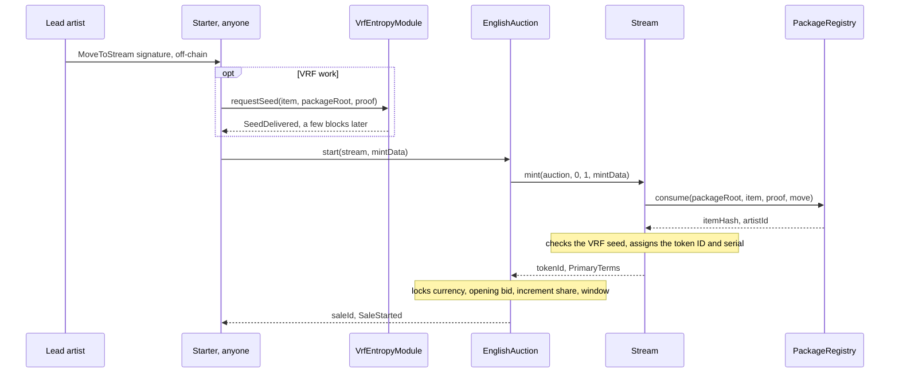
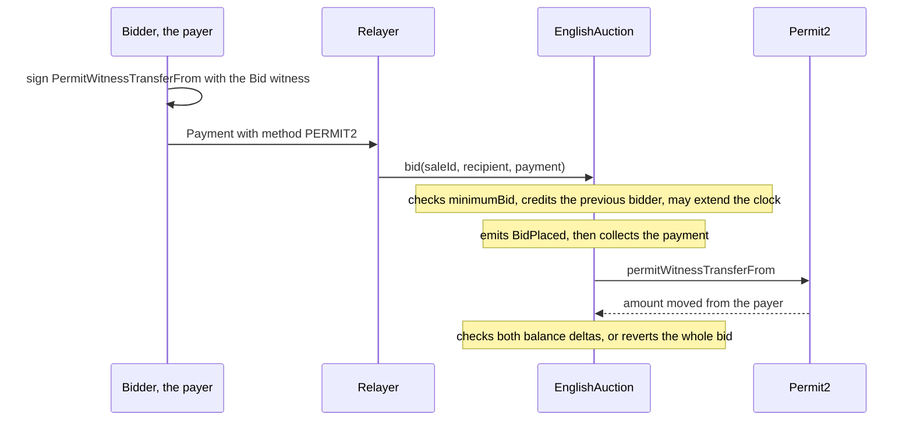
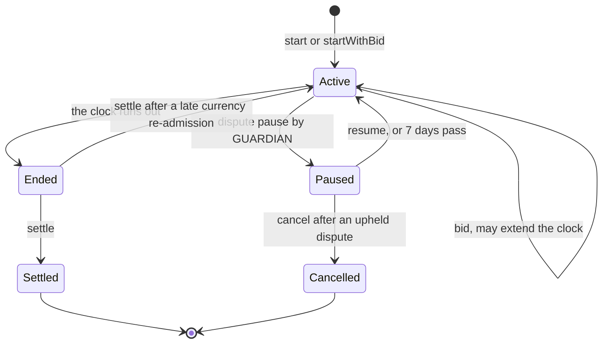
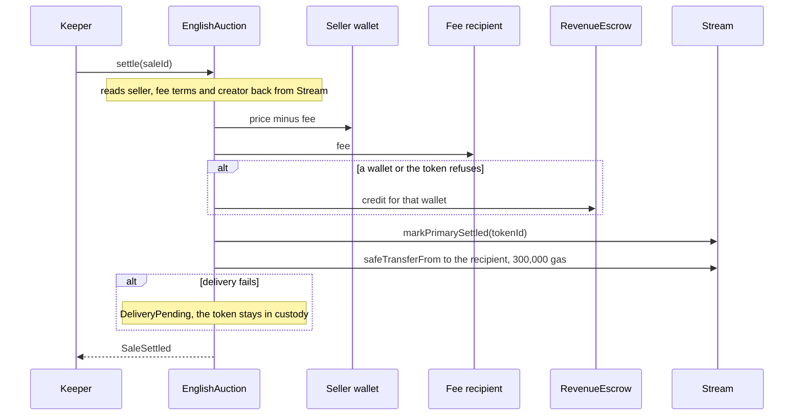
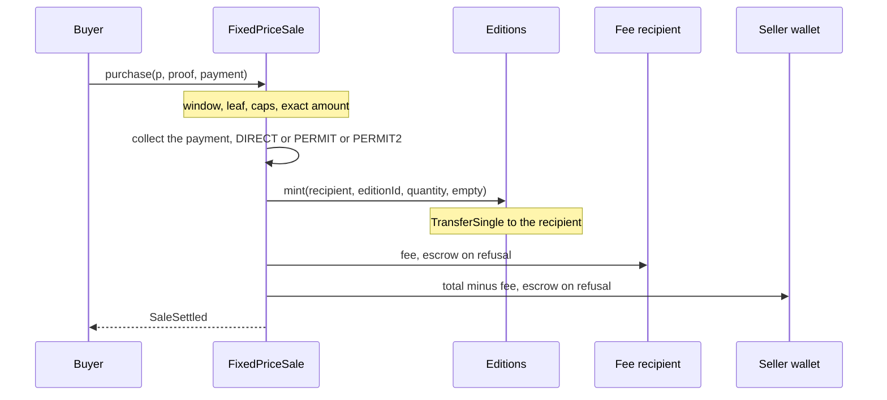

# Buying, bidding, settling and claiming

For marketplace and wallet engineers, relayers and keepers: how to start, bid on and settle a
6529 Stream auction, buy 6529 Editions copies, claim what is owed, and read royalties. Rules are in [Stream and auctions](../spec/stream-and-auctions.md#rules-and-invariants) (`AUC-n`),
[Editions and sales](../spec/editions-and-sales.md#rules-and-invariants) (`ED-n`) and
[Economics and payouts](../spec/economics-and-payouts.md#rules-and-invariants) (`ECO-n`); event
signatures in [Events and indexing](events-and-indexing.md); addresses in [Addresses](addresses.md).

> Pre-audit. See the [project status](../../README.md#status).

Sepolia r3 ([Addresses](addresses.md#sepolia-r3)) runs the code this page describes. The
superseded r2 predates the October 2026 review fixes: it has no `claimFor`, ERC-20 payout
frame, `scheduleDelay`, currency freeze, `SHORTFALL_REVERT_CEILING` or identity restraint
([Addresses](addresses.md#sepolia-r2-superseded)). Sepolia gas figures here are r2's; r3's
are in [the flows file](../../deployments/11155111/flows.md#r3-the-release-candidate-15-october-2026).

## Before you start

### Contracts you call

| Contract | Interface | You call it to |
| --- | --- | --- |
| `EnglishAuction` | [IEnglishAuction](../../src/interfaces/IEnglishAuction.sol) | start, bid, withdraw, settle, claim |
| `FixedPriceSale` | [IFixedPriceSale](../../src/interfaces/IFixedPriceSale.sol) | buy copies at a fixed price, with allowlist phases |
| `DutchSale` | [IDutchSale](../../src/interfaces/IDutchSale.sol) | buy copies at a descending price |
| `Stream` | [IStream](../../src/interfaces/IStream.sol), [IMintTarget](../../src/interfaces/IMintTarget.sol) | preview a start, read works, `royaltyInfo` |
| `Editions` | [IEditions](../../src/interfaces/IEditions.sol) | read editions, `royaltyInfo` |
| `PackageRegistry` | [IPackageRegistry](../../src/interfaces/IPackageRegistry.sol) | check approvals, acceptances and move nonces; relay acceptances; get the move digest |
| `VrfEntropyModule` | [IEntropyModule](../../src/interfaces/IEntropyModule.sol) | request a VRF seed |
| `AssetAllowlist` | [IAssetAllowlist](../../src/economics/interfaces/IAssetAllowlist.sol) | read a currency's status and increment floor |
| `RevenueEscrow` | [IRevenueEscrow](../../src/economics/interfaces/IRevenueEscrow.sol) | flush refused payouts |
| `SplitWallet`, `SplitFactory` | [ISplitWallet](../../src/economics/interfaces/ISplitWallet.sol), [ISplitFactory](../../src/economics/interfaces/ISplitFactory.sol) | deploy a wallet, release a share |
| `ReleaseVerifier` | [IReleaseVerifier](../../src/economics/interfaces/IReleaseVerifier.sol) | build and revoke signed releases |
| `ClaimRouter` | [IClaimRouter](../../src/economics/interfaces/IClaimRouter.sol) | batch releases |

The sale adapters share [`ISaleAdapter`](../../src/interfaces/ISaleAdapter.sol): `SaleStarted`,
`SaleSettled`, `Credited`, `Claimed`, `claim`, `claimable`, `paused` and the shared errors.

### Conventions

- **Currencies.** `CURRENCY_ETH` is `address(0)`. `CURRENCY_DEFAULT` is
  `address(type(uint160).max)`; in a package it means "the product's default currency when the sale
  starts" ([EconomicsTypes.sol](../../src/interfaces/types/EconomicsTypes.sol)). Every sale locks
  its resolved currency when it starts or opens (AUC-15, ED-10).
- **Shares and rates** are out of 100,000 (`Splits.DENOMINATOR`, ECO-1): 6.529% is 6,529.
- **Errors** are custom errors. A nested contract's error (Stream, the package registry, the
  allowlist, Permit2, a token) bubbles up unchanged: decode against every ABI on the path
  ([ABIs and interface IDs](abis-and-interface-ids.md)).
- **Simulate first.** Run every write with `eth_call`, and take the gas limit from
  `eth_estimateGas` on the target chain ([Prague gas and Glamsterdam gas](#prague-gas-and-glamsterdam-gas)).

### The `Payment` struct

Every bid and purchase carries one `Payment`
([SaleTypes.sol](../../src/interfaces/types/SaleTypes.sol)):

| Field | Type | Meaning |
| --- | --- | --- |
| `method` | `PaymentMethod` | `DIRECT` (0), `PERMIT` (1) or `PERMIT2` (2) |
| `payer` | `address` | The bidder or buyer of record. Refunds and credits go to it. For `DIRECT` and `PERMIT` it must be `msg.sender`; for `PERMIT2` it is the signer, and anyone may submit. |
| `amount` | `uint256` | The exact bid; the exact fixed-price total; the most the payer will pay in a Dutch sale |
| `deadline` | `uint256` | The permit's deadline (`PERMIT`, `PERMIT2`); ignored for `DIRECT` |
| `nonce` | `uint256` | The Permit2 nonce; zero otherwise |
| `signature` | `bytes` | `PERMIT`: exactly 65 bytes, `r \|\| s \|\| v`. `PERMIT2`: the Permit2 signature. `DIRECT`: empty |

Every adapter collects the same way (`_collect` in
[EnglishAuction.sol](../../src/sales/EnglishAuction.sol) and
[MintSaleBase.sol](../../src/sales/MintSaleBase.sol)):

- **ETH** takes `DIRECT` only, with `payer == msg.sender` and `msg.value == amount`; anything else
  reverts with `InvalidPayment()`.
- **An ERC-20** takes `msg.value == 0`. For `DIRECT`, the payer approved the adapter beforehand.
  For `PERMIT`, an EIP-2612 permit of `amount` to the adapter; a permit that fails (say,
  submitted first by someone else) is ignored, and the pull uses whatever allowance exists. For
  `PERMIT2`, the payer approved the canonical Permit2 once and signs a witness transfer (below).
- An expired `PERMIT` or `PERMIT2` deadline reverts with `PaymentExpired(deadline)`, even where an
  allowance would cover the pull.

**Which ERC-20s work** ([TokenTransfer.sol](../../src/economics/TokenTransfer.sol)):

- **Balance deltas, on every path.** A fee-on-transfer or rebasing token reverts with
  `TokenBalanceMismatch(asset)`.
- **Return values, except under `PERMIT2`.** Every other movement also requires exactly one
  `true` word back (`TokenCallFailed(asset, selector)`;
  `test_NoReturnAndFalseReturningTokensFailClosed` in
  [EnglishAuctionHostile.t.sol](../../test/sales/auction/EnglishAuctionHostile.t.sol)). Around a
  `PERMIT2` pull the adapter checks only balances, and Permit2 accepts a token that returns
  nothing (`test_HostileToken_Permit2CannotSkipTheDeltaCheck` in
  [FixedPricePayments.t.sol](../../test/sales/fixed/FixedPricePayments.t.sol)).
- **Governance is the guard.** A currency is usable only once `AssetAllowlist.admitAsset`
  (FUNDS_SETTER, 14 days) admits it, and governance admits standard ERC-20s only; the admission
  probe is not a behavior check (ECO-32).

### Signing a Permit2 payment

A `PERMIT2` payment is a Permit2 `permitWitnessTransferFrom`, signed in Permit2's own EIP-712
domain. The witness binds the action, so a relayer can submit it and cannot change it (AUC-19,
ED-18).

- The signed type is `PermitWitnessTransferFrom(TokenPermissions permitted,address spender,uint256 nonce,uint256 deadline,`
  followed by the action's witness type string.
- `permitted` is `(currency, payment.amount)`, `spender` is the adapter, and `nonce` and `deadline`
  are `payment.nonce` and `payment.deadline`.
- The witness is `keccak256(abi.encode(WITNESS_TYPEHASH, field1, field2, ...))`, with the fields
  below in order. The type strings and typehashes are in
  [ABIs and interface IDs](abis-and-interface-ids.md#permit2-witnesses).

| Action | Witness typehash | Witness fields |
| --- | --- | --- |
| `bid` | `BID_WITNESS` | `saleId`, the recipient **resolved** (the payer when zero), `payment.amount`, `payment.deadline` |
| `startWithBid` | `START_BID_WITNESS` | `token`, `keccak256(mintData)`, the recipient **resolved**, `payment.amount`, `payment.deadline` |
| Fixed-price `purchase` | `PURCHASE_WITNESS` | `p.saleId`, `p.phase`, `p.recipient` **as passed** (zero stays zero), `p.quantity`, the total (equal to `payment.amount`), `payment.deadline` |
| Dutch `purchase` | `DUTCH_PURCHASE_WITNESS` | `saleId`, `recipient` **as passed**, `quantity`, `maxUnitPrice`, `payment.deadline` |

When the auction's `permit2()` is zero, a `PERMIT2` payment reverts with `InvalidPayment()`.

## Starting an auction

Starting is permissionless: one transaction mints the work into the auction's custody and starts
its clock. Whoever submits it pays the gas; the network is not obliged to
([ADR 0001 §5](../adr/0001-v1-scope.md#5-sales-and-auctions)).

```solidity
function start(address token, bytes calldata mintData) external returns (uint256 saleId);

function startWithBid(
    address token,
    bytes calldata mintData,
    address recipient,
    Payment calldata payment
) external payable returns (uint256 saleId);

function saleIdOf(address token, uint256 tokenId) external pure returns (uint256);
```

- `token` is the 6529 Stream address; `mintData` is `abi.encode(StreamMintRequest)` (below).
- The sale ID is `uint256(keccak256(abi.encode(token, tokenId)))`. Take it from the return value or
  from `SaleStarted`; the token ID is assigned at mint.
- `startWithBid` also places the first bid, with the bid's payer as the bidder of record; a
  relayer can submit it with a `PERMIT2` bid.

### Building the `StreamMintRequest`

[PackageTypes.sol](../../src/interfaces/types/PackageTypes.sol) defines the request:

| Field | Type | Where it comes from |
| --- | --- | --- |
| `packageRoot` | `bytes32` | The approved package root, from the published package document |
| `item` | `PackageItem` | The item, exactly as published in the package document |
| `proof` | `bytes32[]` | The Merkle proof that places the item's leaf under the root, at most 32 nodes (`Limits.MAX_PROOF_DEPTH`) |
| `move.nonce` | `uint256` | The lead artist's move nonce |
| `move.deadline` | `uint64` | When the move signature expires |
| `move.signature` | `bytes` | The lead artist's `MoveToStream` signature |

The item hash, leaf and tree are OpenZeppelin's `StandardMerkleTree` over
`[PACKAGE_ITEM_DOMAIN, item]` ([Curation](../spec/curation.md#identifiers-and-hashes)), so the
package tooling's proofs verify directly.

**Check before you submit:**

1. `PackageRegistry.packageOf(root)` returns `APPROVED`.
2. `PackageRegistry.consumedItemOf(item.contentHash)` is zero.
3. `PackageRegistry.acceptedAs(root, party.account)` is nonzero for every `item.parties[i]`.
4. `Stream.collection(item.collectionId)` does not revert.
5. The move is unexpired and `PackageRegistry.isMoveNonceUsed(artistId, nonce)` is false.
6. For a VRF item, `IEntropyModule.isDelivered(itemHash)` is true.
7. The currency is usable ([The currency](#the-currency)).
8. `Stream.primaryTerms(0, mintData).creator` is nonzero, so the lead artist is not
   [restrained](../glossary.md#restraint). This preview does not check the proof, acceptances or
   move.
9. `EnglishAuction.paused()` is false.

### The move signature

The lead artist signs the [move](../glossary.md#move) off-chain, in the package registry's EIP-712
domain (name `6529 Works Package Registry`, version `1`, the chain ID, the registry's address), over
`MoveToStream(bytes32 packageRoot,bytes32 itemHash,uint256 nonce,uint64 deadline)`
(`Typehashes.MOVE_TO_STREAM`). `PackageRegistry.moveDigest(packageRoot, itemHash, nonce, deadline)`
returns the digest to sign.

- **Signer.** The active authority of the lead artist's ID
  (`IArtistRegistry.activeAuthorityOf(artistId)`), where the artist ID is
  `PackageRegistry.acceptedAs(root, item.parties[0].account)`.
- **Signature forms.** 65-byte ECDSA, 64-byte ERC-2098, ERC-1271 (at most 4,096 bytes) and
  EIP-7702 accounts ([SignatureVerifier.sol](../../src/libraries/SignatureVerifier.sol)).
- **Nonce.** Any unused `uint256`, single use per artist ID. Use them in order from 0: the first
  255 share an existing storage word, which keeps the start within its gas budget. The artist
  revokes an unused one with `revokeMove(artistId, nonce)`. A move signed by a rotated-away
  authority stays void.

### Encoding `mintData`

Encode the request as one tuple. Stream reads it in place and reverts with
`IMintTarget.InvalidMintRequest()` unless the first word is `0x20` (`_request` in
[Stream.sol](../../src/stream/Stream.sol)). In Solidity, as the Sepolia driver
[Flows.s.sol](../../script/sepolia/Flows.s.sol) does:

```solidity
bytes memory mintData = abi.encode(
    StreamMintRequest(packageRoot, item, proof, MoveAuthorization(nonce, deadline, signature))
);
```

Off-chain, encode a single parameter of this type (for example with ethers'
`AbiCoder.encode([REQUEST], [request])`):

```text
tuple(
  bytes32 packageRoot,
  tuple(
    uint8 kind, uint256 collectionId, bytes32 contentHash, bytes32 mediaHash, bytes32 recordFileId,
    tuple(address account, uint8 role)[] parties,
    tuple(uint256 artistId, address account, uint32 share)[] payees,
    tuple(string spdxId, bytes32 textFileId) license,
    uint8 seedPolicy, bytes32 seed,
    tuple(bytes32 saleKind, address currency, bytes params) sale,
    tuple(uint8 format, uint64 size, uint64 window, uint256 price, address currency, bytes32 saleKind, bytes params) edition
  ) item,
  bytes32[] proof,
  tuple(uint256 nonce, uint64 deadline, bytes signature) move
)
```

Do not encode the four members as four separate parameters: that drops the leading offset word.

### VRF works

A work whose item has `seedPolicy == VRF` starts only after its seed is delivered (AUC-4):

1. Anyone calls `requestSeed(item, packageRoot, proof)` on the entropy module.
2. Wait for `SeedDelivered(contentHash, requestId, seed)`; on Sepolia it arrived five blocks after
   the request ([flows §6](../../deployments/11155111/flows.md#6-vrf)).
3. Check `isDelivered(itemHash)`, then start.

If no seed arrives, anyone may request again once `retryDelay()` has passed (at least 3 days,
`VrfEntropyModule.MIN_RETRY_DELAY`); earlier calls revert with `RequestPending(itemHash, retryAt)`.

### The currency

The currency locks at start (AUC-15). `CURRENCY_DEFAULT` resolves to
`AssetAllowlist.defaultCurrency(PRODUCT_STREAM)`, ETH at launch; an explicit currency must be
active. An unusable currency reverts with `CurrencyNotConfigured(product)` or
`AssetNotActive(asset)`. Read the locked currency from `SaleStarted.currency` or
`auction(saleId).currency`, never from the current default.



**Events.** `ItemConsumed` ([PackageRegistry](events-and-indexing.md#packageregistry)), the mint's
`Transfer` and `WorkMinted` ([Stream](events-and-indexing.md#stream)), and `SaleStarted`, whose
`price` is the locked opening bid and `endTime` the initial end, plus `BidPlaced` for
`startWithBid` ([EnglishAuction](events-and-indexing.md#englishauction)).

### Errors

Errors come from `EnglishAuction` (`SalePaused`, `TargetNotAllowed`, `InvalidSaleTerms`), `Stream`
(`InvalidMintRequest`, the item-rule errors below, `SeedNotDelivered`), `AssetAllowlist`
(currency), `PackageRegistry`, or the shared `SignatureVerifier` and `Dependency` errors.

| Error | Cause | What to do |
| --- | --- | --- |
| `SalePaused()` | The emergency pause stops starts only (AUC-13). | Wait: an unpause comes at least 48 hours after the pause. |
| `TargetNotAllowed(token)` | `token` is not a served token contract. | Use the Stream address. |
| `InvalidMintRequest()`, `InvalidItemSale()`, `InvalidLeadArtist()`, `UnknownCollection(collectionId)`, `InvalidSeedPolicy()`, `InvalidLicenseId()`, `InvalidWorkTerms()`, `TermsCapacityExceeded()` | Malformed `mintData`, a missing collection, or item terms Stream refuses (AUC-2). | Fix the request. |
| `PackageNotApproved(packageRoot)`, `ContentUsed(product, contentHash, claimedBy)`, `ContentReserved(contentHash, beneficiary)` | The root is unknown or revoked; the item already started, or its content is claimed by or reserved for another item. | Nothing to start. |
| `ItemNotInPackage(packageRoot, itemHash)` | The proof does not place the item, or has more than 32 nodes. | Rebuild the proof. |
| `PartyNotAccepted(packageRoot, account)` | A party has not accepted the root. | Relay its signed acceptance with `acceptPackage(packageRoot, acceptance, signature)`. |
| `InvalidItem(itemHash)` | Parties, payees, seed or edition fields are inconsistent. | Report it to curation. |
| `SignatureExpired(deadline)`, `InvalidSignature(signer)` | The move expired, was signed by another key, or the lead artist is restrained. | Get a fresh move, or wait for the override's outcome. |
| `MoveNonceUsed(artistId, nonce)` | The nonce was spent or revoked. | Ask for a move with a new nonce. |
| `SeedNotDelivered(itemHash)` | A VRF work's seed has not arrived. | Request the seed and wait. |
| `AssetNotActive(asset)`, `CurrencyNotConfigured(product)` | The item's currency, or the product default, is not usable. | Wait for governance. |
| `InvalidSaleTerms(token, id)` | The token returned unusable terms (AUC-14). | Report it. |

`startWithBid` can also revert with any bidding error below.

### Gas

A steady-state `start`'s Prague gas and new slots are in the
[ADR 0004 table](../adr/0004-gas-budgets-under-glamsterdam.md#the-table) (AUC-32), with the
costlier first-time cases (an artist's first start, with and without a bid, which on a
collision of its terms' position writes one slot more; LIM-GAS-10) and the ERC-20 Permit2
`startWithBid`.

## Bidding

```solidity
function bid(uint256 saleId, address recipient, Payment calldata payment) external payable;
function minimumBid(uint256 saleId) external view returns (uint256);
function auction(uint256 saleId) external view returns (Auction memory);
```

`recipient` receives the token if the bid wins; zero means the payer. It cannot be the auction
itself (`InvalidRecipient(recipient)`).

- **The amount.** The bid is `payment.amount` exactly; there is no "bid up to" form. Read
  `minimumBid(saleId)` just before you submit (the rule is AUC-16). Live parameters are in
  `config()` and `AssetAllowlist.incrementFloor(currency)`; launch defaults are in the
  [script README](../../script/README.md#environment-reference). A bid above `type(uint96).max`
  reverts with OpenZeppelin's `SafeCastOverflowedUintDowncast`.
- **[Anti-snipe](../glossary.md#anti-snipe).** A bid in the last `extensionWindow` moves the end
  (AUC-17); `BidPlaced.endTime` carries the end after the bid. A bid at or after the end reverts
  with `InvalidAuctionState(saleId, ENDED)` (`test_Bid_AntiSnipeExtends` in
  [EnglishAuction.t.sol](../../test/sales/auction/EnglishAuction.t.sol)).
- **Outbid [credits](../glossary.md#credit).** An outbid bid, even by the same bidder, is credited
  to its payer, never pushed (AUC-18), and claimed with `claim(currency, to)`.

### Paying

Pay as in [The `Payment` struct](#the-payment-struct). With `PERMIT2`, anyone may submit the
bidder's signed bid:



### Withdrawing, and when bids stop

```solidity
function withdrawBid(uint256 saleId) external;
```

Only the high bidder (the payer) may withdraw, and only while the auction is paused for a dispute
or its locked currency is deprecated and the sale has not settled (MARKET-2). The bid is credited
back (`BidWithdrawn`), and its amount stays as a reserve the next bid must reach.

| Halt | Bids revert with | Rule |
| --- | --- | --- |
| [Dispute pause](../glossary.md#dispute-pause) by a guardian, at most 7 days | `InvalidAuctionState(saleId, PAUSED)` | AUC-26, AUC-27 |
| The locked currency is deprecated | `AssetNotActive(currency)` | AUC-25 |
| Emergency `pause()` on the auction | Nothing: it stops only `start` and `startWithBid` | AUC-13 |

A resumed auction emits `AuctionResumed(saleId, endTime)`; an upheld dispute's cancel emits
`AuctionCancelled`, credits the high bid back and burns the token.

### Errors

| Error | Cause | What to do |
| --- | --- | --- |
| `UnknownSale(saleId)` | No such sale. | Check the sale ID. |
| `InvalidAuctionState(saleId, state)` | The auction is paused, ended, settled or cancelled. | Read `auction(saleId).state`. |
| `BidTooLow(required, offered)` | Below `minimumBid`. | Re-read and re-sign. |
| `InvalidPayment()` | Method, amount, `msg.value` or payer mismatch; a `PERMIT` signature that is not 65 bytes; Permit2 disabled. | Fix the payment. |
| `PaymentExpired(deadline)` | The permit deadline passed. | Sign again. |
| `InvalidRecipient(recipient)` | The recipient is the auction. | Name another recipient. |
| `AssetNotActive(currency)` | The locked currency is deprecated (the auction is frozen). | Wait; a standing bidder may withdraw. |
| `TargetNotAllowed(token)` | A federated token's registry entry was delisted (v1.1). | None. |
| `TokenBalanceMismatch(asset)`, `TokenCallFailed(asset, selector)` | A non-standard token, a balance below the amount, or a missing allowance. | Fund and approve, or use another currency. |

### Events and gas

`BidPlaced`, and the auction's `Credited` for the previous bidder when the bid outbids
([EnglishAuction](events-and-indexing.md#englishauction)). A bid that outbids is a row of the
[ADR 0004 table](../adr/0004-gas-budgets-under-glamsterdam.md#the-table).

## Settling

```solidity
function settle(uint256 saleId) external;
function claimDelivery(uint256 saleId, address to) external;
function claimFor(address account, address currency) external returns (uint256 amount);
function pendingDelivery(uint256 saleId) external view returns (address);
```

Settlement is permissionless once `auction(saleId).state == ENDED` (derived from the clock; no
transaction ends an auction), and never depends on the winner accepting the token (AUC-21).





The fee is `floor(price × feeShare / 100,000)`. The [seller wallet](../glossary.md#seller-wallet)
is a predicted split-wallet address and may not be deployed yet.

### Gas the caller must forward

`settle` refuses to run unless it can give each external call its allowance, plus EIP-150's
1/63, plus a reserve, so a starved call cannot force the escrow or pending route (AUC-22):

| Call | Allowance | Reserve | Revert when short |
| --- | ---: | ---: | --- |
| ETH payout to each wallet | 100,000 (`PAYOUT_GAS`) | 40,000 (`ETH_CALL_RESERVE`) | `PaymentInsufficientGas(100000)` |
| ERC-20 payout frame, per payout | 1,000,000 (`_ERC20_PAYOUT_GAS`), of which the token's `transfer` gets 300,000 (`ERC20_TRANSFER_GAS`) | 50,000 (`DELIVERY_RESERVE`) | `PaymentInsufficientGas(1000000)` |
| Delivery (`safeTransferFrom`) | 300,000 (`DELIVERY_GAS`) | 50,000 (`DELIVERY_RESERVE`) | `DeliveryInsufficientGas()` |

So an ERC-20 `settle` needs a gas limit of about 1.11M although it uses about 140K, and an ETH
`settle` about 460K ([ADR 0004, Security impact](../adr/0004-gas-budgets-under-glamsterdam.md#security-impact);
`test_Settle_SettlerGasLimitVersusGasUsed` in
[EnglishAuction.t.sol](../../test/sales/auction/EnglishAuction.t.sol)).
`eth_estimateGas` returns these; never reuse the gas a past settlement used. The first payout to
a new seller wallet creates its account, at the settler's cost.

### Outcomes and what to do

| Outcome | How you see it | What to do |
| --- | --- | --- |
| Delivered | `Transfer` to the recipient, `SaleSettled` | Nothing. |
| Delivery failed (rejected, or the hook needed more than 300,000 gas) | `DeliveryPending(saleId, recipient)`; `pendingDelivery(saleId)` nonzero | The recipient or the winning bidder (with no bids, the artist's authority) calls `claimDelivery(saleId, to)`, `to` neither zero nor the auction. |
| A payout refused by the wallet (ETH: reverted or needed over 100,000 gas) or by the token | The escrow's `Credited` | Anyone calls `RevenueEscrow.flush(wallet, asset)`, for a token once it allows it. |
| An ERC-20 payout that failed even through the escrow (MONEY-1, AUC-23) | The auction's `Credited(wallet, token, saleId, amount)` | Anyone calls `claimFor(wallet, token)`; the funds only go to `wallet`. |
| No bid | `SaleSettled` with `buyer == address(0)`, `price == 0`, the artist as recipient | Nothing. |
| No bid while the artist is [restrained](../glossary.md#restraint) (IDENTITY-1, AUC-24) | Reverts with `InvalidRecipient(address(0))`: the creator from `IMintTarget.primaryTerms(tokenId, "")` is zero | Retry once the recovery override executes, is vetoed or voided, or lapses. |
| Locked currency deprecated under 30 days | Reverts with `AssetNotActive(currency)` | Wait; the high bidder may `withdrawBid`. |
| Locked currency deprecated 30 days | The high bid is credited back; the work goes to the artist | The bidder claims its credit. |
| Currency re-admitted in the last window or after the end | `AuctionResumed(saleId, endTime)`, no `SaleSettled` | Bid again; settle after the new end. |
| Paused for a dispute | Reverts with `InvalidAuctionState(saleId, PAUSED)` | Wait for the resume, the cancel, or 7 days. |

A sale with a standing bid settles normally during a restraint
(`test_NoBidAuctionRunningAtStagingWaitsForTheOutcome` in
[RecoveryRestraint.t.sol](../../test/integration/RecoveryRestraint.t.sol)). For the currency freeze
(MARKET-2, AUC-25), read when the deprecation began from `AssetAllowlist.statusClock(currency)`,
which returns `(status, since, inactiveTotal)`, on the auction's `allowlist()`; re-admission comes
no earlier than 14 days after it (ECO-33).

### Keeper checklist

1. Track ends from `SaleStarted.endTime`, every `BidPlaced.endTime`, `AuctionPaused` and
   `AuctionResumed`.
2. At `ENDED`, simulate `settle(saleId)`. A revert with `AssetNotActive`,
   `InvalidRecipient(address(0))` or `InvalidAuctionState(..., PAUSED)` means the sale is waiting:
   retry later.
3. Send with the limit from `eth_estimateGas`.
4. In the receipt, `SaleSettled` means settled; `AuctionResumed` alone means reopened. Follow up
   `DeliveryPending` and both kinds of `Credited` ([Claiming](#claiming)).

### Settlement errors

Besides the reverts in the two tables above:

| Error | Cause |
| --- | --- |
| `UnknownSale(saleId)`, `InvalidAuctionState(saleId, state)` | No such sale, or not `ENDED`. |
| `NoPendingDelivery(saleId)` | `claimDelivery` with nothing pending, or by a caller that may not claim. |
| `InvalidRecipient(to)` | `claimDelivery` to zero or to the auction. |
| `IRevenueEscrow.InvalidAsset(address(0))` | `claimFor` on an ETH credit, which only its bidder claims. |

## Buying an edition

Copies are sold only through the shared fixed-price and Dutch adapters. An edition's ID is its
master's Stream token ID; price, currency, size and window come from the edition (the approved
package), never from the sale.

**Finding the sale.**
- `openSaleOf(editions, editionId)` on each adapter returns the open sale, or zero (at most one per
  edition per adapter, ED-11).
- `sale(saleId)` returns the `LockedTerms` (currency, unit or starting price, seller, fee terms) and
  whether it is closed; on `FixedPriceSale` also whether the artist approved the phases.
- `Editions.edition(editionId)` gives the size and the copies minted so far.

### Fixed price

```solidity
function purchase(
    IFixedPriceSale.Purchase calldata p,
    bytes32[] calldata proof,
    Payment calldata payment
) external payable;
```

| `Purchase` field | Type | Meaning |
| --- | --- | --- |
| `saleId` | `uint256` | The sale |
| `phase` | `uint256` | The index into `phases(saleId)` |
| `recipient` | `address` | Who receives the copies; zero means the payer |
| `quantity` | `uint256` | Copies, at least 1 (`InvalidQuantity()` otherwise) |
| `leafCap` | `uint256` | The `cap` of the caller's allowlist leaf; ignored in a public phase |
| `leafPrice` | `uint256` | The `price` of the caller's leaf; the unit price only in a `leafPriced` phase, but part of the leaf in every allowlist phase |

What to get right ([FixedPriceSale.sol](../../src/sales/FixedPriceSale.sol)):

- **The window.** Phase `i` is open during `[start + d, end + d)`, where `d` is
  `scheduleDelay(saleId)`, the [schedule delay](../glossary.md#schedule-delay) that halts have
  added (ED-21).
- **The amount is exact.** `payment.amount` must equal `unit × quantity`, where the unit is the
  locked package price, or `leafPrice` in a `leafPriced` phase; for ETH `msg.value` equals it too
  (ED-17). A zero price is a gift: the amount is zero.
- **The keyed account** for the allowlist is the recipient, or the payer in a `payerKeyed` phase
  (ED-15). Anyone may pay for an allowlisted recipient, against its cap.
- **Caps** count per `(token, editionId, phase index, account)` across sales, in capped phases
  only (ED-16): an uncapped public phase records nothing. Read the count with
  `purchased(token, id, phase, account)`.
- **The recipient must accept ERC-1155.** The edition mints inside `purchase`, so a recipient that
  rejects `onERC1155Received` reverts the whole purchase.



### Allowlist leaves and proofs

An [allowlist leaf](../glossary.md#allowlist-leaf) binds the chain, the adapter, the edition, the
phase, the account, its cap and its price
([IFixedPriceSale.sol](../../src/interfaces/IFixedPriceSale.sol)):

```solidity
keccak256(bytes.concat(keccak256(abi.encode(
    ALLOWLIST_LEAF_DOMAIN, block.chainid, address(this), token, id, phase, account, cap, price
))))
// ALLOWLIST_LEAF_DOMAIN = keccak256("6529WORKS_ALLOWLIST_LEAF_V1")
```

Trees are OpenZeppelin sorted-pair trees, so OpenZeppelin's `StandardMerkleTree` builds them with
the same nine values as the leaf encoding:

```js
import { StandardMerkleTree } from "@openzeppelin/merkle-tree";
import { id } from "ethers";

const DOMAIN = id("6529WORKS_ALLOWLIST_LEAF_V1"); // ALLOWLIST_LEAF_DOMAIN
const ENCODING = ["bytes32", "uint256", "address", "address", "uint256", "uint256", "address", "uint256", "uint256"];

// One row per account and phase. chainId and fixedPriceSale name the deployment that sells.
const rows = entries.map((e) =>
  [DOMAIN, chainId, fixedPriceSale, editions, editionId, phase, e.account, e.cap, e.price]);
const tree = StandardMerkleTree.of(rows, ENCODING);

const root = tree.root;              // Phase.root, fixed when the sale opens
const proof = tree.getProof(index);  // bytes32[] passed to purchase()
```

- `FixedPriceSale.allowlistLeaf(token, id, phase, account, cap, price)` returns the leaf on-chain;
  compare it with `tree.leafHash(row)` before you publish a root
  (`test_AllowlistLeaf_MatchesTheDefinition` in
  [FixedPriceSale.t.sol](../../test/sales/fixed/FixedPriceSale.t.sol)).
- Emit at most one leaf per account and phase.
- In an allowlist phase that is not leaf-priced, pick any `price` for the leaf (zero is usual) and
  pass the same value as `leafPrice`.
- A proof has at most 32 nodes (`Limits.MAX_PROOF_DEPTH`); a sale at most 16 phases
  (`Limits.MAX_PHASES`).

### Dutch

```solidity
function purchase(
    uint256 saleId,
    address recipient,
    uint256 quantity,
    uint256 maxUnitPrice,
    Payment calldata payment
) external payable;

function currentPrice(uint256 saleId) external view returns (uint256);
```

- **The price** is `currentPrice(saleId)` in the block the purchase lands in, on a curve moved
  later by `scheduleDelay(saleId)`; it is never rebated (ED-20). `maxUnitPrice` bounds it
  (`PriceAboveLimit(price, maxUnitPrice)`) for a transaction that lands earlier than expected.
- **`payment.amount` is the most the payer will pay**, not the charge. The charge is
  `currentPrice × quantity` (`InvalidPayment()` if `amount` is below it).
  - ETH: send `msg.value == amount`. The excess is credited to the payer
    (`Credited(payer, address(0), saleId, excess)`) and claimed with `claim(address(0), to)`.
  - ERC-20: exactly the charge is pulled. A Permit2 signature permits `amount` and transfers only
    the charge. An EIP-2612 permit of `amount` leaves the unspent allowance with the adapter,
    usable only by the payer (`test_Erc20_PermitAllowsAMaximum` in
    [DutchSale.t.sol](../../test/sales/dutch/DutchSale.t.sol)).
- `recipient` zero means the payer.

### Halts

| Halt | Purchases revert with | Rule |
| --- | --- | --- |
| The adapter is paused (PAUSER, immediate; unpause no earlier than 48 hours after) | `SalePaused()` | ED-22 |
| The sale's currency is deprecated | `CurrencyNotActive(currency)` | ED-10 |
| Either halt | The schedule stops: `scheduleDelay(saleId)` grows by the halt, and overlapping halts count twice | ED-21 |

`closeSale` and `claim` keep working through both (ED-22, ED-23). Anyone may close a fixed-price
sale once all its moved phases have ended (ED-14).

### Events

One `SaleSettled` per purchase (`price` is the total, `tokenId` the edition ID), the mint's
`TransferSingle`, and `EditionWindowOpened` on an OPEN edition's first mint
([FixedPriceSale](events-and-indexing.md#fixedpricesale), [DutchSale](events-and-indexing.md#dutchsale),
[Editions](events-and-indexing.md#editions)); the escrow's `Credited` for a refused payout
([RevenueEscrow](events-and-indexing.md#revenueescrow)). A recipient's hook may close a sale inside
a purchase, so `SaleSettled` can follow `SaleClosed`
([event ordering](events-and-indexing.md#event-ordering-within-a-transaction)).

### Errors

| Error | Sale | Cause |
| --- | --- | --- |
| `SalePaused()` | both | The adapter is paused. |
| `PhaseNotOpen(saleId, phase)` | fixed | Unknown phase or sale, closed, or outside the moved window. |
| `SaleNotOpen(saleId)` | Dutch | Unknown, closed, or before the moved start. |
| `CurrencyNotActive(currency)` | both | The locked currency is deprecated. |
| `TargetNotAllowed(token)` | both | A federated token was delisted (v1.1). |
| `InvalidQuantity()` | both | `quantity` is zero. |
| `NotAllowlisted(saleId, phase, account)` | fixed | The proof does not verify for the keyed account, cap and price. |
| `WalletCapExceeded(saleId, phase, account)` | fixed | The purchase passes the leaf cap or `walletCap`. |
| `PriceAboveLimit(price, maxUnitPrice)` | Dutch | The current price is above the buyer's limit. |
| `InvalidPayment()` | both | Wrong amount, `msg.value`, method or payer; a `PERMIT` signature that is not 65 bytes. |
| `PaymentExpired(deadline)` | both | The permit deadline passed. |
| `EditionUnavailable(editionId)` | both | Sold out, or an OPEN edition's window is over. |
| `TokenBalanceMismatch(asset)`, `TokenCallFailed(asset, selector)` | both | A non-standard token, a balance below the charge, or a missing allowance. |
| `PaymentInsufficientGas(gasLimit)`, `TokenInsufficientGas(gasLimit)` | both | The gas limit cannot forward a payout's allowance in full: 100,000 for ETH (`PAYOUT_GAS`), 300,000 for a token transfer (`ERC20_TRANSFER_GAS`). Raise the limit. |

### Gas

A purchase's Prague gas and new slots, first copy and later copies, fixed price and Dutch, are
in the [ADR 0004 table](../adr/0004-gas-budgets-under-glamsterdam.md#the-table). Worst cases with a
32-node proof and escrowed payouts are measured against the transaction cap by the adapters' gas-cap tests
([sales module notes](../../src/sales/README.md#developer-notes)).

## Claiming

Refunds are never pushed; every amount owed has a pull function:

| What is owed | Where | Who calls | Function |
| --- | --- | --- | --- |
| An outbid, withdrawn or refunded bid | `EnglishAuction` | The bidder (payer) | `claim(currency, to)` |
| ETH paid above a Dutch charge | `DutchSale` | The payer | `claim(address(0), to)` |
| An ERC-20 auction payout that failed (MONEY-1) | `EnglishAuction` | Anyone, for the wallet | `claimFor(wallet, token)` |
| A token whose delivery failed | `EnglishAuction` | The recipient or the winning bidder; with no bids the artist | `claimDelivery(saleId, to)` |
| A payout a wallet or token refused | `RevenueEscrow` | Anyone | `flush(wallet, asset)` |
| A payee's share of sales or royalties | the `SplitWallet` | Depends on the payee (below) | `release`, `releaseTo`, `releaseWithAuthorization` |

### Credits on a sale adapter

```solidity
function claimable(address account, address currency) external view returns (uint256);
function claim(address currency, address to) external returns (uint256 amount);
```

`claim` sends all of the caller's credits in `currency` to `to` and emits `Claimed`. It reverts with
`InvalidRecipient(address(0))` for a zero `to`, `NothingToClaim(account, currency)` for no credit,
and `ClaimFailed(to)` when `to` refuses ETH, keeping the credit. On Sepolia, a bidder's `claim` of
an outbid credit used 32,580 gas ([flows §2](../../deployments/11155111/flows.md#2-the-curated-stream-sale)).

### The escrow

```solidity
function owed(address wallet, address asset) external view returns (uint256);
function flush(address wallet, address asset) external returns (uint256 amount);
```

Anyone may flush; the funds only go to `wallet` (ECO-27). `flush` reverts with
`NothingOwed(wallet, asset)` when nothing is owed, and with `ETHTransferFailed(wallet, amount)` when
the wallet refuses ETH again. A credit for a wallet a token has blocked moves to an equivalent
replacement only by a governed `recover` (ECO-28,
[recovery flows](../spec/economics-and-payouts.md#escrow-recovery-for-a-blocked-split-wallet)).

### Split wallets

Sale proceeds go to the [seller wallet](../glossary.md#seller-wallet) (`seller` in
`Stream.work(tokenId)` or `Editions.edition(editionId)`; for a work,
`SplitFactory.walletFor(item.payees, bytes32(0))`), royalties to the
[royalty wallet](../glossary.md#royalty-wallet) (`royaltyReceiver` in the same records). Both are
predicted CREATE2 addresses (ECO-9).

- **Deploy before you release.** Funds sent to a predicted address wait there (ECO-11). Anyone
  deploys the wallet with `SplitFactory.createWallet(payees, salt)`, with the payees and salt (zero)
  the address was predicted from. Its cost is in the
  [ADR 0004 table](../adr/0004-gas-budgets-under-glamsterdam.md#the-table): mostly code, which
  Glamsterdam reprices.
- **Releasable amount.** `releasable(asset, index)`; ETH is `address(0)` (ECO-13).

| Function | Who may call | Pays to |
| --- | --- | --- |
| `release(asset, index)` | Anyone, for a [fixed payee](../glossary.md#fixed-payee); only the current payout address, for an [artist-resolved payee](../glossary.md#artist-resolved-payee) | The payee's account or payout address |
| `releaseTo(asset, index, recipient)` | Only the payee's current payout address | `recipient` |
| `releaseWithAuthorization(authorization, signature)` | Anyone, with the payee's signature | The signed `recipient` |

A royalty wallet's two payees (the seller wallet and the fee recipient) are fixed, so anyone may
push royalties on to them; a seller wallet's artist-resolved payees are pull-only (ECO-15, ECO-16).

The errors (`NotPayoutAddress`, `NothingToRelease`, `PayoutUnresolved` and others) are declared
in [ISplitWallet.sol](../../src/economics/interfaces/ISplitWallet.sol).

### Signed releases

A payee signs an EIP-712 authorization in the release verifier's domain (name
`6529 Works Release Verifier`, version `1`, the chain ID, the verifier's address), with the type
string exactly as in `ReleaseVerifier.RELEASE_TYPEHASH`
([ReleaseVerifier.sol](../../src/economics/ReleaseVerifier.sol)):

```text
ReleaseAuthorization(address wallet,address asset,uint256 payee,address account,address recipient,uint256 amount,uint256 nonce,uint256 deadline)
```

- `account` is the signer and must be the payee's payout address when the release runs (ECO-20).
- `amount` is released exactly; `type(uint256).max` releases everything due. Prefer it for a fixed
  payee: anyone may push that payee's balance first, and an exact-amount release then reverts
  without spending its nonce (ECO-22).
- Nonces are any `uint256`, single use per account across every wallet (ECO-21). Revoke one with
  `revokeNonce(nonce)`; check one with `nonceUsed(account, nonce)`. `releaseDigest(authorization)`
  returns the digest to sign.
- Moving the payout address away does not revoke its signatures: if the payout returns to that key,
  its unexpired authorizations work again. Sign short deadlines or revoke.

### The claim router (keepers)

```solidity
function claim(IClaimRouter.Claim[] calldata claims, bool continueOnFailure)
    external returns (uint256[] memory amounts);
function claimSigned(IClaimRouter.SignedClaim[] calldata claims, bool continueOnFailure)
    external returns (uint256[] memory amounts);
```

The router is stateless: it calls `release` for each `Claim(wallet, asset, payee)` and
`releaseWithAuthorization` for each `SignedClaim(authorization, signature)`, and never holds or
redirects funds (ECO-29). Plain items pay fixed payees only; a plain item for an artist-resolved
payee fails. A batch holds at most 50 plain items (`MAX_CLAIMS`) or 20 signed ones
(`MAX_SIGNED_CLAIMS`), and more revert with `TooManyClaims(count)`
([ClaimRouter.sol](../../src/economics/ClaimRouter.sol), ECO-30).

- **Atomic mode** (`continueOnFailure == false`): any failed item reverts the batch with
  `ClaimCallFailed(index, wallet, size, reason)`.
- **Continue mode**: a failed item emits `ClaimFailed(wallet, asset, payee, index, size, reason)`,
  releases 0, and the batch goes on. The batch reverts with `ClaimInsufficientGas(index, available)`
  when an item's even share of the gas left is below `MIN_ITEM_GAS` (`MIN_SIGNED_ITEM_GAS`), or when
  an item offered less than `SHORTFALL_REVERT_CEILING` runs dry, so gas estimation raises the limit
  instead of silently skipping it.

Keeper guidance ([LIM-GAS-6](../audit/known-limitations.md#gas-and-glamsterdam)):
- Estimate every batch; a full batch of first releases may not fit one transaction, and then
  reverts whole, so split it.
- A party to an item (a gas-burning co-payee, a signed release's recipient, a token issuer) can
  make it look short of gas after you estimated. Simulate privately, isolate contract payees and
  unfamiliar tokens, and drop an item whose revert names its index.
- An artist's first signed release through the router is a row of the
  [ADR 0004 table](../adr/0004-gas-budgets-under-glamsterdam.md#the-table).

## Royalties for marketplaces

Both tokens implement ERC-2981 and report it through `supportsInterface(0x2a55205a)`:

```solidity
function royaltyInfo(uint256 tokenId, uint256 salePrice)
    external view returns (address receiver, uint256 royaltyAmount);
```

| | 6529 Stream | 6529 Editions |
| --- | --- | --- |
| Receiver | Derived on each call: the seller wallet at a zero fee share, otherwise the royalty split wallet (AUC-7, ECO-7) | Stored when the edition was created (ED-7) |
| Amount | `floor(salePrice × rate / 100,000)`, without overflow for any price | `Math.mulDiv(salePrice, rate, 100,000)`, rounded down |
| Rate | Set at mint from the product default, 6,529 (6.529%) at launch ([launch terms](../spec/economics-and-payouts.md#products-and-launch-terms)) | Starts at the master's current rate and follows its re-rates |
| Unknown token | `UnknownWork(tokenId)` | `UnknownEdition(editionId)` |
| Rate change event | `RoyaltyRateChanged` ([Stream](events-and-indexing.md#stream)) | `RoyaltyRateChanged` and `MetadataUpdate` ([Editions](events-and-indexing.md#editions)) |

- **Gas.** Stream's `royaltyInfo` makes one view call to the split factory; its gas as a whole
  call is in the [ADR 0004 table](../adr/0004-gas-budgets-under-glamsterdam.md#the-table).
  Short of gas it reverts, never returning a zero royalty; supply comfortably more.
- **Advisory.** Stream and Editions transfer as plain ERC-721 and ERC-1155 tokens and do not enforce
  payment ([ADR 0001 §16](../adr/0001-v1-scope.md#16-6529-stream-federated)).
- **A predicted receiver.** The royalty wallet may not be deployed yet: ETH sent to it creates the
  account once, and splits once anyone deploys the wallet.

## Prague gas and Glamsterdam gas

Every Prague figure here is [Prague gas](../glossary.md#prague-gas), what Foundry measures
([ADR 0004 decision 1](../adr/0004-gas-budgets-under-glamsterdam.md#decision)). Sepolia has run
Glamsterdam, which reprices state creation, since 6 October 2026
([ADR 0004, Problem](../adr/0004-gas-budgets-under-glamsterdam.md#problem)).

- **Rule of thumb on Sepolia's parameters:** Prague gas, plus about 89,000 per new slot, plus about
  184,000 per new account ([ADR 0004](../adr/0004-gas-budgets-under-glamsterdam.md#the-table),
  after the table). Reads are not repriced.
- **Estimate on the target chain** with `eth_estimateGas`, never from the Prague figures or a
  Foundry simulation: Foundry 1.7.1 has no Amsterdam EVM (ADR 0004).
- **Mainnet may differ.** Its Glamsterdam parameters are not final (ADR 0004 decision 3).

## References

- **Code.** [src/sales](../../src/sales/) and [src/economics](../../src/economics/), with their
  [sales](../../src/sales/README.md) and [economics](../../src/economics/README.md) READMEs; the
  interfaces are linked under [Contracts you call](#contracts-you-call).
- **ADRs.** [ADR 0001 §5](../adr/0001-v1-scope.md#5-sales-and-auctions) (sales and auctions),
  [§7](../adr/0001-v1-scope.md#7-economics) (economics),
  [ADR 0004](../adr/0004-gas-budgets-under-glamsterdam.md) (gas budgets under Glamsterdam).
- **Tests.** Linked where cited; Prague gas rows from
  [GasReport.t.sol](../../test/integration/GasReport.t.sol).
- **Measurements.** [Sepolia flows](../../deployments/11155111/flows.md).
- **Related pages.** [Stream and auctions](../spec/stream-and-auctions.md),
  [Editions and sales](../spec/editions-and-sales.md),
  [Economics and payouts](../spec/economics-and-payouts.md),
  [Identity and recovery](../spec/identity-and-recovery.md),
  [Events and indexing](events-and-indexing.md), [ABIs and interface IDs](abis-and-interface-ids.md),
  [Addresses](addresses.md).
