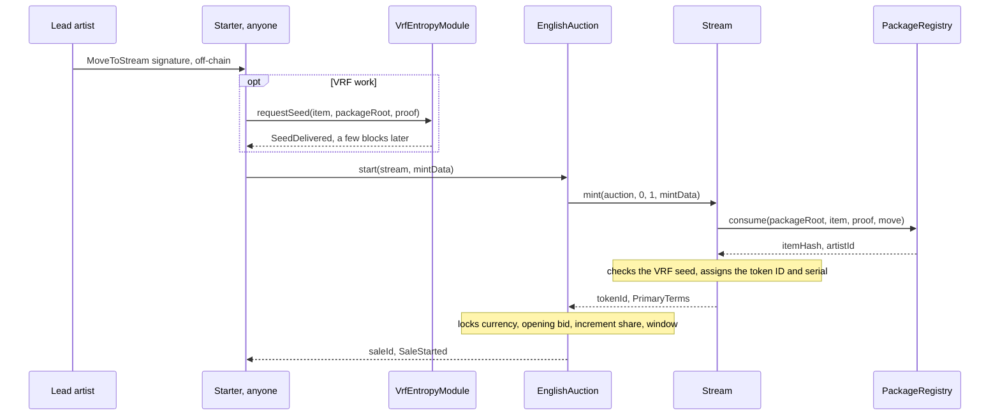
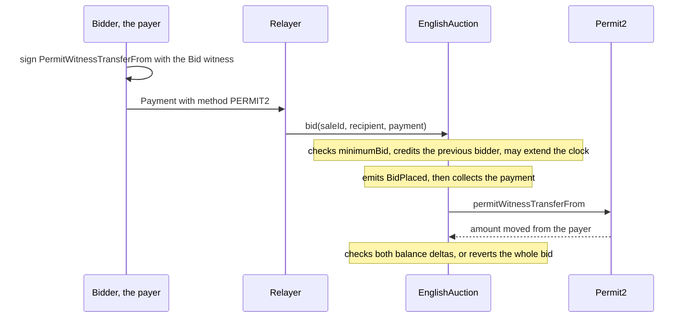
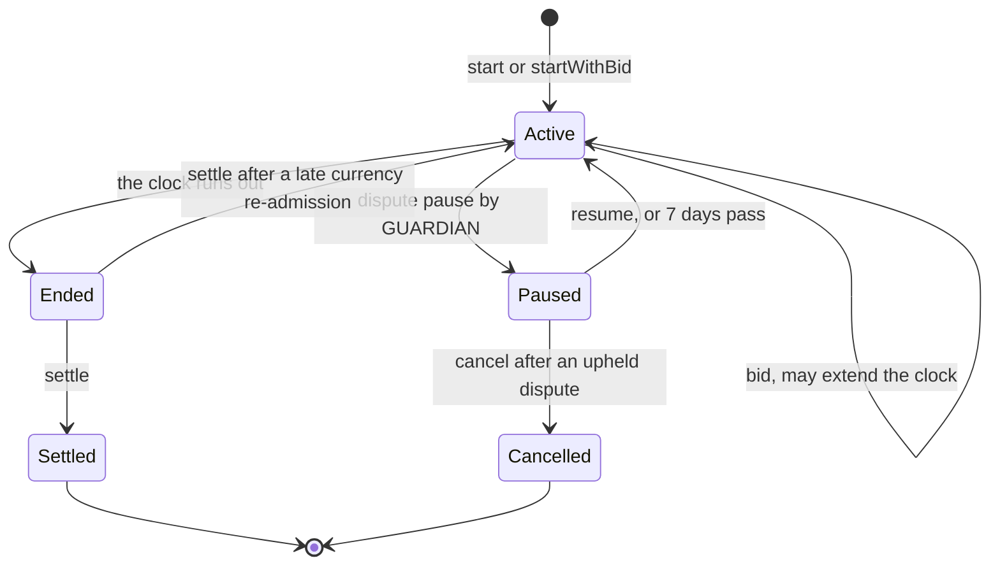
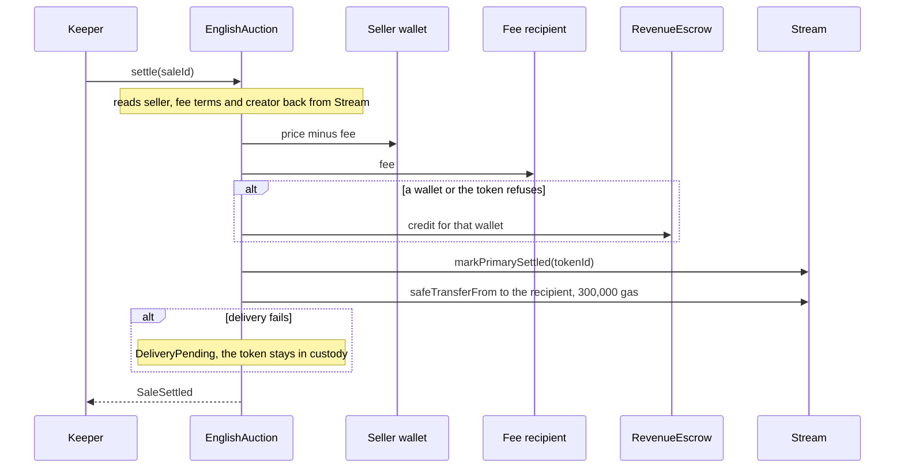
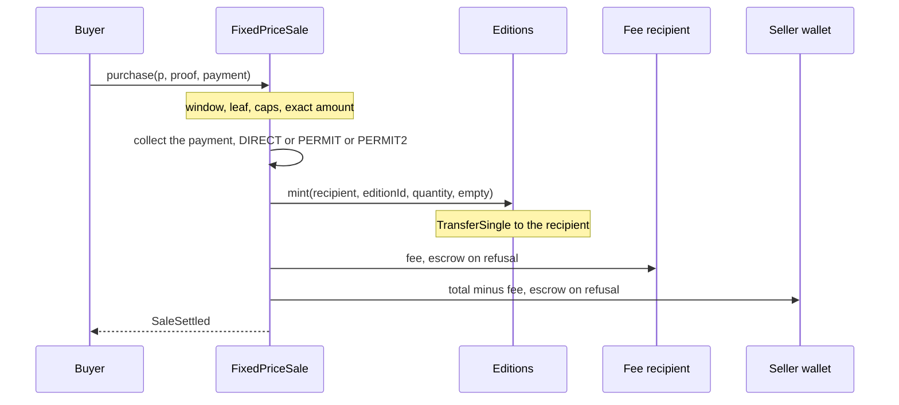

# Buying, bidding, settling and claiming

This page is for marketplace and wallet engineers, relayers and keepers who send transactions to
6529 Works. It covers every action a caller takes on the sale and payout contracts: starting a
6529 Stream auction and bidding on it (`EnglishAuction`), settling it, buying 6529 Editions copies
(`FixedPriceSale`, `DutchSale`), claiming credits, deliveries and split-wallet balances
(`RevenueEscrow`, `SplitWallet`, `ClaimRouter`), and reading royalties. For each action it gives the
exact signature, the fields to fill, the preconditions, the events to watch, the errors to handle
and the gas. The rules themselves are specified in [Stream and auctions](../spec/stream-and-auctions.md),
[Editions and sales](../spec/editions-and-sales.md) and
[Economics and payouts](../spec/economics-and-payouts.md). Deployed addresses are in
[Addresses](addresses.md).

> **Status.** Pre-audit. This page describes `main` at `46941d6` (15 October 2026). The Sepolia
> rehearsal instance r2 runs `main` at `400f96d`, which predates the sales, auction, economics and
> identity review fixes. On r2 there is no `claimFor`, no ERC-20 payout frame, no `scheduleDelay`,
> no currency freeze, no `SHORTFALL_REVERT_CEILING` and no identity restraint. The Sepolia gas
> figures on this page are r2's ([flows](../../deployments/11155111/flows.md)).

## Before you start

### Contracts you call

| Contract | Source | Interface | You call it to |
| --- | --- | --- | --- |
| `EnglishAuction` | [EnglishAuction.sol](../../src/sales/EnglishAuction.sol) | [IEnglishAuction](../../src/interfaces/IEnglishAuction.sol) | start, bid, withdraw, settle, claim credits and pending deliveries |
| `FixedPriceSale` | [FixedPriceSale.sol](../../src/sales/FixedPriceSale.sol) | [IFixedPriceSale](../../src/interfaces/IFixedPriceSale.sol) | buy edition copies at a fixed price, with allowlist phases |
| `DutchSale` | [DutchSale.sol](../../src/sales/DutchSale.sol) | [IDutchSale](../../src/interfaces/IDutchSale.sol) | buy edition copies at a descending price |
| `Stream` | [Stream.sol](../../src/stream/Stream.sol) | [IStream](../../src/interfaces/IStream.sol), [IMintTarget](../../src/interfaces/IMintTarget.sol) | preview a start (`primaryTerms(0, mintData)`), read works, `royaltyInfo` |
| `Editions` | [Editions.sol](../../src/editions/Editions.sol) | [IEditions](../../src/interfaces/IEditions.sol) | read editions, `royaltyInfo` |
| `PackageRegistry` | [PackageRegistry.sol](../../src/curation/PackageRegistry.sol) | [IPackageRegistry](../../src/interfaces/IPackageRegistry.sol) | check approvals, acceptances and move nonces, relay acceptances, get the move digest |
| `VrfEntropyModule` | [VrfEntropyModule.sol](../../src/entropy/VrfEntropyModule.sol) | [IEntropyModule](../../src/interfaces/IEntropyModule.sol) | request a VRF work's seed before its start |
| `AssetAllowlist` | [AssetAllowlist.sol](../../src/economics/AssetAllowlist.sol) | [IAssetAllowlist](../../src/economics/interfaces/IAssetAllowlist.sol) | read a currency's status and increment floor |
| `RevenueEscrow` | [RevenueEscrow.sol](../../src/economics/RevenueEscrow.sol) | [IRevenueEscrow](../../src/economics/interfaces/IRevenueEscrow.sol) | flush payouts that a wallet or token refused |
| `SplitWallet`, `SplitFactory` | [SplitWallet.sol](../../src/economics/SplitWallet.sol), [SplitFactory.sol](../../src/economics/SplitFactory.sol) | [ISplitWallet](../../src/economics/interfaces/ISplitWallet.sol), [ISplitFactory](../../src/economics/interfaces/ISplitFactory.sol) | deploy a predicted wallet, release a payee's share |
| `ReleaseVerifier` | [ReleaseVerifier.sol](../../src/economics/ReleaseVerifier.sol) | [IReleaseVerifier](../../src/economics/interfaces/IReleaseVerifier.sol) | build and revoke signed releases |
| `ClaimRouter` | [ClaimRouter.sol](../../src/economics/ClaimRouter.sol) | [IClaimRouter](../../src/economics/interfaces/IClaimRouter.sol) | batch releases across split wallets |

The three sale adapters share [`ISaleAdapter`](../../src/interfaces/ISaleAdapter.sol): the
`SaleStarted`, `SaleSettled`, `Credited` and `Claimed` events, `claim`, `claimable`, `paused` and
the shared errors.

### Conventions

- **Currencies.** `CURRENCY_ETH` is `address(0)`. `CURRENCY_DEFAULT` is
  `address(type(uint160).max)`; in package terms it means "the product's default currency when the
  sale starts" ([EconomicsTypes.sol](../../src/interfaces/types/EconomicsTypes.sol)). Every sale
  locks its resolved currency when it starts or opens.
- **Shares and rates** are out of 100,000 (`Splits.DENOMINATOR` in
  [Splits.sol](../../src/economics/Splits.sol)): 6.529% is 6,529.
- **Errors** are custom errors. A call that reaches a nested contract (Stream, the package
  registry, the asset allowlist, Permit2, a token) bubbles that contract's error up unchanged, so
  decode a revert against every ABI on the path ([ABIs and interface IDs](abis-and-interface-ids.md)).
- **Simulate first.** Run every write below with `eth_call` before sending it, and take the gas
  limit from `eth_estimateGas` on the target chain (see
  [Prague gas and Glamsterdam gas](#prague-gas-and-glamsterdam-gas)).

### The `Payment` struct

Every bid and purchase carries one `Payment`
([SaleTypes.sol](../../src/interfaces/types/SaleTypes.sol)):

| Field | Type | Meaning |
| --- | --- | --- |
| `method` | `PaymentMethod` | `DIRECT` (0), `PERMIT` (1) or `PERMIT2` (2) |
| `payer` | `address` | The bidder or buyer of record. Refunds and credits go to it. For `DIRECT` and `PERMIT` it must be `msg.sender`; for `PERMIT2` it is the signer, and anyone may submit. |
| `amount` | `uint256` | The exact bid; the exact fixed-price total; the most the payer will pay in a Dutch sale |
| `deadline` | `uint256` | The permit's deadline (`PERMIT`, `PERMIT2`); ignored for `DIRECT` |
| `nonce` | `uint256` | The Permit2 nonce; zero otherwise |
| `signature` | `bytes` | `PERMIT`: exactly 65 bytes, `r \|\| s \|\| v`. `PERMIT2`: the Permit2 signature. `DIRECT`: empty |

The adapters apply the same rules (`_collect` in [EnglishAuction.sol](../../src/sales/EnglishAuction.sol)
and [MintSaleBase.sol](../../src/sales/MintSaleBase.sol)):

- **ETH** takes `DIRECT` only, with `payer == msg.sender` and `msg.value == amount`. Anything else
  reverts with `InvalidPayment()`.
- **An ERC-20** takes `msg.value == 0`.
  - `DIRECT`: the payer approved the adapter beforehand.
  - `PERMIT`: an EIP-2612 permit of `amount` to the adapter. A permit that fails, for example because
    someone submitted it first, is ignored; the pull then uses whatever allowance exists.
  - `PERMIT2`: the payer approved the canonical Permit2 once and signs a witness transfer (below).
- An expired `PERMIT` or `PERMIT2` deadline reverts with `PaymentExpired(deadline)`, even where an
  allowance would cover the pull.
- Every ERC-20 movement is checked by exact balance delta on both sides. A fee-on-transfer,
  rebasing, no-return or `false`-returning token reverts (`TokenTransfer.TokenBalanceMismatch` or
  `TokenTransfer.TokenCallFailed`, [TokenTransfer.sol](../../src/economics/TokenTransfer.sol)).

### Signing a Permit2 payment

A `PERMIT2` payment is a Permit2 `permitWitnessTransferFrom`, signed in Permit2's own EIP-712
domain. The witness binds the action, so a relayer can submit it and cannot change it.

- The signed type is `PermitWitnessTransferFrom(TokenPermissions permitted,address spender,uint256 nonce,uint256 deadline,`
  followed by the action's witness type string.
- `permitted` is `(currency, payment.amount)`, `spender` is the adapter, and `nonce` and `deadline`
  are `payment.nonce` and `payment.deadline`.
- The witness is `keccak256(abi.encode(WITNESS_TYPEHASH, field1, field2, ...))`, with the fields
  below in order.

The witness type strings and typehashes are in
[ABIs and interface IDs](abis-and-interface-ids.md#permit2-witnesses). The fields, in order:

| Action | Witness typehash | Witness fields |
| --- | --- | --- |
| `bid` | `BID_WITNESS` | `saleId`, the recipient **resolved** (the payer when zero), `payment.amount`, `payment.deadline` |
| `startWithBid` | `START_BID_WITNESS` | `token`, `keccak256(mintData)`, the recipient **resolved**, `payment.amount`, `payment.deadline` |
| Fixed-price `purchase` | `PURCHASE_WITNESS` | `p.saleId`, `p.phase`, `p.recipient` **as passed** (zero stays zero), `p.quantity`, the total (equal to `payment.amount`), `payment.deadline` |
| Dutch `purchase` | `DUTCH_PURCHASE_WITNESS` | `saleId`, `recipient` **as passed**, `quantity`, `maxUnitPrice`, `payment.deadline` |

The auction resolves a zero recipient before it hashes the witness; the fixed-price and Dutch
adapters hash the value you pass. Sign accordingly. The auction runs without Permit2 when its
`permit2()` is zero, and a `PERMIT2` payment then reverts with `InvalidPayment()`. Permit2's own
errors (for example `InvalidSigner` or `InvalidNonce`) bubble up.

## Starting an auction

Starting is permissionless. The start mints the work into the auction's custody and starts its
clock in one transaction. Whoever submits it pays its gas: a bidder, the artist or the network,
which is not obliged to ([ADR 0001 §5](../adr/0001-v1-scope.md#5-sales-and-auctions)).

```solidity
function start(address token, bytes calldata mintData) external returns (uint256 saleId);

function startWithBid(
    address token,
    bytes calldata mintData,
    address recipient,
    Payment calldata payment
) external payable returns (uint256 saleId);

function saleIdOf(address token, uint256 tokenId) external pure returns (uint256);
```

- `token` is the 6529 Stream address.
- `mintData` is `abi.encode(StreamMintRequest)` (below).
- The sale ID is derived: `uint256(keccak256(abi.encode(token, tokenId)))`. Take it from the
  return value or from `SaleStarted`; the token ID is assigned at mint.

### Building the `StreamMintRequest`

[PackageTypes.sol](../../src/interfaces/types/PackageTypes.sol) defines the request:

| Field | Type | Where it comes from |
| --- | --- | --- |
| `packageRoot` | `bytes32` | The approved package root, from the published package document |
| `item` | `PackageItem` | The item, exactly as published in the package document |
| `proof` | `bytes32[]` | The Merkle proof that places the item's leaf under the root, at most 32 nodes (`Limits.MAX_PROOF_DEPTH`) |
| `move.nonce` | `uint256` | The lead artist's move nonce |
| `move.deadline` | `uint64` | When the move signature expires |
| `move.signature` | `bytes` | The lead artist's `MoveToStream` signature |

The item hash and the leaf follow [WorksHashing.sol](../../src/interfaces/types/WorksHashing.sol):

- `itemHash = keccak256(abi.encode(keccak256("6529WORKS_PACKAGE_ITEM_V1"), item))`;
- `leaf = keccak256(bytes.concat(itemHash))`, over an OpenZeppelin sorted-pair tree. This is
  OpenZeppelin's `StandardMerkleTree` with the values `[PACKAGE_ITEM_DOMAIN, item]`, so the
  package tooling's proofs verify directly.

**Preconditions.** Check each with a view before you submit:

1. The root is approved: `PackageRegistry.packageOf(root)` returns `APPROVED`.
2. The item is unconsumed: `PackageRegistry.consumedItemOf(item.contentHash)` is zero.
3. Every party accepted the root: `PackageRegistry.acceptedAs(root, party.account)` is nonzero for
   each `item.parties[i]`. A party's signed `PackageAcceptance` is recorded by anyone with
   `acceptPackage(packageRoot, acceptance, signature)`.
4. The collection exists: `Stream.collection(item.collectionId)` does not revert.
5. The move is valid: unexpired, and `PackageRegistry.isMoveNonceUsed(artistId, nonce)` is false.
6. A VRF item's seed is delivered: `IEntropyModule.isDelivered(itemHash)` is true.
7. The currency is usable (see [The currency](#the-currency)).
8. The lead artist is not restrained by a pending recovery override:
   `Stream.primaryTerms(0, mintData).creator` is nonzero. The preview does not check the proof,
   acceptances or move.
9. The auction is not paused: `EnglishAuction.paused()` is false.

### The move signature

The lead artist authorizes the move off-chain. It is an EIP-712 signature in the package
registry's domain (name `6529 Works Package Registry`, version `1`, the chain ID, the registry's
address) over
`MoveToStream(bytes32 packageRoot,bytes32 itemHash,uint256 nonce,uint64 deadline)`
(`Typehashes.MOVE_TO_STREAM`). `PackageRegistry.moveDigest(packageRoot, itemHash, nonce, deadline)`
returns the digest to sign.

- **Signer.** The active authority of the lead artist's ID
  (`IArtistRegistry.activeAuthorityOf(artistId)`). The artist ID is
  `PackageRegistry.acceptedAs(root, item.parties[0].account)`.
- **Signature forms.** 65-byte ECDSA, 64-byte ERC-2098, ERC-1271 for contract accounts (at most
  4,096 bytes, `SignatureVerifier.MAX_SIGNATURE_LENGTH`), and EIP-7702 delegated accounts
  ([SignatureVerifier.sol](../../src/libraries/SignatureVerifier.sol)).
- **Nonce.** Any unused `uint256`, single use per artist ID. Use them in order from 0: the first
  255 share a storage word that already exists, which keeps the start within its gas budget
  (`PackageRegistry` NatSpec). The artist revokes an unused one with
  `revokeMove(artistId, nonce)`. A move signed by an authority the artist has rotated away from
  stays void.

### Encoding `mintData`

Encode the request as one tuple. Stream reads it in place and reverts with
`IStream.InvalidMintRequest()` unless the first word is `0x20` (`_request` in
[Stream.sol](../../src/stream/Stream.sol)). In Solidity, as the Sepolia driver
[Flows.s.sol](../../script/sepolia/Flows.s.sol) does:

```solidity
bytes memory mintData = abi.encode(
    StreamMintRequest(packageRoot, item, proof, MoveAuthorization(nonce, deadline, signature))
);
```

Off-chain, encode a single parameter of this type (for example with ethers'
`AbiCoder.encode([REQUEST], [request])`):

```text
tuple(
  bytes32 packageRoot,
  tuple(
    uint8 kind, uint256 collectionId, bytes32 contentHash, bytes32 mediaHash, bytes32 recordFileId,
    tuple(address account, uint8 role)[] parties,
    tuple(uint256 artistId, address account, uint32 share)[] payees,
    tuple(string spdxId, bytes32 textFileId) license,
    uint8 seedPolicy, bytes32 seed,
    tuple(bytes32 saleKind, address currency, bytes params) sale,
    tuple(uint8 format, uint64 size, uint64 window, uint256 price, address currency, bytes32 saleKind, bytes params) edition
  ) item,
  bytes32[] proof,
  tuple(uint256 nonce, uint64 deadline, bytes signature) move
)
```

Do not encode the four members as four separate parameters: that drops the leading offset word.

### VRF works

A work whose item has `seedPolicy == VRF` starts only after its seed is delivered, so nothing ever
sits in custody waiting for randomness ([IEntropyModule.sol](../../src/interfaces/IEntropyModule.sol)).

1. Anyone calls `requestSeed(item, packageRoot, proof)` on the entropy module. It emits
   `SeedLinked(itemHash, contentHash)` and `SeedRequested(itemHash, requestId)`, or only links the
   item when its content already has a draw.
2. Wait for `SeedDelivered(contentHash, requestId, seed)`. On Sepolia it arrived five blocks after
   the request ([flows §6](../../deployments/11155111/flows.md#6-vrf)).
3. Check `isDelivered(itemHash)`, then start. A start before delivery reverts with
   `IStream.SeedNotDelivered(itemHash)`.

If no seed arrives, anyone may request again once `retryDelay()` has passed since the last request
(at least 3 days, `VrfEntropyModule.MIN_RETRY_DELAY`); earlier calls revert with
`RequestPending(itemHash, retryAt)`.

### The currency

The auction locks the sale's currency at start from `item.sale.currency`
(`_lockTerms` in [EnglishAuction.sol](../../src/sales/EnglishAuction.sol)):

- `CURRENCY_DEFAULT` resolves to `AssetAllowlist.defaultCurrency(PRODUCT_STREAM)`, ETH at launch
  ([ADR 0001 §5](../adr/0001-v1-scope.md#5-sales-and-auctions)). It reverts with
  `CurrencyNotConfigured(product)` or `AssetNotActive(asset)` when the default is unusable.
- An explicit currency must be active on the allowlist (`AssetNotActive(currency)` otherwise).
- The start also locks the currency's opening bid (`openingBid(currency)`, zero at launch), the
  increment share and the anti-snipe window. The first bid locks the currency's increment floor.

Read the locked currency from `SaleStarted.currency` or `auction(saleId).currency`, never from the
current default.

### `start` or `startWithBid`

`start` opens the auction with no bid. `startWithBid` opens it and places the first bid in the same
transaction, with the bid's payer as the bidder of record. A relayer can submit `startWithBid` with
a `PERMIT2` bid that a bidder signed; the witness is `StartBid`, which binds the hash of `mintData`
because no sale ID exists before the start.



### Events

| Event | Emitter | Notes |
| --- | --- | --- |
| `ItemConsumed(packageRoot, itemHash, artistId, contentHash)` | `PackageRegistry` | The item is spent; it can never start again. |
| `Transfer(address(0), auction, tokenId)` | `Stream` | The mint into custody. |
| `WorkMinted(tokenId, collectionId, itemHash, serial, artistId, kind, packageRoot, contentHash, mediaHash, recordFileId)` | `Stream` | The work's source record. |
| `SaleStarted(saleId, token, tokenId, saleKind, currency, price, startTime, endTime)` | `EnglishAuction` | `price` is the locked opening bid; `endTime` the initial end. |
| `BidPlaced(saleId, bidder, recipient, amount, endTime)` | `EnglishAuction` | `startWithBid` only. |

### Errors

| Error | From | Cause | What to do |
| --- | --- | --- | --- |
| `SalePaused()` | `EnglishAuction` | The emergency pause stops starts. Bids and settlements on live auctions continue. | Wait. An unpause comes at least 48 hours (`Roles.STANDARD`) after the pause. |
| `TargetNotAllowed(token)` | `EnglishAuction` | `token` is not a served token contract. | Use the Stream address. |
| `InvalidMintRequest()` | `Stream` | Malformed `mintData`; a missing collection; sale terms that are not an English auction with empty parameters; an inconsistent seed policy; an invalid license ID. | Fix the request. |
| `PackageNotApproved(packageRoot)` | `PackageRegistry` | The root is unknown or revoked. | Nothing to start. |
| `ItemNotInPackage(packageRoot, itemHash)` | `PackageRegistry` | The proof does not place the item, or has more than 32 nodes. | Rebuild the proof from the published package. |
| `ContentUsed(product, contentHash, claimedBy)` | `PackageRegistry` | The item already started, or its content is claimed by another item. | Nothing to start. |
| `ContentReserved(contentHash, beneficiary)` | `PackageRegistry` | Released content is reserved for another artist's item. | Nothing to start. |
| `PartyNotAccepted(packageRoot, account)` | `PackageRegistry` | A party has not accepted the root. | Relay its acceptance with `acceptPackage`. |
| `InvalidItem(itemHash)` | `PackageRegistry` | Parties, payees, seed or edition fields are inconsistent. | Report it to curation: the item cannot start as published. |
| `InvalidSignature()` | `PackageRegistry` | The move expired, was signed by another key, or the lead artist is restrained by a pending recovery override. | Get a fresh move, or wait for the override's outcome. |
| `MoveNonceUsed(artistId, nonce)` | `PackageRegistry` | The nonce was spent or revoked. | Ask for a move with a new nonce. |
| `SeedNotDelivered(itemHash)` | `Stream` | A VRF work's seed has not arrived. | Request the seed and wait. |
| `AssetNotActive(asset)`, `CurrencyNotConfigured(product)` | `AssetAllowlist` | The item's currency, or the product default, is not usable. | Wait for governance. |
| `InvalidTerms(token, tokenId)` | `EnglishAuction` | The token returned unusable terms (for example no creator, or the escrow as seller). | Report it. |

`startWithBid` can also revert with any bidding error below.

### Gas

- **Steady state.** A `start` costs 291,808 Prague gas and a `startWithBid` 333,883, against a
  budget of 350,000; they write 6 and 7 new storage slots
  ([ADR 0004 table](../adr/0004-gas-budgets-under-glamsterdam.md#the-table)).
- **On Sepolia (Glamsterdam).** The same steady-state calls cost 846,963 and 982,312 on r2
  ([flows §2](../../deployments/11155111/flows.md#2-the-curated-stream-sale)).
- **One-time costs.** The first start on a deployment, and the first bid under a new combination of
  locked sale terms (it writes a new shared terms record), cost more once. Each later start or bid
  under the same terms costs the steady-state figure. The ADR 0004 table lists both rows.
- **ERC-20 starts.** A `startWithBid` paid in an ERC-20 through Permit2 has a regression ceiling,
  not the budget (ADR 0004 decision 6).

## Bidding

```solidity
function bid(uint256 saleId, address recipient, Payment calldata payment) external payable;
function minimumBid(uint256 saleId) external view returns (uint256);
function auction(uint256 saleId) external view returns (Auction memory);
```

`recipient` receives the token if the bid wins; zero means the payer. It cannot be the auction
itself (`InvalidRecipient(recipient)`). The payer is the bidder of record: refunds go to it, and it
alone may withdraw the bid.

### The minimum bid

Read `minimumBid(saleId)` just before you submit. The rule (`_minimumBid` in
[EnglishAuction.sol](../../src/sales/EnglishAuction.sol)):

- **With no standing bid**, at least `max(opening bid, reserve, 1 wei)`. The opening bid is the one
  locked at start. The reserve is the amount of a bid that was withdrawn or refunded, which the next
  bid must reach (LIFECYCLE-1); otherwise it is zero.
- **With a standing high bid `h`**, at least
  `h + max(ceil(h × incrementShare / 100,000), incrementFloor)`. The increment floor is locked by
  the sale's first bid.
- **Launch values.** An increment share of 5,000 (5%) and an ETH increment floor of 0.001 ETH
  (deploy defaults, [script README](../../script/README.md#environment-reference)). Below a high
  bid of 0.02 ETH the floor decides; above it, the 5%. Read `config()` and
  `AssetAllowlist.incrementFloor(currency)` on the target chain for the live values.
- **The largest bid** is `type(uint96).max` base units (about 7.9e28). A larger one reverts with
  OpenZeppelin's `SafeCastOverflowedUintDowncast`.
- The bid is `payment.amount` exactly. There is no "bid up to" form.

### Anti-snipe

A bid that lands with less than the sale's `extensionWindow` left moves the end to
`block.timestamp + extensionWindow`. `BidPlaced.endTime` carries the end after the bid.

- The window is locked per sale at start. It is 15 minutes by default
  ([script README](../../script/README.md#environment-reference)); governance may set 1 minute to
  1 day, never more than the duration (`MIN_EXTENSION_WINDOW`, `MAX_EXTENSION_WINDOW` in
  [EnglishAuction.sol](../../src/sales/EnglishAuction.sol)). The default duration is 24 hours,
  within bounds of 1 hour to 7 days.
- Bidding stops at the end time: a bid at or after it reverts with
  `InvalidAuctionState(saleId, ENDED)` (`test_Bid_AntiSnipeExtends` in
  [EnglishAuction.t.sol](../../test/sales/auction/EnglishAuction.t.sol)).
- On Sepolia, a simulated bid 5 minutes before the end moved it to 15 minutes after the bid
  ([flows §2](../../deployments/11155111/flows.md#2-the-curated-stream-sale)).

### Paying

| Currency and method | What the bidder does | `msg.sender` |
| --- | --- | --- |
| ETH, `DIRECT` | Sends `msg.value == amount`. | The payer |
| ERC-20, `DIRECT` | Approves the auction for `amount` first. | The payer |
| ERC-20, `PERMIT` | Signs an EIP-2612 permit of `amount` to the auction, deadline `payment.deadline`. | The payer |
| ERC-20, `PERMIT2` | Approves Permit2 once, then signs the `Bid` witness. | Anyone, for example a relayer |



### Outbid credits

Refunds are pulled, never pushed. When a bid is outbid, its amount is credited to its payer
(`Credited(account, currency, saleId, amount)`), including a bidder that outbids itself. The payer
claims all of its credits in one currency with `claim(currency, to)`; `claimable(account, currency)`
reads the balance. See [Claiming](#claiming).

### Withdrawing a bid

```solidity
function withdrawBid(uint256 saleId) external;
```

Only the high bidder (the payer) may withdraw, and only while the auction is paused for a dispute,
or while its locked currency is deprecated and the sale has not settled (MARKET-2). The bid is
credited back and `BidWithdrawn(saleId, bidder, amount)` is emitted. Its amount stays as a reserve
the next bid must reach.

### When bids stop

- **Dispute pause.** A guardian may pause a live auction once, for at most 7 days (`MAX_PAUSE`).
  Bids revert with `InvalidAuctionState(saleId, PAUSED)`. When it resumes, by the UNPAUSER role no
  earlier than 48 hours after the pause or by itself after 7 days, it runs at least the governed
  duration again (`AuctionResumed(saleId, endTime)`). An upheld dispute cancels it: the high bid is
  credited back and the token burned (`AuctionCancelled`).
- **Currency deprecation.** Bids revert with `AssetNotActive(currency)` until it is re-admitted.
- **Emergency pause.** `pause()` on the auction stops only `start` and `startWithBid`. Bids on live
  auctions continue.

### Errors

| Error | Cause | What to do |
| --- | --- | --- |
| `UnknownSale(saleId)` | No such sale. | Check the sale ID. |
| `InvalidAuctionState(saleId, state)` | The auction is paused, ended, settled or cancelled. | Read `auction(saleId).state`. |
| `BidTooLow(required, offered)` | Below `minimumBid`. | Re-read and re-sign. |
| `InvalidPayment()` | Method, amount, `msg.value` or payer mismatch; a `PERMIT` signature that is not 65 bytes; Permit2 disabled. | Fix the payment. |
| `PaymentExpired(deadline)` | The permit deadline passed. | Sign again. |
| `InvalidRecipient(recipient)` | The recipient is the auction. | Name another recipient. |
| `AssetNotActive(currency)` | The locked currency is deprecated (the auction is frozen). | Wait; a standing bidder may withdraw. |
| `TargetNotAllowed(token)` | A federated token's registry entry was delisted (v1.1). | None. |
| `TokenBalanceMismatch(asset)`, `TokenCallFailed(asset, selector)` | A non-standard token, a balance below the amount, or a missing allowance. | Fund and approve, or use a standard token. |

### Events and gas

- `BidPlaced(saleId, bidder, recipient, amount, endTime)`, and `Credited(previousBidder, currency, saleId, amount)` when it outbids.
- A bid that outbids costs 73,464 Prague gas
  ([ADR 0004 table](../adr/0004-gas-budgets-under-glamsterdam.md#the-table)) and 168,932 on
  Sepolia ([flows §2](../../deployments/11155111/flows.md#2-the-curated-stream-sale)). The first
  bid under a new combination of locked terms is a one-time cost.

## Settling

```solidity
function settle(uint256 saleId) external;
function claimDelivery(uint256 saleId, address to) external;
function claimFor(address account, address currency) external returns (uint256 amount);
function pendingDelivery(uint256 saleId) external view returns (address);
```

Settlement is permissionless once the auction has ended (`auction(saleId).state == ENDED`). It never
depends on the winner accepting the token. Bidders, the artist, the network or a keeper may settle.

### Auction states

`ENDED` and `PAUSED` are derived from the clock: an `ACTIVE` auction whose end has passed reads as
`ENDED` without any transaction.



### What `settle` does



- The fee is `floor(price × feeShare / 100,000)`; the seller wallet gets the rest. The seller is a
  split wallet's predicted address, which may not be deployed yet.
- With no bid, the token goes to the artist's active authority, resolved now, and nothing is paid.
- `markPrimarySettled` runs before delivery, so a winner who never claims cannot block the
  master's edition.

### Gas the caller must forward

`settle` gives each external call a fixed allowance and refuses to run with less, so a caller can
never force a payout into the escrow or a delivery into a pending one by starving it. Each check
requires the allowance, plus EIP-150's 1/63, plus a reserve
([BoundedCall.sol](../../src/libraries/BoundedCall.sol)):

| Call | Allowance | Reserve | Source | Revert when short |
| --- | ---: | ---: | --- | --- |
| ETH payout to each wallet | 100,000 (`PAYOUT_GAS`) | 40,000 (`ETH_CALL_RESERVE`) | [EnglishAuction.sol](../../src/sales/EnglishAuction.sol), [RevenuePayment.sol](../../src/economics/RevenuePayment.sol) | `PaymentInsufficientGas(100000)` |
| ERC-20 payout frame, per payout | 1,000,000 (`_ERC20_PAYOUT_GAS`), of which the token's `transfer` gets 300,000 (`ERC20_TRANSFER_GAS`) | 50,000 (`DELIVERY_RESERVE`) | same | `PaymentInsufficientGas(1000000)` |
| Delivery (`safeTransferFrom`) | 300,000 (`DELIVERY_GAS`) | 50,000 (`DELIVERY_RESERVE`) | [EnglishAuction.sol](../../src/sales/EnglishAuction.sol) | `DeliveryInsufficientGas()` |

An ERC-20 `settle` therefore needs a call gas limit of about 1.11M although it uses about 140K, and
an ETH `settle` about 460K ([ADR 0004, Security impact](../adr/0004-gas-budgets-under-glamsterdam.md#security-impact);
`test_MONEY1_SettlerGasLimitVersusGasUsed` in
[EnglishAuctionFollowUp.t.sol](../../test/sales/auction/EnglishAuctionFollowUp.t.sol)).
`eth_estimateGas` searches for the lowest limit that succeeds, so it returns these figures. Do not
set the limit from the gas a past settlement used.

On Sepolia, a `settle` with a bid used 257,763 gas, and the first one that paid a new seller
wallet used 441,363, because the payout created the wallet's account
([flows §2](../../deployments/11155111/flows.md#2-the-curated-stream-sale)). In Prague gas they
are 143,063 and 168,063 ([ADR 0004 table](../adr/0004-gas-budgets-under-glamsterdam.md#the-table)).
The first payout to each new payee configuration is paid by whoever settles.

### Outcomes and what to do

| Outcome | How you see it | What to do |
| --- | --- | --- |
| Delivered | `Transfer` to the recipient, `SaleSettled` | Nothing. |
| Delivery failed (the recipient rejected the token, or its hook needed more than 300,000 gas) | `DeliveryPending(saleId, recipient)`; `pendingDelivery(saleId)` is nonzero | The recipient or the winning bidder calls `claimDelivery(saleId, to)`, naming any address but zero and the auction. With no bids, the artist's authority claims. |
| An ETH payout refused (the wallet reverted, or needed more than 100,000 gas) | The escrow's `Credited(wallet, asset, payer, amount, owed)` | Anyone calls `RevenueEscrow.flush(wallet, address(0))`. |
| An ERC-20 payout refused by the wallet or the token | The escrow's `Credited` | Anyone calls `flush(wallet, token)` once the token allows it. |
| An ERC-20 payout that failed even through the escrow (MONEY-1) | The auction's `Credited(wallet, token, saleId, amount)` | Anyone calls `claimFor(wallet, token)`. The funds only go to `wallet`. |
| No bid | `SaleSettled` with `buyer == address(0)`, `price == 0`, and the artist as recipient | Nothing. |
| No bid while the artist is restrained | Reverts with `InvalidRecipient(address(0))`; nothing moves | Retry once the recovery override executes, is vetoed or voided, or lapses. |
| The locked currency is deprecated, for less than 30 days | Reverts with `AssetNotActive(currency)` | Wait. The high bidder may `withdrawBid`. |
| The locked currency has been deprecated for 30 days | Succeeds: the high bid is credited back (`Credited`) and the work goes to the artist | The bidder claims its credit. |
| The currency was re-admitted in the auction's last window or after its end | `AuctionResumed(saleId, endTime)`, no `SaleSettled`; the call succeeds | Bid again; settle after the new end. |
| Paused for a dispute | Reverts with `InvalidAuctionState(saleId, PAUSED)` | Wait for the resume, the cancel, or 7 days. |

### No bids, and the identity restraint

With no bid, the token goes to the lead artist's active authority, read from Stream at settlement
(`IMintTarget.primaryTerms(tokenId, "").creator`). While a recovery override that would move the
artist's authority is pending, the artist has no active authority (IDENTITY-1), and a no-bid
`settle` reverts with `InvalidRecipient(address(0))`, leaving the token in custody. Anyone may retry
after the override executes, is vetoed or voided, or lapses (`test_NoBidAuctionRunningAtStagingWaitsForTheOutcome`
in [RecoveryRestraint.t.sol](../../test/integration/RecoveryRestraint.t.sol)). An auction with a
standing bid settles normally during the restraint. The rules are in
[Identity and recovery](../spec/identity-and-recovery.md).

### The currency freeze

A deprecation of the sale's locked currency freezes the auction (MARKET-2,
`_reopenedAfterFreeze` in [EnglishAuction.sol](../../src/sales/EnglishAuction.sol)):

- Nothing settles, sold or unsold, and no bid is accepted. The high bidder may withdraw its bid,
  and claims never read the allowlist, so they keep working.
- Governance may re-admit the currency no earlier than 14 days after the deprecation
  (`ReadmissionTooEarly`, `Roles.FUNDS` in
  [IAssetAllowlist.sol](../../src/economics/interfaces/IAssetAllowlist.sol)). If the re-admission
  came within the auction's last anti-snipe window or after its end, the first `settle` reopens the
  auction for the governed duration (or the window, if longer) instead of settling.
- Once the currency has been deprecated for 30 days (`_FREEZE_EXIT`), the next `settle` ends the
  sale unsold: the standing bid is credited back and the work goes to the artist.
- A keeper reads when the deprecation began from
  `AssetAllowlist.statusClock(currency)`, which returns `(status, since, inactiveTotal)`; the
  auction's allowlist is `EnglishAuction.allowlist()`.

### Keeper checklist

1. Track ends from `SaleStarted.endTime` and every `BidPlaced.endTime`, plus `AuctionPaused` and
   `AuctionResumed`.
2. When `auction(saleId).state` is `ENDED`, simulate `settle(saleId)` with `eth_call`.
3. If the simulation reverts with `AssetNotActive`, `InvalidRecipient(address(0))` or
   `InvalidAuctionState(..., PAUSED)`, the sale is waiting; schedule a retry.
4. Send with the limit from `eth_estimateGas`.
5. Read the receipt: `SaleSettled` means settled; `AuctionResumed` alone means reopened.
6. Follow up `DeliveryPending`, the escrow's `Credited` and the auction's `Credited` for a wallet
   (see [Claiming](#claiming)).

### Settlement errors

| Error | From | Cause |
| --- | --- | --- |
| `UnknownSale(saleId)`, `InvalidAuctionState(saleId, state)` | `EnglishAuction` | No such sale, or not `ENDED`. |
| `AssetNotActive(currency)` | `EnglishAuction` (allowlist error) | Frozen: deprecated for less than 30 days. |
| `InvalidRecipient(address(0))` | `EnglishAuction` | No bid and no active artist authority. |
| `PaymentInsufficientGas(gasLimit)` | `RevenuePayment` | The caller cannot forward a payout's allowance in full. |
| `DeliveryInsufficientGas()` | `EnglishAuction` | The caller cannot forward 300,000 gas to the delivery. |
| `NoPendingDelivery(saleId)` | `EnglishAuction` | `claimDelivery` with nothing pending, or by a caller that may not claim. |
| `InvalidRecipient(to)` | `EnglishAuction` | `claimDelivery` to zero or to the auction. |
| `InvalidAsset(address(0))` | `IRevenueEscrow` error, raised by `claimFor` | ETH credits are bidders' refunds; only the bidder claims them. |

## Buying an edition

6529 Editions copies are sold only through the shared fixed-price and Dutch adapters. An edition's
ID equals its master's Stream token ID. Price, currency, size and window come from the edition
(the approved package), never from the sale.

**Finding the sale.**
- `openSaleOf(editions, editionId)` on each adapter returns the open sale, or zero. At most one sale
  per edition is open at a time on an adapter.
- `sale(saleId)` returns the `LockedTerms` (currency, unit or starting price, seller, fee terms) and
  whether it is closed; on `FixedPriceSale` also whether the artist approved the phases.
- `Editions.edition(editionId)` gives the size and the copies minted so far.

### Fixed price

```solidity
function purchase(
    IFixedPriceSale.Purchase calldata p,
    bytes32[] calldata proof,
    Payment calldata payment
) external payable;
```

| `Purchase` field | Type | Meaning |
| --- | --- | --- |
| `saleId` | `uint256` | The sale |
| `phase` | `uint256` | The index into `phases(saleId)` |
| `recipient` | `address` | Who receives the copies; zero means the payer |
| `quantity` | `uint256` | Copies, at least 1 (`InvalidQuantity()` otherwise) |
| `leafCap` | `uint256` | The `cap` of the caller's allowlist leaf; ignored in a public phase |
| `leafPrice` | `uint256` | The `price` of the caller's leaf; the unit price only in a `leafPriced` phase, but part of the leaf in every allowlist phase |

Rules (`purchase` and `_admit` in [FixedPriceSale.sol](../../src/sales/FixedPriceSale.sol)):

- **The window.** Phase `i` is open during `[start + d, end + d)`, where `d` is
  `scheduleDelay(saleId)`: the time the adapter was paused and the currency deprecated since the
  sale opened (MARKET-1). A halt never uses up a phase.
- **The unit price** is the locked package price, or `leafPrice` in a `leafPriced` phase.
- **The amount is exact.** `payment.amount` must equal `unit × quantity` (`InvalidPayment()`
  otherwise), and for ETH `msg.value` must equal it. A zero price is a gift: the amount is zero.
- **The allowlist account** is the recipient, or the payer in a `payerKeyed` phase. The payer is
  always authenticated (`msg.sender`, or the Permit2 signer), so nobody can spend another wallet's
  leaf for themselves. Anyone may pay for an allowlisted recipient; the copies go to it and count
  against its cap.
- **Caps** count per `(token, editionId, phase index, account)` across sales, so reopening an
  edition never resets them: `purchased(token, id, phase, account)` reads the count. An allowlist
  phase enforces the leaf's cap, and `walletCap` when nonzero; a public phase enforces `walletCap`
  per recipient (zero means no limit).
- **The recipient must accept ERC-1155.** The edition mints inside `purchase`, so a recipient
  contract that rejects `onERC1155Received` reverts the whole purchase.



### Allowlist leaves and proofs

A leaf binds the chain, the adapter, the edition, the phase, the account, its cap and its price
([IFixedPriceSale.sol](../../src/interfaces/IFixedPriceSale.sol)):

```solidity
keccak256(bytes.concat(keccak256(abi.encode(
    ALLOWLIST_LEAF_DOMAIN, block.chainid, address(this), token, id, phase, account, cap, price
))))
// ALLOWLIST_LEAF_DOMAIN = keccak256("6529WORKS_ALLOWLIST_LEAF_V1")
```

Trees are OpenZeppelin sorted-pair trees, so OpenZeppelin's `StandardMerkleTree` builds them with
the same nine values as the leaf encoding:

```js
import { StandardMerkleTree } from "@openzeppelin/merkle-tree";
import { id } from "ethers";

const DOMAIN = id("6529WORKS_ALLOWLIST_LEAF_V1"); // ALLOWLIST_LEAF_DOMAIN
const ENCODING = ["bytes32", "uint256", "address", "address", "uint256", "uint256", "address", "uint256", "uint256"];

// One row per account and phase. chainId and fixedPriceSale name the deployment that sells.
const rows = entries.map((e) =>
  [DOMAIN, chainId, fixedPriceSale, editions, editionId, phase, e.account, e.cap, e.price]);
const tree = StandardMerkleTree.of(rows, ENCODING);

const root = tree.root;              // Phase.root, fixed when the sale opens
const proof = tree.getProof(index);  // bytes32[] passed to purchase()
```

- `FixedPriceSale.allowlistLeaf(token, id, phase, account, cap, price)` returns the leaf on-chain;
  compare it with `tree.leafHash(row)` before you publish a root
  (`test_AllowlistLeaf_MatchesTheDefinition` in
  [FixedPriceSale.t.sol](../../test/sales/fixed/FixedPriceSale.t.sol)).
- Emit at most one leaf per account and phase.
- In an allowlist phase that is not leaf-priced, pick any `price` for the leaf (zero is usual) and
  pass the same value as `leafPrice`.
- A proof has at most 32 nodes (`Limits.MAX_PROOF_DEPTH`). A sale has at most 16 phases
  (`Limits.MAX_PHASES`).

### Dutch

```solidity
function purchase(
    uint256 saleId,
    address recipient,
    uint256 quantity,
    uint256 maxUnitPrice,
    Payment calldata payment
) external payable;

function currentPrice(uint256 saleId) external view returns (uint256);
```

- **The price** is `currentPrice(saleId)` in the block the purchase lands in. It falls from the
  starting price to the resting price over the curve, moved later by `scheduleDelay(saleId)`, and
  then rests. There is no rebate when the price later falls.
- **`maxUnitPrice`** bounds the unit price (`PriceAboveLimit(price, maxUnitPrice)`), protecting a
  buyer whose transaction lands earlier than expected.
- **`payment.amount` is the most the payer will pay**, not the charge. The charge is
  `currentPrice × quantity` (`InvalidPayment()` if `amount` is below it).
  - ETH: send `msg.value == amount`. The excess above the charge is credited to the payer
    (`Credited(payer, address(0), saleId, excess)`) and claimed with `claim(address(0), to)`.
  - ERC-20: exactly the charge is pulled. A Permit2 signature permits `amount` and transfers only
    the charge. An EIP-2612 permit of `amount` leaves the unspent allowance with the adapter,
    usable only by the payer (`test_Erc20_PermitAllowsAMaximum` in
    [DutchSale.t.sol](../../test/sales/dutch/DutchSale.t.sol)).
- `recipient` zero means the payer.

### Halts

| Halt | Effect on a purchase | Notes |
| --- | --- | --- |
| The adapter is paused (PAUSER, immediate) | `SalePaused()` | `closeSale` and `claim` still work. An unpause comes no earlier than 48 hours after the pause (`Roles.STANDARD`). |
| The sale's currency is deprecated | `CurrencyNotActive(currency)` | Claims are never blocked. |
| Either halt | The schedule stops: `scheduleDelay(saleId)` grows by the halt | Fixed-price windows and the Dutch curve resume where they stopped. Overlapping halts count twice ([sales README](../../src/sales/README.md#fixed-price-and-dutch)). |
| The sale is closed, or not yet open | `PhaseNotOpen(saleId, phase)` (fixed price), `SaleNotOpen(saleId)` (Dutch) | Anyone may close a fixed-price sale once all its moved phases have ended. |
| The edition is sold out, or an OPEN edition's window is over | `IEditions.EditionUnavailable(editionId)` | |

### Events

| Event | Emitter | Notes |
| --- | --- | --- |
| `SaleSettled(saleId, token, tokenId, buyer, recipient, quantity, currency, price, seller, sellerProceeds, feeRecipient, fee)` | the adapter | One per purchase; `price` is the total, `tokenId` the edition ID. |
| `TransferSingle` | `Editions` | The mint. |
| `EditionWindowOpened(editionId, closesAt)` | `Editions` | The first mint of an OPEN edition. |
| `Credited(payer, address(0), saleId, excess)` | `DutchSale` | ETH paid above the charge. |
| `Credited(wallet, asset, payer, amount, owed)` | `RevenueEscrow` | A refused payout. |
| `SaleClosed(saleId)` | the adapter | Means "no new purchases". A recipient's hook may close a sale inside a purchase, so `SaleSettled` can follow `SaleClosed` ([sales README](../../src/sales/README.md#events-for-indexers)). |

### Errors

| Error | Fixed | Dutch | Cause |
| --- | :---: | :---: | --- |
| `SalePaused()` | yes | yes | The adapter is paused. |
| `PhaseNotOpen(saleId, phase)` | yes | | Unknown phase or sale, closed, or outside the moved window. |
| `SaleNotOpen(saleId)` | | yes | Unknown, closed, or before the moved start. |
| `CurrencyNotActive(currency)` | yes | yes | The locked currency is deprecated. |
| `TargetNotAllowed(token)` | yes | yes | A federated token was delisted (v1.1). |
| `InvalidQuantity()` | yes | yes | `quantity` is zero. |
| `NotAllowlisted(saleId, phase, account)` | yes | | The proof does not verify for the keyed account, cap and price. |
| `WalletCapExceeded(saleId, phase, account)` | yes | | The purchase passes the leaf cap or `walletCap`. |
| `PriceAboveLimit(price, maxUnitPrice)` | | yes | The current price is above the buyer's limit. |
| `InvalidPayment()` | yes | yes | Wrong amount, `msg.value`, method or payer; a `PERMIT` signature that is not 65 bytes. |
| `PaymentExpired(deadline)` | yes | yes | The permit deadline passed. |
| `EditionUnavailable(editionId)` | yes | yes | Sold out, or an OPEN edition's window is over. |
| `TokenBalanceMismatch(asset)`, `TokenCallFailed(asset, selector)` | yes | yes | A non-standard token, a balance below the charge, or a missing allowance. |
| `PaymentInsufficientGas(gasLimit)`, `TokenInsufficientGas(gasLimit)` | yes | yes | The gas limit cannot forward a payout's allowance in full: 100,000 for ETH (`PAYOUT_GAS`), 300,000 for a token transfer (`ERC20_TRANSFER_GAS`). Raise the limit. |

### Gas

- A purchase that mints an edition's first copy to a new holder costs 193,971 Prague gas; a later
  copy to a new holder 176,871
  ([ADR 0004 table](../adr/0004-gas-budgets-under-glamsterdam.md#the-table)). On Sepolia they cost
  468,086 and 370,142 ([flows §3](../../deployments/11155111/flows.md#3-6529-editions)).
- Worst cases measured against a mock edition, including a 32-node proof and gas-burning or
  escrowed payouts, are about 0.40M to 0.48M
  ([sales README](../../src/sales/README.md#gas)). The real Editions mint adds its own cost.

## Claiming

Refunds are never pushed, and a payout that cannot be delivered stays owed to its wallet. Every
amount owed is a credit, a pending delivery, an escrow balance or a split-wallet balance, and each
has a pull function.

| What is owed | Where | Who calls | Function |
| --- | --- | --- | --- |
| An outbid, withdrawn or refunded bid | `EnglishAuction` | The bidder (payer) | `claim(currency, to)` |
| ETH paid above a Dutch charge | `DutchSale` | The payer | `claim(address(0), to)` |
| An ERC-20 auction payout that failed (MONEY-1) | `EnglishAuction` | Anyone, for the wallet | `claimFor(wallet, token)` |
| A token whose delivery failed | `EnglishAuction` | The recipient or the winning bidder; with no bids the artist | `claimDelivery(saleId, to)` |
| A payout a wallet or token refused | `RevenueEscrow` | Anyone | `flush(wallet, asset)` |
| A payee's share of sales or royalties | the `SplitWallet` | Depends on the payee (below) | `release`, `releaseTo`, `releaseWithAuthorization` |

### Credits on a sale adapter

```solidity
function claimable(address account, address currency) external view returns (uint256);
function claim(address currency, address to) external returns (uint256 amount);
```

- `claim` sends all of the caller's credits in `currency` to `to` and emits
  `Claimed(account, currency, to, amount)`.
- It reverts with `InvalidRecipient(address(0))` for a zero `to`, `NothingToClaim(account, currency)`
  for no credit, and `ClaimFailed(to)` when `to` refuses ETH; the credit is then kept.
- `claimFor(account, currency)` on the auction pays an ERC-20 credit to `account` itself, and never
  elsewhere. It refuses ETH with `IRevenueEscrow.InvalidAsset(address(0))`.
- Claims never read the asset allowlist: a deprecated currency never blocks them.
- On Sepolia, a bidder's `claim` of an outbid credit cost 32,580 gas
  ([flows §2](../../deployments/11155111/flows.md#2-the-curated-stream-sale)).

### The escrow

```solidity
function owed(address wallet, address asset) external view returns (uint256);
function flush(address wallet, address asset) external returns (uint256 amount);
```

Anyone may flush; the funds only go to `wallet`. `flush` reverts with `NothingOwed(wallet, asset)`
when nothing is owed, and with `ETHTransferFailed(wallet, amount)` when the wallet refuses ETH again.
A credit for a wallet a token has blocked can be moved to an equivalent replacement only by a
governed `recover` (FUNDS_SETTER, 14 days); see
[economics README](../../src/economics/README.md#escrow-recovery).

### Split wallets

Sale proceeds go to the **seller wallet**: `Stream.work(tokenId).seller`, which is
`SplitFactory.walletFor(item.payees, bytes32(0))`, or `Editions.edition(editionId).seller`.
Royalties go to the **royalty wallet**: `Stream.work(tokenId).royaltyReceiver` or
`Editions.edition(editionId).royaltyReceiver`. Both are predicted CREATE2 addresses.

- **Deploy before you release.** Funds sent to a predicted address wait there. Anyone deploys the
  wallet with `SplitFactory.createWallet(payees, salt)`, with the same payees and salt (zero) the
  address was predicted from. A seller wallet with one payee costs 1,236,339 Prague gas ([ADR 0004 table](../adr/0004-gas-budgets-under-glamsterdam.md#the-table)), about 9M on
  Sepolia ([economics README](../../src/economics/README.md#for-sale-adapters)).
- **Releasable amount.** `releasable(asset, index)`; ETH is `address(0)`. Each payee is entitled to
  `floor(observed × share / 100,000)` minus what it has released.

| Function | Who may call | Pays to |
| --- | --- | --- |
| `release(asset, index)` | Anyone, for a fixed payee; only the current payout address, for an artist-resolved payee | The payee's account or payout address |
| `releaseTo(asset, index, recipient)` | Only the payee's current payout address | `recipient` |
| `releaseWithAuthorization(authorization, signature)` | Anyone, with the payee's signature | The signed `recipient` |

A royalty wallet's two payees, the seller wallet and the fee recipient, are fixed payees, so anyone
may push royalties on to them. A seller wallet's artist-resolved payees are pull-only: nobody can
push an accrued balance to a lost key before recovery redirects it
([economics README](../../src/economics/README.md#who-can-release)).

Errors: `NotPayoutAddress(caller, payoutAddress)`, `NothingToRelease(asset, payee)`,
`AmountExceedsReleasable(amount, releasable)`, `InvalidRecipient(recipient)`,
`UnknownPayee(payee)`, `PayoutUnresolved(artistId)`, `ResolverCodeChanged()`,
`ObservedDecreased(asset, recorded, current)` and `ETHTransferFailed(recipient, amount)`
([ISplitWallet.sol](../../src/economics/interfaces/ISplitWallet.sol)).

### Signed releases

A payee signs an EIP-712 authorization in the release verifier's domain (name
`6529 Works Release Verifier`, version `1`, the chain ID, the verifier's address), with the type
string exactly as in `ReleaseVerifier.RELEASE_TYPEHASH`
([ReleaseVerifier.sol](../../src/economics/ReleaseVerifier.sol)):

```text
ReleaseAuthorization(address wallet,address asset,uint256 payee,address account,address recipient,uint256 amount,uint256 nonce,uint256 deadline)
```

- `account` is the signer and must be the payee's payout address when the release runs.
- `amount` is released exactly; `type(uint256).max` releases everything due. Prefer it for a
  fixed payee: anyone may push that payee's balance first, and an exact-amount release then reverts
  without spending its nonce.
- Nonces are any `uint256`, single use per account across every wallet. Revoke one with
  `revokeNonce(nonce)`; check one with `nonceUsed(account, nonce)`. `releaseDigest(authorization)`
  returns the digest to sign.
- Moving the payout address away does not revoke its signatures: if the payout returns to that key,
  its unexpired authorizations work again. Sign short deadlines or revoke.

### The claim router (keepers)

```solidity
function claim(IClaimRouter.Claim[] calldata claims, bool continueOnFailure)
    external returns (uint256[] memory amounts);
function claimSigned(IClaimRouter.SignedClaim[] calldata claims, bool continueOnFailure)
    external returns (uint256[] memory amounts);
```

The router is stateless: it calls `release` for each `Claim(wallet, asset, payee)` and
`releaseWithAuthorization` for each `SignedClaim(authorization, signature)`. It never holds or
redirects funds. Plain items pay fixed payees only; a plain item for an artist-resolved payee fails.

| Limit | Value | Source |
| --- | ---: | --- |
| Plain items per batch | 50 (`MAX_CLAIMS`) | [ClaimRouter.sol](../../src/economics/ClaimRouter.sol) |
| Signed items per batch | 20 (`MAX_SIGNED_CLAIMS`) | same |
| Least gas per plain item, continue mode | 200,000 (`MIN_ITEM_GAS`) | same |
| Least gas per signed item, continue mode | 450,000 (`MIN_SIGNED_ITEM_GAS`) | same |
| Shortfall ceiling per item | 1,500,000 (`SHORTFALL_REVERT_CEILING`) | same |

- **Atomic mode** (`continueOnFailure == false`): any failed item reverts the batch with
  `ClaimCallFailed(index, wallet, size, reason)`.
- **Continue mode**: a failed item emits `ClaimFailed(wallet, asset, payee, index, size, reason)`,
  releases 0, and the batch goes on. Each item gets an even share of the gas left. The batch
  reverts with `ClaimInsufficientGas(index, available)` when an item's share is below its minimum,
  or when an item offered less than the ceiling fails after spending all but EIP-150's 1/64 of its
  gas. Gas estimation then raises the limit instead of silently skipping an item that ran dry.
- Too many items revert with `TooManyClaims(count)`.

Keeper guidance ([economics README](../../src/economics/README.md#batch-claims-and-gas)):
- Estimate every batch with `eth_estimateGas`. A first release from a wallet writes new slots and
  may create the payee's account: about 571,000 gas for a plain item and 716,000 for a signed one on
  Sepolia, against about 120,000 Prague gas. A full batch of first releases may not fit one
  transaction; it then reverts rather than paying part of the batch, and you split it.
- A party to an item (a fixed co-payee whose `receive` burns gas, a signed release's recipient, a
  token issuer) can make the item look short of gas, and can switch that on after you estimated.
  Simulate privately, put items with contract payees or unfamiliar tokens at the end of a batch or
  in batches of their own, and drop an item whose revert names its index.
- In Prague gas, an artist's first signed release through the router costs 141,370 and a later one
  90,074 ([ADR 0004 table](../adr/0004-gas-budgets-under-glamsterdam.md#the-table)).

## Royalties for marketplaces

Both tokens implement ERC-2981 and report it through `supportsInterface(0x2a55205a)`:

```solidity
function royaltyInfo(uint256 tokenId, uint256 salePrice)
    external view returns (address receiver, uint256 royaltyAmount);
```

| | 6529 Stream | 6529 Editions |
| --- | --- | --- |
| Receiver | Derived on each call: the seller wallet when the fee share is zero, otherwise the royalty split wallet over `(fee recipient: fee share, seller wallet: the rest)` | Stored when the edition was created |
| Amount | `floor(salePrice × rate / 100,000)`, computed without overflow for any price | `Math.mulDiv(salePrice, rate, 100,000)`, rounded down |
| Rate | Set at mint from the product default, 6.529% (6,529) at launch ([economics README](../../src/economics/README.md)); changes only with every party's agreement and a governed action | Starts at the master's current rate and follows its re-rates |
| Unknown token | `UnknownWork(tokenId)` | `UnknownEdition(editionId)` |
| Rate change event | `RoyaltyRateChanged(tokenId, previous, next)` (`IStream`) | `RoyaltyRateChanged(editionId, previous, next)`, declared in `Editions.sol`, and `MetadataUpdate` |

- **Gas.** Stream's `royaltyInfo` makes one view call to the split factory to derive the receiver.
  It costs about 41K gas as a whole call: 41,325 in Prague gas and 40,667 on Sepolia
  ([ADR 0004 table](../adr/0004-gas-budgets-under-glamsterdam.md#the-table)). With too little gas
  it reverts; it never returns a zero royalty for lack of gas. Supply comfortably more than 41K.
- **Advisory.** Royalties are an ERC-2981 signal. Stream and Editions transfer as plain ERC-721 and
  ERC-1155 tokens and do not enforce payment
  ([ADR 0001 §16](../adr/0001-v1-scope.md#16-6529-stream-federated)). Paying them is the
  marketplace's choice.
- **Paying a predicted wallet.** The royalty receiver may not be deployed. ETH sent to it creates
  the account, which on Sepolia costs about 184,000 gas more, once per royalty wallet
  ([ADR 0004 decision 5](../adr/0004-gas-budgets-under-glamsterdam.md#decision)). The funds are
  safe there and split once anyone deploys the wallet.

## Prague gas and Glamsterdam gas

The repository's gas budgets and ceilings are **Prague gas**: a whole transaction's gas priced
with Prague's schedule, which is what Foundry measures
([ADR 0004 decision 1](../adr/0004-gas-budgets-under-glamsterdam.md#decision)). Sepolia has run
Glamsterdam since 6 October 2026, and Glamsterdam reprices state creation
([ADR 0004, Problem](../adr/0004-gas-budgets-under-glamsterdam.md#problem)):

| Operation | Prague | Sepolia (Glamsterdam) |
| --- | ---: | ---: |
| New storage slot (`SSTORE` from zero) | 22,100 | about 111,000 |
| ETH transfer to a fresh account, as a transaction | 21,000 | about 205,000 |

- **Rule of thumb on Sepolia's parameters.** A transaction's Glamsterdam gas is about its Prague
  gas, plus about 89,000 per new slot, plus about 184,000 per new account (ADR 0004, after the
  table). It is a guide, not a gate. Reads are not repriced.
- **Estimate on the target chain.** Use `eth_estimateGas` against the chain you send to. Do not
  derive limits from the repository's Prague figures, and do not trust a Foundry simulation:
  Foundry 1.7.1 has no Amsterdam EVM and simulates with Prague costs (ADR 0004).
- **Allowance-bound calls.** `settle` needs the limits in
  [Gas the caller must forward](#gas-the-caller-must-forward), well above the gas it uses.
- **`tokenURI`** needs about 1M gas supplied although it uses about 0.3M, because the renderer
  checks that `gasleft()` covers its bounded reads before it makes them
  ([flows, section 4](../../deployments/11155111/flows.md)). Give `eth_call` at least that.
- **Mainnet may differ.** Mainnet's Glamsterdam parameters are not final; every Sepolia figure
  here will be re-measured when they are (ADR 0004 decision 3).

## References

- **Code.** [EnglishAuction.sol](../../src/sales/EnglishAuction.sol),
  [FixedPriceSale.sol](../../src/sales/FixedPriceSale.sol),
  [DutchSale.sol](../../src/sales/DutchSale.sol),
  [MintSaleBase.sol](../../src/sales/MintSaleBase.sol),
  [SaleTypes.sol](../../src/interfaces/types/SaleTypes.sol),
  [Typehashes.sol](../../src/interfaces/types/Typehashes.sol),
  [PackageTypes.sol](../../src/interfaces/types/PackageTypes.sol),
  [RevenuePayment.sol](../../src/economics/RevenuePayment.sol),
  [RevenueEscrow.sol](../../src/economics/RevenueEscrow.sol),
  [SplitWallet.sol](../../src/economics/SplitWallet.sol),
  [ReleaseVerifier.sol](../../src/economics/ReleaseVerifier.sol),
  [ClaimRouter.sol](../../src/economics/ClaimRouter.sol).
- **Module READMEs.** [sales](../../src/sales/README.md),
  [economics](../../src/economics/README.md).
- **ADRs.** [ADR 0001 §5](../adr/0001-v1-scope.md#5-sales-and-auctions) (sales and auctions),
  [§7](../adr/0001-v1-scope.md#7-economics) (economics),
  [ADR 0004](../adr/0004-gas-budgets-under-glamsterdam.md) (gas budgets under Glamsterdam).
- **Tests.** [EnglishAuction.t.sol](../../test/sales/auction/EnglishAuction.t.sol),
  [EnglishAuctionFollowUp.t.sol](../../test/sales/auction/EnglishAuctionFollowUp.t.sol),
  [FixedPriceSale.t.sol](../../test/sales/fixed/FixedPriceSale.t.sol),
  [DutchSale.t.sol](../../test/sales/dutch/DutchSale.t.sol),
  [RecoveryRestraint.t.sol](../../test/integration/RecoveryRestraint.t.sol),
  [Typehashes.t.sol](../../test/interfaces/Typehashes.t.sol),
  [GasReport.t.sol](../../test/integration/GasReport.t.sol).
- **Measurements.** [Sepolia flows](../../deployments/11155111/flows.md).
- **Related pages.** [Stream and auctions](../spec/stream-and-auctions.md),
  [Editions and sales](../spec/editions-and-sales.md),
  [Economics and payouts](../spec/economics-and-payouts.md),
  [Identity and recovery](../spec/identity-and-recovery.md),
  [Events and indexing](events-and-indexing.md), [ABIs and interface IDs](abis-and-interface-ids.md),
  [Addresses](addresses.md).
