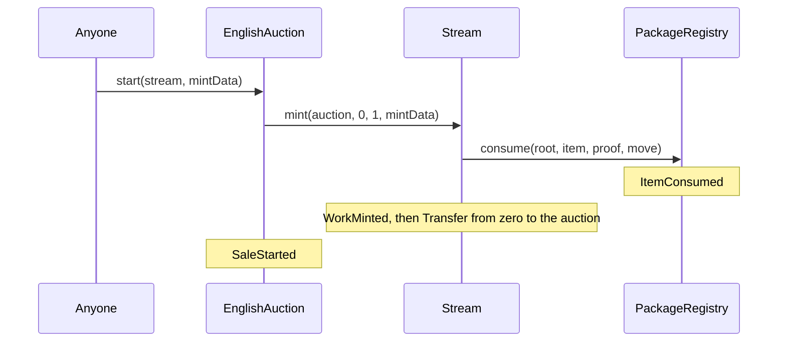

# Events and indexing

For indexer and integration engineers (marketplaces, 6529.io, analytics and the museum tooling)
who rebuild 6529 Works state from logs: every event each deployed contract can emit, with its
signature, topic0, emitters and meaning; the sequences that build each entity; and what the
events do not tell you. The rules are in the [specification](../spec/README.md), cited by ID.

> Pre-audit. See the [project status](../../README.md#status).

## Contents

- [How to read this page](#how-to-read-this-page)
- [Events by contract](#events-by-contract)
- [Reconstructing state from events](#reconstructing-state-from-events)
- [Indexing caveats](#indexing-caveats)
- [Appendix: full topic0 values](#appendix-full-topic0-values)

## How to read this page

- **Key every log by emitter address and topic0.** Several contracts share a signature, and so
  a topic0: every sale adapter has `ISaleAdapter`'s `SaleStarted`, `SaleSettled`,
  `Credited(address,address,uint256,uint256)`, `Claimed`, `TargetSet`,
  `FederationRegistrySet`, `Paused` and `Unpaused`; 6529 Stream and 6529 Stream Editions share
  `RoyaltyRateChanged`, `MetadataUpdate`, `BatchMetadataUpdate`, `OwnershipTransferred`,
  `ContractURISet`, `ContractURIUpdated`, `AdmittedMinterSet` and `ApprovalForAll`; `Bound`
  comes from both tokens and both registries, `AuthorityUpdated` from every governed contract.
  `Credited` (adapters, escrow), `ConfigSet` (auction, entropy module) and `NonceRevoked`
  (artist registry, statement log) each name two events with different topic0 values.
  `Transfer(address,address,uint256)` is also ERC-20's (the ERC-721 log has four topics), and
  `Paused`, `Unpaused` and `OwnershipTransferred` match OpenZeppelin's `Pausable` and `Ownable`.
- **Topics.** `indexed` parameters are topics 1 to 3, in declaration order. Structs, strings,
  bytes and arrays are ABI-encoded in the data, even where the table shows the struct name.
  The canonical signature of every event, with structs expanded to tuples, is in the
  [appendix](#appendix-full-topic0-values).
- **topic0** in the tables is the first four bytes of `keccak256` of the canonical signature;
  the appendix gives all 32 bytes, computed from the compiled ABIs
  ([`tools/content/keccak.py`](../../tools/content/keccak.py)).
- **Binding names.** The `name` of a `Bound` event is an ASCII string left-aligned in a
  `bytes32` (for example `"WORK_RECORDS"`), not a hash.
- **Where to start.** Scan from the deployment record's `startBlock`. For Sepolia r3 that is
  block 11,922,738 ([`1792095396.json`](../../deployments/11155111/1792095396.json)). The
  superseded r2 starts at block 11,894,137
  ([`1791750816.json`](../../deployments/11155111/1791750816.json)) and runs an earlier build
  whose events differ in a few places
  ([changes since r2](abis-and-interface-ids.md#changes-since-the-sepolia-r2-build)).
- **Roles and delays.** "PARAMETER_SETTER (48 hours)" names the role the selector maps to in
  the committed genesis policy and that role's delay class: immediate, standard (48 hours),
  funds (14 days) or successor (30 days). The full map is the generated
  [role matrix](../audit/roles.md).
- **Rule IDs.** An ID such as AUC-21 is a row of the "Rules and invariants" table of the spec
  page for its prefix: [CUR][cur], [AUC][auc], [ED][ed], [WS][ws], [RND][rnd], [ECO][eco],
  [ID][id], [DSP][dsp], [GV][gv], [ENT][ent].

**Enum values in event data.** Enums are encoded as `uint8`.

| Enum | Values | Source |
| --- | --- | --- |
| `ItemKind` | 0 `ORIGINAL`, 1 `EDITION_MASTER` | [`PackageTypes.sol`](../../src/interfaces/types/PackageTypes.sol) |
| `SeedPolicy` | 0 `NONE`, 1 `ARTIST`, 2 `VRF` | [`PackageTypes.sol`](../../src/interfaces/types/PackageTypes.sol) |
| `LocatorKind` | 0 `NONE`, 1 `ARWEAVE`, 2 `IPFS`, 3 `ONCHAIN` | [`ContentTypes.sol`](../../src/interfaces/types/ContentTypes.sol) |
| `IContentStore.Encoding` | 0 `Identity`, 1 `Gzip`, 2 `Base64`, 3 `GzipBase64` | [`IContentStore.sol`](../../src/interfaces/IContentStore.sol) |
| `Role` (statement log) | 0 `NONE`, 1 `ARTIST`, 2 `OWNER`, 3 `CURATOR`, 4 `PLATFORM` | [`IStatementLog.sol`](../../src/interfaces/IStatementLog.sol) |
| `ChangeKind` | 0 `NONE`, 1 `STANDARD`, 2 `CONTESTED`, 3 `ESTATE`, 4 `LOST_KEY` | [`IdentityTypes.sol`](../../src/interfaces/types/IdentityTypes.sol) |
| `IAssetAllowlist.Status` | 0 `None`, 1 `Active`, 2 `Deprecated` | [`IAssetAllowlist.sol`](../../src/economics/interfaces/IAssetAllowlist.sol) |
| `HashRef.algorithm` | 1 keccak256, 2 SHA-256, 3 BLAKE3 | [`HashRef.sol`](../../src/interfaces/types/HashRef.sol) |

The well-known `bytes32` labels in event data (`saleKind`, product IDs and the reserved
statement kinds) are `keccak256` of an ASCII name; their values are in
[ABIs and interface IDs](abis-and-interface-ids.md#other-derived-values). A statement `kind`
may be any non-zero value.

## Events by contract

Contracts are grouped by area. Two deployed contracts emit no events at all: the
`ConsolidationAdapter` ([`src/identity/ConsolidationAdapter.sol`](../../src/identity/ConsolidationAdapter.sol))
and the `Renderer` ([`src/content/Renderer.sol`](../../src/content/Renderer.sol)).

### Stream

[`src/stream/Stream.sol`](../../src/stream/Stream.sol), interface
[`IStream`](../../src/interfaces/IStream.sol) and [`IMintTarget`](../../src/interfaces/IMintTarget.sol).
ERC-721 events come from OpenZeppelin 5.7.0's `ERC721`; ERC-4906 events from `IERC4906`.

| Event | topic0 | Emitted by | Meaning and indexing notes |
| --- | --- | --- | --- |
| `WorkMinted(uint256 indexed tokenId, uint256 indexed collectionId, bytes32 indexed itemHash, uint64 serial, uint256 artistId, ItemKind kind, bytes32 packageRoot, bytes32 contentHash, bytes32 mediaHash, bytes32 recordFileId)` | `0x2f52e67a…` | `mint`, called by an admitted sale adapter (the English auction's `start` or `startWithBid`) | A curated work exists, in the adapter's custody. `artistId` is the lead artist; `serial` is its number in the collection. The only on-chain join from item hash to token ID. No economic terms ([what is not emitted](#what-is-not-emitted)). |
| `Transfer(address indexed from, address indexed to, uint256 indexed tokenId)` | `0xddf252ad…` | The mint (to the adapter), delivery at `settle` or `claimDelivery`, holder transfers, and the burn in `EnglishAuction.cancel` (to zero) | Ownership. A transfer clears the token's approval without an `Approval` event (OpenZeppelin 5). |
| `Approval(address indexed owner, address indexed approved, uint256 indexed tokenId)` | `0x8c5be1e5…` | `approve` | Standard ERC-721. |
| `ApprovalForAll(address indexed owner, address indexed operator, bool approved)` | `0x17307eab…` | `setApprovalForAll` | Standard ERC-721. |
| `PrimarySaleSettled(uint256 indexed tokenId)` | `0xbdf40a60…` | `markPrimarySettled`, by the adapter that minted the token, inside `settle` | The primary sale is final. Emitted before delivery is attempted, whether delivery then succeeds or is left pending ([AUC-21][auc]). At most once per token; it allows the master's edition ([ED-1][ed]). |
| `CollectionCreated(uint256 indexed collectionId, string name, bytes32 metadataHash)` | `0x8966ba95…` | `createCollection` (PLATFORM, immediate) | Collection IDs run from 1. A collection's count, and its last serial, is the number of `WorkMinted` naming it. |
| `RoyaltyRateChanged(uint256 indexed tokenId, uint32 previous, uint32 next)` | `0x2114cdf5…` | `setRoyaltyRate`, callable only by the bound work-records satellite, from `WorkRecords.setRoyaltyRate` | The ERC-2981 rate (out of 100,000) changed; the receiver never does ([AUC-6][auc]). Followed by the satellite's `RoyaltyRateSet`. |
| `DefaultRendererSet(address previous, address next, bytes32 codeHash)` | `0xe2fab5e9…` | The constructor (`previous` zero) and `setDefaultRenderer` (SUCCESSOR_SETTER, 30 days) | The renderer for every unfinalized work; `codeHash` is pinned. Followed by both tokens' `BatchMetadataUpdate`. Changes every unfinalized work's state hash, with no per-token event. |
| `EditionLinked(uint256 indexed tokenId, address indexed editions, uint256 editionId)` | `0xbab490db…` | `linkEdition`, callable only by bound 6529 Stream Editions, from `createEdition` | The master's edition exists; `editionId` always equals `tokenId`. Followed by `MetadataUpdate(tokenId)`. |
| `Bound(bytes32 indexed name, address target)` | `0xd18d9295…` | `bindWorkRecords` (`"WORK_RECORDS"`), `bindEditions` (`"EDITIONS"`), run by the genesis wiring | Once per name, never changed. |
| `OwnershipTransferred(address indexed previousOwner, address indexed newOwner)` | `0x8be0079c…` | The constructor (from zero) and `setOwner` (FUNDS_SETTER, 14 days) | The marketplace owner (`owner()`); no on-chain powers. |
| `ContractURISet(string previous, string next)` | `0xd144c591…` | `setContractURI` (PARAMETER_SETTER, 48 hours) | Followed by `ContractURIUpdated`. |
| `ContractURIUpdated()` | `0xa5d4097e…` | `setContractURI` | ERC-7572. |
| `AdmittedMinterSet(address indexed adapter, bool admitted)` | `0x16c923b1…` | `setAdmittedMinter` (SUCCESSOR_SETTER, 30 days; at genesis through the wiring) | Emitted on every call, even when nothing changes. Removal stops new mints only ([AUC-9][auc]). |
| `MetadataUpdate(uint256 _tokenId)` | `0xf8e1a15a…` | `emitMetadataUpdate` (bound work-records satellite only) and `linkEdition` | ERC-4906. The parameter is not indexed. See [ERC-4906 refresh triggers](#erc-4906-refresh-triggers). |
| `BatchMetadataUpdate(uint256 _fromTokenId, uint256 _toTokenId)` | `0x6bd5c950…` | `setDefaultRenderer`, and `emitMetadataUpdate` after a global or collection preferred-kind change | ERC-4906. Always `1` to `totalMinted()`, burned IDs included; not emitted while nothing is minted. With exactly one token minted, a preferred-kind change emits `MetadataUpdate(1)` instead. |

### WorkRecords

[`src/stream/WorkRecords.sol`](../../src/stream/WorkRecords.sol), interface
[`IWorkRecords`](../../src/interfaces/IWorkRecords.sol). Every per-token change below also
emits ERC-4906 events through both tokens ([refresh triggers](#erc-4906-refresh-triggers)).

| Event | topic0 | Emitted by | Meaning and indexing notes |
| --- | --- | --- | --- |
| `RecordOpened(uint256 indexed tokenId, bytes32 recordFileId, bytes32 mediaHash)` | `0xaa2a63e2…` | `openRecord` (permissionless) | The work's record exists, from the approved item and media. The media list, a non-default license and an ARTIST seed are stored but not emitted: read `mediaOf`, `licenseOf` and `seedOf`. Per-token views revert before this event ([WS-1][ws]). |
| `RecordSet(uint256 indexed tokenId, bytes32 recordFileId, bytes32 stateHash)` | `0xe459e8a9…` | `setRecord` (the lead artist's active authority, before finalize) | The work points at a new record file. `stateHash` is the new state hash. Re-publishing the current file emits nothing. |
| `WorkFinalized(uint256 indexed tokenId, address renderer, bytes32 stateHash)` | `0x01445583…` | `finalize` (the artist) | The record is immutable and `renderer`, the default renderer then, is pinned ([WS-9][ws]). `stateHash` is the new state hash. |
| `OnChainSyncProgress(uint256 indexed tokenId, uint256 files)` | `0x2ac9493b…` | `syncOnChain` (permissionless), when its budget of 512 chunks (`SYNC_CHUNKS`) stops it | The first `files` media files are complete in the content store; the next call resumes there. No metadata or state-hash change. |
| `WorkOnChainComplete(uint256 indexed tokenId)` | `0x15405c6b…` | The `syncOnChain` call that finds the last media file complete | Every media file is on-chain. One-way; the state hash does not change. Enables the implicit ONCHAIN locator ([WS-21][ws]) and inlining of the primary ([RND-17][rnd]). |
| `LicenseChanged(uint256 indexed tokenId, License previous, License next)` | `0x8f67810f…` | `relicense` (PARAMETER_SETTER, 48 hours, plus every party's `Relicense` signature) | `License` is `(string spdxId, bytes32 textFileId)`. The record version bumps; the event carries no state hash (read `workStateHash`). |
| `RoyaltyRateSet(uint256 indexed tokenId, uint32 previous, uint32 next, bytes32 stateHash)` | `0xe8cb8922…` | `setRoyaltyRate` (FUNDS_SETTER, 14 days, plus every party's `RoyaltyRateChange` signature) | The authoritative record of a rate change, with the new state hash. Follows 6529 Stream's and, for a linked master, 6529 Stream Editions' `RoyaltyRateChanged`. An unchanged rate emits nothing. |
| `RendererRepinned(uint256 indexed tokenId, address previous, address next, bytes32 codeHash)` | `0x382b0879…` | `repinRenderer` (SUCCESSOR_SETTER, 30 days, plus the artist's `RendererRepin` signature) | The errata path replaced a finalized work's renderer pin. No state hash in the event. |
| `LocatorAdded(uint256 indexed tokenId, bytes32 indexed fileId, uint256 index, Locator locator)` | `0x728460e4…` | `addLocator` (the artist before finalize, or PLATFORM) | `Locator` is `(uint8 kind, string uri)`. `index` is its position in the file's list, which is append-only. No state-hash change. |
| `PreferredKindSet(LocatorKind previous, LocatorKind next)` | `0x0c7addff…` | `setPreferredKind` (STORAGE_OPERATOR, immediate) | The global preferred locator kind. Emitted even when unchanged; refreshes every token and edition. |
| `CollectionPreferredKindSet(uint256 indexed collectionId, LocatorKind previous, LocatorKind next)` | `0x57ab57ed…` | `setCollectionPreferredKind` (STORAGE_OPERATOR) | A collection's preferred kind. The refresh covers every token, not only the collection's. |
| `FilePreferenceSet(uint256 indexed tokenId, bytes32 indexed fileId, uint256 previous, uint256 next)` | `0x700a41d4…` | `setFilePreference` (STORAGE_OPERATOR) | A file's preferred locator index; `type(uint256).max` means none. |

### Editions

[`src/editions/Editions.sol`](../../src/editions/Editions.sol), interface
[`IEditions`](../../src/interfaces/IEditions.sol). ERC-1155 events come from OpenZeppelin
`ERC1155`. The edition ID equals the master's Stream token ID.

| Event | topic0 | Emitted by | Meaning and indexing notes |
| --- | --- | --- | --- |
| `EditionCreated(uint256 indexed editionId, bytes32 indexed contentHash, EditionTerms terms)` | `0x3a4f273b…` | `createEdition` (permissionless, once the master's primary sale settled) | `EditionTerms` is `(uint32 maxCount, address currency, bytes32 saleKind, bytes params)`. The economics locked at creation are not emitted: read `edition(id)`. |
| `EditionMinterBound(uint256 indexed editionId, address indexed minter)` | `0x35bb9c80…` | The first `mint` of an edition, by an admitted adapter | The edition is bound to `minter`, the only adapter that may mint it from now on ([ED-5][ed]). Precedes that mint's `TransferSingle`. |
| `TransferSingle(address indexed operator, address indexed from, address indexed to, uint256 id, uint256 value)` | `0xc3d58168…` | Each mint (`operator` is the sale adapter, `from` zero), holder transfers, and an adapter's `burn` (to zero) | Copies minted is the sum of `value` with `from` zero. No v1 adapter calls `burn`. |
| `TransferBatch(address indexed operator, address indexed from, address indexed to, uint256[] ids, uint256[] values)` | `0x4a39dc06…` | Holder batch transfers | Never from a mint: adapters mint one ID per call. |
| `ApprovalForAll(address indexed account, address indexed operator, bool approved)` | `0x17307eab…` | `setApprovalForAll` | Standard ERC-1155. |
| `URI(string value, uint256 indexed id)` | `0x6bb7ff70…` | Never emitted | Metadata is `uri(id)`; use ERC-4906 events instead. |
| `RoyaltyRateChanged(uint256 indexed editionId, uint32 previous, uint32 next)` | `0x2114cdf5…` | `setRoyaltyRate`, callable only by the bound work-records satellite when the master is re-rated | The edition's rate follows its master's ([ED-7][ed]). Followed by `MetadataUpdate`. Nothing is emitted when the rate is unchanged. |
| `MetadataUpdate(uint256 _tokenId)` | `0xf8e1a15a…` | `createEdition`, `setRoyaltyRate`, and `notifyMasterUpdated` (the satellite, after the master changed) | ERC-4906 for one edition. |
| `BatchMetadataUpdate(uint256 _fromTokenId, uint256 _toTokenId)` | `0x6bd5c950…` | `notifyAllUpdated` (6529 Stream after a new default renderer, or the satellite after a preferred-kind change) | Always `(0, type(uint256).max)`: refresh every edition. |
| `Bound(bytes32 indexed name, address target)` | `0xd18d9295…` | `bindWorkRecords` (`"WORK_RECORDS"`), at genesis | Once. |
| `AdmittedMinterSet(address indexed adapter, bool admitted)` | `0x16c923b1…` | `setAdmittedMinter` (SUCCESSOR_SETTER, 30 days) | Emitted only on a change, unlike 6529 Stream's. |
| `ContractURISet(string previous, string next)` | `0xd144c591…` | `setContractURI` (PARAMETER_SETTER, 48 hours) | Followed by `ContractURIUpdated`. |
| `ContractURIUpdated()` | `0xa5d4097e…` | `setContractURI` | ERC-7572. |
| `OwnershipTransferred(address indexed previousOwner, address indexed newOwner)` | `0x8be0079c…` | The constructor (from zero) and `setOwner` (FUNDS_SETTER, 14 days) | The marketplace owner; no on-chain powers. |

### PackageRegistry

[`src/curation/PackageRegistry.sol`](../../src/curation/PackageRegistry.sol), interface
[`IPackageRegistry`](../../src/interfaces/IPackageRegistry.sol).

| Event | topic0 | Emitted by | Meaning and indexing notes |
| --- | --- | --- | --- |
| `PackageRegistered(bytes32 indexed packageRoot, bytes32 evidenceHash, address indexed verifier, address indexed signer)` | `0x0c1aff27…` | `registerPackage` (permissionless; the verifier decides) | The root is APPROVED. `verifier` is the curation verifier contract, `signer` the curation signer whose attestation it accepted. Approvals do not expire. |
| `PackageRevoked(bytes32 indexed packageRoot, bytes32 reasonHash)` | `0x6d695ea2…` | `revokePackage` (GUARDIAN, immediate) | The root is REVOKED for good: unconsumed items can no longer mint. It can come before, or without, a `PackageRegistered` ([CUR-2][cur]). |
| `PackageAccepted(bytes32 indexed packageRoot, uint256 indexed artistId, address indexed account)` | `0x49639e31…` | `acceptPackage` (permissionless relay of the party's signature) | `acceptedAs[root][account] = artistId`. Only the first acceptance per root and account emits; a repeat is a silent no-op. For an account with no artist ID yet, followed by the artist registry's `ArtistRegistered`. |
| `ItemConsumed(bytes32 indexed packageRoot, bytes32 indexed itemHash, uint256 indexed artistId, bytes32 contentHash)` | `0x1acc8cae…` | `consume`, callable only by bound 6529 Stream, inside `mint` during an auction start | The item is used and its content hash is claimed under `PRODUCT_STREAM`. The lead artist's move nonce is spent here with no event of its own. |
| `ContentClaimed(bytes32 indexed contentHash, bytes32 indexed itemHash)` | `0x7ee6542c…` | `claimContent`, callable only by bound 6529 Stream Editions, inside `createEdition` | The master's content hash is claimed under `PRODUCT_EDITIONS`. |
| `ContentReleased(bytes32 indexed contentHash, bytes32 indexed itemHash, uint256 indexed beneficiary)` | `0x0f5bb07b…` | `releaseContent`, callable only by 6529 Stream, from `Stream.releaseContent` (PARAMETER_SETTER, 48 hours) after an upheld-dispute burn | `itemHash` is tombstoned; the content hash is reserved for items led by `beneficiary` ([CUR-14][cur]). 6529 Stream emits nothing for this call. |
| `MoveRevoked(uint256 indexed artistId, uint256 indexed nonce)` | `0x7cfb5149…` | `revokeMove` (the artist's active authority) | An unused move nonce is void. |
| `VerifierSet(address previous, address next, bytes32 codeHash)` | `0xa3fb3ba5…` | The constructor (`previous` zero) and `setVerifier` (SUCCESSOR_SETTER, 30 days) | The previous verifier is retired for good. Registered approvals are unaffected. |
| `Bound(bytes32 indexed name, address target)` | `0xd18d9295…` | `bindStream` (`"STREAM"`), `bindEditions` (`"EDITIONS"`), at genesis | Once per name. |

### Eip712CurationVerifier

[`src/curation/Eip712CurationVerifier.sol`](../../src/curation/Eip712CurationVerifier.sol)
(the deployment record calls it `CurationVerifier`), interface
[`ICurationSignerVerifier`](../../src/interfaces/ICurationVerifier.sol).

| Event | topic0 | Emitted by | Meaning and indexing notes |
| --- | --- | --- | --- |
| `SignerDisabled(address indexed signer)` | `0xcd7d4157…` | `disableSigner` (GUARDIAN, immediate) | The signer's attestations stop counting at once, and it starts a new epoch, so nothing it signed before counts again ([CUR-17][cur]). Registered packages stay approved. |
| `SignerEnabled(address indexed signer)` | `0x71b97cfb…` | `enableSigner` (SUCCESSOR_SETTER, 30 days) | The signer counts again, at a new epoch. |

Who is a curation signer is decided by the AccessManager: `RoleGranted` and `RoleRevoked`
for role 4 (`CURATION_SIGNER`). The signer's epoch also changes with a new grant, so read
`signerEpoch(signer)` rather than deriving it.

### EnglishAuction

[`src/sales/EnglishAuction.sol`](../../src/sales/EnglishAuction.sol), interfaces
[`IEnglishAuction`](../../src/interfaces/IEnglishAuction.sol) and
[`ISaleAdapter`](../../src/interfaces/ISaleAdapter.sol). Sale IDs are derived:
`saleIdOf(token, tokenId) = uint256(keccak256(abi.encode(token, tokenId)))`.

| Event | topic0 | Emitted by | Meaning and indexing notes |
| --- | --- | --- | --- |
| `SaleStarted(uint256 indexed saleId, address indexed token, uint256 indexed tokenId, bytes32 saleKind, address currency, uint256 price, uint64 startTime, uint64 endTime)` | `0x36e87edc…` | `start`, `startWithBid` (permissionless) | An auction opened on a work just minted into custody. `saleKind` is `ENGLISH_AUCTION`; `currency` is the locked currency (`CURRENCY_DEFAULT` resolved); `price` is the locked opening bid; `endTime` is `startTime` plus the governed duration. |
| `BidPlaced(uint256 indexed saleId, address indexed bidder, address recipient, uint256 amount, uint64 endTime)` | `0x6dcc6bb7…` | `bid`, `startWithBid` | The new high bid. `bidder` is the payer (`payment.payer`; under Permit2 not always the sender); `recipient` receives the token if the bid wins; `endTime` includes any anti-snipe extension. Preceded by `Credited` to the outbid bidder. |
| `Credited(address indexed account, address indexed currency, uint256 indexed saleId, uint256 amount)` | `0xdd0ef63b…` | `bid` (the outbid bidder), `withdrawBid`, `cancel`, and `settle` (a refund at a freeze exit or for a delisted federated contract, or an ERC-20 payout that failed in its own frame, MONEY-1, [AUC-23][auc]) | `amount` is now claimable by `account` in `currency`; for a failed payout `account` is the seller wallet or the fee recipient. Credits pool per account and currency, across sales. |
| `Claimed(address indexed account, address indexed currency, address indexed to, uint256 amount)` | `0x913c9923…` | `claim` (by the account, to `to`) and `claimFor` (ERC-20 only, to the account itself) | All of the account's credit in that currency was paid out. |
| `BidWithdrawn(uint256 indexed saleId, address indexed bidder, uint256 amount)` | `0x8f861952…` | `withdrawBid`, while the auction is paused or its currency is deprecated | Preceded by `Credited`. The auction has no bidder; `amount` stays as the reserve ([DSP-15][dsp]). |
| `AuctionPaused(uint256 indexed saleId, bytes32 disputeRef)` | `0xc5ebe769…` | `pause(saleId, disputeRef)` (GUARDIAN, immediate) | A dispute pause, once per auction, at most 7 days ([AUC-26][auc]). |
| `AuctionResumed(uint256 indexed saleId, uint64 endTime)` | `0xd6998361…` | `resume` (UNPAUSER); the first state-changing call that touches an auction whose pause ran out; `settle` after a late re-admission of the locked currency (MARKET-2), which reopens instead of settling | The auction runs again until `endTime` ([AUC-27][auc]). An expired pause is [written down lazily](#event-ordering-within-a-transaction). |
| `AuctionCancelled(uint256 indexed saleId, bytes32 outcomeRef)` | `0x49d67654…` | `cancel` (PARAMETER_SETTER, 48 hours) | An upheld dispute. Preceded by `Credited` (the high bid) and 6529 Stream's `Transfer` to zero. `outcomeRef` is the token's own DISPUTE_OUTCOME entry hash ([DSP-18][dsp]). |
| `DeliveryPending(uint256 indexed saleId, address indexed recipient)` | `0x96b5b68e…` | `settle`, when the token's transfer to the recipient failed | The token stays in custody until `claimDelivery`. |
| `DeliveryClaimed(uint256 indexed saleId, address indexed recipient, address to)` | `0x97b1d318…` | `claimDelivery` (the recipient, the winning bidder, or with no bids the artist) | `recipient` is the recorded recipient; `to` is where the token went. Preceded by 6529 Stream's `Transfer`. |
| `SaleSettled(uint256 indexed saleId, address indexed token, uint256 indexed tokenId, address buyer, address recipient, uint256 quantity, address currency, uint256 price, address seller, uint256 sellerProceeds, address feeRecipient, uint256 fee)` | `0x16010625…` | `settle` (permissionless after the end) | The last event of a settlement. `quantity` is 1. With no standing bid (including a freeze exit or a delisted federated contract) `buyer` and `price` are zero and `recipient` is the artist's active authority. `price = sellerProceeds + fee`. |
| `ConfigSet(AuctionConfig previous, AuctionConfig next)` | `0xb2088623…` | The constructor and `setConfig` (PARAMETER_SETTER, 48 hours) | `AuctionConfig` is `(uint32 duration, uint32 extensionWindow, uint32 incrementShare)`. What a start locks is [AUC-15][auc]. |
| `OpeningBidSet(address indexed currency, uint256 previous, uint256 next)` | `0xdb7c74c4…` | `setOpeningBid` (PARAMETER_SETTER, 48 hours) | Applies to auctions that start afterwards. |
| `TargetSet(address indexed token, bool listed)` | `0xd79dab7c…` | The constructor's targets and `setTarget` (SUCCESSOR_SETTER, 30 days; at genesis through the wiring) | A token contract listed or unlisted for new auctions. |
| `FederationRegistrySet(address previous, address next)` | `0xb6b3a87c…` | `setFederationRegistry` (SUCCESSOR_SETTER) | No federation registry exists in v1. |
| `Paused(address account)` | `0x62e78cea…` | `pause()` (PAUSER, immediate) | Adapter-wide pause; on the auction it stops only new starts ([AUC-13][auc]). `account` is the immediate caller: the role holder, or the AccessManager through `execute`. |
| `Unpaused(address account)` | `0x5db9ee0a…` | `unpause()` (UNPAUSER, no earlier than 48 hours after the pause) | |

The fixed-price and Dutch adapters left with ADR 0005, and with them `PhasesSet`,
`SaleClosed` and `ConsentNonceRevoked`. The Sepolia r1 to r3 instances still emit them; the
`v1.0.0-rc.1` version of this page lists them. The edition auction's events come with its
adapter.

### StatementLog

[`src/records/StatementLog.sol`](../../src/records/StatementLog.sol), interface
[`IStatementLog`](../../src/interfaces/IStatementLog.sol).

| Event | topic0 | Emitted by | Meaning and indexing notes |
| --- | --- | --- | --- |
| `StatementAppended(bytes32 indexed subjectKey, bytes32 indexed kind, address indexed signer, Role role, address resolver, uint64 index, uint64 recordedAt, bytes32 entryHash, bytes32 head, Statement statement)` | `0x5cc78d0b…` | `append` (ARTIST or OWNER, as the caller), `appendCurator` (CURATOR, immediate), `appendPlatform` (PLATFORM, immediate), `appendGovernanceManifest` (SUCCESSOR_SETTER, 30 days), `appendSigned` (anyone relays a signature; a CURATOR or PLATFORM signer must hold the role with no execution delay, [DSP-3][dsp]) | One entry, in full. `Statement` is `(address token, uint256 id, bytes32 kind, bytes32 schema, HashRef content, string uri, bytes32 fileId, bytes32 supersedes)` and `HashRef` is `(uint16 algorithm, bytes32 digest)`. `subjectKey = keccak256(abi.encode(token, id))`. `resolver` is the artist resolver for an ARTIST entry, else zero. `index` is the entry's position in the subject's chain; `head` the chain head after it. Everything needed to recompute `entryHash` and `head` is in the event ([statements](#statements)). |
| `StatementRelayed(bytes32 indexed entryHash, address indexed signer, uint256 nonce)` | `0x080f9921…` | `appendSigned`, right after its `StatementAppended` | Marks the entry as relayed and spends `nonce` of `signer`. |
| `NonceRevoked(address indexed signer, uint256 indexed nonce)` | `0x22cd1acb…` | `revokeNonce` (the signer) | An unused relay nonce is void. |
| `ArtistResolverSet(address indexed previous, address indexed next, bytes32 codeHash)` | `0x0923c844…` | The constructor and `setArtistResolver` (SUCCESSOR_SETTER, 30 days) | Who may speak as ARTIST. Zero disables ARTIST statements. |

### ArtistRegistry

[`src/identity/ArtistRegistry.sol`](../../src/identity/ArtistRegistry.sol), interface
[`IArtistRegistry`](../../src/interfaces/IArtistRegistry.sol).

| Event | topic0 | Emitted by | Meaning and indexing notes |
| --- | --- | --- | --- |
| `ArtistRegistered(uint256 indexed artistId, ArtistIdentity identity)` | `0xd245a084…` | `register`, callable only by the package registry, inside an account's first `acceptPackage` | `ArtistIdentity` is `(address authority, address payout, bytes32 profileId, bytes32 profileDocHash)`. `artistId = uint256(uint160(authority))` and `payout = authority` ([ID-1][id]). It counts as first activity but emits no `ActivityRecorded`: use the block timestamp. |
| `ChangeStaged(uint256 indexed artistId, PendingChange change)` | `0x132aeaf2…` | `stageChange` (signed; STANDARD) and `stageOverride` (PARAMETER_SETTER, 48 hours; CONTESTED, ESTATE or LOST_KEY) | `PendingChange` is `(uint8 kind, ArtistIdentity next, address previousAuthority, uint64 stagedAt, uint64 executableAt, uint64 contestedAt, bytes32 priorOutcome, bytes32 evidenceHash, address[] cancellers)`; `contestedAt` and `priorOutcome` are zero here. `executableAt` is 7 days after staging for STANDARD, 180 days for an override ([ID-8][id]). Over a pending STANDARD change, `stageOverride` first emits its `ChangeCancelled`. |
| `ChangeCancelled(uint256 indexed artistId, address indexed by, bool vetoed)` | `0x88a03d9c…` | `cancelChange` on a STANDARD change (`vetoed` false); `vetoChange` (GUARDIAN, immediate; `vetoed` true); a voiding `resolveContested` (`vetoed` true); `stageOverride` replacing a STANDARD change (`vetoed` true); `executeChange` or an upholding `resolveContested` whose re-checks fail, and `expireContest` (`by` is the registry itself, `vetoed` false) | The pending change is gone and its reservation is released. |
| `ChangeContested(uint256 indexed artistId, address indexed by)` | `0xd96e40f8…` | `cancelChange` by a captured wallet on an override, before its notice ends | The override stays pending until resolved or lapsed ([ID-13][id]). `contestedAt` is this block's timestamp; `priorOutcome` is not in the event: read `pendingChange`. |
| `ChangeExecuted(uint256 indexed artistId, ArtistIdentity previous, ArtistIdentity next)` | `0x8e7ef8fd…` | `executeChange` (permissionless once due) and an upholding `resolveContested` | The identity changed. Preceded by `ActivityRecorded`; followed by the new authority's standing refresh events. |
| `ContestResolved(uint256 indexed artistId, bool upheld, bool executed, bytes32 outcomeRef)` | `0x82a368c0…` | `resolveContested` (SUCCESSOR_SETTER, 30 days) | The vote was applied. Follows the `ChangeExecuted` (upheld and executed) or the `ChangeCancelled` (voided, or re-checks failed). |
| `ContestExpired(uint256 indexed artistId)` | `0x7581cc54…` | `expireContest` (permissionless, 365 days after the contest, `CONTEST_TIMEOUT`) | Followed by `ChangeCancelled(artistId, registry, false)`. The lapse takes effect at the timeout, before anyone calls this ([ID-15][id]). |
| `ActivityRecorded(uint256 indexed artistId, uint64 timestamp)` | `0xb54d675a…` | `stageChange`, `cancelChange` (a cancel or a contest), `heartbeat`, `revokeNonce`, and every executed change | Signed artist activity, for dormancy ([ID-19][id]). |
| `NonceRevoked(uint256 indexed artistId, uint256 nonce)` | `0x7b1a3f30…` | `revokeNonce` (the current authority) | The change nonce `nonce` is burnt. Followed by `ActivityRecorded`. |
| `StandingAdded(uint256 indexed artistId, address indexed wallet, uint64 effectiveAt)` | `0xd59a9b09…` | Any standing refresh: registration, staging, `heartbeat`, execution, `refreshStanding` (permissionless) | A consolidated wallet was recorded, or a missing one was found again. It has standing from `effectiveAt`. |
| `StandingMissing(uint256 indexed artistId, address indexed wallet)` | `0x38ff12c3…` | A standing refresh | An established wallet is no longer consolidated; it keeps standing for 30 days (`STANDING_GRACE`, [ID-21][id]). |
| `StandingRemoved(uint256 indexed artistId, address indexed wallet)` | `0xe79c9b80…` | A standing refresh | The wallet lost standing ([ID-21][id], [ID-22][id]). |
| `StandingRefreshSkipped(uint256 indexed artistId)` | `0x103bc6dd…` | Registration or execution, when the consolidation source could not read or no longer has its pinned code hash | Nobody lost standing; a later `refreshStanding` catches up. |
| `FederatedContractListed(uint256 indexed artistId, address indexed token)` | `0x4004e60c…` | `listFederatedContract`, callable only by the v1.1 federation registry | Not emitted in v1. |
| `ConsolidationSourceSet(address previous, address next)` | `0x5b375cc7…` | The constructor and `setConsolidationSource` (SUCCESSOR_SETTER, 30 days) | |
| `Bound(bytes32 indexed name, address target)` | `0xd18d9295…` | `bindPackageRegistry` (`"PACKAGE_REGISTRY"`), `bindStream` (`"STREAM"`), `bindFederationRegistry` (`"FEDERATION_REGISTRY"`), `bindSplitFactory` (`"SPLIT_FACTORY"`), `bindStatementLog` (`"STATEMENT_LOG"`) | Once per name. |

### ContentStore

[`src/content/ContentStore.sol`](../../src/content/ContentStore.sol), interface
[`IContentStore`](../../src/interfaces/IContentStore.sol). Not governed.

| Event | topic0 | Emitted by | Meaning and indexing notes |
| --- | --- | --- | --- |
| `ChunkWritten(bytes32 indexed chunkHash, address pointer, uint256 length)` | `0xa720bfe8…` | `writeChunk` (anyone), the first time those bytes are stored | `chunkHash = keccak256(bytes)`. Chunks are shared by every file that lists them. Writing stored bytes again emits nothing. |
| `ManifestRegistered(bytes32 indexed fileId, uint256 length, uint256 chunkCount, Encoding encoding, bytes32 sha256Hash, string mimeType)` | `0x1642eab5…` | `registerManifest` (anyone), the first time | A file is declared. The chunk hashes are not in the event: read `chunkHash(fileId, i)` or decode the call. |
| `Base64Progress(bytes32 indexed fileId, uint256 chunksValidated)` | `0x02b839e8…` | `attestBase64` (anyone) when more calls are needed | `chunksValidated` chunks are checked; a call checks at most 48 (`ATTEST_CHUNKS_PER_CALL`). |
| `Base64Attested(bytes32 indexed fileId)` | `0xde611757…` | The `attestBase64` call that checks the last chunk | The whole file is strict base64, for good. Once per file. |

### DependencyRegistry

[`src/content/DependencyRegistry.sol`](../../src/content/DependencyRegistry.sol), interface
[`IDependencyRegistry`](../../src/interfaces/IDependencyRegistry.sol).

| Event | topic0 | Emitted by | Meaning and indexing notes |
| --- | --- | --- | --- |
| `DependencyRegistered(bytes32 indexed name, bytes32 indexed version, bytes32 indexed fileId)` | `0x5e1b96d0…` | `register` (PARAMETER_SETTER, 48 hours) | `(name, version)` maps to `fileId` forever; the file was complete on-chain when registered. `name` and `version` are left-aligned ASCII. |
| `DependencyDeprecated(bytes32 indexed name, bytes32 indexed version)` | `0x1ec1691a…` | `deprecate` (GUARDIAN, immediate) | A flag only; the version still resolves. |

### VrfEntropyModule

[`src/entropy/VrfEntropyModule.sol`](../../src/entropy/VrfEntropyModule.sol) (the deployment
record calls it `EntropyModule`), interface [`IEntropyModule`](../../src/interfaces/IEntropyModule.sol).

| Event | topic0 | Emitted by | Meaning and indexing notes |
| --- | --- | --- | --- |
| `SeedLinked(bytes32 indexed itemHash, bytes32 indexed contentHash)` | `0xf4e9ac38…` | `requestSeed` (permissionless), the first time an item is linked | The item reads its content's draw. One draw per content hash, shared by every item carrying that content. |
| `SeedRequested(bytes32 indexed itemHash, uint256 requestId)` | `0x13ccebb8…` | `requestSeed`, when it makes a VRF request: the first, or a retry once `retryDelay()` (at least 3 days, `MIN_RETRY_DELAY`) has passed with no seed ([ENT-5][ent]) | Not emitted when the item only joins a delivered or pending draw, or when an earlier request delivered during the call. |
| `SeedDelivered(bytes32 indexed contentHash, uint256 requestId, bytes32 seed)` | `0x2a1a98d7…` | `rawFulfillRandomWords`, by the VRF coordinator | The first delivery fixes the content's seed; later ones are silent no-ops ([ENT-4][ent]). Join to items through `SeedLinked`. |
| `CoordinatorSet(address previous, address next, bytes32 codeHash)` | `0x04092dc0…` | The constructor and `setCoordinator` (SUCCESSOR_SETTER, 30 days) | The old coordinator's requests can no longer deliver ([ENT-8][ent]). |
| `ConfigSet(VrfConfig previous, VrfConfig next)` | `0xc5843e71…` | The constructor, `setConfig` (PARAMETER_SETTER, 48 hours) and `lowerCallbackGasLimit` (SUCCESSOR_SETTER, 30 days) | `VrfConfig` is `(uint256 subscriptionId, bytes32 keyHash, uint32 callbackGasLimit, uint16 confirmations, bool nativePayment)`. Not the auction's `ConfigSet`. |

### SplitFactory and SplitWallet

[`src/economics/SplitFactory.sol`](../../src/economics/SplitFactory.sol) and
[`src/economics/SplitWallet.sol`](../../src/economics/SplitWallet.sol), interfaces
[`ISplitFactory`](../../src/economics/interfaces/ISplitFactory.sol) and
[`ISplitWallet`](../../src/economics/interfaces/ISplitWallet.sol). Each split wallet is its own
contract at a CREATE2 address.

| Event | topic0 | Emitted by | Meaning and indexing notes |
| --- | --- | --- | --- |
| `WalletCreated(address indexed wallet, bytes32 indexed configHash, bytes32 salt, ISplitWallet.Payee[] payees)` | `0x140f5f99…` | `SplitFactory.createWallet` (anyone), the first deployment only | `Payee` is `(uint256 artistId, address account, uint32 share)`. Sales pay predicted addresses, so funds can arrive long before this event, or without it ([ECO-11][eco]). |
| `Released(address indexed asset, uint256 indexed payee, address indexed recipient, address account, uint256 amount, uint256 observed)` | `0x8cb42764…` | A wallet's `release`, `releaseTo` and `releaseWithAuthorization` | `payee` is the payee index; `account` is its payout address at that moment (resolved through the artist registry for an artist-resolved payee); `observed` is the wallet's cumulative receipts of `asset` then. ETH is `asset` zero. The emitter is the wallet. |

### ReleaseVerifier and ClaimRouter

[`src/economics/ReleaseVerifier.sol`](../../src/economics/ReleaseVerifier.sol) and
[`src/economics/ClaimRouter.sol`](../../src/economics/ClaimRouter.sol).

| Event | topic0 | Emitted by | Meaning and indexing notes |
| --- | --- | --- | --- |
| `NonceUsed(address indexed account, uint256 indexed nonce, bool revoked)` | `0x4efdf80e…` | `ReleaseVerifier.consume`, called by the wallet inside `releaseWithAuthorization` (`revoked` false), and `revokeNonce` (`revoked` true) | A signed-release nonce is spent. A consumed nonce is followed by the wallet's `Released`. |
| `ClaimFailed(address indexed wallet, address indexed asset, uint256 indexed payee, uint256 index, uint256 size, bytes reason)` | `0xdaabf7a5…` | `ClaimRouter.claim` and `claimSigned`, in continue mode, for an item that failed | `index` is the item's position in the batch; `reason` is at most the first 256 bytes of the revert data: decode it against the wallet, the release verifier and the shared library errors (a bad signature reverts with the error `SignatureVerifier.InvalidSignature`, an expired one with `SignatureVerifier.SignatureExpired`). Successful items appear only as the wallets' `Released`. |

### RevenueEscrow

[`src/economics/RevenueEscrow.sol`](../../src/economics/RevenueEscrow.sol), interface
[`IRevenueEscrow`](../../src/economics/interfaces/IRevenueEscrow.sol).

| Event | topic0 | Emitted by | Meaning and indexing notes |
| --- | --- | --- | --- |
| `Credited(address indexed wallet, address indexed asset, address indexed payer, uint256 amount, uint256 owed)` | `0x2a56c0b8…` | `depositETH`, `depositERC20` (any payer; a sale adapter when a payout was refused) | `wallet` is now owed `owed` of `asset`. `payer` is the depositing contract, so a sale's escrowed payout shows the adapter as payer. |
| `Flushed(address indexed wallet, address indexed asset, address indexed caller, uint256 amount)` | `0xf5c342af…` | `flush` (anyone) | Everything owed was paid to the wallet; it is owed zero. |
| `Recovered(address indexed wallet, address indexed replacement, address indexed asset, uint256 amount, uint256 owed)` | `0xc8e2b659…` | `recover` (FUNDS_SETTER, 14 days) | The whole credit moved to `replacement`, now owed `owed`; `wallet` is owed zero. For a non-factory account it uses up the recovery consent ([ECO-28][eco]). |
| `RecoveryConsentSet(address indexed account, address indexed replacement)` | `0x4d47077d…` | `consentToRecovery` (the account) | Zero withdraws the consent. |

### AssetAllowlist and EconomicsResolver

[`src/economics/AssetAllowlist.sol`](../../src/economics/AssetAllowlist.sol) and
[`src/economics/EconomicsResolver.sol`](../../src/economics/EconomicsResolver.sol), interfaces
[`IAssetAllowlist`](../../src/economics/interfaces/IAssetAllowlist.sol) and
[`IEconomicsResolver`](../../src/interfaces/IEconomicsResolver.sol).

| Event | topic0 | Emitted by | Meaning and indexing notes |
| --- | --- | --- | --- |
| `AssetStatusChanged(address indexed asset, Status previous, Status current, uint64 revision)` | `0xd5701084…` | The allowlist's constructor (ETH admitted), `admitAsset` (FUNDS_SETTER, 14 days; [ECO-33][eco]) and `deprecateAsset` (GUARDIAN, immediate) | A deprecation freezes running auctions in that currency ([AUC-25][auc]). |
| `IncrementFloorChanged(address indexed asset, uint256 previous, uint256 current, uint64 revision)` | `0x866085d8…` | Every admission (with the same revision as its `AssetStatusChanged`) and `setIncrementFloor` (PARAMETER_SETTER, 48 hours) | The absolute minimum bid increment; an auction locks it at its first bid. |
| `DefaultCurrencyChanged(bytes32 indexed product, address previous, address current, uint64 revision)` | `0x067a6334…` | `setDefaultCurrency` (FUNDS_SETTER, 14 days; each product's first at genesis through the wiring) | The currency a sale of `product` locks when its terms say `CURRENCY_DEFAULT`. |
| `EconomicsSet(bytes32 indexed product, ProductEconomics previous, ProductEconomics next, uint64 revision)` | `0x7b619472…` | The resolver's constructor (once per product, from zeros, revision 1), `setFeeTerms` (FUNDS_SETTER, 14 days) and `setRoyaltyRate` (PARAMETER_SETTER, 48 hours) | `ProductEconomics` is `(address feeRecipient, uint32 feeShare, uint32 royaltyRate)`. Applies to new works and editions only ([ECO-6][eco]). `revision` is the changed setting's own counter: compare `previous` and `next` to tell fee terms from royalty rate. |
| `DefaultLicenseSet(bytes32 indexed product, License previous, License next, uint64 revision)` | `0x45967214…` | The constructor (once per product) and `setDefaultLicense` (PARAMETER_SETTER, 48 hours) | The default license for new packages. |
| `MuseumSet(address previous, address next, uint64 revision)` | `0x2a1c0960…` | The constructor (once, from zero, revision 1) and `setMuseum` (FUNDS_SETTER, 14 days) | The 6529 Network Museum (D140): where an unbid canonical 6529 Stream work goes. The auction reads it at settlement, so it applies to every settlement after the change, sales already running included; a delivery already pending for the previous museum stays with it ([AUC-24][auc], [ECO-37][eco]). Not indexed: filter by the resolver's address. |

### GovernanceConfigurator and WorksAccessManager

[`src/governance/GovernanceConfigurator.sol`](../../src/governance/GovernanceConfigurator.sol)
and [`src/governance/WorksAccessManager.sol`](../../src/governance/WorksAccessManager.sol). The
manager is OpenZeppelin 5.7.0's `AccessManager`
([`IAccessManager.sol` at v5.7.0](https://github.com/OpenZeppelin/openzeppelin-contracts/blob/v5.7.0/contracts/access/manager/IAccessManager.sol))
with three cancellation rules and the guardians' suspension of operational keys, which adds two
events, `RoleSuspended` and `RoleSuspensionLifted`. Role IDs are in
[`Roles.sol`](../../src/governance/Roles.sol): 0 `ADMIN`, 1 `GUARDIAN`, 2 `PAUSER`, 3
`UNPAUSER`, 4 `CURATION_SIGNER`, 5 `STORAGE_OPERATOR`, 6 `MINTER`, 7 `KEEPER`, 8 `PLATFORM`,
9 `PARAMETER_SETTER`, 10 `FUNDS_SETTER`, 11 `SUCCESSOR_SETTER`, 12 `CURATOR`.

| Event | topic0 | Emitted by | Meaning and indexing notes |
| --- | --- | --- | --- |
| `GovernanceConfigured(address indexed manager, bytes32 indexed configHash, bytes32 indexed manifestHash, bytes32 wiringHash)` | `0xeb9f30f8…` | `GovernanceConfigurator.configure` (the deployer, once) | Genesis is installed. `configHash = keccak256(abi.encode(cfg))`, `wiringHash = keccak256(abi.encode(wiring))`, `manifestHash` the signed epoch-0 manifest. The last event of the genesis transaction. |
| `OperationScheduled(bytes32 indexed operationId, uint32 indexed nonce, uint48 schedule, address caller, address target, bytes data)` | `0x82a2da5d…` | `schedule` | A delayed call is queued. `operationId = keccak256(abi.encode(caller, target, data))`; `schedule` is the earliest execution time; `data` the full calldata; `nonce` counts reschedulings. |
| `OperationExecuted(bytes32 indexed operationId, uint32 indexed nonce)` | `0x76a2a469…` | `execute`, or the target's `restricted` check when the scheduler calls the target directly (`consumeScheduledOp`) | A scheduled operation ran. Immediate calls emit nothing here. |
| `OperationCanceled(bytes32 indexed operationId, uint32 indexed nonce)` | `0xbd9ac67a…` | `cancel` (the scheduler, an admin or a guardian, within [GV-1][gv], [GV-2][gv] and [GV-25][gv]) | The operation will not run. |
| `RoleGranted(uint64 indexed roleId, address indexed account, uint32 delay, uint48 since, bool newMember)` | `0xf98448b9…` | `grantRole` (genesis, or a 30-day admin operation) | A new member is active from `since`. For an existing member, `since` is when its new execution `delay` applies. |
| `RoleRevoked(uint64 indexed roleId, address indexed account)` | `0xf229baa5…` | `revokeRole` (an admin operation), `renounceRole` (the holder, at once) | Membership ends when the call runs. The configurator renounces `ADMIN` at the end of `configure`. Preceded by `RoleSuspensionLifted` when the holder was suspended. |
| `RoleSuspended(uint64 indexed roleId, address indexed account, address indexed guardian)` | `0xe1ae3024…` | `suspend` (any GUARDIAN holder, immediate), for a `PLATFORM`, `CURATOR` or `STORAGE_OPERATOR` holder ([GV-26][gv]) | From this block `account` fails `hasRole` and `canCall` for `roleId` ([GV-27][gv]). No `RoleRevoked` follows, and `getAccess` still shows the record. |
| `RoleSuspensionLifted(uint64 indexed roleId, address indexed account)` | `0x4c939cf9…` | `grantRole` or `revokeRole` of that role to that account (an admin operation, 30 days), or the holder's own `renounceRole` (at once) ([GV-28][gv]) | The suspension is over. Precedes the same call's `RoleGranted` (the holder acts again) or `RoleRevoked` (it holds no role). |
| `RoleLabel(uint64 indexed roleId, string label)` | `0x1256f5b5…` | `labelRole`, at genesis for roles 1 to 12 | Names from `Roles.label`. |
| `RoleAdminChanged(uint64 indexed roleId, uint64 indexed admin)` | `0x1fd6dd76…` | `setRoleAdmin` | Not used at genesis: every role's admin stays `ADMIN`. |
| `RoleGuardianChanged(uint64 indexed roleId, uint64 indexed guardian)` | `0x7a805963…` | `setRoleGuardian`, at genesis for roles 1 to 12 | Every role but `ADMIN` has `GUARDIAN` as guardian. |
| `RoleGrantDelayChanged(uint64 indexed roleId, uint32 delay, uint48 since)` | `0xfeb69018…` | `setGrantDelay` | The new grant delay applies from `since`. |
| `TargetAdminDelayUpdated(address indexed target, uint32 delay, uint48 since)` | `0xa56b7601…` | `setTargetAdminDelay`, at genesis for the manager and every target | The new admin delay applies from `since`. |
| `TargetFunctionRoleUpdated(address indexed target, bytes4 selector, uint64 indexed roleId)` | `0x9ea6790c…` | `setTargetFunctionRole`, at genesis one per mapped selector | The role a selector needs. Unmapped selectors fall back to `ADMIN`. |
| `TargetClosed(address indexed target, bool closed)` | `0x90d4e7bb…` | `setTargetClosed` | A closed target refuses every `restricted` call. |

### AccessManaged and EIP-712 events

Every governed contract declares `AuthorityUpdated`, and the EIP-712 signers declare
`EIP712DomainChanged`; the per-contract tables above omit both, and the
[appendix](#appendix-full-topic0-values) lists the contracts.

| Event | topic0 | Emitted by | Meaning and indexing notes |
| --- | --- | --- | --- |
| `AuthorityUpdated(address authority)` | `0x2f658b44…` | Every governed contract's constructor, and `setAuthority`, which only the current AccessManager can call (`updateAuthority`) | The contract is now governed by `authority`. A change after deployment moves the whole contract to another manager: alert on it. |
| `EIP712DomainChanged()` | `0x0a6387c9…` | Never emitted | Declared by EIP-5267 in OpenZeppelin `EIP712`. Each domain is fixed at deployment; read it with `eip712Domain()`. |

### Not deployed: federation registry

[`IFederationRegistry`](../../src/interfaces/IFederationRegistry.sol) declares `Registered`,
`StatusSet` and `ArtistDelistingSet`. v1 ships no implementation, so nothing emits them; their
signatures are in the appendix.

## Reconstructing state from events

Each subsection lists the events that build one entity, in order, and names the view to read
where no event carries the value.

### A package

The registry holds a root's approval and per-item use; the items are in the published package
document.

- **Status.** `PackageRegistered` makes the root APPROVED; `PackageRevoked` makes it REVOKED for
  good, and may come first ([CUR-2][cur]).
- **Evidence.** `PackageRegistered.evidenceHash` and `signer`, and the CURATOR's
  `CURATION_EVIDENCE` statement on the subject `(address(0), uint256(packageRoot))`.
- **Consent.** One `PackageAccepted` per party: `acceptedAs(root, account)`.
- **Items.** One `ItemConsumed` per item that started an auction, followed in the same
  transaction by `WorkMinted` with the same `itemHash`. An item with none is unconsumed.
- **Moves.** A consumed item spends its move nonce silently; `MoveRevoked` records a
  revocation. Read `isMoveNonceUsed(artistId, nonce)` for either.
- **Content.** `consumedItemOf`, `editionClaimOf` and `releasedTo` follow `ItemConsumed`,
  `ContentClaimed` and `ContentReleased`.

### A Stream work

| Stage | Events | Read |
| --- | --- | --- |
| Minted | `ItemConsumed`, `WorkMinted`, `Transfer(0, auction, tokenId)` | The full item: the published package, or the start calldata (`mintData` is `abi.encode(StreamMintRequest)`) |
| Record opened | `RecordOpened` | `mediaOf`, `licenseOf`, `seedOf` |
| Record set | `RecordSet`, each time until finalize | `record(tokenId)` |
| Locators | `LocatorAdded` per copy; `FilePreferenceSet`, `CollectionPreferredKindSet`, `PreferredKindSet` | `preferredLocator(tokenId, fileId)` ([WS-21][ws]) |
| On-chain complete | Zero or more `OnChainSyncProgress`, then `WorkOnChainComplete` | |
| Finalized | `WorkFinalized` | `record(tokenId)` |
| Amended | `RoyaltyRateChanged` then `RoyaltyRateSet`; `LicenseChanged`; `RendererRepinned` | `workStateHash(tokenId)` |
| Edition linked | `EditionLinked(tokenId, editions, tokenId)` | `editionOf(tokenId)` |
| Delivered, transferred | `Transfer` | `ownerOf(tokenId)` |
| Burned | `Transfer(auction, 0, tokenId)` with `AuctionCancelled`, only before the sale settled ([DSP-20][dsp]); a later `ContentReleased` names the item | |

The record version is the number of `RecordSet`, `WorkFinalized`, `LicenseChanged`,
`RoyaltyRateSet` and `RendererRepinned` events for the token, from zero at `openRecord`
([WS-11][ws]). The state hash also commits to values no event carries, so read
`workStateHash(tokenId)` rather than recompute it
([formula](abis-and-interface-ids.md#work-state-hash)).

### An auction

Per `saleId`:

- **Bids.** Each `BidPlaced` replaces the high bid and may extend `endTime`; the outbid
  bidder's `Credited` comes just before it.
- **Paused.** `AuctionPaused`, ended by `AuctionResumed`, `AuctionCancelled`, or the 7-day
  lapse ([DSP-14][dsp]). A withdrawal is `Credited`, then `BidWithdrawn`.
- **Ended.** Never emitted: read `auction(saleId)`, which also applies an expired pause.
- **Currency frozen.** An `AssetStatusChanged` to `Deprecated` for the locked currency freezes
  the auction ([AUC-25][auc]). The first `settle` after a late re-admission emits
  `AuctionResumed` and settles nothing. After 30 days of deprecation (`_FREEZE_EXIT`), `settle`
  ends the sale unsold: `Credited` back to the bidder, then the settlement events with `buyer`
  zero.
- **Settled.** In order: any refund `Credited`; the payouts (direct, an escrow `Credited` with
  the auction as payer, or an auction `Credited` for a failed ERC-20 frame);
  `PrimarySaleSettled`; `Transfer` or `DeliveryPending`; `SaleSettled`. A pending delivery ends
  with 6529 Stream's `Transfer`, then `DeliveryClaimed`; meanwhile `pendingDelivery(saleId)` is
  the recipient.
- **Cancelled.** `Credited` (the high bid), `Transfer` to zero, `AuctionCancelled`.
- **Credits.** Per account and currency on one adapter, `claimable` is the sum of `Credited`
  minus the sum of `Claimed`.

### An edition

- **Created.** `EditionCreated`, `MetadataUpdate(editionId)`, the registry's `ContentClaimed`,
  and 6529 Stream's `EditionLinked` and `MetadataUpdate`, in one transaction. Read
  `edition(editionId)` for the locked economics.
- **Bound.** `EditionMinterBound` on the first mint names the adapter that sells the edition;
  `edition(id).minter` reads it.
- **Mints.** `TransferSingle` from zero, with the sale adapter as `operator`; the adapter's own
  events tell the sale.
- **Supply.** The sum of `TransferSingle.value` from zero equals `edition(id).minted`.
  Reaching the creator's cap emits nothing.

### Money

- **Split wallets.** A work's seller and royalty wallets are predicted addresses
  (`work(tokenId)`, or `edition(id)`). Payments into them emit no protocol event; an ERC-20
  emits its own `Transfer`.
- **Releases.** Per wallet, asset and payee index, the released total is the sum of
  `Released.amount`. For current figures read `observed(asset)` and `releasable(asset, index)`.
- **Signed releases and batches.** `NonceUsed(account, nonce, false)`, then the wallet's
  `Released`; `NonceUsed(account, nonce, true)` is a revocation. A claim router batch shows its
  successes only as `Released`, and its failures in continue mode as `ClaimFailed`.
- **Escrow.** Per `(wallet, asset)`, the balance is the `owed` of the latest `Credited`, or of a
  `Recovered` naming the wallet as `replacement`; `Flushed`, or a `Recovered` naming it as
  `wallet`, sets it to zero. A non-factory account's recovery consent is its latest
  `RecoveryConsentSet`, cleared by its next `Recovered`. `WalletCreated` tells factory wallets
  apart.
- **Sale credits.** See [an auction](#an-auction).

### Identity

- **Created.** `ArtistRegistered`, in a first `acceptPackage`. The authority maps to the artist
  ID from then on (`artistIdOf`).
- **Staged.** `ChangeStaged` carries the whole pending change, cancellers and `executableAt`
  included. A new authority is reserved until the change ends ([ID-3][id]). `changeNonce` is
  the number of `ChangeStaged` plus `NonceRevoked` events for the artist.
- **Ended.** Exactly one of: `ChangeExecuted`; `ChangeCancelled`; or, for a contested override,
  `ContestResolved` (after `ChangeExecuted` or `ChangeCancelled`) or `ContestExpired` (then
  `ChangeCancelled`).
- **Contested.** `ChangeContested`. The contest lapses 365 days later with no event
  ([ID-15][id]).
- **Derived answers.** `activeAuthorityOf` ([ID-18][id]) and `payoutAddress` ([ID-16][id])
  depend on the pending change and the clock: read them rather than replay the rules.
- **Dormancy.** The last activity is the later of the registration block's timestamp and the
  latest `ActivityRecorded.timestamp`.
- **Standing.** Replay `StandingAdded`, `StandingMissing` and `StandingRemoved`, or read
  `standingOf(artistId)`.

### Statements

The log stores only a count, a head and the latest dispute outcome per subject; the events
carry everything else. To rebuild a subject's history and prove it complete:

1. Collect every `StatementAppended` whose topic 1 is the subject key, and check that each
   `statement.token` and `statement.id` hash to it.
2. Sort by `index`. The indexes must run 0, 1, 2 and so on with no gap.
3. Recompute each `entryHash`, then fold the head from zero, and check both against the event
   ([formulas](abis-and-interface-ids.md#statement-entry-hash-and-chain-head), [DSP-10][dsp]).
4. Call `chainOf(token, id)` at the block you indexed to. If its `count` equals your number of
   entries and its `head` your last head, your copy is complete and unaltered.

[`StatementLogGolden.t.sol`](../../test/records/StatementLogGolden.t.sol) pins an entry hash
and a head. Also:

- The log does not check `supersedes`; verify it against your rebuilt chains.
- A relayed entry is followed by `StatementRelayed`.
- Read `kind` together with `role`: only `DISPUTE_OUTCOME`, `CURATION_EVIDENCE` and
  `GOVERNANCE_MANIFEST` are reserved ([DSP-4][dsp]). PLATFORM is the only writer of
  `DISPUTE_OUTCOME`, through `appendPlatform` or a relayed `appendSigned`.
- `disputeOutcomeOf(token, id)` is the subject's own latest outcome; `latestDisputeOutcome`
  adds the fallback from a token to its item ([DSP-12][dsp]).
- Governance manifests form their own chain on the subject `(manager, 0)`, with the manager as
  signer and role PLATFORM ([DSP-5][dsp]).

### Governance

- **Genesis.** One transaction holds, in order: the configurator's `RoleLabel`,
  `RoleGuardianChanged`, `RoleGrantDelayChanged` and `TargetAdminDelayUpdated` events; the
  wiring calls' own events (`Bound`, `AdmittedMinterSet`, `TargetSet`, `DefaultCurrencyChanged`,
  the epoch-0 `GOVERNANCE_MANIFEST` statement); `TargetFunctionRoleUpdated` per selector;
  `RoleGranted` per holder; the configurator's `RoleRevoked` of `ADMIN`; `GovernanceConfigured`.
- **Operations.** Pending from `OperationScheduled` until `OperationExecuted` or
  `OperationCanceled` with the same `operationId` and `nonce`. An operation not executed within
  one week of becoming ready expires with no event ([GV-7][gv]); it can still be cancelled,
  which emits `OperationCanceled`. Decode `data` to see what it will do. Calls
  by an immediate role holder show only as the target's own event.
- **Roles.** Membership is the replay of `RoleGranted` and `RoleRevoked` per
  `(roleId, account)`; a new member is active from `RoleGranted.since`.
- **Suspensions.** The membership replay still shows a suspended holder. Track a flag per
  `(roleId, account)`, set by `RoleSuspended` and cleared by `RoleSuspensionLifted`, or read
  `isSuspended`. A lift by admin operation is announced by its `OperationScheduled`; one by
  `renounceRole` is not ([GV-28][gv]).
- **Selectors.** `TargetFunctionRoleUpdated` per `(target, selector)`; `TargetClosed` per
  target.
- **Blind spots.** The manager has no getter for a pending grant-delay or target-admin-delay
  cut (a `RoleGrantDelayChanged` or `TargetAdminDelayUpdated` with a future `since`), a role's
  members, or pending operations, so the deployment CI scans for them
  ([genesis configure](../spec/governance.md#genesis-configure), [GV-33][gv]).
- **Later epochs.** Each later configuration epoch publishes its manifest as a
  `GOVERNANCE_MANIFEST` statement on `(manager, 0)`, scheduled with that epoch's operations.

## Indexing caveats

### Event ordering within a transaction

- **Effects come before the summary event.** `ItemConsumed` precedes `WorkMinted`;
  `PrimarySaleSettled` and the delivery precede `SaleSettled`; `Credited` precedes
  `BidPlaced` and `BidWithdrawn`; `RoyaltyRateChanged` precedes `RoyaltyRateSet`;
  `ChangeExecuted` or `ChangeCancelled` precede `ContestResolved`.
- **Lazy events.** An expired auction pause is written down (`AuctionResumed`) by a later
  transaction; a contest lapses with no event until `expireContest`. Apply the time rules
  yourself, or read the views.
- **Several contracts in one transaction.** A start touches the package registry, 6529 Stream
  and the auction; a settlement may also touch the escrow; a royalty change touches both tokens
  and the satellite. Order by log index, not by contract.

### Reorgs

Treat logs as provisional until their block is final, and keep the block hash with every log
so a reorg can be undone. Two checks catch gaps: statement chains must have contiguous indexes
and a head that matches `chainOf`, and each collection's serials must run 1, 2, 3 and so on.

### Subjects, items and tokens

- **The pre-mint subject.** Statements about an item before it is minted use the subject
  `(address(0), uint256(itemHash))`. The log never links it to the token: join the two chains
  through `WorkMinted.itemHash`. A package's curation evidence uses
  `(address(0), uint256(packageRoot))`.
- **Burned tokens leave ID gaps** ([AUC-5][auc]). `totalMinted()` is the highest ID;
  `totalSupply()` counts live tokens. A burned ID's views revert with `UnknownWork`.
- **Edition ID equals master token ID.** `EditionCreated`, `EditionLinked` and
  `TransferSingle.id` all carry the same number.

### Derived state with no event

- **Content-store completeness.** No event marks it. A file is complete when every chunk its
  manifest lists is written at the length the layout requires ([WS-27][ws]). Derive it from
  `ManifestRegistered` and the `ChunkWritten` events of its chunk hashes (which may come first,
  and may be shared with other files), or read `isComplete(fileId)`.
### What is not emitted

| Value | Where to read it |
| --- | --- |
| A work's seller wallet, royalty receiver and current royalty rate | `Stream.work(tokenId)`; the receiver is derived, never stored ([ECO-7][eco]) |
| A work's fee recipient and fee share, locked at mint | `Stream.primaryTerms(tokenId, "")`: the `PRODUCT_STREAM` terms of the latest `EconomicsSet` before the mint ([ECO-6][eco]) |
| An edition's seller, fee terms, royalty receiver and rate | `Editions.edition(id)` |
| A record's media list, stored license and ARTIST seed | `mediaOf`, `licenseOf`, `seedOf` on the satellite |
| A work's state hash after `openRecord`, `LicenseChanged`, `RendererRepinned` or a new default renderer | `workStateHash(tokenId)` |
| A manifest's chunk hashes | `chunkHash(fileId, index)`, or the `registerManifest` calldata |
| The full package item | The published package, or the calldata of `start`, `openRecord`, `createEdition` or `requestSeed` |
| A move nonce spent by `consume` | `isMoveNonceUsed` |
| A contest's `priorOutcome` | `pendingChange(artistId)` |
| Money arriving in a split wallet | The wallet's balance, or the token's `Transfer` events |
| An auction's minimum next bid | `minimumBid(saleId)` |

### ERC-4906 refresh triggers

6529 Stream and 6529 Stream Editions emit ERC-4906 events for these changes ([RND-27][rnd]).
The mint itself emits none: a new token has no cached metadata.

| Change | 6529 Stream emits | 6529 Stream Editions emits |
| --- | --- | --- |
| `openRecord`, `setRecord`, `finalize`, the `syncOnChain` that completes, `relicense`, `setRoyaltyRate`, `repinRenderer`, `addLocator`, `setFilePreference` | `MetadataUpdate(tokenId)` | `MetadataUpdate(tokenId)` when the master has an edition |
| `setRoyaltyRate` on a master with an edition | (as above) | also `MetadataUpdate(editionId)` from the rate change itself |
| `setPreferredKind`, `setCollectionPreferredKind` | `BatchMetadataUpdate(1, totalMinted)` | `BatchMetadataUpdate(0, type(uint256).max)` |
| `setDefaultRenderer` | `BatchMetadataUpdate(1, totalMinted)` | `BatchMetadataUpdate(0, type(uint256).max)` |
| `createEdition` | `MetadataUpdate(tokenId)` (from `linkEdition`) | `MetadataUpdate(editionId)` |
| `setContractURI` | `ContractURIUpdated` (ERC-7572) | `ContractURIUpdated` |

Metadata also changes with no ERC-4906 event when a dispute outcome is recorded, when a record
or preview file completes in the content store, and when a base64 file is attested: the
signals are in [Reading a work](reading-a-work.md#when-to-refresh). A pinned renderer whose
code changed makes `tokenURI` revert with `Dependency.DependencyCodeChanged(renderer)` until a
new default renderer or an errata repin, which do emit; a burned token's `tokenURI` reverts,
and its `Transfer` to zero is the signal.

## Appendix: full topic0 values

Every distinct event signature in the compiled ABIs of the deployed contracts on `main`, with
structs expanded to tuples: 121 signatures.

All topic0 values

| Event (canonical signature) | topic0 | Emitted by |
| --- | --- | --- |
| `ActivityRecorded(uint256,uint64)` | `0xb54d675a5c19358e8f54f81f0cac7fd6943dfd2d92b364e3b26d42636a051b84` | ArtistRegistry |
| `AdmittedMinterSet(address,bool)` | `0x16c923b169076220ab3ef66659485b422111449c22d808a061a2375f5f7ce85a` | Stream, Editions |
| `Approval(address,address,uint256)` | `0x8c5be1e5ebec7d5bd14f71427d1e84f3dd0314c0f7b2291e5b200ac8c7c3b925` | Stream |
| `ApprovalForAll(address,address,bool)` | `0x17307eab39ab6107e8899845ad3d59bd9653f200f220920489ca2b5937696c31` | Stream, Editions |
| `ArtistRegistered(uint256,(address,address,bytes32,bytes32))` | `0xd245a084992a93fd6ea576a8978336bc03798bf9ae33d7863f3f5ac2464d2e8e` | ArtistRegistry |
| `ArtistResolverSet(address,address,bytes32)` | `0x0923c8444fde0faa8f8b86ac14170efc9116fa3fc434402baab8c4ef1731c3ff` | StatementLog |
| `AssetStatusChanged(address,uint8,uint8,uint64)` | `0xd5701084de76fb29c872a1a80df02ce3534cfe6bb1437ad174219a1dd3626c0c` | AssetAllowlist |
| `AuctionCancelled(uint256,bytes32)` | `0x49d6765465d68d3195fe23b8994c157a73a07cf3732ab9d094d1d5fe2f896880` | EnglishAuction |
| `AuctionPaused(uint256,bytes32)` | `0xc5ebe7699a677eb954ea6988e36b511bab70d7e1ade4318cdafac5206db27f79` | EnglishAuction |
| `AuctionResumed(uint256,uint64)` | `0xd6998361646975076830fd22deba76d0ebb862929692ac6a7c878737e9ab430d` | EnglishAuction |
| `AuthorityUpdated(address)` | `0x2f658b440c35314f52658ea8a740e05b284cdc84dc9ae01e891f21b8933e7cad` | DependencyRegistry, ArtistRegistry, AssetAllowlist, EconomicsResolver, RevenueEscrow, Eip712CurationVerifier, PackageRegistry, StatementLog, VrfEntropyModule, Stream, WorkRecords, Editions, EnglishAuction |
| `Base64Attested(bytes32)` | `0xde611757905ea5f13eedb7ea4f8e87ddcbc29ce9429073a6a8b0cf12101e563e` | ContentStore |
| `Base64Progress(bytes32,uint256)` | `0x02b839e82d6e5c2ec40d13754cce314a887150d421bd3eeb478b03567c686971` | ContentStore |
| `BatchMetadataUpdate(uint256,uint256)` | `0x6bd5c950a8d8df17f772f5af37cb3655737899cbf903264b9795592da439661c` | Stream, Editions |
| `BidPlaced(uint256,address,address,uint256,uint64)` | `0x6dcc6bb7f6ff492d5dd3fff00632c3b14d65ad4465c1b4f44685d8ac094ef16c` | EnglishAuction |
| `BidWithdrawn(uint256,address,uint256)` | `0x8f8619524e8d462cead34604bd2247ede24175801481e4d0b8059ac8aa41c301` | EnglishAuction |
| `Bound(bytes32,address)` | `0xd18d9295537e6da9cdfc3a07c1de8a8d8eb30fd42853acff19f097e2969f4784` | ArtistRegistry, PackageRegistry, Stream, Editions |
| `ChangeCancelled(uint256,address,bool)` | `0x88a03d9ccb529a0c33b398ed874de8eb17013d6989134d8ca2bb31d264882ddf` | ArtistRegistry |
| `ChangeContested(uint256,address)` | `0xd96e40f81122d9e08069624062bbcc05e00ba4d74c189a8bff7b33ced8299792` | ArtistRegistry |
| `ChangeExecuted(uint256,(address,address,bytes32,bytes32),(address,address,bytes32,bytes32))` | `0x8e7ef8fd2a03e7165c8094e3607108b18469eeed2ed508186ffefd3fa6e0488c` | ArtistRegistry |
| `ChangeStaged(uint256,(uint8,(address,address,bytes32,bytes32),address,uint64,uint64,uint64,bytes32,bytes32,address[]))` | `0x132aeaf28d0224ddcdd5cd42f1f2019354ba9d972372922378473c32c4a15e94` | ArtistRegistry |
| `ChunkWritten(bytes32,address,uint256)` | `0xa720bfe8fb78f1436f460c61e8c1a02410fc148201c63e8e07a8f54a82e5627a` | ContentStore |
| `Claimed(address,address,address,uint256)` | `0x913c992353dc81b7a8ba31496c484e9b6306bd2f6c509a649a38fdf5e1c953b2` | EnglishAuction |
| `ClaimFailed(address,address,uint256,uint256,uint256,bytes)` | `0xdaabf7a59b4eba4a2596b828b3ea851d5c37ae2de75087cf6d2c2bdd159d7070` | ClaimRouter |
| `CollectionCreated(uint256,string,bytes32)` | `0x8966ba956c90c682e7629fa1eff72812e2a5d54259d1e684285c761439588057` | Stream |
| `CollectionPreferredKindSet(uint256,uint8,uint8)` | `0x57ab57edc511e68ceac9b1e49b80959a2aa7279eb6fa0a548dabba84f3f42d33` | WorkRecords |
| `ConfigSet((uint256,bytes32,uint32,uint16,bool),(uint256,bytes32,uint32,uint16,bool))` | `0xc5843e7141f604b3110f98ce25e5557fe89b0f64cff0657e5cefc993f00511a9` | VrfEntropyModule |
| `ConfigSet((uint32,uint32,uint32),(uint32,uint32,uint32))` | `0xb208862316333bb2d7b1d4c78c1fe2307cb8fcc7de4ef87712dcbe581689fe52` | EnglishAuction |
| `ConsolidationSourceSet(address,address)` | `0x5b375cc73af25458e0e96a18adb844a77f4f149bbacebcad4489a1c1926a83fa` | ArtistRegistry |
| `ContentClaimed(bytes32,bytes32)` | `0x7ee6542c3bb14fbd1d5f2469b3fe9a3bc0f12f90717d2df3d785ca1c5e34ca51` | PackageRegistry |
| `ContentReleased(bytes32,bytes32,uint256)` | `0x0f5bb07b99770b114d938317e5ef610ece9a8fd796e204b663203cfcc17ac974` | PackageRegistry |
| `ContestExpired(uint256)` | `0x7581cc54a135d361750f6124773095c416d451f6b06538f823864a9755ec25df` | ArtistRegistry |
| `ContestResolved(uint256,bool,bool,bytes32)` | `0x82a368c0e2070f2987a33692517ce1d64696a873b53c7323dbca5a8a998bfb10` | ArtistRegistry |
| `ContractURISet(string,string)` | `0xd144c5914915e649557dfce6d3199a18bae1ec7c249c1766603a2b76ade11c06` | Stream, Editions |
| `ContractURIUpdated()` | `0xa5d4097edda6d87cb9329af83fb3712ef77eeb13738ffe43cc35a4ce305ad962` | Stream, Editions |
| `CoordinatorSet(address,address,bytes32)` | `0x04092dc0da2aa8151ef027969128a1ab74240da2198b35dd3a2118b6043617ff` | VrfEntropyModule |
| `Credited(address,address,address,uint256,uint256)` | `0x2a56c0b8b56559d2047c27729efa9ad0bba3ad9f14cbab37251e3008934dbdb0` | RevenueEscrow |
| `Credited(address,address,uint256,uint256)` | `0xdd0ef63b44a932361273bab95d6e9bfcea5c7850c43844f540314e89899b970c` | EnglishAuction |
| `DefaultCurrencyChanged(bytes32,address,address,uint64)` | `0x067a63345dbae6001939bc0d94813caee97a817779e5a2f7b1f80f88a1d12b98` | AssetAllowlist |
| `DefaultLicenseSet(bytes32,(string,bytes32),(string,bytes32),uint64)` | `0x45967214951395edfaed913e180d66f46dc20f884611341e05657335090698b1` | EconomicsResolver |
| `DefaultRendererSet(address,address,bytes32)` | `0xe2fab5e93f4326fb3c630fb4727e23f53f515c7850a15793f49130e5c0bcd320` | Stream |
| `DeliveryClaimed(uint256,address,address)` | `0x97b1d318557d1873c3d7a8a9ef7fb4b4c83f2bb976bb53525208ed7712543748` | EnglishAuction |
| `DeliveryPending(uint256,address)` | `0x96b5b68e86af123b788e4434fa8a32249a60a4f022f6bb2451d03055a8dfcb26` | EnglishAuction |
| `DependencyDeprecated(bytes32,bytes32)` | `0x1ec1691a0ca2ee98d4fbcf4e43b0bb0e0a14423b3295cb62e5b0e3ab1f57cae5` | DependencyRegistry |
| `DependencyRegistered(bytes32,bytes32,bytes32)` | `0x5e1b96d09ad31255e23f0b0144c328663f9dcfd03600de24ba76bed97f415716` | DependencyRegistry |
| `EconomicsSet(bytes32,(address,uint32,uint32),(address,uint32,uint32),uint64)` | `0x7b619472492d3cc46abfe0e47b5d8d9cda2fc6d6d600c6419416f2216b2ae7d3` | EconomicsResolver |
| `EditionCreated(uint256,bytes32,(uint32,address,bytes32,bytes))` | `0x3a4f273bace47a11e8e5de24d0acbc869a740c271e97cfecf75bd80c2cb740da` | Editions |
| `EditionMinterBound(uint256,address)` | `0x35bb9c806dab754b3f2ba332514b28be18c8c25f824111ab5ca68be3d8fbbc93` | Editions |
| `EditionLinked(uint256,address,uint256)` | `0xbab490db1fd479b73eef98c43ceeab4d158fbc6ac6a8dd914df5849d80a60b99` | Stream |
| `EIP712DomainChanged()` | `0x0a6387c9ea3628b88a633bb4f3b151770f70085117a15f9bf3787cda53f13d31` | ArtistRegistry, ReleaseVerifier, Eip712CurationVerifier, PackageRegistry, StatementLog, WorkRecords |
| `FederatedContractListed(uint256,address)` | `0x4004e60cf220a5ca24e2a0c0c4cb54e0759d8673a29f64b5c7afe580b01a51fc` | ArtistRegistry |
| `FederationRegistrySet(address,address)` | `0xb6b3a87c0596650c0cf0eb6eca374c8ddc3de178190eabdc7b67d09f2f3a431e` | EnglishAuction |
| `FilePreferenceSet(uint256,bytes32,uint256,uint256)` | `0x700a41d4664d4e095541038a6ae434f80ea7c64a803f26a15c0731a550f59855` | WorkRecords |
| `Flushed(address,address,address,uint256)` | `0xf5c342afbc0fd5497d66d2246a8208902c06a969755b7f7c415041a67d222caf` | RevenueEscrow |
| `GovernanceConfigured(address,bytes32,bytes32,bytes32)` | `0xeb9f30f841bfc2bc2f6aebff0405fc98dd6e152e030304669b0dcb91e6668529` | GovernanceConfigurator |
| `IncrementFloorChanged(address,uint256,uint256,uint64)` | `0x866085d802dfc753eb059bc39bdea997aaaefc005a15744952a21ae167284f43` | AssetAllowlist |
| `ItemConsumed(bytes32,bytes32,uint256,bytes32)` | `0x1acc8caea45736c0b63da474d6b10e90cfaf3eb87a5bb8d60a18967e09b3fb60` | PackageRegistry |
| `LicenseChanged(uint256,(string,bytes32),(string,bytes32))` | `0x8f67810fb582d968f9657bdbd5c11d48fbbacbc03dcd748f7f1a32d10ee1eb3a` | WorkRecords |
| `LocatorAdded(uint256,bytes32,uint256,(uint8,string))` | `0x728460e4f943f61d09e65ec94ea0e763b99bc49428b9251f51cbc781e15d5dc2` | WorkRecords |
| `ManifestRegistered(bytes32,uint256,uint256,uint8,bytes32,string)` | `0x1642eab57d0dfde0dbc96816fadfb0ff51124ba555f539163ab21409a54c2d6f` | ContentStore |
| `MetadataUpdate(uint256)` | `0xf8e1a15aba9398e019f0b49df1a4fde98ee17ae345cb5f6b5e2c27f5033e8ce7` | Stream, Editions |
| `MoveRevoked(uint256,uint256)` | `0x7cfb514923d27af9b82a4a821fe5a0bcd7ec408a9eb63cb78d0938a49b32e66e` | PackageRegistry |
| `MuseumSet(address,address,uint64)` | `0x2a1c096078cbb1875dbcbf421f3c0f318e9bed496c866d5b4c3b234470ce684f` | EconomicsResolver |
| `NonceRevoked(address,uint256)` | `0x22cd1acb7e7a306800a1b2c0ca9b0280187bbc00b7fbf55d38ad6cbf73082aec` | StatementLog |
| `NonceRevoked(uint256,uint256)` | `0x7b1a3f30c1ca888cfd6defd5d5df604c39c92f54a37840d7b876254accf0d4d7` | ArtistRegistry |
| `NonceUsed(address,uint256,bool)` | `0x4efdf80e1ee210a464536b94135bd8ee19bc4cfe4f456dee6baa71426721a82b` | ReleaseVerifier |
| `OnChainSyncProgress(uint256,uint256)` | `0x2ac9493bfa97be588f74d557d9ca6adde42edf1750dda020d1004fecde9a9f95` | WorkRecords |
| `OpeningBidSet(address,uint256,uint256)` | `0xdb7c74c48042b2021c70932a529e546b1424727d95e82be79d520e252e58be44` | EnglishAuction |
| `OperationCanceled(bytes32,uint32)` | `0xbd9ac67a6e2f6463b80927326310338bcbb4bdb7936ce1365ea3e01067e7b9f7` | WorksAccessManager |
| `OperationExecuted(bytes32,uint32)` | `0x76a2a46953689d4861a5d3f6ed883ad7e6af674a21f8e162707159fc9dde614d` | WorksAccessManager |
| `OperationScheduled(bytes32,uint32,uint48,address,address,bytes)` | `0x82a2da5dee54ea8021c6545b4444620291e07ee83be6dd57edb175062715f3b4` | WorksAccessManager |
| `OwnershipTransferred(address,address)` | `0x8be0079c531659141344cd1fd0a4f28419497f9722a3daafe3b4186f6b6457e0` | Stream, Editions |
| `PackageAccepted(bytes32,uint256,address)` | `0x49639e3178859abe27d1fabf424f120e3144b903fbc59fb7a6d5666da877907d` | PackageRegistry |
| `PackageRegistered(bytes32,bytes32,address,address)` | `0x0c1aff273f69c590d79d6ec4500fbec709412c9d6f5aca50140d6f1e72d8b821` | PackageRegistry |
| `PackageRevoked(bytes32,bytes32)` | `0x6d695ea27d607e410f90e6b81ed7be5aacde025347b8885f0eef8a60c796dd90` | PackageRegistry |
| `Paused(address)` | `0x62e78cea01bee320cd4e420270b5ea74000d11b0c9f74754ebdbfc544b05a258` | EnglishAuction |
| `PreferredKindSet(uint8,uint8)` | `0x0c7addff33115506eceb32af47e39cfa360f77cd274f7a61785628f220a420e8` | WorkRecords |
| `PrimarySaleSettled(uint256)` | `0xbdf40a602018a6fb327f9f11eb8f24f164a3439dc6bb06c5cf2317ff92121cea` | Stream |
| `RecordOpened(uint256,bytes32,bytes32)` | `0xaa2a63e255d7826a28755f26ec86b6a056cf997cc736f42a4b0af2b13dcb48b8` | WorkRecords |
| `RecordSet(uint256,bytes32,bytes32)` | `0xe459e8a97a49d1b5f56a31c6ab1565c10a52e0bbc110dcccb81c2e3a745ec19a` | WorkRecords |
| `Recovered(address,address,address,uint256,uint256)` | `0xc8e2b659b1d85626596b21f7945db0a7a6af6e14418d8abc2027b3bd5e86701b` | RevenueEscrow |
| `RecoveryConsentSet(address,address)` | `0x4d47077de11627502b9cf0f9e550c82b6776030b1e996a5688440f97717726b7` | RevenueEscrow |
| `Released(address,uint256,address,address,uint256,uint256)` | `0x8cb42764ffcce5f55f7e8bec3c9963b3d27b7ece201dff26d2f2fb2d44663362` | SplitWallet |
| `RendererRepinned(uint256,address,address,bytes32)` | `0x382b0879887d53c2bd61ffffd40942bd2b11a72433e864886dc052d87380aeda` | WorkRecords |
| `RoleAdminChanged(uint64,uint64)` | `0x1fd6dd7631312dfac2205b52913f99de03b4d7e381d5d27d3dbfe0713e6e6340` | WorksAccessManager |
| `RoleGrantDelayChanged(uint64,uint32,uint48)` | `0xfeb69018ee8b8fd50ea86348f1267d07673379f72cffdeccec63853ee8ce8b48` | WorksAccessManager |
| `RoleGranted(uint64,address,uint32,uint48,bool)` | `0xf98448b987f1428e0e230e1f3c6e2ce15b5693eaf31827fbd0b1ec4b424ae7cf` | WorksAccessManager |
| `RoleGuardianChanged(uint64,uint64)` | `0x7a8059630b897b5de4c08ade69f8b90c3ead1f8596d62d10b6c4d14a0afb4ae2` | WorksAccessManager |
| `RoleLabel(uint64,string)` | `0x1256f5b5ecb89caec12db449738f2fbcd1ba5806cf38f35413f4e5c15bf6a450` | WorksAccessManager |
| `RoleRevoked(uint64,address)` | `0xf229baa593af28c41b1d16b748cd7688f0c83aaf92d4be41c44005defe84c166` | WorksAccessManager |
| `RoleSuspended(uint64,address,address)` | `0xe1ae302406100645ea7518db99f4eec3f03e4c4115f58871c94ee2c96029505d` | WorksAccessManager |
| `RoleSuspensionLifted(uint64,address)` | `0x4c939cf9582b90782641e9eb9bbd308c3522c902eb4f53ced7ed3fecede67020` | WorksAccessManager |
| `RoyaltyRateChanged(uint256,uint32,uint32)` | `0x2114cdf53fc75abac90fa604432eefa896d1dd5272aa96c82c01f9b543f8cd53` | Stream, Editions |
| `RoyaltyRateSet(uint256,uint32,uint32,bytes32)` | `0xe8cb89229984389ed515ad4468d11354162343e1f8a6428bec4ffc6c1f6b04a5` | WorkRecords |
| `SaleSettled(uint256,address,uint256,address,address,uint256,address,uint256,address,uint256,address,uint256)` | `0x16010625338e58299cd56c138533827e742865fde105b0c14272c707dd971b20` | EnglishAuction |
| `SaleStarted(uint256,address,uint256,bytes32,address,uint256,uint64,uint64)` | `0x36e87edc6a9768b0cbf62a7a844b6d147adee3701d9778029ef463c3cf2df954` | EnglishAuction |
| `SeedDelivered(bytes32,uint256,bytes32)` | `0x2a1a98d789f6210c2fb6c327204a52242c65b0c98a164f3fc8bc1c6b0479eb0d` | VrfEntropyModule |
| `SeedLinked(bytes32,bytes32)` | `0xf4e9ac388df032c7aa58c87fffa65eea30eafa553518699548720ef2f6f64f42` | VrfEntropyModule |
| `SeedRequested(bytes32,uint256)` | `0x13ccebb8a291fc5c387c182a5403c0aa3e322623fa2b250e1820cf8be4c55b2e` | VrfEntropyModule |
| `SignerDisabled(address)` | `0xcd7d415743afbe3da9a397922c4a1d3f20efecad669641a0665b8fbd1f62d740` | Eip712CurationVerifier |
| `SignerEnabled(address)` | `0x71b97cfbc2b8e475857f737bec1103b6beebaca04b52e11c9f7ecb527e64a6ca` | Eip712CurationVerifier |
| `StandingAdded(uint256,address,uint64)` | `0xd59a9b0990450e51fc8b192b0c5988c84843d1db383c0e624bb9e8eeb4274a09` | ArtistRegistry |
| `StandingMissing(uint256,address)` | `0x38ff12c31075abaa9ed4c0ab2ef4aaed7bc1ff6a0e29ac967a6f78371f2a8413` | ArtistRegistry |
| `StandingRefreshSkipped(uint256)` | `0x103bc6dd45d14472e3411f5154a0c9ca62d162253eed377d836b2bf1dd179c08` | ArtistRegistry |
| `StandingRemoved(uint256,address)` | `0xe79c9b802ddd8723e612c30d239c7bf1074f07a11b351601c8d88dd74d978884` | ArtistRegistry |
| `StatementAppended(bytes32,bytes32,address,uint8,address,uint64,uint64,bytes32,bytes32,(address,uint256,bytes32,bytes32,(uint16,bytes32),string,bytes32,bytes32))` | `0x5cc78d0bb8cba9859acd138dcd052b94f324e46596996fa42262ccee5d1a45a5` | StatementLog |
| `StatementRelayed(bytes32,address,uint256)` | `0x080f9921ae00d2f63d13ca84de2d985b72f4a84a0a7b898d568853dc747754fc` | StatementLog |
| `TargetAdminDelayUpdated(address,uint32,uint48)` | `0xa56b76017453f399ec2327ba00375dbfb1fd070ff854341ad6191e6a2e2de19c` | WorksAccessManager |
| `TargetClosed(address,bool)` | `0x90d4e7bb7e5d933792b3562e1741306f8be94837e1348dacef9b6f1df56eb138` | WorksAccessManager |
| `TargetFunctionRoleUpdated(address,bytes4,uint64)` | `0x9ea6790c7dadfd01c9f8b9762b3682607af2c7e79e05a9f9fdf5580dde949151` | WorksAccessManager |
| `TargetSet(address,bool)` | `0xd79dab7c1ad9be25388690df227462ca1accba2033dbdbd3011ff0eb30c25088` | EnglishAuction |
| `Transfer(address,address,uint256)` | `0xddf252ad1be2c89b69c2b068fc378daa952ba7f163c4a11628f55a4df523b3ef` | Stream |
| `TransferBatch(address,address,address,uint256[],uint256[])` | `0x4a39dc06d4c0dbc64b70af90fd698a233a518aa5d07e595d983b8c0526c8f7fb` | Editions |
| `TransferSingle(address,address,address,uint256,uint256)` | `0xc3d58168c5ae7397731d063d5bbf3d657854427343f4c083240f7aacaa2d0f62` | Editions |
| `Unpaused(address)` | `0x5db9ee0a495bf2e6ff9c91a7834c1ba4fdd244a5e8aa4e537bd38aeae4b073aa` | EnglishAuction |
| `URI(string,uint256)` | `0x6bb7ff708619ba0610cba295a58592e0451dee2622938c8755667688daf3529b` | Editions |
| `VerifierSet(address,address,bytes32)` | `0xa3fb3ba52a3f33a4d15ad313aff346c928cc1b2b39194ec69d2b7785d362a0ea` | PackageRegistry |
| `WalletCreated(address,bytes32,bytes32,(uint256,address,uint32)[])` | `0x140f5f9969cb7742e82b483caead38e16ee71968d0c0147939e24b8cc251372f` | SplitFactory |
| `WorkFinalized(uint256,address,bytes32)` | `0x01445583576e00c75dcf7097e261819caa20e55dc9609e8d62000ae1ea472986` | WorkRecords |
| `WorkMinted(uint256,uint256,bytes32,uint64,uint256,uint8,bytes32,bytes32,bytes32,bytes32)` | `0x2f52e67a66ac559d9d69c3e1de3044d92d5dfc95d07d41c4a9f46d06ece8393f` | Stream |
| `WorkOnChainComplete(uint256)` | `0x15405c6beca1812d5599c3c71668ef2f894705b2271421a61bceb70c6fcb1428` | WorkRecords |

Not deployed in v1 ([`IFederationRegistry`](../../src/interfaces/IFederationRegistry.sol)):

| Event (canonical signature) | topic0 |
| --- | --- |
| `Registered(address,uint256,(uint8,address,uint256,uint32,bytes32,uint32,uint8))` | `0x55ed4d7c96d2cae552b1cfab4ff200f71ee66340ffb4e2318bb59d2790b37572` |
| `StatusSet(address,uint8,bytes32)` | `0x5a1ea338c4a4f74a95392a68887f36af5e2d73cc404fdee6386c1b6b1664212c` |
| `ArtistDelistingSet(uint256,bool,bytes32)` | `0x48779d164f9ff2d69d3daf65d8ace8f462015ad431da253126d02c531692b929` |

## References

- Code: the contracts linked in each section; the shared adapter surface in
  [`ISaleAdapter.sol`](../../src/interfaces/ISaleAdapter.sol);
  [OpenZeppelin `AccessManager` v5.7.0](https://github.com/OpenZeppelin/openzeppelin-contracts/blob/v5.7.0/contracts/access/manager/AccessManager.sol).
- Module READMEs: [stream](../../src/stream/README.md), [sales](../../src/sales/README.md),
  [editions](../../src/editions/README.md), [records](../../src/records/README.md),
  [identity](../../src/identity/README.md), [economics](../../src/economics/README.md),
  [content](../../src/content/README.md), [entropy](../../src/entropy/README.md),
  [governance](../../src/governance/README.md).
- ADRs: [ADR 0001](../adr/0001-v1-scope.md) (§12 disputes and the statement log, §15 the
  museum's source data), [ADR 0002](../adr/0002-access-manager-hardening.md).
- Related pages: [ABIs and interface IDs](abis-and-interface-ids.md),
  [Addresses](addresses.md), [Reading a work](reading-a-work.md),
  [Buying, bidding and settling](buying-bidding-settling.md), [Storage](storage.md),
  [Disputes and statements](../spec/disputes-and-statements.md),
  [Governance](../spec/governance.md), [Glossary](../glossary.md).

[cur]: ../spec/curation.md#rules-and-invariants
[auc]: ../spec/stream-and-auctions.md#rules-and-invariants
[ed]: ../spec/editions-and-sales.md#rules-and-invariants
[ws]: ../spec/works-and-storage.md#rules-and-invariants
[rnd]: ../spec/rendering-and-tokenuri.md#rules-and-invariants
[eco]: ../spec/economics-and-payouts.md#rules-and-invariants
[id]: ../spec/identity-and-recovery.md#rules-and-invariants
[dsp]: ../spec/disputes-and-statements.md#rules-and-invariants
[gv]: ../spec/governance.md#rules-and-invariants
[ent]: ../spec/entropy.md#rules-and-invariants
