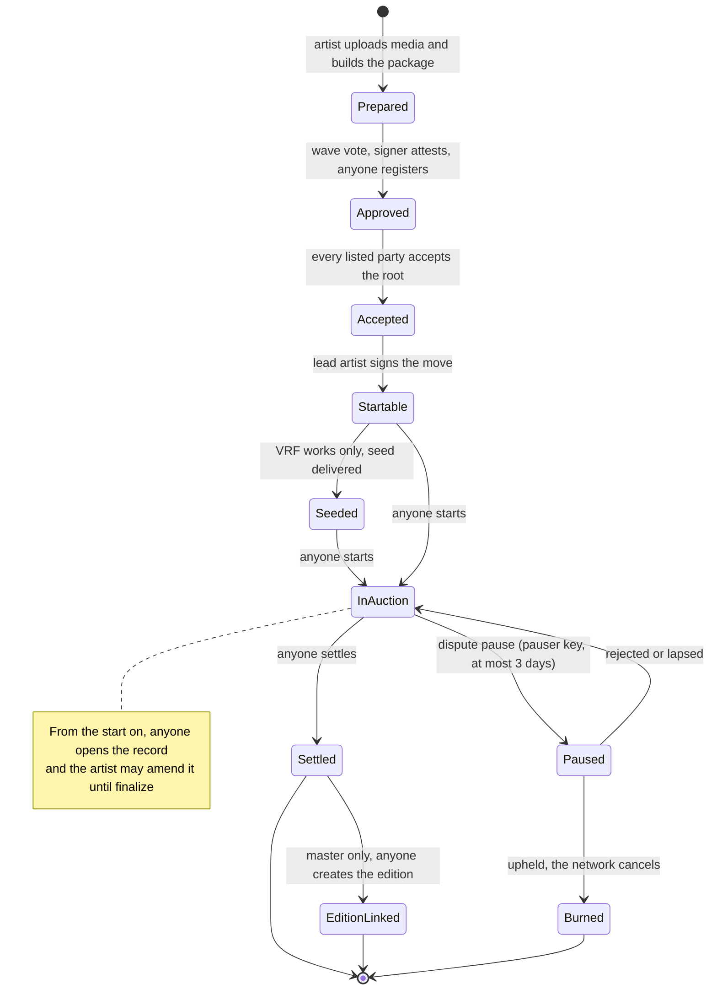

# Protocol specification

How 6529 Works v1 behaves now, one page per area. Each page gives the state machines, the
call sequences with the role and delay of every governed step, the rules with the tests that
check them, and the failure modes with their recovery.

> Pre-audit. See the [project status](../../README.md#status).

The ADRs record how the design was decided; this specification is how it works now. Where an
ADR, a module README and the code differ, the pages follow the code, and the
[register below](#differences-from-the-adrs) lists every difference from the ADRs.

## Pages

| Page | Prefix | Covers |
| --- | --- | --- |
| [Curation](curation.md) | `CUR` | Package items and roots, the curation signer's approval and epochs, party consent, the move signature, consume-once and content uniqueness, revocation |
| [Stream and auctions](stream-and-auctions.md) | `AUC` | The shared ERC-721: minting, collections and serials, locked terms, royalties, burns; the English auction from start to settlement |
| [Works and storage](works-and-storage.md) | `WS` | Each work's record, license, amendments, finalize and pins, locators and preferred location; the content store and dependency registry |
| [Rendering and tokenURI](rendering-and-tokenuri.md) | `RND` | Which renderer serves a token, record status, the metadata format, inline media and the 8M gas budget |
| [Editions and sales](editions-and-sales.md) | `ED`, `EA` | 6529 Stream Editions, the linked ERC-1155, and the uniform-price edition auction beside each 1/1: the step ladder, the clearing, the cut step, the clocks, settlement and claims |
| [Economics and payouts](economics-and-payouts.md) | `ECO` | Products and terms, split wallets, currencies, the escrow, signed releases and batch claims |
| [Identity and recovery](identity-and-recovery.md) | `ID` | The artist registry: consolidated accounts and their wallets, own changes, the network's replacement and freeze, contests, payouts and the federation directory |
| [Disputes and statements](disputes-and-statements.md) | `DSP` | The dispute pause, upheld and rejected outcomes, content release, and the statement log |
| [Declarations and conventions](declarations-and-conventions.md) | `DCL` | Conventions with no contract logic: the declarations document and conservation floor, content-change, catalogue, citation and custody statements, the control proof, the fact sheet, primary price reads |
| [Entropy](entropy.md) | `ENT` | Optional Chainlink VRF seeds, one per content |
| [Governance](governance.md) | `GV` | The AccessManager, the network address and the optional brake, roles and delay classes, the handover, genesis and operating procedures |
| [Federation](federation.md) | `FED` | Federated Stream and Federated Stream Editions: templates, joining, minting into adapter custody, unsold custody and restart, the 90/10 terms, the federation registry, delisting (no exit), the federated edition auction |

Terms are defined in the [glossary](../glossary.md). Every governed selector, with its role,
delay class and who can cancel it while it waits, is in the generated
[role and permission matrix](../audit/roles.md).

## A work from end to end

The lifecycle of a Stream work, and the page that specifies each step.

| Step | Page |
| --- | --- |
| Prepare and upload content; record files; locators | [Works and storage](works-and-storage.md) |
| Approve, register, accept, move; consume at the start | [Curation](curation.md) |
| Seed a VRF work before its start | [Entropy](entropy.md) |
| Start, bid, settle; royalties | [Stream and auctions](stream-and-auctions.md) |
| Pay the seller, the network and the payees | [Economics and payouts](economics-and-payouts.md) |
| Pause, cancel and burn on an upheld dispute | [Disputes and statements](disputes-and-statements.md) |
| Open the record, amend it, finalize, sync on-chain | [Works and storage](works-and-storage.md) |
| Render metadata | [Rendering and tokenURI](rendering-and-tokenuri.md) |
| Open the edition auction beside the 1/1, create the edition and settle the sale | [Editions and sales](editions-and-sales.md) |
| Change an account's root; the network's replacement and freeze | [Identity and recovery](identity-and-recovery.md) |
| Change any governed setting | [Governance](governance.md) |

## How to read a page

Every page has the same headings, so a reader can jump straight to what they need:

- **Contracts:** the contracts in the area, their sources and interfaces.
- **State machine:** `stateDiagram-v2` diagrams, then who triggers each transition.
- **Flows:** `sequenceDiagram` call sequences. A governed step names its role and delay
  class, for example `PARAMETER_SETTER, 24 hours`.
- **Rules and invariants:** one row per rule, with an ID (`CUR-3`), the contract and
  function that enforce it, and the tests that check it ("Tested by"). Rule IDs are the
  page's own; the internal review's finding IDs (such as `MARKET-2` or `GOV-5`) are a separate
  namespace.
- **Failure modes and recovery**, **Parameters and limits**.
- **Events** and **Differences from the ADRs** link to their single owners: the
  [events page](../integrators/events-and-indexing.md) and the
  [register below](#differences-from-the-adrs).

## Conventions

- **Delay classes.** The network acts at once (`NETWORK`), or after 24 hours
  (`PARAMETER_SETTER`), 3 days (`FUNDS_SETTER`) or 7 days (`SUCCESSOR_SETTER`, `ADMIN`), fixed in
  [`Roles.sol`](../../src/governance/Roles.sol). The network or the scheduler can cancel a
  scheduled operation during its delay, and the brake, when one is set, can delay it once by
  7 days.
- **Rates and shares** use a denominator of 100,000, so the default royalty of 6.529% is
  exactly 6,529.
- **Currency** `address(0)` is ETH. `CURRENCY_DEFAULT` in package terms means the product's
  default when the sale opens.
- **Gas** is Prague gas unless a figure says otherwise, as
  [ADR 0004](../adr/0004-gas-budgets-under-glamsterdam.md) defines it; Sepolia figures are
  Glamsterdam receipts from [flows.md](../../deployments/11155111/flows.md).
- **"Anyone"** means a permissionless function: no role and no allow-list.
- **Calls out of permanent contracts** compile in no gas number. They use the forward-all
  family of [`BoundedCall`](../../src/libraries/BoundedCall.sol): all the gas EIP-150 allows is
  forwarded, at most a stated number of return bytes is copied, and a call that fails while
  leaving at most 1/8 of the gas held before it reverts with `BoundedCallShortfall(target)`, so
  running short never reads as a refusal or a default answer. The library's NatSpec states why
  1/8 and the residuals; the statement log's rule is
  [DSP-26](disputes-and-statements.md#rules-and-invariants).

## Differences from the ADRs

The one register of where the code departs from an accepted ADR, and which later decision made
it so. The ADRs stay as written: they record why. The rule ID leads to the page that states
the current behavior in full.

| Page | Rule | The ADR said | The code now | Decided by |
| --- | --- | --- | --- | --- |
| [Curation](curation.md) | CUR-20 | ADR 0001 §3: items are canonical JSON with manifest and metadata hashes | ABI-encoded items (`WorksHashing`) committing content, media, record, license, seed and terms | ADR 0003, curation |
| [Curation](curation.md) | CUR-3 | ADR 0001 §3: Stream asks an `ICurationVerifier` | The registry asks once, at registration; a verifier swap leaves registered roots alone | None recorded |
| [Curation](curation.md) | – | ADR 0001 §3: the evidence hash goes to the statement log | The registry stores and emits it; the evidence statement is separate and unchecked | None recorded |
| [Curation](curation.md) | CUR-11 | ADR 0001 §3: revoke a move by nonce or by digest | Nonce bitmap only (`revokeMove`) | None recorded |
| [Curation](curation.md) | CUR-4 | ADR 0001 §3: approvals never expire | Registered roots never expire; unregistered attestations lapse on a signer-epoch change | Review finding SIGS-2 |
| [Curation](curation.md) | – | ADR 0001 §13: one curation signer key | At least two off a local chain | ADR 0003, curation |
| [Curation](curation.md) | CUR-14, DSP-21 | ADR 0003 first made the post-dispute content release permissionless | Governed (PARAMETER_SETTER, 24 hours), as amended ADR 0003 now says | Review finding SIGS-1 |
| [Stream and auctions](stream-and-auctions.md) | AUC-1, ED-5 | ADR 0001 §5: sale types get the minter role; §13: keeper roles as needed | Per-target admission (`setAdmittedMinter`, 7 days); no selector maps to `MINTER` or `KEEPER` | ADR 0003, governance |
| [Stream and auctions](stream-and-auctions.md) | AUC-30 | ADR 0001 §5: the starting bid is 0 and can be raised | The opening bid moves either way, to any value up to `type(uint96).max` (no price cap, R19); genesis wires ETH's at 0.05 ETH (owner decision 19); the first bid is at least 1 wei | ADR 0003, sales; [ADR 0009](../adr/0009-second-permanence-pass.md) (owner, 16 November 2026) |
| [Stream and auctions](stream-and-auctions.md) | AUC-7, ECO-7 | ADR 0001 §7: Core reads royalty terms directly, with a completion buffer | `Stream` makes one view call to the split factory, no buffer; `Editions` stores its receiver | ADR 0003, economics |
| [Stream and auctions](stream-and-auctions.md) | AUC-27, DSP-17 | ADR 0001 §12: a resumed auction gets its remaining time | The longest of remaining time, governed duration and anti-snipe window | ADR 0003, disputes; review finding LIFECYCLE-1 |
| [Stream and auctions](stream-and-auctions.md) | AUC-25 | ADR 0001 §12: only the dispute pause halts a live auction | A currency deprecation freezes it; after 14 days anyone ends it unsold | ADR 0003, disputes; review finding MARKET-2; [ADR 0009](../adr/0009-second-permanence-pass.md) (owner, 16 November 2026) |
| [Stream and auctions](stream-and-auctions.md) | AUC-24 | ADR 0003: an unsold work goes to the current authority | A 6529 Stream work that ends unsold goes to the 6529 Network Museum, moved there by Stream itself when the adapter reports the outcome, so it never waits on the artist's account; another token's (federated) work goes to its artist's active authority, and waits while it is zero (the account frozen or being replaced) | ADR 0005 (D140; §11, owner decision 17), owner decisions 9 and 10; earlier ADR 0003, owner decision 6 |
| [Stream and auctions](stream-and-auctions.md) | AUC-23 | ADR 0001 §5: failed wallet payments fall back to the escrow | An ERC-20 payout the escrow refuses is credited in the auction | Review finding MONEY-1; ADR 0004 |
| [Stream and auctions](stream-and-auctions.md) | AUC-32 | ADR 0001: a 300K start budget; ADR 0003: 350K against measured figures | 350,000 Prague gas and at most 6 new slots (7 with a bid) | ADR 0004, decisions 1, 2 and 6 |
| [Works and storage](works-and-storage.md) | WS-21, RND-20 | ADR 0001 §8: global, collection, file; ADR 0003: on-chain once the file completes | File, collection, global, first registered, then `ONCHAIN` once the whole work is complete; every tier chooses among all live locators, the artist's and the platform's, and the storage operator can mark a locator dead (C21, C33) | ADR 0003, storage (the `ONCHAIN` rule: none recorded); [ADR 0009](../adr/0009-second-permanence-pass.md) (owner, 16 November 2026) |
| [Works and storage](works-and-storage.md) | WS-22 | ADR 0001 §8: the operator switches among locators sharing a hash | No locator hash is stored; an off-chain monitor verifies copies | None recorded |
| [Works and storage](works-and-storage.md) | WS-18, WS-19 | ADR 0001 §8: artist or platform roles register locators | Bare content addresses, 8 per side per file, only PLATFORM after finalize | ADR 0003, storage |
| [Works and storage](works-and-storage.md) | WS-6 | ADR 0001 §8: the artist edits the record until finalize | Media hashes are fixed at approval; only the record file changes | ADR 0003, curation |
| [Works and storage](works-and-storage.md) | WS-13 | ADR 0001 §8, §10: the artist agrees to a license change | Every party signs a relicense; the errata repin is the network's alone, until `RENDERER_REPIN` is renounced (C8) | [ADR 0009](../adr/0009-second-permanence-pass.md) (owner, 16 November 2026) |
| [Works and storage](works-and-storage.md) | WS-12 | ADR 0001 §8: licenses change only toward more permissive terms | Only CC0 irrevocability is enforced | ADR 0003, integration |
| [Works and storage](works-and-storage.md) | – | ADR 0001 §8: the default license is governed | `WorkRecords`' CC0 default is immutable; per-product defaults are governed | None recorded |
| [Works and storage](works-and-storage.md) | WS-2, WS-4 | ADR 0003, integration: opening a record never fails | `openRecord` refuses bad media lists, oversize previews and a wrong CC0 text | None recorded |
| [Works and storage](works-and-storage.md) | WS-8, WS-9, WS-13 | ADR 0003, integration: one check list for `setRecord`, `finalize` and `relicense` | Each checks a different subset | None recorded |
| [Works and storage](works-and-storage.md) | – | ADR 0001 §8: the media list holds file size and MIME type | The content-store manifest holds them | None recorded |
| [Works and storage](works-and-storage.md) | – | ADR 0001 §8: 72 KB per transaction, 0.23 ETH per MB per gwei | One chunk per transaction under Glamsterdam (two under Prague); about 1.65 ETH per MiB at 1 gwei | ADR 0003; ADR 0004 |
| [Works and storage](works-and-storage.md) | WS-8 | ADR 0003 first set `MAX_RECORD_BYTES` at 24,575 | 12,288, as ADR 0003 later set | ADR 0003, integration |
| [Rendering and tokenURI](rendering-and-tokenuri.md) | RND-17, RND-18 | ADR 0001 §8: media of 256 KB or less inlines once on-chain complete | By cost-weighted size per encoding, `Gzip` never; scripts only in the HTML page | ADR 0003, storage |
| [Rendering and tokenURI](rendering-and-tokenuri.md) | – | No ADR covers preview inlining | A preview inlines once its own file is complete | None recorded |
| [Rendering and tokenURI](rendering-and-tokenuri.md) | RND-6 | ADR 0001 §8: one bounded read of at least the inline threshold | One chunk per read, capped at 24,575 bytes and 300,000 gas | None recorded |
| [Rendering and tokenURI](rendering-and-tokenuri.md) | RND-20 | ADR 0001 §8: a mirror URL between 256 KB and 1 MB | An `ar://` or `ipfs://` address, or no media member | ADR 0003, "Locator kinds" |
| [Rendering and tokenURI](rendering-and-tokenuri.md) | RND-10 | ADR 0003, integration: at most 512 escapes within 1,024 units | 512 bounds `%` and `#`; JSON escapes count only toward 1,024 | None recorded |
| [Rendering and tokenURI](rendering-and-tokenuri.md) | RND-19, RND-21 | ADR 0003: `fullTokenURI` serves larger scripts in full | Only within size, UTF-8, `<` and dependency limits | None recorded |
| [Rendering and tokenURI](rendering-and-tokenuri.md) | RND-26 | ADR 0004's table: `tokenURI` at most 2,733,567 gas | That is the size matrix; the worst case, every cap at once, is 7.80M, under 8M | ADR 0004, decision 1 |
| [Editions and sales](editions-and-sales.md) | ED-2 | ADR 0001 §6: the link is permanent once both sides finalize | Permanent from `createEdition`, finalized or not | None recorded |
| [Editions and sales](editions-and-sales.md) | ED-1 | ADR 0001 §6: the link comes only from the approved package | The root must be registered, revoked or not | Review finding SIGS-4 |
| [Editions and sales](editions-and-sales.md) | ED-4, EA-1 to EA-16 | ADR 0001 §5, §6: fixed-price and Dutch adapters; the artist picks size, format and price, in ETH or an ERC-20 | One uniform-price edition auction beside the 1/1, in ETH; the terms carry only an optional cap; the fixed-price and Dutch adapters are deleted | ADR 0005 (D138, D141), owner decisions 6 and 8 |
| [Editions and sales](editions-and-sales.md) | ED-5 | ADR 0003: an adapter mints for a token once admitted | An adapter of the edition's sale kind, within its cap: the edition is bound to the adapter whose sale opened it (`bindMinter`), or else to the first to mint it, and only that adapter mints it; it seals the supply when its sale settles, and after its removal mints only an edition it sealed (owner decision of 15 November 2026, ADR 0007) | ADR 0005, owner decision 14 and the 31 October amendment |
| [Editions and sales](editions-and-sales.md) | – | ADR 0001 §6: the collection is "6529 Editions" | "6529 Stream Editions", `STREAMEDITIONS`; the contract and identifiers keep their names | ADR 0005 (D139), owner decision 13 |
| [Editions and sales](editions-and-sales.md) | EA-12 | No ADR barred the escrow as a payee | A sale paying the escrow is refused at open | Review finding CALLS-1 |
| [Economics and payouts](economics-and-payouts.md) | ECO-8 | ADR 0001 §7: split wallets take any number of recipients | At most 64 payees per wallet, 16 parties per item | ADR 0003, economics |
| [Economics and payouts](economics-and-payouts.md) | – | ADR 0001 §7: RC1's scoped resolvers stay | One `EconomicsResolver` with per-product settings | None recorded |
| [Economics and payouts](economics-and-payouts.md) | – | ADR 0001 §7: the settlement recorder stays | No recorder; `TokenTransfer` checks exact deltas | None recorded (LIM-ECO-5) |
| [Economics and payouts](economics-and-payouts.md) | ECO-6 | ADR 0001 §7: locked terms change with artist agreement plus a governed action | The royalty rate changes, up or down, when every party signs and the network acts (FUNDS_SETTER, 3 days; R10); the network alone may lower its fee share (R9), never raise it | [ADR 0009](../adr/0009-second-permanence-pass.md) (owner, 16 November 2026) |
| [Economics and payouts](economics-and-payouts.md) | ECO-28 | ADR 0001 §7: terminal recovery needs the affected accounts' consent | Factory wallets' credit moves only to identical payees; the network's own credits move without consent (C19); others call `consentToRecovery`; credits unclaimed for 180 days go to the network (R12) | ADR 0003, economics; [ADR 0009](../adr/0009-second-permanence-pass.md) (owner, 16 November 2026) |
| [Economics and payouts](economics-and-payouts.md) | ECO-23, ECO-32 | ADR 0001 §5: only standard ERC-20s, every transfer checked by balance delta | On-chain admission checks a few properties; Permit2 pulls skip the return-value check | None recorded |
| [Economics and payouts](economics-and-payouts.md) | – | ADR 0001 §5: Editions launch with ETH plus admitted ERC-20s | Genesis makes ETH every product's default; items may name any active ERC-20 | ADR 0003, integration |
| [Economics and payouts](economics-and-payouts.md) | – | ADR 0001 §7: governance sets new-work splits with any basis points | Governance sets the fee and royalty rate; the approved payee list splits the artist portion | None recorded |
| [Identity and recovery](identity-and-recovery.md) | – | ADR 0001 §11: the registry holds the artist ID, authority and profile | Also payout, nonce, freeze, pending change and the federated directory (status per contract and per account, fee share) | ADR 0003, identity; [ADR 0009](../adr/0009-second-permanence-pass.md) (owner, 16 November 2026) |
| [Identity and recovery](identity-and-recovery.md) | ID-2 to ID-8 | ADR 0001 §11: one authority wallet per artist; captured consolidated wallets cancel overrides; estate and lost-key overrides after dormancy; guardian vetoes | An artist or collaborator is a 6529 consolidated account and every wallet in it has the same rights (a live two-way consolidation with the root, no minimum age); own changes wait 2 days; the network replaces a root after a 14-day notice, which any wallet may contest (a contest lapses after 90 days unless a vote upholds it); the network can freeze an account for 14 days and cancel its own replacement or an account's pending change; no standing, dormancy, override kinds or guardians | [ADR 0009](../adr/0009-second-permanence-pass.md) (owner, 16 November 2026) |
| [Identity and recovery](identity-and-recovery.md) | ID-15 | ADR 0001 §11: the identity source is swapped when the 6529 chain arrives | Swappable any time (7 days); its code hash is re-checked at use; the root never reads it | Review finding DEPS-6 (PR #53); [ADR 0009](../adr/0009-second-permanence-pass.md) (owner, 16 November 2026) |
| [Disputes and statements](disputes-and-statements.md) | DSP-18, AUC-26 | ADR 0001 §12: an upheld dispute cancels the auction, then records the outcome | The outcome comes first; the network's `cancel` (no delay, within the 3-day pause) must cite it | ADR 0003, disputes; review finding LIFECYCLE-4; [ADR 0009](../adr/0009-second-permanence-pass.md) (owner, 16 November 2026) |
| [Disputes and statements](disputes-and-statements.md) | DSP-13, DSP-14 | ADR 0001 §12: a guardian pause lasts at most 7 days | A pauser key pauses, once per auction, for at most 3 days (C30) | [ADR 0009](../adr/0009-second-permanence-pass.md) (owner, 16 November 2026) |
| [Disputes and statements](disputes-and-statements.md) | DSP-19 | ADR 0001 §12: all bids are refunded | As pull credits | None recorded |
| [Disputes and statements](disputes-and-statements.md) | – | ADR 0001 §12: each entry records the work | Open subjects: tokens, items, artists, governance manifests, any `(token, id)` | ADR 0003, owner decision 1; ADR 0002, decision 6 |
| [Entropy](entropy.md) | ENT-12 | ADR 0001 §9: `start` requests the seed; the 24-hour clock starts at delivery | `start` needs a delivered seed; the clock starts at the start | ADR 0003, sales |
| [Entropy](entropy.md) | ENT-5 | ADR 0001 §9: an undelivered request may be re-requested | Repeats add requests after an exponential backoff (`retryDelay`, doubling per repeat, capped at 30 days); the first delivery wins; a federated VRF work's requester pays the provider's own price, never the network's subscription, and requests are off until the network sets a wrapper | ADR 0003, sales; [ADR 0009](../adr/0009-second-permanence-pass.md) (owner, 16 November 2026) |
| [Entropy](entropy.md) | ENT-1, ENT-2 | ADR 0001 §9: VRF per work; ADR 0003: one draw per VRF item | One draw per content hash, plus repeats while undelivered | Review finding DEPS-1 |
| [Entropy](entropy.md) | ENT-11, GV-19 | ADR 0001 §13.9: gas parameters are raise-only | The callback gas limit can also be lowered (7 days, floor 100,000) | Review finding DEPS-5 (ADR 0003) |
| [Entropy](entropy.md) | ENT-13 | Sepolia `flows.md` §6 (not an ADR): the callback writes a new slot | No new slot: the seed overwrites the request ID | Review finding DEPS-2; ADR 0004 |
| [Governance](governance.md) | GV-1 to GV-9 | ADR 0001 §13, ADR 0002: a guardian-guarded meta role or a TimelockController; guardians cancel and suspend; ADR 0007: seats, escalation, dead-admin recovery and succession | One network address (one 6529 Safe until the TDH bridge, then the bridge) holds every network role, with fixed delays: none, 24 hours, 3 days and 7 days; one optional brake can delay a scheduled operation once by 7 days; the handover is `transferNetwork` (7 days) then `acceptNetwork`; operational keys are granted and revoked by the network at once; no guardians, seats, suspension, recovery or successor registration | [ADR 0009](../adr/0009-second-permanence-pass.md) (owner, 16 November 2026) |
| [Editions and sales](editions-and-sales.md) | EA-5, EA-17 to EA-19 | ADR 0005 §4: one governed close offset of 0 to 1 day; ADR 0007: a per-sale offset and a 150-day abandonment exit; withdrawals during a dispute | Every edition sale closes exactly 15 minutes after its 1/1 (R20); bids are firm, also during a dispute (R21); `abandon` from 21 days after the close creates the edition when the 1/1's sale settled, else voids and seals at zero (R16); credits unclaimed for 180 days go to the network (R12) | [ADR 0009](../adr/0009-second-permanence-pass.md) (owner, 16 November 2026) |
| [Governance](governance.md) | – | ADR 0001 §13: an event emits the manifest hash | `GovernanceConfigured` and an epoch-0 statement at genesis, then `GOVERNANCE_MANIFEST` statements | ADR 0002, decision 6 |
| [Governance](governance.md) | – | ADR 0001 §13: freezes are one-way, in the 30-day class | No freeze function exists | None recorded |
| [Governance](governance.md) | GV-12 | ADR 0003: genesis performs every binding and minter admission | Also sale targets, default currencies and the epoch-0 manifest, and the federation registry's one-shot bind (`bindFederationRegistry`) with its adapters and template approvals ([ADR 0008](../adr/0008-federation.md)) | ADR 0003, integration |
| [Governance](governance.md) | GV-21, AUC-13, DSP-16, EA-15 | ADR 0002 decision 7, ADR 0003: unpause, resume and cancel wait 48 hours from scheduling | The network unpauses, resumes and cancels with no wait (C30, integrator ruling 13) | [ADR 0009](../adr/0009-second-permanence-pass.md) (owner, 16 November 2026) |
| [Federation](federation.md) | FED-7, FED-8, FED-48, FED-73 | ADR 0008: a listed contract may leave the federation; the share is fixed at deployment | No exit: a joined contract stays joined; the network delists by contract or by account (24 hours); the share in force is the smaller of the deployed share and the registry's record, which only the network lowers (R8); works may name collaborators who consent on chain | [ADR 0009](../adr/0009-second-permanence-pass.md) (owner, 16 November 2026) |
| [Stream and auctions](stream-and-auctions.md) | AUC-41, AUC-48, AUC-51, AUC-52 | ADR 0007: a governed rescue delay; the fee recipient locked at start; EIP-2612 permits | Rescue delay a compiled 14 days (C12); the fee goes to the economics resolver's recipient read at settlement, leftover wei included (R18); credits unclaimed for 180 days go to the network (R12); EIP-2612 `PERMIT` payments refused | [ADR 0009](../adr/0009-second-permanence-pass.md) (owner, 16 November 2026) |
| [Works and storage](works-and-storage.md) | WS-7, WS-15, WS-37 | ADR 0006: royalty rates only fall; the artist alone renounces; only the artist finalizes | Rates move up or down by agreement (R10); renouncing `ROYALTY_RATE` or `RELICENSE` needs the network (C7); the network repairs a finalized work's renderer alone (C8); anyone finalizes 14 days after a recorded notice once the sale settled (C9) | [ADR 0009](../adr/0009-second-permanence-pass.md) (owner, 16 November 2026) |
| [Economics and payouts](economics-and-payouts.md) | ECO-43 | ADR 0001 §7: each payee pulls its own share | Every release from a wallet that names the network fee vault also pays the vault its due share (R11) | [ADR 0009](../adr/0009-second-permanence-pass.md) (owner, 16 November 2026) |
| [Declarations and conventions](declarations-and-conventions.md) | DCL-8, DCL-26 to DCL-28 | ADR 0006: a promise card with a grade and control proof; intended renunciations | A neutral fact sheet with no grade, rubric or residual-risk list; declarations carry no intended renunciations (O1, O2) | [ADR 0009](../adr/0009-second-permanence-pass.md) (owner, 16 November 2026) |
| [Build, test and budgets](../audit/build-and-test.md) | – | ADR 0001: EIP-170 holds in every Foundry profile | Measured for the one defined profile, `default` | None recorded |
| [Build, test and budgets](../audit/build-and-test.md) | – | ADR 0001: 8–12K non-comment lines | Only the maximum is enforced: 13,000 lines since the 1 November 2026 amendment (owner decision 24), 15,000 since ADR 0007 (owner decision of 15 November 2026), 16,000 since ADR 0008 (16 November 2026), 16,500 for its review's fixes, 17,000 by owner direction of 16 November 2026 | ADR 0001 amendment, ADR 0007, ADR 0008 |
| [Build, test and budgets](../audit/build-and-test.md) | – | ADR 0001: build and test in under 15 minutes | Per-job timeouts: 15 minutes for Contracts and Static analysis, 5 for Docs | None recorded |
| [Build, test and budgets](../audit/build-and-test.md) | – | ADR 0001: reproducible from a committed standard-JSON input | None committed; `Verify.s.sol` does not rebuild bytecode | Known gap LIM-REL-1 |
| [Invariants](../audit/invariants.md) | INV-CUR-1, INV-CUR-3, INV-CUR-4, INV-CUR-6 | ADR 0001 test plan: single-use packages and items as an invariant | Items and content hashes are tested directly; a package's single use only through the model's exactness | None recorded |
| [Invariants](../audit/invariants.md) | – | ADR 0001, AGENTS.md: stateful invariants for every contract moving money | `EconomicsResolver` and `AssetAllowlist` run for real only in the wired and halts campaigns | None recorded |
| [Known limitations](../audit/known-limitations.md) | AUC-7 | ADR 0001 §16: royalties are advisory for federated contracts | Also for Stream and Editions, which implement only ERC-2981 (LIM-SAL-8) | None (a clarification) |
| [Known limitations](../audit/known-limitations.md) | WS-32 | ADR 0003, content README: every transaction fits 16,777,216 gas | Regular gas only; state gas sits outside it on Sepolia (LIM-GAS-2) | ADR 0004, decision 4 |

## Reporting a mismatch

If the code and a page disagree, the code is what runs. Open an issue that names the page,
the rule ID and the code. If the mismatch is exploitable, report it privately as
[SECURITY.md](../../SECURITY.md) describes.

## Related

- [Architecture overview](../architecture.md): modules, identifiers and trust boundaries.
- [Auditor pack](../audit/README.md) and [integrator guide](../integrators/README.md).
- [ADRs](../adr/README.md): the decisions and their reasons.
