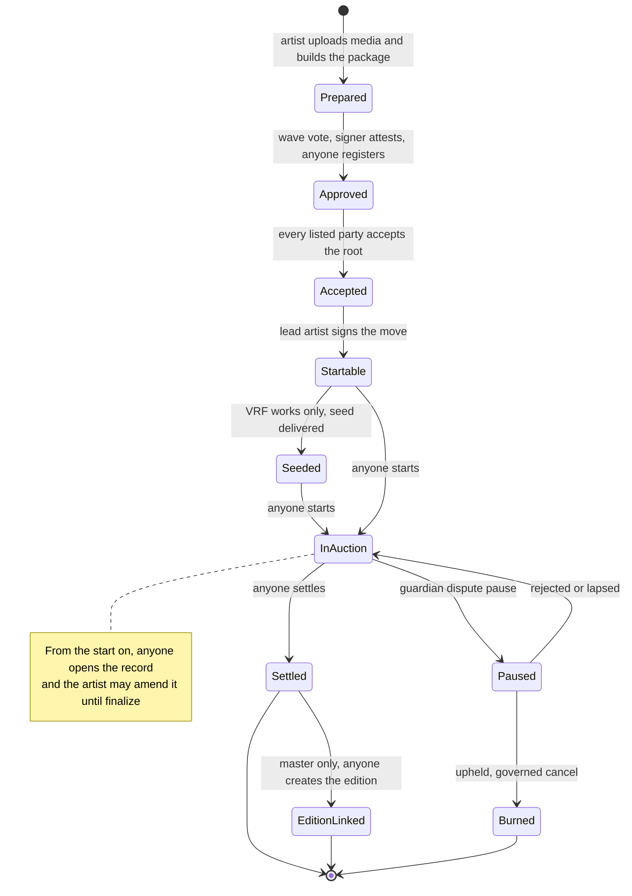

# Protocol specification

How 6529 Works v1 behaves now, one page per area. Each page gives the state machines, the
call sequences with the role and delay of every governed step, the rules with the tests that
check them, and the failure modes with their recovery.

> Pre-audit. See the [project status](../../README.md#status).

The ADRs record how the design was decided; this specification is how it works now. Where an
ADR, a module README and the code differ, the pages follow the code, and the
[register below](#differences-from-the-adrs) lists every difference from the ADRs.

## Pages

| Page | Prefix | Covers |
| --- | --- | --- |
| [Curation](curation.md) | `CUR` | Package items and roots, the curation signer's approval and epochs, party consent, the move signature, consume-once and content uniqueness, revocation |
| [Stream and auctions](stream-and-auctions.md) | `AUC` | The shared ERC-721: minting, collections and serials, locked terms, royalties, burns; the English auction from start to settlement |
| [Works and storage](works-and-storage.md) | `WS` | Each work's record, license, amendments, finalize and pins, locators and preferred location; the content store and dependency registry |
| [Rendering and tokenURI](rendering-and-tokenuri.md) | `RND` | Which renderer serves a token, record status, the metadata format, inline media and the 8M gas budget |
| [Editions and sales](editions-and-sales.md) | `ED` | The linked ERC-1155, edition formats, and the fixed-price and Dutch adapters with allowlists, payments and halts |
| [Economics and payouts](economics-and-payouts.md) | `ECO` | Products and terms, split wallets, currencies, the escrow, signed releases and batch claims |
| [Identity and recovery](identity-and-recovery.md) | `ID` | The artist registry, consolidations and standing, changes, overrides, contests and restraint |
| [Disputes and statements](disputes-and-statements.md) | `DSP` | The dispute pause, upheld and rejected outcomes, content release, and the statement log |
| [Entropy](entropy.md) | `ENT` | Optional Chainlink VRF seeds, one per content |
| [Governance](governance.md) | `GV` | The AccessManager, roles and delay classes, the guardians' cancel rules, genesis and operating procedures |

Terms are defined in the [glossary](../glossary.md). Every governed selector, with its role,
delay class and whether a guardian can cancel it, is in the generated
[role and permission matrix](../audit/roles.md).

## A work from end to end

The lifecycle of a Stream work, and the page that specifies each step.

| Step | Page |
| --- | --- |
| Prepare and upload content; record files; locators | [Works and storage](works-and-storage.md) |
| Approve, register, accept, move; consume at the start | [Curation](curation.md) |
| Seed a VRF work before its start | [Entropy](entropy.md) |
| Start, bid, settle; royalties | [Stream and auctions](stream-and-auctions.md) |
| Pay the seller, the network and the payees | [Economics and payouts](economics-and-payouts.md) |
| Pause, cancel and burn on an upheld dispute | [Disputes and statements](disputes-and-statements.md) |
| Open the record, amend it, finalize, sync on-chain | [Works and storage](works-and-storage.md) |
| Render metadata | [Rendering and tokenURI](rendering-and-tokenuri.md) |
| Create the edition and sell it | [Editions and sales](editions-and-sales.md) |
| Recover a lost or stolen artist key | [Identity and recovery](identity-and-recovery.md) |
| Change any governed setting | [Governance](governance.md) |

## How to read a page

Every page has the same headings, so a reader can jump straight to what they need:

- **Contracts:** the contracts in the area, their sources and interfaces.
- **State machine:** `stateDiagram-v2` diagrams, then who triggers each transition.
- **Flows:** `sequenceDiagram` call sequences. A governed step names its role and delay
  class, for example `PARAMETER_SETTER, 48 hours`.
- **Rules and invariants:** one row per rule, with an ID (`CUR-3`), the contract and
  function that enforce it, and the tests that check it ("Tested by"). Rule IDs are the
  page's own; the internal review's finding IDs (such as `MARKET-2` or `GOV-5`) are a separate
  namespace.
- **Failure modes and recovery**, **Parameters and limits**.
- **Events** and **Differences from the ADRs** link to their single owners: the
  [events page](../integrators/events-and-indexing.md) and the
  [register below](#differences-from-the-adrs).

## Conventions

- **Delay classes.** Immediate (0), standard (48 hours), funds and recipients (14 days),
  verifier and successor (30 days), from [`Roles.sol`](../../src/governance/Roles.sol). Any
  guardian can cancel any scheduled operation during its delay.
- **Rates and shares** use a denominator of 100,000, so the default royalty of 6.529% is
  exactly 6,529.
- **Currency** `address(0)` is ETH. `CURRENCY_DEFAULT` in package terms means the product's
  default when the sale opens.
- **Gas** is Prague gas unless a figure says otherwise, as
  [ADR 0004](../adr/0004-gas-budgets-under-glamsterdam.md) defines it; Sepolia figures are
  Glamsterdam receipts from [flows.md](../../deployments/11155111/flows.md).
- **"Anyone"** means a permissionless function: no role and no allow-list.

## Differences from the ADRs

The one register of where the code now departs from what an accepted ADR says, and which later
decision made it so. The ADRs stay as written: they record why. Each row names the page and
rule that state the current behavior.

| Page | Rule | The ADR said | The code now | Decided by |
| --- | --- | --- | --- | --- |
| [Curation](curation.md) | CUR-20 | ADR 0001 §3 said items are hashed as canonical JSON (RFC 8785) | Items are hashed as their ABI encoding through `WorksHashing`, compatible with OpenZeppelin `StandardMerkleTree`; the JSON package document maps field for field onto the structs | ADR 0003, "Package format and curation" |
| [Curation](curation.md) | – | ADR 0001 §3 said an item commits "the content manifest hash" and "the metadata hash" | An item commits the primary media's decoded SHA-256 (`contentHash`), a hash over every media file (`mediaHash`), the record file ID (editable until finalize), the license, seed policy and seed, and the sale terms | ADR 0003, "Package format and curation" |
| [Curation](curation.md) | CUR-3 | ADR 0001 §3 said Stream asks an `ICurationVerifier` | The registry asks the verifier once, at `registerPackage`, and stores the result; Stream asks the registry at `consume`; a verifier swap leaves registered roots alone | Not recorded in an ADR (`PackageRegistry`) |
| [Curation](curation.md) | – | ADR 0001 §3 said the evidence hash is written to the statement log | The registry stores and emits the evidence hash; the CURATOR's `CURATION_EVIDENCE` statement is a separate transaction the registry neither requires nor checks | Not recorded in an ADR |
| [Curation](curation.md) | CUR-11 | ADR 0001 §3 allowed move revocation by "a nonce bitmap or revoke-by-digest" | Only the per-artist nonce bitmap (`revokeMove`) | Not recorded in an ADR |
| [Curation](curation.md) | CUR-4 | ADR 0001 §3 said approvals do not expire | Registered roots never expire; an attestation not yet registered stops counting when its signer's epoch changes (disable, re-enable or a new role grant) | Review finding SIGS-2 (the signer epoch is in no ADR) |
| [Curation](curation.md) | – | ADR 0001 §13 proposed "the curation signer key" | Deployments off a local chain need at least two curation signer keys (`DeployGuards.MIN_CURATION_SIGNERS`) | ADR 0003, "Package format and curation" |
| [Curation](curation.md) | CUR-14 | ADR 0003 first made the content release after an upheld dispute permissionless | `Stream.releaseContent` is PARAMETER_SETTER, 48 hours; the code matches the amended ADR 0003 text | Review finding SIGS-1 (ADR 0003 amended) |
| [Stream and auctions](stream-and-auctions.md) | AUC-1 | ADR 0001 §5 said a new sale type "receives the minter role through a timelocked AccessManager action" | Stream keeps its own admitted-minter mapping, written by `setAdmittedMinter` (SUCCESSOR_SETTER, 30 days); no selector maps to `Roles.MINTER` | ADR 0003 (governance) |
| [Stream and auctions](stream-and-auctions.md) | AUC-30 | ADR 0001 §5 said the starting bid is 0 and "can be raised" | The opening bid is compare-and-set and moves either way under a ceiling; the first bid is at least 1 wei | ADR 0003 (sales and auctions) |
| [Stream and auctions](stream-and-auctions.md) | AUC-7 | ADR 0001 §7 said Core reads royalty terms directly so `royaltyInfo` "needs no fragile external call", with a completion buffer | The receiver is derived by one view call to the pinned split factory, with no buffer; the call reverts rather than return a zero royalty when gas runs short | ADR 0003 (economics) |
| [Stream and auctions](stream-and-auctions.md) | AUC-27 | ADR 0001 §12 said the auction resumes "with its remaining time" | It resumes for the longer of the remaining time and the governed duration (or the locked anti-snipe window, if longer), even with a standing bid | ADR 0003 (disputes and statements); LIFECYCLE-1 |
| [Stream and auctions](stream-and-auctions.md) | AUC-26 | ADR 0001 §12 said the auction is cancelled when a dispute is upheld | The guardian only pauses; `cancel` is PARAMETER_SETTER (48 hours), must cite the token's own latest `DISPUTE_OUTCOME` recorded after the pause, and is refused until 48 hours after the pause | ADR 0003 (the citation); LIFECYCLE-4 and GOV-5 (PR #57) |
| [Stream and auctions](stream-and-auctions.md) | AUC-25 | ADR 0001 §12 gave a live auction only the dispute pause | A currency deprecation freezes the auction; anyone ends it unsold 30 days into the deprecation; after a re-admission the first settle reopens it only if the re-admission came after the end or within the last anti-snipe window | ADR 0003 (disputes and statements); MARKET-2 |
| [Stream and auctions](stream-and-auctions.md) | AUC-13 | ADR 0003 assigned the emergency pause to PAUSER and UNPAUSER, and AccessManager counts UNPAUSER's 48 hours from scheduling | The auction also refuses `unpause` and `resume` until 48 hours after the pause | GOV-5 (PR #57) |
| [Stream and auctions](stream-and-auctions.md) | AUC-24 | ADR 0003 sent an unsold work to the artist's "current authority" | It goes to the active authority, which is zero during a restraint, so the no-bid settlement waits | ADR 0003 owner decision 6 (IDENTITY-1) |
| [Stream and auctions](stream-and-auctions.md) | AUC-23 | ADR 0001 §5 had wallet payments fall back to the escrow | An ERC-20 payout that fails even through the escrow is credited to its wallet in the auction and paid out with `claimFor` | MONEY-1; ADR 0004 (security impact) |
| [Stream and auctions](stream-and-auctions.md) | AUC-32 | ADR 0003 set a 350K steady-state start gate with a measured table (start about 276K, settle about 176K) | The start budget is 350,000 Prague gas and at most 6 new slots (7 with a bid) | ADR 0004 |
| [Works and storage](works-and-storage.md) | WS-21 | ADR 0001 §8 said preferred location goes global, then collection, then file, then the next registered locator | Most specific first: file, collection, global, first registered, then the implicit `ONCHAIN` copy (that fallback is in no ADR) | ADR 0003, "Token model and storage" |
| [Works and storage](works-and-storage.md) | WS-21 | ADR 0003 said on-chain copies are served once "the file" is complete | `ONCHAIN` is served only once the whole work is on-chain complete (the stored `syncOnChain` flag), never from a per-file completeness scan | Not recorded in an ADR |
| [Works and storage](works-and-storage.md) | WS-22 | ADR 0001 §8 said the storage operator switches among locators "that share the same hash" | No hash is stored or checked for a locator; the operator chooses among the copies registered for that file, and the off-chain monitor verifies them | Not recorded in an ADR |
| [Works and storage](works-and-storage.md) | WS-18, WS-19 | ADR 0001 §8 allowed the artist or platform roles to register locators | Bare content addresses only (HTTPS dropped), 8 per side per file, and only PLATFORM after finalize | ADR 0003, "Token model and storage" |
| [Works and storage](works-and-storage.md) | WS-6 | ADR 0001 §8 said the artist can edit the record until finalize, with content hashes immutable after | The media list, and so every content hash, is fixed at approval; only the record file pointer changes before finalize | ADR 0003, "Package format and curation" |
| [Works and storage](works-and-storage.md) | WS-13 | ADR 0001 §8 and §10 spoke of the artist's agreement to a license change | Every party of the item signs a relicense; the errata repin needs only the lead artist | Not recorded in an ADR |
| [Works and storage](works-and-storage.md) | WS-12 | ADR 0001 §8 allowed a license change only toward more permissive terms | Only CC0 irrevocability is enforced, on the license key, and a CC0 license always names the deployment's CC0 text; other judgements rest on the consents and the governed action | Adversarial review, recorded in ADR 0003 |
| [Works and storage](works-and-storage.md) | – | ADR 0001 §8 made the default license a governed setting | `WorkRecords`' CC0 default is immutable; the governed per-product default for new packages is `IEconomicsResolver.setDefaultLicense` | Not recorded in an ADR |
| [Works and storage](works-and-storage.md) | WS-2, WS-4 | ADR 0003 "Decisions from integration" said opening a record never fails | `openRecord` stores the record and license as approved but still refuses a mis-committed media list, an oversize preview and a CC0 license with another text | Not recorded in an ADR |
| [Works and storage](works-and-storage.md) | WS-8, WS-9, WS-13 | ADR 0003 listed "complete, one `Identity` chunk, within the bound, licence text registered" for `setRecord`, `finalize` and `relicense` | `setRecord` checks the record file only; `finalize` checks it and requires the license text complete; `relicense` requires the new text registered, and complete for a finalized work | Not recorded in an ADR |
| [Works and storage](works-and-storage.md) | – | ADR 0001 §8 listed each file's size and MIME type in the media list | They live in the content-store manifest (`fileInfo`); the media list holds the file ID, the SHA-256 and the role | Not recorded in an ADR |
| [Works and storage](works-and-storage.md) | – | ADR 0001 §8 said "72 KB per transaction" and "0.23 ETH per MB per gwei" | One full chunk per transaction under Glamsterdam (two under Prague), about 1.65 ETH per MiB at 1 gwei on Sepolia | ADR 0003 (two chunks, Prague); ADR 0004, "Superseded or amended" |
| [Works and storage](works-and-storage.md) | WS-8 | ADR 0003 first set `MAX_RECORD_BYTES` at 24,575 bytes | 12,288 bytes, as ADR 0003 later lowered it | ADR 0003 |
| [Rendering and tokenURI](rendering-and-tokenuri.md) | RND-17, RND-18 | ADR 0001 §8 said media of 256 KB or less is inlined once the work is on-chain complete | Inlining is by cost-weighted size: attested `Base64` up to 256 KiB, `Identity` up to 32 KiB, `Gzip` and `GzipBase64` never, a script only through the HTML page | ADR 0003, "Token model and storage" (rendering inline media) |
| [Rendering and tokenURI](rendering-and-tokenuri.md) | – | No ADR covers preview inlining | A preview image is inlined once the preview file is complete, without the work being on-chain complete | Not recorded in an ADR |
| [Rendering and tokenURI](rendering-and-tokenuri.md) | RND-6 | ADR 0001 §8 asked for a bounded read that allows at least the inline threshold | The renderer never reads a whole file in one call: one chunk per read, each capped at 24,575 bytes and 300,000 gas, into the output buffer | Not recorded in an ADR |
| [Rendering and tokenURI](rendering-and-tokenuri.md) | RND-20 | ADR 0001 §8 gave "a mirror URL" between 256 KB and 1 MB | The URL is a bare content address (`ar://` or `ipfs://`); a file with no such locator gets no media member | ADR 0003, "Locator kinds" |
| [Rendering and tokenURI](rendering-and-tokenuri.md) | RND-20 | ADR 0001 §8 listed the preference order global, collection, file | The renderer uses `WorkRecords.preferredLocator`: file, collection, global, first registered, implicit on-chain | ADR 0003, "Token model and storage" |
| [Rendering and tokenURI](rendering-and-tokenuri.md) | RND-10 | ADR 0003 "Decisions from integration" said keys, values and escapes share a 1,024-unit budget "with at most 512 escapes" | The 512 bounds `%` and `#` characters (`MAX_ESCAPES`); JSON backslash escapes count only against the 1,024 units | Not recorded in an ADR |
| [Rendering and tokenURI](rendering-and-tokenuri.md) | RND-19, RND-21 | ADR 0003 said larger scripts are served "in full by `fullTokenURI`" | `fullTokenURI` wraps a script only up to 128 KiB (an `Identity` file counts eight times against 1 MiB), valid UTF-8, at most 1,024 `<`, no declared dependencies; otherwise it reverts | Not recorded in an ADR |
| [Rendering and tokenURI](rendering-and-tokenuri.md) | RND-26 | ADR 0004's table gave `tokenURI` "at most 2,733,567" | That row covers the size matrix (`test_Gas_TokenURIBySize`) only; the worst case with every cap at once is the budget proof, 7.80M, under the same 8M budget | ADR 0004, decision 1 |
| [Editions and sales](editions-and-sales.md) | ED-2 | ADR 0001 §6 said the link is permanent "once both sides are finalized" | Both sides are written in `createEdition`, and no function changes or removes the link, whether or not the master is finalized | – (not recorded in an ADR) |
| [Editions and sales](editions-and-sales.md) | ED-1 | ADR 0001 §6 said the link is created "only from the approved package" | The root must be registered, revoked or not, because Stream already consumed exactly this item | SIGS-4 |
| [Editions and sales](editions-and-sales.md) | ED-5 | ADR 0001 §5 said a new sale type "receives the minter role through a timelocked AccessManager action" | Each mint target keeps an admitted-adapter mapping written by `setAdmittedMinter` (SUCCESSOR_SETTER, 30 days), and `mint` also requires the adapter's `saleKind()` to equal the terms' | ADR 0003 (governance, "Minting") |
| [Editions and sales](editions-and-sales.md) | ED-12 | ADR 0001 §6 said the artist chooses size, format and price within the package | The terms are fixed at approval in `EditionTerms`; PLATFORM alone sells only a FIXED edition at the package price; leaf prices at any level and any OPEN edition sale need the creator | MARKET-6; ADR 0003 (package format and curation) |
| [Editions and sales](editions-and-sales.md) | ED-14 | ADR 0003 owner decision 6 said PLATFORM still opens and closes edition sales at the package terms during the restraint, and the artist cannot close them | PLATFORM alone opens only listed FIXED editions with unpriced phases; while the creator resolves to zero it may close every sale, the artist's own included | IDENTITY-1 with MARKET-6 |
| [Editions and sales](editions-and-sales.md) | ED-21 | ADR 0003 said deprecating a currency halts running sales | A pause or a deprecation also moves the sale's phase windows and Dutch curve (`scheduleDelay`); overlapping halts count twice (LIM-SAL-2) | MARKET-1 |
| [Editions and sales](editions-and-sales.md) | ED-22 | ADR 0003 said PAUSER pauses and UNPAUSER unpauses | The adapters also refuse an unpause until 48 hours after the pause | GOV-5 |
| [Editions and sales](editions-and-sales.md) | ED-14 | ADR 0003 said anyone may close a sale whose phases have all ended | "Ended" is measured after adding `scheduleDelay`, and the rule applies to fixed price only; a Dutch sale has no end | MARKET-1 |
| [Editions and sales](editions-and-sales.md) | ED-9 | No ADR barred the escrow as a payee | A sale whose seller or fee recipient is the revenue escrow is refused at open | CALLS-1 |
| [Economics and payouts](economics-and-payouts.md) | ECO-8 | ADR 0001 §7 said split wallets take "any number of recipients" | At most 64 payees per wallet (`Splits.MAX_PAYEES`) and 16 per package item (`Limits.MAX_PARTIES`) | ADR 0003 (Economics) |
| [Economics and payouts](economics-and-payouts.md) | ECO-7 | ADR 0001 §7 said Core reads royalty terms directly, so `royaltyInfo` needs no external call, with a completion buffer | `Stream` derives the receiver with one view call to the pinned split factory, keeps no completion buffer, and reverts rather than return a zero royalty when gas runs short; `Editions` stores its receiver | ADR 0003 (Economics) |
| [Economics and payouts](economics-and-payouts.md) | – | ADR 0001 §7 said RC1's royalty and revenue resolvers with scoped assignments stay | One `EconomicsResolver` with per-product settings and no scoped assignments | Not recorded in a later ADR |
| [Economics and payouts](economics-and-payouts.md) | – | ADR 0001 §7 said the settlement-recorder pattern with single-use settlement keys stays | No settlement recorder in `src/`; exact balance deltas and fee-on-transfer rejection live in `TokenTransfer` | Not recorded in a later ADR (LIM-ECO-5) |
| [Economics and payouts](economics-and-payouts.md) | ECO-6 | ADR 0001 §7 said changing a work's locked terms needs the artist's agreement plus a governed action | Only the royalty rate can change (`IWorkRecords.setRoyaltyRate`: every party's signature plus FUNDS_SETTER, 14 days); payees, the seller wallet and the fee terms never change after mint | Not recorded in a later ADR |
| [Economics and payouts](economics-and-payouts.md) | ECO-28 | ADR 0001 §7 required the affected accounts' consent for escrow terminal recovery | A factory wallet's credit moves only to a wallet with identical payees; any other account consents explicitly, once per recovery, with `consentToRecovery` | ADR 0003 (Economics), review of 14 October 2026 |
| [Economics and payouts](economics-and-payouts.md) | ECO-23, ECO-32 | ADR 0001 §5 said only standard ERC-20s are admitted and every transfer is checked by exact balance delta | On-chain admission checks only code, EIP-7702 delegation, one-word `balanceOf` and `totalSupply`, and balance not above supply; governance vets the rest. Balance deltas are checked on every path; the return value is checked by `TokenTransfer` but not on the Permit2 pulls | Not recorded in a later ADR |
| [Economics and payouts](economics-and-payouts.md) | – | ADR 0001 §5 said 6529 Editions launch with "ETH plus any admitted ERC-20s" | Genesis sets ETH as the default currency of all three products; an Editions item may name any active ERC-20 explicitly | ADR 0003 ("Default currencies are set at genesis"), a scoped exception to the 14-day funds class |
| [Economics and payouts](economics-and-payouts.md) | – | ADR 0001 §7 lets governance change new-work defaults including "multi-party splits with any basis points" | Governance sets each product's fee recipient, fee share and royalty rate, out of 100,000; the artist portion's split is the package item's payee list, approved by curation | Not recorded in a later ADR |
| [Identity and recovery](identity-and-recovery.md) | ID-9, ID-13 | ADR 0001 §11 (Hardening) said captured wallets can cancel the 180-day override | A captured wallet's cancel during the notice only contests the override, and a TDH vote decides through `resolveContested`; a STANDARD change still dies on a cancel | ADR 0003 owner decision 1 |
| [Identity and recovery](identity-and-recovery.md) | ID-9, ID-23 | ADR 0001 §11 said "any established consolidated wallet" may cancel | The cancellers are captured at staging from the sticky snapshot: entries whose `effectiveAt` has passed, missing wallets within their 30-day grace included, at most 16 | ADR 0003 (Identity and recovery, "Sticky standing") |
| [Identity and recovery](identity-and-recovery.md) | ID-22 | ADR 0003 (Identity and recovery) said the snapshot holds established wallets | The snapshot also records young consolidations as pending entries, and removes a pending entry at once when its consolidation ends | Review finding IDENTITY-3, PR #51 |
| [Identity and recovery](identity-and-recovery.md) | ID-11 | ADR 0001 §11 said `LOST_KEY` is for lost keys with no consolidation | The code does not check for consolidations; `ESTATE` and `LOST_KEY` share one rule, 365 days without signed activity | Not recorded in a later ADR |
| [Identity and recovery](identity-and-recovery.md) | – | ADR 0001 §11 said the registry holds the artist ID, authority, profile document hash and profile ID | It also holds the payout address, the change nonce, the last activity, the pending change, the standing snapshot, reservations and the v1.1 federated list | ADR 0003 (Identity and recovery) for the payout freeze and sticky standing; review finding IDENTITY-2 for reservations |
| [Identity and recovery](identity-and-recovery.md) | ID-26, ID-27 | ADR 0001 §11 said the identity source can be swapped when the 6529 chain arrives | `setConsolidationSource` is available at any time in the 30-day class, and the installed source's code hash is re-checked at every use | Review finding DEPS-6, PR #53 |
| [Identity and recovery](identity-and-recovery.md) | ID-18 | ADR 0003 owner decision 6 listed "cancelled" among the ways the restraint ends | No cancel ends an override: a captured wallet's cancel contests it and the restraint continues; the restraint also ends when the execution re-check clears the override | ADR 0003 owner decision 1 (cancels of overrides became contests) |
| [Identity and recovery](identity-and-recovery.md) | ID-2, ID-3 | ADR 0001 §11 had no rule against returning to an earlier authority and no reservation of a pending new authority | A new authority must be the current one or never an authority of any artist (A, B, A reverts); a staged authority change reserves its new authority until the change ends | Review finding SIGS-3 (14 October 2026), recorded in ADR 0003; review finding IDENTITY-2, not recorded in an ADR |
| [Disputes and statements](disputes-and-statements.md) | DSP-17 | ADR 0001 §12 said "the auction resumes with its remaining time" | It resumes for the longest of the remaining time, the governed duration and the sale's anti-snipe window, with or without a standing bid, and a withdrawn bid stays as the reserve | ADR 0003 (disputes and statements); LIFECYCLE-1 |
| [Disputes and statements](disputes-and-statements.md) | DSP-13 | ADR 0001 §12 said the guardian may pause "for at most 7 days" | One pause per auction (`PauseExhausted` on a second), live for at most 7 days; a pause that `resume` ends early cannot be renewed with the time left | – (not recorded in an ADR) |
| [Disputes and statements](disputes-and-statements.md) | DSP-18 | ADR 0001 §12 said "If the dispute is upheld ... the outcome is recorded" | The outcome is recorded first, after the pause, and the governed `cancel` must cite it; the display rule's item fallback and the refusal of item outcomes by `cancel` are also new | ADR 0003 (the citation); LIFECYCLE-4 (the rest, in no ADR) |
| [Disputes and statements](disputes-and-statements.md) | DSP-19 | ADR 0001 §12 said "all bids are refunded" | Refunds are pull credits: `cancel` credits the high bid, and outbid bids were credited when outbid | – |
| [Disputes and statements](disputes-and-statements.md) | – | ADR 0001 §12 said each entry records "the work" | Subjects are open: a token, an item before its mint, an artist in the registry, the AccessManager for governance manifests, or any other `(token, id)` | ADR 0003 (items); ADR 0003 owner decision 1 (artists); ADR 0002 decision 6 (manifests) |
| [Disputes and statements](disputes-and-statements.md) | DSP-16 | ADR 0001 §12 said the guardian "may only pause"; ADR 0002 decision 7 gave `resume` to UNPAUSER and `cancel` to PARAMETER_SETTER, 48 hours each | The code matches, and neither takes effect before `pausedAt + 48 hours` | GOV-5 (in no ADR) |
| [Disputes and statements](disputes-and-statements.md) | DSP-21 | ADR 0003 first made `releaseContent` permissionless | It is governed (PARAMETER_SETTER, 48 hours) and names a registered beneficiary | SIGS-1 (recorded in ADR 0003) |
| [Entropy](entropy.md) | ENT-12 | ADR 0001 §9 said the start transaction requests randomness and the 24-hour clock starts at delivery | The seed is requested before any token exists; `start` requires a delivered seed, and the clock starts at the start | ADR 0003, "Sales and auctions" |
| [Entropy](entropy.md) | ENT-5 | ADR 0001 §9 said a request that never delivered may be re-requested | A repeat after `retryDelay` (at least 3 days) adds a request; every outstanding request may deliver and the first delivery wins | ADR 0003, "Sales and auctions" |
| [Entropy](entropy.md) | ENT-2 | ADR 0001 §9 spoke of a module "enabled per work" | One draw per content hash, shared by every approved item that carries the content; the deployment enables the module once and each item opts in with `SeedPolicy.VRF` | Review finding DEPS-1 (ADR 0003) |
| [Entropy](entropy.md) | ENT-11 | ADR 0001 §13.9 made gas parameters raise-only | The callback gas limit can also be lowered, in the 30-day class, never below 100,000 | Review finding DEPS-5 (ADR 0003) |
| [Entropy](entropy.md) | ENT-1 | ADR 0003 "Security impact" said a hostile approved package can spend "one randomness draw per VRF item" | One draw per VRF content, plus one repeat per `retryDelay` for each content whose draw has not arrived | Review finding DEPS-1 |
| [Entropy](entropy.md) | ENT-13 | `deployments/11155111/flows.md` section 6 (the r1 measurement, about 62% of a 200,000-gas limit) describes a callback that writes one new slot | The seed overwrites the request ID, so the callback creates no slot | Review finding DEPS-2; ADR 0004, "Security impact" |
| [Governance](governance.md) | GV-1 | ADR 0001 §13, hardening requirement 2, offered a meta role guarded by the guardian, or a TimelockController with the guardian as canceller | Neither: `WorksAccessManager` Rule 1 lets any guardian cancel any operation, and there is no META role; neither option could reach a direct `setAuthority` or an unmapped selector | ADR 0002, decisions 1 and 2 |
| [Governance](governance.md) | GV-2 | ADR 0001 §13 said a guardian cannot cancel its own replacement | Rule 2 generalizes it: nobody but its scheduler cancels a revocation of the canceller's own role, for every role and every canceller, `ADMIN` included | ADR 0002, decision 1 |
| [Governance](governance.md) | GV-25 | ADR 0002, decision 1, had two cancellation rules | Three: Rule 3 lets only an active guardian cancel a `revokeRole` on the manager that another account scheduled; no admin can | review finding GOV-1; ADR 0002 addendum |
| [Governance](governance.md) | GV-26 | ADR 0001 §13 said guardians only veto | Guardians also suspend `PLATFORM`, `CURATOR` and `STORAGE_OPERATOR` holders at once (`suspend`); a tightening action, and guardians still never propose | review finding GOV-2; ADR 0002 addendum |
| [Governance](governance.md) | GV-28 | ADR 0002 addendum said a suspension is lifted by an admin grant "or ... through revocation and a new grant" | A revocation alone lifts it, and so does the holder's own `renounceRole`, because OpenZeppelin runs both through the overridden `_revokeRole` (`test_ARevocationClearsItAndTheKeyCanRenounce`) | review finding GOV-2 (`WorksAccessManager._revokeRole`) |
| [Governance](governance.md) | – | ADR 0001 §13, hardening requirement 3, said the guardian set cannot change while a terminal action is pending | Not implemented: every guardian change is a 30-day operation the other guardians can veto | ADR 0002, decision 4 |
| [Governance](governance.md) | GV-6 | ADR 0001 §13 said a guardian is never a proposer | No dedicated check: guardians hold only zero-delay roles (`GovernanceConfig._checkPair`), and `schedule` refuses a zero-delay caller (`test_GuardianCannotSchedule`) | ADR 0002, decision 4 (guardians hold only `GUARDIAN` and `PAUSER`) |
| [Governance](governance.md) | GV-14 | ADR 0001 §13 role holders named one admin Safe and one guardian Safe | Several are supported; off anvil the deploy requires two admin Safes and three guardian Safes, each bare and independent (GV-29); the code floor stays at two guardians | ADR 0002, decision 5; ADR 0003, owner decisions 2 and 3; ADR 0003 addendum (GOV-4) |
| [Governance](governance.md) | – | ADR 0001 §13 said keeper roles are added as needed | `KEEPER` exists but nothing maps to it; `MINTER` exists but is unused, because adapters are admitted per token (`setAdmittedMinter`) | ADR 0003, "Governance" |
| [Governance](governance.md) | – | ADR 0001 §13 said the manifest hash is emitted in an event | At genesis the hash is in `GovernanceConfigured`, and the wiring also appends the epoch-0 manifest to the statement log; later epochs are `GOVERNANCE_MANIFEST` statements in the 30-day class | ADR 0002, decision 6 |
| [Governance](governance.md) | – | ADR 0001 §13, hardening requirement 6, said freezes are one-way and in the 30-day class | No governed freeze function exists; `Roles` keeps the 30-day class for them | no recorded decision |
| [Governance](governance.md) | GV-21 | ADR 0001 §13, hardening requirement 9, said gas parameters are raise-only | `BoundedParameter` has one user, the entropy callback gas limit, which also has a separate 30-day lowering path (`lowerCallbackGasLimit`, never below `MIN_CALLBACK_GAS`); the auction's opening bid is a price and moves either way under a ceiling | review of 14 October 2026; ADR 0002, decision 7 table |
| [Governance](governance.md) | GV-12 | ADR 0003 said genesis wiring performs every binding and minter admission | It also lists the sale targets, sets each product's first default currency and appends the epoch-0 manifest; `bindFederationRegistry` is allowed but deferred to v1.1 | ADR 0003, "Decisions from integration" |
| [Governance](governance.md) | GV-15 | ADR 0002, decision 3, said the configurator's readback rejects any unexpected admin | `verify` rejects the configurator still holding `ADMIN` and checks the configured admins, but cannot see an admin added by a later grant; only `Verify.s.sol`'s `RoleGranted` scan catches that | no recorded decision (OpenZeppelin cannot enumerate members) |
| [Governance](governance.md) | GV-23 | ADR 0002, decision 7, said an upheld dispute is scheduled by day 5 of the 7-day pause | The auction also refuses `cancel` and `resume` before 48 hours after the pause, so an operation scheduled before the pause cannot land inside it | review finding GOV-5 |
| [Governance](governance.md) | – | ADR 0003 Governance table said the sale adapters' `openSale` and `closeSale` are zero-delay `PLATFORM` | They are not `restricted`: they check the `PLATFORM` mapping by hand beside the creator's own path, and `PLATFORM` alone may open only a listed FIXED edition at the package terms | review finding MARKET-6 |
| [Build, test and budgets](../audit/build-and-test.md) | – | ADR 0001 (intended behavior) said EIP-170 is enforced in every Foundry profile | `check_budgets.py` measures only the profile CI names (`--profile default`), the one profile `foundry.toml` defines | no recorded decision (CI configuration) |
| [Build, test and budgets](../audit/build-and-test.md) | – | ADR 0001 (intended behavior) said 8–12K non-comment lines | the gate enforces the 12,000 maximum only; there is no minimum | no recorded decision (`check_budgets.py` `MAX_LINES`) |
| [Build, test and budgets](../audit/build-and-test.md) | – | ADR 0001 (intended behavior) said a full build and test in under 15 minutes | enforced as per-job timeouts: Contracts and Static analysis run in parallel, 15 minutes each, Docs 5 | no recorded decision (`ci.yml` `timeout-minutes`) |
| [Build, test and budgets](../audit/build-and-test.md) | – | ADR 0001 (intended behavior) said reproducibility comes from the committed standard-JSON input of one release compilation unit | no standard-JSON input is committed, and `Verify.s.sol` does not rebuild bytecode | known gap LIM-REL-1 |
| [Build, test and budgets](../audit/build-and-test.md) | – | ADR 0001 said a start budget of 300K gas | 350K Prague gas for a steady-state ETH `start`/`startWithBid`, with 6 and 7 new-slot maxima | ADR 0003 (350K); ADR 0004 decisions 1, 2 and 6 |
| [Invariants](../audit/invariants.md) | INV-CUR-1, INV-CUR-3, INV-CUR-4, INV-CUR-6 | ADR 0001 (test plan) named "single-use packages and items" as a stateful invariant | the curation campaign tests single use of items and content hashes (INV-CUR-3, INV-CUR-4); a package registration's single use is tested only through the model's exactness (INV-CUR-1, INV-CUR-6) | no recorded decision |
| [Invariants](../audit/invariants.md) | – | ADR 0001 (intended behavior) and AGENTS.md require stateful invariants for every contract that moves money | `EconomicsResolver` and `AssetAllowlist` (which hold no funds but govern where funds go) have no campaign; the fixed-price and Dutch campaigns run against a mock escrow | no recorded decision (open gap; more suites in PR #62) |
| [Known limitations](../audit/known-limitations.md) | AUC-7 | ADR 0001 §16 said royalties are advisory for federated contracts | Stream and Editions also implement only ERC-2981, so the same holds for them (LIM-SAL-8) | – (no decision; a clarification) |
| [Known limitations](../audit/known-limitations.md) | WS-32 | ADR 0003 and the content README said every transaction fits 16,777,216 gas | The cap is applied to regular gas only; state gas sits outside it on Sepolia (LIM-GAS-2) | ADR 0004, decision 4 |

## Reporting a mismatch

If the code and a page disagree, the code is what runs. Open an issue that names the page,
the rule ID and the code. If the mismatch is exploitable, report it privately as
[SECURITY.md](../../SECURITY.md) describes.

## Related

- [Architecture overview](../architecture.md): modules, identifiers and trust boundaries.
- [Auditor pack](../audit/README.md) and [integrator guide](../integrators/README.md).
- [ADRs](../adr/README.md): the decisions and their reasons.
