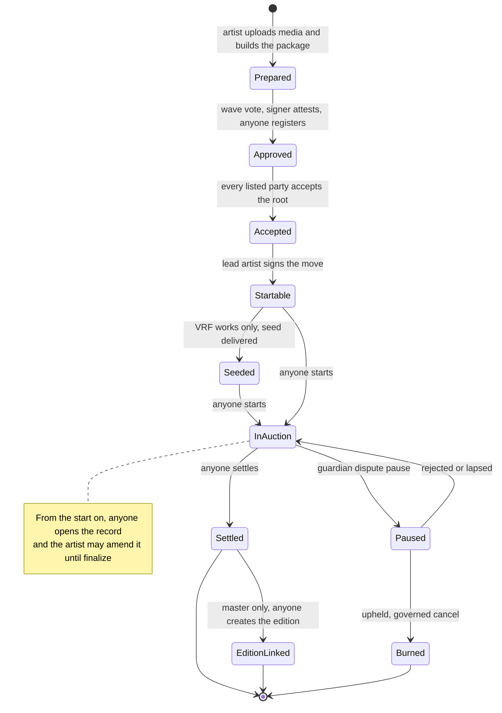

# Protocol specification

How 6529 Works v1 behaves now, one page per area. Each page gives the state machines, the
call sequences with the role and delay of every governed step, the rules with the tests that
check them, and the failure modes with their recovery.

> Pre-audit. See the [project status](../../README.md#status).

The ADRs record how the design was decided; this specification is how it works now. Where an
ADR, a module README and the code differ, the pages follow the code, and the
[register below](#differences-from-the-adrs) lists every difference from the ADRs.

## Pages

| Page | Prefix | Covers |
| --- | --- | --- |
| [Curation](curation.md) | `CUR` | Package items and roots, the curation signer's approval and epochs, party consent, the move signature, consume-once and content uniqueness, revocation |
| [Stream and auctions](stream-and-auctions.md) | `AUC` | The shared ERC-721: minting, collections and serials, locked terms, royalties, burns; the English auction from start to settlement |
| [Works and storage](works-and-storage.md) | `WS` | Each work's record, license, amendments, finalize and pins, locators and preferred location; the content store and dependency registry |
| [Rendering and tokenURI](rendering-and-tokenuri.md) | `RND` | Which renderer serves a token, record status, the metadata format, inline media and the 8M gas budget |
| [Editions and sales](editions-and-sales.md) | `ED` | The linked ERC-1155, edition formats, and the fixed-price and Dutch adapters with allowlists, payments and halts |
| [Economics and payouts](economics-and-payouts.md) | `ECO` | Products and terms, split wallets, currencies, the escrow, signed releases and batch claims |
| [Identity and recovery](identity-and-recovery.md) | `ID` | The artist registry, consolidations and standing, changes, overrides, contests and restraint |
| [Disputes and statements](disputes-and-statements.md) | `DSP` | The dispute pause, upheld and rejected outcomes, content release, and the statement log |
| [Entropy](entropy.md) | `ENT` | Optional Chainlink VRF seeds, one per content |
| [Governance](governance.md) | `GV` | The AccessManager, roles and delay classes, the guardians' cancel rules, genesis and operating procedures |

Terms are defined in the [glossary](../glossary.md). Every governed selector, with its role,
delay class and whether a guardian can cancel it, is in the generated
[role and permission matrix](../audit/roles.md).

## A work from end to end

The lifecycle of a Stream work, and the page that specifies each step.

| Step | Page |
| --- | --- |
| Prepare and upload content; record files; locators | [Works and storage](works-and-storage.md) |
| Approve, register, accept, move; consume at the start | [Curation](curation.md) |
| Seed a VRF work before its start | [Entropy](entropy.md) |
| Start, bid, settle; royalties | [Stream and auctions](stream-and-auctions.md) |
| Pay the seller, the network and the payees | [Economics and payouts](economics-and-payouts.md) |
| Pause, cancel and burn on an upheld dispute | [Disputes and statements](disputes-and-statements.md) |
| Open the record, amend it, finalize, sync on-chain | [Works and storage](works-and-storage.md) |
| Render metadata | [Rendering and tokenURI](rendering-and-tokenuri.md) |
| Create the edition and sell it | [Editions and sales](editions-and-sales.md) |
| Recover a lost or stolen artist key | [Identity and recovery](identity-and-recovery.md) |
| Change any governed setting | [Governance](governance.md) |

## How to read a page

Every page has the same headings, so a reader can jump straight to what they need:

- **Contracts:** the contracts in the area, their sources and interfaces.
- **State machine:** `stateDiagram-v2` diagrams, then who triggers each transition.
- **Flows:** `sequenceDiagram` call sequences. A governed step names its role and delay
  class, for example `PARAMETER_SETTER, 48 hours`.
- **Rules and invariants:** one row per rule, with an ID (`CUR-3`), the contract and
  function that enforce it, and the tests that check it ("Tested by"). Rule IDs are the
  page's own; the internal review's finding IDs (such as `MARKET-2` or `GOV-5`) are a separate
  namespace.
- **Failure modes and recovery**, **Parameters and limits**.
- **Events** and **Differences from the ADRs** link to their single owners: the
  [events page](../integrators/events-and-indexing.md) and the
  [register below](#differences-from-the-adrs).

## Conventions

- **Delay classes.** Immediate (0), standard (48 hours), funds and recipients (14 days),
  verifier and successor (30 days), from [`Roles.sol`](../../src/governance/Roles.sol). Any
  guardian can cancel any scheduled operation during its delay.
- **Rates and shares** use a denominator of 100,000, so the default royalty of 6.529% is
  exactly 6,529.
- **Currency** `address(0)` is ETH. `CURRENCY_DEFAULT` in package terms means the product's
  default when the sale opens.
- **Gas** is Prague gas unless a figure says otherwise, as
  [ADR 0004](../adr/0004-gas-budgets-under-glamsterdam.md) defines it; Sepolia figures are
  Glamsterdam receipts from [flows.md](../../deployments/11155111/flows.md).
- **"Anyone"** means a permissionless function: no role and no allow-list.

## Differences from the ADRs

The one register of where the code departs from an accepted ADR, and which later decision made
it so. The ADRs stay as written: they record why. The rule ID leads to the page that states
the current behavior in full.

| Page | Rule | The ADR said | The code now | Decided by |
| --- | --- | --- | --- | --- |
| [Curation](curation.md) | CUR-20 | ADR 0001 §3: items are canonical JSON with manifest and metadata hashes | ABI-encoded items (`WorksHashing`) committing content, media, record, license, seed and terms | ADR 0003, curation |
| [Curation](curation.md) | CUR-3 | ADR 0001 §3: Stream asks an `ICurationVerifier` | The registry asks once, at registration; a verifier swap leaves registered roots alone | None recorded |
| [Curation](curation.md) | – | ADR 0001 §3: the evidence hash goes to the statement log | The registry stores and emits it; the evidence statement is separate and unchecked | None recorded |
| [Curation](curation.md) | CUR-11 | ADR 0001 §3: revoke a move by nonce or by digest | Nonce bitmap only (`revokeMove`) | None recorded |
| [Curation](curation.md) | CUR-4 | ADR 0001 §3: approvals never expire | Registered roots never expire; unregistered attestations lapse on a signer-epoch change | Review finding SIGS-2 |
| [Curation](curation.md) | – | ADR 0001 §13: one curation signer key | At least two off a local chain | ADR 0003, curation |
| [Curation](curation.md) | CUR-14, DSP-21 | ADR 0003 first made the post-dispute content release permissionless | Governed (PARAMETER_SETTER, 48 hours), as amended ADR 0003 now says | Review finding SIGS-1 |
| [Stream and auctions](stream-and-auctions.md) | AUC-1, ED-5 | ADR 0001 §5: sale types get the minter role; §13: keeper roles as needed | Per-target admission (`setAdmittedMinter`, 30 days); no selector maps to `MINTER` or `KEEPER` | ADR 0003, governance |
| [Stream and auctions](stream-and-auctions.md) | AUC-30 | ADR 0001 §5: the starting bid is 0 and can be raised | The opening bid moves either way under a ceiling; the first bid is at least 1 wei | ADR 0003, sales |
| [Stream and auctions](stream-and-auctions.md) | AUC-7, ECO-7 | ADR 0001 §7: Core reads royalty terms directly, with a completion buffer | `Stream` makes one view call to the split factory, no buffer; `Editions` stores its receiver | ADR 0003, economics |
| [Stream and auctions](stream-and-auctions.md) | AUC-27, DSP-17 | ADR 0001 §12: a resumed auction gets its remaining time | The longest of remaining time, governed duration and anti-snipe window | ADR 0003, disputes; review finding LIFECYCLE-1 |
| [Stream and auctions](stream-and-auctions.md) | AUC-25 | ADR 0001 §12: only the dispute pause halts a live auction | A currency deprecation freezes it; after 30 days anyone ends it unsold | ADR 0003, disputes; review finding MARKET-2 |
| [Stream and auctions](stream-and-auctions.md) | AUC-24 | ADR 0003: an unsold work goes to the current authority | To the active authority, zero in a restraint, so a no-bid settlement waits | ADR 0003, owner decision 6 |
| [Stream and auctions](stream-and-auctions.md) | AUC-23 | ADR 0001 §5: failed wallet payments fall back to the escrow | An ERC-20 payout the escrow refuses is credited in the auction | Review finding MONEY-1; ADR 0004 |
| [Stream and auctions](stream-and-auctions.md) | AUC-32 | ADR 0001: a 300K start budget; ADR 0003: 350K against measured figures | 350,000 Prague gas and at most 6 new slots (7 with a bid) | ADR 0004, decisions 1, 2 and 6 |
| [Works and storage](works-and-storage.md) | WS-21, RND-20 | ADR 0001 §8: global, collection, file; ADR 0003: on-chain once the file completes | File, collection, global, first registered, then `ONCHAIN` once the whole work is complete | ADR 0003, storage (the `ONCHAIN` rule: none recorded) |
| [Works and storage](works-and-storage.md) | WS-22 | ADR 0001 §8: the operator switches among locators sharing a hash | No locator hash is stored; an off-chain monitor verifies copies | None recorded |
| [Works and storage](works-and-storage.md) | WS-18, WS-19 | ADR 0001 §8: artist or platform roles register locators | Bare content addresses, 8 per side per file, only PLATFORM after finalize | ADR 0003, storage |
| [Works and storage](works-and-storage.md) | WS-6 | ADR 0001 §8: the artist edits the record until finalize | Media hashes are fixed at approval; only the record file changes | ADR 0003, curation |
| [Works and storage](works-and-storage.md) | WS-13 | ADR 0001 §8, §10: the artist agrees to a license change | Every party signs a relicense; an errata repin needs the lead artist only | None recorded |
| [Works and storage](works-and-storage.md) | WS-12 | ADR 0001 §8: licenses change only toward more permissive terms | Only CC0 irrevocability is enforced | ADR 0003, integration |
| [Works and storage](works-and-storage.md) | – | ADR 0001 §8: the default license is governed | `WorkRecords`' CC0 default is immutable; per-product defaults are governed | None recorded |
| [Works and storage](works-and-storage.md) | WS-2, WS-4 | ADR 0003, integration: opening a record never fails | `openRecord` refuses bad media lists, oversize previews and a wrong CC0 text | None recorded |
| [Works and storage](works-and-storage.md) | WS-8, WS-9, WS-13 | ADR 0003, integration: one check list for `setRecord`, `finalize` and `relicense` | Each checks a different subset | None recorded |
| [Works and storage](works-and-storage.md) | – | ADR 0001 §8: the media list holds file size and MIME type | The content-store manifest holds them | None recorded |
| [Works and storage](works-and-storage.md) | – | ADR 0001 §8: 72 KB per transaction, 0.23 ETH per MB per gwei | One chunk per transaction under Glamsterdam (two under Prague); about 1.65 ETH per MiB at 1 gwei | ADR 0003; ADR 0004 |
| [Works and storage](works-and-storage.md) | WS-8 | ADR 0003 first set `MAX_RECORD_BYTES` at 24,575 | 12,288, as ADR 0003 later set | ADR 0003, integration |
| [Rendering and tokenURI](rendering-and-tokenuri.md) | RND-17, RND-18 | ADR 0001 §8: media of 256 KB or less inlines once on-chain complete | By cost-weighted size per encoding, `Gzip` never; scripts only in the HTML page | ADR 0003, storage |
| [Rendering and tokenURI](rendering-and-tokenuri.md) | – | No ADR covers preview inlining | A preview inlines once its own file is complete | None recorded |
| [Rendering and tokenURI](rendering-and-tokenuri.md) | RND-6 | ADR 0001 §8: one bounded read of at least the inline threshold | One chunk per read, capped at 24,575 bytes and 300,000 gas | None recorded |
| [Rendering and tokenURI](rendering-and-tokenuri.md) | RND-20 | ADR 0001 §8: a mirror URL between 256 KB and 1 MB | An `ar://` or `ipfs://` address, or no media member | ADR 0003, "Locator kinds" |
| [Rendering and tokenURI](rendering-and-tokenuri.md) | RND-10 | ADR 0003, integration: at most 512 escapes within 1,024 units | 512 bounds `%` and `#`; JSON escapes count only toward 1,024 | None recorded |
| [Rendering and tokenURI](rendering-and-tokenuri.md) | RND-19, RND-21 | ADR 0003: `fullTokenURI` serves larger scripts in full | Only within size, UTF-8, `<` and dependency limits | None recorded |
| [Rendering and tokenURI](rendering-and-tokenuri.md) | RND-26 | ADR 0004's table: `tokenURI` at most 2,733,567 gas | That is the size matrix; the worst case, every cap at once, is 7.80M, under 8M | ADR 0004, decision 1 |
| [Editions and sales](editions-and-sales.md) | ED-2 | ADR 0001 §6: the link is permanent once both sides finalize | Permanent from `createEdition`, finalized or not | None recorded |
| [Editions and sales](editions-and-sales.md) | ED-1 | ADR 0001 §6: the link comes only from the approved package | The root must be registered, revoked or not | Review finding SIGS-4 |
| [Editions and sales](editions-and-sales.md) | ED-12 | ADR 0001 §6: the artist picks size, format and price; ADR 0003: `openSale` is PLATFORM | Terms fixed at approval; PLATFORM alone opens only listed FIXED editions | Review finding MARKET-6; ADR 0003, curation |
| [Editions and sales](editions-and-sales.md) | ED-14 | ADR 0003 owner decision 6: in a restraint PLATFORM runs sales; the artist cannot close them | PLATFORM alone opens only FIXED editions with unpriced phases; it closes any sale while the creator is zero | Review findings IDENTITY-1, MARKET-6 |
| [Editions and sales](editions-and-sales.md) | ED-21, ED-14 | ADR 0003: deprecations halt sales; anyone closes a sale whose phases ended | Halts shift phase windows and the Dutch curve; only fixed-price sales end | Review finding MARKET-1 |
| [Editions and sales](editions-and-sales.md) | ED-9 | No ADR barred the escrow as a payee | A sale paying the escrow is refused at open | Review finding CALLS-1 |
| [Economics and payouts](economics-and-payouts.md) | ECO-8 | ADR 0001 §7: split wallets take any number of recipients | At most 64 payees per wallet, 16 parties per item | ADR 0003, economics |
| [Economics and payouts](economics-and-payouts.md) | – | ADR 0001 §7: RC1's scoped resolvers stay | One `EconomicsResolver` with per-product settings | None recorded |
| [Economics and payouts](economics-and-payouts.md) | – | ADR 0001 §7: the settlement recorder stays | No recorder; `TokenTransfer` checks exact deltas | None recorded (LIM-ECO-5) |
| [Economics and payouts](economics-and-payouts.md) | ECO-6 | ADR 0001 §7: locked terms change with artist agreement plus a governed action | Only the royalty rate changes (every party signs; FUNDS_SETTER, 14 days) | None recorded |
| [Economics and payouts](economics-and-payouts.md) | ECO-28 | ADR 0001 §7: terminal recovery needs the affected accounts' consent | Factory wallets' credit moves only to identical payees; others call `consentToRecovery` | ADR 0003, economics |
| [Economics and payouts](economics-and-payouts.md) | ECO-23, ECO-32 | ADR 0001 §5: only standard ERC-20s, every transfer checked by balance delta | On-chain admission checks a few properties; Permit2 pulls skip the return-value check | None recorded |
| [Economics and payouts](economics-and-payouts.md) | – | ADR 0001 §5: Editions launch with ETH plus admitted ERC-20s | Genesis makes ETH every product's default; items may name any active ERC-20 | ADR 0003, integration |
| [Economics and payouts](economics-and-payouts.md) | – | ADR 0001 §7: governance sets new-work splits with any basis points | Governance sets the fee and royalty rate; the approved payee list splits the artist portion | None recorded |
| [Identity and recovery](identity-and-recovery.md) | ID-9, ID-13, ID-18 | ADR 0001 §11: captured wallets cancel overrides; ADR 0003 owner decision 6: cancels end restraints | Their cancel contests an override (TDH vote) and the restraint continues; STANDARD changes still die | ADR 0003, owner decision 1 |
| [Identity and recovery](identity-and-recovery.md) | ID-9, ID-23 | ADR 0001 §11: any established consolidated wallet may cancel | At most 16 cancellers, captured at staging from the sticky snapshot | ADR 0003, identity |
| [Identity and recovery](identity-and-recovery.md) | ID-22 | ADR 0003, identity: the snapshot holds established wallets | Young consolidations too, as pending entries | Review finding IDENTITY-3 (PR #51) |
| [Identity and recovery](identity-and-recovery.md) | ID-11 | ADR 0001 §11: `LOST_KEY` is for keys with no consolidation | Unchecked; `ESTATE` and `LOST_KEY` both need 365 days without signed activity | None recorded |
| [Identity and recovery](identity-and-recovery.md) | – | ADR 0001 §11: the registry holds the artist ID, authority and profile | Also payout, nonce, activity, pending change, standing, reservations and federated list | ADR 0003, identity; review finding IDENTITY-2 |
| [Identity and recovery](identity-and-recovery.md) | ID-26, ID-27 | ADR 0001 §11: the identity source is swapped when the 6529 chain arrives | Swappable any time (30 days); its code hash is re-checked at use | Review finding DEPS-6 (PR #53) |
| [Identity and recovery](identity-and-recovery.md) | ID-2, ID-3 | ADR 0001 §11: nothing barred a past authority or reserved a pending one | A new authority must be current or never used; staged changes reserve theirs | Review findings SIGS-3 (ADR 0003), IDENTITY-2 |
| [Disputes and statements](disputes-and-statements.md) | DSP-18, AUC-26 | ADR 0001 §12: an upheld dispute cancels the auction, then records the outcome | The outcome comes first; the governed `cancel` (48 hours) must cite it | ADR 0003, disputes; review finding LIFECYCLE-4 |
| [Disputes and statements](disputes-and-statements.md) | DSP-13 | ADR 0001 §12: a guardian pause lasts at most 7 days | One pause per auction, not renewable after an early `resume` | None recorded |
| [Disputes and statements](disputes-and-statements.md) | DSP-19 | ADR 0001 §12: all bids are refunded | As pull credits | None recorded |
| [Disputes and statements](disputes-and-statements.md) | – | ADR 0001 §12: each entry records the work | Open subjects: tokens, items, artists, governance manifests, any `(token, id)` | ADR 0003, owner decision 1; ADR 0002, decision 6 |
| [Entropy](entropy.md) | ENT-12 | ADR 0001 §9: `start` requests the seed; the 24-hour clock starts at delivery | `start` needs a delivered seed; the clock starts at the start | ADR 0003, sales |
| [Entropy](entropy.md) | ENT-5 | ADR 0001 §9: an undelivered request may be re-requested | Repeats after `retryDelay` add requests; the first delivery wins | ADR 0003, sales |
| [Entropy](entropy.md) | ENT-1, ENT-2 | ADR 0001 §9: VRF per work; ADR 0003: one draw per VRF item | One draw per content hash, plus repeats while undelivered | Review finding DEPS-1 |
| [Entropy](entropy.md) | ENT-11, GV-21 | ADR 0001 §13.9: gas parameters are raise-only | The callback gas limit can also be lowered (30 days, floor 100,000) | Review finding DEPS-5 (ADR 0003) |
| [Entropy](entropy.md) | ENT-13 | Sepolia `flows.md` §6 (not an ADR): the callback writes a new slot | No new slot: the seed overwrites the request ID | Review finding DEPS-2; ADR 0004 |
| [Governance](governance.md) | GV-1 | ADR 0001 §13: a guardian-guarded meta role or a TimelockController | Neither: under Rule 1 any guardian cancels any operation | ADR 0002, decisions 1 and 2 |
| [Governance](governance.md) | GV-2 | ADR 0001 §13: a guardian cannot cancel its own replacement | Rule 2 generalizes this to every role and canceller | ADR 0002, decision 1 |
| [Governance](governance.md) | GV-25 | ADR 0002 decision 1: two cancellation rules | Three: Rule 3 lets only an active guardian cancel another account's manager `revokeRole` | Review finding GOV-1; ADR 0002 addendum |
| [Governance](governance.md) | GV-26 | ADR 0001 §13: guardians only veto | They also suspend PLATFORM, CURATOR and STORAGE_OPERATOR holders | Review finding GOV-2; ADR 0002 addendum |
| [Governance](governance.md) | GV-28 | ADR 0002 addendum: a grant, or revocation and regrant, lifts a suspension | Revocation alone lifts it, as does `renounceRole` | Review finding GOV-2 |
| [Governance](governance.md) | – | ADR 0001 §13: no guardian change while a terminal action is pending | Not implemented; guardian changes are vetoable 30-day operations | ADR 0002, decision 4 |
| [Governance](governance.md) | GV-6 | ADR 0001 §13: a guardian is never a proposer | No dedicated check: guardians hold only zero-delay roles, which cannot schedule | ADR 0002, decision 4 |
| [Governance](governance.md) | GV-14 | ADR 0001 §13: one admin Safe, one guardian Safe | Off anvil, two admin and three guardian Safes; the code floor is two guardians | ADR 0002, decision 5; ADR 0003, owner decisions 2 and 3, addendum |
| [Governance](governance.md) | – | ADR 0001 §13: an event emits the manifest hash | `GovernanceConfigured` and an epoch-0 statement at genesis, then `GOVERNANCE_MANIFEST` statements | ADR 0002, decision 6 |
| [Governance](governance.md) | – | ADR 0001 §13: freezes are one-way, in the 30-day class | No freeze function exists | None recorded |
| [Governance](governance.md) | GV-12 | ADR 0003: genesis performs every binding and minter admission | Also sale targets, default currencies and the epoch-0 manifest; federation binding waits for v1.1 | ADR 0003, integration |
| [Governance](governance.md) | GV-15 | ADR 0002 decision 3: the readback rejects any unexpected admin | `verify` misses admins granted later; `Verify.s.sol`'s `RoleGranted` scan catches them | None recorded |
| [Governance](governance.md) | GV-23, AUC-13, DSP-16, ED-22 | ADR 0002 decision 7, ADR 0003: unpause, resume and cancel wait 48 hours from scheduling | None lands before 48 hours after the pause | Review finding GOV-5 (PR #57) |
| [Build, test and budgets](../audit/build-and-test.md) | – | ADR 0001: EIP-170 holds in every Foundry profile | Measured for the one defined profile, `default` | None recorded |
| [Build, test and budgets](../audit/build-and-test.md) | – | ADR 0001: 8–12K non-comment lines | Only the 12,000 maximum is enforced | None recorded |
| [Build, test and budgets](../audit/build-and-test.md) | – | ADR 0001: build and test in under 15 minutes | Per-job timeouts: 15 minutes for Contracts and Static analysis, 5 for Docs | None recorded |
| [Build, test and budgets](../audit/build-and-test.md) | – | ADR 0001: reproducible from a committed standard-JSON input | None committed; `Verify.s.sol` does not rebuild bytecode | Known gap LIM-REL-1 |
| [Invariants](../audit/invariants.md) | INV-CUR-1, INV-CUR-3, INV-CUR-4, INV-CUR-6 | ADR 0001 test plan: single-use packages and items as an invariant | Items and content hashes are tested directly; a package's single use only through the model's exactness | None recorded |
| [Invariants](../audit/invariants.md) | – | ADR 0001, AGENTS.md: stateful invariants for every contract moving money | None for `EconomicsResolver` or `AssetAllowlist`; sale campaigns use a mock escrow | None recorded (PR #62 adds suites) |
| [Known limitations](../audit/known-limitations.md) | AUC-7 | ADR 0001 §16: royalties are advisory for federated contracts | Also for Stream and Editions, which implement only ERC-2981 (LIM-SAL-8) | None (a clarification) |
| [Known limitations](../audit/known-limitations.md) | WS-32 | ADR 0003, content README: every transaction fits 16,777,216 gas | Regular gas only; state gas sits outside it on Sepolia (LIM-GAS-2) | ADR 0004, decision 4 |

## Reporting a mismatch

If the code and a page disagree, the code is what runs. Open an issue that names the page,
the rule ID and the code. If the mismatch is exploitable, report it privately as
[SECURITY.md](../../SECURITY.md) describes.

## Related

- [Architecture overview](../architecture.md): modules, identifiers and trust boundaries.
- [Auditor pack](../audit/README.md) and [integrator guide](../integrators/README.md).
- [ADRs](../adr/README.md): the decisions and their reasons.
