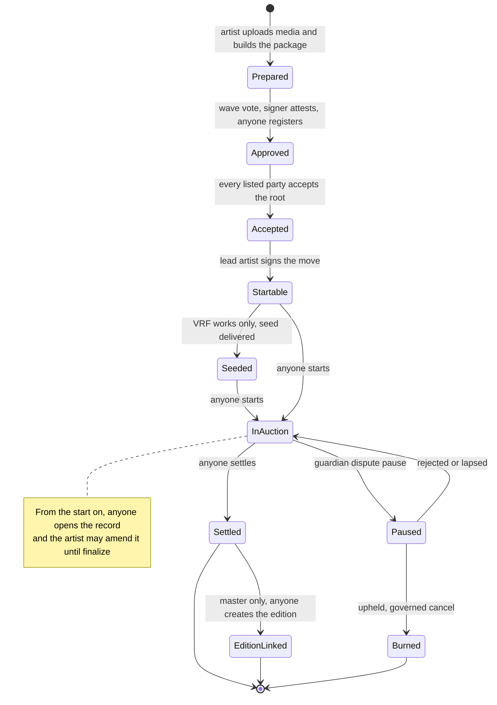

# Protocol specification

How 6529 Works v1 behaves now, one page per area. Each page gives the state machines, the
call sequences with the role and delay of every governed step, the rules with the tests that
prove them, the events, and the failure modes with their recovery.

> **Status.** Pre-audit. The pages describe `main` at `46941d6` (15 October 2026). The ADRs
> record how the design was decided; this specification is how it works now. Where an ADR, a
> module README and the code differ, the page follows the code and lists the difference under
> its "Differences from the ADRs" heading.

## Pages

| Page | Prefix | Covers |
| --- | --- | --- |
| [Curation](curation.md) | `CUR` | Package items and roots, the curation signer's approval and epochs, party consent, the move signature, consume-once and content uniqueness, revocation |
| [Stream and auctions](stream-and-auctions.md) | `AUC` | The shared ERC-721: minting, collections and serials, locked terms, royalties, burns; the English auction from start to settlement |
| [Works and storage](works-and-storage.md) | `WS` | Each work's record, license, amendments, finalize and pins, locators and preferred location; the content store and dependency registry |
| [Rendering and tokenURI](rendering-and-tokenuri.md) | `RND` | Which renderer serves a token, record status, the metadata format, inline media and the 8M gas budget |
| [Editions and sales](editions-and-sales.md) | `ED` | The linked ERC-1155, edition formats, and the fixed-price and Dutch adapters with allowlists, payments and halts |
| [Economics and payouts](economics-and-payouts.md) | `ECO` | Products and terms, split wallets, currencies, the escrow, signed releases and batch claims |
| [Identity and recovery](identity-and-recovery.md) | `ID` | The artist registry, consolidations and standing, changes, overrides, contests and restraint |
| [Disputes and statements](disputes-and-statements.md) | `DSP` | The dispute pause, upheld and rejected outcomes, content release, and the statement log |
| [Entropy](entropy.md) | `ENT` | Optional Chainlink VRF seeds, one per content |
| [Governance](governance.md) | `GV` | The AccessManager, roles and delay classes, the guardians' cancel rules, genesis and operating procedures |

Terms are defined in the [glossary](../glossary.md). Every governed selector, with its role,
delay class and whether a guardian can cancel it, is in the generated
[role and permission matrix](../audit/roles.md).

## A work from end to end

The lifecycle of a Stream work, and the page that specifies each step.

| Step | Page |
| --- | --- |
| Prepare and upload content; record files; locators | [Works and storage](works-and-storage.md) |
| Approve, register, accept, move; consume at the start | [Curation](curation.md) |
| Seed a VRF work before its start | [Entropy](entropy.md) |
| Start, bid, settle; royalties | [Stream and auctions](stream-and-auctions.md) |
| Pay the seller, the network and the payees | [Economics and payouts](economics-and-payouts.md) |
| Pause, cancel and burn on an upheld dispute | [Disputes and statements](disputes-and-statements.md) |
| Open the record, amend it, finalize, sync on-chain | [Works and storage](works-and-storage.md) |
| Render metadata | [Rendering and tokenURI](rendering-and-tokenuri.md) |
| Create the edition and sell it | [Editions and sales](editions-and-sales.md) |
| Recover a lost or stolen artist key | [Identity and recovery](identity-and-recovery.md) |
| Change any governed setting | [Governance](governance.md) |

## How to read a page

Every page has the same headings, so a reader can jump straight to what they need:

- **Contracts:** the contracts in the area, their sources and interfaces.
- **State machine:** `stateDiagram-v2` diagrams, then who triggers each transition.
- **Flows:** `sequenceDiagram` call sequences. A governed step names its role and delay
  class, for example `PARAMETER_SETTER, 48 hours`.
- **Rules and invariants:** one row per rule, with an ID (`CUR-3`), the contract and
  function that enforce it, and the tests that prove it. Rule IDs are the page's own; the
  internal review's finding IDs (such as `MARKET-2` or `GOV-5`) are a separate namespace.
- **Events**, **Failure modes and recovery**, **Parameters and limits**.
- **Differences from the ADRs:** where the code departs from an ADR, and which later
  decision made it so.

## Conventions

- **Delay classes.** Immediate (0), standard (48 hours), funds and recipients (14 days),
  verifier and successor (30 days), from [`Roles.sol`](../../src/governance/Roles.sol). Any
  guardian can cancel any scheduled operation during its delay.
- **Rates and shares** use a denominator of 100,000, so the default royalty of 6.529% is
  exactly 6,529.
- **Currency** `address(0)` is ETH. `CURRENCY_DEFAULT` in package terms means the product's
  default when the sale opens.
- **Gas** is Prague gas unless a figure says otherwise, as
  [ADR 0004](../adr/0004-gas-budgets-under-glamsterdam.md) defines it; Sepolia figures are
  Glamsterdam receipts from [flows.md](../../deployments/11155111/flows.md).
- **"Anyone"** means a permissionless function: no role and no allow-list.

## Reporting a mismatch

If the code and a page disagree, the code is what runs. Open an issue that names the page,
the rule ID and the code. If the mismatch is exploitable, report it privately as
[SECURITY.md](../../SECURITY.md) describes.

## Related

- [Architecture overview](../architecture.md): modules, identifiers and trust boundaries.
- [Auditor pack](../audit/README.md) and [integrator guide](../integrators/README.md).
- [ADRs](../adr/README.md): the decisions and their reasons.
