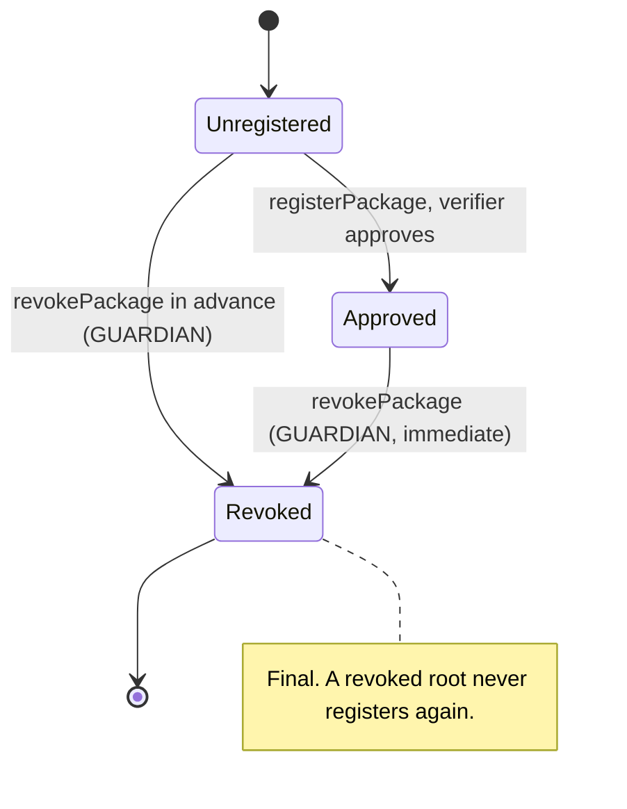
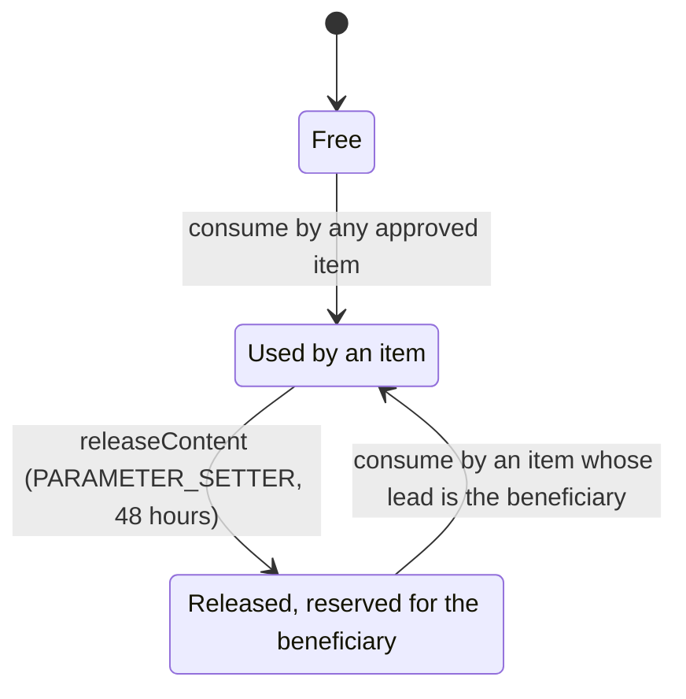
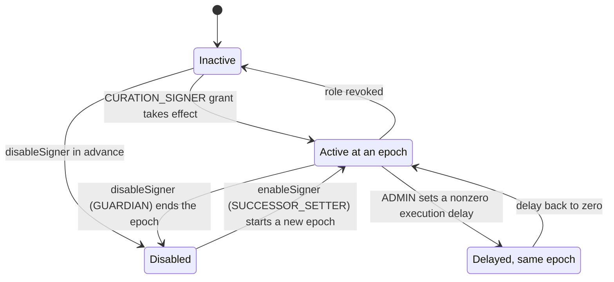
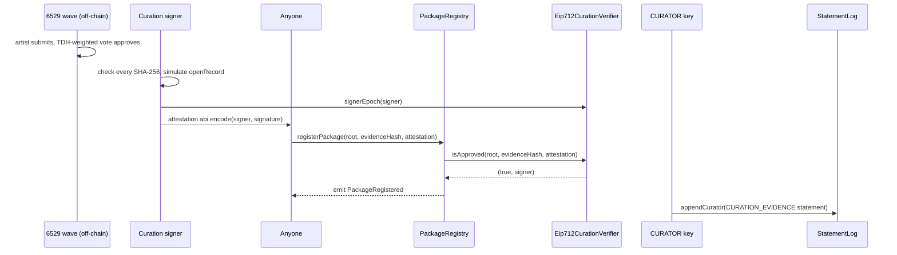
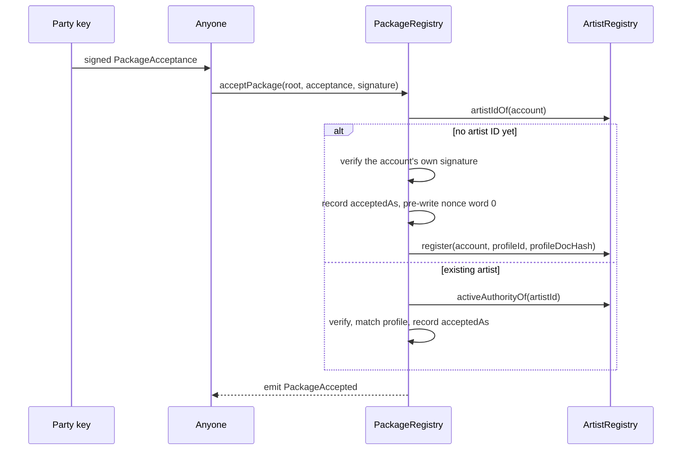
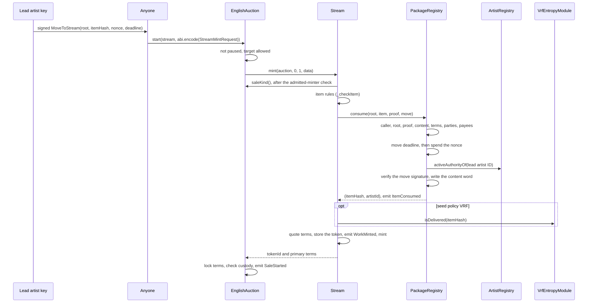
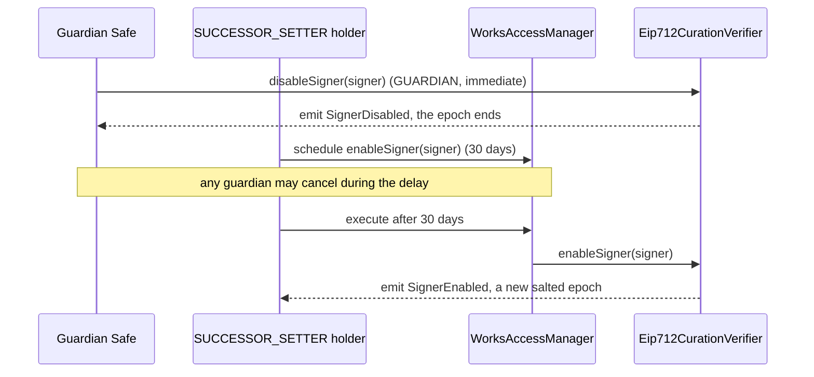
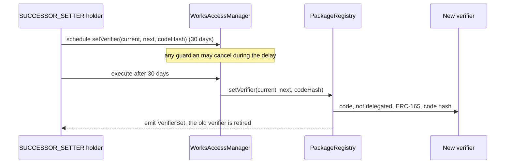

# Curation

Curation decides which works may ever mint on 6529 Stream. Voters approve a package (a Merkle
root of items) in a 6529 wave; a curation signer attests the approval; anyone registers the
root; every party named by an item signs it; and the lead artist signs a revocable move that lets
the work start. At the auction start the package registry consumes the item, checking all of this
and recording its content hash so the same work never mints twice. For auditors, integrators and
curation operators; `PackageRegistry` and `Eip712CurationVerifier` implement it.

> Pre-audit. See the [project status](../../README.md#status).

## Contracts

| Contract | Source | Interface | Responsibility |
| --- | --- | --- | --- |
| `PackageRegistry` | [`src/curation/PackageRegistry.sol`](../../src/curation/PackageRegistry.sol) | [`IPackageRegistry`](../../src/interfaces/IPackageRegistry.sol) | Approved roots, acceptances, consume-once and per-product content uniqueness, move nonces, content release, verifier swap. |
| `Eip712CurationVerifier` | [`src/curation/Eip712CurationVerifier.sol`](../../src/curation/Eip712CurationVerifier.sol) | [`ICurationVerifier`, `ICurationSignerVerifier`](../../src/interfaces/ICurationVerifier.sol) | The v1 verifier: accepts a `PackageApproval` signature by an active curation signer at its current signer epoch; the guardian's per-signer kill switch. |
| `WorksHashing` (library) | [`src/interfaces/types/WorksHashing.sol`](../../src/interfaces/types/WorksHashing.sol) | none | The one definition of the item hash, Merkle leaf, media hash and license key. |
| `Typehashes` (library) | [`src/interfaces/types/Typehashes.sol`](../../src/interfaces/types/Typehashes.sol) | none | EIP-712 domain names, the domain version and every typehash. |
| `EditionRules` (library) | [`src/editions/EditionRules.sol`](../../src/editions/EditionRules.sol) | none | Valid edition terms, applied by the registry at `consume` and by 6529 Editions at `createEdition`. |
| Package types | [`src/interfaces/types/PackageTypes.sol`](../../src/interfaces/types/PackageTypes.sol) | none | `PackageItem`, `Party`, `License`, `SaleTerms`, `EditionTerms`, `PartyAcceptance`, `MoveAuthorization`, `StreamMintRequest`. |

## Concepts

The [package](../glossary.md#package), [package root](../glossary.md#package-root),
[item hash](../glossary.md#item-hash), [curation signer](../glossary.md#curation-signer),
[evidence hash](../glossary.md#evidence-hash), [signer epoch](../glossary.md#signer-epoch),
[acceptance](../glossary.md#acceptance), [move](../glossary.md#move),
[consume](../glossary.md#consume) and [restraint](../glossary.md#restraint) are defined in the
glossary. What this page adds:

- A root names no chain or contract, so it is the same on every chain.
- Until a verifier backed by the 6529 chain replaces the v1 verifier, the contracts trust the
  curation signer, not the vote ([`ICurationVerifier`](../../src/interfaces/ICurationVerifier.sol)).
- The evidence hash commits to the published vote snapshot, TDH snapshot and rule parameters,
  and to the signer's check of every declared SHA-256. The registry stores it; the CURATOR
  publishes the matching [curation evidence](../glossary.md#curation-evidence) statement.
- One storage word, `contentHash => itemHash`, is both the consume-once record and the
  uniqueness record.
- While an authority-moving override is pending, `activeAuthorityOf` returns zero, so no
  acceptance, move or move revocation verifies for that artist (CUR-19, ADR 0003 owner decision 6).

### The package item

Every field of `PackageItem` ([`PackageTypes.sol`](../../src/interfaces/types/PackageTypes.sol))
enters the item hash, so voters approve and parties sign exactly these values.

| Field | Meaning | Checked on-chain |
| --- | --- | --- |
| `kind` | `ORIGINAL` (a 1/1) or `EDITION_MASTER` (a 1/1 that anchors one 6529 Editions edition). | `consume`: an `ORIGINAL` has empty edition terms; a master's terms pass `EditionRules.isValid`. |
| `collectionId` | A 6529 Stream collection (below 2^32). | Stream `mint`: the collection exists. |
| `contentHash` | Decoded SHA-256 of the primary media; the per-product uniqueness key. | `consume`: nonzero and unused on Stream. `WorkRecords.openRecord`: equals the primary file's SHA-256. |
| `mediaHash` | Hash over every media file (file ID, decoded SHA-256, role), primary first. Media is fixed by approval. | `WorkRecords.openRecord`. |
| `recordFileId` | Content-store file ID of the approved JSON record; the artist may replace it until finalize. | Structure checked at `setRecord` and `finalize`. |
| `parties` | 1 to `Limits.MAX_PARTIES` (16) `(account, role)` entries, lead `ARTIST` first, `COLLABORATOR` for credited contributors. | `consume` ([CUR-6](#rules-and-invariants)). |
| `payees` | The canonical payee list of the artist portion: fixed payees by account, artist-resolved payees by artist ID. | `consume` ([CUR-8](#rules-and-invariants)). |
| `license` | SPDX ID and the content-store file of the full text. | Stream `mint`: `SpdxId` rule. `openRecord`: CC0 names the deployment's CC0 text. |
| `seedPolicy`, `seed` | `NONE`, `ARTIST` (with the artist's nonzero seed) or `VRF`. See [entropy.md](entropy.md). | `consume` and Stream: a seed exactly under `ARTIST`. Stream: `VRF` needs an entropy module and a delivered seed. |
| `sale` | `SaleTerms`: how the work is first sold. | Stream `mint`: `SaleKind.ENGLISH_AUCTION` with empty `params`. |
| `edition` | `EditionTerms` of the edition a master anchors; all zero for an `ORIGINAL`. | `consume` and Editions `createEdition`: `EditionRules.isValid`. |

Canonical payee order is strictly increasing `(artistId, account)`, so fixed payees (`artistId`
zero) come first, ordered by address. One party may be paid both as a fixed and as an
artist-resolved payee; the two are distinct keys (`test_validItem_partyPaidBothWays`).

### Identifiers and hashes

Structured hashes are `keccak256(abi.encode(DOMAIN, value))` with a per-type domain label
([`WorksHashing.sol`](../../src/interfaces/types/WorksHashing.sol)). The golden vectors in
[`WorksHashing.t.sol`](../../test/interfaces/WorksHashing.t.sol) were computed with `cast`, the
way off-chain tools compute them.

| Identifier | Definition |
| --- | --- |
| item hash | `keccak256(abi.encode(PACKAGE_ITEM_DOMAIN, item))`, with `PACKAGE_ITEM_DOMAIN = keccak256("6529WORKS_PACKAGE_ITEM_V1")`. |
| leaf | `keccak256(bytes.concat(itemHash))`. Double hashing makes a leaf's preimage 32 bytes, so a 64-byte inner node never passes as a leaf. |
| package root | OpenZeppelin `MerkleProof` root (sorted pairs) over the leaves, equal to `StandardMerkleTree` with leaf encoding `["bytes32", <PackageItem tuple>]` and values `[PACKAGE_ITEM_DOMAIN, item]`. A one-item package's root is its leaf. |
| media hash | `keccak256(abi.encode(MEDIA_DOMAIN, media))` over the ordered `MediaFile[]`, with `MEDIA_DOMAIN = keccak256("6529WORKS_MEDIA_V1")`. |
| content hash, evidence hash | Declared by the item and by the signed approval; the contracts never recompute them. |

The JSON package document maps field for field onto these structs; the ABI encoding is committed.

### EIP-712 messages

Each signing contract uses the domain `(name, "1", chainid, itself)`
(`Typehashes.DOMAIN_VERSION`), so a signature is valid for one deployment on one chain.

| Message | Type string (`Typehashes`) | Domain name | Signed by | Replay protection |
| --- | --- | --- | --- | --- |
| `PACKAGE_APPROVAL` | `PackageApproval(bytes32 packageRoot,bytes32 evidenceHash,uint256 signerEpoch)` | `6529 Works Curation Verifier` | A curation signer | A root registers once; the signer epoch. |
| `PACKAGE_ACCEPTANCE` | `PackageAcceptance(bytes32 packageRoot,address account,bytes32 profileId,bytes32 profileDocHash,uint64 deadline)` | `6529 Works Package Registry` | The account itself if it has no artist ID, otherwise its artist's active authority | Once per `(root, account)`; a deadline. |
| `MOVE_TO_STREAM` | `MoveToStream(bytes32 packageRoot,bytes32 itemHash,uint256 nonce,uint64 deadline)` | `6529 Works Package Registry` | The lead artist's active authority | A per-artist nonce; a deadline. |

- **Attestation encoding.** The registry passes the attestation to the verifier unread. The v1
  verifier accepts only canonical `abi.encode(address signer, bytes signature)` (clean address
  word, offset `0x40`, length, zero-padded bytes, nothing after); anything else returns
  `(false, address(0))` without reverting.
- **Signatures.** All three go through
  [`SignatureVerifier.isValid`](../../src/libraries/SignatureVerifier.sol): low-s ECDSA (65 bytes
  or ERC-2098's 64), ERC-1271 and EIP-7702 accounts; never a zero signer. Replay protection never
  keys on signature bytes, since both ECDSA encodings verify.
- **Digests.** `approvalDigest`, `acceptanceDigest` and `moveDigest` return them.

### Signer epoch

`signerEpoch(signer)` is `since << 128 | salt << 64 | changes`
(`Eip712CurationVerifier.signerEpoch`):

- `since` is when the signer's current `CURATION_SIGNER` grant takes or took effect, read from
  the AccessManager. A revocation deletes it and a new grant sets a later one.
- `changes` counts `disableSigner` and `enableSigner` calls.
- `salt` is the low 64 bits of `keccak256(abi.encode(block.prevrandao, signer, changes))`,
  drawn at the latest disable or enable. It only has to be unknown before that block.

So an approval made before a disable or under a revoked grant never counts again, and one signed
while disabled cannot name the re-enable epoch. The signer reads `signerEpoch` before signing. A
nonzero execution delay makes the signer inactive but keeps its epoch. Registered approvals never
expire.

### Move nonces

Each artist's move nonces live in a bitmap: word `nonce / 255`, bit `nonce % 255`; bit 255 of
every written word is a sentinel. The acceptance that creates an identity writes the sentinel
into word 0, so the artist's first 255 starts update an existing slot. Tools should use nonces 0,
1, 2, and so on per artist; any `uint256` works.

### Trust obligations of the curation signer

The contracts cannot check these; the signer's tooling must, before it attests (ADR 0003,
"Package format and curation").

- **Verify every declared SHA-256 against the decoded bytes**, for every media file, including
  the content hash, on which on-chain uniqueness keys.
- **Simulate `WorkRecords.openRecord`** for every item. Its media checks
  ([WS-2](works-and-storage.md#rules-and-invariants)) do not run at mint, so a mis-committed
  item mints and its record never opens.
- **Decode Base64 strictly** (RFC 4648 alphabet, as the content store's `attestBase64` checks).
- **Revoke before revising a VRF work's media.** A revision of the primary media has a new
  content hash and so draws a new seed; the guardian revokes the old root first
  ([`src/curation/README.md`](../../src/curation/README.md)).

## State machine

### Package root

`packageOf(root)` returns `(status, evidenceHash, signer)`; the enum is
`IPackageRegistry.PackageStatus { NONE, APPROVED, REVOKED }`.

### Item and content hash (6529 Stream)

If an upheld dispute burns a work, `releaseContent` tombstones its item: never consumable again,
through any root. The content hash:

`consumedItemOf(contentHash)` reads the item holding the content, or zero when free or
released. `releasedTo(contentHash)` reads the beneficiary of the latest release; it binds only
while the content is released. `isReleased(itemHash)` reads the tombstone and `editionClaimOf`
the [edition claim](#edition-content-claim).

### Curation signer

`isSignerActive` reads the state; a disable survives a role re-grant.

| Transition | Caller (role) | Delay | Function |
| --- | --- | --- | --- |
| Root: unregistered to approved | Anyone | none | `PackageRegistry.registerPackage` |
| Root: unregistered or approved to revoked | `GUARDIAN` | immediate | `PackageRegistry.revokePackage` |
| Party consent recorded | Anyone, relaying the party's signature | none | `PackageRegistry.acceptPackage` |
| Move nonce revoked | The lead artist's active authority | none | `PackageRegistry.revokeMove` |
| Item consumed, content used | Bound 6529 Stream, inside `IStream.mint` at the auction start | none | `PackageRegistry.consume` |
| Edition claims the content | Bound 6529 Editions, inside `createEdition` | none | `PackageRegistry.claimContent` |
| Content released, item tombstoned | `PARAMETER_SETTER` through `IStream.releaseContent` | standard, 48 hours | `PackageRegistry.releaseContent` |
| Signer becomes active | ADMIN grants `CURATION_SIGNER` | 30-day ADMIN operation, then the 30-day grant delay (`Roles.grantDelay`) | `AccessManager.grantRole` |
| Signer disabled | `GUARDIAN` | immediate | `Eip712CurationVerifier.disableSigner` |
| Signer re-enabled | `SUCCESSOR_SETTER` | successor, 30 days | `Eip712CurationVerifier.enableSigner` |
| Verifier replaced, old one retired | `SUCCESSOR_SETTER` | successor, 30 days | `PackageRegistry.setVerifier` |
| Stream or Editions bound | ADMIN (genesis configurator, before it renounces ADMIN) | once each | `PackageRegistry.bindStream`, `bindEditions` |

Role mappings are from [`config/genesis.example.json`](../../config/genesis.example.json); the
selector-by-selector matrix is [roles.md](../audit/roles.md).

## Flows

### Approve and register

- **Preconditions.** The root's status is `NONE`. The current verifier still has its pinned
  code hash (`InvalidDependency`). The verifier approves and the evidence hash is nonzero
  (`NotApproved`).
- **Effects.** Status `APPROVED`; the signer and evidence hash are stored and emitted.
- **Curation evidence.** Only CURATOR writes a `CURATION_EVIDENCE` statement, subject
  `(address(0), uint256(root))`, by `appendCurator` or a relayed `appendSigned`
  ([`StatementLog.sol`](../../src/records/StatementLog.sol); delays and suspension in
  [disputes-and-statements.md](disputes-and-statements.md)). The registry neither requires nor
  checks it.

Sepolia gas for registration and acceptance is in
[flows.md, section 2](../../deployments/11155111/flows.md#2-the-curated-stream-sale).

### Party acceptance

- **Preconditions.** The root is `APPROVED`; `block.timestamp <= deadline`. For an existing
  artist, `profileId` and `profileDocHash` must match the identity record (`ProfileMismatch`).
- **Effects.** `acceptedAs[root][account] = artistId`. A first acceptance creates artist ID
  `uint256(uint160(account))` with the signed profile and is the artist's first activity; later
  acceptances do not reset the dormancy clock. A repeat changes nothing.
- **Consent is per account.** An item listing an artist under another address (say, a new
  authority after recovery) needs an acceptance for that address; an item listing two accounts of
  one artist is invalid at consume.
- **Restraint.** Acceptances, even ones signed before the override was staged, revert with
  `InvalidSignature` until a veto.

### Move and start

The auction side of the start is in [stream-and-auctions.md](stream-and-auctions.md).

`consume` fails, in order, with: `UnboundCaller`; `PackageNotApproved`; `ItemNotInPackage` (also
for a proof over 32 nodes; the registry computes the item hash itself); `ContentUsed` (held, or
released and this item tombstoned); `InvalidItem` or `PartyNotAccepted` (CUR-9, CUR-6, CUR-8);
`ContentReserved` (released content, not the beneficiary); then for the move `InvalidSignature`
(deadline), `MoveNonceUsed` (the nonce is spent here) and `InvalidSignature` (over `moveDigest`).
A revert anywhere in the start, including `SeedNotDelivered`, undoes the consume and the nonce.

- **Consent reads, not calls.** The only external call in `consume` is `activeAuthorityOf` for
  the lead (plus ERC-1271 if that authority is a contract).
- **Restraint.** No move verifies, from the old key or the reserved new key, and `revokeMove`
  reverts with `NotAuthority`. After execution the new key signs.
- **Rotated keys.** Unused moves signed by a rotated-away key stay void, unless the new authority
  is an ERC-1271 or EIP-7702 wallet that accepts them (ADR 0003, SIGS-3).
- **Gas.** `consume` measures 96,456 Prague gas and 1 new slot, under a 99,000 ceiling
  ([ADR 0004](../adr/0004-gas-budgets-under-glamsterdam.md#the-table)).

### Edition content claim

After a master's primary sale settles, `Editions.createEdition` checks the item against the
master's stored item hash and the proof against a registered root (nonzero evidence hash), then
calls `claimContent(contentHash, itemHash)`.

- **Preconditions.** The caller is the bound Editions (`UnboundCaller`); `itemHash` consumed
  `contentHash` on Stream (`ClaimNotAllowed`, also for released content); no edition claimed it
  (`ContentUsed`).
- **Effects.** `editionClaimOf(contentHash) = itemHash`: the one permitted cross-product reuse.
- **Revocation does not block it.** Editions needs a registered root, not an approved one, and
  `EditionRules` is the same rule at both ends, so a master that minted can always get its
  edition ([editions-and-sales.md](editions-and-sales.md)).

### Guardian revocation

A guardian calls `revokePackage(root, reasonHash)` (GUARDIAN, immediate). From then on
`acceptPackage` and `consume` revert for the root, and the entropy module's `requestSeed` refuses
its items.

- **Preconditions.** The root is not already `REVOKED` (`PackageNotApproved`). A `NONE` root may
  be revoked in advance, say after an attestation leaked; it then never registers (`PackageExists`).
- **Effects.** Final. Consumed items, minted works and their editions are unaffected.
- **Per root, not per item.** An item listed in two approved roots stays consumable through the
  other (`test_revokePackage_isPerRoot`), so the guardian revokes every root that lists it.

### Signer disable and re-enable

- **Disable.** Roots the signer registered stay approved until the guardian revokes them.
- **Re-enable.** Only a disabled signer (`SignerNotDisabled`). After a suspected compromise,
  grant the role to a fresh key instead.
- **Not suspendable.** `WorksAccessManager.suspend` refuses `CURATION_SIGNER`
  (`RoleNotSuspendable`): `disableSigner` also ends the epoch, which a lift by grant would not.

### Verifier swap

- **Preconditions.** `expected` is the current verifier (`ExpectedValueMismatch`). `next` is
  neither current nor retired, has code, is not delegated, supports `ICurationVerifier` and has
  `nextCodeHash` (`InvalidDependency`).
- **Effects.** The old verifier is retired for good; registered approvals are unaffected.
- **Why.** The path by which a verifier backed by the 6529 chain replaces the v1 signer verifier
  ([ADR 0001 §3](../adr/0001-v1-scope.md#3-curation-and-approved-packages)).

### Content release after an upheld dispute

[Disputes and statements](disputes-and-statements.md) specifies the dispute, the burn and the
governed `Stream.releaseContent` (PARAMETER_SETTER, 48 hours). The registry's part:

- **Preconditions.** Stream passes the burned token's stored item hash (`NotBurned` otherwise);
  the registry requires that item to hold `contentHash`
  (`ClaimNotAllowed(PRODUCT_STREAM, contentHash)`), so a release happens once per burned item.
  The beneficiary must be a registered artist (`UnknownArtist`).
- **Effects.** The content hash is reserved for items whose lead artist is the beneficiary; the
  burned item is tombstoned. The Editions slot is untouched: a burned work never settled, so it
  has no edition.

## Rules and invariants

| ID | Rule | Enforced in | Tested by |
| --- | --- | --- | --- |
| CUR-1 | Only an item of an `APPROVED` root, placed by a proof of at most 32 nodes, can be consumed. | `PackageRegistry.consume` | [`PackageRegistry.t.sol`](../../test/curation/PackageRegistry.t.sol): `test_revokePackage_blocksUnconsumedItems`, `test_consume_revertsItemNotInPackage`, `test_consume_proofLengthCap`, `testFuzz_merkle_proofs` |
| CUR-2 | A root registers at most once; a revoked root, including one revoked in advance, never registers. | `PackageRegistry.registerPackage`, `revokePackage` | [`PackageRegistry.t.sol`](../../test/curation/PackageRegistry.t.sol): `test_registerPackage_onceOnly`, `test_revokePackage_inAdvance`, `test_revokePackage_revertsOnlyWhenRevoked` |
| CUR-3 | Registration needs the current verifier with its pinned code hash, the verifier's approval, and a nonzero evidence hash. Anyone may submit. | `PackageRegistry.registerPackage` | [`PackageRegistry.t.sol`](../../test/curation/PackageRegistry.t.sol): `test_registerPackage_permissionless`, `test_registerPackage_revertsNotApproved`, `test_registerPackage_revertsZeroEvidence`, `test_registerPackage_refusesAVerifierWhoseCodeChanged` |
| CUR-4 | An approval counts only from a signer that holds `CURATION_SIGNER` with no execution delay, is not disabled, and signed over its current epoch, in this verifier's domain on this chain. | `Eip712CurationVerifier.isApproved`, `isSignerActive`, `signerEpoch` | [`Eip712CurationVerifier.t.sol`](../../test/curation/Eip712CurationVerifier.t.sol): `test_isApproved_onlyAtTheCurrentEpoch`, `test_isApproved_reEnablingDoesNotReviveOlderApprovals`, `test_isApproved_regrantingDoesNotReviveOlderApprovals`, `test_isApproved_anApprovalSignedWhileDisabledCannotNameTheNextEpoch`, `test_isApproved_signerWithExecutionDelayDoesNotCount`, `test_isApproved_rejectsWrongChain`, `testFuzz_isApproved_onlyActiveSignersCount`; [`CuratedSale.t.sol`](../../test/integration/CuratedSale.t.sol): `test_ReEnablingASignerDoesNotReviveOlderApprovals` |
| CUR-5 | The verifier accepts only the canonical attestation encoding and never reverts on a malformed one. | `Eip712CurationVerifier._decode` | [`Eip712CurationVerifier.t.sol`](../../test/curation/Eip712CurationVerifier.t.sol): `test_isApproved_rejectsNonCanonicalEncodings`, `test_isApproved_malformedAttestationsReturnFalse`, `testFuzz_isApproved_neverRevertsOnGarbage` |
| CUR-6 | Every party of a consumed item accepted the root, and the parties are distinct artists. | `PackageRegistry._checkParties` | [`PackageRegistry.t.sol`](../../test/curation/PackageRegistry.t.sol): `test_consume_revertsMissingCollaboratorAcceptance`, `test_invalidItem_parties`, `test_invalidItem_sameArtistUnderTwoAccounts`, `test_invalidItem_tooManyParties` |
| CUR-7 | An acceptance is signed by the account (no identity yet) or its artist's active authority, unexpired, with a matching profile; it is recorded once per `(root, account)`, and only a first acceptance creates an identity. | `PackageRegistry.acceptPackage` | [`PackageRegistry.t.sol`](../../test/curation/PackageRegistry.t.sol): `test_acceptPackage_createsIdentity`, `test_acceptPackage_replayIsNoop`, `test_acceptPackage_afterRecoverySignedByNewAuthority`, `test_acceptPackage_revertsProfileMismatch`, `test_acceptPackage_relayOrderPicksProfile`, `test_acceptPackage_revertsExpired` |
| CUR-8 | The payee list is canonical, nonempty, no longer than the party list, pays only parties, and sums to 100,000. | `PackageRegistry._checkParties` | [`PackageRegistry.t.sol`](../../test/curation/PackageRegistry.t.sol): `test_invalidItem_payees`, `test_invalidItem_duplicatePayee`, `test_validItem_partyPaidBothWays` |
| CUR-9 | A consumed item has a nonzero content hash, a seed exactly under `ARTIST`, empty edition terms if `ORIGINAL`, and terms `EditionRules.isValid` accepts if `EDITION_MASTER`. | `PackageRegistry._checkTerms` | [`PackageRegistry.t.sol`](../../test/curation/PackageRegistry.t.sol): `test_invalidItem_seedPolicy`, `test_invalidItem_zeroContentHash`, `test_invalidItem_originalWithEditionTerms`, `test_invalidItem_masterEditionTerms`, `test_invalidItem_masterEditionTermsSharedRule` |
| CUR-10 | A move is signed by the lead's active authority over this registry's `MoveToStream` digest for this item, unexpired, on an unused nonce; the nonce is spent whatever the signature encoding. | `PackageRegistry._useMove`, `_spendMoveNonce` | [`PackageRegistry.t.sol`](../../test/curation/PackageRegistry.t.sol): `test_move_revertsExpired`, `test_move_revertsWrongSigner`, `test_move_revertsWrongChain`, `test_move_bindsItem`, `test_move_signedByCurrentAuthorityAfterRecovery`, `test_move_nonceSpentWhateverTheSignatureForm` |
| CUR-11 | Only the artist's active authority revokes its unused move nonces; a used or revoked nonce reverts; nonces are isolated per artist and bit. | `PackageRegistry.revokeMove` | [`PackageRegistry.t.sol`](../../test/curation/PackageRegistry.t.sol): `test_revokeMove_beforeUse`, `test_revokeMove_onlyCurrentAuthority`, `test_revokeMove_revertsWhenUsedOrRevoked`, `testFuzz_revokeMove_bitmapIsolation`; [`CuratedSale.t.sol`](../../test/integration/CuratedSale.t.sol): `test_MoveSignatureIsRevocable` |
| CUR-12 | A content hash is held by at most one item on 6529 Stream, so an item is consumed at most once, through any root. | `PackageRegistry.consume` | [`PackageRegistry.t.sol`](../../test/curation/PackageRegistry.t.sol): `test_consume_revertsDoubleConsume`, `test_consume_itemIsSingleUseAcrossPackages`, `test_consume_contentUniquenessKeysOnContentHash`; [`PackageRegistryInvariant.t.sol`](../../test/curation/PackageRegistryInvariant.t.sol): `invariant_itemConsumedAtMostOnce`, `invariant_contentRecordsMatch` |
| CUR-13 | 6529 Editions claims only the content hash its master item consumed on Stream, once. | `PackageRegistry.claimContent` | [`PackageRegistry.t.sol`](../../test/curation/PackageRegistry.t.sol): `test_claimContent_linkedPairException`, `test_claimContent_mustNameTheMasterItem`, `test_claimContent_editionNeedsStreamMaster`; [`PackageRegistryInvariant.t.sol`](../../test/curation/PackageRegistryInvariant.t.sol): `invariant_editionsReuseOnlyTheirMaster` |
| CUR-14 | A release happens once per burned item, names a registered artist, reserves the content for items led by that artist, and tombstones the burned item everywhere. It is governed (48 hours). | `PackageRegistry.releaseContent`, `consume`; `Stream.releaseContent` | [`PackageRegistry.t.sol`](../../test/curation/PackageRegistry.t.sol): `test_releaseContent_rightfulArtistConsumesAfterBurn`, `test_releaseContent_tombstonesTheItemEverywhere`, `test_releaseContent_reservesTheContentForTheNamedArtist`; [`Dispute.t.sol`](../../test/integration/Dispute.t.sol): `test_UpheldDisputeCancelsBurnsReleasesAndTheRightfulArtistMints`, `test_ReleaseIsGovernedNamesAnArtistAndHappensOnce`, `test_AGuardianCancelsAPendingRelease` |
| CUR-15 | Only the bound Stream calls `consume` and `releaseContent`; only the bound Editions calls `claimContent`; each is bound once, to a contract answering ERC-165 for its interface and not delegated. | `PackageRegistry.consume`, `releaseContent`, `claimContent`, `bindStream`, `bindEditions` | [`PackageRegistry.t.sol`](../../test/curation/PackageRegistry.t.sol): `test_consume_onlyBoundStream`, `test_releaseContent_onlyBoundStream`, `test_claimContent_onlyBoundEditions`, `test_bindStream_once`, `test_bindEditions_onceAndLater`, `test_unboundRegistryRefusesEveryone` |
| CUR-16 | Revocation is GUARDIAN-only, immediate, final and per root. | `PackageRegistry.revokePackage`; genesis role map | [`PackageRegistry.t.sol`](../../test/curation/PackageRegistry.t.sol): `test_revokePackage_onlyGuardian`, `test_revokePackage_isPerRoot`; [`CuratedSale.t.sol`](../../test/integration/CuratedSale.t.sol): `test_GuardianRevokesAPackageAndDisablesASigner` |
| CUR-17 | Disabling a signer is GUARDIAN-only, immediate, one-way, possible in advance, and stops only future registrations; re-enabling is 30 days. | `Eip712CurationVerifier.disableSigner`, `enableSigner` | [`Eip712CurationVerifier.t.sol`](../../test/curation/Eip712CurationVerifier.t.sol): `test_disableSigner_immediateAndOneWay`, `test_disableSigner_inAdvance`, `test_disableSigner_survivesRoleRegrant`, `test_enableSigner_thirtyDayClass`; [`PackageRegistry.t.sol`](../../test/curation/PackageRegistry.t.sol): `test_registerPackage_revertsAfterSignerDisabled`, `test_disabledSigner_registeredRootsStayUsable` |
| CUR-18 | A verifier swap is compare-and-set, pins the code hash, never installs the current or a retired verifier, and leaves registered approvals intact. | `PackageRegistry.setVerifier`, `_setVerifier` | [`PackageRegistry.t.sol`](../../test/curation/PackageRegistry.t.sol): `test_setVerifier`, `test_setVerifier_compareAndSet`, `test_setVerifier_refusesARetiredVerifier`, `test_setVerifier_keepsRegisteredApprovals`, `test_setVerifier_onlySuccessorSetter` |
| CUR-19 | While an authority-moving override is pending, the artist's acceptances and moves do not verify and it cannot revoke moves. | `PackageRegistry.acceptPackage`, `_useMove`, `revokeMove` (through `activeAuthorityOf`) | [`RecoveryRestraint.t.sol`](../../test/integration/RecoveryRestraint.t.sol): `test_PreSignedAcceptanceRefusedWhileRestrained`, `test_NobodyStartsAnUnmintedWorkDuringTheNotice` |
| CUR-20 | Item hashes, leaves, media hashes and typehashes match independently computed golden vectors and do not depend on the chain. | `WorksHashing`, `Typehashes` | [`WorksHashing.t.sol`](../../test/interfaces/WorksHashing.t.sol): `test_itemHash_golden`, `test_mediaHash_golden`, `testFuzz_itemHash_independentOfChain`, `test_threeItemPackage_proofs`; [`Typehashes.t.sol`](../../test/interfaces/Typehashes.t.sol): `test_domainConstants`, `test_signedPayloadTypehashes`; [`PackageRegistry.t.sol`](../../test/curation/PackageRegistry.t.sol): `test_golden_typehashes`, `test_golden_digests`, `testFuzz_consume_itemHashMatchesWorksHashing` |
| CUR-21 | Governed functions are non-payable. | `PackageRegistry`, `Eip712CurationVerifier` | `test_governedFunctionsAreNonPayable` in both [`PackageRegistry.t.sol`](../../test/curation/PackageRegistry.t.sol) and [`Eip712CurationVerifier.t.sol`](../../test/curation/Eip712CurationVerifier.t.sol) |
| CUR-22 | `consume` stays within its gas ceiling and the worst case fits the per-transaction cap. | `PackageRegistry.consume` | [`PackageRegistryGas.t.sol`](../../test/curation/PackageRegistryGas.t.sol): `test_gas_streamShape_typical`, `test_txCap_consumeWorstCase`; [`GasReport.t.sol`](../../test/integration/GasReport.t.sol): `test_Gas_Consume` |

## Events

Signatures and topic0 of the registry's and verifier's events are under
[PackageRegistry](../integrators/events-and-indexing.md#packageregistry) and
[Eip712CurationVerifier](../integrators/events-and-indexing.md#eip712curationverifier). A move
nonce spent by `consume` emits nothing of its own (only `revokeMove` emits `MoveRevoked`), and a
repeat acceptance emits no `PackageAccepted`: read `isMoveNonceUsed` and `acceptedAs`.

## Failure modes and recovery

| Failure | Effect | Recovery |
| --- | --- | --- |
| A curation signer key is compromised. | It can attest new roots. | `disableSigner` at once; curation continues on the other key (at least two at deployment). Revoke every root the key registered that should not stand (`packageOf` names the signer); grant the role to a fresh key. |
| The CURATOR key is compromised. | Misleading `CURATION_EVIDENCE` stays in the log. | A guardian suspends it; governance replaces it (30 days, then the 30-day grant delay). A later statement supersedes the false one. |
| A root with a bad item is approved. | Its items can start. | Revoke that root and every other root listing the item; works already started are disputes. |
| The verifier's code no longer has the pinned hash. | `registerPackage` reverts (`InvalidDependency`); registered roots keep working. | `setVerifier` to a reviewed verifier (30 days). |
| Pre-signed acceptances differ in profile fields. | The first relayed sets a new identity's profile; the others revert (`ProfileMismatch`). | The artist re-signs with the recorded profile. |
| An account to be accepted is another artist's pending new authority. | The artist registry reverts (`AccountTaken`). | Wait for the change to resolve, or list another account. |
| An unwanted move signature exists. | Anyone holding it can start the work before its deadline. | `revokeMove`, or let the deadline pass. |
| An item's media commitments do not match the content store. | It mints, but its record never opens: core-only metadata. | None on-chain; the signer's `openRecord` simulation is the control. |
| A copier's work is minted from another artist's content. | During the auction an upheld dispute burns it; after the sale, a statement only. | `releaseContent` (48 hours) reserves the content for the rightful artist. |
| A release names an artist with no identity. | `UnknownArtist`. | The rightful artist first registers, by a first acceptance. |
| A mistaken content release is scheduled. | The content would be reserved for the wrong artist. | Any guardian cancels it within the 48 hours. |
| An ERC-1271 check cannot get its full 200,000-gas allowance. | `BoundedCall.BoundedCallInsufficientGas`. | Resubmit with more gas. |

## Parameters and limits

| Parameter | Value | Source |
| --- | --- | --- |
| Parties per item (and payees per item) | 1 to 16 | `Limits.MAX_PARTIES`, [`Limits.sol`](../../src/interfaces/types/Limits.sol) |
| Merkle proof nodes | at most 32 | `Limits.MAX_PROOF_DEPTH` |
| Share denominator | 100,000 | `Splits.DENOMINATOR`, [`Splits.sol`](../../src/economics/Splits.sol) |
| Move nonces per bitmap word | 255 (bit 255 is the sentinel) | `PackageRegistry.NONCES_PER_WORD` |
| Signature length | at most 4,096 bytes | `SignatureVerifier.MAX_SIGNATURE_LENGTH` |
| ERC-1271 gas allowance | 200,000 | `SignatureVerifier.ERC1271_GAS_LIMIT` |
| EIP-712 domain version | `"1"` | `Typehashes.DOMAIN_VERSION` |
| `CURATION_SIGNER` and `CURATOR` grant delay | 30 days | `Roles.grantDelay`, [`Roles.sol`](../../src/governance/Roles.sol) |
| Curation signer keys at deployment | at least 2 (off a local chain) | `DeployGuards.MIN_CURATION_SIGNERS`, [`DeployGuards.sol`](../../script/DeployGuards.sol) |

## Differences from the ADRs

See the [register](README.md#differences-from-the-adrs).

## References

- Code: the sources under [Contracts](#contracts),
  [`SignatureVerifier.sol`](../../src/libraries/SignatureVerifier.sol),
  [`src/curation/README.md`](../../src/curation/README.md).
- ADRs: [ADR 0001 §3](../adr/0001-v1-scope.md#3-curation-and-approved-packages),
  [ADR 0003, "Package format and curation"](../adr/0003-build-time-decisions.md#package-format-and-curation-amends-adr-0001-3),
  [ADR 0004, the table](../adr/0004-gas-budgets-under-glamsterdam.md#the-table).
- Tests: [`test/curation/`](../../test/curation/) and the files in the rules table. How to run them:
  [testing docs](https://github.com/6529-Collections/6529-works/blob/main/docs/testing/README.md).
- Related pages: [architecture: identifiers and hashes](../architecture.md#identifiers-and-hashes),
  [stream-and-auctions.md](stream-and-auctions.md), [editions-and-sales.md](editions-and-sales.md),
  [identity-and-recovery.md](identity-and-recovery.md),
  [disputes-and-statements.md](disputes-and-statements.md), [governance.md](governance.md),
  [entropy.md](entropy.md), [Sepolia flows](../../deployments/11155111/flows.md).
