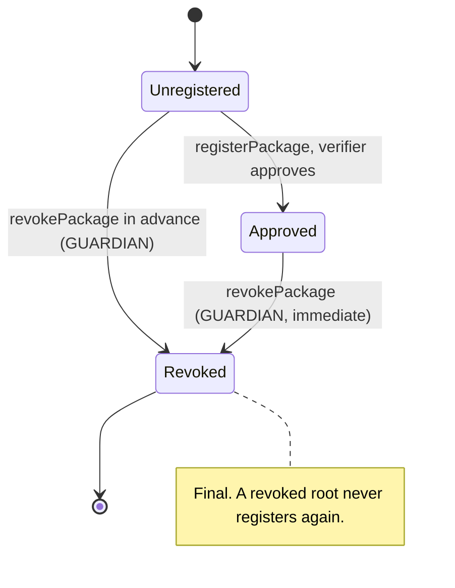
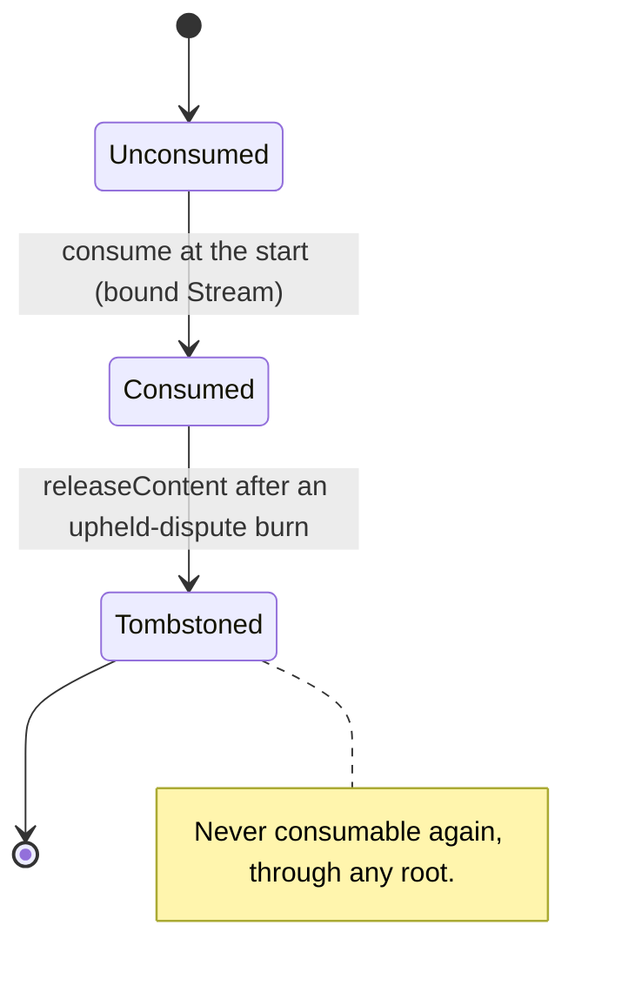
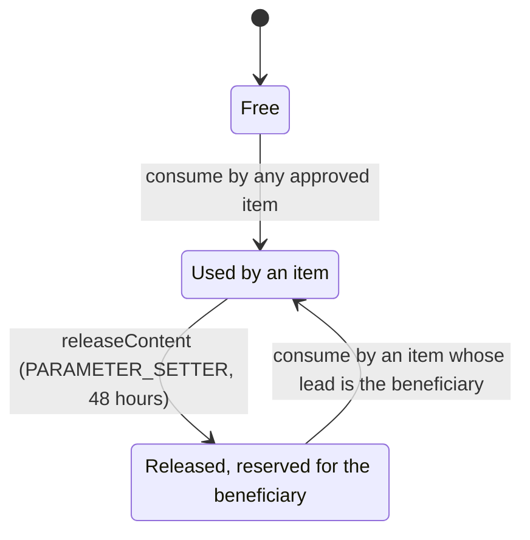
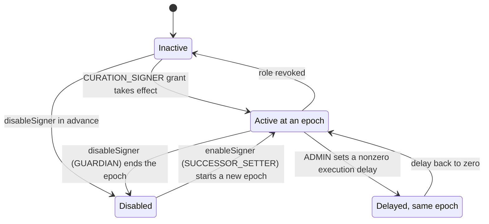
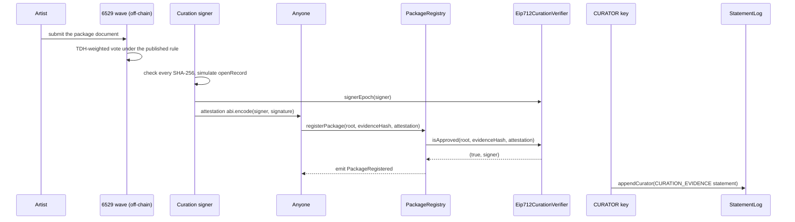
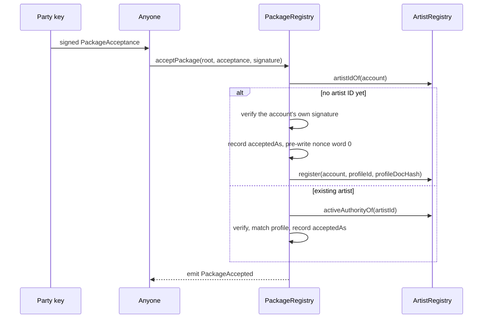
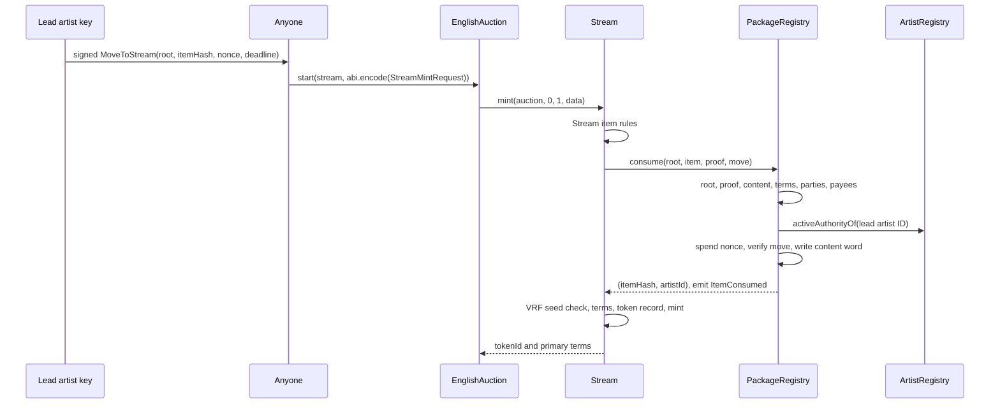
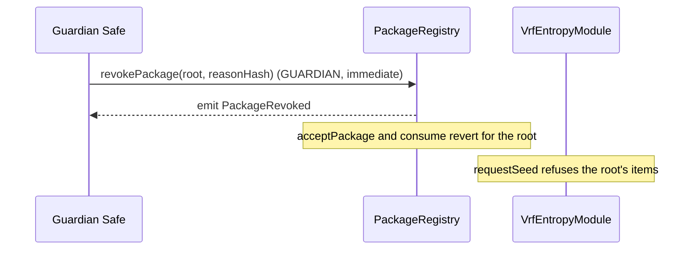
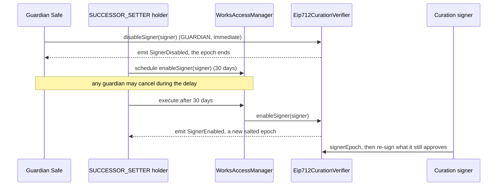
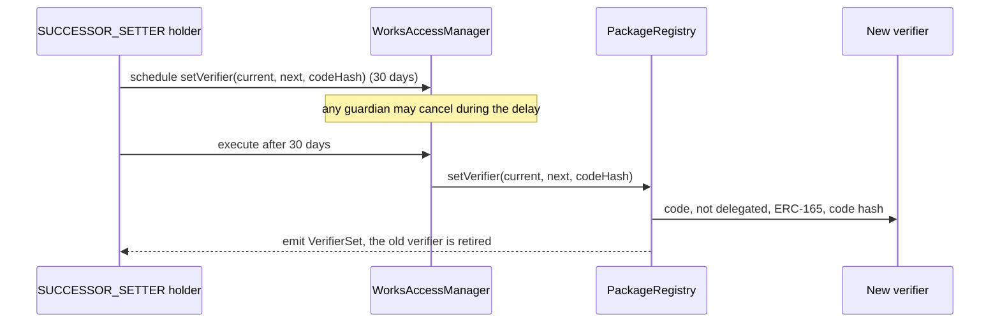

# Curation

Curation decides which works may ever mint on 6529 Stream. Voters approve a
package (a Merkle root of items) in a 6529 wave; a curation signer attests the
approval; anyone registers the attested root on-chain; every party named by an
item signs the root; and the lead artist signs a revocable move that lets the
work start. At the auction start, 6529 Stream asks the package registry to
consume the item, which checks all of this and records the item's content hash
so that the same work can never mint twice. This page is for auditors,
integrators and curation operators. `PackageRegistry` and
`Eip712CurationVerifier` implement it, with the hashing rules in
`WorksHashing` and `Typehashes` and the shared edition rule in `EditionRules`.

> **Status.** Pre-audit. This page describes `main` at `c4b3355` (15 October 2026). The ADRs
> record how the design was decided; this page is how it works now. Where they differ, this
> page follows the code and says so under [Differences from the ADRs](#differences-from-the-adrs).

## Contracts

| Contract | Source | Interface | Responsibility |
| --- | --- | --- | --- |
| `PackageRegistry` | [`src/curation/PackageRegistry.sol`](../../src/curation/PackageRegistry.sol) | [`IPackageRegistry`](../../src/interfaces/IPackageRegistry.sol) | Registers approved roots, records party acceptances, consumes items once at the start, enforces per-product content uniqueness, tracks move nonces, releases content after an upheld dispute, swaps the verifier. |
| `Eip712CurationVerifier` | [`src/curation/Eip712CurationVerifier.sol`](../../src/curation/Eip712CurationVerifier.sol) | [`ICurationVerifier`, `ICurationSignerVerifier`](../../src/interfaces/ICurationVerifier.sol) | The v1 verifier: accepts a `PackageApproval` signature by an active curation signer at its current signer epoch; the guardian's per-signer kill switch. |
| `WorksHashing` (library) | [`src/interfaces/types/WorksHashing.sol`](../../src/interfaces/types/WorksHashing.sol) | none | The one definition of the item hash, Merkle leaf, media hash and license key. |
| `Typehashes` (library) | [`src/interfaces/types/Typehashes.sol`](../../src/interfaces/types/Typehashes.sol) | none | EIP-712 domain names, the domain version and every typehash. |
| `EditionRules` (library) | [`src/editions/EditionRules.sol`](../../src/editions/EditionRules.sol) | none | Valid edition terms, applied by the registry at `consume` and by 6529 Editions at `createEdition`. |
| Package types | [`src/interfaces/types/PackageTypes.sol`](../../src/interfaces/types/PackageTypes.sol) | none | `PackageItem`, `Party`, `License`, `SaleTerms`, `EditionTerms`, `PartyAcceptance`, `MoveAuthorization`, `StreamMintRequest`. |

Callers and neighbors: 6529 Stream ([`Stream.sol`](../../src/stream/Stream.sol)) is the only
caller of `consume` and `releaseContent`; 6529 Editions
([`Editions.sol`](../../src/editions/Editions.sol)) is the only caller of `claimContent`; the
artist registry creates identities on a first acceptance and answers `activeAuthorityOf`; the
statement log holds the CURATOR's `CURATION_EVIDENCE` statements. See
[stream-and-auctions.md](stream-and-auctions.md), [editions-and-sales.md](editions-and-sales.md),
[identity-and-recovery.md](identity-and-recovery.md) and
[disputes-and-statements.md](disputes-and-statements.md).

## Concepts

Terms used here are defined in the [glossary](../glossary.md).

- **Package and root.** A package is a set of items; its root is the Merkle root of their
  leaves. Roots carry no chain ID or contract address, so a root is the same on every chain.
- **Curation signer.** A key holding `Roles.CURATION_SIGNER` that signs approvals. It never
  calls a contract. Until a verifier backed by the 6529 chain replaces the v1 verifier, the
  contracts trust the signer, not the vote
  ([`ICurationVerifier`](../../src/interfaces/ICurationVerifier.sol)).
- **Evidence hash.** A nonzero `bytes32` the signer attests with the root. It commits to the
  published vote snapshot, TDH snapshot and rule parameters, and to the signer's check of every
  declared SHA-256. The registry stores it; the CURATOR role publishes the matching
  **curation evidence** statement (`StatementKinds.CURATION_EVIDENCE`).
- **Signer epoch.** The value an approval must bind to count: when the signer's role grant took
  effect, how often it was disabled or enabled, and a salt drawn at the latest such change
  ([Signer epoch](#signer-epoch)). This is the curation signer epoch, not a configuration epoch.
- **Acceptance.** A party's signature over a root, stored as `acceptedAs[root][account] =
  artistId`. A first acceptance by an account with no identity creates one.
- **Move.** The lead artist's `MoveToStream` signature over one item, with a deadline and a
  single-use, revocable nonce. It makes the work startable.
- **Consume.** The registry's single-use check at the start: one storage word,
  `contentHash => itemHash`, is both the consume-once record and the uniqueness record.
- **Restraint.** While an override that would move an artist's authority is pending,
  `IArtistRegistry.activeAuthorityOf` returns zero, so no acceptance, move or move revocation
  verifies for that artist (ADR 0003 owner decision 6; see
  [identity-and-recovery.md](identity-and-recovery.md)).

### The package item

Every field of `PackageItem` ([`PackageTypes.sol`](../../src/interfaces/types/PackageTypes.sol))
enters the item hash, so voters approve and parties sign exactly these values.

| Field | Type | Meaning | Checked on-chain |
| --- | --- | --- | --- |
| `kind` | `ItemKind` | `ORIGINAL` (a 1/1) or `EDITION_MASTER` (a 1/1 that anchors one 6529 Editions edition). | Registry `consume`: an `ORIGINAL` has empty edition terms; an `EDITION_MASTER` passes `EditionRules.isValid`. |
| `collectionId` | `uint256` | A 6529 Stream collection (below 2^32). | Stream `mint`: the collection exists. |
| `contentHash` | `bytes32` | Decoded SHA-256 of the primary media; the per-product uniqueness key. | Registry `consume`: nonzero and unused on Stream. `WorkRecords.openRecord`: equals the primary file's SHA-256. |
| `mediaHash` | `bytes32` | `WorksHashing.mediaHash` over every media file (file ID, decoded SHA-256, role), primary first. Media is fixed by approval. | `WorkRecords.openRecord`. |
| `recordFileId` | `bytes32` | Content-store file ID of the approved JSON descriptive record. The artist may point the work at a new record until finalize. | Stored by `openRecord`; structure checked at `setRecord` and `finalize`. |
| `parties` | `Party[]` (`account`, `role`) | 1 to `Limits.MAX_PARTIES` (16) accounts, lead `ARTIST` first; `COLLABORATOR` for credited contributors. | Registry `consume`: count, lead role, every party accepted, distinct artist IDs. |
| `payees` | `ISplitWallet.Payee[]` (`artistId`, `account`, `share`) | The canonical payee list of the artist portion: fixed payees by account, artist-resolved payees by artist ID. | Registry `consume`: canonical order, one of the two keys set, nonzero shares summing to `Splits.DENOMINATOR` (100,000), no more payees than parties, every payee a party. |
| `license` | `License` (`spdxId`, `textFileId`) | SPDX ID and the content-store file of the full text. | Stream `mint`: `SpdxId` rule. `openRecord`: CC0 names the deployment's CC0 text. |
| `seedPolicy` | `SeedPolicy` | `NONE`, `ARTIST` or `VRF`. See [entropy.md](entropy.md). | Registry and Stream: a seed is set exactly under `ARTIST`. Stream: `VRF` needs an entropy module and a delivered seed. |
| `seed` | `bytes32` | The artist-chosen seed; zero unless `ARTIST`. | As above. |
| `sale` | `SaleTerms` (`saleKind`, `currency`, `params`) | How the work is first sold. | Stream `mint`: `SaleKind.ENGLISH_AUCTION` with empty `params`. |
| `edition` | `EditionTerms` (`format`, `size`, `window`, `price`, `currency`, `saleKind`, `params`) | The edition an `EDITION_MASTER` anchors; all zero for an `ORIGINAL`. | Registry `consume` and Editions `createEdition`: `EditionRules.isValid`. |

Canonical payee order is strictly increasing `(artistId, account)`, so fixed payees
(`artistId` zero) come first, ordered by address. One party may appear both as a fixed and as
an artist-resolved payee; the two are distinct keys (`test_validItem_partyPaidBothWays`).

### Identifiers and hashes

All structured hashes are `keccak256(abi.encode(DOMAIN, value))` with a per-type domain label
([`WorksHashing.sol`](../../src/interfaces/types/WorksHashing.sol)). The golden vectors in
[`test/interfaces/WorksHashing.t.sol`](../../test/interfaces/WorksHashing.t.sol) were computed
with `cast`, the way off-chain tools compute them.

| Identifier | Definition |
| --- | --- |
| item hash | `keccak256(abi.encode(PACKAGE_ITEM_DOMAIN, item))`, with `PACKAGE_ITEM_DOMAIN = keccak256("6529WORKS_PACKAGE_ITEM_V1")`. |
| leaf | `keccak256(bytes.concat(itemHash))`. Double hashing makes a leaf's preimage 32 bytes, so a 64-byte inner node never passes as a leaf. |
| package root | OpenZeppelin `MerkleProof` root (sorted-pair keccak256) over the leaves. Equal to OpenZeppelin's `StandardMerkleTree` with leaf encoding `["bytes32", <PackageItem tuple>]` and values `[PACKAGE_ITEM_DOMAIN, item]`. A one-item package's root is its leaf. Proofs have at most `Limits.MAX_PROOF_DEPTH` (32) nodes. |
| media hash | `keccak256(abi.encode(MEDIA_DOMAIN, media))` over the ordered `MediaFile[]`, with `MEDIA_DOMAIN = keccak256("6529WORKS_MEDIA_V1")`. |
| content hash | The decoded SHA-256 of the primary media, declared by the item. The contracts cannot recompute it. |
| evidence hash | Opaque to the contracts; must be nonzero at registration. |

The canonical JSON package document maps field for field onto these structs; the committed
form is the ABI encoding.

### EIP-712 messages

Each signing contract uses the domain `(name, "1", chainid, itself)`
(`Typehashes.DOMAIN_VERSION`), so a signature is valid for one deployment on one chain.

| Message | Type string (`Typehashes`) | Domain name | Signed by | Replay protection |
| --- | --- | --- | --- | --- |
| `PACKAGE_APPROVAL` | `PackageApproval(bytes32 packageRoot,bytes32 evidenceHash,uint256 signerEpoch)` | `6529 Works Curation Verifier` (the verifier) | A curation signer | The registry stores a root once; the epoch ends with a disable, an enable or a new role grant. |
| `PACKAGE_ACCEPTANCE` | `PackageAcceptance(bytes32 packageRoot,address account,bytes32 profileId,bytes32 profileDocHash,uint64 deadline)` | `6529 Works Package Registry` | The account itself if it has no artist ID, otherwise its artist's active authority | Recorded once per `(root, account)`; a deadline. |
| `MOVE_TO_STREAM` | `MoveToStream(bytes32 packageRoot,bytes32 itemHash,uint256 nonce,uint64 deadline)` | `6529 Works Package Registry` | The lead artist's active authority | A per-artist nonce, spent or revoked once; a deadline. |

- **Attestation encoding.** The registry passes the attestation to the verifier unread. The v1
  verifier accepts only the canonical `abi.encode(address signer, bytes signature)`: an address
  word with clean upper bits, the offset `0x40`, a length, the bytes zero-padded to a whole
  word, and nothing after. Any other shape returns `(false, address(0))` and never reverts.
- **Signatures.** All three go through `SignatureVerifier.isValid`
  ([`SignatureVerifier.sol`](../../src/libraries/SignatureVerifier.sol)): low-s ECDSA in 65-byte
  or 64-byte ERC-2098 form, ERC-1271 with a 200,000-gas cap (`ERC1271_GAS_LIMIT`), EIP-7702
  delegated accounts, and at most 4,096 bytes (`MAX_SIGNATURE_LENGTH`). A zero signer never
  verifies. Replay protection never keys on signature bytes, because both encodings verify.
- **Digests.** `Eip712CurationVerifier.approvalDigest`, `PackageRegistry.acceptanceDigest` and
  `PackageRegistry.moveDigest` return the exact digests to sign.

### Signer epoch

`signerEpoch(signer)` is `since << 128 | salt << 64 | changes`
(`Eip712CurationVerifier.signerEpoch`):

- `since` is when the signer's current `CURATION_SIGNER` grant takes or took effect, read from
  the AccessManager. A revocation deletes it and a new grant sets a later one.
- `changes` counts `disableSigner` and `enableSigner` calls.
- `salt` is the low 64 bits of `keccak256(abi.encode(block.prevrandao, signer, changes))`,
  drawn at the latest disable or enable. It only has to be unknown before that block; it is not
  a randomness source for anything else.

Consequences: an approval made before a disable, or under a revoked grant, never counts again;
an approval signed while the signer is disabled cannot name the epoch its re-enable will start.
The signer reads `signerEpoch` before signing and re-signs what it still approves. A change of
the signer's execution delay by ADMIN makes it inactive while the delay is nonzero but keeps its
epoch. Registered approvals never expire.

### Move nonces

Each artist's move nonces live in a bitmap: word `nonce / 255`, bit `nonce % 255`. Bit 255 of
every written word is a sentinel. The acceptance that creates an identity writes the sentinel
into word 0, so the artist's first 255 starts update an existing slot instead of creating one.
Tools should use nonces 0, 1, 2, and so on per artist. Any `uint256` nonce works.

### Trust obligations of the curation signer

The contracts cannot check these; the signer's tooling must, before it attests. They are trust
assumptions, not on-chain checks (ADR 0003, "Package format and curation").

- **Verify every declared SHA-256 against the decoded bytes**, for every media file, including
  the content hash. On-chain uniqueness keys on the declared content hash and is defense in
  depth; the evidence hash covers this check.
- **Simulate `WorkRecords.openRecord`** for every item. Its media commitments (1 to 32 files,
  the PRIMARY first and alone, its SHA-256 equal to `contentHash`, every declaration matching
  the content store, every inlinable PREVIEW within `Limits.MAX_PREVIEW_BYTES`, a CC0 license
  naming the deployment's CC0 text) are not checked at mint, so a mis-committed item mints and
  its record never opens ([`WorkRecords.sol`](../../src/stream/WorkRecords.sol), `openRecord`).
- **Decode Base64 strictly** (RFC 4648 alphabet, as the content store's `attestBase64` checks)
  when computing a decoded SHA-256.
- **Revoke before revising a VRF work's media.** A revision that changes the primary media has a
  new content hash and so draws a new seed; the guardian revokes the old root first
  ([`src/curation/README.md`](../../src/curation/README.md)).

## State machine

### Package root

`packageOf(root)` returns `(status, evidenceHash, signer)`; the enum is
`IPackageRegistry.PackageStatus { NONE, APPROVED, REVOKED }`.

### Item and content hash (6529 Stream)

`consumedItemOf(contentHash)` reads the item holding the content, or zero when free or
released. `releasedTo(contentHash)` reads the beneficiary of the latest release; it binds only
while the content is released. `isReleased(itemHash)` reads the tombstone. Separately, 6529
Editions may claim a used content hash once, for the master item that holds it
(`editionClaimOf`).

### Curation signer

A signer counts only while it holds the role with no execution delay and is not disabled
(`isSignerActive`). A disabled signer stays disabled through a role re-grant
(`test_disableSigner_survivesRoleRegrant`); a re-enabled signer is active only if it still holds
the role with no delay.

| Transition | Caller (role) | Delay | Function |
| --- | --- | --- | --- |
| Root: unregistered to approved | Anyone | none | `PackageRegistry.registerPackage` |
| Root: unregistered or approved to revoked | `GUARDIAN` | immediate | `PackageRegistry.revokePackage` |
| Party consent recorded | Anyone, relaying the party's signature | none | `PackageRegistry.acceptPackage` |
| Move nonce revoked | The lead artist's active authority | none | `PackageRegistry.revokeMove` |
| Item consumed, content used | Bound 6529 Stream, inside `IStream.mint` at the auction start | none | `PackageRegistry.consume` |
| Edition claims the content | Bound 6529 Editions, inside `createEdition` | none | `PackageRegistry.claimContent` |
| Content released, item tombstoned | `PARAMETER_SETTER` through `IStream.releaseContent` | standard, 48 hours | `PackageRegistry.releaseContent` |
| Signer becomes active | ADMIN grants `CURATION_SIGNER` | 30-day ADMIN operation, then the 30-day grant delay (`Roles.grantDelay`) | `AccessManager.grantRole` |
| Signer disabled | `GUARDIAN` | immediate | `Eip712CurationVerifier.disableSigner` |
| Signer re-enabled | `SUCCESSOR_SETTER` | successor, 30 days | `Eip712CurationVerifier.enableSigner` |
| Verifier replaced, old one retired | `SUCCESSOR_SETTER` | successor, 30 days | `PackageRegistry.setVerifier` |
| Stream or Editions bound | ADMIN (genesis configurator, before it renounces ADMIN) | once each | `PackageRegistry.bindStream`, `bindEditions` |

Role mappings are from [`config/genesis.example.json`](../../config/genesis.example.json) and
the role definitions in [`Roles.sol`](../../src/governance/Roles.sol); see
[governance.md](governance.md).

## Flows

### Approve and register

- **Preconditions.** The root's status is `NONE`. The current verifier still has its pinned
  code hash (`InvalidDependency` otherwise). The verifier approves and the evidence hash is
  nonzero (`NotApproved` otherwise). The v1 verifier approves when the attestation is
  canonical, the signer is active and the signature is over the signer's current epoch.
- **Effects.** Status `APPROVED`; the signer and evidence hash are stored and emitted in
  `PackageRegistered(root, evidenceHash, verifier, signer)`. Approvals do not expire.
- **Curation evidence.** The CURATOR role (zero delay) appends a `CURATION_EVIDENCE` statement
  with subject `(address(0), uint256(root))`. The statement log reserves that kind to CURATOR
  ([`StatementLog.sol`](../../src/records/StatementLog.sol)). The registry does not require or
  check this statement; it is an operational step.
- **Gas.** On Sepolia r2, `registerPackage` used 98,155 Prague gas and created 2 slots
  ([flows.md, section 2](../../deployments/11155111/flows.md#2-the-curated-stream-sale)).

### Party acceptance

- **Preconditions.** The root is `APPROVED`; `block.timestamp <= deadline`; the signature is
  by the account (new) or by the active authority of the account's artist ID (existing). For an
  existing artist, `profileId` and `profileDocHash` must match the identity record
  (`ProfileMismatch`).
- **Effects.** `acceptedAs[root][account] = artistId`. A first acceptance creates artist ID
  `uint256(uint160(account))` with the signed profile, counts as the artist's first activity,
  and pre-writes the move-nonce sentinel. A repeat returns the stored ID and changes nothing.
  Later acceptances are not activity for the dormancy clock.
- **Consent is per account.** An item that lists an artist under another address (for example a
  new authority after recovery) needs an acceptance for that address too. An item that lists two
  accounts of the same artist is invalid at consume.
- **Relay order.** The first acceptance relayed sets a new identity's profile. Pre-signed
  acceptances with different profile fields succeed only in relay order; the others revert with
  `ProfileMismatch` until the artist re-signs.
- **Restraint.** While an authority-moving override is pending, the active authority is zero, so
  an existing artist's acceptances revert with `InvalidSignature`, including ones signed before
  the staging; they verify again after a veto
  (`test_PreSignedAcceptanceRefusedWhileRestrained`).
- **Gas.** A first acceptance on Sepolia r2 used 344,087 Prague gas and 10 new slots, 8 of them in
  the artist registry, including the standing entry of a wallet the artist had already
  consolidated ([flows.md, section 2](../../deployments/11155111/flows.md#2-the-curated-stream-sale)).

### Move and start

The auction side of the start is in [stream-and-auctions.md](stream-and-auctions.md). This is
`consume` as 6529 Stream calls it.

`consume` checks, in order (`PackageRegistry.consume`):

1. The caller is the bound Stream (`UnboundCaller`).
2. The root is `APPROVED` (`PackageNotApproved`).
3. The proof has at most 32 nodes and places `leaf(itemHash)` under the root
   (`ItemNotInPackage`). The registry hashes the item itself, so any changed field is a
   different, unapproved item.
4. The content hash is free on Stream (`ContentUsed` naming the holder). If it is released, the
   item must not be tombstoned (`ContentUsed` naming the item itself).
5. The terms: nonzero content hash, a seed exactly under `ARTIST`, an `ORIGINAL` with empty
   edition terms or an `EDITION_MASTER` whose terms pass `EditionRules.isValid` (`InvalidItem`).
6. The parties: 1 to 16, lead `ARTIST` first, each with an `acceptedAs` entry for this root
   (`PartyNotAccepted`) and a distinct artist ID; the payees: 1 to the number of parties,
   canonical, each a party, shares summing to 100,000 (`InvalidItem`).
7. A released content hash is consumed only by an item whose lead is its beneficiary
   (`ContentReserved`).
8. The move: `block.timestamp <= deadline`, the nonce unused (`MoveNonceUsed`), then a valid
   signature by the lead's active authority over `moveDigest` (`InvalidSignature`). The nonce is
   spent before the signature check; a failed check reverts the whole call.
9. `contentHash => itemHash` is written, and `ItemConsumed(root, itemHash, artistId,
   contentHash)` is emitted.

- **Consent reads, not calls.** Party consent is read from `acceptedAs`; the only external call
  is `activeAuthorityOf` for the lead (plus an ERC-1271 call if that authority is a contract).
- **Restraint.** While the lead artist is restrained, no move verifies, from the old key or the
  reserved new key, and `revokeMove` reverts with `NotAuthority`
  (`test_NobodyStartsAnUnmintedWorkDuringTheNotice`). After execution the new key signs the
  move.
- **Rotated keys.** A key the artist rotated away from never becomes its authority again, so its
  unused moves stay void, unless the new authority is an ERC-1271 or EIP-7702 wallet that accepts
  the old key's signatures (ADR 0003, SIGS-3).
- **Revoking a move.** The lead's active authority calls `revokeMove(artistId, nonce)` to spend an
  unused nonce (`MoveRevoked`); a used or revoked nonce reverts with `MoveNonceUsed`.
- **Gas.** `consume` as Stream calls it measures 96,456 Prague gas and creates 1 new slot, under
  a 99,000 regression ceiling; the whole steady-state start budget is 350,000 Prague gas and 6
  new slots ([ADR 0004](../adr/0004-gas-budgets-under-glamsterdam.md#the-table)).

### Edition content claim

When a master's primary sale has settled, `Editions.createEdition` checks the item against the
master's stored item hash, the proof against the root, and that the root was registered (its
evidence hash is nonzero), then calls `claimContent(contentHash, itemHash)`.

- **Preconditions.** The caller is the bound Editions (`UnboundCaller`). `itemHash` is the item
  that consumed `contentHash` on Stream (`ClaimNotAllowed` otherwise, including for a released
  content hash). No edition has claimed it (`ContentUsed`).
- **Effects.** `editionClaimOf(contentHash) = itemHash`; `ContentClaimed` is emitted. This is the
  one permitted cross-product reuse: the linked pair.
- **Revocation does not block it.** Editions requires a registered root, not an approved one, and
  `EditionRules` is the same rule at both ends, so a master that minted can always get its
  edition ([`Editions.sol`](../../src/editions/Editions.sol), `_admit`). See
  [editions-and-sales.md](editions-and-sales.md).

### Guardian revocation

- **Preconditions.** The root is not already `REVOKED` (`PackageNotApproved`). A root still
  `NONE` may be revoked in advance, for example after an attestation leaked; it can then never
  be registered (`PackageExists`).
- **Effects.** Final. Unconsumed items of the root can no longer mint, accept or request a seed.
  Consumed items, minted works and their editions are unaffected.
- **Per root, not per item.** An item listed in two approved roots stays consumable through the
  other (`test_revokePackage_isPerRoot`). The guardian revokes every root that lists it.

### Signer disable and re-enable

- **Disable.** Immediate and one-way: the guardian cannot undo it. Any address may be disabled in
  advance. It ends the epoch, so no approval the signer made so far registers again. It stops
  only future registrations: roots the signer already registered stay approved until the
  guardian revokes them (`test_disabledSigner_registeredRootsStayUsable`).
- **Continuity.** Deployments outside a local chain need at least two curation signer keys
  (`DeployGuards.MIN_CURATION_SIGNERS`), so curation continues on the other key.
- **Re-enable.** `SUCCESSOR_SETTER`, 30 days, only for a disabled signer (`SignerNotDisabled`).
  The new epoch is salted from the re-enable's block, so nothing signed while disabled counts.
- **After a suspected compromise,** use a fresh key: disable the old one and grant the role to a
  new address (a 30-day grant delay).

### Verifier swap

- **Preconditions.** `expected` is the current verifier (`ExpectedValueMismatch`). `next` is
  neither the current verifier nor any verifier retired before (`InvalidDependency`). `next` has
  code, is not an EIP-7702 delegated account, supports `ICurationVerifier` through ERC-165, and
  has `nextCodeHash` (`InvalidDependency`).
- **Effects.** The old verifier is retired for good, so a swap back never restores its
  approvals or signer states. Registered approvals are unaffected. The pinned code hash is
  checked again at every registration.
- **Why.** A verifier backed by the 6529 chain replaces the v1 signer verifier through this path
  ([ADR 0001 §3](../adr/0001-v1-scope.md#3-curation-and-approved-packages)).

### Content release after an upheld dispute

[Disputes and statements](disputes-and-statements.md#upheld-dispute-during-an-auction)
specifies the pause, the auction cancel that burns the token, and the governed
`Stream.releaseContent` (PARAMETER_SETTER, 48 hours) that calls the registry's
`releaseContent(contentHash, itemHash, beneficiary)`. The registry's part:

- **Preconditions.** The token was minted and burned (`NotBurned` from Stream). Stream passes the
  burned token's stored item hash; the registry requires that item to hold `contentHash`
  (`ClaimNotAllowed(PRODUCT_STREAM, contentHash)`), so a content release happens once per burned item.
  The beneficiary must be a registered artist (`UnknownArtist`), so the release waits until the
  rightful artist has an identity.
- **Effects.** The content hash is released and reserved for items whose lead artist is the
  beneficiary; the burned item is tombstoned and can never be consumed again, through any root.
  The Editions slot is untouched: an edition exists only after its master's sale settles, and a
  burned work never settled.
- **Veto.** A guardian may cancel a mistaken content release during its 48 hours
  (`test_AGuardianCancelsAPendingRelease`).

## Rules and invariants

| ID | Rule | Enforced in | Proven by |
| --- | --- | --- | --- |
| CUR-1 | Only an item of an `APPROVED` root, placed by a proof of at most 32 nodes, can be consumed. | `PackageRegistry.consume` | [`PackageRegistry.t.sol`](../../test/curation/PackageRegistry.t.sol): `test_revokePackage_blocksUnconsumedItems`, `test_consume_revertsItemNotInPackage`, `test_consume_proofLengthCap`, `testFuzz_merkle_proofs`, `testFuzz_merkle_foreignItemRejected` |
| CUR-2 | A root registers at most once; a revoked root, including one revoked in advance, never registers. | `PackageRegistry.registerPackage`, `revokePackage` | [`PackageRegistry.t.sol`](../../test/curation/PackageRegistry.t.sol): `test_registerPackage_onceOnly`, `test_revokePackage_inAdvance`, `test_revokePackage_revertsOnlyWhenRevoked` |
| CUR-3 | Registration needs the current verifier with its pinned code hash, the verifier's approval, and a nonzero evidence hash. Anyone may submit. | `PackageRegistry.registerPackage` | [`PackageRegistry.t.sol`](../../test/curation/PackageRegistry.t.sol): `test_registerPackage_permissionless`, `test_registerPackage_revertsNotApproved`, `test_registerPackage_revertsZeroEvidence`, `test_registerPackage_refusesAVerifierWhoseCodeChanged` |
| CUR-4 | An approval counts only from a signer that holds `CURATION_SIGNER` with no execution delay, is not disabled, and signed over its current epoch, in this verifier's domain on this chain. | `Eip712CurationVerifier.isApproved`, `isSignerActive`, `signerEpoch` | [`Eip712CurationVerifier.t.sol`](../../test/curation/Eip712CurationVerifier.t.sol): `test_isApproved_onlyAtTheCurrentEpoch`, `test_isApproved_reEnablingDoesNotReviveOlderApprovals`, `test_isApproved_regrantingDoesNotReviveOlderApprovals`, `test_isApproved_anApprovalSignedWhileDisabledCannotNameTheNextEpoch`, `test_isApproved_pendingGrantDoesNotCount`, `test_isApproved_signerWithExecutionDelayDoesNotCount`, `test_isApproved_rejectsWrongChain`, `test_isApproved_rejectsOtherDeployment`, `testFuzz_isApproved_onlyActiveSignersCount`; [`CuratedSale.t.sol`](../../test/integration/CuratedSale.t.sol): `test_ReEnablingASignerDoesNotReviveOlderApprovals`, `test_AnApprovalSignedWhileDisabledCannotNameTheReEnableEpoch`, `test_RegrantingTheSignerRoleDoesNotReviveOlderApprovals` |
| CUR-5 | The verifier accepts only the canonical attestation encoding and never reverts on a malformed one. | `Eip712CurationVerifier._decode` | [`Eip712CurationVerifier.t.sol`](../../test/curation/Eip712CurationVerifier.t.sol): `test_isApproved_rejectsNonCanonicalEncodings`, `test_isApproved_malformedAttestationsReturnFalse`, `testFuzz_isApproved_neverRevertsOnGarbage` |
| CUR-6 | Every party of a consumed item accepted the root, and the parties are distinct artists. | `PackageRegistry._checkParties` | [`PackageRegistry.t.sol`](../../test/curation/PackageRegistry.t.sol): `test_consume_revertsMissingCollaboratorAcceptance`, `test_invalidItem_parties`, `test_invalidItem_sameArtistUnderTwoAccounts`, `test_invalidItem_tooManyParties` |
| CUR-7 | An acceptance is signed by the account (no identity yet) or its artist's active authority, unexpired, with a matching profile; it is recorded once per `(root, account)`, and only a first acceptance creates an identity. | `PackageRegistry.acceptPackage` | [`PackageRegistry.t.sol`](../../test/curation/PackageRegistry.t.sol): `test_acceptPackage_createsIdentity`, `test_acceptPackage_laterAcceptancesAreNotActivity`, `test_acceptPackage_replayIsNoop`, `test_acceptPackage_afterRecoverySignedByNewAuthority`, `test_acceptPackage_erc1271Authority`, `test_acceptPackage_revertsProfileMismatch`, `test_acceptPackage_relayOrderPicksProfile`, `test_acceptPackage_revertsExpired`, `test_acceptPackage_revertsWrongChain` |
| CUR-8 | The payee list is canonical, nonempty, no longer than the party list, pays only parties, and sums to 100,000. | `PackageRegistry._checkParties` | [`PackageRegistry.t.sol`](../../test/curation/PackageRegistry.t.sol): `test_invalidItem_payees`, `test_invalidItem_duplicatePayee`, `test_validItem_partyPaidBothWays` |
| CUR-9 | A consumed item has a nonzero content hash, a seed exactly under `ARTIST`, empty edition terms if `ORIGINAL`, and terms `EditionRules.isValid` accepts if `EDITION_MASTER`. | `PackageRegistry._checkTerms` | [`PackageRegistry.t.sol`](../../test/curation/PackageRegistry.t.sol): `test_invalidItem_seedPolicy`, `test_invalidItem_zeroContentHash`, `test_invalidItem_originalWithEditionTerms`, `test_invalidItem_masterEditionTerms`, `test_invalidItem_pricedEditionInDefaultCurrency`, `test_invalidItem_masterEditionTermsSharedRule` |
| CUR-10 | A move is signed by the lead's active authority over this registry's `MoveToStream` digest for this item, unexpired, on an unused nonce; the nonce is spent whatever the signature encoding. | `PackageRegistry._useMove`, `_spendMoveNonce` | [`PackageRegistry.t.sol`](../../test/curation/PackageRegistry.t.sol): `test_move_revertsExpired`, `test_move_validAtDeadline`, `test_move_revertsWrongSigner`, `test_move_revertsMalleableHighS`, `test_move_revertsWrongChain`, `test_move_revertsOtherRegistryDeployment`, `test_move_bindsItem`, `test_move_signedByCurrentAuthorityAfterRecovery`, `test_move_erc1271Authority`, `test_move_nonceSpentWhateverTheSignatureForm` |
| CUR-11 | Only the artist's active authority revokes its unused move nonces; a used or revoked nonce reverts; nonces are isolated per artist and bit. | `PackageRegistry.revokeMove` | [`PackageRegistry.t.sol`](../../test/curation/PackageRegistry.t.sol): `test_revokeMove_beforeUse`, `test_revokeMove_onlyCurrentAuthority`, `test_revokeMove_revertsWhenUsedOrRevoked`, `testFuzz_revokeMove_bitmapIsolation`; [`CuratedSale.t.sol`](../../test/integration/CuratedSale.t.sol): `test_MoveSignatureIsRevocable` |
| CUR-12 | A content hash is held by at most one item on 6529 Stream, so an item is consumed at most once, through any root. | `PackageRegistry.consume` | [`PackageRegistry.t.sol`](../../test/curation/PackageRegistry.t.sol): `test_consume_revertsDoubleConsume`, `test_consume_itemIsSingleUseAcrossPackages`, `test_consume_contentUniquenessKeysOnContentHash`; [`PackageRegistryInvariant.t.sol`](../../test/curation/PackageRegistryInvariant.t.sol): `invariant_itemConsumedAtMostOnce`, `invariant_contentRecordsMatch` |
| CUR-13 | 6529 Editions claims only the content hash its master item consumed on Stream, once. | `PackageRegistry.claimContent` | [`PackageRegistry.t.sol`](../../test/curation/PackageRegistry.t.sol): `test_claimContent_linkedPairException`, `test_claimContent_mustNameTheMasterItem`, `test_claimContent_editionNeedsStreamMaster`; [`PackageRegistryInvariant.t.sol`](../../test/curation/PackageRegistryInvariant.t.sol): `invariant_editionsReuseOnlyTheirMaster` |
| CUR-14 | A release happens once per burned item, names a registered artist, reserves the content for items led by that artist, and tombstones the burned item everywhere. It is governed (48 hours). | `PackageRegistry.releaseContent`, `consume`; `Stream.releaseContent` | [`PackageRegistry.t.sol`](../../test/curation/PackageRegistry.t.sol): `test_releaseContent_rightfulArtistConsumesAfterBurn`, `test_releaseContent_tombstonesTheItemEverywhere`, `test_releaseContent_reservesTheContentForTheNamedArtist`, `test_releaseContent_revertsOnMismatch`; [`Dispute.t.sol`](../../test/integration/Dispute.t.sol): `test_UpheldDisputeCancelsBurnsReleasesAndTheRightfulArtistMints`, `test_ReleasedContentIsReservedForTheNamedArtist`, `test_ReleaseIsGovernedNamesAnArtistAndHappensOnce`, `test_AGuardianCancelsAPendingRelease` |
| CUR-15 | Only the bound Stream calls `consume` and `releaseContent`; only the bound Editions calls `claimContent`; each is bound once, to a contract answering ERC-165 for its interface and not delegated. | `PackageRegistry.consume`, `releaseContent`, `claimContent`, `bindStream`, `bindEditions` | [`PackageRegistry.t.sol`](../../test/curation/PackageRegistry.t.sol): `test_consume_onlyBoundStream`, `test_releaseContent_onlyBoundStream`, `test_claimContent_onlyBoundEditions`, `test_bindStream_once`, `test_bindEditions_onceAndLater`, `test_bind_rejectsContractsWithoutTheInterface`, `test_bind_governedAndContractsOnly`, `test_unboundRegistryRefusesEveryone` |
| CUR-16 | Revocation is GUARDIAN-only, immediate, final and per root. | `PackageRegistry.revokePackage`; genesis role map | [`PackageRegistry.t.sol`](../../test/curation/PackageRegistry.t.sol): `test_revokePackage_onlyGuardian`, `test_revokePackage_isPerRoot`; [`CuratedSale.t.sol`](../../test/integration/CuratedSale.t.sol): `test_GuardianRevokesAPackageAndDisablesASigner` |
| CUR-17 | Disabling a signer is GUARDIAN-only, immediate, one-way, possible in advance, and stops only future registrations; re-enabling is 30 days. | `Eip712CurationVerifier.disableSigner`, `enableSigner` | [`Eip712CurationVerifier.t.sol`](../../test/curation/Eip712CurationVerifier.t.sol): `test_disableSigner_immediateAndOneWay`, `test_disableSigner_inAdvance`, `test_disableSigner_survivesRoleRegrant`, `test_disableSigner_onlyGuardian`, `test_enableSigner_thirtyDayClass`; [`PackageRegistry.t.sol`](../../test/curation/PackageRegistry.t.sol): `test_registerPackage_revertsAfterSignerDisabled`, `test_disabledSigner_registeredRootsStayUsable` |
| CUR-18 | A verifier swap is compare-and-set, pins the code hash, never installs the current or a retired verifier, and leaves registered approvals intact. | `PackageRegistry.setVerifier`, `_setVerifier` | [`PackageRegistry.t.sol`](../../test/curation/PackageRegistry.t.sol): `test_setVerifier`, `test_setVerifier_compareAndSet`, `test_setVerifier_revertsOnNoOp`, `test_setVerifier_refusesARetiredVerifier`, `test_setVerifier_rejectsBadVerifier`, `test_setVerifier_keepsRegisteredApprovals`, `test_setVerifier_onlySuccessorSetter` |
| CUR-19 | While an authority-moving override is pending, the artist's acceptances and moves do not verify and it cannot revoke moves. | `PackageRegistry.acceptPackage`, `_useMove`, `revokeMove` (through `activeAuthorityOf`) | [`RecoveryRestraint.t.sol`](../../test/integration/RecoveryRestraint.t.sol): `test_PreSignedAcceptanceRefusedWhileRestrained`, `test_NobodyStartsAnUnmintedWorkDuringTheNotice` |
| CUR-20 | Item hashes, leaves, media hashes and typehashes match independently computed golden vectors and do not depend on the chain. | `WorksHashing`, `Typehashes` | [`WorksHashing.t.sol`](../../test/interfaces/WorksHashing.t.sol): `test_itemHash_golden`, `test_mediaHash_golden`, `testFuzz_itemHash_independentOfChain`, `test_itemHash_isDomainSeparated`, `test_singleItemPackage_rootIsLeaf`, `test_threeItemPackage_proofs`; [`Typehashes.t.sol`](../../test/interfaces/Typehashes.t.sol): `test_domainConstants`, `test_signedPayloadTypehashes`; [`PackageRegistry.t.sol`](../../test/curation/PackageRegistry.t.sol): `test_golden_typehashes`, `test_golden_digests`, `testFuzz_consume_itemHashMatchesWorksHashing` |
| CUR-21 | Governed functions are non-payable. | `PackageRegistry`, `Eip712CurationVerifier` | `test_governedFunctionsAreNonPayable` in both [`PackageRegistry.t.sol`](../../test/curation/PackageRegistry.t.sol) and [`Eip712CurationVerifier.t.sol`](../../test/curation/Eip712CurationVerifier.t.sol) |
| CUR-22 | `consume` stays within its gas ceiling and the worst case fits the per-transaction cap. | `PackageRegistry.consume` | [`PackageRegistryGas.t.sol`](../../test/curation/PackageRegistryGas.t.sol): `test_gas_streamShape_typical`, `test_txCap_consumeWorstCase`; [`GasReport.t.sol`](../../test/integration/GasReport.t.sol): `test_Gas_Consume` |

## Events

| Event | Contract | Emitted when | Notes |
| --- | --- | --- | --- |
| `PackageRegistered(bytes32 indexed packageRoot, bytes32 evidenceHash, address indexed verifier, address indexed signer)` | `PackageRegistry` | A root registers. | The signer the verifier reported. |
| `PackageRevoked(bytes32 indexed packageRoot, bytes32 reasonHash)` | `PackageRegistry` | The guardian revokes a root, registered or not. | |
| `PackageAccepted(bytes32 indexed packageRoot, uint256 indexed artistId, address indexed account)` | `PackageRegistry` | A party's first acceptance of a root. | Not emitted on a repeat. A new identity also emits the artist registry's `ArtistRegistered`. |
| `ItemConsumed(bytes32 indexed packageRoot, bytes32 indexed itemHash, uint256 indexed artistId, bytes32 contentHash)` | `PackageRegistry` | An item is consumed at the start. | Stream's `WorkMinted` follows in the same transaction. |
| `ContentClaimed(bytes32 indexed contentHash, bytes32 indexed itemHash)` | `PackageRegistry` | 6529 Editions claims a master's content hash. | |
| `ContentReleased(bytes32 indexed contentHash, bytes32 indexed itemHash, uint256 indexed beneficiary)` | `PackageRegistry` | A burned item's content is released. | `itemHash` is the tombstoned item. |
| `MoveRevoked(uint256 indexed artistId, uint256 indexed nonce)` | `PackageRegistry` | An artist revokes an unused move nonce. | A nonce spent by `consume` emits nothing of its own. |
| `VerifierSet(address previous, address next, bytes32 codeHash)` | `PackageRegistry` | Construction (previous zero) and every swap. | |
| `Bound(bytes32 indexed name, address target)` | `PackageRegistry` | `bindStream` (`"STREAM"`) or `bindEditions` (`"EDITIONS"`). | Once each. |
| `SignerDisabled(address indexed signer)` | `Eip712CurationVerifier` | The guardian disables a signer. | The epoch changes. |
| `SignerEnabled(address indexed signer)` | `Eip712CurationVerifier` | A disabled signer is re-enabled. | The epoch changes. |
| `StatementAppended(...)` with kind `CURATION_EVIDENCE` | `StatementLog` | The CURATOR publishes a root's evidence. | Subject `(address(0), uint256(root))`; see [disputes-and-statements.md](disputes-and-statements.md). |

## Failure modes and recovery

| Failure | Effect | Recovery |
| --- | --- | --- |
| An attestation leaks before anyone registers it. | Anyone could register the root. | The guardian revokes the root in advance; `registerPackage` then reverts with `PackageExists`. |
| A curation signer key is compromised. | It can attest new roots. | The guardian calls `disableSigner` at once; curation continues on the other key. The guardian revokes every root the key registered that should not stand (`packageOf` names the signer). Grant the role to a fresh key. |
| A root with a bad item is approved. | Its items can start. | The guardian revokes that root and every other root listing the item. Works already started are handled as disputes. |
| Code at the verifier's address no longer has the pinned hash. | `registerPackage` reverts with `InvalidDependency`; registered roots keep working. | `setVerifier` to a reviewed verifier (30 days). |
| Pre-signed acceptances carry different profile fields. | Only the first relayed succeeds; others revert with `ProfileMismatch`. | The artist re-signs with the profile now on record. |
| An account to be accepted is reserved as another artist's pending new authority. | The first acceptance reverts in the artist registry (`AccountTaken`). | Wait for the pending change to resolve, or list a different account. |
| An unwanted move signature exists. | Anyone holding it can start the work before its deadline. | The lead's active authority calls `revokeMove`; or let the deadline pass. |
| The lead artist is restrained by a pending override. | No acceptance or move verifies for that artist; unminted works cannot start. | Resolves with the override: execution (the new key signs), veto, void or lapse. |
| An item's media commitments do not match the content store. | The item mints, but its record never opens and the work renders core-only metadata. | None on-chain for that token. The signer's `openRecord` simulation is the control. |
| A copier's work is minted from content that belongs to another artist. | During the auction: an upheld dispute burns it. After the sale: a statement only. | `releaseContent` (48 hours) reserves the content for the rightful artist; their item then consumes it. |
| A release names an artist with no identity. | `releaseContent` reverts with `UnknownArtist`. | The rightful artist registers (a first acceptance), then the release is scheduled. |
| A mistaken content release is scheduled. | It would reserve the content for the wrong artist. | Any guardian cancels it during its 48 hours. |
| An ERC-1271 signature check cannot receive its full 200,000-gas allowance. | The call reverts (`BoundedCall.BoundedCallInsufficientGas`). | Resubmit with a higher gas limit. |

## Parameters and limits

| Parameter | Value | Source |
| --- | --- | --- |
| Parties per item (and payees per item) | 1 to 16 | `Limits.MAX_PARTIES`, [`Limits.sol`](../../src/interfaces/types/Limits.sol) |
| Merkle proof nodes | at most 32 | `Limits.MAX_PROOF_DEPTH` |
| Share denominator | 100,000 | `Splits.DENOMINATOR`, [`Splits.sol`](../../src/economics/Splits.sol) |
| Move nonces per bitmap word | 255 (bit 255 is the sentinel) | `PackageRegistry.NONCES_PER_WORD` |
| Signature length | at most 4,096 bytes | `SignatureVerifier.MAX_SIGNATURE_LENGTH` |
| ERC-1271 gas allowance | 200,000 | `SignatureVerifier.ERC1271_GAS_LIMIT` |
| EIP-712 domain version | `"1"` | `Typehashes.DOMAIN_VERSION` |
| `revokePackage`, `disableSigner` | `GUARDIAN`, immediate | [`config/genesis.example.json`](../../config/genesis.example.json) |
| `setVerifier`, `enableSigner` | `SUCCESSOR_SETTER`, 30 days | [`config/genesis.example.json`](../../config/genesis.example.json) |
| `IStream.releaseContent` | `PARAMETER_SETTER`, 48 hours | [`config/genesis.example.json`](../../config/genesis.example.json) |
| `StatementLog.appendCurator` | `CURATOR`, immediate | [`config/genesis.example.json`](../../config/genesis.example.json) |
| `CURATION_SIGNER` and `CURATOR` grant delay | 30 days | `Roles.grantDelay`, [`Roles.sol`](../../src/governance/Roles.sol) |
| Curation signer keys at deployment | at least 2 (off a local chain) | `DeployGuards.MIN_CURATION_SIGNERS`, [`DeployGuards.sol`](../../script/DeployGuards.sol) |
| `consume` gas, as Stream calls it | 96,456 Prague gas, 1 new slot, 99,000 ceiling | [ADR 0004](../adr/0004-gas-budgets-under-glamsterdam.md#the-table) |

## Differences from the ADRs

- **Hashing.** ADR 0001 §3 hashes items as canonical JSON (RFC 8785). The code hashes the ABI
  encoding through `WorksHashing`, compatible with `StandardMerkleTree`; the JSON document maps
  onto the structs ([ADR 0003, "Package format and curation"](../adr/0003-build-time-decisions.md#package-format-and-curation-amends-adr-0001-3)).
- **What an item commits.** ADR 0001 §3 lists "the content manifest hash" and "the metadata
  hash". The code commits the decoded SHA-256 of the primary media (`contentHash`), a hash over
  every media file (`mediaHash`) and the record file ID, which stays editable until finalize,
  plus the license, seed policy and seed, and sale terms (ADR 0003).
- **Who asks the verifier.** ADR 0001 §3 says Stream asks an `ICurationVerifier`. The code asks
  the verifier once, at `registerPackage`, and stores the result; Stream asks the registry at
  `consume`. A later verifier swap does not touch registered roots.
- **Evidence in the log.** ADR 0001 §3 says the evidence hash is written to the statement log.
  The registry stores and emits it; the CURATOR's `CURATION_EVIDENCE` statement is a separate
  transaction the registry neither requires nor checks.
- **Move revocation.** ADR 0001 §3 allows "a nonce bitmap or revoke-by-digest". The code has
  only the nonce bitmap (`revokeMove`).
- **Approvals do not expire.** ADR 0001 §3 still holds for registered roots. An attestation not
  yet registered stops counting when its signer's epoch changes (disable, re-enable or a new
  role grant). The signer epoch is not recorded in an ADR; the tests cite it as review finding
  SIGS-2.
- **One signer key.** ADR 0001 §13 proposes "the curation signer key". Deployments need at least
  two (ADR 0003, `DeployGuards.MIN_CURATION_SIGNERS`).
- **Content release.** ADR 0003 records that the release after a dispute was first
  permissionless and is now `PARAMETER_SETTER`, 48 hours (SIGS-1). The code matches the amended
  text.

## References

- Code: [`PackageRegistry.sol`](../../src/curation/PackageRegistry.sol),
  [`Eip712CurationVerifier.sol`](../../src/curation/Eip712CurationVerifier.sol),
  [`IPackageRegistry.sol`](../../src/interfaces/IPackageRegistry.sol),
  [`ICurationVerifier.sol`](../../src/interfaces/ICurationVerifier.sol),
  [`PackageTypes.sol`](../../src/interfaces/types/PackageTypes.sol),
  [`WorksHashing.sol`](../../src/interfaces/types/WorksHashing.sol),
  [`Typehashes.sol`](../../src/interfaces/types/Typehashes.sol),
  [`EditionRules.sol`](../../src/editions/EditionRules.sol),
  [`SignatureVerifier.sol`](../../src/libraries/SignatureVerifier.sol),
  [`src/curation/README.md`](../../src/curation/README.md).
- ADRs: [ADR 0001 §3](../adr/0001-v1-scope.md#3-curation-and-approved-packages),
  [ADR 0003, "Package format and curation"](../adr/0003-build-time-decisions.md#package-format-and-curation-amends-adr-0001-3),
  [ADR 0004, the table](../adr/0004-gas-budgets-under-glamsterdam.md#the-table).
- Tests: [`test/curation/`](../../test/curation/),
  [`WorksHashing.t.sol`](../../test/interfaces/WorksHashing.t.sol),
  [`Typehashes.t.sol`](../../test/interfaces/Typehashes.t.sol),
  [`CuratedSale.t.sol`](../../test/integration/CuratedSale.t.sol),
  [`Dispute.t.sol`](../../test/integration/Dispute.t.sol),
  [`RecoveryRestraint.t.sol`](../../test/integration/RecoveryRestraint.t.sol). How to run them:
  [testing docs](https://github.com/6529-Collections/6529-works/blob/main/docs/testing/README.md).
- Related pages: [architecture: identifiers and hashes](../architecture.md#identifiers-and-hashes),
  [architecture: call flows](../architecture.md#call-flows),
  [stream-and-auctions.md](stream-and-auctions.md), [editions-and-sales.md](editions-and-sales.md),
  [identity-and-recovery.md](identity-and-recovery.md),
  [disputes-and-statements.md](disputes-and-statements.md), [governance.md](governance.md),
  [entropy.md](entropy.md), [Sepolia flows](../../deployments/11155111/flows.md).
