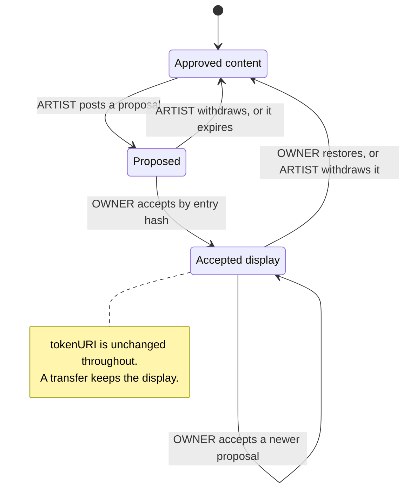

# Declarations and conventions

This page specifies conventions that tooling, front ends, venues and indexers build on top of
the deployed contracts, with no new contract logic: a declarations document each work can carry,
a conservation floor the curation signer checks, statement kinds for proposed content changes,
catalogue entries, citations and custody attestations, an off-chain control proof, and a
promise card with a grade. It is written for artist and curator tooling, marketplaces, venues
and indexers.

> Pre-audit. See the [project status](../../README.md#status).

> **Conventions, not contract rules.** No contract enforces anything on this page beyond what
> the cited contract rules already enforce. A document that breaks a convention is still
> accepted on chain; readers apply the rules below, and a reader that skips them shows claims
> the protocol never checked (LIM-CNT-13). Where a rule depends on the work powers, it reads
> `IWorkPowers`, which `WorkRecords` implements beside `IWorkRecords`
> ([ADR 0006](../adr/0006-work-powers-and-conventions.md)).

## Contracts

This page adds no contract logic. The conventions use these reads and paths:

| Contract | Source | What the conventions use |
| --- | --- | --- |
| `StatementLog` | [`StatementLog.sol`](../../src/records/StatementLog.sol) | Every convention statement: `append`, `appendSigned`, `appendPlatform`; `chainOf`, `latestDisputeOutcome`, `artistResolver` |
| `StatementKinds` | [`StatementKinds.sol`](../../src/interfaces/types/StatementKinds.sol) | The convention kind labels (constants only; the [registry](disputes-and-statements.md#statement-kind-registry) lists them) |
| `WorkRecords` | [`WorkRecords.sol`](../../src/stream/WorkRecords.sol) | `mediaOf` (finding the declarations file), `record`, `licenseOf`, `locators`, `preferredLocator`, `pinnedRenderer`, `seedOf`, `workStateHash`; the `RecordOpened` event |
| `WorkRecords` as `IWorkPowers` | [`IWorkPowers.sol`](../../src/interfaces/IWorkPowers.sol) | `renouncedPowers` (which powers over a work are renounced, DCL-8), reported through ERC-165 |
| `ContentStore` | [`ContentStore.sol`](../../src/content/ContentStore.sol) | `fileInfo` (MIME type, encoding, length), `read`, `isComplete`, `sha256Of` |
| `DependencyRegistry` | [`DependencyRegistry.sol`](../../src/content/DependencyRegistry.sol) | `resolve` (a declared dependency's file and whether it is deprecated, DCL-5) |
| `Stream` | [`Stream.sol`](../../src/stream/Stream.sol) | `ownerOf`, `coreOf`, `primarySale`, `editionOf`, `rendererOf`, `defaultRenderer`; the `WorkMinted` event (the content hash and the package root) |
| `ArtistRegistry`, `ConsolidationAdapter` | [`ArtistRegistry.sol`](../../src/identity/ArtistRegistry.sol), [`ConsolidationAdapter.sol`](../../src/identity/ConsolidationAdapter.sol) | `artist` (the profile document hash), `activeAuthorityOf`, `pendingChange`, `consolidationSource`; `isEstablished`, `effectiveAt` |
| `PackageRegistry` | [`PackageRegistry.sol`](../../src/curation/PackageRegistry.sol) | `consumedItemOf` (whether proposed bytes were minted as another work) |
| `EnglishAuction`, `UniformEditionAuction` | [`EnglishAuction.sol`](../../src/sales/EnglishAuction.sol), [`UniformEditionAuction.sol`](../../src/sales/UniformEditionAuction.sol) | `pendingDelivery`; `saleIdOf`, `clearing` (primary prices) |

The JSON Schemas (Draft 2020-12) are in [`schemas/`](schemas/), with an example of each
document in [`schemas/examples/`](schemas/examples/). Shared definitions are in
[`common.v1.schema.json`](schemas/common.v1.schema.json).

## Concepts

### What the code fixes and what it leaves open

These facts, read from the code, decide what can be a convention.

| Fact | Where the code says so | Consequence for conventions |
| --- | --- | --- |
| A statement kind is any non-zero `bytes32`; only `DISPUTE_OUTCOME`, `CURATION_EVIDENCE` and `GOVERNANCE_MANIFEST` are reserved. | `StatementLog._validate`, `_append` ([DSP-2, DSP-4](disputes-and-statements.md#rules-and-invariants)) | A new kind needs no deployment, and the log accepts every convention kind under every role (`test_Kinds_ConventionKindsAreAcceptedUnderEveryRole`). Readers enforce each kind's writer. |
| ARTIST is the lead artist's active authority, and only for a 6529 Stream work or an edition (through its master). | `ArtistRegistry.isArtist` ([ID-28](identity-and-recovery.md#rules-and-invariants)) | No ARTIST statement about an item before its mint (LIM-ID-11) or about the artist subject `(ArtistRegistry, artistId)`. Co-artists other than the lead have no ARTIST lane. |
| OWNER is the ERC-721 `ownerOf`, else any ERC-1155 holder, read when the entry is appended (for a relayed entry, when it is relayed). | `StatementLog._owns` ([who may write](disputes-and-statements.md#who-may-write)) | The log proves the signer owned the token at the entry's block. An edition has many OWNER writers. A work in auction custody is owned by the adapter. |
| CURATOR and PLATFORM may write about any subject; there are no other roles. | `StatementLog._isAuthorized`, `IStatementLog.Role` | A custodian, a venue or a collaborator has no lane of its own: its words reach the log only inside a document someone with a role posts. |
| A statement carries a hash and one locator: a URI of at most 2,048 bytes, or a content-store file ID. The log never reads the document. | `StatementLog._validate` (`MAX_URI_BYTES`) | The document's size is bounded only by where it is stored: a content-store file holds up to 512 chunks ([WS-26](works-and-storage.md#rules-and-invariants)). DCL-1 sets a convention limit. |
| The renderer validates the whole record JSON and copies only its known members; other members are validated and ignored, and count toward the record's bounds (12,288 bytes, 1,024 units). | `Renderer` contract notes, `JsonScan` ([LIM-CNT-5](../audit/known-limitations.md#content-records-and-rendering)) | An extra record member is invisible in metadata, can be replaced by `setRecord` until finalize, and spends the record's budget. Promises fixed at approval do not belong there. |
| The renderer uses only the PRIMARY file, the first PREVIEW image, and the locator of a license text listed among the media; no other AUXILIARY file reaches the metadata. | `Renderer._media`, `_preview`, `_licenseUrl` | A declarations file changes nothing a marketplace sees through `tokenURI`. |
| The ordered media list, each entry's file ID, declared SHA-256 and role, is committed by the item's media hash, which the curation signer attests; `openRecord` opens only that exact list, and nothing changes it afterwards. A file ID commits to the chunk hashes, length, encoding, MIME type and declared SHA-256. | `WorksHashing.mediaHash`, `WorkRecords.openRecord` ([WS-2, WS-6, WS-25](works-and-storage.md#rules-and-invariants)) | An AUXILIARY file's bytes are fixed from approval. The declared SHA-256 is never recomputed on chain (WS-30, LIM-CNT-3), so the signer checks it; the chunk hashes bind the bytes at every read (WS-28). |
| `mediaOf` reverts until the record opens; `openRecord` reverts while a listed manifest is unregistered; `syncOnChain` needs every listed file complete. | `WorkRecords.openRecord`, `mediaOf`, `syncOnChain` ([WS-1, WS-17](works-and-storage.md#rules-and-invariants)) | A declarations file must be registered before the record can open, and uploaded in full before the work can become on-chain complete. Before the open, a reader finds it only in the package data. |
| The artist's profile document hash is set at the first package acceptance and changes only by a staged identity change. | `ArtistRegistry.register`, `stageChange` ([change kinds](identity-and-recovery.md#change-kinds)) | An artist-wide document can be named from the profile document, at the pace of identity changes (DCL-17). |

### Document format

**DCL-1.** Every convention document is UTF-8 JSON in RFC 8785 canonical form, as the record file
is ([Works and storage](works-and-storage.md#concepts)), with a `v` member (the schema version)
and, for a statement document, a `subject` member naming the statement's own chain ID, token and
token ID. A statement that carries one:

| Field | Value |
| --- | --- |
| `kind` | The kind's label hash from the [registry](disputes-and-statements.md#statement-kind-registry) |
| `schema` | `keccak256` of the UTF-8 schema `$id`, for example `keccak256("urn:6529-works:schema:citation:v1")`; the registry lists each value |
| `content` | Algorithm 2 (SHA-256) of the document's bytes as published |
| `uri` or `fileId` | An `ar://` or `ipfs://` content address of the document ([storage](../integrators/storage.md#4-locators-content-addresses-only)), or a complete content-store file |
| `supersedes` | The entry hash of the earlier entry of the same kind this one replaces, or zero |

A reader refuses a convention document over 65,536 bytes; the declarations document has its own
limit (DCL-3).

**DCL-2. Validating any convention statement.** A reader:

1. Rebuilds the subject's chain from `StatementAppended` events and proves it against
   `chainOf(token, id)` ([statements](../integrators/events-and-indexing.md#statements)).
2. Keys the subject on the official 6529 Stream address of the chain
   ([addresses](../integrators/addresses.md)); an entry about any other token is not a
   statement about a work.
3. Counts the entry only under the role the kind's rule names below; for ARTIST, only when
   `resolver` is an artist resolver the deployment installed (`ArtistResolverSet`), since the
   resolver vouched for the signer (LIM-GV-10).
4. Fetches the document, checks its SHA-256 against `content`, checks it is canonical, validates
   it against the schema whose `$id` hashes to `schema`, and checks that its `subject` equals
   the statement's chain, token and ID. Any failure discards the entry, which stays in the log.
5. Follows `supersedes` only to an earlier entry of the same subject, kind and role (any
   authority of the work's artist counts as the same ARTIST); any other target is ignored, and
   the entry stands alone (the log does not check it, LIM-CNT-12).

## The declarations document

**DCL-3. Where it is and what fixes it.** A work's declarations document is the AUXILIARY media
file whose content-store MIME type is `application/vnd.6529-works.declarations+json`. It is
stored as `Identity`, in one chunk (at most 24,575 bytes), and follows
[`declarations.v1.schema.json`](schemas/declarations.v1.schema.json) with `contentHash` equal to
the work's content hash. A work lists at most one; two make the declarations `ambiguous`, and a
reader then trusts neither. Because the media hash commits to it, the document is fixed from
approval for as long as the work exists, and nothing the artist, the platform or governance does
later changes it (WS-6). The curation signer requires it complete in the content store
(`isComplete`) before it attests (DCL-5), so a work approved by a wave that checks the floor can
always read it on chain; only a wave that does not check the floor can approve a work whose
declarations file is incomplete. Examples: a still image with a physical twin
([`declarations.json`](schemas/examples/declarations.json)), a generative living work
([`declarations-generative.json`](schemas/examples/declarations-generative.json)) and a time
capsule ([`declarations-time-capsule.json`](schemas/examples/declarations-time-capsule.json)).

A reader finds it with `WorkRecords.mediaOf(tokenId)`, then `ContentStore.fileInfo(fileId)` for
each AUXILIARY entry, then `ContentStore.read`, or fetches the copy at a locator and checks its
SHA-256 against the media entry. The sections, all optional:

| Section | Holds | Rule |
| --- | --- | --- |
| `conservation` | The conservation floor | DCL-4, DCL-5 |
| `custodians` | Who holds each physical twin, and how fresh an attestation must be | DCL-6, DCL-21, DCL-22 |
| `citations` | Works the work cites at birth | DCL-6, DCL-18 |
| `timeCapsule` | A reveal date, the encryption scheme, the ciphertext file (an AUXILIARY media file) and a plaintext commitment | DCL-7 |
| `intendedRenunciations` | Work powers (`ROYALTY_RATE`, `RELICENSE`) the artist states they will renounce after the record opens | DCL-8 |
| `livingWork` | What makes the work change by itself | DCL-9 |

### The conservation floor

**DCL-4.** The floor is the minimum set of preservation facts a work states, limited to what the
signer can verify and a reader can display. Each fact has a `waived` flag; a waived fact must give
a `reason`.

| Fact | Content | Applies to |
| --- | --- | --- |
| `storage` | For every media file except the declarations file: its file ID, its SHA-256, and at least two independent storage receipts, each an `ar://` or `ipfs://` content address with its provider and the `form` of the bytes it holds: `stored`, the file's stored (encoded) stream, or `decoded`, the decoded media. For an `Identity` file the two are the same bytes. | Every work |
| `format` | For every media file except the declarations file: its MIME type and, for images and video, its width and height in pixels; for time-based media, its duration | Every work |
| `license` | The license identifier and the SHA-256 of its full text | Every work |
| `generative` | The renderer address and code hash the work was approved under, its dependencies (name, version, file ID), its seed policy, and the runtime it was made for | A generative work (`G` in DCL-5): a PRIMARY file of a script MIME type (`text/html`, `text/javascript`, `application/javascript`, `text/ecmascript`, `application/ecmascript` or `image/svg+xml`), a record that declares dependencies (its `dependencies` member present and non-empty), or a seed policy other than NONE |
| `display` | Instructions for display: aspect ratio, background, looping, sound, interaction | Every work |

A storage receipt's `form` follows the storage guide's rule for what a locator holds
([which bytes a locator holds](../integrators/storage.md#4-locators-content-addresses-only)): for a
`Gzip`, `Base64` or `GzipBase64` file a copy may be either the stored stream (the one that can
rebuild the content-store file, whose ID commits to those exact bytes) or the decoded media, and
the receipt says which.

**DCL-5. The check before attestation.** ADR 0001 makes approval rules wave policy, not contract
code ([ADR 0001 §3](../adr/0001-v1-scope.md#3-curation-and-approved-packages)), so the floor is
enforced by the curation signer's tooling before it attests, beside its other
[trust obligations](curation.md#trust-obligations-of-the-curation-signer). Whether a wave requires
a declarations document, and which waivers it accepts, is that wave's policy; the evidence hash
already commits to the rule parameters, and the result of this check goes into the evidence too,
so the CURATOR's `CURATION_EVIDENCE` statement publishes it (DCL-33). With `P` the wave's policy,
`item` and `media` the package item and its media list (`media[0]` is the PRIMARY file):

```text
CHECK_FLOOR(item, media, P):
  D := [m in media : m.role == AUXILIARY and fileInfo(m.fileId).mimeType == DECLARATIONS_MIME]
  if |D| > 1:                                  REFUSE "ambiguous declarations"
  G := fileInfo(media[0].fileId).mimeType in SCRIPT_MIMES
       or recordDependencies(item.recordFileId) != [] or item.seedPolicy != NONE
  if |D| == 0:
      if P.requiresDeclarations:               REFUSE "no declarations"
      return {storage, format, license, display: "unmet";
              generative: "unmet" if G else "not_applicable"}
  d := D[0]; fi := fileInfo(d.fileId)
  require fi.encoding == Identity and fi.length <= 24575 and isComplete(d.fileId)
  bytes := read(d.fileId, 0, fi.length)
  require sha256(bytes) == d.sha256Hash
  require utf8(bytes) and bytes == rfc8785(parse(bytes)) and valid(bytes, declarations.v1)
  doc := parse(bytes)
  require doc.contentHash == item.contentHash
  S := media without d
  facts := {storage, format, license, display} + ({generative} if G)
  for k in facts:
      require k in doc.conservation                         else REFUSE "missing " + k
      if doc.conservation[k].waived:
          require k in P.waivable                            else REFUSE "waiver not allowed: " + k
          result[k] := "waived"; continue
      CHECK_<k>(...); result[k] := "met"
  result[generative] := "not_applicable" unless G
  return result                                  # published in the curation evidence (DCL-33)

SCRIPT_MIMES := {text/html, text/javascript, application/javascript, text/ecmascript,
                 application/ecmascript, image/svg+xml}
recordDependencies(f) := the record file's `dependencies` member as an ordered list of
                         (name, version), or [] when the member is absent

CHECK_storage:
  require set(f.fileId for f in doc.storage.files) == set(m.fileId for m in S)
  for f in doc.storage.files, m the entry of S with m.fileId == f.fileId:
      require f.sha256 == m.sha256Hash
      require |{(r.network, r.provider) for r in f.receipts}| >= 2
      for r in f.receipts:
          require r.uri passes WorkRecords' locator shape (WS-18) and r.network matches it
          b := fetch(r.uri)
          if r.form == stored:   require |b| == fileInfo(m.fileId).length
                                 and sha256(decode(b, fileInfo(m.fileId).encoding)) == m.sha256Hash
          if r.form == decoded:  require sha256(b) == m.sha256Hash

CHECK_format:
  require set(f.fileId for f in doc.format.files) == set(m.fileId for m in S)
  for f: require f.mimeType == fileInfo(f.fileId).mimeType
         if image/* or video/*: require f.width, f.height and that decoding the file gives them
         if audio/* or video/*: require f.durationSeconds

CHECK_license:
  require licenseKey(doc.license.spdxId) == licenseKey(item.license.spdxId)
  require doc.license.textSha256 == sha256Of(item.license.textFileId or the CC0 text file)

CHECK_generative:
  require doc.generative.renderer.address == Stream.defaultRenderer()
          and doc.generative.renderer.codeHash == extcodehash(that address)
  for dep in doc.generative.dependencies:
      require DependencyRegistry.resolve(label(dep.name), label(dep.version))
              gives dep.fileId, not deprecated
  require [(dep.name, dep.version) for dep in doc.generative.dependencies]
          == recordDependencies(item.recordFileId)          # ordered lists, compared in order
  require doc.generative.seedPolicy == item.seedPolicy and doc.generative.runtime is present

label(s) := the ASCII bytes of s, left-aligned in a bytes32 and zero-padded (Solidity's
            bytes32("p5.js")), the one spelling DependencyRegistry accepts: 1 to 32 bytes of
            [a-z0-9._-], then zeros

CHECK_display:
  require doc.display.instructions is present

ALWAYS (whether or not facts are waived):
  if "timeCapsule" in doc:
      if not P.allowsTimeCapsule:              REFUSE "time capsule outside policy" (DCL-7)
      require doc.timeCapsule.ciphertextFileId == m.fileId for some m in S with
              m.role == AUXILIARY                                                 (DCL-7)
  for r in doc.intendedRenunciations: require r.power in {ROYALTY_RATE, RELICENSE}  (DCL-8)
  require the (address, objectId) pairs of doc.custodians are distinct, and no address is zero
  for c in doc.citations: require c.work is well formed                           (DCL-18)
```

The floor proves that copies existed and matched at approval, not that they still exist: later
copies and fixity checks are `STORAGE_COPY` and `FIXITY_CHECK` statements, and locators the
artist or the platform registers.

**DCL-33. The published floor result.** The signer publishes the result of each item it checked
in its `CURATION_EVIDENCE` document, as a member `conservationFloor` holding one
[`floor-result.v1`](schemas/floor-result.v1.schema.json) object per item
([example](schemas/examples/floor-result.json)): the item hash, the declarations file ID (`null`
when the item lists none) and each fact's state. Only a passing check is published, so every
state is `met`, `waived`, `unmet` or `not_applicable`; with no declarations file, no fact is
`met` or `waived`. The evidence document has no schema of its own; only this member does. A
promise-card reader finds the result in the CURATOR's latest valid `CURATION_EVIDENCE` statement
about the root the work was minted from (`WorkMinted.packageRoot`, subject
`(address(0), uint256(root))`) and uses it only when it is schema-valid, names the work's item
hash, and names the declarations file the card found (`null` when the card's declarations are
`absent`). In every other case (no published result, a result that fails those checks, or
declarations `invalid`, `ambiguous` or `unreadable`) every fact is `unmet`, which is also what a
work approved by a wave that does not check the floor shows. A reader MAY recompute the result
with `CHECK_FLOOR` from the reads at its own block and show where the two differ; the card
carries the published result.

### Custodians and citations at birth

**DCL-6.** `custodians` names, for each physical twin, the custodian's signing account, its
`objectId` (the `keccak256` of its own identifier for the object), a description, and
`maxAttestationAgeDays`. `citations` lists works the work cites, with the same fields as a
CITATION document (DCL-18). Both are the artist's claims as approved; a reader shows birth
citations with the approval as their date, and treats a named custodian as recognized (DCL-22).

### Time capsule

**DCL-7.** `timeCapsule` declares that a media file (`ciphertextFileId`) holds ciphertext the
artist promises can be decrypted after `revealAfter`, under `scheme`, with an optional hash of
the plaintext. It is a convention the contracts do not enforce: nothing on chain decrypts,
releases a key or checks the date, and the media list cannot change, so the decrypted content can
never become the work's media. `ciphertextFileId` must be the file ID of one of the work's
AUXILIARY media files, so the media hash fixes the ciphertext and the `format` fact (and the
`storage` fact, unless waived) lists it like every other file; the signer refuses a document
whose ciphertext file is not in the media list as AUXILIARY (DCL-5). **It is not part of the v1
curation policy until the owner approves it**: the schema requires `policyStatus` to say so, and
the signer's tooling refuses a package that carries one (DCL-5) unless the wave's policy allows
it.

### Intended renunciations

**DCL-8.** Each entry names a work power by its name in the `WorkPowers` library of
[`IWorkPowers.sol`](../../src/interfaces/IWorkPowers.sol) (ADR 0006), and promises to renounce it
within `withinDaysOfRecordOpen` days of the work's `RecordOpened` event. The powers, in bit order
(a power's bit index is its position):

| Power | Bit (value) | What it stops | Card row it covers (DCL-27) |
| --- | --- | --- | --- |
| `ROYALTY_RATE` | 0 (1) | Any further `WorkRecords.setRoyaltyRate` | `royalty_rate` |
| `RELICENSE` | 1 (2) | Any further `WorkRecords.relicense` | `license` |

The schema accepts only these two names. The due time is the `RecordOpened` event's block
timestamp plus the days. A reader computes the state at a block: `renounced` when
`renouncedPowers(tokenId)` has the power's bit; otherwise `pending` while the block's timestamp
is before the due time and `overdue` from the due time on (at exactly the due time the promise is
due: `timestamp >= dueAt`); `unknown` where the deployment's `WorkRecords` does not report
`IWorkPowers` through ERC-165 (a deployment from before ADR 0006). A promise is not a
renunciation: until `renouncedPowers` reports it, the power is retained. Before the record opens
there is no `RecordOpened` event, so nothing is due yet, and the declarations cannot be read
(`mediaOf` reverts), so the card shows no intended renunciation (DCL-28).

### Living work

**DCL-9.** `livingWork` lists what drives change (time, block, chain state, external data, viewer
input, randomness) and explains it. A change driven by any of these emits no ERC-4906 event,
because nothing on chain changes ([when to refresh](../integrators/reading-a-work.md#when-to-refresh)),
so a marketplace that caches a rendering shows a stale one. Readers re-render at
`suggestedRefreshSeconds` or label the cached image with its time.

## Proposed content change (1/1 only)

A display-only way for the artist to offer, and the owner to accept, new content for a 1/1 work.
The token's media list, `content_hash` and `tokenURI` never change (WS-6); the change exists only
in readers that apply these rules.

**DCL-10. Proposal.** A `CONTENT_CHANGE_PROPOSAL` counts only under the ARTIST role, about a
6529 Stream token (an ORIGINAL or an EDITION_MASTER), with a
[`content-change-proposal.v1`](schemas/content-change-proposal.v1.schema.json) document
([example](schemas/examples/content-change-proposal.json)) whose `fromContentHash` is the
work's content hash and whose `content` names the new primary file's SHA-256, MIME type and at
least one content address. The artist withdraws a proposal with a new proposal that supersedes it
with `withdrawn: true`; `expiresAt`, if given, bounds when an acceptance can count.

**DCL-11. Acceptance.** A `CONTENT_CHANGE_ACCEPTANCE` counts only under the OWNER role about the
same token, with a [`content-change-acceptance.v1`](schemas/content-change-acceptance.v1.schema.json)
document. `decision: "accept"` names the proposal's entry hash in `proposal` and repeats its
`content.sha256` ([example](schemas/examples/content-change-acceptance.json)); the proposal must
be earlier in the same subject's chain, valid, not withdrawn and not expired at the acceptance's
`recordedAt`. `decision: "restore"` returns the display to the approved content
([example](schemas/examples/content-change-restore.json)). The log already proved that the
signer owned the token at that block (the OWNER check in
[who may write](disputes-and-statements.md#who-may-write)).

**DCL-12. Display rule.** The displayed content is decided by the latest valid acceptance in the
chain: the accepted proposal's content, or the approved content after a restore. A later
withdrawal of the accepted proposal by the artist returns the display to the approved content:
both must still agree. A reader that applies the change verifies the fetched bytes against
`content.sha256`, keeps the approved content one action away, and labels the display "artist's
proposed content, accepted by the owner". It never replaces the `content_hash`, the license or the
media members of the metadata.

**DCL-13. Transfer after acceptance.** An acceptance survives a transfer: it was the owner's
decision at that block, and the log keeps it. A reader shows who accepted it and whether that is
the current owner (`acceptedByCurrentOwner` on the card). The new owner may restore the approved
content or accept another proposal; until then the display stays as accepted.

**DCL-14. Burns and disputes.** A burned token has no display. A dispute outcome about the work
is shown whatever the display.

**DCL-15. Why editions are excluded.** For an ERC-1155 edition every holder passes the OWNER check
(`balanceOf > 0`), so no single owner can accept for the others, and the contracts have no way to
gather every holder's consent. The renderer shows an edition its master's media. So readers
ignore both kinds about an edition subject, and never apply a master's accepted change to its
edition: an edition always shows the approved content, and a reader labels an EDITION_MASTER whose
display changed accordingly. A proposed content hash is not reserved on chain: a reader checks
`PackageRegistry.consumedItemOf(sha256)` and flags a proposal whose bytes were minted as another
work.



## Catalogue raisonné

**DCL-16. Per-work entry.** A `CATALOGUE_ENTRY` counts only under the ARTIST role, about a 6529
Stream token, with a [`catalogue-entry.v1`](schemas/catalogue-entry.v1.schema.json) document
([example](schemas/examples/catalogue-entry.json)). The latest valid entry for the work, following
`supersedes`, is its entry. An entry about a master covers its edition. Two works whose current
entries share a `catalogueNumber` are both flagged.

**DCL-17. The artist-wide catalogue.** The log cannot hold it: `isArtist` is false for the artist
subject, so no ARTIST statement can be about the artist, and a PLATFORM or CURATOR statement there
would not be the artist's. The catalogue is therefore a
[`catalogue.v1`](schemas/catalogue.v1.schema.json) document ([example](schemas/examples/catalogue.json))
that the artist's profile document names by hash, in a member
`"catalogue": {"sha256": "0x…", "locators": ["ar://…"]}`. The profile document's hash is the one
`ArtistRegistry.artist(artistId)` returns; it changes only through a staged identity change, with
its delay and cancellers ([change kinds](identity-and-recovery.md#change-kinds)), and it is an
unverified claim (LIM-ID-13). The catalogue can list works on any chain and works off chain; for
a 6529 Stream work its `entry` names the CATALOGUE_ENTRY entry hash, and where the two differ the
statement wins, being newer and per work.

## Citations

**DCL-18.** A `CITATION` counts only under the ARTIST role, about the citing 6529 Stream work, with
a [`citation.v1`](schemas/citation.v1.schema.json) document ([example](schemas/examples/citation.json))
naming the cited work by chain ID, contract and token ID, and the relation. A citation is well
formed when it is schema-valid (its document, or for a birth citation its declarations entry),
its chain ID is non-zero, and it does not name the citing work itself (the same chain ID,
contract and token ID); a reader discards one that is not. The signer checks the first two
before it attests (DCL-5): the work's token ID does not exist before mint. It is the citing
artist's claim: the cited work's artist does not
consent, and a reader that shows a "cited by" list on the cited work labels it so. A
`citedContentHash` lets a reader say whether the cited token still shows what was cited. Birth
citations in the declarations document (DCL-6) have the same meaning.

## Custody attestations for a physical twin

Custodians have no role in the log. A custodian signs an attestation off chain; someone with a
role posts it.

**DCL-19. The typed data.** EIP-712, domain `{name: "6529 Works Custody Attestation", version:
"1", chainId}` with the chain ID of the work's token and no verifying contract, since no contract
verifies it:

```text
CustodyAttestation(address token,uint256 tokenId,bytes32 objectId,uint8 status,uint64 asOf,address successor,bytes32 evidenceHash)
```

`status` is 1 HELD, 2 RELEASED (to `successor`, the next custodian's signing account, or zero),
3 MISSING or 4 DESTROYED; `successor` is zero unless RELEASED; `evidenceHash` is the SHA-256 of a
condition report or zero. The type hash is
`0x3dc91787a59cbc3117d2a54785ad6b184b56a9699733e6713675770b4787fe15`. The
[`custody-attestation.v1`](schemas/custody-attestation.v1.schema.json) document carries the
custodian's address, the message and the signature;
[the example](schemas/examples/custody-attestation.json) is signed by the public Anvil test
account 0 and its digest is
`0xa03cc2c3767834df2ef6c583fd5d08e6d65ddd616d2f90a96e0ad8e00e152e2a`.

**DCL-20. Posting.** A `CUSTODY_ATTESTATION` counts under the OWNER, ARTIST or PLATFORM role,
about the 6529 Stream token the message names. The poster's role tells only who published it;
the custodian's signature is what a reader trusts. The reader verifies it as the log verifies
signatures ([`SignatureVerifier`](../../src/libraries/SignatureVerifier.sol)): low-s ECDSA for an
account without code; for an EIP-7702 delegated account, ECDSA against the account first, then
ERC-1271; ERC-1271 for a contract, called at the reader's block, so a contract custodian that
later disowns a signature makes it fail.

**DCL-21. Staleness.** For each object and custodian, the valid attestation with the latest
`asOf` counts, not the latest entry; of two with the same `asOf`, the later entry in the log
counts. A valid attestation is one DCL-2 and DCL-20 accept that is not future-dated: one whose
`asOf` is later than the entry's `recordedAt` plus one hour is discarded. It is stale when the
reader's block time minus `asOf` exceeds the custodian's `maxAttestationAgeDays` in the
declarations, or 365 days for a custodian the declarations do not name. A stale attestation is
shown with its date, never as current custody. A custodian the declarations name with no valid
attestation for its object is shown with status `NONE`, no date and `stale`, never as current
custody.

**DCL-22. Recognized custodians.** A custodian is recognized when the declarations name it for the
object, or when the counting attestation (DCL-21) of a recognized custodian for that object is
RELEASED and names it as `successor`. Only that latest attestation counts: a RELEASED attestation
that the same custodian's later one replaced recognizes no one. Any other custodian's
attestation is shown as "custodian not named by the work's declarations", with the poster's role
and address, and never as the object's custody.

## Control proof

An off-chain challenge and response by which a venue or app checks, with no transaction and no
gas, that the person in front of it controls the wallet that holds a work. Nothing is written on
chain.

**DCL-23. The message.** EIP-712, domain `{name: "6529 Works Control Proof", version: "1",
chainId}`. The domain's `chainId` and the message's `chainId` are the same value: the chain ID of
the chain the token is on, which the verifier knows from its own configuration (DCL-24):

```text
ControlProof(string venue,bytes32 nonce,uint64 issuedAt,uint64 expiresAt,uint256 chainId,address token,uint256 tokenId,address holder,address signer)
```

The type hash is `0x551abbed9e673b4462640aaa67f046692206a5f53883fb9c6187674681c102eb`. The
[`control-proof.v1`](schemas/control-proof.v1.schema.json) document is the challenge without
`signature` and the response with it ([example](schemas/examples/control-proof.json), signed by
Anvil test account 0, digest
`0x2548db021144b031169071ded42000449c5128184168ca0bd94e5d56c4e0a057`).

**DCL-24. The verifier's steps.**

1. Issue the challenge: a fresh random `nonce`, `venue` set to the venue's own origin or
   published name, `issuedAt` now, `expiresAt` at most 10 minutes later, `chainId` the
   verifier's own expected chain ID, `token` the official 6529 Stream (or 6529 Stream Editions)
   address of that chain, and the token ID, holder and signer. Store the whole challenge, keyed
   by its nonce, as outstanding.
2. On the response, look up the outstanding challenge by the response's nonce. Refuse unless one
   is outstanding and unused and the response's message equals it in every field (`venue`,
   `nonce`, `issuedAt`, `expiresAt`, `chainId`, `token`, `tokenId`, `holder`, `signer`): a
   response is the issued challenge plus a signature and nothing else. Refuse unless the time is
   within `[issuedAt − 60 s, expiresAt]`, and unless the challenge's `venue`, `chainId` and
   `token` are still the verifier's own name, expected chain ID and official address.
3. Build the digest from the issued challenge, with the verifier's own expected chain ID as the
   domain's `chainId`, never from values only the response carries. Verify the signature by
   `signer` as DCL-20 does: ECDSA for an account without code; for code
   `0xef0100 ‖ delegate` (EIP-7702), ECDSA against `signer` first, then ERC-1271; otherwise
   ERC-1271 `isValidSignature(digest, signature) == 0x1626ba7e`, at block `B` below.
4. Choose `B`, a block no older than the venue's freshness bound (for example the latest block
   at most 64 blocks behind the head) and not before `issuedAt`. Read at `B`:
   `Stream.ownerOf(tokenId) == holder`, or for an edition `Editions.balanceOf(holder, id) > 0`.
   While a sold 1/1 waits for delivery, the auction holds it and
   `EnglishAuction.pendingDelivery(saleId)` names the buyer; a venue may accept that buyer as
   the holder.
5. If `holder == signer`, accept. Otherwise apply DCL-25.
6. Mark the nonce used, whatever the outcome.

**DCL-25. A cold wallet through a consolidated wallet.** A collector keeps the work in a cold
`holder` and signs with a hot `signer` consolidated with it in the 6529 delegation contract (use
case 999, all collections). The verifier reads the consolidation source the artist registry
uses, `ArtistRegistry.consolidationSource()`, at `B`: `isEstablished(holder, signer)` is true
when both have registered the consolidation of the other for at least 30 days and neither has
expired ([the consolidation adapter](identity-and-recovery.md#the-consolidation-adapter)), and
`effectiveAt(holder, signer)` gives the time it is or becomes established (zero when there is no
two-way consolidation). A venue accepts an established pair, and may accept a live, younger pair
at lower trust: one whose `effectiveAt(holder, signer)` at `B` is non-zero and later than `B`'s
timestamp, so each side holds a live registration of the other but the later of the two is less
than 30 days old (`isEstablished` is false). A pair whose `effectiveAt` is zero has no live
two-way consolidation and is refused. A consolidation can be added by whoever holds the cold key
or a use-case-998 sub-delegate (LIM-ID-4), so a high-value venue asks the holder itself to sign.

```mermaid
sequenceDiagram
    participant V as Venue
    participant W as Wallet (signer)
    participant N as Node at block B
    V->>W: challenge (venue, nonce, issuedAt, expiresAt, chainId, token, tokenId, holder, signer)
    W-->>V: EIP-712 signature
    V->>V: response equals the issued challenge, times, digest with its own chain ID
    V->>N: code of signer; ERC-1271 isValidSignature if a contract
    V->>N: Stream.ownerOf(tokenId)
    opt holder is not the signer
        V->>N: consolidationSource().isEstablished(holder, signer)
    end
    V->>V: accept or refuse, and spend the nonce
```

## Promise card and grade

### The card

**DCL-26. Inputs.** A card is generated for one work at one block `B`, every read made at `B`.

| Read | Contract | Gives |
| --- | --- | --- |
| `ownerOf`, `coreOf`, `primarySale`, `editionOf`, `rendererOf` | Stream | Owner; item hash, artist ID, collection and kind; the sale outcome and price; the edition link; the renderer in force |
| The `WorkMinted` event | Stream | The content hash (`contentHash`): no view returns it, since Stream stores only the item hash; and the package root, where the floor result is published (DCL-33) |
| `isOpen`, `record`, `mediaOf`, `licenseOf`, `workStateHash`, `locators`, `preferredLocator`, `pinnedRenderer`; the `RecordOpened` event | WorkRecords | Record status, version, finalized, on-chain complete, state hash, whether a renderer is pinned; media, roles and hashes; license; how many copies each file has and the served copy's kind; when intended renunciations fall due |
| `renouncedPowers` | WorkRecords, as `IWorkPowers` (ERC-165) | Renounced and retained powers (DCL-8) |
| `fileInfo`, `isComplete`, `read` | ContentStore | Each media file's MIME type and completeness; whether the license text is on chain; the declarations bytes |
| `latestDisputeOutcome`, `disputeOutcomeOf`, `chainOf`, `artistResolver` | StatementLog | Dispute status and its scope (token or item); the chain's count and head; the resolver |
| `activeAuthorityOf`, `pendingChange` | ArtistRegistry | The active authority and whether the artist is restrained; a pending identity change |
| `saleIdOf`, `clearing` | UniformEditionAuction | The edition's copies and price per copy, for a master with an edition |
| Documents | The declarations document; the published floor result (DCL-33); custody attestations; the winning display change (DCL-12) | Declarations, floor, custody, display change, intended renunciations |

The [`promise-card.v1`](schemas/promise-card.v1.schema.json) schema is its machine-readable form
([example](schemas/examples/promise-card.json)).

**DCL-27. Who can still change what.** The card lists each thing that can still change, who can
change it and after what delay. The caller (the front end or card generator) composes one row
per path in the table below from the generated [role matrix](../audit/roles.md) for the
deployment (and its later `RoleGranted` and `TargetFunctionRoleUpdated` events), never from this
page: `what`, the roles (`who`), the delay, whether a guardian can cancel, and, for a path that
applies only before or only after finalize, that phase:

| What | Paths | Until |
| --- | --- | --- |
| `record` | `WorkRecords.setRecord`, `finalize`: the artist, no governed delay ([WS-7](works-and-storage.md#rules-and-invariants)) | finalize |
| `license` | `WorkRecords.relicense` ([roles](../audit/roles.md#workrecords)); never for CC0 (WS-12) | permanent |
| `royalty_rate` | `WorkRecords.setRoyaltyRate` ([roles](../audit/roles.md#workrecords)) | permanent |
| `renderer` | Before finalize `Stream.setDefaultRenderer` ([roles](../audit/roles.md#stream)); after, `WorkRecords.repinRenderer` ([roles](../audit/roles.md#workrecords)) | permanent |
| `served_copy` | `WorkRecords.addLocator` (the artist before finalize), `setFilePreference`, `setCollectionPreferredKind`, `setPreferredKind` ([roles](../audit/roles.md#workrecords)) | permanent |
| `dispute_statement` | `StatementLog.appendPlatform` ([roles](../audit/roles.md#statementlog)) | permanent |
| `artist_authority` | `ArtistRegistry.stageChange` (the artist), `stageOverride` ([roles](../audit/roles.md#artistregistry); [change kinds](identity-and-recovery.md#change-kinds)) | permanent |
| `artist_resolver` | `StatementLog.setArtistResolver` ([roles](../audit/roles.md#statementlog)) | permanent |
| `burn_and_release` | `EnglishAuction.cancel` and `Stream.releaseContent` after an upheld dispute ([roles](../audit/roles.md#englishauction)) | settlement ([DSP-20, DSP-22](disputes-and-statements.md#rules-and-invariants)) |

The generator then applies these rules to the rows, as the reference tool does:

1. A row for a before-finalize path is dropped once the record is finalized, and a row for an
   after-finalize path while it is not.
2. The `record` row is dropped once the record is finalized.
3. The `license` row is dropped for a CC0 work (WS-12).
4. The `burn_and_release` row is dropped once the primary sale has an outcome other than NONE.
5. `until` is `finalize` for `record`, `settlement` for `burn_and_release`, and `permanent` for
   every other row.
6. A row a renounced power covers (DCL-8: `ROYALTY_RATE` covers `royalty_rate`, `RELICENSE`
   covers `license`) gets `until: renounced` and `renouncedBy` with the power's name. Without
   `IWorkPowers` every row stays as it is.

**DCL-28. States the card distinguishes.** Record not open, open or finalized; on-chain complete
or not; disputed (an outcome about the token, or only about its item) or not; the primary sale
NONE, SOLD, UNBID, FROZEN_OUT or RESCUED (rescued by governance to the museum); each power
renounced or retained, or `available: false` without `IWorkPowers`; declarations absent, valid,
invalid, ambiguous or unreadable; each floor fact met, waived, unmet or not applicable (DCL-33);
display changed or not, and by the current owner or not; each custody attestation recognized or
not, fresh or stale, and each named custodian with no attestation (`NONE`, no date). A burned
token has no card. A dispute outcome's document is read to say what it decided: the log records
only that an outcome exists. While the record is not open, `mediaOf` and `licenseOf` revert: the
card shows the license of the approved package item (the one `openRecord` will store), no media
files, declarations `unreadable`, every floor fact `unmet`, and no intended renunciation, since
none is due before `RecordOpened` (DCL-8).

**DCL-29. Residual risks.** The card always prints LIM-GV-1, LIM-GV-2, LIM-GV-9, LIM-GV-10,
LIM-GV-11, LIM-ID-11, LIM-ID-13, LIM-CNT-2, LIM-CNT-3, LIM-CNT-12, LIM-CNT-13 and LIM-SAL-8;
LIM-CNT-1 while the work is not on-chain complete; LIM-CNT-10 once it is finalized; and
LIM-EA-14 when the work is an EDITION_MASTER with a linked edition (`editionOf` names an editions
contract) and a dispute outcome is recorded about the token or its item (`dispute.entryHash` is
set). Each links to [known limitations](../audit/known-limitations.md), which owns the text.

### The grade

**DCL-30.** The grade is a pure function of one card: the same card always gives the same grade.
It is computed by clients, never written on chain, and always shown with its rubric version and
a link to this rubric. It grades how much of a work's permanence is locked and verifiable, not
the work. Its output follows [`promise-grade.v1`](schemas/promise-grade.v1.schema.json)
([example](schemas/examples/promise-grade.json), the grade of the example card), with `card` the
SHA-256 of the card's canonical JSON. Rubric 1:

| Row | Points | Condition on the card |
| --- | ---: | --- |
| R1 | 20, or 5 | `record.status` is `finalized`; 5 if `open` |
| R2 | 25 | `storage.onChainComplete` |
| R3 | 5 | `license.textOnChain` |
| R4 | 10 | `declarations.status` is `valid` |
| R5 | 15, or 8 | Every applicable `conservationFloor` fact (one that is not `not_applicable`) is `met`, which also holds when no fact is applicable; 8 if each is `met` or `waived` and at least one is waived |
| R6 | 10, or 5 | The first PRIMARY file in `storage.files` has at least 2 `locators`; 5 if it has 1; 0 when there is none (record not open) |
| R7 | 0 to 10 | With `powers.available`: `floor(10 × renounced / (renounced + retained))`; 0 without the view or with no powers |
| R8 | 5 | No intended renunciation is `overdue` |

The letter is A from 85 points, B from 70, C from 50, D below, then capped: at C when
`dispute.entryHash` is set (CAP1); at D when the record is not open (CAP2); at C when an intended
renunciation is overdue (CAP3); at C when the declarations are invalid, ambiguous or unreadable
(CAP4). `reasons` lists, in rubric order, each row that scored points, then each cap that lowers
the letter: one whose ceiling is below the letter the points alone give. A cap's reason carries 0
points; a cap whose ceiling is at or above that letter changes nothing and is not listed.

**DCL-31.** A rubric never changes once published; a new rubric is a new version number, a new
`rubric` value and a new table on this page. A client shows the version it used and never
compares grades of different versions.

## Primary price history

**DCL-32.** Primary prices are already recorded; a reader needs no new contract.

| Sale | Read | Events |
| --- | --- | --- |
| A 6529 Stream 1/1 | `Stream.primarySale(tokenId)`: outcome, currency and price, the price held in 96 bits (`type(uint96).max` means at least that) ([AUC-8](stream-and-auctions.md#rules-and-invariants)) | `Stream.PrimarySaleSettled`, with the exact price; `EnglishAuction.SaleSettled`, with the seller's proceeds and the fee ([events](../integrators/events-and-indexing.md#stream), [auction events](../integrators/events-and-indexing.md#englishauction)) |
| A 6529 Stream Editions edition | `UniformEditionAuction.clearing(saleIdOf(editions, editionId))`: copies sold and the one price every winner paid ([EA-11](editions-and-sales.md#rules-and-invariants)) | `AuctionCleared` (count, price, revenue) and `SaleSettled` (quantity and revenue) ([events](../integrators/events-and-indexing.md#uniformeditionauction)) |

An edition's ID is its master's token ID. Secondary sales are not recorded by the protocol.

## Rules and invariants

Every rule here is applied off chain; none is a contract invariant. "Applied by" names who must
apply it; "Supported on chain by" names the contract rule it builds on.

| ID | Rule | Applied by | Supported on chain by |
| --- | --- | --- | --- |
| DCL-1 | Convention documents are canonical JSON with `v` and `subject`; `schema` is the hash of the `$id`; content is SHA-256; at most 65,536 bytes. | Writers' tooling; readers | DSP-2 |
| DCL-2 | A convention statement counts only after chain proof, official subject, the kind's role, a trusted resolver, hash, schema and subject checks, and supersession within kind and role. | Readers | DSP-1, DSP-7, DSP-10 |
| DCL-3 | The declarations document is the one AUXILIARY file of its MIME type, `Identity`, one chunk, matching the content hash, and complete in the content store when the signer attests; fixed from approval. | Signer's tooling; readers | WS-2, WS-6, WS-25 |
| DCL-4 | The floor's facts, each waivable with a reason; each storage receipt declares the form of the bytes it holds. | Artists' tooling | none |
| DCL-5 | The signer checks the floor before attesting: generative by script MIME type, non-empty record dependencies or seed policy; dependencies resolved by their bytes32 labels and compared in order; custodians distinct by (address, object); citations well formed. | Curation signer | The evidence hash the package registry stores ([curation](curation.md#concepts)); DSP-4 |
| DCL-6 | Birth custodians and citations are the artist's approved claims. | Readers | WS-6 |
| DCL-7 | A time capsule is unenforced, its ciphertext is an AUXILIARY media file, and it is outside the v1 curation policy until the owner approves it. | Curation signer; readers | WS-6 |
| DCL-8 | An intended renunciation names `ROYALTY_RATE` or `RELICENSE`, is due at `RecordOpened` plus its days (due from that time on), and its state comes from `IWorkPowers.renouncedPowers`. | Readers | WS-37, WS-38 |
| DCL-9 | A living work's change emits no refresh event; readers re-render or date their cache. | Readers | none |
| DCL-10 | A proposal counts only as ARTIST about a 6529 Stream token. | Readers | ID-28, DSP-7 |
| DCL-11 | An acceptance counts only as OWNER about the same token, citing an earlier valid proposal. | Readers | DSP-6 |
| DCL-12 | The latest valid acceptance decides the display; withdrawal undoes it; `tokenURI` never changes. | Readers | WS-6 |
| DCL-13 | An acceptance survives a transfer, labelled by who accepted it. | Readers | none |
| DCL-14 | Burns and dispute outcomes prevail over the display. | Readers | DSP-12 |
| DCL-15 | Editions never take a content change; proposed bytes minted as another work are flagged. | Readers | DSP-11 subject rules; `consumedItemOf` |
| DCL-16 | A catalogue entry counts only as ARTIST; the latest per work wins; duplicate numbers are flagged. | Readers | ID-28 |
| DCL-17 | The artist-wide catalogue is named from the profile document. | Artists; readers | ID-5, ID-8, ID-28 |
| DCL-18 | A citation counts only as ARTIST about the citing work, only when well formed (schema-valid, non-zero chain ID, not the work itself), and is shown as the citing artist's claim. | Readers | ID-28 |
| DCL-19 | Custody attestations are the typed data above. | Custodians' tooling | none |
| DCL-20 | A custody attestation counts as posted by OWNER, ARTIST or PLATFORM, and only with a valid custodian signature. | Readers | DSP-3, DSP-6 |
| DCL-21 | The latest `asOf` counts, the later entry on a tie; future-dated is discarded; older than the allowed age is stale; a named custodian with no attestation is `NONE`. | Readers | none |
| DCL-22 | Only a named custodian, or the successor in a recognized custodian's latest attestation when it is RELEASED, is recognized. | Readers | WS-6 |
| DCL-23 | Control proofs are the typed data above, in the domain of the token's chain. | Venues; wallets | none |
| DCL-24 | The response must equal the issued challenge; the verifier builds the digest with its own chain ID, checks the time window, the signature and ownership at a recent block, and spends the nonce. | Venues | none |
| DCL-25 | A consolidated signer proves a cold holder only through the registry's consolidation source; a live, younger pair (non-zero `effectiveAt` after `B`) only at lower trust. | Venues | ID-24, ID-27 |
| DCL-26 | A card reads everything at one block; the content hash comes from `WorkMinted`. | Card generators | none |
| DCL-27 | Roles and delays on a card come from the role matrix and the deployment's events; the generator applies the six row rules. | Card generators | GV-10, GV-17 |
| DCL-28 | The card distinguishes the states listed, including a record not yet open. | Card generators | none |
| DCL-29 | The card prints the residual risks listed. | Card generators | none |
| DCL-30 | The grade is a pure function of the card under rubric 1, never on chain; caps are listed only when they lower the letter. | Clients | none |
| DCL-31 | Rubrics are versioned and immutable. | Clients | none |
| DCL-32 | Primary prices come from the reads and events listed. | Readers | AUC-8, EA-11 |
| DCL-33 | The signer publishes each item's floor result as `floor-result.v1` in the curation evidence; a card uses it only when it matches the work and its declarations, and otherwise shows every fact `unmet`. | Curation signer; card generators | DSP-4 |

## Events

No event is added. Statements are `StatementAppended`, and the reads above have the events on
the [events page](../integrators/events-and-indexing.md). A convention statement emits no ERC-4906
event: a reader that shows a display change, a catalogue entry or custody refreshes on
`StatementAppended` with the kind.

## Failure modes and recovery

| Failure | Effect | Recovery |
| --- | --- | --- |
| A declarations document breaks DCL-3, or two are listed | `invalid` or `ambiguous`; every floor fact `unmet` | None for that work: the media cannot change. Later facts go in statements. |
| The declarations file is not registered | `openRecord` reverts | Anyone registers the committed manifest. |
| The declarations file is not complete on chain (possible only under a wave that does not check the floor: DCL-3, DCL-5) | The work cannot become on-chain complete; readers fetch the document by locator | Anyone uploads the missing chunks. |
| A storage receipt goes dark after approval | The floor stays `met` (it is about approval) | `STORAGE_COPY` and `FIXITY_CHECK` statements; new locators. |
| An artist's key is lost or restrained | No ARTIST statements | [Identity and recovery](identity-and-recovery.md); earlier entries keep their resolver. |
| A wrong convention statement | It stays in the log | A superseding entry of the same kind and role; readers apply DCL-2. |
| A custodian's key is lost | No new attestations; the last goes stale | A RELEASED attestation signed earlier, or a statement explaining the change; readers show the custodian as unrecognized. |
| No floor result is published for the item, or it does not match the work | Every floor fact `unmet` on the card (DCL-33) | The CURATOR publishes a corrected `CURATION_EVIDENCE` statement that supersedes the earlier one. |
| A renunciation is signed in error | Permanent: the power stays renounced (LIM-CNT-14) | None. |

## Parameters and limits

| Parameter | Value | Source |
| --- | --- | --- |
| Declarations MIME type | `application/vnd.6529-works.declarations+json` | DCL-3; the content store's MIME rule ([WS-26](works-and-storage.md#rules-and-invariants)) |
| Declarations size | `Identity`, at most 24,575 bytes (one chunk) | DCL-3 |
| Other convention documents | At most 65,536 bytes | DCL-1 |
| Storage receipts per file | At least 2, of distinct network or provider, each of form `stored` or `decoded` | DCL-4, DCL-5 |
| Script MIME types (a generative work) | `text/html`, `text/javascript`, `application/javascript`, `text/ecmascript`, `application/ecmascript`, `image/svg+xml` | DCL-4, DCL-5 |
| Work powers | `ROYALTY_RATE` (bit 0, value 1), `RELICENSE` (bit 1, value 2) | DCL-8; [`IWorkPowers.sol`](../../src/interfaces/IWorkPowers.sol) |
| Default custody age | 365 days for an unnamed custodian | DCL-21 |
| Custody future skew | 1 hour after `recordedAt` | DCL-21 |
| Control proof validity | At most 10 minutes; 60 seconds of clock skew | DCL-24 |
| Schema IDs | `urn:6529-works:schema:<name>:v1` | DCL-1; [registry](disputes-and-statements.md#statement-kind-registry) |
| EIP-712 domains | `"6529 Works Custody Attestation"` and `"6529 Works Control Proof"`, version `"1"`, chain ID, no verifying contract | DCL-19, DCL-23 |

## Differences from the ADRs

No accepted ADR is departed from. The work powers this page refers to are
[ADR 0006](../adr/0006-work-powers-and-conventions.md)'s; see also the
[register](README.md#differences-from-the-adrs).

## References

- Code: [`StatementKinds.sol`](../../src/interfaces/types/StatementKinds.sol),
  [`StatementLog.sol`](../../src/records/StatementLog.sol),
  [`WorkRecords.sol`](../../src/stream/WorkRecords.sol),
  [`IWorkPowers.sol`](../../src/interfaces/IWorkPowers.sol),
  [`DependencyRegistry.sol`](../../src/content/DependencyRegistry.sol),
  [`Renderer.sol`](../../src/content/Renderer.sol), [`JsonScan.sol`](../../src/content/JsonScan.sol),
  [`ContentTypes.sol`](../../src/interfaces/types/ContentTypes.sol),
  [`ArtistRegistry.sol`](../../src/identity/ArtistRegistry.sol),
  [`ConsolidationAdapter.sol`](../../src/identity/ConsolidationAdapter.sol),
  [`SignatureVerifier.sol`](../../src/libraries/SignatureVerifier.sol).
- Schemas and examples: [`schemas/`](schemas/).
- Tests: `test_Kinds_ConventionKindsAreStableLabels` and
  `test_Kinds_ConventionKindsAreAcceptedUnderEveryRole` in
  [`StatementLog.t.sol`](../../test/records/StatementLog.t.sol).
- ADRs: [ADR 0001 §3](../adr/0001-v1-scope.md#3-curation-and-approved-packages) and
  [§12](../adr/0001-v1-scope.md#12-disputes); [ADR 0006](../adr/0006-work-powers-and-conventions.md).
- Related pages: [Disputes and statements](disputes-and-statements.md),
  [Works and storage](works-and-storage.md), [Curation](curation.md),
  [Identity and recovery](identity-and-recovery.md),
  [Reading a work](../integrators/reading-a-work.md), [roles](../audit/roles.md),
  [known limitations](../audit/known-limitations.md).

## Reference tools

[`tools/conventions/`](../../tools/conventions/README.md) implements these rules in Python,
standard library only, for front ends, venues and the curation signer to copy or test against:
schema validation and RFC 8785 canonical form (DCL-1), the floor check before attestation and
its published result (DCL-3 to DCL-5, DCL-7, DCL-33), the promise card from reads at one block
(DCL-26 to DCL-29, DCL-33), rubric 1
(DCL-30), the control-proof verifier (DCL-23 to DCL-25) and the custody-attestation reader check
(DCL-19 to DCL-22). The tools make no chain reads; the caller supplies them. This page is the
authority where the two differ.
