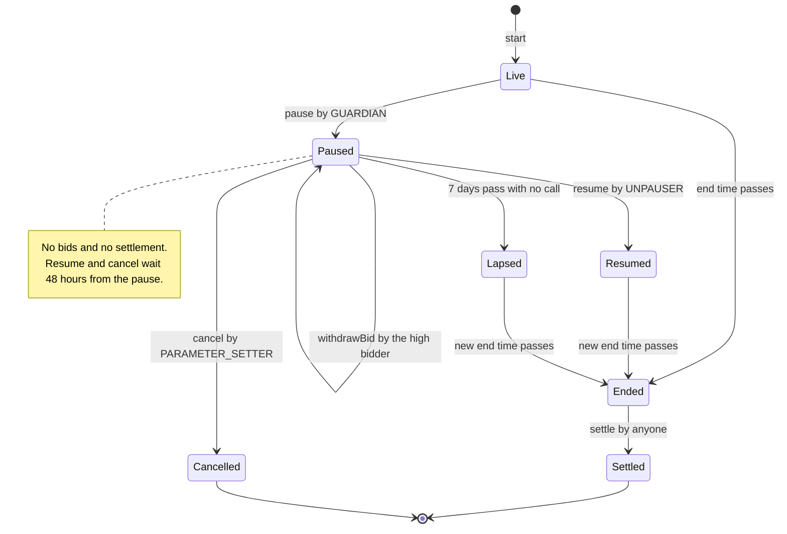
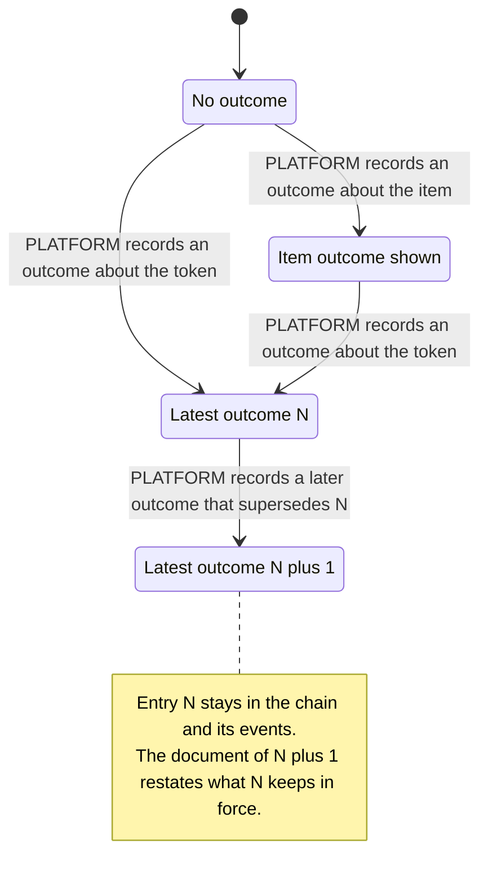
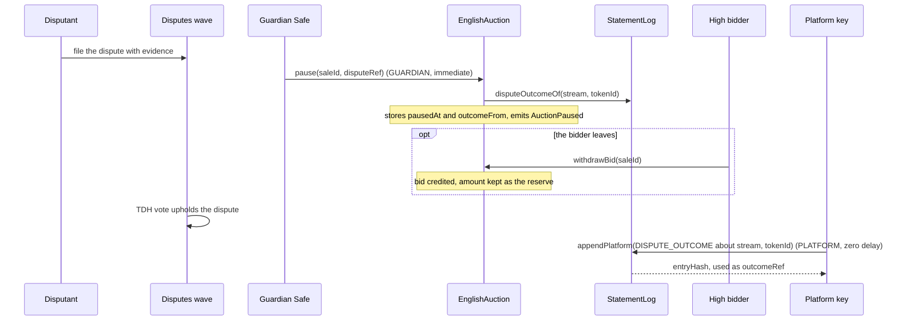
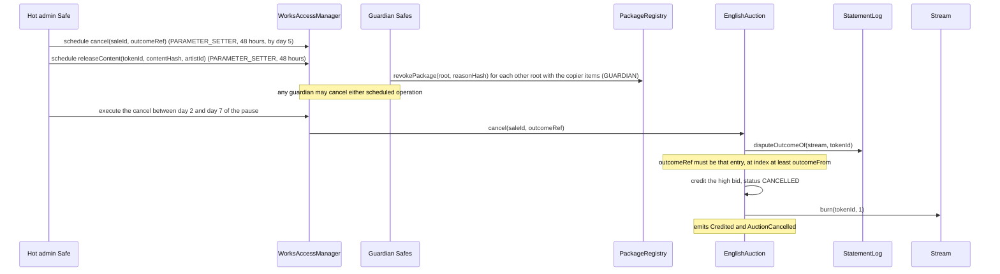
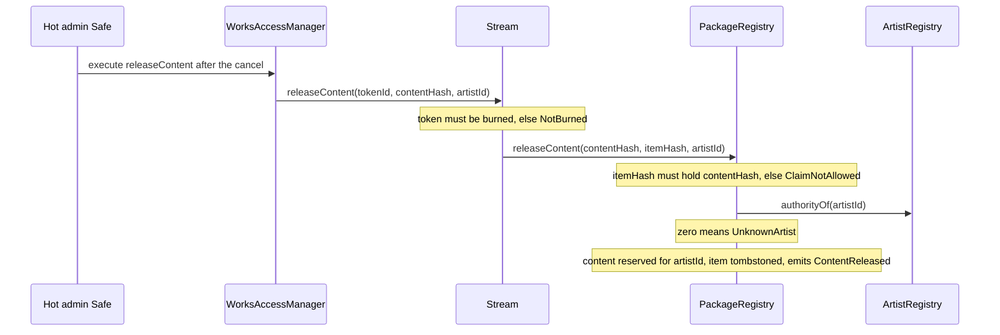
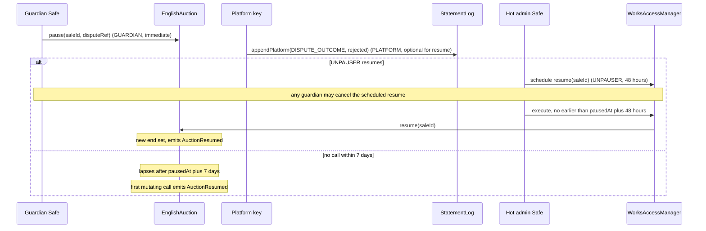
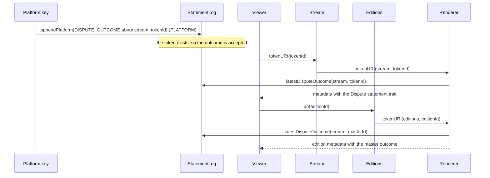
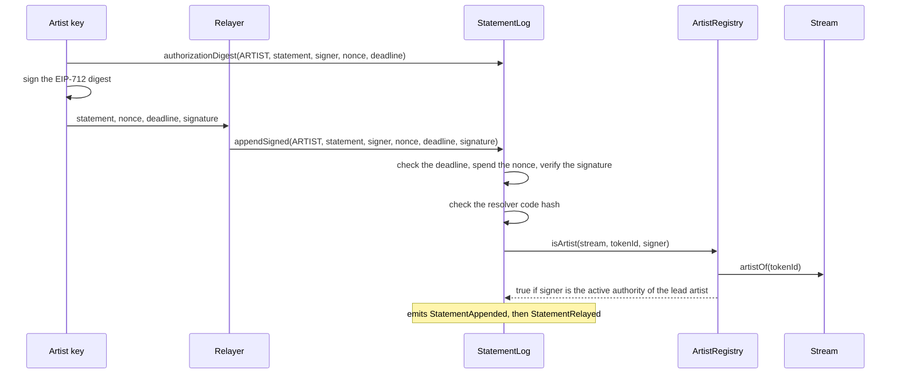
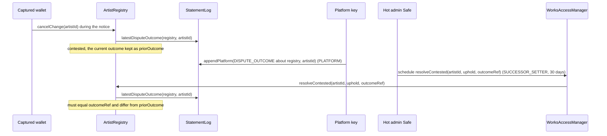

# Disputes and statements

This page specifies how 6529 Works records statements about works and how a dispute
runs from filing to outcome. It is written for auditors, integrators and operators. The
statement log (`StatementLog`) is one append-only, signed log in which artists, owners,
curators and the platform publish statements about a subject: a work, an approved item
before its mint, an artist, or the governance configuration. A dispute is decided off-chain
by a TDH vote and recorded in that log as a dispute outcome. During a 6529 Stream auction,
the English auction (`EnglishAuction`) adds a dispute pause, bid withdrawal, a governed
resumption and a governed cancel that burns the work; Stream (`Stream`) and the package
registry (`PackageRegistry`) then release the burned work's content to the rightful artist.
After a sale a dispute produces only a statement, which the renderer shows in the metadata
of the work and its edition. The artist registry (`ArtistRegistry`) uses the same outcome
records to settle contested identity overrides.

> **Status.** Pre-audit. This page describes `main` at `c4b3355` (15 October 2026). The ADRs
> record how the design was decided; this page is how it works now. Where they differ, this
> page follows the code and says so under [Differences from the ADRs](#differences-from-the-adrs).

## Contracts

| Contract | Source | Interface | Responsibility |
| --- | --- | --- | --- |
| `StatementLog` | [`src/records/StatementLog.sol`](../../src/records/StatementLog.sol) | [`IStatementLog`](../../src/interfaces/IStatementLog.sol) | Append paths per role, EIP-712 relay and nonces, per-subject hash chain, the latest dispute outcome per subject and the display rule. Holds no value; has no pause and no edit or delete path. |
| `HashRef`, `isKnownHashAlgorithm` | [`src/interfaces/types/HashRef.sol`](../../src/interfaces/types/HashRef.sol) | n/a | The content hash type and the three accepted algorithm IDs. |
| `StatementKinds` | [`src/interfaces/types/StatementKinds.sol`](../../src/interfaces/types/StatementKinds.sol) | n/a | Well-known kind labels, three of them reserved. Constants only. |
| `ArtistRegistry` | [`src/identity/ArtistRegistry.sol`](../../src/identity/ArtistRegistry.sol) | [`IArtistRoleResolver`](../../src/interfaces/IArtistRoleResolver.sol), [`IArtistRegistry`](../../src/interfaces/IArtistRegistry.sol) | The v1 artist resolver (`isArtist`) the log asks for ARTIST statements; `resolveContested`, which cites a dispute outcome. |
| `EnglishAuction` | [`src/sales/EnglishAuction.sol`](../../src/sales/EnglishAuction.sol) | [`IEnglishAuction`](../../src/interfaces/IEnglishAuction.sol) | The dispute pause, `withdrawBid`, `resume`, the self-ending pause, and `cancel`, which must cite a recorded outcome. |
| `Stream` | [`src/stream/Stream.sol`](../../src/stream/Stream.sol) | [`IStream`](../../src/interfaces/IStream.sol) | `burn` by the minting adapter before the primary sale settles; the governed `releaseContent`. |
| `PackageRegistry` | [`src/curation/PackageRegistry.sol`](../../src/curation/PackageRegistry.sol) | [`IPackageRegistry`](../../src/interfaces/IPackageRegistry.sol) | `revokePackage`; `releaseContent`, which reserves the content hash for the rightful artist and tombstones the burned item. |
| `Renderer` | [`src/content/Renderer.sol`](../../src/content/Renderer.sol) | [`IRenderer`](../../src/interfaces/IRenderer.sol) | Shows `latestDisputeOutcome` as the `Dispute statement` trait in the metadata of a work and its edition. |
| `WorksAccessManager` | [`src/governance/WorksAccessManager.sol`](../../src/governance/WorksAccessManager.sol) | OpenZeppelin `IAccessManager` | Schedules and executes the delayed actions (`resume`, `cancel`, `releaseContent`, `resolveContested`, `setArtistResolver`); any guardian may cancel a scheduled operation. |

## Concepts

See also the [glossary](../glossary.md) for statement, subject and dispute outcome.

- **Statement.** One entry in the log: a subject, a kind, a schema hash, a content hash and
  exactly one locator (a URI or a `ContentStore` file ID), signed by an account speaking in
  one role. The log stores the content's hash, never the document.
- **Subject.** The pair `(token, id)` a statement is about. Its key is
  `subjectKey(token, id) = keccak256(abi.encode(token, id))`. Each subject has its own chain.
  Subjects are open: the log accepts any `token` address and checks the signer's role (and,
  for a dispute outcome, the subject rules below), so readers key on the official contract
  addresses.

  | Subject | `token` | `id` | Typical statements |
  | --- | --- | --- | --- |
  | A minted 6529 Stream work | the Stream address | the token ID | Artist statements, owner statements, fixity, dispute outcomes |
  | An approved item before its mint | `address(0)` | `uint256(itemHash)` | Curator or platform statements, pre-mint dispute outcomes ([ADR 0003](../adr/0003-build-time-decisions.md#package-format-and-curation-amends-adr-0001-3)) |
  | A 6529 Editions edition | the Editions address | the edition ID (equal to the master's token ID) | Owner statements by any holder, artist statements. Not dispute outcomes: those go on the master. |
  | An artist | the `ArtistRegistry` address | the artist ID | Dispute outcomes that record an identity contest vote |
  | The governance chain | the AccessManager address | `0` | `GOVERNANCE_MANIFEST` entries only ([governance](governance.md)) |

  The log never links an item subject to the token subject the item later becomes. Stream
  holds that link (`IStream.coreOf(tokenId)` returns the item hash), and the display rule
  below reads it.
- **Kind.** A non-zero `bytes32` label. The log accepts any kind, so a new kind needs no
  deployment. [`StatementKinds`](../../src/interfaces/types/StatementKinds.sol) lists the
  well-known ones:

  | Constant | Value | Reserved to |
  | --- | --- | --- |
  | `ARTIST_STATEMENT` | `keccak256("ARTIST_STATEMENT")` | any role |
  | `INTERVIEW` | `keccak256("INTERVIEW")` | any role |
  | `EXHIBITION` | `keccak256("EXHIBITION")` | any role |
  | `CONSERVATION_NOTE` | `keccak256("CONSERVATION_NOTE")` | any role |
  | `STORAGE_COPY` | `keccak256("STORAGE_COPY")` | any role |
  | `FIXITY_CHECK` | `keccak256("FIXITY_CHECK")` | any role |
  | `ACCESSION` | `keccak256("ACCESSION")` | any role |
  | `DISPUTE_OUTCOME` | `keccak256("DISPUTE_OUTCOME")` | PLATFORM |
  | `CURATION_EVIDENCE` | `keccak256("CURATION_EVIDENCE")` | CURATOR |
  | `GOVERNANCE_MANIFEST` | `keccak256("GOVERNANCE_MANIFEST")` | `appendGovernanceManifest` only |

  An unreserved kind may be written under any role, so an OWNER entry of kind
  `ARTIST_STATEMENT` is possible. Consumers read `kind` together with `role`.
- **Role.** Who a statement speaks as: `Role.ARTIST` (1), `OWNER` (2), `CURATOR` (3) or
  `PLATFORM` (4). `NONE` (0) is the zero value and never passes. See
  [Who may write](#who-may-write).
- **Dispute outcome.** A `DISPUTE_OUTCOME` statement recording the result of a TDH vote. Its
  document states the result. The log does not record on-chain whether a dispute was upheld
  or rejected: on an auction, the governed `cancel` is the decision, and the outcome is the
  public record it must cite (`EnglishAuction.cancel`).
- **Display rule.** `latestDisputeOutcome(token, id)` is the dispute status a renderer shows.
  See [Dispute status](#dispute-status-of-a-subject).
- **Disputes wave and TDH vote.** Disputes are filed with evidence in a 6529 disputes wave and
  decided by TDH vote, off-chain ([ADR 0001 §12](../adr/0001-v1-scope.md#12-disputes)).
  Until the 6529 chain exists, the admin Safe is trusted to execute the vote's result through
  the delayed governed actions, and the guardians can cancel any of them during the delay
  ([ADR 0003, owner decision 1](../adr/0003-build-time-decisions.md#owner-decisions-11-october-2026)).
- **Delay classes.** Immediate (no delay); standard, 48 hours (`Roles.STANDARD`); funds,
  14 days (`Roles.FUNDS`, not used on this page); successor, 30 days (`Roles.SUCCESSOR`).
  All are in [`src/governance/Roles.sol`](../../src/governance/Roles.sol).
- **Dispute pause and emergency pause.** `pause(uint256 saleId, bytes32 disputeRef)` halts one
  auction for a dispute (GUARDIAN). The adapter-wide `pause()` (PAUSER) is different: it
  blocks only new starts, and auctions already running continue
  ([stream and auctions](stream-and-auctions.md)).

### The Statement struct

[`IStatementLog`](../../src/interfaces/IStatementLog.sol) defines the struct every path
validates (`StatementLog._validate`):

| Field | Type | Rule | Error |
| --- | --- | --- | --- |
| `token` | `address` | With `id`, the subject. `(address(0), 0)` is refused. | `InvalidSubject` |
| `id` | `uint256` | Token ID, item hash as `uint256`, artist ID, or `0` for the governance chain. | `InvalidSubject` |
| `kind` | `bytes32` | Non-zero; reserved kinds only under their role or path. | `InvalidKind`, `ReservedKind(kind, role)` |
| `schema` | `bytes32` | Non-zero hash of the schema the document follows. | `InvalidSchema` |
| `content` | `HashRef` | `algorithm` is 1 (keccak256), 2 (SHA-256) or 3 (BLAKE3), and `digest` is non-zero. | `InvalidHashRef(algorithm)` |
| `uri` | `string` | At most 2,048 bytes (`StatementLog.MAX_URI_BYTES`) of well-formed UTF-8. | `InvalidUri` |
| `fileId` | `bytes32` | A `ContentStore` file ID, opaque to the log. Exactly one of a non-empty `uri` and a non-zero `fileId`. | `ConflictingLocators`, `MissingLocator` |
| `supersedes` | `bytes32` | The entry hash of an earlier entry this one corrects or replaces, or zero. Not checked on-chain. | none |

`HashRef` algorithm IDs keep RC1's numbering. IDs 4 and 5 (variable-length multihash and
CID) and 6 (an Arweave transaction ID, which locates rather than hashes) are refused; such
identifiers go in `uri` ([`HashRef.sol`](../../src/interfaces/types/HashRef.sol)).

### Who may write

| Role | Entry points | Who qualifies | Checked against |
| --- | --- | --- | --- |
| ARTIST | `append(Role.ARTIST, s)`, `appendSigned` | `IArtistRoleResolver(artistResolver).isArtist(token, id, signer)`. In v1 the resolver is `ArtistRegistry`: for a 6529 Stream work, the lead artist's active authority (`IStream.artistOf`, then `activeAuthorityOf`); for an edition, the same through its master. Every other subject, item subjects included, answers false, so artist statements need a minted token. A zero resolver disables ARTIST statements. | The resolver, with its code hash checked again at every use |
| OWNER | `append(Role.OWNER, s)`, `appendSigned` | ERC-721 `ownerOf(id) == signer`; otherwise ERC-1155 `balanceOf(signer, id) > 0`, so any holder of an edition counts. Each read is capped at 50,000 gas (`OWNER_READ_GAS`) and 32 bytes; any failure means "not the owner". An item subject has no owner. | The token contract |
| CURATOR | `appendCurator(s)` (restricted), `appendSigned` | A holder of the role mapped to `appendCurator` with zero execution delay: `CURATOR` in the genesis configuration. | The AccessManager |
| PLATFORM | `appendPlatform(s)` (restricted), `appendSigned` | A holder of the role mapped to `appendPlatform` with zero execution delay: `PLATFORM` in the genesis configuration. | The AccessManager |
| PLATFORM, signed by the AccessManager | `appendGovernanceManifest(s)` (restricted) | A scheduled operation of the role mapped to the selector: `SUCCESSOR_SETTER`, 30 days. Subject `(authority(), 0)` and kind `GOVERNANCE_MANIFEST` only. | The AccessManager |

`append` accepts only ARTIST and OWNER (`InvalidRole` otherwise). The genesis mapping is in
[`config/genesis.example.json`](../../config/genesis.example.json) and the role table in
[governance](governance.md).

**No statement is attributed to the AccessManager, except a governance manifest.** Every path
but `appendGovernanceManifest` reverts with `AuthorityCannotSign` when the signer is
`authority()`. A CURATOR or PLATFORM holder with a non-zero execution delay therefore cannot
write at once, cannot write by relay (`NotAuthorized`: the relay needs a zero-delay holder),
and cannot write through `AccessManager.execute` (the manager would be the signer). Genesis
grants both roles with zero delay.

**Trust boundary for ARTIST statements.** No governance role has a direct path to an ARTIST
or OWNER entry: those roles never consult the AccessManager. ARTIST authority is exactly as
strong as three things ([records README](../../src/records/README.md#trust-boundary-for-artist-statements)):

1. the resolver's code and whatever governs its answers;
2. `setArtistResolver(expected, next, nextCodeHash)`, which can install a resolver that
   vouches for anyone; genesis maps it to `SUCCESSOR_SETTER` (30 days), so the guardians can
   cancel a hostile swap during the delay;
3. the AccessManager that can call it or replace the log's authority.

The install checks bind bytecode, not behaviour: compare-and-set on the current resolver
(`ResolverMismatch`), code present, not an EIP-7702 delegated account, ERC-165 support for
`IArtistRoleResolver` (`InvalidResolver`), and the reviewed code hash
(`ResolverCodeHashMismatch`). The log checks the code hash again at every ARTIST
authorization, records the vouching resolver in each ARTIST entry's hash and event, and emits
`ArtistResolverSet` on every swap. A reader can therefore flag or discard the entries of any
resolver it does not trust. A resolver must be immutable or never make an answer true faster
than the 30-day class. The artist registry's restraint (no active authority while an
authority-moving override is pending) makes `isArtist` false for both keys; that withholding
is the one allowed exception
([ADR 0003, owner decision 6](../adr/0003-build-time-decisions.md#owner-decisions-11-october-2026);
[identity and recovery](identity-and-recovery.md)).

### Relay

`appendSigned(role, statement, signer, nonce, deadline, signature)` lets anyone submit a
statement that `signer` authorized. It checks, in order: the deadline (`deadline <
block.timestamp` reverts with `DeadlineExpired`, so the deadline second itself is accepted),
the nonce (`NonceAlreadyUsed`), the signature (`InvalidSignature`), and the signer's role
under the rules above (`NotAuthorized`). The nonce is spent in the same transaction as the
append, so a failed append spends nothing. Nonces are a per-signer bitmap of 256 nonces per
word; `revokeNonce(nonce)` spends one before use and emits `NonceRevoked`.
`authorizationDigest(role, statement, signer, nonce, deadline)` returns the digest to sign,
and `nonceUsed(signer, nonce)` reads the bitmap.

Signatures go through [`SignatureVerifier`](../../src/libraries/SignatureVerifier.sol): low-s
ECDSA in 65-byte or 64-byte ERC-2098 form, EIP-7702 delegated accounts, and ERC-1271 with a
200,000-gas cap (`ERC1271_GAS_LIMIT`). Replay protection is the nonce, never the signature
bytes.

The EIP-712 domain is `name = "6529 Works Statement Log"`, `version = "1"`, with the chain ID
and the log's address. The type strings, exactly as in `StatementLog.sol`:

```text
HashRef(uint16 algorithm,bytes32 digest)

Statement(address token,uint256 id,bytes32 kind,bytes32 schema,HashRef content,string uri,bytes32 fileId,bytes32 supersedes)HashRef(uint16 algorithm,bytes32 digest)

Authorization(uint8 role,address signer,uint256 nonce,uint64 deadline,Statement statement)HashRef(uint16 algorithm,bytes32 digest)Statement(address token,uint256 id,bytes32 kind,bytes32 schema,HashRef content,string uri,bytes32 fileId,bytes32 supersedes)
```

```solidity
contentHash   = keccak256(abi.encode(HASHREF_TYPEHASH, s.content.algorithm, s.content.digest));
statementHash = keccak256(abi.encode(STATEMENT_TYPEHASH, s.token, s.id, s.kind, s.schema,
                    contentHash, keccak256(bytes(s.uri)), s.fileId, s.supersedes));
structHash    = keccak256(abi.encode(AUTHORIZATION_TYPEHASH, role, signer, nonce, deadline,
                    statementHash));
digest        = _hashTypedDataV4(structHash);   // EIP-712 v4 under the domain above
```

### Entry hash and chain head

Per subject the log stores the entry count, the chain head and, for subjects with dispute
outcomes, the latest outcome's entry hash and chain position. Everything else is emitted in
`StatementAppended`, which carries every input of the entry hash, so an indexer rebuilds a
subject's history from events and proves it complete against `chainOf(token, id)`.

```solidity
ENTRY_DOMAIN = keccak256("6529.works.StatementLog.entry.v1");
HEAD_DOMAIN  = keccak256("6529.works.StatementLog.head.v1");

// StatementLog._write. Every word is static, so the two encodings joined equal one
// abi.encode of all ten values.
entryHash = keccak256(bytes.concat(
    abi.encode(ENTRY_DOMAIN, block.chainid, address(this), subjectKey, index),
    abi.encode(role, signer, resolver, recordedAt, statementHash)
));
head' = keccak256(abi.encode(HEAD_DOMAIN, head, entryHash));   // the first head is zero
```

- `index` is the entry's zero-based position in the subject's chain, so two identical
  statements get different entry hashes.
- `role` is encoded as `uint8`; `recordedAt` is the block timestamp as `uint64`.
- `resolver` is the artist resolver that vouched for an ARTIST entry, and zero for every
  other role.
- `statementHash` is the EIP-712 `hashStruct(Statement)` above.

[`test/records/StatementLogGolden.t.sol`](../../test/records/StatementLogGolden.t.sol) pins the
type hashes, the domain tags, a digest, an entry hash and a head as fixed values.

### Supersession

Nothing is edited or deleted. A correction is a new entry whose `supersedes` names the
earlier entry's hash. The log does not check that the cited hash exists, or that it belongs
to the same subject or role: that check would cost a storage write per entry. Readers verify
the citation against the chain rebuilt from events and decide whose corrections to honour.

### Dispute status of a subject

The log keeps, per subject, the entry hash of the latest `DISPUTE_OUTCOME` and its chain
position. Two views read it:

| View | Answers | Use |
| --- | --- | --- |
| `latestDisputeOutcome(token, id)` | The subject's own latest outcome. If it has none and `token` is not zero, one bounded read of `IStream.coreOf(id)` on `token` (50,000 gas, exactly 192 bytes): the latest outcome about the item the token was minted from, subject `(address(0), uint256(itemHash))`. Any other answer (not a Stream, a burned or unminted token) leaves zero. | The display rule. The renderer and `ArtistRegistry.resolveContested` read it. |
| `disputeOutcomeOf(token, id)` | The subject's own latest outcome (no item fallback) and its zero-based index in the subject's chain. | A caller that must know when an outcome about the token itself was recorded. The auction's `pause` and `cancel` read it. |

Precedence follows from the display rule. The latest outcome about the token replaces every
earlier one, about the token or about its item, in `latestDisputeOutcome` and in the
metadata. Once the token has an outcome of its own, later outcomes about its item are not
shown. Earlier outcomes stay in the chain and its events. So each outcome document restates
the status of every earlier dispute it keeps in force (a rejected second dispute restates an
upheld first one) and cites the outcome it replaces in `supersedes` (`IStatementLog`).

**Subject checks on a dispute outcome** (`StatementLog._checkDisputeSubject`):

- An ERC-721 subject (by ERC-165) must exist when the outcome is recorded: its bounded
  `ownerOf` must return a non-zero owner. An unminted or burned token is refused with
  `UnknownDisputeSubject`.
- Every ERC-1155 subject is refused. An edition's outcome goes on its master, which the
  edition's metadata shows. An outcome about a federated ERC-1155 work goes on its master or
  waits for v1.1.
- Other subjects are not checked: an item before its mint, an artist in the artist
  registry, or a contract that reports neither interface.

**How the renderer shows it.** The renderer reads `latestDisputeOutcome(stream, workId)`,
where `workId` is the work's token ID, or the master's for an edition. A non-zero answer
becomes the `Dispute statement` trait, whose value is the entry hash as 32-byte hex. The
document behind it says what was decided. A failed read reverts `tokenURI` with
`RendererReadFailed`; the renderer never omits the trait silently. See
[rendering and tokenURI](rendering-and-tokenuri.md). Recording an outcome emits no ERC-4906
event, so indexers watch `StatementAppended` filtered by kind.

## State machine

### An auction under dispute



`Resumed` and `Lapsed` are both `AuctionState.ACTIVE` on-chain, with the pause used.
`Paused` is `PAUSED` from `pausedAt` through `pausedAt + 7 days` inclusive; `Ended` is derived
(`ACTIVE` with the end passed). An auction gets one dispute pause, so neither `Resumed` nor
`Lapsed` can return to `Paused`.

| Transition | Caller (role) | Delay | Function |
| --- | --- | --- | --- |
| Live to Paused | Guardian Safe (`GUARDIAN`) | Immediate | `EnglishAuction.pause(saleId, disputeRef)`. Requires `ACTIVE` and an unused pause (`PauseExhausted` otherwise). Records `pausedAt` and the chain position a later outcome must reach (`outcomeFrom`). |
| Paused to Paused | The high bidder | None | `withdrawBid(saleId)`. The bid is credited; its amount stays as the reserve. |
| Paused to Resumed | Hot admin Safe (`UNPAUSER`) | Standard, 48 hours, and no earlier than `pausedAt + 48 hours` | `resume(saleId)`. New end: `now + max(remaining at pause, governed duration, anti-snipe window)`. |
| Paused to Lapsed | Nobody | Time: after `pausedAt + 7 days` | None. Views and every mutating call treat the pause as a 7-day pause; the first mutating call writes it down and emits `AuctionResumed`. New end: `pausedAt + 7 days + max(remaining at pause, governed duration, anti-snipe window)`. |
| Paused to Cancelled | Hot admin Safe (`PARAMETER_SETTER`) | Standard, 48 hours; executes within `[pausedAt + 48 hours, pausedAt + 7 days]` | `cancel(saleId, outcomeRef)`. Credits the high bid and burns the token. |
| Resumed or Lapsed to Ended | Nobody | Time | None. Anti-snipe extensions apply as before. |
| Ended to Settled | Anyone | None | `settle(saleId)` ([stream and auctions](stream-and-auctions.md)). |

The remaining time at the pause is `endTime - pausedAt`. The governed duration is the current
`config().duration` (1 hour to 7 days); the anti-snipe window is the sale's own, locked at
start (`EnglishAuction._resumedEnd`, `_reopening`).

### A subject's dispute status

This is what `latestDisputeOutcome` answers for a 6529 Stream work.



| Transition | Caller (role) | Delay | Function |
| --- | --- | --- | --- |
| None to Item outcome shown | Platform key (`PLATFORM`) | Immediate (zero-delay role) | `appendPlatform` with subject `(address(0), uint256(itemHash))`, before or after the mint. Shown on the work once minted, and on its edition. |
| None or Item outcome shown to Latest outcome N | Platform key (`PLATFORM`) | Immediate | `appendPlatform` with subject `(stream, tokenId)`; the token must exist. |
| Latest outcome N to N plus 1 | Platform key (`PLATFORM`) | Immediate | `appendPlatform`, with `supersedes` naming N by convention. The newest entry wins whatever `supersedes` says. |

Relayed PLATFORM signatures (`appendSigned` with `Role.PLATFORM`) follow the same transitions.
An artist subject `(artistRegistry, artistId)` and an item subject have the same machine
without the item fallback.

## Flows

### Upheld dispute during an auction

The full path has three parts: the pause and the vote, the governed cancel, and the release
of the content. The schedule is tight, so it is laid out first. `T` is `pausedAt`.

| When | Action | Who (role, delay) | What the code enforces |
| --- | --- | --- | --- |
| `T` | Pause the auction. | Guardian Safe (`GUARDIAN`, immediate) | The auction is `ACTIVE` and its pause unused. |
| `T` to `T + 7 days` | The high bidder may withdraw. | High bidder | Only while `PAUSED`. |
| After `T` | The TDH vote upholds; record the outcome about the token. | Platform key (`PLATFORM`, zero delay) | The token exists. The outcome's chain index is at least `outcomeFrom`. |
| After the outcome, by `T + 5 days` | Schedule `cancel(saleId, outcomeRef)` and `releaseContent(tokenId, contentHash, artistId)`. | Hot admin Safe (`PARAMETER_SETTER`, 48 hours each) | A cancel scheduled after `T + 5 days` matures after the pause and is refused. |
| During the 48 hours | Review the scheduled operations; revoke every other approved root that lists the copier's items. | Guardian Safes (`GUARDIAN`, immediate) | Any guardian may cancel either operation (`WorksAccessManager`); `revokePackage` is per root. |
| `T + 48 hours` to `T + 7 days` inclusive | Execute the cancel. | Hot admin Safe | `UnpauseTooEarly` before `T + 48 hours`; `InvalidAuctionState` after `T + 7 days`; `OutcomeNotRecorded` unless `outcomeRef` is the token's own latest outcome recorded after the pause. |
| After the cancel | Execute the content release, once the rightful artist has an artist ID. | Hot admin Safe | `NotBurned` before the burn; `UnknownArtist` for an unregistered beneficiary. A scheduled operation expires 7 days after it matures (OpenZeppelin `AccessManager.expiration`). |

**Part 1: pause and vote.**



**Part 2: the governed cancel.**



**Part 3: releasing the content.**



- **Preconditions.** The auction is `ACTIVE` and has not used its pause. The outcome is a
  `DISPUTE_OUTCOME` about `(stream, tokenId)`, recorded after the pause, and is still the
  token's latest when the cancel executes: a later outcome invalidates a scheduled cancel. An
  outcome about the item, or one recorded before the pause, cannot cancel (review finding
  LIFECYCLE-4).
- **Effects of `cancel`.** Status `CANCELLED`; `pausedTotal` is the time since the pause; the
  high bid is credited to the bidder (`Credited`), so every bid is now a credit (outbid bids
  were credited when they were outbid). The token is burned through `IMintTarget.burn`,
  which only the adapter that minted it may call, while it holds the token and before the
  primary sale settled. The token ID leaves a gap and is never reused. A cancelled sale keeps
  the last amount in `Auction.bid`; read `bidder`, which is zero.
- **Effects of `releaseContent`.** The content hash's Stream slot becomes "released",
  reserved for items whose lead artist is the beneficiary (`ContentReserved` for anyone
  else). The burned item is tombstoned: it can never be consumed again, through any root
  (`ContentUsed`). The content release happens once per burned item. The beneficiary comes from the
  outcome document; the chain does not check that link, so the guardians check it during the
  delay. A VRF item of the rightful artist joins the content's delivered seed
  ([entropy](entropy.md)).
- **Root revocation.** Revocation is per root, and the cancel tombstones only the burned
  item. The guardians therefore revoke every approved root that lists the copier's items
  before the cancel executes ([architecture](../architecture.md#dispute-pause);
  [curation](curation.md)).
- **Tests.** [`test/integration/Dispute.t.sol`](../../test/integration/Dispute.t.sol)
  `test_UpheldDisputeCancelsBurnsReleasesAndTheRightfulArtistMints` runs the whole path on the
  real contracts; `test_Cancel_ThroughTheStandardDelay` in
  [`EnglishAuctionDisputes.t.sol`](../../test/sales/auction/EnglishAuctionDisputes.t.sol)
  proves the day-5 schedule lands at exactly day 7 and one second later does not.
- **Not yet exercised on Sepolia.** The guardian pause, the upheld cancel and the UNPAUSER
  paths were not run on the public deployment
  ([`deployments/11155111/flows.md`](../../deployments/11155111/flows.md)).

### Rejected dispute during an auction



- `resume` reads no outcome. Recording the rejected outcome is the platform's record, not a
  precondition. Once recorded, it is the token's displayed dispute status, so its document
  restates any earlier outcome it keeps in force.
- `resume` is refused before `pausedAt + 48 hours` (`UnpauseTooEarly`), even when it was
  scheduled before the pause, so the guardians always have the standard window to cancel it
  (review finding GOV-5).
- The resumed auction runs for `max(remaining at pause, governed duration, anti-snipe
  window)`, with or without a standing bid. A withdrawn bid stays as the reserve: with no
  bidder, `minimumBid` is `max(openingBid, reserve, 1)`, so the next bid must reach the
  withdrawn amount, not exceed it (LIFECYCLE-1).
- The auction can never be paused again (`PauseExhausted`).
- Tests: `test_RejectedDisputeResumesTheAuction` in
  [`Dispute.t.sol`](../../test/integration/Dispute.t.sol);
  [`Lifecycle1Regression.t.sol`](../../test/adv/Lifecycle1Regression.t.sol).

### Dispute after a sale



- Only a statement. Nothing is confiscated: `Stream.burn` refuses a token whose primary sale
  settled (`SaleAlreadySettled`), and no other path moves a sold work. Royalties do not
  change (`test_DisputeAfterASaleIsAStatementOnly`).
- The outcome shows on the work and on its edition. An edition's own outcome cannot be
  recorded (`UnknownDisputeSubject`); it goes on the master.
- Each later outcome about the same work replaces the displayed one, so its document restates
  the earlier outcomes it keeps in force and cites the one it replaces in `supersedes`.
- A dispute filed after an auction's end but before its settlement cannot pause it
  (`pause` requires `ACTIVE`); it follows this path.

### Relayed artist statement



- The signer is the lead artist's active authority when the relayer submits, not when the
  artist signed. A key the artist rotated away from never verifies again, and nobody verifies
  while an authority-moving override is pending ([identity and recovery](identity-and-recovery.md)).
- The entry records `signer` (the artist), never the relayer, and the resolver that vouched.
- The relayer cannot alter any field: the digest binds the role, signer, nonce, deadline and
  every statement field, under the log's address and the chain ID
  (`test_Relay_AnyTamperedFieldIsRejected`).
- Gas: a relayed ARTIST append costs about 52,000 execution gas on a nonce word already in
  use and about 69,000 on a new word, from `test_Gas_PerAppend` as reported in the
  [records README](../../src/records/README.md); new-slot costs under Glamsterdam are in
  [ADR 0004](../adr/0004-gas-budgets-under-glamsterdam.md#the-table).

### Identity contest decided by a recorded vote

An override is a 180-day governed identity change. If a captured consolidated wallet cancels
it during the notice, the override becomes contested, and a TDH vote decides it. The log is
how the vote reaches the chain. Full rules are in [identity and recovery](identity-and-recovery.md).



- The subject is `(artistRegistry, artistId)`. The registry is not a token, so the log
  does not check it.
- `outcomeRef` must be the latest outcome (`OutcomeNotRecorded`) and must not be the one that
  was latest when the contest began (`OutcomePredatesContest`), so a later outcome invalidates
  a scheduled resolution. Upholding, voiding, the guardian veto and the 365-day lapse are
  specified in [identity and recovery](identity-and-recovery.md#contest-and-vote).
- Tests: [`test/identity/ContestedOverrides.t.sol`](../../test/identity/ContestedOverrides.t.sol),
  `test_ContestedOverrideUpheldByARecordedVote` in
  [`test/integration/IdentityRecovery.t.sol`](../../test/integration/IdentityRecovery.t.sol).

## Rules and invariants

| ID | Rule | Enforced in | Proven by |
| --- | --- | --- | --- |
| DSP-1 | The log is append-only: no entry is edited or deleted, and each subject's count and head match the events emitted for it. | `StatementLog._write` (the only write path) | [`StatementLog.invariant.t.sol`](../../test/records/StatementLog.invariant.t.sol) `invariant_CountAndHeadMatchEmittedEvents`; [`StatementLog.t.sol`](../../test/records/StatementLog.t.sol) `test_Supersession_IsANewEntryAndNothingIsOverwritten`, `test_HashChainRebuiltFromEventsEqualsStoredHeads` |
| DSP-2 | Every entry has a subject other than `(0, 0)`, a non-zero kind and schema, a known non-zero `HashRef`, exactly one locator, and a URI of at most 2,048 bytes of UTF-8. | `StatementLog._validate` | `StatementLog.t.sol` `test_Validation_RejectsMalformedStatements`, `test_Validation_Locators`, `test_Validation_UriMustBeUtf8`, `test_Validation_AcceptsEveryRecognisedAlgorithm` |
| DSP-3 | `append` serves only ARTIST and OWNER; CURATOR and PLATFORM write only through their restricted functions, or by relay from a zero-delay role holder. | `StatementLog.append`, `_isAuthorized` | `StatementLog.t.sol` `test_Append_RefusesCuratorPlatformAndNoneRoles`, `test_CuratorAndPlatform_RejectStrangersAndTheOtherRole`, `test_Curator_DelayedRoleCannotWriteDirectlyOrByRelay`, `test_Relay_CuratorSignerWithoutTheRoleIsRejected` |
| DSP-4 | `DISPUTE_OUTCOME` is written only as PLATFORM, `CURATION_EVIDENCE` only as CURATOR, `GOVERNANCE_MANIFEST` only by `appendGovernanceManifest`, directly or by relay. | `StatementLog._validate`, `_append`, `appendGovernanceManifest` | [`StatementLogPolicy.t.sol`](../../test/records/StatementLogPolicy.t.sol) `test_ReservedKinds_DisputeOutcomeIsPlatformOnly`, `test_ReservedKinds_CurationEvidenceIsCuratorOnly`, `test_ReservedKinds_AlsoHoldForRelayedStatements`, `test_GovernanceManifest_EveryOtherPathRejectsTheKind`; `invariant_RolesAreSpokenOnlyByTheirHoldersAndReservedKindsStayReserved` |
| DSP-5 | No entry names the AccessManager as signer, except a governance manifest with subject `(authority(), 0)`. | `StatementLog._append` (`AuthorityCannotSign`), `appendGovernanceManifest` | `StatementLogPolicy.t.sol` `test_Manager_CannotBeTheRecordedSignerOnAnyPath`, `test_GovernanceManifest_MustBeAboutTheManagerWithTheGovernanceKind`, `test_GovernanceManifest_ManagerStillCannotSignOnOtherPaths`; `StatementLog.t.sol` `test_Curator_ScheduledExecutionCannotBeAttributedToTheManager` |
| DSP-6 | No governance role writes an ARTIST or OWNER entry, directly or by relay. | `StatementLog._isAuthorized` (ARTIST and OWNER never consult the AccessManager) | `StatementLog.t.sol` `test_Admin_CannotWriteArtistOrOwner`, `test_Admin_HoldingEveryGovernedRoleStillCannotWriteArtistOrOwner`, `test_Admin_RelayedArtistOrOwnerSignatureIsRejected`, `test_Curator_CannotWriteArtistOrOwner` |
| DSP-7 | An ARTIST entry needs the installed resolver, with its pinned code hash, to vouch for the signer, and records that resolver in its hash and event; other roles record zero. | `StatementLog._isAuthorized`, `_write` | `StatementLog.t.sol` `test_Artist_AResolverWhoseCodeChangedIsRefused`, `test_Artist_DisabledWhenResolverUnset`; `StatementLogPolicy.t.sol` `test_ResolverIsPartOfTheEntryHash`, `test_OwnerAndPlatformEntriesCarryNoResolver`; `invariant_ArtistEntriesBindTheActiveResolver` |
| DSP-8 | `setArtistResolver` is restricted and compare-and-set, and installs only a contract with code, no EIP-7702 delegation, ERC-165 support and the reviewed code hash; zero disables ARTIST statements. | `StatementLog.setArtistResolver`, `_installResolver` | `StatementLog.t.sol` `test_SetArtistResolver_IsRestricted`, `test_SetArtistResolver_SwapsAndEmits`, `test_SetArtistResolver_StaleExpectedValueReverts`, `test_SetArtistResolver_RejectsUnsuitableResolvers`, `test_SetArtistResolver_ZeroDisablesArtistStatements` |
| DSP-9 | A relayed entry needs an unexpired deadline (inclusive), an unused nonce of the signer, a valid signature over the full authorization under this log and chain, and the signer's role; a nonce is spent once, a failed append spends none. | `StatementLog.appendSigned`, `_spendNonce`, `revokeNonce` | `StatementLog.t.sol` `test_Relay_ReplayIsRejected`, `test_Relay_DeadlineIsInclusive`, `test_Relay_RevokeBeforeUse`, `test_Relay_WrongChainIsRejected`, `test_Relay_WrongContractIsRejected`, `test_Relay_AnyTamperedFieldIsRejected`, `test_Relay_FailedAppendDoesNotSpendTheNonce`; `invariant_SpentNoncesStaySpent` |
| DSP-10 | Type hashes, the domain, the entry hash and the head follow the formulas on this page. | `StatementLog._statementHash`, `_authorizationHash`, `_write` | [`StatementLogGolden.t.sol`](../../test/records/StatementLogGolden.t.sol) `test_Golden_TypeHashesAndDomainTags`, `test_Golden_DigestMatchesForgeTypedDataEncoder`, `test_Golden_EntryHashAndHead` |
| DSP-11 | A `DISPUTE_OUTCOME` about an ERC-721 token needs the token to exist; any ERC-1155 subject is refused. | `StatementLog._checkDisputeSubject` | `StatementLogPolicy.t.sol` `test_DisputeOutcome_SubjectRules`; [`Dispute.t.sol`](../../test/integration/Dispute.t.sol) `test_ADisputeOutcomeNamesAnExistingToken` |
| DSP-12 | `latestDisputeOutcome` returns the subject's own latest outcome, else, for a Stream token, its item's; `disputeOutcomeOf` returns the own latest outcome and its index, with no fallback. | `StatementLog.latestDisputeOutcome`, `disputeOutcomeOf` | `StatementLogPolicy.t.sol` `test_LatestDisputeOutcome_TracksOnlyDisputeEntries`, `test_DisputeOutcomeOf_IsTheOwnLatestOutcomeAndItsPosition`; `Dispute.t.sol` `test_APreMintOutcomeShowsOnTheWorkAndItsEdition`; `invariant_LatestDisputeOutcomeMatchesEvents` |
| DSP-13 | Only a guardian pauses, only a live auction, and only once. | `EnglishAuction.pause` | [`EnglishAuctionDisputes.t.sol`](../../test/sales/auction/EnglishAuctionDisputes.t.sol) `test_Pause_OnlyTheGuardian`, `test_Pause_OnlyALiveAuctionOnce` |
| DSP-14 | A pause is live through `pausedAt + 7 days` inclusive and then ends by itself. | `EnglishAuction._state`, `_require`, `_endPause` | `EnglishAuctionDisputes.t.sol` `test_Pause_EndsByItselfAfterSevenDays`, `test_Pause_ExpiredPauseSettlesWithoutAResumeCall` |
| DSP-15 | While paused, nobody bids or settles; only the high bidder may withdraw, and the withdrawn amount stays as the reserve the next bid must reach. | `EnglishAuction._bid`, `settle`, `withdrawBid`, `_minimumBid`, `_refundHighBid` | `EnglishAuctionDisputes.t.sol` `test_Pause_FreezesTheAuction`, `test_WithdrawBid_WhilePaused`; [`Lifecycle1Regression.t.sol`](../../test/adv/Lifecycle1Regression.t.sol) `test_LIFECYCLE1_WithdrawnBidStaysAsReserveThroughALapse` |
| DSP-16 | Neither `resume` nor `cancel` takes effect before `pausedAt + 48 hours`, whenever it was scheduled. | `EnglishAuction._requireUnpausable` | `EnglishAuctionDisputes.t.sol` `test_Resume_OnlyTheUnpauserAndOnlyWhilePaused`, `test_Cancel_NeedsTheRecordedOutcome` |
| DSP-17 | A resumed or lapsed auction runs for at least the longer of the governed duration and its anti-snipe window, or its remaining time if longer. | `EnglishAuction._resumedEnd`, `_reopening` | `EnglishAuctionDisputes.t.sol` `test_Resume_GivesAtLeastTheDuration`, `test_Resume_LeavesAtLeastTheWindow`; `Lifecycle1Regression.t.sol` `test_LIFECYCLE1_RejectedDisputeResumesWithTheReserveAndTheDuration`, `test_LIFECYCLE1_APauseWithAStandingBidAlsoReopensForTheDuration` |
| DSP-18 | `cancel` cites the token's own latest outcome, recorded after the pause; an earlier outcome, a superseded one or an item outcome cannot cancel. | `EnglishAuction.pause` (`outcomeFrom`), `cancel`, `_ownOutcome` | `EnglishAuctionDisputes.t.sol` `test_Cancel_NeedsTheRecordedOutcome`; [`Lifecycle4AuctionRegression.t.sol`](../../test/adv/Lifecycle4AuctionRegression.t.sol) `test_LIFECYCLE4_OutcomeBeforeThePauseCannotCancel`, `test_LIFECYCLE4_ItemOutcomeBeforeTheMintCannotCancel`, `test_LIFECYCLE4_OnlyTheLatestOutcomeCancels` |
| DSP-19 | `cancel` runs only while the pause is live, credits the high bid and burns the token. | `EnglishAuction.cancel`, `Stream.burn` | `EnglishAuctionDisputes.t.sol` `test_Cancel_UpheldDisputeRefundsAndBurns`, `test_Cancel_WithNoBids`, `test_Cancel_OnlyWhileThePauseIsLive`, `test_Cancel_PauseWindowBoundary`, `test_Cancel_ThroughTheStandardDelay`; `Dispute.t.sol` `test_CancelIsRefusedOnceThePauseHasLapsed` |
| DSP-20 | Only the adapter that minted a token burns it, while holding it and before its primary sale settled, even after the adapter's removal. | `Stream.burn` | [`Stream.t.sol`](../../test/stream/Stream.t.sol) `test_burn_onlyByMintingAdapter`, `test_burn_byRemovedMintingAdapter`, `test_burn_neverAfterSettlement`; [`ReviewRegressions.t.sol`](../../test/stream/ReviewRegressions.t.sol) `test_burnAfterSettlementRefused` |
| DSP-21 | `releaseContent` is governed, needs a burned token, the item that held the content and a registered beneficiary, happens once per burned item, reserves the content for the beneficiary's items and tombstones the burned item. | `Stream.releaseContent`, `PackageRegistry.releaseContent`, `PackageRegistry.consume` | `Dispute.t.sol` `test_ReleaseIsGovernedNamesAnArtistAndHappensOnce`, `test_ReleasedContentIsReservedForTheNamedArtist`, `test_AGuardianCancelsAPendingRelease`; [`PackageRegistry.t.sol`](../../test/curation/PackageRegistry.t.sol) `test_releaseContent_rightfulArtistConsumesAfterBurn`, `test_releaseContent_tombstonesTheItemEverywhere`, `test_releaseContent_revertsOnMismatch`, `test_releaseContent_onlyBoundStream`, `test_releaseContent_reservesTheContentForTheNamedArtist`; `Stream.t.sol` `test_releaseContent_afterBurnLetsTheRealArtistMint`, `test_releaseContent_reverts` |
| DSP-22 | After a sale, a dispute moves nothing: no path burns or transfers a settled work. | `Stream.burn` (`SaleAlreadySettled`) | `Dispute.t.sol` `test_DisputeAfterASaleIsAStatementOnly`; `Stream.t.sol` `test_burn_neverAfterSettlement` |
| DSP-23 | Through pauses, withdrawals, resumptions and cancels, the auction's balance covers every live bid and credit, value is conserved, and custody is exact. | `EnglishAuction` | [`AuctionHaltsInvariant.t.sol`](../../test/sales/auction/invariant/AuctionHaltsInvariant.t.sol) `invariant_BalanceCoversOwed`, `invariant_ValueIsConserved`, `invariant_ExactCustody` |
| DSP-24 | Metadata shows the display rule's answer for a work, and the master's for an edition, and fails closed when the log cannot be read. | `Renderer._chainTraits` | [`Renderer.t.sol`](../../test/content/renderer/Renderer.t.sol) `test_Dispute_ShownWhenTheLogHasAnOutcome`, `test_Dispute_ReadsTheMastersSubjectForAnEdition`, `test_Dispute_ABrokenLogFailsClosed` |
| DSP-25 | A contest resolves only with the artist's latest outcome, recorded after the contest began. | `ArtistRegistry.resolveContested`, `cancelChange` | `ContestedOverrides.t.sol` `test_Resolve_RevertsForAMismatchedOrZeroOutcome`, `test_M1_OutcomeRecordedBeforeTheContestIsRejected`, `test_M1_StaleOutcomeFromAnEarlierContestIsRejected` |

## Events

| Event | Contract | Emitted when | Notes |
| --- | --- | --- | --- |
| `StatementAppended(bytes32 indexed subjectKey, bytes32 indexed kind, address indexed signer, Role role, address resolver, uint64 index, uint64 recordedAt, bytes32 entryHash, bytes32 head, Statement statement)` | `StatementLog` | Every append, on every path | Carries every input of `entryHash` and the new `head`. Filter outcomes with `kind == DISPUTE_OUTCOME`. |
| `StatementRelayed(bytes32 indexed entryHash, address indexed signer, uint256 nonce)` | `StatementLog` | Right after the `StatementAppended` of a relayed entry | Distinguishes relayed from direct entries. |
| `NonceRevoked(address indexed signer, uint256 indexed nonce)` | `StatementLog` | `revokeNonce` | The nonce can no longer be used. |
| `ArtistResolverSet(address indexed previous, address indexed next, bytes32 codeHash)` | `StatementLog` | Construction and every `setArtistResolver` | `next == address(0)` disables ARTIST statements; `codeHash` is then zero. |
| `AuctionPaused(uint256 indexed saleId, bytes32 disputeRef)` | `EnglishAuction` | `pause(saleId, disputeRef)` | `disputeRef` is opaque, for example a hash of the disputes-wave post; it is not stored. |
| `BidWithdrawn(uint256 indexed saleId, address indexed bidder, uint256 amount)` | `EnglishAuction` | `withdrawBid` | Preceded by `Credited`. |
| `Credited(address indexed account, address indexed currency, uint256 indexed saleId, uint256 amount)` | `EnglishAuction` (from `ISaleAdapter`) | A withdrawal, a cancel's refund of the high bid, an outbid, and the other credit paths in [stream and auctions](stream-and-auctions.md) | Pull with `claim(currency, to)`. |
| `AuctionResumed(uint256 indexed saleId, uint64 endTime)` | `EnglishAuction` | `resume`, the first mutating call after a lapse, and the reopening after a currency freeze (MARKET-2) | `endTime` is the new end. |
| `AuctionCancelled(uint256 indexed saleId, bytes32 outcomeRef)` | `EnglishAuction` | `cancel` | `outcomeRef` is the cited `DISPUTE_OUTCOME` entry hash. |
| `Transfer(address indexed from, address indexed to, uint256 indexed tokenId)` | `Stream` | The burn in `cancel` (`to` is zero) | ERC-721. |
| `PackageRevoked(bytes32 indexed packageRoot, bytes32 reasonHash)` | `PackageRegistry` | `revokePackage` | Unconsumed items of that root can no longer mint. |
| `ContentReleased(bytes32 indexed contentHash, bytes32 indexed itemHash, uint256 indexed beneficiary)` | `PackageRegistry` | `releaseContent` (through `Stream.releaseContent`) | `itemHash` is tombstoned; the content is reserved for `beneficiary`. |
| `ChangeContested(uint256 indexed artistId, address indexed by)` | `ArtistRegistry` | A captured wallet contests an override | See [identity and recovery](identity-and-recovery.md). |
| `ContestResolved(uint256 indexed artistId, bool upheld, bool executed, bytes32 outcomeRef)` | `ArtistRegistry` | `resolveContested` | `outcomeRef` is the cited outcome. |
| `OperationScheduled`, `OperationExecuted`, `OperationCanceled` | `WorksAccessManager` (OpenZeppelin) | Scheduling, executing or cancelling `resume`, `cancel`, `releaseContent` and `resolveContested` | A guardian's cancel of a scheduled operation emits `OperationCanceled`. |

## Failure modes and recovery

| Failure | Effect | Recovery |
| --- | --- | --- |
| The cancel is scheduled after day 5 of the pause, or executed after `pausedAt + 7 days`. | `InvalidAuctionState` (the auction is `ACTIVE` or `ENDED` again). The auction continues and may sell. | None for that auction. The outcome stays a statement, and the work follows the after-sale path. |
| The cancel or resume executes before `pausedAt + 48 hours`. | `UnpauseTooEarly(allowedAt)`. | Execute at or after `allowedAt`. |
| The cited outcome was recorded before the pause, is about the item, or a newer outcome exists. | `OutcomeNotRecorded(saleId, outcomeRef)`. | PLATFORM records an outcome about the token; schedule a new cancel citing it, if it still fits before day 7. |
| A second dispute arrives after a resume or lapse. | `PauseExhausted(saleId)`. | No second pause. The dispute follows the after-sale path. |
| A dispute arrives after the auction ended but before settlement. | `pause` reverts with `InvalidAuctionState(ENDED)`. | The after-sale path. |
| The rightful artist has no artist ID when the content release executes. | `UnknownArtist(beneficiary)`. | Wait for the artist's first package acceptance, which creates the identity, then reschedule. A scheduled operation expires 7 days after it matures. |
| The content release executes before the cancel, or names a live or unminted token. | `NotBurned(tokenId)`. | Execute it after the cancel. |
| The content release names the wrong content hash, or runs a second time. | `ClaimNotAllowed(PRODUCT_STREAM, contentHash)`. | Use the burned item's content hash (public in `WorkMinted`, `ItemConsumed` and the package). A release is final once executed. |
| A content release scheduled with the wrong beneficiary. | Executes after 48 hours unless cancelled. | Any guardian cancels the scheduled operation during its delay (`test_AGuardianCancelsAPendingRelease`). |
| An outcome is aimed at an unminted or burned token, or at an edition. | `UnknownDisputeSubject(token, id)`. | Before the mint, record it on the item subject `(address(0), uint256(itemHash))`, which the work shows once minted. For an edition, record it on the master. |
| A wrong or unauthorized statement is appended. | It stays in the log forever. | The signer, or another role, appends a correction whose `supersedes` cites it; readers decide whose corrections to honour. A misused CURATOR or PLATFORM key is revoked through governance. |
| The resolver's code changes after install. | Every ARTIST append reverts with `ResolverCodeHashMismatch`. | `setArtistResolver` to a reviewed resolver (30 days). |
| The lead artist is restrained by a pending authority-moving override. | ARTIST appends revert with `NotAuthorized`. | Wait for the override to execute, be vetoed or voided, or lapse ([identity and recovery](identity-and-recovery.md)). |
| A relay uses a spent or revoked nonce, a passed deadline, or a bad signature. | `NonceAlreadyUsed`, `DeadlineExpired`, or `InvalidSignature`. | Sign again with a fresh nonce and deadline. |
| The statement log cannot be read during rendering. | `tokenURI` reverts with `RendererReadFailed`. | The renderer never shows metadata without the dispute read. A new default renderer (30 days) or the errata repin replaces a broken one ([rendering and tokenURI](rendering-and-tokenuri.md)). |

## Parameters and limits

| Parameter | Value | Source |
| --- | --- | --- |
| Dispute pause length | At most 7 days, one pause per auction, live through `pausedAt + 7 days` inclusive | `EnglishAuction.MAX_PAUSE`; `_PAUSE_USED` flag |
| Earliest `resume` or `cancel` | `pausedAt + 48 hours` | `Roles.STANDARD`; `EnglishAuction._requireUnpausable` |
| Latest scheduling of the cancel | `pausedAt + 5 days` (7 days minus the 48-hour delay) | `test_Cancel_ThroughTheStandardDelay` |
| `pause(uint256,bytes32)` | `GUARDIAN`, immediate | [`config/genesis.example.json`](../../config/genesis.example.json) |
| `resume(uint256)` | `UNPAUSER`, standard (48 hours) | `config/genesis.example.json`; `Roles.executionDelay` |
| `cancel(uint256,bytes32)` | `PARAMETER_SETTER`, standard (48 hours) | `config/genesis.example.json` |
| `Stream.releaseContent` | `PARAMETER_SETTER`, standard (48 hours) | `config/genesis.example.json`; `Dispute.t.sol` |
| `PackageRegistry.revokePackage` | `GUARDIAN`, immediate | `config/genesis.example.json` |
| `appendPlatform`, `appendCurator` | `PLATFORM`, `CURATOR`, zero execution delay; grant delays 48 hours and 30 days | `config/genesis.example.json`; `Roles.grantDelay` |
| `setArtistResolver`, `appendGovernanceManifest` | `SUCCESSOR_SETTER`, successor (30 days) | `config/genesis.example.json` |
| `ArtistRegistry.resolveContested` | `SUCCESSOR_SETTER`, successor (30 days) | `config/genesis.example.json` |
| Contest timeout | 365 days | `ArtistRegistry.CONTEST_TIMEOUT` |
| Scheduled operation lifetime | 7 days after it matures | OpenZeppelin `AccessManager.expiration` |
| Resumed auction length | `max(remaining at pause, governed duration, anti-snipe window)`; the duration is 1 hour to 7 days | `EnglishAuction._resumedEnd`, `MIN_DURATION`, `MAX_DURATION` |
| URI length | 2,048 bytes | `StatementLog.MAX_URI_BYTES` |
| Owner and item-fallback read | 50,000 gas, 32 bytes (`ownerOf`, `balanceOf`) or 192 bytes (`coreOf`) | `StatementLog.OWNER_READ_GAS`, `latestDisputeOutcome` |
| Hash algorithms | 1 keccak256, 2 SHA-256, 3 BLAKE3 | `HashRef.sol` |
| Relay nonces | One bitmap per signer, 256 nonces per word | `StatementLog._spendNonce`, `_bit` |
| ERC-1271 gas | 200,000 | `SignatureVerifier.ERC1271_GAS_LIMIT` |
| Signature size | At most 4,096 bytes | `SignatureVerifier.MAX_SIGNATURE_LENGTH` |
| EIP-712 domain | `"6529 Works Statement Log"`, version `"1"` | `StatementLog` constructor |
| Append gas | Below 85,000 execution gas for a first ARTIST entry; 272,040 gas for an `appendCurator` transaction on Sepolia | `test_Gas_PerAppend`; [`deployments/11155111/flows.md`](../../deployments/11155111/flows.md) |

## Differences from the ADRs

- **ADR 0001 §12: "the auction resumes with its remaining time".** The code resumes it for
  the longest of the remaining time, the governed duration and the sale's anti-snipe window,
  with or without a standing bid, and keeps a withdrawn bid as a reserve. Decided by
  [ADR 0003](../adr/0003-build-time-decisions.md#disputes-and-statements-amends-adr-0001-12)
  (review finding LIFECYCLE-1).
- **ADR 0001 §12: the guardian may pause "for at most 7 days".** The code allows one pause
  per auction (`PauseExhausted` on a second), live for at most 7 days. A pause that `resume`
  ends early cannot be renewed with the time left.
- **ADR 0001 §12: "If the dispute is upheld ... the outcome is recorded."** The order is
  reversed: the outcome must be recorded first, after the pause, and the governed `cancel`
  must cite it. ADR 0003 states the citation; the after-the-pause rule, the item fallback of
  the display rule, and the refusal of item outcomes by `cancel` come from review finding
  LIFECYCLE-4, which no ADR records. [Architecture](../architecture.md#dispute-pause)
  describes them.
- **ADR 0001 §12: "all bids are refunded".** Refunds are pull credits: `cancel` credits the
  high bid; outbid bids were already credited when outbid.
- **ADR 0001 §12: each entry records "the work".** Subjects are open: a token, an item before
  its mint (ADR 0003), an artist in the registry (ADR 0003, owner decision 1), the
  AccessManager for governance manifests
  ([ADR 0002, decision 6](../adr/0002-access-manager-hardening.md#decision)), or any other
  `(token, id)`.
- **ADR 0001 §12: the guardian "may only pause".** The code matches. `resume` belongs to
  UNPAUSER and `cancel` to PARAMETER_SETTER, both 48 hours
  ([ADR 0002, decision 7](../adr/0002-access-manager-hardening.md#decision)). Neither may take
  effect before `pausedAt + 48 hours`, a rule (review finding GOV-5) that no ADR records.
- **ADR 0003: `releaseContent` was first permissionless.** It is governed (PARAMETER_SETTER,
  48 hours) and names the beneficiary, who must be registered (SIGS-1, recorded in ADR 0003).

## References

- Code: [`src/records/StatementLog.sol`](../../src/records/StatementLog.sol),
  [`src/records/README.md`](../../src/records/README.md),
  [`src/interfaces/IStatementLog.sol`](../../src/interfaces/IStatementLog.sol),
  [`src/interfaces/IArtistRoleResolver.sol`](../../src/interfaces/IArtistRoleResolver.sol),
  [`src/interfaces/types/HashRef.sol`](../../src/interfaces/types/HashRef.sol),
  [`src/interfaces/types/StatementKinds.sol`](../../src/interfaces/types/StatementKinds.sol),
  [`src/sales/EnglishAuction.sol`](../../src/sales/EnglishAuction.sol),
  [`src/interfaces/IEnglishAuction.sol`](../../src/interfaces/IEnglishAuction.sol),
  [`src/stream/Stream.sol`](../../src/stream/Stream.sol),
  [`src/curation/PackageRegistry.sol`](../../src/curation/PackageRegistry.sol),
  [`src/identity/ArtistRegistry.sol`](../../src/identity/ArtistRegistry.sol),
  [`src/content/Renderer.sol`](../../src/content/Renderer.sol),
  [`src/governance/Roles.sol`](../../src/governance/Roles.sol),
  [`config/genesis.example.json`](../../config/genesis.example.json).
- ADRs: [ADR 0001 §12](../adr/0001-v1-scope.md#12-disputes),
  [ADR 0002 decisions 6 and 7](../adr/0002-access-manager-hardening.md#decision),
  [ADR 0003 "Disputes and statements"](../adr/0003-build-time-decisions.md#disputes-and-statements-amends-adr-0001-12),
  [ADR 0003 "Package format and curation"](../adr/0003-build-time-decisions.md#package-format-and-curation-amends-adr-0001-3),
  [ADR 0003 owner decisions](../adr/0003-build-time-decisions.md#owner-decisions-11-october-2026),
  [architecture: dispute pause](../architecture.md#dispute-pause).
- Tests: [`test/records/`](../../test/records/),
  [`test/integration/Dispute.t.sol`](../../test/integration/Dispute.t.sol),
  [`test/sales/auction/EnglishAuctionDisputes.t.sol`](../../test/sales/auction/EnglishAuctionDisputes.t.sol),
  [`test/sales/auction/invariant/AuctionHaltsInvariant.t.sol`](../../test/sales/auction/invariant/AuctionHaltsInvariant.t.sol),
  [`test/adv/Lifecycle1Regression.t.sol`](../../test/adv/Lifecycle1Regression.t.sol),
  [`test/adv/Lifecycle4AuctionRegression.t.sol`](../../test/adv/Lifecycle4AuctionRegression.t.sol),
  [`test/curation/PackageRegistry.t.sol`](../../test/curation/PackageRegistry.t.sol),
  [`test/stream/Stream.t.sol`](../../test/stream/Stream.t.sol),
  [`test/identity/ContestedOverrides.t.sol`](../../test/identity/ContestedOverrides.t.sol),
  [`test/content/renderer/Renderer.t.sol`](../../test/content/renderer/Renderer.t.sol).
  How to run them:
  [testing](https://github.com/6529-Collections/6529-works/blob/main/docs/testing/README.md).
- Related pages: [stream and auctions](stream-and-auctions.md), [curation](curation.md),
  [identity and recovery](identity-and-recovery.md),
  [rendering and tokenURI](rendering-and-tokenuri.md), [governance](governance.md),
  [entropy](entropy.md), [glossary](../glossary.md), [roles](../audit/roles.md),
  [events and indexing](../integrators/events-and-indexing.md),
  [reading a work](../integrators/reading-a-work.md).
