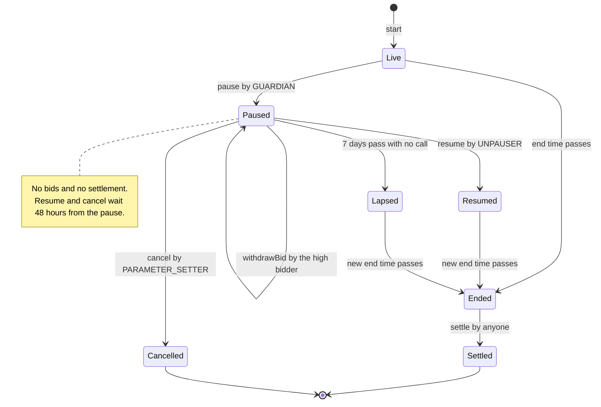
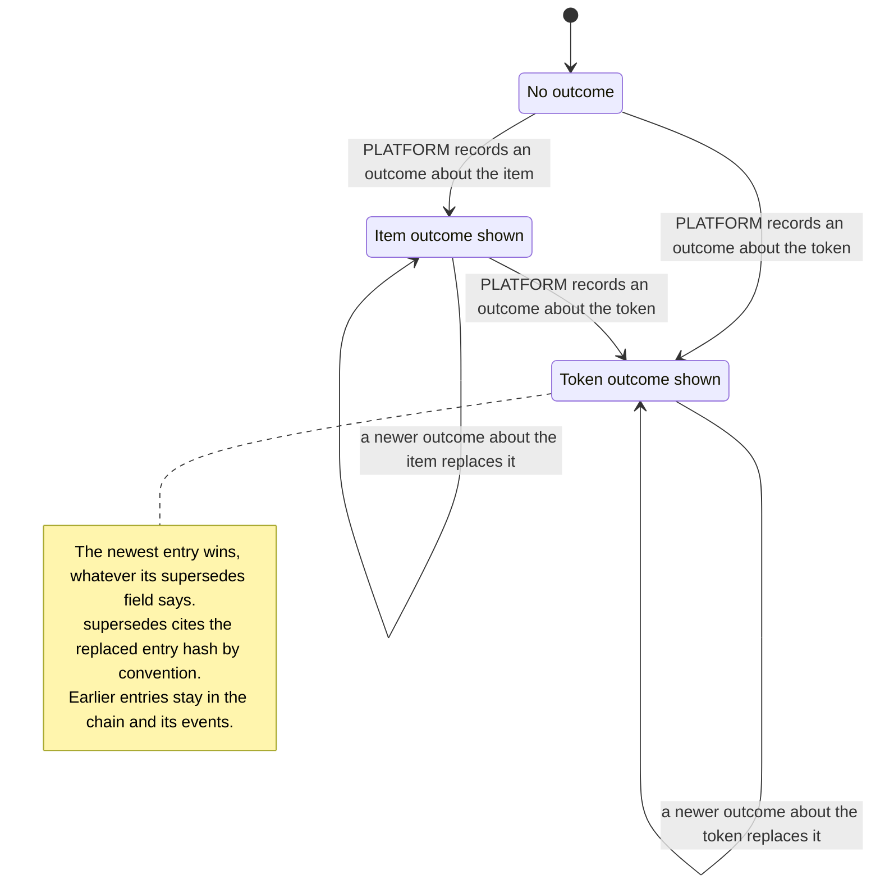
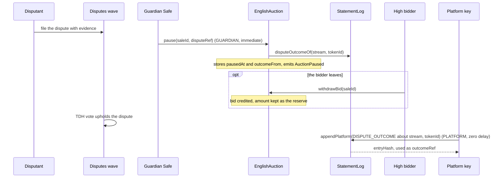
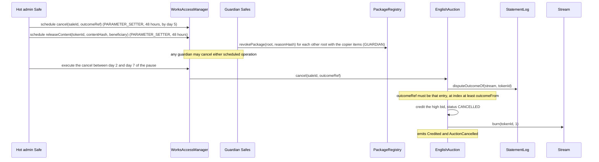
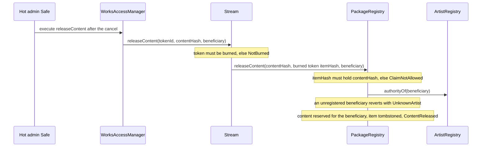
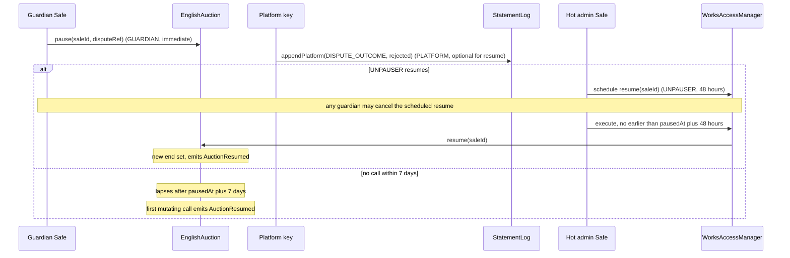
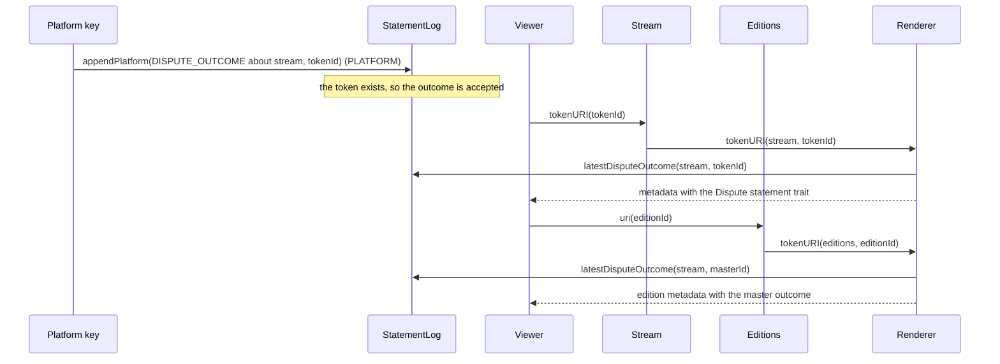
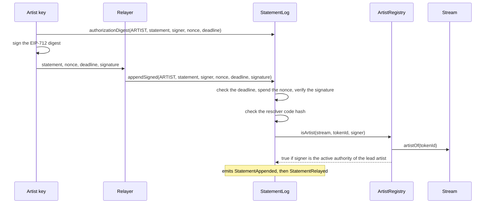
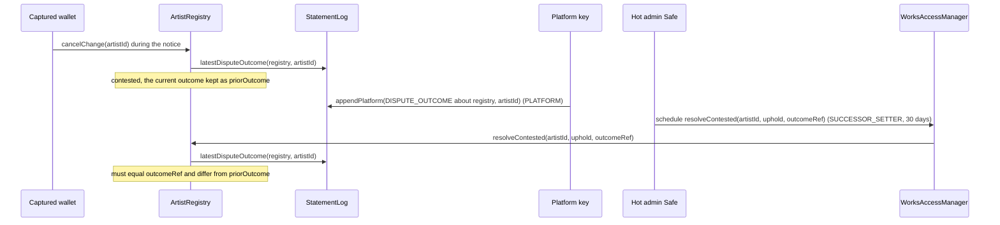

# Disputes and statements

This page specifies how 6529 Works records statements about works and how a dispute runs from
filing to outcome, for auditors, integrators and operators. `StatementLog` is one append-only,
signed log in which artists, owners, curators and the platform publish statements about a
subject. A dispute is decided off-chain by a TDH vote and recorded there as a dispute outcome.
During a 6529 Stream auction, an upheld dispute ends in a governed cancel that burns the work
and releases its content to the rightful artist; after a sale it produces only a statement,
shown in the work's and its edition's metadata. Contested identity overrides cite the same
outcomes.

> Pre-audit. See the [project status](../../README.md#status).

## Contracts

| Contract | Source | Interface | Responsibility |
| --- | --- | --- | --- |
| `StatementLog` | [`src/records/StatementLog.sol`](../../src/records/StatementLog.sol) | [`IStatementLog`](../../src/interfaces/IStatementLog.sol) | Append paths per role, EIP-712 relay and nonces, per-subject hash chain, the latest dispute outcome per subject and the display rule. Holds no value; has no pause and no edit or delete path. |
| `HashRef`, `StatementKinds` | [`HashRef.sol`](../../src/interfaces/types/HashRef.sol), [`StatementKinds.sol`](../../src/interfaces/types/StatementKinds.sol) | n/a | The content hash type and its three accepted algorithm IDs; the well-known kind labels, three of them reserved. |
| `ArtistRegistry` | [`src/identity/ArtistRegistry.sol`](../../src/identity/ArtistRegistry.sol) | [`IArtistRoleResolver`](../../src/interfaces/IArtistRoleResolver.sol), [`IArtistRegistry`](../../src/interfaces/IArtistRegistry.sol) | The v1 artist resolver (`isArtist`) the log asks for ARTIST statements; `resolveContested`, which cites a dispute outcome. |
| `EnglishAuction` | [`src/sales/EnglishAuction.sol`](../../src/sales/EnglishAuction.sol) | [`IEnglishAuction`](../../src/interfaces/IEnglishAuction.sol) | The dispute pause, `withdrawBid`, `resume`, the self-ending pause, and `cancel`, which must cite a recorded outcome. |
| `Stream`, `PackageRegistry` | [`Stream.sol`](../../src/stream/Stream.sol), [`PackageRegistry.sol`](../../src/curation/PackageRegistry.sol) | [`IStream`](../../src/interfaces/IStream.sol), [`IPackageRegistry`](../../src/interfaces/IPackageRegistry.sol) | `burn`; the governed `releaseContent`; `revokePackage`. |
| `Renderer`, `WorksAccessManager` | [`Renderer.sol`](../../src/content/Renderer.sol), [`WorksAccessManager.sol`](../../src/governance/WorksAccessManager.sol) | [`IRenderer`](../../src/interfaces/IRenderer.sol), OpenZeppelin `IAccessManager` | The `Dispute statement` trait of a work and its edition; scheduling of the delayed actions, which any guardian may cancel. |

## Concepts

The [glossary](../glossary.md) defines [statement](../glossary.md#statement),
[subject](../glossary.md#subject), [statement kind](../glossary.md#statement-kind),
[statement role](../glossary.md#statement-role), [dispute outcome](../glossary.md#dispute-outcome),
[supersession](../glossary.md#supersession), [entry hash](../glossary.md#entry-hash),
[chain head](../glossary.md#chain-head), [artist resolver](../glossary.md#artist-resolver),
[TDH](../glossary.md#tdh), [dispute pause](../glossary.md#dispute-pause),
[content release](../glossary.md#content-release) and [tombstone](../glossary.md#tombstone).
Disputes are filed with evidence in a 6529 disputes [wave](../glossary.md#wave) and decided by
TDH vote, off-chain ([ADR 0001 §12](../adr/0001-v1-scope.md#12-disputes)); until the 6529
chain exists, the admin Safe is trusted to execute the vote's result through delayed governed
actions that any guardian can cancel (LIM-GV-9 in
[known limitations](../audit/known-limitations.md#trust-and-governance)).

### Subjects and kinds

A subject is `(token, id)`, keyed `subjectKey(token, id) = keccak256(abi.encode(token, id))`,
and each subject has its own chain. Subjects are open: the log accepts any `token` and checks
only the signer's role (and, for a dispute outcome, the subject rules below), so readers key on
the official contract addresses.

| Subject | `token` | `id` | Typical statements |
| --- | --- | --- | --- |
| A minted 6529 Stream work | the Stream address | the token ID | Artist and owner statements, fixity, dispute outcomes |
| An approved item before its mint | `address(0)` | `uint256(itemHash)` | Curator or platform statements, pre-mint dispute outcomes |
| A 6529 Editions edition | the Editions address | the edition ID | Owner statements by any holder, artist statements; never dispute outcomes (those go on the master) |
| An artist | the `ArtistRegistry` address | the artist ID | Dispute outcomes of an identity contest vote |
| The governance chain | the AccessManager address | `0` | `GOVERNANCE_MANIFEST` entries only ([Governance](governance.md)) |

The log never links an item subject to the token it becomes; Stream holds that link
(`IStream.coreOf(tokenId)` returns the item hash), and the display rule reads it. A kind is any
non-zero `bytes32`. Three are reserved to one role or path (DSP-4). The other well-known labels in
`StatementKinds` (`ARTIST_STATEMENT`, `FIXITY_CHECK` and so on, each `keccak256` of its name)
may be written under any role, so readers read `kind` with `role`.

### The Statement struct

Every path validates the struct (`StatementLog._validate`):

| Field | Rule | Error |
| --- | --- | --- |
| `token`, `id` | The subject; `(address(0), 0)` is refused. | `InvalidSubject` |
| `kind` | Non-zero; a reserved kind only under its role or path. | `InvalidKind`, `ReservedKind(kind, role)` |
| `schema` | Non-zero hash of the schema the document follows. | `InvalidSchema` |
| `content` | `HashRef{algorithm, digest}`: algorithm 1 (keccak256), 2 (SHA-256) or 3 (BLAKE3), digest non-zero. IDs 4 to 6 (multihash, CID, Arweave ID) are refused; such identifiers go in `uri`. | `InvalidHashRef(algorithm)` |
| `uri`, `fileId` | Exactly one locator: a URI of at most 2,048 bytes (`MAX_URI_BYTES`) of well-formed UTF-8, or a `ContentStore` file ID, opaque to the log. | `InvalidUri`, `ConflictingLocators`, `MissingLocator` |
| `supersedes` | The entry hash of an earlier entry this one corrects, or zero. Not checked on-chain. | none |

### Who may write

A statement's role is `ARTIST` (1), `OWNER` (2), `CURATOR` (3) or `PLATFORM` (4); `NONE` (0)
never passes.

| Role | Entry points | Who qualifies |
| --- | --- | --- |
| ARTIST | `append(Role.ARTIST, s)`, `appendSigned` | `isArtist(token, id, signer)` on the installed resolver, its code hash checked at every use. In v1 the resolver is `ArtistRegistry`: for a Stream work, the lead artist's active authority; for an edition, the same through its master; every other subject answers false. A zero resolver disables ARTIST statements. |
| OWNER | `append(Role.OWNER, s)`, `appendSigned` | ERC-721 `ownerOf(id) == signer`, otherwise ERC-1155 `balanceOf(signer, id) > 0` (any edition holder). Each read is capped at 50,000 gas (`OWNER_READ_GAS`) and 32 bytes; any failure means "not the owner". |
| CURATOR | `appendCurator(s)` (restricted), `appendSigned` | A holder of the role mapped to `appendCurator` (`CURATOR` at genesis, zero delay). |
| PLATFORM | `appendPlatform(s)` (restricted), `appendSigned` | A holder of the role mapped to `appendPlatform` (`PLATFORM` at genesis, zero delay). |
| PLATFORM, signed by the AccessManager | `appendGovernanceManifest(s)` (restricted) | A scheduled operation of `SUCCESSOR_SETTER` (30 days); subject `(authority(), 0)` and kind `GOVERNANCE_MANIFEST` only. |

`append` accepts only ARTIST and OWNER (`InvalidRole`). Every path but
`appendGovernanceManifest` reverts with `AuthorityCannotSign` when the signer is `authority()`,
so a scheduled call run through `AccessManager.execute` writes nothing, and a CURATOR or
PLATFORM holder with an execution delay cannot write at once (DSP-3). A
[suspended](governance.md#suspension-of-operational-keys) CURATOR or PLATFORM key fails the
role check on both paths, including for statements it signed earlier, since the check runs at
relay time.

**ARTIST authority** is no stronger than the resolver's code, `setArtistResolver`
(`SUCCESSOR_SETTER`, 30 days, so the guardians can cancel a hostile swap), and the
AccessManager behind it ([trust assumptions](../audit/trust-assumptions.md#resolvers-and-renderer-pins);
LIM-GV-10); no governance role has a direct path to an ARTIST or OWNER entry (DSP-6). The
install is checked (DSP-8). Each ARTIST entry records its resolver, so a reader can discard
the entries of a resolver it does not trust. A resolver must be immutable or never make an
answer true faster than the 30-day class; the restraint is the one allowed exception.

### Dispute outcome

A `DISPUTE_OUTCOME` statement records the result of a TDH vote; its document states the result.
The log does not record on-chain whether a dispute was upheld: on an auction the governed
`cancel` is the decision, and the outcome is the public record it must cite. A correction is a
new entry citing the earlier entry's hash in `supersedes`, which readers verify against the
chain rebuilt from events (LIM-CNT-12).

## State machine

### An auction under dispute



`Resumed` and `Lapsed` are both `ACTIVE` on-chain, with the pause used, so neither can return to
`Paused`.

| Transition | Caller (role) | Delay | Function |
| --- | --- | --- | --- |
| Live to Paused | Guardian Safe (`GUARDIAN`) | immediate | `pause(saleId, disputeRef)`: requires `ACTIVE` and an unused pause (`PauseExhausted`); records `pausedAt` and the chain position a later outcome must reach (`outcomeFrom`). |
| Paused to Paused | the high bidder | none | `withdrawBid`: the bid is credited and stays as the reserve. |
| Paused to Resumed | Hot admin Safe (`UNPAUSER`) | standard, 48 hours, and no earlier than `pausedAt + 48 hours` | `resume`: new end `now + L`. |
| Paused to Lapsed | nobody | after `pausedAt + 7 days` | none: the first mutating call writes it down and emits `AuctionResumed`; new end `pausedAt + 7 days + L`. |
| Paused to Cancelled | Hot admin Safe (`PARAMETER_SETTER`) | standard, 48 hours; within `[pausedAt + 48 hours, pausedAt + 7 days]` | `cancel(saleId, outcomeRef)`: credits the high bid and burns the token. |
| Ended to Settled | anyone | none | `settle` ([Stream and auctions](stream-and-auctions.md)). |

`L` is `max(endTime - pausedAt, current governed duration, the sale's anti-snipe window)`
(`_resumedEnd`, `_reopening`).

### A subject's dispute status

What `latestDisputeOutcome` answers for a 6529 Stream work:



| Transition | Caller (role) | Delay | Function |
| --- | --- | --- | --- |
| to Item outcome shown | PLATFORM | immediate (zero-delay role) | `appendPlatform`, or `appendSigned` signed by a PLATFORM holder, with subject `(address(0), uint256(itemHash))`, before or after the mint |
| to Token outcome shown | PLATFORM | immediate | the same, with subject `(stream, tokenId)`; the token must exist |

Artist and item subjects have the same machine without the item fallback. The log stores per
subject the entry count, chain head and latest outcome; two views read it:

| View | Answers | Read by |
| --- | --- | --- |
| `latestDisputeOutcome(token, id)` | The subject's own latest outcome; if none and `token` is not zero, one bounded read of `IStream.coreOf(id)` on `token` gives the latest outcome about the item the token was minted from; any other answer leaves zero. | The renderer and `ArtistRegistry.resolveContested` |
| `disputeOutcomeOf(token, id)` | The subject's own latest outcome (no item fallback) and its zero-based index in the subject's chain. | The auction's `pause` and `cancel` |

- **Precedence.** Once the token has an outcome of its own, item outcomes are no longer shown,
  so each outcome document restates every earlier dispute it keeps in force.
- **Subject checks** (`_checkDisputeSubject`, DSP-11): an edition's outcome goes on its
  master; subjects other than ERC-721 and ERC-1155 tokens are not checked.
- **Rendering.** A non-zero answer becomes the `Dispute statement` trait (the entry hash as
  32-byte hex) of the work and its edition (DSP-24,
  [Rendering and tokenURI](rendering-and-tokenuri.md)).

## Flows

### Upheld dispute during an auction

`T` is `pausedAt`.

| When | Action | Who (role, delay) | What the code enforces |
| --- | --- | --- | --- |
| `T` | Pause the auction. | Guardian Safe (`GUARDIAN`, immediate) | The auction is `ACTIVE` and its pause unused. |
| `T` to `T + 7 days` | The high bidder may withdraw. | High bidder | Only while `PAUSED`. |
| After `T` | Record the upheld outcome about the token. | Platform key (`PLATFORM`, zero delay) | The token exists; the outcome's chain index is at least `outcomeFrom`. |
| By `T + 5 days` | Schedule `cancel(saleId, outcomeRef)` and `releaseContent(tokenId, contentHash, beneficiary)`. | Hot admin Safe (`PARAMETER_SETTER`, 48 hours each) | A cancel scheduled later matures after the pause and is refused. |
| During the 48 hours | Review both; revoke every other approved root listing the copier's items. | Guardian Safes (`GUARDIAN`, immediate) | Any guardian may cancel either operation (LIM-GV-3 for revocation). |
| `T + 48 hours` to `T + 7 days` inclusive | Execute the cancel. | Hot admin Safe | DSP-16, DSP-18, DSP-19. |
| After the cancel | Execute the release, once the beneficiary has an artist ID. | Hot admin Safe | DSP-21; the operation expires 7 days after it matures. |

**Part 1: pause and vote.**



**Part 2: the governed cancel.**



**Part 3: releasing the content.**



- **The outcome** must still be the token's latest when the cancel executes, so a later outcome
  invalidates a scheduled cancel (DSP-18, LIFECYCLE-4).
- **`cancel`** sets `pausedTotal` to the time since the pause and credits the high bid. A
  cancelled sale keeps the last amount in `Auction.bid`; its `bidder` is zero.
- **`releaseContent`** (DSP-21) reserves the content for the beneficiary's items
  (`ContentReserved` for anyone else) and tombstones the burned item (`ContentUsed`). The
  beneficiary comes from the outcome document, unchecked on chain, so the guardians check it
  during the delay. A VRF item of the rightful artist joins the content's delivered seed
  ([Entropy](entropy.md)). Roots are revoked one by one
  ([architecture](../architecture.md#dispute-pause)).
- `test_UpheldDisputeCancelsBurnsReleasesAndTheRightfulArtistMints` in
  [`Dispute.t.sol`](../../test/integration/Dispute.t.sol) runs the whole path; it was not run
  on Sepolia ([`deployments/11155111/flows.md`](../../deployments/11155111/flows.md)).

### Rejected dispute during an auction



`resume` reads no outcome; a recorded rejected outcome becomes the token's displayed status.
An early-scheduled `resume` still waits (DSP-16, GOV-5), a withdrawn bid stays as the reserve
(LIFECYCLE-1), and the auction can never be paused again.

### Dispute after a sale



Only a statement (DSP-22); royalties do not change. A dispute after an auction's end also
follows this path.

### Relayed artist statement



- **Checks**, in order: `SignatureExpired` (inclusive), `NonceAlreadyUsed`, `InvalidSignature`,
  `NotAuthorized` (DSP-9). `revokeNonce(nonce)` spends one before use, and
  `nonceUsed(signer, nonce)` reads the per-signer bitmap.
- **Signatures** go through [`SignatureVerifier`](../../src/libraries/SignatureVerifier.sol):
  low-s ECDSA (65 bytes, or 64 in ERC-2098 form), EIP-7702 delegated accounts, and ERC-1271
  with a 200,000-gas cap. A rotated key never verifies again, and the entry records `signer`,
  never the relayer.
- **Digest.** Domain `"6529 Works Statement Log"`, version `"1"`, the chain ID and the log's
  address; it binds the role, signer, nonce, deadline and every statement field. The type
  strings, exactly as in `StatementLog.sol`:

```text
HashRef(uint16 algorithm,bytes32 digest)

Statement(address token,uint256 id,bytes32 kind,bytes32 schema,HashRef content,string uri,bytes32 fileId,bytes32 supersedes)HashRef(uint16 algorithm,bytes32 digest)

Authorization(uint8 role,address signer,uint256 nonce,uint64 deadline,Statement statement)HashRef(uint16 algorithm,bytes32 digest)Statement(address token,uint256 id,bytes32 kind,bytes32 schema,HashRef content,string uri,bytes32 fileId,bytes32 supersedes)
```

```solidity
contentHash   = keccak256(abi.encode(HASHREF_TYPEHASH, s.content.algorithm, s.content.digest));
statementHash = keccak256(abi.encode(STATEMENT_TYPEHASH, s.token, s.id, s.kind, s.schema,
                    contentHash, keccak256(bytes(s.uri)), s.fileId, s.supersedes));
structHash    = keccak256(abi.encode(AUTHORIZATION_TYPEHASH, role, signer, nonce, deadline,
                    statementHash));
digest        = _hashTypedDataV4(structHash);   // EIP-712 v4 under the domain above
```

- **Entry hash and head** (`StatementLog._write`, every path). `StatementAppended` carries every
  input, so an indexer rebuilds a subject's history from events and proves it complete against
  `chainOf(token, id)`. `index` is the entry's zero-based position in the subject's chain;
  `role` is a `uint8`; `recordedAt` the block timestamp as `uint64`; `resolver` as in DSP-7.
  [`StatementLogGolden.t.sol`](../../test/records/StatementLogGolden.t.sol) pins the type
  hashes, domain tags, a digest, an entry hash and a head.

```solidity
ENTRY_DOMAIN = keccak256("6529.works.StatementLog.entry.v1");
HEAD_DOMAIN  = keccak256("6529.works.StatementLog.head.v1");
// Every word is static, so the two encodings joined equal one abi.encode of all ten values.
entryHash = keccak256(bytes.concat(
    abi.encode(ENTRY_DOMAIN, block.chainid, address(this), subjectKey, index),
    abi.encode(role, signer, resolver, recordedAt, statementHash)
));
head' = keccak256(abi.encode(HEAD_DOMAIN, head, entryHash));   // the first head is zero
```

### Identity contest decided by a recorded vote

If a captured consolidated wallet cancels a 180-day override during its notice, the override is
contested and a TDH vote decides it; the log is how the vote reaches the chain
([Identity and recovery](identity-and-recovery.md#contest-and-vote)).



Errors: `OutcomeNotRecorded`, `OutcomePredatesContest` (DSP-25); a later outcome invalidates a
scheduled resolution. Tested end to end by `test_ContestedOverrideUpheldByARecordedVote` in
[`IdentityRecovery.t.sol`](../../test/integration/IdentityRecovery.t.sol).

## Rules and invariants

Test files: `SL` is [`StatementLog.t.sol`](../../test/records/StatementLog.t.sol), `SLP`
[`StatementLogPolicy.t.sol`](../../test/records/StatementLogPolicy.t.sol), `SLI`
[`StatementLog.invariant.t.sol`](../../test/records/StatementLog.invariant.t.sol), `EAD`
[`EnglishAuctionDisputes.t.sol`](../../test/sales/auction/EnglishAuctionDisputes.t.sol) and
`DI` [`Dispute.t.sol`](../../test/integration/Dispute.t.sol).

| ID | Rule | Enforced in | Tested by |
| --- | --- | --- | --- |
| DSP-1 | The log is append-only: no entry is edited or deleted, and each subject's count and head match the events emitted for it. | `StatementLog._write` (the only write path) | SLI `invariant_CountAndHeadMatchEmittedEvents`; SL `test_Supersession_IsANewEntryAndNothingIsOverwritten`, `test_HashChainRebuiltFromEventsEqualsStoredHeads` |
| DSP-2 | Every entry has a subject other than `(0, 0)`, a non-zero kind and schema, a known non-zero `HashRef`, exactly one locator, and a URI of at most 2,048 bytes of UTF-8. | `StatementLog._validate` | SL `test_Validation_RejectsMalformedStatements`, `test_Validation_Locators`, `test_Validation_UriMustBeUtf8`, `test_Validation_AcceptsEveryRecognisedAlgorithm` |
| DSP-3 | `append` serves only ARTIST and OWNER. CURATOR and PLATFORM write through their restricted functions, or by relay only when the signer holds the role with zero execution delay; a delayed holder cannot write at once or by relay. | `StatementLog.append`, `_isAuthorized` | SL `test_Append_RefusesCuratorPlatformAndNoneRoles`, `test_CuratorAndPlatform_RejectStrangersAndTheOtherRole`, `test_Curator_DelayedRoleCannotWriteDirectlyOrByRelay`, `test_Relay_CuratorSignerWithoutTheRoleIsRejected` |
| DSP-4 | `DISPUTE_OUTCOME` is written only as PLATFORM (`appendPlatform`, or `appendSigned` signed by a PLATFORM holder), `CURATION_EVIDENCE` only as CURATOR, `GOVERNANCE_MANIFEST` only by `appendGovernanceManifest`. | `StatementLog._validate`, `_append`, `appendGovernanceManifest` | SLP `test_ReservedKinds_DisputeOutcomeIsPlatformOnly`, `test_ReservedKinds_CurationEvidenceIsCuratorOnly`, `test_ReservedKinds_AlsoHoldForRelayedStatements`, `test_GovernanceManifest_EveryOtherPathRejectsTheKind`; SLI `invariant_RolesAreSpokenOnlyByTheirHoldersAndReservedKindsStayReserved` |
| DSP-5 | No entry names the AccessManager as signer, except a governance manifest with subject `(authority(), 0)`. | `StatementLog._append` (`AuthorityCannotSign`), `appendGovernanceManifest` | SLP `test_Manager_CannotBeTheRecordedSignerOnAnyPath`, `test_GovernanceManifest_MustBeAboutTheManagerWithTheGovernanceKind`, `test_GovernanceManifest_ManagerStillCannotSignOnOtherPaths`; SL `test_Curator_ScheduledExecutionCannotBeAttributedToTheManager` |
| DSP-6 | No governance role writes an ARTIST or OWNER entry, directly or by relay. | `StatementLog._isAuthorized` (ARTIST and OWNER never consult the AccessManager) | SL `test_Admin_CannotWriteArtistOrOwner`, `test_Admin_HoldingEveryGovernedRoleStillCannotWriteArtistOrOwner`, `test_Admin_RelayedArtistOrOwnerSignatureIsRejected`, `test_Curator_CannotWriteArtistOrOwner` |
| DSP-7 | An ARTIST entry needs the installed resolver, with its pinned code hash, to vouch for the signer, and records that resolver in its hash and event; other roles record zero. | `StatementLog._isAuthorized`, `_write` | SL `test_Artist_AResolverWhoseCodeChangedIsRefused`, `test_Artist_DisabledWhenResolverUnset`; SLP `test_ResolverIsPartOfTheEntryHash`, `test_OwnerAndPlatformEntriesCarryNoResolver`; SLI `invariant_ArtistEntriesBindTheActiveResolver` |
| DSP-8 | `setArtistResolver` is restricted and compare-and-set, and installs only a contract with code, no EIP-7702 delegation, ERC-165 support and the reviewed code hash; zero disables ARTIST statements. | `StatementLog.setArtistResolver`, `_installResolver` | SL `test_SetArtistResolver_IsRestricted`, `test_SetArtistResolver_SwapsAndEmits`, `test_SetArtistResolver_StaleExpectedValueReverts`, `test_SetArtistResolver_RejectsUnsuitableResolvers`, `test_SetArtistResolver_ZeroDisablesArtistStatements` |
| DSP-9 | A relayed entry needs an unexpired deadline (inclusive), an unused nonce of the signer, a valid signature over the full authorization under this log and chain, and the signer's role; a nonce is spent once, a failed append spends none. | `StatementLog.appendSigned`, `_spendNonce`, `revokeNonce` | SL `test_Relay_ReplayIsRejected`, `test_Relay_DeadlineIsInclusive`, `test_Relay_RevokeBeforeUse`, `test_Relay_WrongChainIsRejected`, `test_Relay_WrongContractIsRejected`, `test_Relay_AnyTamperedFieldIsRejected`, `test_Relay_FailedAppendDoesNotSpendTheNonce`; SLI `invariant_SpentNoncesStaySpent` |
| DSP-10 | Type hashes, the domain, the entry hash and the head follow the formulas on this page. | `StatementLog._statementHash`, `_authorizationHash`, `_write` | [`StatementLogGolden.t.sol`](../../test/records/StatementLogGolden.t.sol) `test_Golden_TypeHashesAndDomainTags`, `test_Golden_DigestMatchesForgeTypedDataEncoder`, `test_Golden_EntryHashAndHead` |
| DSP-11 | A `DISPUTE_OUTCOME` about an ERC-721 token needs the token to exist; any ERC-1155 subject is refused. | `StatementLog._checkDisputeSubject` | SLP `test_DisputeOutcome_SubjectRules`; DI `test_ADisputeOutcomeNamesAnExistingToken` |
| DSP-12 | `latestDisputeOutcome` returns the subject's own latest outcome, else, for a Stream token, its item's; `disputeOutcomeOf` returns the own latest outcome and its index, with no fallback. | `StatementLog.latestDisputeOutcome`, `disputeOutcomeOf` | SLP `test_LatestDisputeOutcome_TracksOnlyDisputeEntries`, `test_DisputeOutcomeOf_IsTheOwnLatestOutcomeAndItsPosition`; DI `test_APreMintOutcomeShowsOnTheWorkAndItsEdition`; SLI `invariant_LatestDisputeOutcomeMatchesEvents` |
| DSP-13 | Only a guardian pauses, only a live auction, and only once. | `EnglishAuction.pause` | EAD `test_Pause_OnlyTheGuardian`, `test_Pause_OnlyALiveAuctionOnce` |
| DSP-14 | A pause is live through `pausedAt + 7 days` inclusive and then ends by itself. | `EnglishAuction._state`, `_require`, `_endPause` | EAD `test_Pause_EndsByItselfAfterSevenDays`, `test_Pause_ExpiredPauseSettlesWithoutAResumeCall` |
| DSP-15 | While paused, nobody bids or settles; only the high bidder may withdraw, and the withdrawn amount stays as the reserve the next bid must reach. | `EnglishAuction._bid`, `settle`, `withdrawBid`, `_minimumBid`, `_refundHighBid` | EAD `test_Pause_FreezesTheAuction`, `test_WithdrawBid_WhilePaused`; [`AuctionDisputePause.t.sol`](../../test/sales/auction/AuctionDisputePause.t.sol) `test_WithdrawBid_StaysAsTheReserveThroughALapse` |
| DSP-16 | Neither `resume` nor `cancel` takes effect before `pausedAt + 48 hours`, whenever it was scheduled. | `EnglishAuction._requireUnpausable` | EAD `test_Resume_OnlyTheUnpauserAndOnlyWhilePaused`, `test_Cancel_NeedsTheRecordedOutcome` |
| DSP-17 | A resumed or lapsed auction runs for at least the longer of the governed duration and its anti-snipe window, or its remaining time if longer. | `EnglishAuction._resumedEnd`, `_reopening` | EAD `test_Resume_GivesAtLeastTheDuration`, `test_Resume_LeavesAtLeastTheWindow`; `AuctionDisputePause.t.sol` `test_Resume_ARejectedDisputeResumesWithTheReserveAndTheDuration`, `test_Pause_WithAStandingBidAlsoReopensForTheDuration` |
| DSP-18 | `cancel` cites the token's own latest outcome, recorded after the pause; an earlier outcome, a superseded one or an item outcome cannot cancel. | `EnglishAuction.pause` (`outcomeFrom`), `cancel`, `_ownOutcome` | EAD `test_Cancel_NeedsTheRecordedOutcome`; [`AuctionDisputeCancel.t.sol`](../../test/sales/auction/AuctionDisputeCancel.t.sol) `test_Cancel_RefusesAnOutcomeRecordedBeforeThePause`, `test_Cancel_RefusesAnItemOutcomeRecordedBeforeTheMint`, `test_Cancel_OnlyTheLatestOutcomeCancels` |
| DSP-19 | `cancel` runs only while the pause is live, credits the high bid and burns the token. | `EnglishAuction.cancel`, `Stream.burn` | EAD `test_Cancel_UpheldDisputeRefundsAndBurns`, `test_Cancel_WithNoBids`, `test_Cancel_OnlyWhileThePauseIsLive`, `test_Cancel_PauseWindowBoundary`, `test_Cancel_ThroughTheStandardDelay`; DI `test_CancelIsRefusedOnceThePauseHasLapsed` |
| DSP-20 | Only the adapter that minted a token burns it, while holding it and before its primary sale settled, even after the adapter's removal. | `Stream.burn` | [`Stream.t.sol`](../../test/stream/Stream.t.sol) `test_burn_onlyByMintingAdapter`, `test_burn_byRemovedMintingAdapter`, `test_burn_neverAfterSettlement`, `test_burn_refusedAfterSettlement` |
| DSP-21 | `releaseContent` is governed, needs a burned token, the item that held the content and a registered beneficiary, happens once per burned item, reserves the content for the beneficiary's items and tombstones the burned item. | `Stream.releaseContent`, `PackageRegistry.releaseContent`, `PackageRegistry.consume` | DI `test_ReleaseIsGovernedNamesAnArtistAndHappensOnce`, `test_ReleasedContentIsReservedForTheNamedArtist`, `test_AGuardianCancelsAPendingRelease`; [`PackageRegistry.t.sol`](../../test/curation/PackageRegistry.t.sol) `test_releaseContent_tombstonesTheItemEverywhere`, `test_releaseContent_revertsOnMismatch`, `test_releaseContent_onlyBoundStream`; `Stream.t.sol` `test_releaseContent_reverts` |
| DSP-22 | After a sale, a dispute moves nothing: no path burns or transfers a settled work. | `Stream.burn` (`SaleAlreadySettled`) | DI `test_DisputeAfterASaleIsAStatementOnly`; `Stream.t.sol` `test_burn_neverAfterSettlement` |
| DSP-23 | Through pauses, withdrawals, resumptions and cancels, the auction's balance covers every live bid and credit, value is conserved, and custody is exact. | `EnglishAuction` | [`AuctionHaltsInvariant.t.sol`](../../test/sales/auction/invariant/AuctionHaltsInvariant.t.sol) `invariant_BalanceCoversOwed`, `invariant_ValueIsConserved`, `invariant_ExactCustody` |
| DSP-24 | Metadata shows the display rule's answer for a work, and the master's for an edition, and fails closed when the log cannot be read. | `Renderer._chainTraits` | [`Renderer.t.sol`](../../test/content/renderer/Renderer.t.sol) `test_Dispute_ShownWhenTheLogHasAnOutcome`, `test_Dispute_ReadsTheMastersSubjectForAnEdition`, `test_Dispute_ABrokenLogFailsClosed` |
| DSP-25 | A contest resolves only with the artist's latest outcome, recorded after the contest began. | `ArtistRegistry.resolveContested`, `cancelChange` | [`ContestedOverrides.t.sol`](../../test/identity/ContestedOverrides.t.sol) `test_Resolve_RevertsForAMismatchedOrZeroOutcome`, `test_Resolve_RefusesAnOutcomeRecordedBeforeTheContest`, `test_Resolve_RefusesAStaleOutcomeFromAnEarlierContest` |

## Events

Event signatures and topic0 values are on the events page, under
[StatementLog](../integrators/events-and-indexing.md#statementlog),
[EnglishAuction](../integrators/events-and-indexing.md#englishauction),
[PackageRegistry](../integrators/events-and-indexing.md#packageregistry) and
[ArtistRegistry](../integrators/events-and-indexing.md#artistregistry). Recording a dispute
outcome emits no ERC-4906 event, so an indexer refreshes a work's metadata on
`StatementAppended` with `kind == DISPUTE_OUTCOME` about the work, its item or its master.

## Failure modes and recovery

| Failure | Effect | Recovery |
| --- | --- | --- |
| The cancel is scheduled after day 5 of the pause, or executed after `pausedAt + 7 days`. | `InvalidAuctionState`; the auction continues and may sell. | None; the after-sale path. |
| The cancel or resume executes before `pausedAt + 48 hours`. | `UnpauseTooEarly(allowedAt)`. | Execute at or after `allowedAt`. |
| The cited outcome predates the pause, is about the item, or is no longer the latest. | `OutcomeNotRecorded(saleId, outcomeRef)`. | Record an outcome about the token and schedule a new cancel citing it, if it still fits before day 7. |
| A second dispute after a resume or lapse, or one after the end. | `PauseExhausted(saleId)`, or `InvalidAuctionState(ENDED)`. | The after-sale path. |
| The beneficiary has no artist ID when the release executes. | `UnknownArtist(beneficiary)`. | Wait for the artist's first package acceptance, then reschedule. |
| The release executes before the cancel, or names the wrong content hash, or runs twice. | `NotBurned(tokenId)`, or `ClaimNotAllowed(PRODUCT_STREAM, contentHash)`. | Execute after the cancel, with the burned item's content hash (public in `WorkMinted`). A release is final. |
| A release scheduled with the wrong beneficiary. | It executes after 48 hours. | A guardian cancels it (`test_AGuardianCancelsAPendingRelease`). |
| An outcome aimed at an unminted or burned token, or at an edition. | `UnknownDisputeSubject(token, id)`. | Before the mint, record it on the item subject; for an edition, on the master. |
| A wrong or unauthorized statement is appended. | It stays in the log forever. | Append a correction whose `supersedes` cites it; a guardian suspends a misused CURATOR or PLATFORM key. |
| The PLATFORM key is suspended during a dispute pause. | With the genesis policy's single platform key, no outcome can be recorded, so no upheld `cancel`; a replacement takes longer than the pause. | Let the pause lapse (after-sale path); suspend the key during a pause only if it is compromised. |
| The resolver's code changes after install. | Every ARTIST append reverts with `DependencyCodeChanged`. | `setArtistResolver` to a reviewed resolver (30 days). |
| The lead artist is restrained. | ARTIST appends revert with `NotAuthorized`. | Wait for the override's outcome ([Identity and recovery](identity-and-recovery.md)). |
| The statement log cannot be read during rendering. | `tokenURI` reverts with `RendererReadFailed`. | A new default renderer or the errata repin. |

## Parameters and limits

| Parameter | Value | Source |
| --- | --- | --- |
| Dispute pause | at most 7 days, one per auction, live through `pausedAt + 7 days` inclusive | `EnglishAuction.MAX_PAUSE`; `_PAUSE_USED` |
| Earliest `resume` or `cancel`; latest scheduling of the cancel | `pausedAt + 48 hours`; `pausedAt + 5 days` | `Roles.STANDARD`, `_requireUnpausable`; `test_Cancel_ThroughTheStandardDelay` |
| URI length | 2,048 bytes | `StatementLog.MAX_URI_BYTES` |
| Owner and item-fallback read | 50,000 gas; 32 bytes (`ownerOf`, `balanceOf`) or 192 bytes (`coreOf`) | `StatementLog.OWNER_READ_GAS`, `latestDisputeOutcome` |
| Relay nonces | one bitmap per signer, 256 nonces per word | `StatementLog._spendNonce`, `_bit` |
| ERC-1271 gas; signature size | 200,000; at most 4,096 bytes | `SignatureVerifier.ERC1271_GAS_LIMIT`, `MAX_SIGNATURE_LENGTH` |
| EIP-712 domain | `"6529 Works Statement Log"`, version `"1"` | `StatementLog` constructor |
| Append gas | below 85,000 execution gas for a first ARTIST entry | `test_Gas_PerAppend` in `StatementLog.t.sol` |

## Differences from the ADRs

See the [register](README.md#differences-from-the-adrs).

## References

- Code: [`StatementLog.sol`](../../src/records/StatementLog.sol),
  [`src/records/README.md`](../../src/records/README.md),
  [`IStatementLog.sol`](../../src/interfaces/IStatementLog.sol),
  [`IArtistRoleResolver.sol`](../../src/interfaces/IArtistRoleResolver.sol),
  [`HashRef.sol`](../../src/interfaces/types/HashRef.sol),
  [`StatementKinds.sol`](../../src/interfaces/types/StatementKinds.sol),
  [`EnglishAuction.sol`](../../src/sales/EnglishAuction.sol),
  [`Stream.sol`](../../src/stream/Stream.sol),
  [`PackageRegistry.sol`](../../src/curation/PackageRegistry.sol),
  [`ArtistRegistry.sol`](../../src/identity/ArtistRegistry.sol),
  [`Renderer.sol`](../../src/content/Renderer.sol), [`Roles.sol`](../../src/governance/Roles.sol),
  [`config/genesis.example.json`](../../config/genesis.example.json).
- ADRs: [ADR 0001 §12](../adr/0001-v1-scope.md#12-disputes),
  [ADR 0002 decisions 6 and 7](../adr/0002-access-manager-hardening.md#decision),
  [ADR 0003 "Disputes and statements"](../adr/0003-build-time-decisions.md#disputes-and-statements-amends-adr-0001-12),
  [ADR 0003 owner decisions](../adr/0003-build-time-decisions.md#owner-decisions-11-october-2026),
  [architecture: dispute pause](../architecture.md#dispute-pause).
- Tests: [`test/records/`](../../test/records/), [`Dispute.t.sol`](../../test/integration/Dispute.t.sol),
  [`EnglishAuctionDisputes.t.sol`](../../test/sales/auction/EnglishAuctionDisputes.t.sol),
  [`AuctionHaltsInvariant.t.sol`](../../test/sales/auction/invariant/AuctionHaltsInvariant.t.sol),
  [`AuctionDisputePause.t.sol`](../../test/sales/auction/AuctionDisputePause.t.sol),
  [`AuctionDisputeCancel.t.sol`](../../test/sales/auction/AuctionDisputeCancel.t.sol),
  [`PackageRegistry.t.sol`](../../test/curation/PackageRegistry.t.sol),
  [`Stream.t.sol`](../../test/stream/Stream.t.sol),
  [`ContestedOverrides.t.sol`](../../test/identity/ContestedOverrides.t.sol),
  [`Renderer.t.sol`](../../test/content/renderer/Renderer.t.sol). How to run them:
  [testing](../testing/README.md).
- Related pages: [Stream and auctions](stream-and-auctions.md), [Curation](curation.md),
  [Identity and recovery](identity-and-recovery.md),
  [Rendering and tokenURI](rendering-and-tokenuri.md), [Governance](governance.md),
  [Entropy](entropy.md), [glossary](../glossary.md), [roles](../audit/roles.md),
  [known limitations](../audit/known-limitations.md),
  [events and indexing](../integrators/events-and-indexing.md),
  [reading a work](../integrators/reading-a-work.md).
