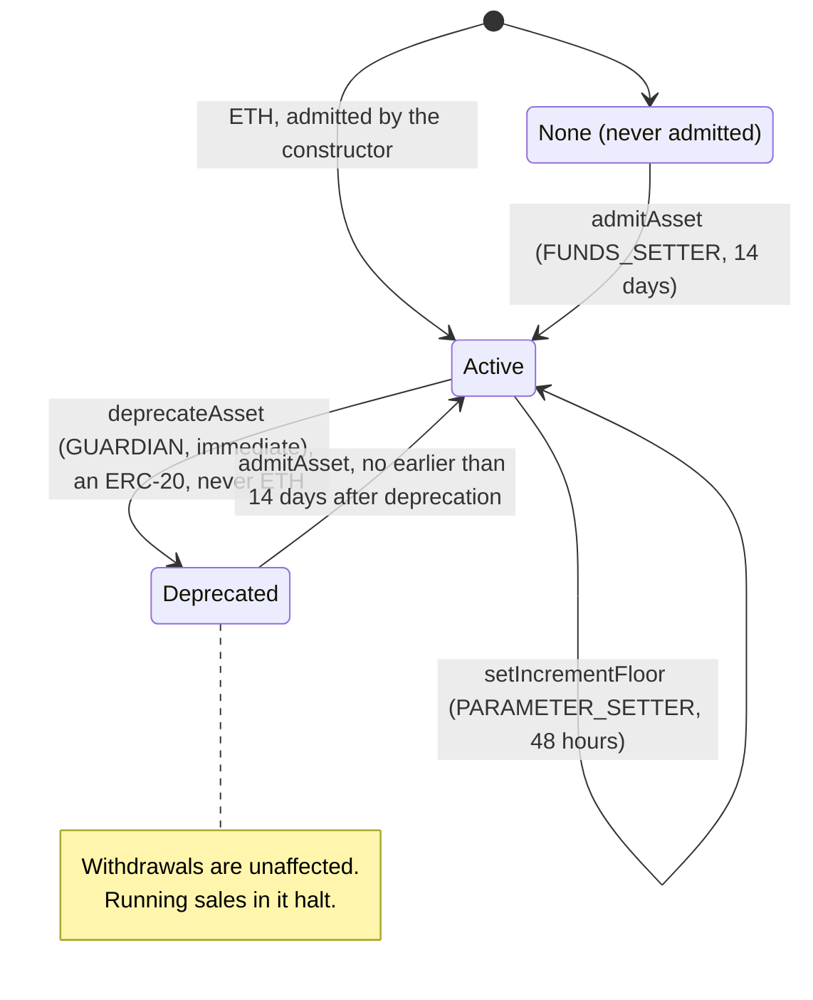
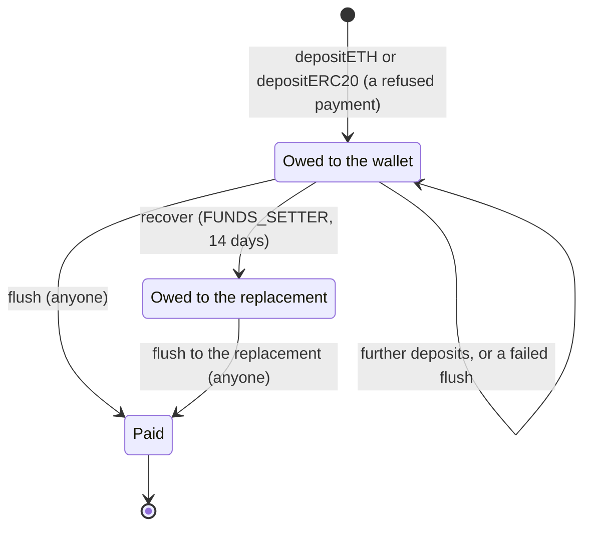
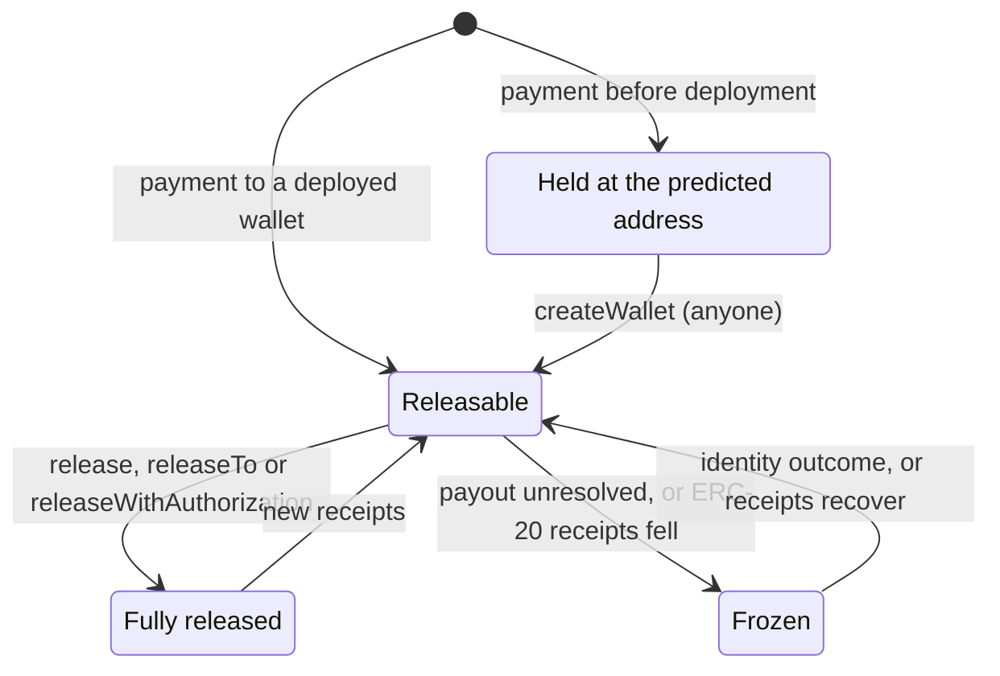
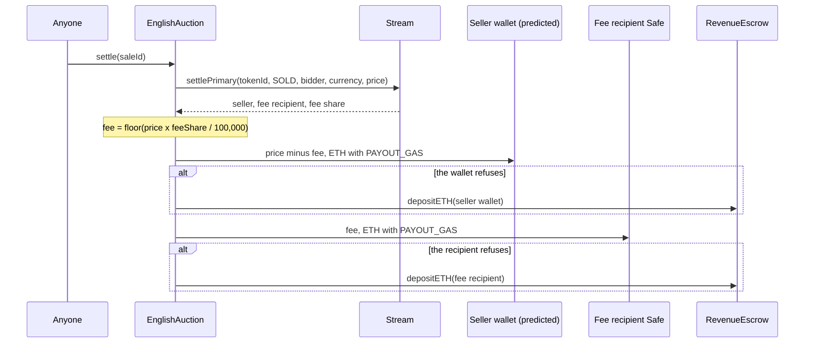
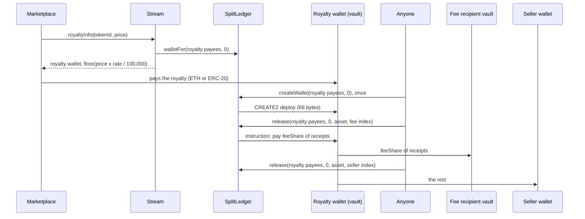
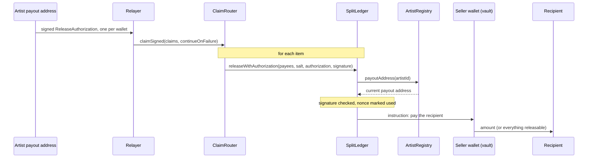
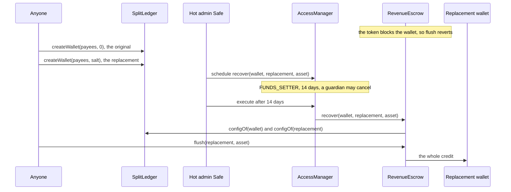
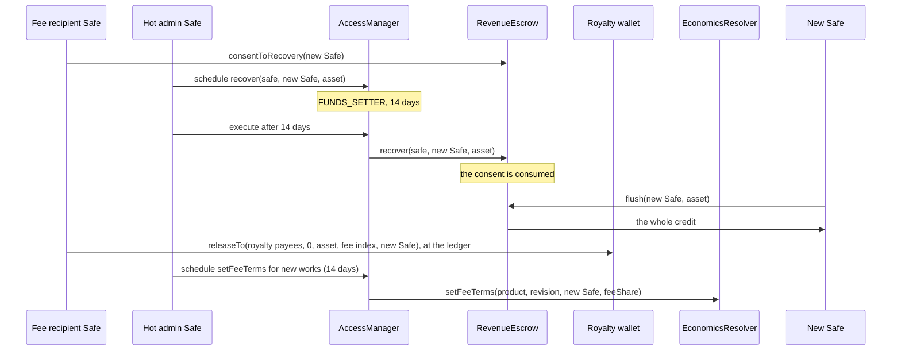

# Economics and payouts

This area decides who is paid, and how: the network's share of primary sales, the secondary
royalty, the split wallets that divide both among the payees, signed and batched releases, the
payment currencies, and the escrow that holds a payment a wallet could not receive. It is for
auditors, for integrators who pay into or claim from split wallets, and for operators who govern
the economics. The contracts live in `src/economics/`. `Stream`, `Editions` and the sale adapters
consume them, and the artist registry resolves artist payouts for them.

> Pre-audit. See the [project status](../../README.md#status).

## Contracts

| Contract | Source | Interface | Responsibility |
| --- | --- | --- | --- |
| `SplitLedger` (permanent) | [`src/economics/SplitLedger.sol`](../../src/economics/SplitLedger.sol) | [`ISplitLedger`](../../src/economics/interfaces/ISplitLedger.sol) = [`ISplitFactory`](../../src/economics/interfaces/ISplitFactory.sol) + [`ISplitWallet`](../../src/economics/interfaces/ISplitWallet.sol) + [`IReleaseVerifier`](../../src/economics/interfaces/IReleaseVerifier.sol) | The one split contract: permissionless and unowned. Predicts (`walletFor`) and deploys (`createWallet`) every split wallet at its CREATE2 address, records each wallet's payee hash (`configOf`), keeps every wallet's accounting, executes every release, and checks EIP-712 release authorizations with unordered, revocable nonces. No owner, governance, allowlist, rescue, `delegatecall` or code-hash pin. |
| `SplitVault` (one per payee configuration) | [`src/economics/SplitVault.sol`](../../src/economics/SplitVault.sol) | none (raw bytecode) | A split wallet's code: 66 bytes that accept ETH from anyone and move funds only when the ledger that deployed them says so. No storage, no decision. |
| `GovernedVault` | [`src/economics/GovernedVault.sol`](../../src/economics/GovernedVault.sol) | [`IGovernedVault`](../../src/economics/interfaces/IGovernedVault.sol) | The network fee recipient and the museum as contracts that outlive any key: receives ETH, ERC-20s, ERC-721s and ERC-1155s and moves them only to a destination governance sets (FUNDS_SETTER, 14 days). |
| `AssetAllowlist` (replaceable) | [`src/economics/AssetAllowlist.sol`](../../src/economics/AssetAllowlist.sol) | [`IAssetAllowlist`](../../src/economics/interfaces/IAssetAllowlist.sol) | Governed payment currencies: a status per asset, an increment floor, the English auction's opening bid (in the status word), a default currency per product, and a deprecation clock for sale adapters. No permanent contract references it and no withdrawal reads it: a new allowlist reaches new sales through a new economics resolver and new adapters (ECO-25). |
| `RevenueEscrow` | [`src/economics/RevenueEscrow.sol`](../../src/economics/RevenueEscrow.sol) | [`IRevenueEscrow`](../../src/economics/interfaces/IRevenueEscrow.sol) | Holds credits for refused payments. Anyone flushes a credit to its wallet; governance moves one only to an identical wallet or to a replacement its holder consented to, and may sweep only what nobody is owed (`sweepExcess`). |
| `EconomicsResolver` | [`src/economics/EconomicsResolver.sol`](../../src/economics/EconomicsResolver.sol) | [`IEconomicsResolver`](../../src/interfaces/IEconomicsResolver.sol) | Governed per-product fee recipient, fee share, royalty rate and default license. Derives the terms a new work locks (`newWorkTerms`) and the currency a new sale locks (`resolveCurrency`). |
| `ClaimRouter` | [`src/economics/ClaimRouter.sol`](../../src/economics/ClaimRouter.sol) | [`IClaimRouter`](../../src/economics/interfaces/IClaimRouter.sol) | Stateless batch claims across split wallets. Holds no funds. |
| `RevenuePayment`, `TokenTransfer`, `Splits` | [`RevenuePayment.sol`](../../src/economics/RevenuePayment.sol), [`TokenTransfer.sol`](../../src/economics/TokenTransfer.sol), [`Splits.sol`](../../src/economics/Splits.sol) | none (internal libraries) | How a payer pays a wallet (directly, else through the escrow); strict ERC-20 moves and the shared ETH send; the 100,000 denominator, payee-list validation and the entitlement formula. |
| `ProtocolContracts` | [`src/libraries/ProtocolContracts.sol`](../../src/libraries/ProtocolContracts.sol) | none (internal library) | Recognises, by ERC-165, protocol contracts that can neither pull a release nor accept an ETH payment. |
| `ArtistRegistry` | [`src/identity/ArtistRegistry.sol`](../../src/identity/ArtistRegistry.sol) | [`IArtistPayoutResolver`](../../src/economics/interfaces/IArtistPayoutResolver.sol) | Answers `payoutAddress(artistId)` for artist-resolved payees ([Identity and recovery](identity-and-recovery.md)). |

Shared types are in [`EconomicsTypes.sol`](../../src/interfaces/types/EconomicsTypes.sol)
(currency constants, product IDs, `ProductEconomics`, `WorkTerms`) and
[`SaleTypes.sol`](../../src/interfaces/types/SaleTypes.sol) (`PrimaryTerms`, `LockedTerms`,
`Payment`).

## Concepts

Durations name their [delay class](../glossary.md#delay-class): standard (48 hours), funds
(14 days) or successor (30 days) ([`Roles.sol`](../../src/governance/Roles.sol)). The glossary
defines [split wallet](../glossary.md#split-wallet), [seller wallet](../glossary.md#seller-wallet),
[royalty wallet](../glossary.md#royalty-wallet), [escrow](../glossary.md#escrow),
[credit](../glossary.md#credit) and [release](../glossary.md#release).

### Products and launch terms

Every rate is out of `Splits.DENOMINATOR` = 100,000, so the 6.529% royalty is exactly 6,529,
which a 10,000 basis-point denominator cannot express. The [network fee](../glossary.md#network-fee)
share is the network's part of both the primary sale and the royalty; the artist portion is
`100,000 - feeShare`.

| Product | ID (`EconomicsTypes.sol`) | Fee share at launch | Split | Royalty rate | Default currency at genesis |
| --- | --- | --- | --- | --- | --- |
| 6529 Stream | `PRODUCT_STREAM = keccak256("PRODUCT_STREAM")` | 25,000 (`DEFAULT_FEE_SHARE`) | 75/25 | 6,529 (`DEFAULT_ROYALTY_RATE`) | ETH |
| 6529 Stream Editions | `PRODUCT_EDITIONS = keccak256("PRODUCT_EDITIONS")` | 25,000 | 75/25 | 6,529 | ETH |
| 6529 Stream Federated (v1.1) | `PRODUCT_FEDERATED = keccak256("PRODUCT_FEDERATED")` | 10,000 (`FEDERATED_FEE_SHARE`) | 90/10 | 6,529 | ETH |

The `EconomicsResolver` constructor writes these values and the `CC0-1.0` default license at
revision 1, with one fee recipient for all three products (`NETWORK_FEE_RECIPIENT` in
[`script/Deploy.s.sol`](../../script/Deploy.s.sol), which off anvil refuses an address with no
code, balance or nonce). The genesis wiring makes ETH each product's default currency at zero
delay ([`config/genesis.example.json`](../../config/genesis.example.json)). For a federated token
(federation is in v1, specified by a later ADR) the English auction takes the fee share from the
federation registry and the recipient from `networkFeeRecipient(PRODUCT_FEDERATED)`, and locks
both when a sale starts ([AUC-48](stream-and-auctions.md#rules-and-invariants)).

The constructor also sets the **6529 Network Museum** (D140, owner decision 11), `museum()`: the
account a 6529 Stream work goes to when its 1/1 sale ends unsold, unbid or frozen out. 6529 Stream
moves the work there itself, reading `museum()` from its current resolver when the adapter
settles the sale, with no receiver callback (owner decision 17;
[Stream and auctions](stream-and-auctions.md#settle-with-no-bid), AUC-24). It is
`MUSEUM` in [`script/Deploy.s.sol`](../../script/Deploy.s.sol), which off anvil refuses an address
with no code, balance or nonce, like the fee recipient, and should be a Safe or an EOA. The
resolver refuses zero and every contract the fee-recipient rule refuses (ECO-3): the resolver,
its dependencies and the recognised protocol contracts, none of which may end up holding the
network's works (`InvalidMuseum`). Since Stream moves a work with no receiver callback, any
other account, a contract included, receives it. `setMuseum(expectedRevision, next)` changes
it: FUNDS_SETTER, 14 days, compare-and-set on the museum's own revision (`museumRevision()`, 1 at
deployment; `RevisionMismatch`), announced by `MuseumSet(previous, next, revision)` (ECO-37).
Unlike the other settings it reaches sales already running: a change applies to every
settlement after it, while a work already moved to the previous museum stays with it. Nothing is
ever pending for the museum (AUC-33). It moves to network control under D67 and D98.

### Terms locked at mint

Nothing in the resolver reaches back into an existing work or a running sale (ECO-6).
- **6529 Stream.** `Stream._quote` reads `economics(PRODUCT_STREAM)` and the seller wallet
  `walletFor(item.payees, 0)` at mint, and stores the seller, fee share, fee recipient and royalty
  rate. With a non-zero fee share it refuses a fee recipient equal to the seller wallet.
- **6529 Stream Editions.** `createEdition` stores
  `newWorkTerms(PRODUCT_EDITIONS, item.payees)`, the royalty receiver included, at the master's
  current royalty rate. Its fee terms may differ from the master's.
- **Sales** lock their currency at start ([Stream and auctions](stream-and-auctions.md),
  [Editions and sales](editions-and-sales.md)).
- **The one exception** is the royalty rate: `IWorkRecords.setRoyaltyRate` (FUNDS_SETTER, funds
  class, plus every party's signature) may only lower it, per
  [ADR 0006](../adr/0006-work-powers-and-conventions.md), and stops for good once the lead artist
  renounces the power (`IWorkPowers`); a linked edition follows its master
  ([Works and storage](works-and-storage.md), WS-14, WS-38). Payees and the royalty receiver
  never change.
- **The fee recipient** is locked too, so one that can never be paid would strand every sale
  of every work minted under it. The resolver refuses the contracts it can recognise (ECO-3); for
  the rest, the runbook checks that a new recipient accepts ETH from a 100,000-gas call before
  `setFeeTerms` is scheduled
  ([script README](../../script/README.md#the-network-fee-recipient-must-exist); LIM-ECO-4).

### The royalty receiver

`EconomicsResolver.newWorkTerms(product, payees)` deploys nothing. It returns the seller wallet
`walletFor(payees, 0)`, the product's current fee terms and royalty rate, and the royalty
receiver: the seller wallet at a zero fee share, otherwise the salt-zero wallet of
`Splits.royaltyPayees`, whose two fixed payees are the seller wallet (`100,000 - feeShare`) and the
fee recipient (`feeShare`), ordered by address (ECO-7). Salt zero means one seller wallet per payee
list, and one royalty wallet per seller wallet and fee terms.

`Stream._royaltyReceiver` derives the receiver on every `royaltyInfo` call with one view call to
the pinned factory, about 41K Prague gas for the whole call
([ADR 0004](../adr/0004-gas-budgets-under-glamsterdam.md#the-table)). It reverts when gas runs
short, never returning a zero royalty, and computes `floor(salePrice × rate / 100,000)` without
overflow. `Editions.royaltyInfo` returns its stored receiver.

**No per-collection receiver.** Each work's receiver comes from its own payees and the fee terms
at mint; 6529 Stream has no receiver per collection. A collection whose royalties should all go
to one account (a crowdfund, for example) needs a token contract of its own, a new collection
outside Stream, or that account among each work's payees, which also shares its primary sale.

### Currencies

`CURRENCY_ETH` is `address(0)`. [`CURRENCY_DEFAULT`](../glossary.md#currency_default),
`address(type(uint160).max)`, means "the product's default when the sale starts" and is never a
sale's locked currency. `resolveCurrency(product, requested)` resolves it through the allowlist
and returns only an active currency (ECO-34).

`AssetAllowlist` marks each asset `None`, `Active` (usable by new sales, with a non-zero
[increment floor](../glossary.md#increment-floor)) or `Deprecated` (not usable, and running sales
in it halt); withdrawals never read it (ECO-25). Admission is a sanity probe, not proof of a
standard ERC-20 (ECO-32): governance vets that the token returns `true` on transfer, takes no fee
and does not rebase, and that vetting is the guard against non-standard tokens (see
[token strictness](#wallet-payments-and-the-escrow)). `statusClock(asset)` lets sale adapters stop
a sale's clock while its currency is deprecated (MARKET-1, MARKET-2). Each asset also holds the
English auction's opening bid, the least first bid an auction in it locks at start
(`setOpeningBid`, PARAMETER_SETTER, 48 hours, compare-and-set on the asset's revision, at most
`OPENING_BID_FLOORS` (1,000) increment floors and `type(uint96).max`; 0.05 ETH for ETH at
genesis). It shares the status word, so a start reads both in one call (`activeOpeningBid`,
`defaultCurrencyOpeningBid`); it moved here from the auction in the permanence restructuring
([ADR 0007](../adr/0007-permanence.md)). Switching a product to USDC is "admit the asset, then
change the default", with no contract change.

### Payee lists, wallets and the split ledger

A payee is `ISplitWallet.Payee { uint256 artistId; address account; uint32 share; }`: a
[fixed payee](../glossary.md#fixed-payee) (`artistId == 0`, paid at `account`) or an
[artist-resolved payee](../glossary.md#artist-resolved-payee) (`account == address(0)`, paid at the
artist registry's payout address at release time, so a recovery also redirects accrued balances). `Splits.validate` accepts only a
[canonical payee list](../glossary.md#canonical-payee-list) of at most 64 payees, a bound that
keeps deployment inside the transaction gas cap (ECO-8). It also refuses payees that could
never be paid: an artist ID of 2^160 or more (IDs are the `uint160` of an account, so it can
never be registered) and the ledger itself as a fixed payee (it refuses itself as a recipient).
Only checks that read no state belong there: a check that read another contract could change
its answer after a wallet's address was derived and paid, and leave the wallet undeployable. So
the revenue escrow as a fixed payee is not refused (its ERC-20 receipts would be sweepable
excess, LIM-ECO-8), and a nested split wallet as a fixed payee stays valid (push only). A package
item's payees must also be its parties (at most 16, `PackageRegistry._checkParties`).

A split wallet is a `SplitVault`: 66 bytes of documented EVM code that hold ETH and ERC-20s and
move them only on the ledger's instruction. Every rule lives in the one permanent `SplitLedger`,
and every wallet has the same init code, so its address commits to the ledger, the payee list
and a salt, and to nothing a compiler produced (ECO-9):

```solidity
bytes32 configHash = keccak256(abi.encode(payees)); // payees: ISplitWallet.Payee[]
bytes32 walletSalt = keccak256(abi.encode(configHash, salt));
address wallet = address(uint160(uint256(keccak256(abi.encodePacked(
    bytes1(0xff), address(splitLedger), walletSalt, walletInitCodeHash
)))));
// walletInitCodeHash = keccak256(SplitVault.INIT_CODE), the same for every wallet
```

- **The vault** (ECO-39): a call from its ledger is an instruction `(target, value, data)`, which
  it executes with all its gas, returning the callee's answer or reverting; any other call with
  no calldata succeeds (36 gas: ETH is accepted even within a 2,300-gas stipend); any other call
  with calldata reverts, so a vault is not an ERC-721 or ERC-1155 receiver. Its runtime is
  `0x73 || ledger || SplitVault.RUNTIME_TAIL`; the byte listing is in
  [`SplitVault.sol`](../../src/economics/SplitVault.sol).
- **Deployment.** Funds sent to a predicted address are held, and split once anyone calls
  `createWallet` (ECO-11); `walletFor` reverts for a list no wallet would accept. `createWallet`
  is permissionless for any canonical list, idempotent, writes one ledger word (`configOf`, which
  `isWallet` reads) whatever the payee count, and emits `WalletCreated` with the whole list
  (ECO-10). One payee costs 95,950 Prague gas for the whole transaction, about 0.43M under
  Glamsterdam (below); no sale pays it, and it is cheap enough for a keeper or the seller to
  deploy at the first sale.
- **Naming a wallet.** The ledger stores no payee list. Every release names its wallet by its
  configuration, `(payees, salt)`, from which the ledger derives the address: read the list from
  `WalletCreated`, or from the work's terms and its package item before the wallet exists. A list
  or salt that is not the wallet's names another address, where nothing is deployed, and the
  release reverts (`WalletNotDeployed`, or `NothingToRelease` if nothing is there either).
- Another salt gives an equivalent wallet (same `configHash`), which the escrow accepts as a
  replacement. Vault bytecode deployed by anyone else is never a wallet: the ledger only derives
  addresses from its own CREATE2.

**Deployment cost and rule 4.** The old 5,097-byte `SplitWallet` cost 1,185,635 Prague gas and
about 8.5M under Glamsterdam, and another code repricing of Glamsterdam's size would have made it
undeployable. The vault's cost, from the `createWallet` row (one payee, 95,950 Prague gas) with
ADR 0004's unit prices: `95,950 - 66 x 200 + 66 x 1,542 + 1 x 89,000 + 157,000 = 430,522`, about
0.43M Glamsterdam gas [E], of which the code is 101,772. It would pass a 60M block only at about
904,000 gas per code byte (586 times Glamsterdam's price), and 2^24 only at about 249,000 (162
times). A release deploys nothing and creates no account but its recipient's. The remaining
dependence is honest and bounded: funds paid to an address whose vault was never deployed need
one future `createWallet` (a CREATE2 of 66 bytes and one storage word). If even that became
impossible, those funds would stay at their address; every deployed wallet is unaffected for
good. Deploying each seller and royalty wallet at its first sale removes the dependence for that
wallet entirely (LIM-ECO-7).

### Split wallet accounting

The ledger keeps every wallet's accounting under the wallet's address. For each asset (ETH is
`address(0)`), `observed = balance + totalReleased` is the wallet's cumulative receipts. Payee `i` is entitled to `floor(observed × share_i / 100,000)` in total, and
`releasable = entitlement - released`. Release order and timing never change totals, and rounding
leaves fewer than `payeeCount` units of each asset unreleasable (ECO-13). For an ERC-20, each
release records the highest `observed` it saw; if receipts fall below that mark, the asset's
releases revert with `ObservedDecreased` until they recover, and nothing is lost (ECO-24).

- **Fixed payees are push, artist-resolved payees pull-only.** Anyone may `release` a fixed payee,
  but only to its own account; only an artist's current payout address, directly or by signature,
  releases an artist-resolved payee, so nobody can push to a lost key (ECO-15, ECO-16; the
  [transition table](#a-payees-balance-in-a-split-wallet) lists every entry point). A nested split
  wallet is a fixed payee.
- **Artist payees stop alone** during a [payout freeze](../glossary.md#payout-freeze), or while
  the resolver refuses or answers something that is not an address (`PayoutUnresolved`);
  balances keep accruing and fixed payees still release (ECO-18). There is no code-hash pin:
  after EIP-6780 the registry's code cannot change, and a pin would only freeze every artist
  share if code-hash semantics ever changed.
- **A payee that can neither receive nor call blocks only its own share** (each release is one
  payee's); the share stays for it, since a wallet has no rescue: every unit in it is some
  payee's, and a time-based escheat would be governance authority over owed funds.
- **Every move is proved by its outcome.** An ETH release requires the wallet's balance to fall
  by exactly the amount, an ERC-20 release both balances to move by exactly the amount, so a
  release from an address with no vault (where a call "succeeds" and moves nothing) reverts
  (`WalletNotDeployed`).
- **Gas rule.** Every call forwards all available gas. A failure that left at most 1/8 of the gas
  (a payee or token that ran short behind the vault, the resolver, an ERC-1271 check) reverts
  with `BoundedCall.BoundedCallShortfall`, never with a refusal (ECO-42).
- **A split wallet cannot be an artist's payout address,** because it cannot call `release`
  (ECO-19). An artist who wants revenue to flow into another split names it as a fixed payee.
- Each wallet has its own transient reentrancy lock, held by every state-changing entry point for
  that wallet; `observed` and `releasable` revert during its release. A release may reach another
  wallet (a nested wallet as a fixed payee).

### Wallet payments and the escrow

Sale adapters pay a wallet through `RevenuePayment`: directly, and on a clean refusal by the
wallet or the token, as a credit in `RevenueEscrow` under that wallet, never anywhere else
(ECO-26). The routes and their gas are under [a primary sale payout](#a-primary-sale-payout).

**Zero amounts.** The adapters' payouts (`EnglishAuction._pay`, `UniformEditionAuction._pay`)
skip a zero amount, so a zero fee needs no fee recipient. `RevenuePayment` itself refuses a zero
wallet or the escrow as the wallet (`InvalidWallet`) before it looks at the amount, then treats a zero
amount as a no-op. The withdrawal and escrow paths revert on a zero amount instead: a release
with nothing releasable, or a signed release of amount 0 (`NothingToRelease`); an escrow deposit
(`ZeroAmount`); a `flush` or `recover` of a zero credit (`NothingOwed`); an adapter claim with
nothing credited (`NothingToClaim`).

**Token strictness.** `TokenTransfer` moves every ERC-20 that a payout, escrow deposit, flush,
release, direct or EIP-2612 pull, or adapter claim handles. It counts a token call only if it
returns exactly one 32-byte word holding `true`, and requires both balances to move by exactly the
amount (`TokenCallFailed`, `TokenBalanceMismatch`). There are two exceptions, and both still
require the exact deltas. The auction's Permit2 pull (`EnglishAuction._collect`): Permit2 makes
the token call, and canonical Permit2 accepts a token that returns nothing. And a split wallet's
release (`transferExactAllowingNoReturn`), which also counts a `transfer` that returns no data:
a marketplace chooses the token a royalty is paid in, and an immutable wallet has no other way
out of it. A `false`, a return of any other size, a call to an account without code (its
`balanceOf` read fails first, `TokenReadFailed`) and a fee or rounding loss still revert there.
Payments, escrow deposits and flushes, and the adapters' pulls and claims keep the strict check,
so a no-return token is still no sale currency. Exact balance deltas therefore hold on every
path, return-value checks do not, and admitting only standard ERC-20s is the guard (ECO-23,
LIM-SAL-7). A token that moves a wei less or more than asked, or whose balance in a wallet
falls, freezes that asset in the wallet, and no path rescues it (ECO-24, LIM-ECO-6).
Other edges, all fail closed with no movement (LIM-ECO-9): a token whose `transfer` returns more
than one word, and an ETH recipient whose fallback returns more than one word, are refused (the
ledger copies one word; a payee can `releaseTo` another recipient); a vault named as an ERC-1271
signer or as an `asset` reverts with `BoundedCallShortfall` rather than `InvalidSignature`;
`released` and `totalReleased` change before the transfer and their getters ignore the lock, so
only `observed` and `releasable` are safe to read inside a release callback; an ERC-721 sent to
a vault with `transferFrom` cannot leave it, and a legacy NFT with `transfer(address,uint256)`
could be released by count as a token ID.

**The escrow** keeps credits by `(wallet, asset)`. Deposits are permissionless; anyone flushes a
credit, only to its wallet, and a failed flush keeps it (ECO-27). Governed `recover` moves a
credit only to an identical factory wallet or to a replacement its holder named with
`consentToRecovery` (ECO-28; see the [recovery flows](#escrow-recovery-for-a-blocked-split-wallet)).
The escrow has no `receive`; ETH force-sent to it, and tokens sent without a deposit, are owed to
nobody. `sweepExcess(asset, recipient)` (FUNDS_SETTER, 14 days) sends exactly
`balance - totalOwed[asset]` to the recipient governance names, and reverts with `NothingToSweep`
when there is none, so afterwards the balance of `asset` equals `totalOwed[asset]` (ECO-40). The
bound is per token address, which no on-chain check can widen (LIM-ECO-8): for a token with two
addresses over one balance (a legacy proxy pair), a sweep of the address nothing was credited
under reads the shared balance against a zero total and takes the credits made under the other;
a positive rebase makes creditors' growth sweepable, and a negative rebase leaves the last flush
of that token short. Governance must not sweep such a token; the 14-day delay and the guardian
veto are the control (`test_SweepExcess_ADoubleEntryTokensAliasIsADocumentedLimit`).

A governed vault's recovery consent names its destination at the time it is given. `recover`
also requires a governed vault's (ERC-165 `IGovernedVault`) replacement to be its current
destination, so a consent a later `setDestination` made stale is refused, and anyone renews it
by calling `consentToRecovery` on the vault again (ECO-41).

## State machine

### An asset in the allowlist



### An escrow credit



### A payee's balance in a split wallet



| Transition | Caller (role) | Delay | Function |
| --- | --- | --- | --- |
| Asset: none or deprecated to active | FUNDS_SETTER | 14 days; a re-admission also at least 14 days after the deprecation | `AssetAllowlist.admitAsset` |
| Asset: new floor | PARAMETER_SETTER | 48 hours | `AssetAllowlist.setIncrementFloor` |
| Asset: new opening bid | PARAMETER_SETTER | 48 hours; zero for ETH's in the genesis wiring | `AssetAllowlist.setOpeningBid` |
| Asset: active to deprecated | GUARDIAN | Immediate | `AssetAllowlist.deprecateAsset` |
| Product: new default currency | FUNDS_SETTER | 14 days; zero in the genesis wiring | `AssetAllowlist.setDefaultCurrency` |
| Product: new fee recipient and fee share | FUNDS_SETTER | 14 days | `EconomicsResolver.setFeeTerms` |
| The museum (every product) | FUNDS_SETTER | 14 days | `EconomicsResolver.setMuseum` |
| Product: new royalty rate, or default license | PARAMETER_SETTER | 48 hours | `EconomicsResolver.setRoyaltyRate`, `setDefaultLicense` |
| Credit: created, increased or paid | Anyone (in practice a sale adapter deposits) | None | `RevenueEscrow.depositETH`, `depositERC20`, `flush` |
| Credit: moved to a replacement | FUNDS_SETTER, with an identical wallet or the holder's consent | 14 days | `RevenueEscrow.recover` |
| Escrow excess (owed to nobody) swept | FUNDS_SETTER | 14 days | `RevenueEscrow.sweepExcess` |
| Governed vault: new destination | FUNDS_SETTER | 14 days | `GovernedVault.setDestination` |
| Balance: predicted to releasable | Anyone | None | `SplitLedger.createWallet` |
| Balance: released, fixed payee | Anyone, to the account (`release`); the account, to any recipient (`releaseTo`); anyone, with the account's signature, to the signed recipient (`releaseWithAuthorization`) | None | `SplitLedger`; `ClaimRouter.claim`, `claimSigned` |
| Balance: released, artist payee | Only the current payout address: `release` pays it, `releaseTo` any recipient; anyone may submit its signature (`releaseWithAuthorization`) | None | `SplitLedger`; `ClaimRouter.claimSigned` |
| Balance: frozen | A pending identity change that moves the payout; or the token, for an ERC-20 below its mark | Until the outcome, or until receipts recover | `ArtistRegistry.payoutAddress` returns zero; `SplitLedger._due` |

A re-admission waits 14 days from the deprecation, not from its scheduling, so one scheduled
ahead cannot undo a deprecation in its own block (MARKET-2, ECO-33). Every governed setter except
`deprecateAsset` and `recover` compares a revision counter that each
change to the same setting bumps, so a queued operation runs only against the exact state it was
written for, and otherwise reverts with `RevisionMismatch` (ECO-4). A guardian can cancel any
scheduled operation during its delay ([Governance](governance.md)); the generated selector, role
and delay matrix is in [roles](../audit/roles.md). The resolver's setters each validate the whole
result (ECO-2, ECO-3) and revert with `UnknownProduct` for a product the constructor did not
configure. `setDefaultLicense` requires an SPDX ID of 1 to 64 bytes
(`Limits.MAX_LICENSE_ID_BYTES`) in `[A-Za-z0-9.+-]` and a non-zero text file ID, and a CC0 license
must name the resolver's `cc0TextFileId`, as `WorkRecords.openRecord` requires (ECO-35).

## Flows

### A primary sale payout



- **Preconditions.** The auction ended with a bid. The seller wallet need not be deployed.
- **ETH** (`RevenuePayment.payETH`) is sent with exactly `PAYOUT_GAS` (100,000); the payer must
  hold that plus `ETH_CALL_RESERVE` (40,000) or the payment reverts (`PaymentInsufficientGas`), so
  a caller cannot starve a payment into the escrow.
- **ERC-20** (`payERC20`) gives the token 300,000 gas (`ERC20_TRANSFER_GAS`). Only a clean refusal
  (a revert, or `false` with nothing moved) goes to the escrow, which pulls exactly the amount;
  the payer then requires a zero allowance (`EscrowAllowanceLeft`). Any other misbehaviour reverts.
  In the auction each ERC-20 payout runs in its own 1,000,000-gas frame: if it fails even through
  the escrow, the auction credits the wallet itself and still delivers the work, and anyone later
  pays the credit with `claimFor(wallet, token)` (MONEY-1, ECO-36).
- **The edition auction** pays its revenue in ETH only, the fee recipient first, then the seller,
  through the same routes ([Editions and sales](editions-and-sales.md#settlement-payouts-and-claims)).
- **Gas.** The first payout to a new seller wallet creates its account, once per payee
  configuration, and costs more, especially under Glamsterdam
  ([ADR 0004](../adr/0004-gas-budgets-under-glamsterdam.md#the-table);
  [Sepolia flows](../../deployments/11155111/flows.md)).

### A royalty payment and its release by fixed payees



- Both payees of a royalty wallet are fixed, so anyone may push each share. The seller wallet's
  share then waits there for its own payees. `ClaimRouter.claim` batches these pushes.
- The marketplace chooses the token. A release counts a `transfer` that returns nothing, as many
  older tokens do, once both balances moved by exactly the amount
  ([token strictness](#wallet-payments-and-the-escrow)).

### An artist's signed pull through the claim router

A payee can sign a [release](../glossary.md#signed-release) for anyone to submit, directly to the
ledger or through the router. The ledger checks it for every wallet:
`IReleaseVerifier.Authorization` under the EIP-712 domain `6529 Works Release Verifier`, version
`1`, verifying contract the ledger, with this type string (`RELEASE_TYPEHASH`):

```text
ReleaseAuthorization(address wallet,address asset,uint256 payee,address account,address recipient,uint256 amount,uint256 nonce,uint256 deadline)
```



- **Preconditions.** The wallet is deployed, and `payees` and `salt` derive the wallet the
  authorization names (`WrongWallet`). `account` signed, and is the payee's current,
  unfrozen payout address (`NotPayoutAddress`). The deadline, which is inclusive, has not passed.
  The nonce is unused: nonces are unordered, single use and per account across all wallets
  (ECO-20, ECO-21), and `revokeNonce(nonce)` burns one everywhere. Signatures go through
  [`SignatureVerifier`](../../src/libraries/SignatureVerifier.sol) (ECDSA, ERC-2098, EIP-7702
  accounts and ERC-1271 forwarding all gas).
- **Effects.** `amount` is released exactly, or everything releasable for `type(uint256).max`.
  No nonce can be consumed without executing its release. A failed release consumes
  nothing, and amounts are bounds, so the same signature works once enough has accrued (ECO-22).
  A recovery that moves the payout voids the old key's unused authorizations. A push can pre-empt
  a fixed payee's exact-amount signed release (LIM-ECO-3), and a payout that returns to an earlier
  key revives that key's unexpired authorizations (LIM-ECO-2).
- **The router** has no storage, owner, approvals, `receive` or `fallback`, and calls only its
  ledger; the ledger enforces who may pull, so it cannot redirect funds (ECO-29). `claim` takes
  up to `MAX_CLAIMS` = 50 plain items `{payees, salt, asset, payee}`, each calling `release`, so it
  serves fixed payees only (an artist item fails with `NotPayoutAddress`). `claimSigned` takes up
  to `MAX_SIGNED_CLAIMS` = 20 `{authorization, signature, payees, salt}` items. A batch of
  64-payee items can exceed a node's transaction-size limit; split it.
- **Atomic mode** (`false`) gives each item all remaining gas; any failure reverts the batch with
  `ClaimCallFailed(index, wallet, size, reason)`.
- **Continue mode** (`true`) takes at most `MAX_CONTINUE_CLAIMS` = 8 items of either kind
  (`TooManyClaims`), so the first item can be offered the ceiling below within the EIP-7825 cap:
  `(8 + 1) * 1,500,000 = 13.5M` leaves about 3.27M of 2^24 for intrinsic and calldata gas. With
  more items no includable gas limit would reach the ceiling, and one gas-burning party early
  in a batch could revert it at every limit (review C finding F5). It offers each item
  `gasleft() / (items remaining + 1)` and reverts with
  `ClaimInsufficientGas(index, available)` if that is below `MIN_ITEM_GAS` (200,000) or
  `MIN_SIGNED_ITEM_GAS` (450,000). A failed item emits `ClaimFailed` and releases 0, unless it was
  offered less than `SHORTFALL_REVERT_CEILING` (1,500,000) and either spent all but EIP-150's
  1/64 or reported a shortfall further down (`BoundedCallShortfall`, `BoundedCallInsufficientGas`):
  then the batch reverts, so gas estimation raises the
  limit instead of silently starving an item.
- **Containment.** An item for a wallet nobody deployed fails (`WalletNotDeployed`); a success
  that does not return exactly one word fails (`InvalidClaimReturnData`). At most one word of return data and
  256 bytes of revert data are copied.
- **Keepers.** The minimums are Prague-sized floors. A first signed release on Sepolia's
  Glamsterdam costs about 716,000 gas, and a full batch of first releases may not fit one
  transaction; it then reverts rather than paying part, so split it
  ([ADR 0004](../adr/0004-gas-budgets-under-glamsterdam.md#security-impact)). A party to an item
  (a co-payee whose `receive` burns gas, a recipient, a token) can make its item look short of gas
  after the keeper estimated: below the ceiling that reverts the batch, from the ceiling up the
  item is skipped. Simulate privately, put items with contract payees or unfamiliar tokens last or
  alone, and drop an item whose revert names its index.

### Escrow recovery for a blocked split wallet



- **Preconditions.** Both wallets are deployed (an undeployed wallet has no `configOf`) and have
  the same configuration.
- **Effects.** The whole credit moves and adds to anything the replacement is owed; `totalOwed`
  is unchanged until the flush. Only escrow credits move: funds already in the blocked wallet stay
  there until the token unblocks it (LIM-ECO-1).

### Escrow recovery for a blocked fee-recipient Safe



- **Why.** A token such as USDC can block the network fee Safe. Fees in that token are then
  credited to the escrow under the Safe, and every existing royalty wallet keeps the Safe as a
  fixed payee, because works lock their terms at mint.
- **Consent.** Without the Safe's consent, or to any other address, `recover` reverts with
  `RecoveryNotConsented`, even after the full delay. One consent covers one recovery in one asset;
  the Safe can change or withdraw (zero) a consent not yet used.
- **Royalty shares** are not escrowed. Only the Safe can move its share, with `releaseTo`; a lost
  Safe's share stays. `setFeeTerms` changes the recipient for new works only.
- **The governed vault removes the key.** With a `GovernedVault` as the fee recipient (and as the
  museum), no key can be lost: anyone calls `vault.consentToRecovery(escrow)` (it names only the
  current destination) and `vault.releaseToDestination(payees, salt, asset, index)`, and
  governance changes the destination with `setDestination` (FUNDS_SETTER, 14 days) (ECO-41).

## Rules and invariants

| ID | Rule | Enforced in | Tested by |
| --- | --- | --- | --- |
| ECO-1 | Rates and shares are out of 100,000; the launch royalty 6,529 is exactly 6.529%. | `Splits.DENOMINATOR`; `EconomicsResolver` constants | [`SplitMath.t.sol`](../../test/economics/SplitMath.t.sol) `test_RoyaltyRateIsExact`; [`EconomicsResolver.t.sol`](../../test/economics/EconomicsResolver.t.sol) `test_LaunchDefaults` |
| ECO-2 | A product's fee share is below 100,000, its royalty rate at most 100,000, and a non-zero fee share names a non-zero recipient. | `EconomicsResolver._validate` (constructor, `setFeeTerms`, `setRoyaltyRate`) | [`EconomicsResolver.t.sol`](../../test/economics/EconomicsResolver.t.sol) `test_ConstructorEmitsAndValidates`, `test_SetFeeTermsIsCompareAndSet` |
| ECO-3 | The fee recipient is never the resolver, its allowlist, factory or verifier, or a recognised protocol contract. | `EconomicsResolver._validate`; `ProtocolContracts.isProtocolContract` | [`RecipientValidation.t.sol`](../../test/integration/RecipientValidation.t.sol) `test_FeeRecipientRefusesSystemContracts`; [`EconomicsResolver.t.sol`](../../test/economics/EconomicsResolver.t.sol) `test_FeeRecipientMustBePayable` |
| ECO-4 | Every governed economics setter (all but `deprecateAsset` and `recover`) is compare-and-set on its own revision, and every change, deprecation included, bumps it (the museum's is `museumRevision`). | `EconomicsResolver._check`; `AssetAllowlist._checkRevision` | [`EconomicsResolver.t.sol`](../../test/economics/EconomicsResolver.t.sol) `test_SetRoyaltyRateIsCompareAndSetOnItsOwnRevision`; [`AssetAllowlist.t.sol`](../../test/economics/AssetAllowlist.t.sol) `test_EveryAssetChangeBumpsTheRevision`, `test_QueuedAdmissionCannotReviveAfterEmergencyDeprecation`, `test_DefaultCurrencyIsCompareAndSet` |
| ECO-5 | Setters are restricted to their roles and delays, and non-payable. | AccessManager (`restricted`) | [`EconomicsResolver.t.sol`](../../test/economics/EconomicsResolver.t.sol) `test_RolesAndDelaysThroughAccessManager`; [`AssetAllowlist.t.sol`](../../test/economics/AssetAllowlist.t.sol) `test_TimelockedAdmissionThroughAccessManager`; [`RevenueEscrow.t.sol`](../../test/economics/RevenueEscrow.t.sol) `test_RecoverIsGovernedInTheFundsClass` |
| ECO-6 | Economics changes apply to new works only: existing works keep their seller, fee terms and royalty receiver. | `Stream._quote`, `Stream._store`; `Editions.createEdition` | [`EconomicsResolver.t.sol`](../../test/economics/EconomicsResolver.t.sol) `test_ChangesApplyToNewWorksOnly`; [`StreamEconomics.t.sol`](../../test/stream/StreamEconomics.t.sol) `test_receiverAtZeroFeeAndAfterAFeeChange` |
| ECO-7 | The royalty receiver is the salt-zero wallet of `Splits.royaltyPayees`, or the seller wallet at a zero fee share; `Stream`, `Editions` and the resolver derive the same address. | `EconomicsResolver.newWorkTerms`; `Stream._royaltyReceiver` | [`StreamEconomics.t.sol`](../../test/stream/StreamEconomics.t.sol) `test_receiverIsTheResolversAndTheFactorys`; [`EconomicsResolver.t.sol`](../../test/economics/EconomicsResolver.t.sol) `test_RoyaltyReceiverMatchesTheSharedDerivation`, `test_ZeroFeeShareOmitsTheFeePayee` |
| ECO-8 | A payee list is canonical: 1 to 64 entries, each exactly fixed or artist-resolved with a non-zero share, strictly ascending by `(artistId, account)`, shares summing to 100,000; no artist ID of 2^160 or more and no fixed payee equal to the ledger. | `Splits.validate` (`createWallet`, `walletFor`) | [`SplitFactory.t.sol`](../../test/economics/SplitFactory.t.sol) `test_RejectsPayeesThatCanNeverBePaid`, `test_RejectsEmptyAndOversizedPayeeLists`, `test_RejectsUnsortedAndDuplicatePayees`, `test_RejectsSharesNotSummingToDenominator`; [`SplitMath.t.sol`](../../test/economics/SplitMath.t.sol) `testFuzz_ValidationAcceptsExactlyCanonicalLists` |
| ECO-9 | A wallet's address is the documented CREATE2 derivation over the ledger, the payee list and the salt, with the constant vault init code; the deployed wallet is always at the prediction. | `SplitLedger.walletFor`, `createWallet` | [`SplitFactory.t.sol`](../../test/economics/SplitFactory.t.sol) `test_AddressIsTheDocumentedCreate2Derivation`, `test_CreateWalletRevertsIfTheDeployedAddressDiffers`, `testFuzz_PredictionMatchesDeployment` |
| ECO-10 | `createWallet` is permissionless for any canonical list, writes one word (`configOf`) and emits the whole list in `WalletCreated`, from which a reader rebuilds every wallet's configuration. | `SplitLedger.createWallet` | [`SplitFactory.t.sol`](../../test/economics/SplitFactory.t.sol) `test_ConfigOfRecordsEachWalletsPayeeHash`, `test_MaximumPayeeListIsLoggedExactly`, `test_AnyoneCreatesAWalletForAnyCanonicalList`; [`SplitVault.t.sol`](../../test/economics/SplitVault.t.sol) `test_CreateWalletWritesOneSlotAndOneAccount`, `test_WalletCreatedLogsTheWholeConfiguration` |
| ECO-11 | Funds sent to a predicted address before deployment are split once the wallet exists; until then a release reverts and moves nothing. | `SplitLedger._release` (outcome checks) | [`SplitFactory.t.sol`](../../test/economics/SplitFactory.t.sol) `test_FundsSentBeforeDeploymentAreSplitAfterwards`; [`SplitVault.t.sol`](../../test/economics/SplitVault.t.sol) `test_ReleaseFromAnUndeployedWalletRevertsAndMovesNothing`; [`RevenuePayment.t.sol`](../../test/economics/RevenuePayment.t.sol) `test_PayETHToUndeployedWalletIsKeptForIt` |
| ECO-12 | The ledger pins no code hash: a resolver code change neither stops wallet creation nor freezes artist payees; the resolver must have code and not be an EIP-7702 delegated account at deployment. | `SplitLedger` constructor | [`SplitFactory.t.sol`](../../test/economics/SplitFactory.t.sol) `test_CreateWalletIgnoresTheResolversCodeHash`, `test_ConstructorRejectsDelegatedEOADependencies`; [`SplitWallet.t.sol`](../../test/economics/SplitWallet.t.sol) `test_ResolverCodeChangeDoesNotFreezeArtistPayees` |
| ECO-13 | A payee's releases never exceed `floor(observed × share / 100,000)`, and the unreleasable dust stays below the payee count: released plus releasable equals received up to that dust. | `SplitLedger._due`; `Splits.entitlement` | [`EconomicsInvariant.t.sol`](../../test/economics/invariant/EconomicsInvariant.t.sol) `invariant_ReleasedWithinEntitlement`, `invariant_DustIsBounded`, `invariant_ReleasedPlusReleasableMatchesReceived`; [`SplitMath.t.sol`](../../test/economics/SplitMath.t.sol) `testFuzz_ReleaseTimingDoesNotChangeTotals` |
| ECO-14 | A wallet conserves value: everything released plus its balance equals everything received, and recipients hold exactly what was released. | `SplitLedger._release` | [`EconomicsInvariant.t.sol`](../../test/economics/invariant/EconomicsInvariant.t.sol) `invariant_WalletConservesValue`, `invariant_RecipientsReceivedEverythingReleased` |
| ECO-15 | Anyone may release a fixed payee, but only to its own account; a payee that can neither receive nor call blocks only its own share. | `SplitLedger.release` | [`SplitWallet.t.sol`](../../test/economics/SplitWallet.t.sol) `test_AnyoneMayReleaseAFixedPayeeButOnlyToItsAccount`, `test_MutePayeeBlocksOnlyItsOwnShare`; [`SplitLedgerStress.t.sol`](../../test/economics/SplitLedgerStress.t.sol) `test_HostilePayeesBlockOnlyTheirOwnShares` |
| ECO-16 | Only an artist's current payout address, directly or by signature, releases an artist-resolved payee; nobody can push to a lost key. | `SplitLedger.release`, `releaseTo`, `releaseWithAuthorization` | [`SplitWallet.t.sol`](../../test/economics/SplitWallet.t.sol) `test_ArtistPayeeIsPullOnly`, `test_LostArtistKeyCannotBePushedBeforeRecovery`, `test_ArtistPayeeFollowsResolverAtReleaseTime`; [`ClaimRouter.t.sol`](../../test/economics/ClaimRouter.t.sol) `test_PlainArtistItemsFailAndContinueModeSkipsThem` |
| ECO-17 | `releaseTo` is callable only by the payee's current payout address, and no release pays zero, the wallet itself or the ledger. | `SplitLedger.releaseTo`, `_release` | [`SplitWallet.t.sol`](../../test/economics/SplitWallet.t.sol) `test_ReleaseToRequiresTheCurrentPayoutAddress`, `test_RejectsZeroAndSelfRecipients` |
| ECO-18 | While the payout is unresolved (frozen, or the resolver refuses or answers a non-address), only the artist-resolved payees stop; fixed payees release. | `SplitLedger._payout`; `ArtistRegistry.payoutAddress` | [`SplitWallet.t.sol`](../../test/economics/SplitWallet.t.sol) `test_UnresolvedOrFailingResolverBlocksOnlyTheArtistPayee`; [`SplitLedgerStress.t.sol`](../../test/economics/SplitLedgerStress.t.sol) `test_ResolverAnsweringANonAddressIsUnresolved`; [`IdentityRecovery.t.sol`](../../test/integration/IdentityRecovery.t.sol) `test_LostKeyOverrideFreezesThePayoutThenRecovers` |
| ECO-19 | A deployed split wallet, and the protocol contracts that cannot pull, never become an artist's payout address. | `ArtistRegistry._payoutAllowed` | [`RecipientValidation.t.sol`](../../test/integration/RecipientValidation.t.sol) `test_PayoutRefusesProtocolContractsThatCannotPull`, `test_PredictedWalletIsCaughtOnlyOnceDeployed`; [`SplitWallet.t.sol`](../../test/economics/SplitWallet.t.sol) `test_NestedWalletCannotBeAnArtistPayoutAddress` |
| ECO-20 | A signed release works once per `(account, nonce)`, only in the wallet (and so only with the payee list and salt) and on the chain and ledger it names, before its deadline, and only while its signer is the payee's payout address. | `SplitLedger.releaseWithAuthorization` | [`ReleaseVerifier.t.sol`](../../test/economics/ReleaseVerifier.t.sol) `test_ReplayAndRevokedNoncesRevert`, `test_OnlyTheNamedWalletConsumesAnAuthorization`, `test_SignatureDoesNotReplayOnAnotherChainOrVerifier`, `test_ExpiredAuthorizationReverts`; [`IdentityRecovery.t.sol`](../../test/integration/IdentityRecovery.t.sol) `test_SignedReleaseIsVoidedByRecovery` |
| ECO-21 | Replay protection is keyed on the nonce, not the signature bytes; nonces in one bitmap word stay independent; one revocation covers every wallet. | `SplitLedger._useNonce`, `revokeNonce` | [`ReleaseVerifier.t.sol`](../../test/economics/ReleaseVerifier.t.sol) `test_ReplayIsKeyedOnTheNonceNotTheSignatureBytes`, `test_NonceBitmapNoAliasingWithinAWord`, `test_OneRevocationCoversEveryWallet` |
| ECO-22 | A signed release that fails does not consume its nonce. | `SplitLedger.releaseWithAuthorization` (atomic revert) | [`ReleaseVerifier.t.sol`](../../test/economics/ReleaseVerifier.t.sol) `test_AmountAboveReleasableRevertsWithoutConsumingNonce`, `test_FailedPaymentRollsBackNonce`, `test_PushCanPreemptAFixedPayeesSignedRelease`, `test_SignedReleaseFromAnUndeployedWalletRevertsWithoutConsumingNonce` |
| ECO-23 | Every ERC-20 move, the Permit2 pulls included, changes both balances by exactly the amount. Moves through `TokenTransfer` also require exactly one `true` word, except a split-wallet release, which also accepts no return data; the Permit2 pulls check balances only. Fee-on-transfer and rounding tokens therefore revert on every path; a token that returns nothing is released from a split wallet and can pass a Permit2 pull, and fails every other path: admitting only standard ERC-20s is the guard. | `TokenTransfer._moveExact`, `transferExactAllowingNoReturn`, `_call`; `SplitLedger._transferToken`; `EnglishAuction._collect`; governance at `AssetAllowlist.admitAsset` | [`HostileTokens.t.sol`](../../test/economics/HostileTokens.t.sol) `test_FeeOnTransfer_PaymentRevertsAtomically`, `test_NoReturn_PaymentRevertsAtomically`, `test_NoReturn_ReleasePaysEachPayeeInFull`, `test_NoReturn_ReleaseThatMovesNothingReverts`, `test_NoReturn_FeeOrRoundingReleaseStillReverts`, `test_ReturnsFalse_PaymentTriesEscrowThenRevertsAtomically`, `test_ReturnsFalse_ReleaseReverts`, `test_OddReturnShapes_FailClosed`, `test_NonCanonicalTrue_FailsClosedOnEveryPath`, `test_Rebasing_RoundingPaymentRevertsAtomically` |
| ECO-24 | An ERC-20 whose receipts fall below the recorded mark freezes that asset's releases without loss. | `SplitLedger._due` | [`SplitWallet.t.sol`](../../test/economics/SplitWallet.t.sol) `test_ShrinkingBalanceFailsClosedUntilRecovered`; [`HostileTokens.t.sol`](../../test/economics/HostileTokens.t.sol) `test_Rebasing_NegativeRebaseFreezesReleasesWithoutLoss`; [`EconomicsInvariant.t.sol`](../../test/economics/invariant/EconomicsInvariant.t.sol) `invariant_ObservedNeverDecreases` |
| ECO-25 | Withdrawals never read the allowlist: deprecated and never-admitted assets stay withdrawable from wallets and the escrow. | `SplitLedger`, `RevenueEscrow` (no allowlist reference) | [`SplitWallet.t.sol`](../../test/economics/SplitWallet.t.sol) `test_DeprecatedAndNeverAdmittedAssetsStayWithdrawable`; [`RevenueEscrow.t.sol`](../../test/economics/RevenueEscrow.t.sol) `test_DeprecatedAssetCreditsStillFlush` |
| ECO-26 | A wallet payment reaches the wallet or a credit under that wallet, never anywhere else, and a caller cannot starve it into the escrow. | `RevenuePayment.payETH`, `payERC20` | [`RevenuePayment.t.sol`](../../test/economics/RevenuePayment.t.sol) `testFuzz_PaymentsAlwaysReachTheWalletOrItsCredit`, `test_CallerCannotStarveETHPaymentIntoEscrow`, `test_CallerCannotStarveTokenPaymentIntoEscrow`, `test_EscrowRouteRevertsIfAnAllowanceSurvives` |
| ECO-27 | The escrow is solvent per asset, credits are isolated per `(wallet, asset)`, and a flush pays only the credited wallet. | `RevenueEscrow._credit`, `flush` | [`EconomicsInvariant.t.sol`](../../test/economics/invariant/EconomicsInvariant.t.sol) `invariant_EscrowIsSolventAndMatchesTheModel`; [`RevenueEscrow.t.sol`](../../test/economics/RevenueEscrow.t.sol) `test_CreditsAreIsolatedPerWalletAndAsset`, `test_FailedFlushKeepsTheCredit` |
| ECO-28 | `recover` moves a factory wallet's credit only to a distinct wallet with the same configuration, and any other account's credit only to the replacement it consented to, consuming the consent. | `RevenueEscrow.recover` | [`RevenueEscrow.t.sol`](../../test/economics/RevenueEscrow.t.sol) `test_RecoverMovesCreditsToAnEquivalentReplacement`, `test_RecoverRejectsWalletsThatAreNotEquivalent`, `test_RecoverRefusesAnAccountsCreditWithoutMatchingConsent`; [`EscrowRecovery.t.sol`](../../test/integration/EscrowRecovery.t.sol) `test_BlockedFeeRecipientCreditMovesWithItsConsent`, `test_GovernanceCannotMoveTheCreditWithoutConsent` |
| ECO-29 | The claim router and payers keep no funds or allowances, and the router cannot redirect a release. | `ClaimRouter` (no storage, no `receive`) | [`EconomicsInvariant.t.sol`](../../test/economics/invariant/EconomicsInvariant.t.sol) `invariant_IntermediariesHoldNothing`; [`ClaimRouter.t.sol`](../../test/economics/ClaimRouter.t.sol) `test_ReentrantRecipientCannotDoubleClaimOrRedirect`; [`RecipientValidation.t.sol`](../../test/integration/RecipientValidation.t.sol) `test_StrangerCannotMoveTheArtistShareThroughTheRouter` |
| ECO-30 | Batches are bounded (50 plain, 20 signed, 8 of either in continue mode, so the first item can reach the ceiling within 2^24 gas); continue mode gives each item at least its minimum and reverts on a shortfall below the ceiling. | `ClaimRouter.claim`, `claimSigned`, `_call` | [`ClaimRouter.t.sol`](../../test/economics/ClaimRouter.t.sol) `test_ContinueModeBoundKeepsTheCeilingWithinTheTransactionCap`, `test_BatchesUpToMaxClaimsAndRejectsMore`, `test_SignedBatchesAreCappedAndNeedTheirMinimumGas`, `test_ShortfallRevertsOnlyBelowTheCeiling`, `test_ArmedCoPayeeIsSkippedOnceItsItemGetsTheCeiling`, `test_ERC1271ShortfallRevertsBelowTheCeiling` |
| ECO-31 | The worst-case batches (every item carrying a 64-payee list) and the 64-payee wallet deployment fit within 75% of the EIP-7825 cap, in Prague gas. | `Splits.MAX_PAYEES`; `ClaimRouter` bounds | [`GasCap.t.sol`](../../test/economics/GasCap.t.sol) `test_WorstCaseAtomicClaimBatchFitsTheCap`, `test_WorstCaseAtomicSignedBatchFitsTheCap`, `test_MaximumWalletDeploymentFitsTheCap` |
| ECO-32 | Admission refuses accounts without code, EIP-7702 delegated accounts, unreadable or inconsistent tokens, zero floors and already-active assets. | `AssetAllowlist.admitAsset`, `_admit` | [`AssetAllowlist.t.sol`](../../test/economics/AssetAllowlist.t.sol) `test_AdmitRejectsNonTokens`, `test_AdmitRejectsABalanceAboveTotalSupply`, `test_AdmitRejectsZeroFloorAndActiveAssets` |
| ECO-33 | A deprecated asset returns only by re-admission, no earlier than 14 days after the deprecation, even if scheduled before it. | `AssetAllowlist.admitAsset` | [`AssetAllowlist.t.sol`](../../test/economics/AssetAllowlist.t.sol) `test_DeprecateThenReadmit`; [`AuctionCurrencyFreeze.t.sol`](../../test/sales/auction/AuctionCurrencyFreeze.t.sol) `test_AdmitAsset_AReadmissionScheduledAheadCannotUndoADeprecation` |
| ECO-34 | The default currency and `resolveCurrency` fail closed: an unconfigured or inactive currency reverts. | `AssetAllowlist.defaultCurrency`; `EconomicsResolver.resolveCurrency` | [`AssetAllowlist.t.sol`](../../test/economics/AssetAllowlist.t.sol) `test_DefaultCurrencyFailsClosed`; [`EconomicsResolver.t.sol`](../../test/economics/EconomicsResolver.t.sol) `test_ResolveCurrencyThroughTheAllowlist` |
| ECO-35 | A CC0 default license names the CC0 text the resolver was deployed with. | `EconomicsResolver.setDefaultLicense` | [`EconomicsResolver.t.sol`](../../test/economics/EconomicsResolver.t.sol) `test_ACc0DefaultLicenseNamesThePinnedText` |
| ECO-36 | An ERC-20 settlement payout that fails even through the escrow does not hold up the work; the credit pays only its own account. | `EnglishAuction._pay`, `settlePayout`, `claimFor` | [`AuctionPayoutFailures.t.sol`](../../test/sales/auction/AuctionPayoutFailures.t.sol) `test_Settle_ATokenThatBlocksTheAuctionDoesNotHoldTheWork`, `test_Settle_ABlockedWalletIsStillPaidThroughTheEscrow`, `test_ClaimFor_PaysOnlyTheAccountItself` |
| ECO-37 | The museum is set at deployment and is never zero, the resolver or one of its dependencies, or a recognised protocol contract; `setMuseum` is FUNDS_SETTER (14 days), compare-and-set on the museum's revision, and emits the old and new museum and the revision. | `EconomicsResolver._setMuseum`, `setMuseum`; `ProtocolContracts.isProtocolContract` | [`EconomicsResolver.t.sol`](../../test/economics/EconomicsResolver.t.sol) `test_Museum_SetAtDeployment`, `test_SetMuseum_IsCompareAndSet`, `test_SetMuseum_RefusesZeroAndTheFeeRecipientRule`, `test_SetMuseum_IsInTheFundsClass`; [`Museum.t.sol`](../../test/integration/Museum.t.sol) `test_GenesisWiresTheMuseumInTheFundsClass`, `test_SetMuseum_GovernedChangeWaitsFourteenDays`, `test_SetMuseum_RefusesZeroAndSystemContracts` |
| ECO-38 | ETH, the native currency, is never deprecated: `deprecateAsset` refuses it for every caller, so no guardian can freeze an ETH sale (the rc.2 review's MONEY-M1 and G-2). | `AssetAllowlist.deprecateAsset` | [`AssetAllowlist.t.sol`](../../test/economics/AssetAllowlist.t.sol): `test_DeprecateAsset_RefusesEth`; [`AuctionCurrencyFreeze.t.sol`](../../test/sales/auction/AuctionCurrencyFreeze.t.sol): `test_DeprecateAsset_OneGuardianCannotFreezeEthSales`, `test_DeprecateAsset_EthIsRefusedThroughGovernance` |

| ECO-39 | A split wallet is the 66-byte vault: it executes only its ledger's instructions, accepts plain ETH from anyone within a 2,300-gas stipend, refuses any other call with calldata, and its code is the documented bytes. | `SplitVault`; `SplitLedger._instruct` | [`SplitVault.t.sol`](../../test/economics/SplitVault.t.sol) `test_RuntimeIsTheDocumentedSixtySixBytes`, `test_AcceptsPlainETHFromAnyoneWithinTheStipend`, `test_CallsWithCalldataFromAnyoneButTheLedgerRevert`, `test_OnlyTheLedgersInstructionMovesFunds`, `test_VaultCodeDeployedElsewhereIsNeverAWallet` |
| ECO-40 | `sweepExcess` moves only `balance - totalOwed[asset]` of the asset it names, and it is FUNDS_SETTER (14 days): for an asset whose balance is its own (ETH, a single-address non-rebasing token) no credit is reduced and the escrow stays solvent. A token with two addresses over one balance, or that rebases, is outside the guarantee (LIM-ECO-8). | `RevenueEscrow.sweepExcess` | [`EconomicsInvariant.t.sol`](../../test/economics/invariant/EconomicsInvariant.t.sol) `invariant_EscrowExcessIsExactlyTheUnowed`, `invariant_EscrowIsSolventAndMatchesTheModel`; [`RevenueEscrow.t.sol`](../../test/economics/RevenueEscrow.t.sol) `test_SweepExcess_TakesOnlyWhatNobodyIsOwed`, `test_SweepExcess_ADoubleEntryTokensAliasIsADocumentedLimit`, `testFuzz_SweepExcess_NeverTouchesCredits`, `test_SweepExcess_IsGovernedInTheFundsClass` |
| ECO-41 | A governed vault moves what it holds only to its destination, which only FUNDS_SETTER changes (14 days, compare-and-set); anyone may forward (ERC-721s and ERC-1155s by safe transfer, so a destination that cannot hold them refuses), release its payee share to the destination, or consent to escrow recovery toward it; the escrow refuses a consent that names a destination no longer current. | `GovernedVault`; `RevenueEscrow.recover` | [`GovernedVault.t.sol`](../../test/economics/GovernedVault.t.sol) `test_ForwardERC721RefusesADestinationThatCannotHoldWorks`, `test_StaleEscrowConsentDoesNotSurviveADestinationChange`, `test_AnyoneForwardsETHToTheDestinationOnly`, `test_SetDestinationIsGovernedInTheFundsClass`, `test_PayeeShareIsPushedOrReleasedToTheDestination`, `test_EscrowCreditMovesToTheDestinationWithTheVaultsConsent` |
| ECO-42 | No compiled gas number in the ledger: a payee, token, resolver or signer costing 1x to 100x its base gives the same release, and one that runs short reverts with `BoundedCallShortfall`, never a refusal. | `SplitLedger._instruct`, `_payout`; `SignatureVerifier` | [`SplitLedgerStress.t.sol`](../../test/economics/SplitLedgerStress.t.sol) `test_GasRule_*`; [`ClaimRouter.t.sol`](../../test/economics/ClaimRouter.t.sol) `test_ContinueModeAtItsEstimatePaysAnItemAboveItsMinimum` |

## Events

The events of these contracts are listed under
[SplitLedger (split wallets)](../integrators/events-and-indexing.md#splitledger-split-wallets),
[ClaimRouter](../integrators/events-and-indexing.md#claimrouter),
[RevenueEscrow](../integrators/events-and-indexing.md#revenueescrow) and
[AssetAllowlist and EconomicsResolver](../integrators/events-and-indexing.md#assetallowlist-and-economicsresolver).

**Logs-only reading.** The ledger's events are sufficient on their own for payout accounting:
- `WalletCreated(wallet, configHash, salt, payees)`: every configuration, each payee fixed (by
  account) or artist-resolved (by artist ID), with its share. The ledger does not know which work
  or terms a wallet serves; the work's own events (seller and royalty receiver at mint) say so,
  and a wallet can be derived from a work's payees before it is created.
- `Released(wallet, asset, recipient, payee, account, amount, observed)`: every unit that leaves
  a wallet, the payee index, its payout address at that moment and the recipient; `observed` is
  the wallet's cumulative receipts of the asset when the release was computed.
- `NonceUsed(account, nonce, revoked)`: signed releases and revocations.
Money arriving in a wallet by a plain transfer cannot be logged for free (a vault runs 36 gas and
logs nothing, and a marketplace pays it without any call). Revenue accounting therefore counts
money when it is released, or when its payer logs it (6529 Stream's primary-sale settlement for
sales); each `Released` also records the receipts up to that moment. That is sufficient for a
consensus that rewards realised revenue; receipts not yet released are visible only as balances.

## Failure modes and recovery

Accepted risks are listed once, with their IDs, in
[known limitations](../audit/known-limitations.md).

| Failure | Effect | Recovery |
| --- | --- | --- |
| Funds sit at a wallet address nobody deployed (LIM-ECO-7) | Nothing can leave until `createWallet`; a release reverts `WalletNotDeployed`. | Anyone calls `createWallet` (one payee: 95,950 Prague gas, about 0.43M Glamsterdam). |
| A token blocks a split wallet (as USDC can) (LIM-ECO-1) | Payments to it in that token are credited to the escrow; `flush` reverts; funds already in the wallet stay there. | Recover the credit to an identical wallet ([flow](#escrow-recovery-for-a-blocked-split-wallet)). |
| A token blocks the network fee Safe | Fees in that token are escrowed under the Safe; pushing its royalty share reverts. | See [the flow](#escrow-recovery-for-a-blocked-fee-recipient-safe). |
| A token blocks a fixed payee | `release` to its account reverts. | The payee calls `releaseTo` ([`HostileTokens.t.sol`](../../test/economics/HostileTokens.t.sol) `test_Blocklist_BlockedPayeeReleaseRevertsAndRedirectWorks`). |
| A wallet's `receive` needs more than 100,000 gas | The ETH payout is credited to the escrow. | Anyone calls `flush`, which forwards all remaining gas. A split wallet accepts ETH for 36 gas. |
| A payee, token, resolver or signer runs short of gas during a release | The release reverts with `BoundedCallShortfall`; nothing moves. | Resend with more gas. |
| An ERC-20 payout fails even through the escrow | The work is delivered and the English auction credits the wallet; edition sales pay only ETH. | Anyone calls `claimFor(wallet, token)` once the token works again. |
| A non-standard token is admitted by mistake (LIM-SAL-7) | Fee-on-transfer and rounding tokens revert on every path. A token that returns `false` fails on every `TokenTransfer` path; one that returns nothing fails on every path but a split wallet's release, and passes a Permit2 pull; in the auction its payouts and refunds then fail and stay as credits. | Deprecate it (GUARDIAN, immediate). Prevention is governance vetting before `admitAsset`. |
| A wallet is paid in a token that moves a wei less or more than asked (LIM-ECO-6) | That asset's releases revert with `TokenBalanceMismatch`; the wallet's other assets are unaffected. | None: a wallet has no rescue path, and the funds stay in it. |
| An ERC-20's balance in a wallet falls (negative rebase) (LIM-ECO-6) | That asset's releases revert with `ObservedDecreased`; nothing is lost. | Releases resume when receipts reach the recorded mark again; nothing else moves them. |
| An artist's key is lost or stolen | A thief holding it can pull until an override that moves the payout is staged; nobody can push to it. | Identity recovery redirects the payout, accrued balances included ([Identity and recovery](identity-and-recovery.md)). |
| A fixed payee's key is lost | Its share stays in the wallet; wallets have no governance and no rescue. | None. Use artist-resolved payees for artists, and governed vaults for network accounts. |
| Funds force-sent or transferred to the escrow without a deposit | Owed to nobody. | `sweepExcess` (FUNDS_SETTER, 14 days) to a recipient governance names. |
| A continue-mode batch reverts with `ClaimInsufficientGas` | Nothing is paid. | Raise the gas limit; drop an item that keeps failing below the ceiling, or batch it alone. |
| A product's default currency is deprecated | `defaultCurrency` and `resolveCurrency(CURRENCY_DEFAULT)` revert; default-currency sales cannot start. | Set another active default (FUNDS_SETTER, 14 days), or re-admit the asset. |
| Funds sent to an address computed for a payee list no wallet accepts | No wallet can ever be deployed there. | None. Compute addresses with `walletFor`, which reverts for such a list. |
| A fee recipient that cannot accept ETH from a 100,000-gas call, and that the resolver does not recognise (LIM-ECO-4) | Every ETH fee is escrowed under it; if it cannot call `consentToRecovery`, the credits stay. | Prevention only: the runbook check before `setFeeTerms` is scheduled. |

## Parameters and limits

| Parameter | Value | Source |
| --- | --- | --- |
| Share denominator | 100,000 | `Splits.DENOMINATOR` |
| Payees per split wallet | 1 to 64 (a safety bound on one release's calldata and hash) | `Splits.MAX_PAYEES` |
| Split wallet (vault) code; init code | 66 bytes; 68 bytes | `SplitVault.INIT_CODE` |
| Payees per package item | At most the item's parties, at most 16 | `Limits.MAX_PARTIES`; `PackageRegistry._checkParties` |
| Payees per royalty wallet | 2, or none (the seller wallet) at a zero fee share | `Splits.royaltyPayees`; `EconomicsResolver.newWorkTerms` |
| Launch fee share: Stream and Editions; Federated | 25,000; 10,000 | `EconomicsResolver.DEFAULT_FEE_SHARE`, `FEDERATED_FEE_SHARE` |
| Launch royalty rate | 6,529 (6.529%) | `EconomicsResolver.DEFAULT_ROYALTY_RATE` |
| Fee share bound; royalty rate bound | Below 100,000; at most 100,000 | `EconomicsResolver._validate`; `Stream._quote` |
| Launch default license | `CC0-1.0` with the genesis CC0 text | `EconomicsResolver.CC0`, `cc0TextFileId` |
| The museum | `MUSEUM` at deployment; never zero or a system contract | `EconomicsResolver.museum`, `setMuseum` |
| SPDX ID length | 1 to 64 bytes | `Limits.MAX_LICENSE_ID_BYTES` |
| ETH increment floor at launch | 0.001 ETH (deploy default) | `ETH_INCREMENT_FLOOR` in [`script/Deploy.s.sol`](../../script/Deploy.s.sol) |
| Default currency at genesis | ETH for all three products | [`config/genesis.example.json`](../../config/genesis.example.json) |
| Re-admission wait | 14 days after the deprecation | `Roles.FUNDS` in `AssetAllowlist.admitAsset` |
| ETH payout gas; reserve on top | 100,000; 40,000 | `EnglishAuction.PAYOUT_GAS`, `UniformEditionAuction.PAYOUT_GAS`; `RevenuePayment.ETH_CALL_RESERVE` |
| Token gas on the direct ERC-20 route | 300,000 | `RevenuePayment.ERC20_TRANSFER_GAS` |
| Auction ERC-20 payout frame | 1,000,000 | `EnglishAuction._ERC20_PAYOUT_GAS` (private) |
| Claims per batch: plain; signed; either in continue mode | 50; 20; 8 | `ClaimRouter.MAX_CLAIMS`, `MAX_SIGNED_CLAIMS`, `MAX_CONTINUE_CLAIMS` |
| Minimum gas per item in continue mode: plain; signed | 200,000; 450,000 | `ClaimRouter.MIN_ITEM_GAS`, `MIN_SIGNED_ITEM_GAS` |
| Shortfall revert ceiling | 1,500,000 | `ClaimRouter.SHORTFALL_REVERT_CEILING` |
| Revert data kept per failed item | 256 bytes | `ClaimRouter._MAX_REASON_BYTES` (private) |
| ERC-1271 gas; signature length | all the gas EIP-150 allows (a shortfall reverts with `BoundedCallShortfall`); at most 65,536 bytes | `SignatureVerifier.isValidERC1271`, `MAX_SIGNATURE_LENGTH` |
| Release nonces per bitmap word | 256 | `SplitLedger._useNonce` |
| Release verifier domain | `6529 Works Release Verifier`, version `1`, verifying contract the ledger | `SplitLedger` constructor |
| Shortfall threshold of the ledger's calls | a failure leaving at most 1/8 of the gas | `BoundedCall.SHORTFALL_DIVISOR` |
| Per-transaction gas cap tested | 16,777,216 (EIP-7825), budget 75% of it | [`GasCap.t.sol`](../../test/economics/GasCap.t.sol) |

Gas figures for wallet deployment, releases, `royaltyInfo` and settlement are in the
[ADR 0004 table](../adr/0004-gas-budgets-under-glamsterdam.md#the-table).

## Differences from the ADRs

See the [register](README.md#differences-from-the-adrs).

## References

- Code: [`src/economics/`](../../src/economics/) and its [README](../../src/economics/README.md);
  [`IEconomicsResolver`](../../src/interfaces/IEconomicsResolver.sol);
  [`ProtocolContracts.sol`](../../src/libraries/ProtocolContracts.sol);
  [`SignatureVerifier.sol`](../../src/libraries/SignatureVerifier.sol);
  [`Stream.sol`](../../src/stream/Stream.sol); [`Editions.sol`](../../src/editions/Editions.sol);
  [`EnglishAuction.sol`](../../src/sales/EnglishAuction.sol);
  [`UniformEditionAuction.sol`](../../src/sales/UniformEditionAuction.sol).
- ADRs: [ADR 0001 §5](../adr/0001-v1-scope.md#5-sales-and-auctions) and
  [§7](../adr/0001-v1-scope.md#7-economics);
  [ADR 0003, Economics](../adr/0003-build-time-decisions.md#economics-amends-adr-0001-7);
  [ADR 0004](../adr/0004-gas-budgets-under-glamsterdam.md#the-table).
- Tests: [`test/economics/`](../../test/economics/);
  [`EscrowRecovery.t.sol`](../../test/integration/EscrowRecovery.t.sol);
  [`RecipientValidation.t.sol`](../../test/integration/RecipientValidation.t.sol);
  [`AuctionPayoutFailures.t.sol`](../../test/sales/auction/AuctionPayoutFailures.t.sol). How to run them:
  [testing docs](../testing/README.md).
- Related pages: [Stream and auctions](stream-and-auctions.md),
  [Editions and sales](editions-and-sales.md), [Identity and recovery](identity-and-recovery.md),
  [Governance](governance.md); [invariants](../audit/invariants.md);
  [buying, bidding and settling](../integrators/buying-bidding-settling.md).
