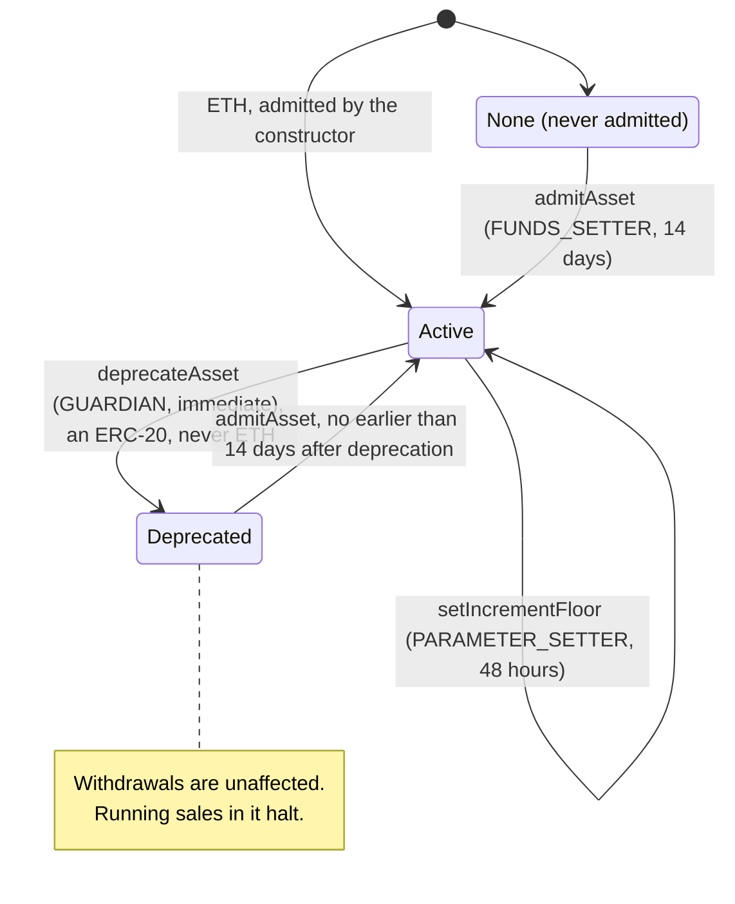
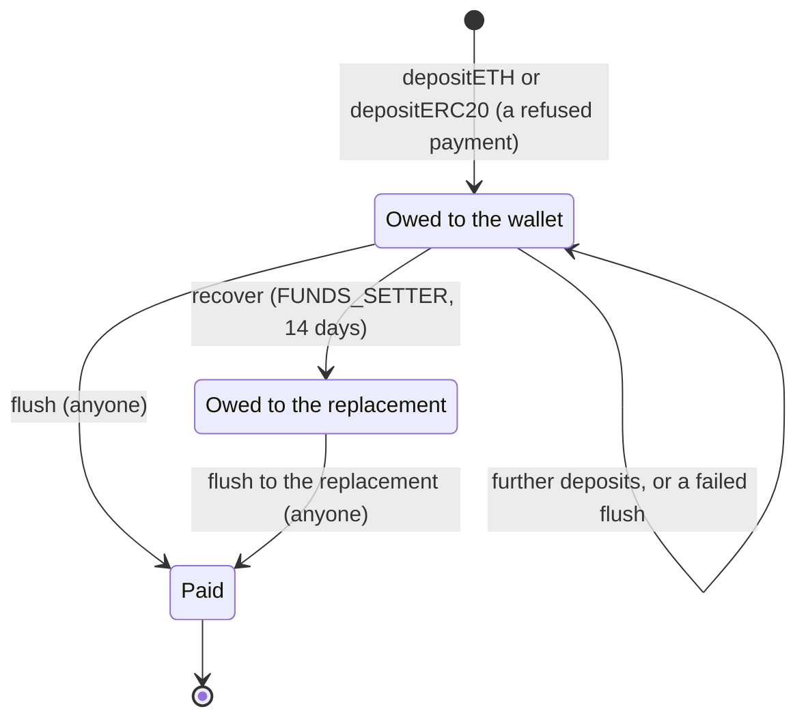
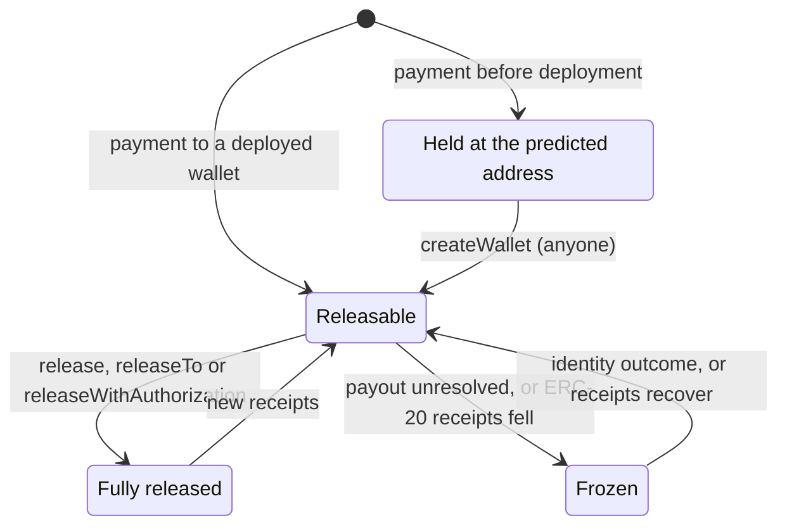
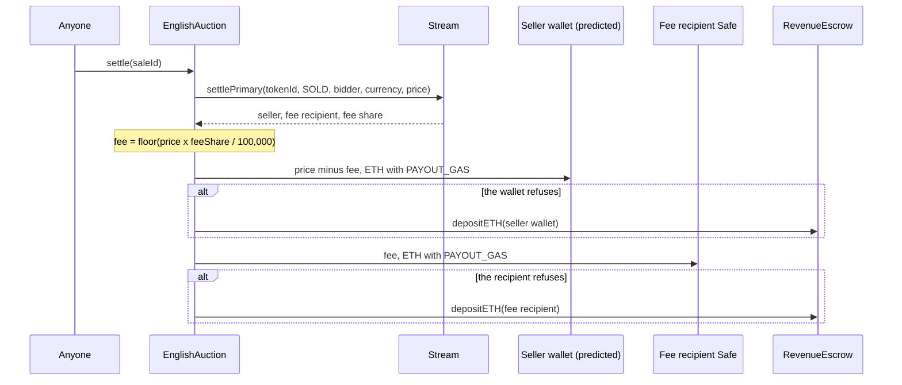
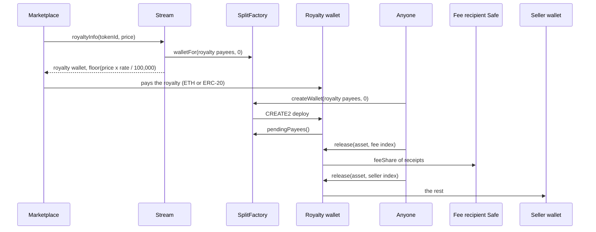
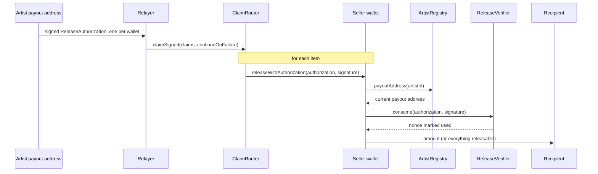
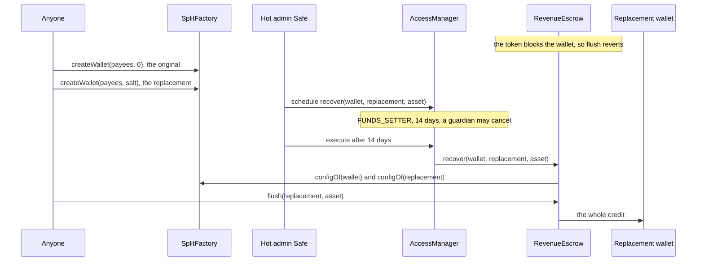
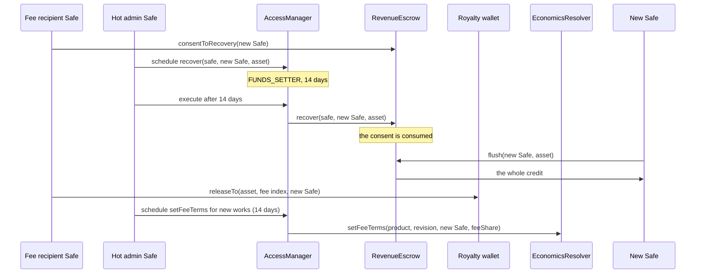

# Economics and payouts

This area decides who is paid, and how: the network's share of primary sales, the secondary
royalty, the split wallets that divide both among the payees, signed and batched releases, the
payment currencies, and the escrow that holds a payment a wallet could not receive. It is for
auditors, for integrators who pay into or claim from split wallets, and for operators who govern
the economics. The contracts live in `src/economics/`. `Stream`, `Editions` and the sale adapters
consume them, and the artist registry resolves artist payouts for them.

> Pre-audit. See the [project status](../../README.md#status).

## Contracts

| Contract | Source | Interface | Responsibility |
| --- | --- | --- | --- |
| `SplitFactory` | [`src/economics/SplitFactory.sol`](../../src/economics/SplitFactory.sol) | [`ISplitFactory`](../../src/economics/interfaces/ISplitFactory.sol) | Permissionless and unowned. Predicts (`walletFor`) and deploys (`createWallet`) split wallets at CREATE2 addresses, pins the payout resolver and the release verifier by code hash, and records each wallet's payee hash (`configOf`). |
| `SplitWallet` | [`src/economics/SplitWallet.sol`](../../src/economics/SplitWallet.sol) | [`ISplitWallet`](../../src/economics/interfaces/ISplitWallet.sol) | Immutable pull-payment wallet for ETH and any ERC-20, with no owner, governance or allowlist. Pays each payee its cumulative share of everything received. |
| `ReleaseVerifier` | [`src/economics/ReleaseVerifier.sol`](../../src/economics/ReleaseVerifier.sol) | [`IReleaseVerifier`](../../src/economics/interfaces/IReleaseVerifier.sol) | Unowned singleton that checks EIP-712 release authorizations and keeps unordered, revocable nonces. |
| `AssetAllowlist` | [`src/economics/AssetAllowlist.sol`](../../src/economics/AssetAllowlist.sol) | [`IAssetAllowlist`](../../src/economics/interfaces/IAssetAllowlist.sol) | Governed payment currencies: a status per asset, an increment floor, a default currency per product, and a deprecation clock for sale adapters. |
| `RevenueEscrow` | [`src/economics/RevenueEscrow.sol`](../../src/economics/RevenueEscrow.sol) | [`IRevenueEscrow`](../../src/economics/interfaces/IRevenueEscrow.sol) | Holds credits for refused payments. Anyone flushes a credit to its wallet; governance moves one only to an identical wallet or to a replacement its holder consented to. |
| `EconomicsResolver` | [`src/economics/EconomicsResolver.sol`](../../src/economics/EconomicsResolver.sol) | [`IEconomicsResolver`](../../src/interfaces/IEconomicsResolver.sol) | Governed per-product fee recipient, fee share, royalty rate and default license. Derives the terms a new work locks (`newWorkTerms`) and the currency a new sale locks (`resolveCurrency`). |
| `ClaimRouter` | [`src/economics/ClaimRouter.sol`](../../src/economics/ClaimRouter.sol) | [`IClaimRouter`](../../src/economics/interfaces/IClaimRouter.sol) | Stateless batch claims across split wallets. Holds no funds. |
| `RevenuePayment`, `TokenTransfer`, `Splits` | [`RevenuePayment.sol`](../../src/economics/RevenuePayment.sol), [`TokenTransfer.sol`](../../src/economics/TokenTransfer.sol), [`Splits.sol`](../../src/economics/Splits.sol) | none (internal libraries) | How a payer pays a wallet (directly, else through the escrow); strict ERC-20 moves and the shared ETH send; the 100,000 denominator, payee-list validation and the entitlement formula. |
| `ProtocolContracts` | [`src/libraries/ProtocolContracts.sol`](../../src/libraries/ProtocolContracts.sol) | none (internal library) | Recognises, by ERC-165, protocol contracts that can neither pull a release nor accept an ETH payment. |
| `ArtistRegistry` | [`src/identity/ArtistRegistry.sol`](../../src/identity/ArtistRegistry.sol) | [`IArtistPayoutResolver`](../../src/economics/interfaces/IArtistPayoutResolver.sol) | Answers `payoutAddress(artistId)` for artist-resolved payees ([Identity and recovery](identity-and-recovery.md)). |

Shared types are in [`EconomicsTypes.sol`](../../src/interfaces/types/EconomicsTypes.sol)
(currency constants, product IDs, `ProductEconomics`, `WorkTerms`) and
[`SaleTypes.sol`](../../src/interfaces/types/SaleTypes.sol) (`PrimaryTerms`, `LockedTerms`,
`Payment`).

## Concepts

Durations name their [delay class](../glossary.md#delay-class): standard (48 hours), funds
(14 days) or successor (30 days) ([`Roles.sol`](../../src/governance/Roles.sol)). The glossary
defines [split wallet](../glossary.md#split-wallet), [seller wallet](../glossary.md#seller-wallet),
[royalty wallet](../glossary.md#royalty-wallet), [escrow](../glossary.md#escrow),
[credit](../glossary.md#credit) and [release](../glossary.md#release).

### Products and launch terms

Every rate is out of `Splits.DENOMINATOR` = 100,000, so the 6.529% royalty is exactly 6,529,
which a 10,000 basis-point denominator cannot express. The [network fee](../glossary.md#network-fee)
share is the network's part of both the primary sale and the royalty; the artist portion is
`100,000 - feeShare`.

| Product | ID (`EconomicsTypes.sol`) | Fee share at launch | Split | Royalty rate | Default currency at genesis |
| --- | --- | --- | --- | --- | --- |
| 6529 Stream | `PRODUCT_STREAM = keccak256("PRODUCT_STREAM")` | 25,000 (`DEFAULT_FEE_SHARE`) | 75/25 | 6,529 (`DEFAULT_ROYALTY_RATE`) | ETH |
| 6529 Stream Editions | `PRODUCT_EDITIONS = keccak256("PRODUCT_EDITIONS")` | 25,000 | 75/25 | 6,529 | ETH |
| 6529 Stream Federated (v1.1) | `PRODUCT_FEDERATED = keccak256("PRODUCT_FEDERATED")` | 10,000 (`FEDERATED_FEE_SHARE`) | 90/10 | 6,529 | ETH |

The `EconomicsResolver` constructor writes these values and the `CC0-1.0` default license at
revision 1, with one fee recipient for all three products (`NETWORK_FEE_RECIPIENT` in
[`script/Deploy.s.sol`](../../script/Deploy.s.sol), which off anvil refuses an address with no
code, balance or nonce). The genesis wiring makes ETH each product's default currency at zero
delay ([`config/genesis.example.json`](../../config/genesis.example.json)). For a federated token
(v1.1, only if needed) the sale adapters take the fee share from the federation registry and the
recipient from `networkFeeRecipient(PRODUCT_FEDERATED)`.

The constructor also sets the **6529 Network Museum** (D140, owner decision 11), `museum()`: the
account a 6529 Stream work goes to when its 1/1 sale ends unsold, unbid or frozen out. 6529 Stream
moves the work there itself, reading `museum()` from its current resolver when the adapter
settles the sale, with no receiver callback (owner decision 17;
[Stream and auctions](stream-and-auctions.md#settle-with-no-bid), AUC-24). It is
`MUSEUM` in [`script/Deploy.s.sol`](../../script/Deploy.s.sol), which off anvil refuses an address
with no code, balance or nonce, like the fee recipient, and should be a Safe or an EOA. The
resolver refuses zero and every contract the fee-recipient rule refuses (ECO-3): the resolver,
its dependencies and the recognised protocol contracts, none of which may end up holding the
network's works (`InvalidMuseum`). Since Stream moves a work with no receiver callback, any
other account, a contract included, receives it. `setMuseum(expectedRevision, next)` changes
it: FUNDS_SETTER, 14 days, compare-and-set on the museum's own revision (`museumRevision()`, 1 at
deployment; `RevisionMismatch`), announced by `MuseumSet(previous, next, revision)` (ECO-37).
Unlike the other settings it reaches sales already running: a change applies to every
settlement after it, while a work already moved to the previous museum stays with it. Nothing is
ever pending for the museum (AUC-33). It moves to network control under D67 and D98.

### Terms locked at mint

Nothing in the resolver reaches back into an existing work or a running sale (ECO-6).
- **6529 Stream.** `Stream._quote` reads `economics(PRODUCT_STREAM)` and the seller wallet
  `walletFor(item.payees, 0)` at mint, and stores the seller, fee share, fee recipient and royalty
  rate. With a non-zero fee share it refuses a fee recipient equal to the seller wallet.
- **6529 Stream Editions.** `createEdition` stores
  `newWorkTerms(PRODUCT_EDITIONS, item.payees)`, the royalty receiver included, at the master's
  current royalty rate. Its fee terms may differ from the master's.
- **Sales** lock their currency at start ([Stream and auctions](stream-and-auctions.md),
  [Editions and sales](editions-and-sales.md)).
- **The one exception** is the royalty rate: `IWorkRecords.setRoyaltyRate` (FUNDS_SETTER, funds
  class, plus every party's signature); a linked edition follows its master
  ([Works and storage](works-and-storage.md)). Payees and the royalty receiver never change.
- **The fee recipient** is locked too, so one that can never be paid would strand every sale
  of every work minted under it. The resolver refuses the contracts it can recognise (ECO-3); for
  the rest, the runbook checks that a new recipient accepts ETH from a 100,000-gas call before
  `setFeeTerms` is scheduled
  ([script README](../../script/README.md#the-network-fee-recipient-must-exist); LIM-ECO-4).

### The royalty receiver

`EconomicsResolver.newWorkTerms(product, payees)` deploys nothing. It returns the seller wallet
`walletFor(payees, 0)`, the product's current fee terms and royalty rate, and the royalty
receiver: the seller wallet at a zero fee share, otherwise the salt-zero wallet of
`Splits.royaltyPayees`, whose two fixed payees are the seller wallet (`100,000 - feeShare`) and the
fee recipient (`feeShare`), ordered by address (ECO-7). Salt zero means one seller wallet per payee
list, and one royalty wallet per seller wallet and fee terms.

`Stream._royaltyReceiver` derives the receiver on every `royaltyInfo` call with one view call to
the pinned factory, about 41K Prague gas for the whole call
([ADR 0004](../adr/0004-gas-budgets-under-glamsterdam.md#the-table)). It reverts when gas runs
short, never returning a zero royalty, and computes `floor(salePrice × rate / 100,000)` without
overflow. `Editions.royaltyInfo` returns its stored receiver.

**No per-collection receiver.** Each work's receiver comes from its own payees and the fee terms
at mint; 6529 Stream has no receiver per collection. A collection whose royalties should all go
to one account (a crowdfund, for example) needs a token contract of its own, a new collection
outside Stream, or that account among each work's payees, which also shares its primary sale.

### Currencies

`CURRENCY_ETH` is `address(0)`. [`CURRENCY_DEFAULT`](../glossary.md#currency_default),
`address(type(uint160).max)`, means "the product's default when the sale starts" and is never a
sale's locked currency. `resolveCurrency(product, requested)` resolves it through the allowlist
and returns only an active currency (ECO-34).

`AssetAllowlist` marks each asset `None`, `Active` (usable by new sales, with a non-zero
[increment floor](../glossary.md#increment-floor)) or `Deprecated` (not usable, and running sales
in it halt); withdrawals never read it (ECO-25). Admission is a sanity probe, not proof of a
standard ERC-20 (ECO-32): governance vets that the token returns `true` on transfer, takes no fee
and does not rebase, and that vetting is the guard against non-standard tokens (see
[token strictness](#wallet-payments-and-the-escrow)). `statusClock(asset)` lets sale adapters stop
a sale's clock while its currency is deprecated (MARKET-1, MARKET-2). Switching a product to USDC is "admit the asset, then change
the default", with no contract change.

### Payee lists and wallet addresses

A payee is `ISplitWallet.Payee { uint256 artistId; address account; uint32 share; }`: a
[fixed payee](../glossary.md#fixed-payee) (`artistId == 0`, paid at `account`) or an
[artist-resolved payee](../glossary.md#artist-resolved-payee) (`account == address(0)`, paid at the
artist registry's payout address at release time, so a recovery also redirects accrued balances). `Splits.validate` accepts only a
[canonical payee list](../glossary.md#canonical-payee-list) of at most 64 payees, a bound that
keeps deployment inside the transaction gas cap (ECO-8). A package item's payees must also be
its parties (at most 16, `PackageRegistry._checkParties`).

Every split wallet has the same init code, and its address commits to the factory, the payee list
and a salt (ECO-9):

```solidity
bytes32 configHash = keccak256(abi.encode(payees)); // payees: ISplitWallet.Payee[]
bytes32 walletSalt = keccak256(abi.encode(configHash, salt));
address wallet = address(uint160(uint256(keccak256(abi.encodePacked(
    bytes1(0xff), address(splitFactory), walletSalt, walletInitCodeHash
)))));
// walletInitCodeHash = keccak256(type(SplitWallet).creationCode), the same for every wallet
```

- The constructor takes no arguments and reads its payees back from the factory's transient
  `pendingPayees()` (ECO-10). Funds sent to a predicted address are held, and split once anyone
  calls `createWallet` (ECO-11); `walletFor` reverts for a list no wallet would accept.
- `createWallet` is idempotent and records `configOf[wallet]`, which `isWallet` reads. Deploying
  a one-payee wallet costs 1,241,422 Prague gas
  ([ADR 0004](../adr/0004-gas-budgets-under-glamsterdam.md#the-table)); no sale pays it.
- Another salt gives an equivalent wallet (same `configHash`), which the escrow accepts as a
  replacement. A `SplitWallet` deployed by any other contract is not the factory's.

### Split wallet accounting

For each asset (ETH is `address(0)`), `observed = balance + totalReleased` is the wallet's
cumulative receipts. Payee `i` is entitled to `floor(observed × share_i / 100,000)` in total, and
`releasable = entitlement - released`. Release order and timing never change totals, and rounding
leaves fewer than `payeeCount` units of each asset unreleasable (ECO-13). For an ERC-20, each
release records the highest `observed` it saw; if receipts fall below that mark, the asset's
releases revert with `ObservedDecreased` until they recover, and nothing is lost (ECO-24).

- **Fixed payees are push, artist-resolved payees pull-only.** Anyone may `release` a fixed payee,
  but only to its own account; only an artist's current payout address, directly or by signature,
  releases an artist-resolved payee, so nobody can push to a lost key (ECO-15, ECO-16; the
  [transition table](#a-payees-balance-in-a-split-wallet) lists every entry point). A nested split
  wallet is a fixed payee.
- **Artist payees stop alone** during a [payout freeze](../glossary.md#payout-freeze)
  (`PayoutUnresolved`) or after a change to the resolver's code (`DependencyCodeChanged`); balances
  keep accruing and fixed payees still release (ECO-18).
- **A split wallet cannot be an artist's payout address,** because it cannot call `release`
  (ECO-19). An artist who wants revenue to flow into another split names it as a fixed payee.
- All state-changing entry points share one transient reentrancy guard, and `observed` and
  `releasable` revert during a release.

### Wallet payments and the escrow

Sale adapters pay a wallet through `RevenuePayment`: directly, and on a clean refusal by the
wallet or the token, as a credit in `RevenueEscrow` under that wallet, never anywhere else
(ECO-26). The routes and their gas are under [a primary sale payout](#a-primary-sale-payout).

**Zero amounts.** The adapters' payouts (`EnglishAuction._pay`, `UniformEditionAuction._pay`)
skip a zero amount, so a zero fee needs no fee recipient. `RevenuePayment` itself refuses a zero
wallet or the escrow as the wallet (`InvalidWallet`) before it looks at the amount, then treats a zero
amount as a no-op. The withdrawal and escrow paths revert on a zero amount instead: a release
with nothing releasable, or a signed release of amount 0 (`NothingToRelease`); an escrow deposit
(`ZeroAmount`); a `flush` or `recover` of a zero credit (`NothingOwed`); an adapter claim with
nothing credited (`NothingToClaim`).

**Token strictness.** `TokenTransfer` moves every ERC-20 that a payout, escrow deposit, flush,
release, direct or EIP-2612 pull, or adapter claim handles. It counts a token call only if it
returns exactly one 32-byte word holding `true`, and requires both balances to move by exactly the
amount (`TokenCallFailed`, `TokenBalanceMismatch`). The auction's Permit2 pull
(`EnglishAuction._collect`) is the exception: Permit2 makes the token call, and the auction
checks only the two balance deltas. Canonical Permit2 accepts a token that returns nothing.
Exact balance deltas therefore hold on every path, but return-value checks do not, and
admitting only standard ERC-20s is the guard (ECO-23, LIM-SAL-7).

**The escrow** keeps credits by `(wallet, asset)`. Deposits are permissionless; anyone flushes a
credit, only to its wallet, and a failed flush keeps it (ECO-27). Governed `recover` moves a
credit only to an identical factory wallet or to a replacement its holder named with
`consentToRecovery` (ECO-28; see the [recovery flows](#escrow-recovery-for-a-blocked-split-wallet)).
The escrow has no `receive`; ETH force-sent to it, and tokens sent without a deposit, are owed to
nobody.

## State machine

### An asset in the allowlist



### An escrow credit



### A payee's balance in a split wallet



| Transition | Caller (role) | Delay | Function |
| --- | --- | --- | --- |
| Asset: none or deprecated to active | FUNDS_SETTER | 14 days; a re-admission also at least 14 days after the deprecation | `AssetAllowlist.admitAsset` |
| Asset: new floor | PARAMETER_SETTER | 48 hours | `AssetAllowlist.setIncrementFloor` |
| Asset: active to deprecated | GUARDIAN | Immediate | `AssetAllowlist.deprecateAsset` |
| Product: new default currency | FUNDS_SETTER | 14 days; zero in the genesis wiring | `AssetAllowlist.setDefaultCurrency` |
| Product: new fee recipient and fee share | FUNDS_SETTER | 14 days | `EconomicsResolver.setFeeTerms` |
| The museum (every product) | FUNDS_SETTER | 14 days | `EconomicsResolver.setMuseum` |
| Product: new royalty rate, or default license | PARAMETER_SETTER | 48 hours | `EconomicsResolver.setRoyaltyRate`, `setDefaultLicense` |
| Credit: created, increased or paid | Anyone (in practice a sale adapter deposits) | None | `RevenueEscrow.depositETH`, `depositERC20`, `flush` |
| Credit: moved to a replacement | FUNDS_SETTER, with an identical wallet or the holder's consent | 14 days | `RevenueEscrow.recover` |
| Balance: predicted to releasable | Anyone | None | `SplitFactory.createWallet` |
| Balance: released, fixed payee | Anyone, to the account (`release`); the account, to any recipient (`releaseTo`); anyone, with the account's signature, to the signed recipient (`releaseWithAuthorization`) | None | `SplitWallet`; `ClaimRouter.claim`, `claimSigned` |
| Balance: released, artist payee | Only the current payout address: `release` pays it, `releaseTo` any recipient; anyone may submit its signature (`releaseWithAuthorization`) | None | `SplitWallet`; `ClaimRouter.claimSigned` |
| Balance: frozen | A pending identity change that moves the payout; or the token, for an ERC-20 below its mark | Until the outcome, or until receipts recover | `ArtistRegistry.payoutAddress` returns zero; `SplitWallet._due` |

A re-admission waits 14 days from the deprecation, not from its scheduling, so one scheduled
ahead cannot undo a deprecation in its own block (MARKET-2, ECO-33). Every governed setter except
`deprecateAsset` and `recover` compares a revision counter that each
change to the same setting bumps, so a queued operation runs only against the exact state it was
written for, and otherwise reverts with `RevisionMismatch` (ECO-4). A guardian can cancel any
scheduled operation during its delay ([Governance](governance.md)); the generated selector, role
and delay matrix is in [roles](../audit/roles.md). The resolver's setters each validate the whole
result (ECO-2, ECO-3) and revert with `UnknownProduct` for a product the constructor did not
configure. `setDefaultLicense` requires an SPDX ID of 1 to 64 bytes
(`Limits.MAX_LICENSE_ID_BYTES`) in `[A-Za-z0-9.+-]` and a non-zero text file ID, and a CC0 license
must name the resolver's `cc0TextFileId`, as `WorkRecords.openRecord` requires (ECO-35).

## Flows

### A primary sale payout



- **Preconditions.** The auction ended with a bid. The seller wallet need not be deployed.
- **ETH** (`RevenuePayment.payETH`) is sent with exactly `PAYOUT_GAS` (100,000); the payer must
  hold that plus `ETH_CALL_RESERVE` (40,000) or the payment reverts (`PaymentInsufficientGas`), so
  a caller cannot starve a payment into the escrow.
- **ERC-20** (`payERC20`) gives the token 300,000 gas (`ERC20_TRANSFER_GAS`). Only a clean refusal
  (a revert, or `false` with nothing moved) goes to the escrow, which pulls exactly the amount;
  the payer then requires a zero allowance (`EscrowAllowanceLeft`). Any other misbehaviour reverts.
  In the auction each ERC-20 payout runs in its own 1,000,000-gas frame: if it fails even through
  the escrow, the auction credits the wallet itself and still delivers the work, and anyone later
  pays the credit with `claimFor(wallet, token)` (MONEY-1, ECO-36).
- **The edition auction** pays its revenue in ETH only, the fee recipient first, then the seller,
  through the same routes ([Editions and sales](editions-and-sales.md#settlement-payouts-and-claims)).
- **Gas.** The first payout to a new seller wallet creates its account, once per payee
  configuration, and costs more, especially under Glamsterdam
  ([ADR 0004](../adr/0004-gas-budgets-under-glamsterdam.md#the-table);
  [Sepolia flows](../../deployments/11155111/flows.md)).

### A royalty payment and its release by fixed payees



- Both payees of a royalty wallet are fixed, so anyone may push each share. The seller wallet's
  share then waits there for its own payees. `ClaimRouter.claim` batches these pushes.

### An artist's signed pull through the claim router

A payee can sign a [release](../glossary.md#signed-release) for anyone to submit, directly to the
wallet or through the router. The `ReleaseVerifier` checks it once for every wallet:
`IReleaseVerifier.Authorization` under the EIP-712 domain `6529 Works Release Verifier`, version
`1`, with this type string (`RELEASE_TYPEHASH`):

```text
ReleaseAuthorization(address wallet,address asset,uint256 payee,address account,address recipient,uint256 amount,uint256 nonce,uint256 deadline)
```



- **Preconditions.** The wallet is deployed. `account` signed, and is the payee's current,
  unfrozen payout address (`NotPayoutAddress`). The deadline, which is inclusive, has not passed.
  The nonce is unused: nonces are unordered, single use and per account across all wallets
  (ECO-20, ECO-21), and `revokeNonce(nonce)` burns one everywhere. Signatures go through
  [`SignatureVerifier`](../../src/libraries/SignatureVerifier.sol) (ECDSA, ERC-2098, EIP-7702
  accounts and capped ERC-1271).
- **Effects.** `amount` is released exactly, or everything releasable for `type(uint256).max`.
  `consume` refuses any caller but the named wallet (`WrongWallet`). A failed release consumes
  nothing, and amounts are bounds, so the same signature works once enough has accrued (ECO-22).
  A recovery that moves the payout voids the old key's unused authorizations. A push can pre-empt
  a fixed payee's exact-amount signed release (LIM-ECO-3), and a payout that returns to an earlier
  key revives that key's unexpired authorizations (LIM-ECO-2).
- **The router** has no storage, owner, approvals, `receive` or `fallback`; the wallets enforce
  who may pull, so it cannot redirect funds (ECO-29). `claim` takes up to `MAX_CLAIMS` = 50 plain
  items `{wallet, asset, payee}`, each calling `release`, so it serves fixed payees only (an
  artist item fails with `NotPayoutAddress`). `claimSigned` takes up to `MAX_SIGNED_CLAIMS` = 20
  `{authorization, signature}` items.
- **Atomic mode** (`false`) gives each item all remaining gas; any failure reverts the batch with
  `ClaimCallFailed(index, wallet, size, reason)`.
- **Continue mode** (`true`) offers each item `gasleft() / (items remaining + 1)` and reverts with
  `ClaimInsufficientGas(index, available)` if that is below `MIN_ITEM_GAS` (200,000) or
  `MIN_SIGNED_ITEM_GAS` (450,000). A failed item emits `ClaimFailed` and releases 0, unless it was
  offered less than `SHORTFALL_REVERT_CEILING` (1,500,000) and either spent all but EIP-150's
  1/64 or failed for want of ERC-1271 gas: then the batch reverts, so gas estimation raises the
  limit instead of silently starving an item.
- **Containment.** A target without code fails (`ClaimTargetHasNoCode`); a success that does not
  return exactly one word fails (`InvalidClaimReturnData`). At most one word of return data and
  256 bytes of revert data are copied.
- **Keepers.** The minimums are Prague-sized floors. A first signed release on Sepolia's
  Glamsterdam costs about 716,000 gas, and a full batch of first releases may not fit one
  transaction; it then reverts rather than paying part, so split it
  ([ADR 0004](../adr/0004-gas-budgets-under-glamsterdam.md#security-impact)). A party to an item
  (a co-payee whose `receive` burns gas, a recipient, a token) can make its item look short of gas
  after the keeper estimated: below the ceiling that reverts the batch, from the ceiling up the
  item is skipped. Simulate privately, put items with contract payees or unfamiliar tokens last or
  alone, and drop an item whose revert names its index.

### Escrow recovery for a blocked split wallet



- **Preconditions.** Both wallets are deployed (an undeployed wallet has no `configOf`) and have
  the same configuration.
- **Effects.** The whole credit moves and adds to anything the replacement is owed; `totalOwed`
  is unchanged until the flush. Only escrow credits move: funds already in the blocked wallet stay
  there until the token unblocks it (LIM-ECO-1).

### Escrow recovery for a blocked fee-recipient Safe



- **Why.** A token such as USDC can block the network fee Safe. Fees in that token are then
  credited to the escrow under the Safe, and every existing royalty wallet keeps the Safe as a
  fixed payee, because works lock their terms at mint.
- **Consent.** Without the Safe's consent, or to any other address, `recover` reverts with
  `RecoveryNotConsented`, even after the full delay. One consent covers one recovery in one asset;
  the Safe can change or withdraw (zero) a consent not yet used.
- **Royalty shares** are not escrowed. Only the Safe can move its share, with `releaseTo`; a lost
  Safe's share stays. `setFeeTerms` changes the recipient for new works only.

## Rules and invariants

| ID | Rule | Enforced in | Tested by |
| --- | --- | --- | --- |
| ECO-1 | Rates and shares are out of 100,000; the launch royalty 6,529 is exactly 6.529%. | `Splits.DENOMINATOR`; `EconomicsResolver` constants | [`SplitMath.t.sol`](../../test/economics/SplitMath.t.sol) `test_RoyaltyRateIsExact`; [`EconomicsResolver.t.sol`](../../test/economics/EconomicsResolver.t.sol) `test_LaunchDefaults` |
| ECO-2 | A product's fee share is below 100,000, its royalty rate at most 100,000, and a non-zero fee share names a non-zero recipient. | `EconomicsResolver._validate` (constructor, `setFeeTerms`, `setRoyaltyRate`) | [`EconomicsResolver.t.sol`](../../test/economics/EconomicsResolver.t.sol) `test_ConstructorEmitsAndValidates`, `test_SetFeeTermsIsCompareAndSet` |
| ECO-3 | The fee recipient is never the resolver, its allowlist, factory or verifier, or a recognised protocol contract. | `EconomicsResolver._validate`; `ProtocolContracts.isProtocolContract` | [`RecipientValidation.t.sol`](../../test/integration/RecipientValidation.t.sol) `test_FeeRecipientRefusesSystemContracts`; [`EconomicsResolver.t.sol`](../../test/economics/EconomicsResolver.t.sol) `test_FeeRecipientMustBePayable` |
| ECO-4 | Every governed economics setter (all but `deprecateAsset` and `recover`) is compare-and-set on its own revision, and every change, deprecation included, bumps it (the museum's is `museumRevision`). | `EconomicsResolver._check`; `AssetAllowlist._checkRevision` | [`EconomicsResolver.t.sol`](../../test/economics/EconomicsResolver.t.sol) `test_SetRoyaltyRateIsCompareAndSetOnItsOwnRevision`; [`AssetAllowlist.t.sol`](../../test/economics/AssetAllowlist.t.sol) `test_EveryAssetChangeBumpsTheRevision`, `test_QueuedAdmissionCannotReviveAfterEmergencyDeprecation`, `test_DefaultCurrencyIsCompareAndSet` |
| ECO-5 | Setters are restricted to their roles and delays, and non-payable. | AccessManager (`restricted`) | [`EconomicsResolver.t.sol`](../../test/economics/EconomicsResolver.t.sol) `test_RolesAndDelaysThroughAccessManager`; [`AssetAllowlist.t.sol`](../../test/economics/AssetAllowlist.t.sol) `test_TimelockedAdmissionThroughAccessManager`; [`RevenueEscrow.t.sol`](../../test/economics/RevenueEscrow.t.sol) `test_RecoverIsGovernedInTheFundsClass` |
| ECO-6 | Economics changes apply to new works only: existing works keep their seller, fee terms and royalty receiver. | `Stream._quote`, `Stream._store`; `Editions.createEdition` | [`EconomicsResolver.t.sol`](../../test/economics/EconomicsResolver.t.sol) `test_ChangesApplyToNewWorksOnly`; [`StreamEconomics.t.sol`](../../test/stream/StreamEconomics.t.sol) `test_receiverAtZeroFeeAndAfterAFeeChange` |
| ECO-7 | The royalty receiver is the salt-zero wallet of `Splits.royaltyPayees`, or the seller wallet at a zero fee share; `Stream`, `Editions` and the resolver derive the same address. | `EconomicsResolver.newWorkTerms`; `Stream._royaltyReceiver` | [`StreamEconomics.t.sol`](../../test/stream/StreamEconomics.t.sol) `test_receiverIsTheResolversAndTheFactorys`; [`EconomicsResolver.t.sol`](../../test/economics/EconomicsResolver.t.sol) `test_RoyaltyReceiverMatchesTheSharedDerivation`, `test_ZeroFeeShareOmitsTheFeePayee` |
| ECO-8 | A payee list is canonical: 1 to 64 entries, each exactly fixed or artist-resolved with a non-zero share, strictly ascending by `(artistId, account)`, shares summing to 100,000. | `Splits.validate` (wallet constructor, `walletFor`) | [`SplitFactory.t.sol`](../../test/economics/SplitFactory.t.sol) `test_RejectsEmptyAndOversizedPayeeLists`, `test_RejectsUnsortedAndDuplicatePayees`, `test_RejectsSharesNotSummingToDenominator`; [`SplitMath.t.sol`](../../test/economics/SplitMath.t.sol) `testFuzz_ValidationAcceptsExactlyCanonicalLists` |
| ECO-9 | A wallet's address is the documented CREATE2 derivation over the factory, the payee list and the salt; the deployed wallet is always at the prediction. | `SplitFactory.walletFor`, `createWallet` | [`SplitFactory.t.sol`](../../test/economics/SplitFactory.t.sol) `test_AddressIsTheDocumentedCreate2Derivation`, `test_CreateWalletRevertsIfTheDeployedAddressDiffers`, `testFuzz_PredictionMatchesDeployment` |
| ECO-10 | `pendingPayees` is non-empty only during `createWallet`, and the wallet stores exactly the list it was deployed for. | `SplitFactory._setPending`, `createWallet` | [`SplitFactory.t.sol`](../../test/economics/SplitFactory.t.sol) `test_PendingPayeesExistOnlyDuringCreation`, `test_PayeeListSurvivesTheHandOffExactly` |
| ECO-11 | Funds sent to a predicted address before deployment are split once the wallet exists. | `SplitWallet._observed` | [`SplitFactory.t.sol`](../../test/economics/SplitFactory.t.sol) `test_FundsSentBeforeDeploymentAreSplitAfterwards`; [`RevenuePayment.t.sol`](../../test/economics/RevenuePayment.t.sol) `test_PayETHToUndeployedWalletIsKeptForIt` |
| ECO-12 | The factory deploys no wallet if the resolver or verifier code changed since installation. | `SplitFactory.createWallet` | [`SplitFactory.t.sol`](../../test/economics/SplitFactory.t.sol) `test_CreateWalletFailsClosedIfAPinnedDependencyChanges`, `test_ConstructorRejectsDelegatedEOADependencies` |
| ECO-13 | A payee's releases never exceed `floor(observed × share / 100,000)`, and the unreleasable dust stays below the payee count. | `SplitWallet._due`; `Splits.entitlement` | [`EconomicsInvariant.t.sol`](../../test/economics/invariant/EconomicsInvariant.t.sol) `invariant_ReleasedWithinEntitlement`, `invariant_DustIsBounded`; [`SplitMath.t.sol`](../../test/economics/SplitMath.t.sol) `testFuzz_ReleaseTimingDoesNotChangeTotals` |
| ECO-14 | A wallet conserves value: everything released plus its balance equals everything received, and recipients hold exactly what was released. | `SplitWallet._release` | [`EconomicsInvariant.t.sol`](../../test/economics/invariant/EconomicsInvariant.t.sol) `invariant_WalletConservesValue`, `invariant_RecipientsReceivedEverythingReleased` |
| ECO-15 | Anyone may release a fixed payee, but only to its own account. | `SplitWallet.release` | [`SplitWallet.t.sol`](../../test/economics/SplitWallet.t.sol) `test_AnyoneMayReleaseAFixedPayeeButOnlyToItsAccount` |
| ECO-16 | Only an artist's current payout address, directly or by signature, releases an artist-resolved payee; nobody can push to a lost key. | `SplitWallet.release`, `releaseTo`, `releaseWithAuthorization` | [`SplitWallet.t.sol`](../../test/economics/SplitWallet.t.sol) `test_ArtistPayeeIsPullOnly`, `test_LostArtistKeyCannotBePushedBeforeRecovery`, `test_ArtistPayeeFollowsResolverAtReleaseTime`; [`ClaimRouter.t.sol`](../../test/economics/ClaimRouter.t.sol) `test_PlainArtistItemsFailAndContinueModeSkipsThem` |
| ECO-17 | `releaseTo` is callable only by the payee's current payout address, and no release pays zero or the wallet itself. | `SplitWallet.releaseTo`, `_release` | [`SplitWallet.t.sol`](../../test/economics/SplitWallet.t.sol) `test_ReleaseToRequiresTheCurrentPayoutAddress`, `test_RejectsZeroAndSelfRecipients` |
| ECO-18 | While the payout is unresolved (frozen) or the resolver's code changed, only the artist-resolved payees stop; fixed payees release. | `SplitWallet._payout`; `ArtistRegistry.payoutAddress` | [`SplitWallet.t.sol`](../../test/economics/SplitWallet.t.sol) `test_UnresolvedOrFailingResolverBlocksOnlyTheArtistPayee`, `test_ResolverCodeChangeFailsClosedForArtistPayeesOnly`; [`IdentityRecovery.t.sol`](../../test/integration/IdentityRecovery.t.sol) `test_LostKeyOverrideFreezesThePayoutThenRecovers` |
| ECO-19 | A deployed split wallet, and the protocol contracts that cannot pull, never become an artist's payout address. | `ArtistRegistry._payoutAllowed` | [`RecipientValidation.t.sol`](../../test/integration/RecipientValidation.t.sol) `test_PayoutRefusesProtocolContractsThatCannotPull`, `test_PredictedWalletIsCaughtOnlyOnceDeployed`; [`SplitWallet.t.sol`](../../test/economics/SplitWallet.t.sol) `test_NestedWalletCannotBeAnArtistPayoutAddress` |
| ECO-20 | A signed release works once per `(account, nonce)`, only in the wallet and on the chain it names, before its deadline, and only while its signer is the payee's payout address. | `ReleaseVerifier.consume`; `SplitWallet.releaseWithAuthorization` | [`ReleaseVerifier.t.sol`](../../test/economics/ReleaseVerifier.t.sol) `test_ReplayAndRevokedNoncesRevert`, `test_OnlyTheNamedWalletConsumesAnAuthorization`, `test_SignatureDoesNotReplayOnAnotherChainOrVerifier`, `test_ExpiredAuthorizationReverts`; [`IdentityRecovery.t.sol`](../../test/integration/IdentityRecovery.t.sol) `test_SignedReleaseIsVoidedByRecovery` |
| ECO-21 | Replay protection is keyed on the nonce, not the signature bytes; nonces in one bitmap word stay independent; one revocation covers every wallet. | `ReleaseVerifier._useNonce`, `revokeNonce` | [`ReleaseVerifier.t.sol`](../../test/economics/ReleaseVerifier.t.sol) `test_ReplayIsKeyedOnTheNonceNotTheSignatureBytes`, `test_NonceBitmapNoAliasingWithinAWord`, `test_OneRevocationCoversEveryWallet` |
| ECO-22 | A signed release that fails does not consume its nonce. | `SplitWallet.releaseWithAuthorization` (atomic revert) | [`ReleaseVerifier.t.sol`](../../test/economics/ReleaseVerifier.t.sol) `test_AmountAboveReleasableRevertsWithoutConsumingNonce`, `test_FailedPaymentRollsBackNonce`, `test_PushCanPreemptAFixedPayeesSignedRelease` |
| ECO-23 | Every ERC-20 move, the Permit2 pulls included, changes both balances by exactly the amount. Moves through `TokenTransfer` also require exactly one `true` word; the Permit2 pulls check balances only. Fee-on-transfer and rounding tokens therefore revert on every path, but a token that returns nothing can pass a Permit2 pull: admitting only standard ERC-20s is the guard. | `TokenTransfer._moveExact`, `_call`; `EnglishAuction._collect`; governance at `AssetAllowlist.admitAsset` | [`HostileTokens.t.sol`](../../test/economics/HostileTokens.t.sol) `test_FeeOnTransfer_PaymentRevertsAtomically`, `test_NoReturn_PaymentRevertsAtomically`, `test_ReturnsFalse_PaymentTriesEscrowThenRevertsAtomically`, `test_NonCanonicalTrue_FailsClosedOnEveryPath`, `test_Rebasing_RoundingPaymentRevertsAtomically` |
| ECO-24 | An ERC-20 whose receipts fall below the recorded mark freezes that asset's releases without loss. | `SplitWallet._due` | [`SplitWallet.t.sol`](../../test/economics/SplitWallet.t.sol) `test_ShrinkingBalanceFailsClosedUntilRecovered`; [`HostileTokens.t.sol`](../../test/economics/HostileTokens.t.sol) `test_Rebasing_NegativeRebaseFreezesReleasesWithoutLoss`; [`EconomicsInvariant.t.sol`](../../test/economics/invariant/EconomicsInvariant.t.sol) `invariant_ObservedNeverDecreases` |
| ECO-25 | Withdrawals never read the allowlist: deprecated and never-admitted assets stay withdrawable from wallets and the escrow. | `SplitWallet`, `RevenueEscrow` (no allowlist reference) | [`SplitWallet.t.sol`](../../test/economics/SplitWallet.t.sol) `test_DeprecatedAndNeverAdmittedAssetsStayWithdrawable`; [`RevenueEscrow.t.sol`](../../test/economics/RevenueEscrow.t.sol) `test_DeprecatedAssetCreditsStillFlush` |
| ECO-26 | A wallet payment reaches the wallet or a credit under that wallet, never anywhere else, and a caller cannot starve it into the escrow. | `RevenuePayment.payETH`, `payERC20` | [`RevenuePayment.t.sol`](../../test/economics/RevenuePayment.t.sol) `testFuzz_PaymentsAlwaysReachTheWalletOrItsCredit`, `test_CallerCannotStarveETHPaymentIntoEscrow`, `test_CallerCannotStarveTokenPaymentIntoEscrow`, `test_EscrowRouteRevertsIfAnAllowanceSurvives` |
| ECO-27 | The escrow is solvent per asset, credits are isolated per `(wallet, asset)`, and a flush pays only the credited wallet. | `RevenueEscrow._credit`, `flush` | [`EconomicsInvariant.t.sol`](../../test/economics/invariant/EconomicsInvariant.t.sol) `invariant_EscrowIsSolventAndMatchesTheModel`; [`RevenueEscrow.t.sol`](../../test/economics/RevenueEscrow.t.sol) `test_CreditsAreIsolatedPerWalletAndAsset`, `test_FailedFlushKeepsTheCredit` |
| ECO-28 | `recover` moves a factory wallet's credit only to a distinct wallet with the same configuration, and any other account's credit only to the replacement it consented to, consuming the consent. | `RevenueEscrow.recover` | [`RevenueEscrow.t.sol`](../../test/economics/RevenueEscrow.t.sol) `test_RecoverMovesCreditsToAnEquivalentReplacement`, `test_RecoverRejectsWalletsThatAreNotEquivalent`, `test_RecoverRefusesAnAccountsCreditWithoutMatchingConsent`; [`EscrowRecovery.t.sol`](../../test/integration/EscrowRecovery.t.sol) `test_BlockedFeeRecipientCreditMovesWithItsConsent`, `test_GovernanceCannotMoveTheCreditWithoutConsent` |
| ECO-29 | The claim router and payers keep no funds or allowances, and the router cannot redirect a release. | `ClaimRouter` (no storage, no `receive`) | [`EconomicsInvariant.t.sol`](../../test/economics/invariant/EconomicsInvariant.t.sol) `invariant_IntermediariesHoldNothing`; [`ClaimRouter.t.sol`](../../test/economics/ClaimRouter.t.sol) `test_ReentrantRecipientCannotDoubleClaimOrRedirect`; [`RecipientValidation.t.sol`](../../test/integration/RecipientValidation.t.sol) `test_StrangerCannotMoveTheArtistShareThroughTheRouter` |
| ECO-30 | Batches are bounded (50 plain, 20 signed); continue mode gives each item at least its minimum and reverts on a shortfall below the ceiling. | `ClaimRouter.claim`, `claimSigned`, `_call` | [`ClaimRouter.t.sol`](../../test/economics/ClaimRouter.t.sol) `test_BatchesUpToMaxClaimsAndRejectsMore`, `test_SignedBatchesAreCappedAndNeedTheirMinimumGas`, `test_ShortfallRevertsOnlyBelowTheCeiling`, `test_ArmedCoPayeeIsSkippedOnceItsItemGetsTheCeiling`, `test_ERC1271ShortfallRevertsBelowTheCeiling` |
| ECO-31 | The worst-case batches and the 64-payee wallet deployment fit within 75% of the EIP-7825 cap, in Prague gas. | `Splits.MAX_PAYEES`; `ClaimRouter` bounds | [`GasCap.t.sol`](../../test/economics/GasCap.t.sol) `test_WorstCaseAtomicClaimBatchFitsTheCap`, `test_WorstCaseAtomicSignedBatchFitsTheCap`, `test_MaximumWalletDeploymentFitsTheCap` |
| ECO-32 | Admission refuses accounts without code, EIP-7702 delegated accounts, unreadable or inconsistent tokens, zero floors and already-active assets. | `AssetAllowlist.admitAsset`, `_admit` | [`AssetAllowlist.t.sol`](../../test/economics/AssetAllowlist.t.sol) `test_AdmitRejectsNonTokens`, `test_AdmitRejectsABalanceAboveTotalSupply`, `test_AdmitRejectsZeroFloorAndActiveAssets` |
| ECO-33 | A deprecated asset returns only by re-admission, no earlier than 14 days after the deprecation, even if scheduled before it. | `AssetAllowlist.admitAsset` | [`AssetAllowlist.t.sol`](../../test/economics/AssetAllowlist.t.sol) `test_DeprecateThenReadmit`; [`AuctionCurrencyFreeze.t.sol`](../../test/sales/auction/AuctionCurrencyFreeze.t.sol) `test_AdmitAsset_AReadmissionScheduledAheadCannotUndoADeprecation` |
| ECO-34 | The default currency and `resolveCurrency` fail closed: an unconfigured or inactive currency reverts. | `AssetAllowlist.defaultCurrency`; `EconomicsResolver.resolveCurrency` | [`AssetAllowlist.t.sol`](../../test/economics/AssetAllowlist.t.sol) `test_DefaultCurrencyFailsClosed`; [`EconomicsResolver.t.sol`](../../test/economics/EconomicsResolver.t.sol) `test_ResolveCurrencyThroughTheAllowlist` |
| ECO-35 | A CC0 default license names the CC0 text the resolver was deployed with. | `EconomicsResolver.setDefaultLicense` | [`EconomicsResolver.t.sol`](../../test/economics/EconomicsResolver.t.sol) `test_ACc0DefaultLicenseNamesThePinnedText` |
| ECO-36 | An ERC-20 settlement payout that fails even through the escrow does not hold up the work; the credit pays only its own account. | `EnglishAuction._pay`, `settlePayout`, `claimFor` | [`AuctionPayoutFailures.t.sol`](../../test/sales/auction/AuctionPayoutFailures.t.sol) `test_Settle_ATokenThatBlocksTheAuctionDoesNotHoldTheWork`, `test_Settle_ABlockedWalletIsStillPaidThroughTheEscrow`, `test_ClaimFor_PaysOnlyTheAccountItself` |
| ECO-37 | The museum is set at deployment and is never zero, the resolver or one of its dependencies, or a recognised protocol contract; `setMuseum` is FUNDS_SETTER (14 days), compare-and-set on the museum's revision, and emits the old and new museum and the revision. | `EconomicsResolver._setMuseum`, `setMuseum`; `ProtocolContracts.isProtocolContract` | [`EconomicsResolver.t.sol`](../../test/economics/EconomicsResolver.t.sol) `test_Museum_SetAtDeployment`, `test_SetMuseum_IsCompareAndSet`, `test_SetMuseum_RefusesZeroAndTheFeeRecipientRule`, `test_SetMuseum_IsInTheFundsClass`; [`Museum.t.sol`](../../test/integration/Museum.t.sol) `test_GenesisWiresTheMuseumInTheFundsClass`, `test_SetMuseum_GovernedChangeWaitsFourteenDays`, `test_SetMuseum_RefusesZeroAndSystemContracts` |
| ECO-38 | ETH, the native currency, is never deprecated: `deprecateAsset` refuses it for every caller, so no guardian can freeze an ETH sale (the rc.2 review's MONEY-M1 and G-2). | `AssetAllowlist.deprecateAsset` | [`AssetAllowlist.t.sol`](../../test/economics/AssetAllowlist.t.sol): `test_DeprecateAsset_RefusesEth`; [`AuctionCurrencyFreeze.t.sol`](../../test/sales/auction/AuctionCurrencyFreeze.t.sol): `test_DeprecateAsset_OneGuardianCannotFreezeEthSales`, `test_DeprecateAsset_EthIsRefusedThroughGovernance` |

## Events

The events of these contracts are listed under
[SplitFactory and SplitWallet](../integrators/events-and-indexing.md#splitfactory-and-splitwallet),
[ReleaseVerifier and ClaimRouter](../integrators/events-and-indexing.md#releaseverifier-and-claimrouter),
[RevenueEscrow](../integrators/events-and-indexing.md#revenueescrow) and
[AssetAllowlist and EconomicsResolver](../integrators/events-and-indexing.md#assetallowlist-and-economicsresolver).
No event announces a work's predicted seller and royalty wallets: read them from the token's views
(`IStream.work`, `royaltyInfo`), since funds can reach them long before any `WalletCreated`.

## Failure modes and recovery

Accepted risks are listed once, with their IDs, in
[known limitations](../audit/known-limitations.md).

| Failure | Effect | Recovery |
| --- | --- | --- |
| A token blocks a split wallet (as USDC can) (LIM-ECO-1) | Payments to it in that token are credited to the escrow; `flush` reverts; funds already in the wallet stay there. | Recover the credit to an identical wallet ([flow](#escrow-recovery-for-a-blocked-split-wallet)). |
| A token blocks the network fee Safe | Fees in that token are escrowed under the Safe; pushing its royalty share reverts. | See [the flow](#escrow-recovery-for-a-blocked-fee-recipient-safe). |
| A token blocks a fixed payee | `release` to its account reverts. | The payee calls `releaseTo` ([`HostileTokens.t.sol`](../../test/economics/HostileTokens.t.sol) `test_Blocklist_BlockedPayeeReleaseRevertsAndRedirectWorks`). |
| A wallet's `receive` needs more than 100,000 gas | The ETH payout is credited to the escrow. | Anyone calls `flush`, which forwards all remaining gas. Split wallets have an empty `receive`. |
| An ERC-20 payout fails even through the escrow | The work is delivered and the English auction credits the wallet; edition sales pay only ETH. | Anyone calls `claimFor(wallet, token)` once the token works again. |
| A non-standard token is admitted by mistake (LIM-SAL-7) | Fee-on-transfer and rounding tokens revert on every path. A token that returns nothing or returns `false` fails on every `TokenTransfer` path, but one that returns nothing passes a Permit2 pull; in the auction its payouts and refunds then fail and stay as credits. | Deprecate it (GUARDIAN, immediate). Prevention is governance vetting before `admitAsset`. |
| An ERC-20's balance in a wallet falls (negative rebase) | That asset's releases revert with `ObservedDecreased`; nothing is lost. | Releases resume when receipts reach the recorded mark again. |
| An artist's key is lost or stolen | A thief holding it can pull until an override that moves the payout is staged; nobody can push to it. | Identity recovery redirects the payout, accrued balances included ([Identity and recovery](identity-and-recovery.md)). |
| A fixed payee's key is lost | Its share stays in the wallet; wallets have no governance. | None. Use artist-resolved payees for artists, and Safes for network accounts. |
| A continue-mode batch reverts with `ClaimInsufficientGas` | Nothing is paid. | Raise the gas limit; drop an item that keeps failing below the ceiling, or batch it alone. |
| A product's default currency is deprecated | `defaultCurrency` and `resolveCurrency(CURRENCY_DEFAULT)` revert; default-currency sales cannot start. | Set another active default (FUNDS_SETTER, 14 days), or re-admit the asset. |
| Funds sent to an address computed for a payee list no wallet accepts | No wallet can ever be deployed there. | None. Compute addresses with `walletFor`, which reverts for such a list. |
| A fee recipient that cannot accept ETH from a 100,000-gas call, and that the resolver does not recognise (LIM-ECO-4) | Every ETH fee is escrowed under it; if it cannot call `consentToRecovery`, the credits stay. | Prevention only: the runbook check before `setFeeTerms` is scheduled. |

## Parameters and limits

| Parameter | Value | Source |
| --- | --- | --- |
| Share denominator | 100,000 | `Splits.DENOMINATOR` |
| Payees per split wallet | 1 to 64 | `Splits.MAX_PAYEES` |
| Payees per package item | At most the item's parties, at most 16 | `Limits.MAX_PARTIES`; `PackageRegistry._checkParties` |
| Payees per royalty wallet | 2, or none (the seller wallet) at a zero fee share | `Splits.royaltyPayees`; `EconomicsResolver.newWorkTerms` |
| Launch fee share: Stream and Editions; Federated | 25,000; 10,000 | `EconomicsResolver.DEFAULT_FEE_SHARE`, `FEDERATED_FEE_SHARE` |
| Launch royalty rate | 6,529 (6.529%) | `EconomicsResolver.DEFAULT_ROYALTY_RATE` |
| Fee share bound; royalty rate bound | Below 100,000; at most 100,000 | `EconomicsResolver._validate`; `Stream._quote` |
| Launch default license | `CC0-1.0` with the genesis CC0 text | `EconomicsResolver.CC0`, `cc0TextFileId` |
| The museum | `MUSEUM` at deployment; never zero or a system contract | `EconomicsResolver.museum`, `setMuseum` |
| SPDX ID length | 1 to 64 bytes | `Limits.MAX_LICENSE_ID_BYTES` |
| ETH increment floor at launch | 0.001 ETH (deploy default) | `ETH_INCREMENT_FLOOR` in [`script/Deploy.s.sol`](../../script/Deploy.s.sol) |
| Default currency at genesis | ETH for all three products | [`config/genesis.example.json`](../../config/genesis.example.json) |
| Re-admission wait | 14 days after the deprecation | `Roles.FUNDS` in `AssetAllowlist.admitAsset` |
| ETH payout gas; reserve on top | 100,000; 40,000 | `EnglishAuction.PAYOUT_GAS`, `UniformEditionAuction.PAYOUT_GAS`; `RevenuePayment.ETH_CALL_RESERVE` |
| Token gas on the direct ERC-20 route | 300,000 | `RevenuePayment.ERC20_TRANSFER_GAS` |
| Auction ERC-20 payout frame | 1,000,000 | `EnglishAuction._ERC20_PAYOUT_GAS` (private) |
| Claims per batch: plain; signed | 50; 20 | `ClaimRouter.MAX_CLAIMS`, `MAX_SIGNED_CLAIMS` |
| Minimum gas per item in continue mode: plain; signed | 200,000; 450,000 | `ClaimRouter.MIN_ITEM_GAS`, `MIN_SIGNED_ITEM_GAS` |
| Shortfall revert ceiling | 1,500,000 | `ClaimRouter.SHORTFALL_REVERT_CEILING` |
| Revert data kept per failed item | 256 bytes | `ClaimRouter._MAX_REASON_BYTES` (private) |
| ERC-1271 gas; signature length | 200,000; at most 4,096 bytes | `SignatureVerifier.ERC1271_GAS_LIMIT`, `MAX_SIGNATURE_LENGTH` |
| Release nonces per bitmap word | 256 | `ReleaseVerifier._useNonce` |
| Release verifier domain | `6529 Works Release Verifier`, version `1` | `ReleaseVerifier` constructor |
| Per-transaction gas cap tested | 16,777,216 (EIP-7825), budget 75% of it | [`GasCap.t.sol`](../../test/economics/GasCap.t.sol) |

Gas figures for wallet deployment, releases, `royaltyInfo` and settlement are in the
[ADR 0004 table](../adr/0004-gas-budgets-under-glamsterdam.md#the-table).

## Differences from the ADRs

See the [register](README.md#differences-from-the-adrs).

## References

- Code: [`src/economics/`](../../src/economics/) and its [README](../../src/economics/README.md);
  [`IEconomicsResolver`](../../src/interfaces/IEconomicsResolver.sol);
  [`ProtocolContracts.sol`](../../src/libraries/ProtocolContracts.sol);
  [`SignatureVerifier.sol`](../../src/libraries/SignatureVerifier.sol);
  [`Stream.sol`](../../src/stream/Stream.sol); [`Editions.sol`](../../src/editions/Editions.sol);
  [`EnglishAuction.sol`](../../src/sales/EnglishAuction.sol);
  [`UniformEditionAuction.sol`](../../src/sales/UniformEditionAuction.sol).
- ADRs: [ADR 0001 §5](../adr/0001-v1-scope.md#5-sales-and-auctions) and
  [§7](../adr/0001-v1-scope.md#7-economics);
  [ADR 0003, Economics](../adr/0003-build-time-decisions.md#economics-amends-adr-0001-7);
  [ADR 0004](../adr/0004-gas-budgets-under-glamsterdam.md#the-table).
- Tests: [`test/economics/`](../../test/economics/);
  [`EscrowRecovery.t.sol`](../../test/integration/EscrowRecovery.t.sol);
  [`RecipientValidation.t.sol`](../../test/integration/RecipientValidation.t.sol);
  [`AuctionPayoutFailures.t.sol`](../../test/sales/auction/AuctionPayoutFailures.t.sol). How to run them:
  [testing docs](../testing/README.md).
- Related pages: [Stream and auctions](stream-and-auctions.md),
  [Editions and sales](editions-and-sales.md), [Identity and recovery](identity-and-recovery.md),
  [Governance](governance.md); [invariants](../audit/invariants.md);
  [buying, bidding and settling](../integrators/buying-bidding-settling.md).
