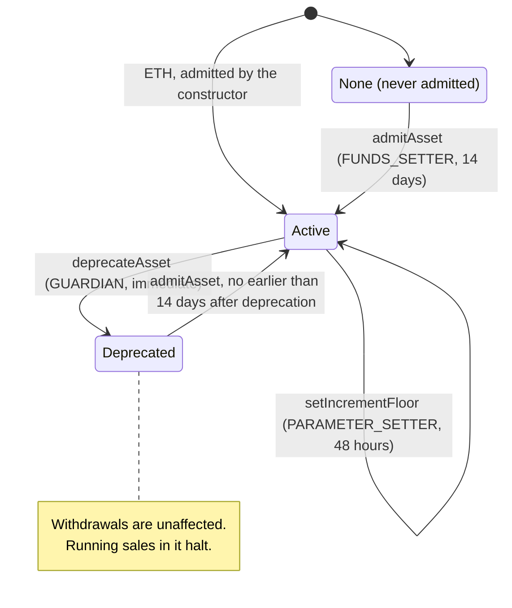
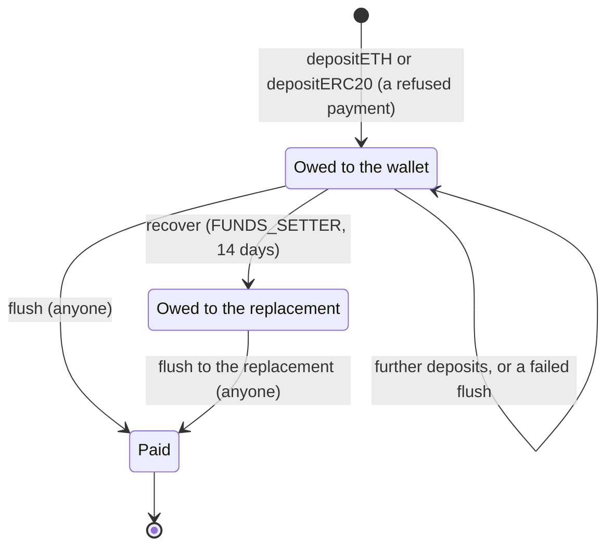
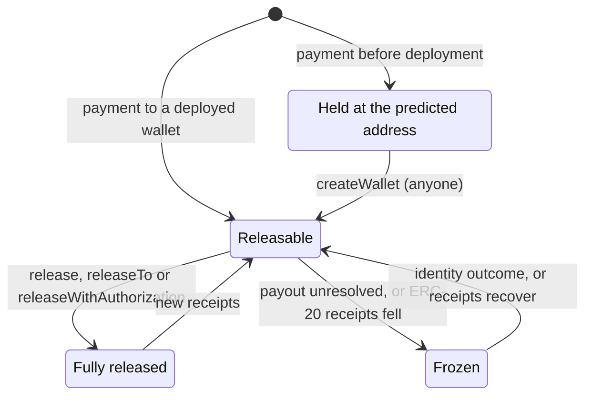
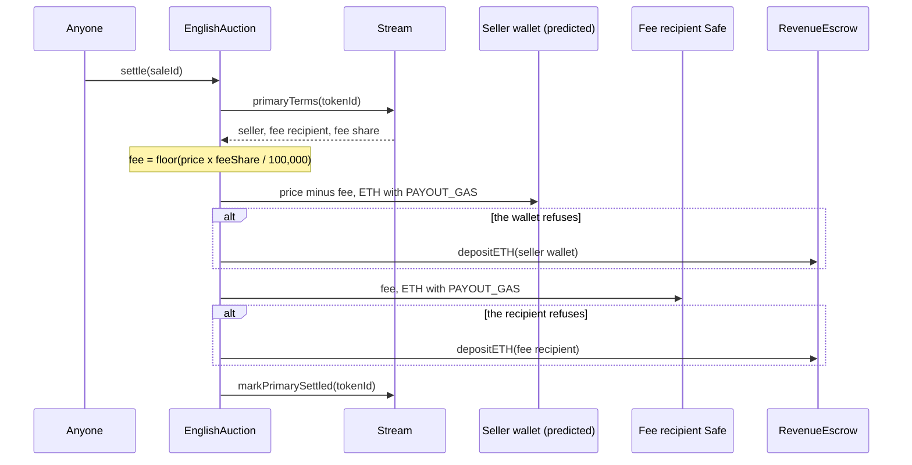
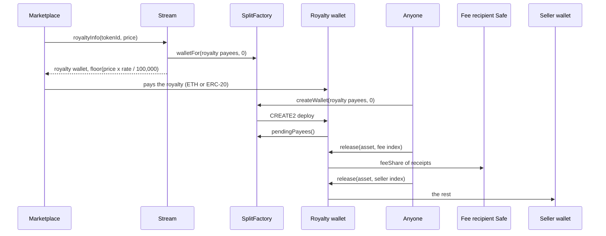
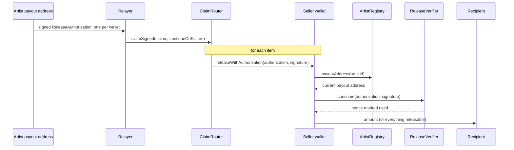
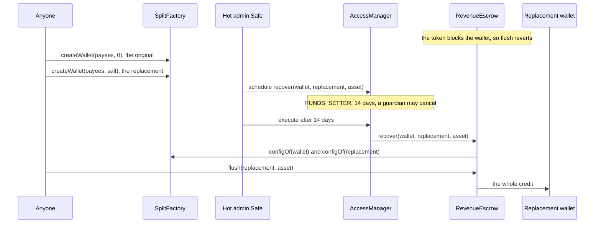
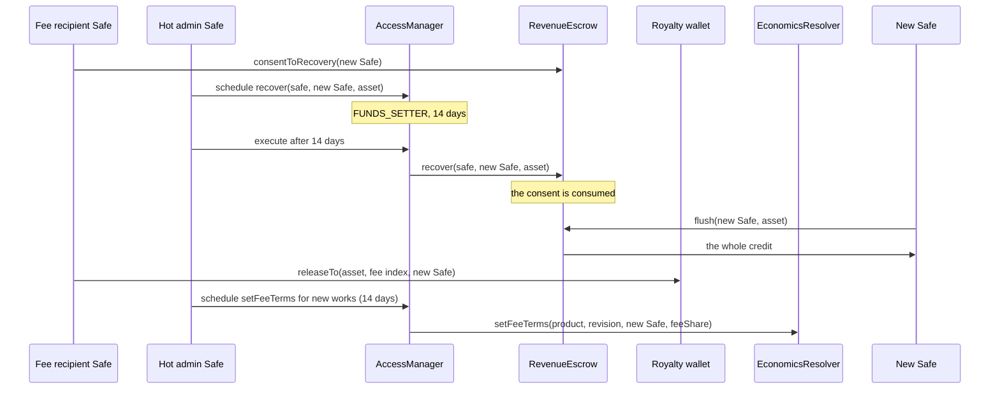

# Economics and payouts

This area decides who is paid, and how. It covers the network's share of primary sales, the
secondary royalty, the split wallets that divide both among the payees, signed and batched
releases, the payment currencies, and the escrow that holds a payment a wallet could not
receive. Auditors, integrators who pay into or claim from split wallets, and operators who
govern the economics all need it. The economics lane in `src/economics/` implements it:
`SplitFactory`, `SplitWallet`, `ReleaseVerifier`, `AssetAllowlist`, `RevenueEscrow`,
`EconomicsResolver` and `ClaimRouter`, with the internal libraries `RevenuePayment`,
`TokenTransfer` and `Splits`. `Stream`, `Editions` and the sale adapters consume it, and the
artist registry resolves artist payouts for it.

> **Status.** Pre-audit. This page describes `main` at `c4b3355` (15 October 2026). The ADRs
> record how the design was decided; this page is how it works now. Where they differ, this
> page follows the code and says so under [Differences from the ADRs](#differences-from-the-adrs).

## Contracts

| Contract | Source | Interface | Responsibility |
| --- | --- | --- | --- |
| `SplitFactory` | [`src/economics/SplitFactory.sol`](../../src/economics/SplitFactory.sol) | [`ISplitFactory`](../../src/economics/interfaces/ISplitFactory.sol) | Permissionless and unowned. Predicts (`walletFor`) and deploys (`createWallet`) split wallets at CREATE2 addresses that commit to the factory, the payee list and a salt. Pins the payout resolver and the release verifier by code hash. Records each wallet's payee configuration hash (`configOf`). |
| `SplitWallet` | [`src/economics/SplitWallet.sol`](../../src/economics/SplitWallet.sol) | [`ISplitWallet`](../../src/economics/interfaces/ISplitWallet.sol) | Immutable pull-payment wallet for ETH and any ERC-20. No owner, no governance, no allowlist. Pays each payee its cumulative share of everything received. |
| `ReleaseVerifier` | [`src/economics/ReleaseVerifier.sol`](../../src/economics/ReleaseVerifier.sol) | [`IReleaseVerifier`](../../src/economics/interfaces/IReleaseVerifier.sol) | Unowned singleton that checks EIP-712 release authorizations (ECDSA, ERC-1271, EIP-7702) and keeps unordered, revocable nonces in a bitmap. |
| `AssetAllowlist` | [`src/economics/AssetAllowlist.sol`](../../src/economics/AssetAllowlist.sol) | [`IAssetAllowlist`](../../src/economics/interfaces/IAssetAllowlist.sol) | Governed payment currencies: a status per asset, a minimum bid increment per currency, a default currency per product, and a deprecation clock for sale adapters. |
| `RevenueEscrow` | [`src/economics/RevenueEscrow.sol`](../../src/economics/RevenueEscrow.sol) | [`IRevenueEscrow`](../../src/economics/interfaces/IRevenueEscrow.sol) | Holds credits for payments a wallet refused. Anyone flushes a credit to its wallet. Governance moves a credit only to an identical replacement wallet, or to the replacement its holder consented to. |
| `EconomicsResolver` | [`src/economics/EconomicsResolver.sol`](../../src/economics/EconomicsResolver.sol) | [`IEconomicsResolver`](../../src/interfaces/IEconomicsResolver.sol) | Governed per-product economics for new works: fee recipient, fee share, royalty rate and default license. Derives the terms a new work locks (`newWorkTerms`) and the currency a new sale locks (`resolveCurrency`). |
| `ClaimRouter` | [`src/economics/ClaimRouter.sol`](../../src/economics/ClaimRouter.sol) | [`IClaimRouter`](../../src/economics/interfaces/IClaimRouter.sol) | Stateless batch claims across split wallets: plain releases for fixed payees, signed releases for any payee. Holds no funds. |
| `RevenuePayment` | [`src/economics/RevenuePayment.sol`](../../src/economics/RevenuePayment.sol) | none (internal library) | How a payer pays a wallet: pay it directly, and on a clean refusal credit the escrow for that wallet. |
| `TokenTransfer` | [`src/economics/TokenTransfer.sol`](../../src/economics/TokenTransfer.sol) | none (internal library) | Strict ERC-20 moves (exact balance deltas, exactly one `true` word) and the shared ETH send. |
| `Splits` | [`src/economics/Splits.sol`](../../src/economics/Splits.sol) | none (internal library) | The 100,000 denominator, the 64-payee bound, payee-list validation, the entitlement formula and the royalty wallet's payee list. |
| `ProtocolContracts` | [`src/libraries/ProtocolContracts.sol`](../../src/libraries/ProtocolContracts.sol) | none (internal library) | Recognises, by ERC-165, protocol contracts that can neither pull a release nor accept an ETH payment. |
| `ArtistRegistry` (identity lane) | [`src/identity/ArtistRegistry.sol`](../../src/identity/ArtistRegistry.sol) | [`IArtistPayoutResolver`](../../src/economics/interfaces/IArtistPayoutResolver.sol) | Answers `payoutAddress(artistId)` for artist-resolved payees. See [Identity and recovery](identity-and-recovery.md). |

Shared types live in [`EconomicsTypes.sol`](../../src/interfaces/types/EconomicsTypes.sol)
(currency constants, product IDs, `ProductEconomics`, `WorkTerms`) and
[`SaleTypes.sol`](../../src/interfaces/types/SaleTypes.sol) (`PrimaryTerms`, `LockedTerms`,
`Payment`).

## Concepts

Terms used here are defined in the [glossary](../glossary.md). Durations name their delay class
the first time: immediate, standard (48 hours), funds (14 days) and successor (30 days), as
`Roles` in [`src/governance/Roles.sol`](../../src/governance/Roles.sol) defines them.

### Products and launch defaults

Every rate is out of `Splits.DENOMINATOR` = 100,000, so the 6.529% royalty is exactly 6,529. A
10,000 basis-point denominator could not express it. The network fee share is the network's
part of both the primary sale and the royalty; the artist portion is `100,000 - feeShare`.

| Product | ID (`EconomicsTypes.sol`) | Fee share at launch | Split | Royalty rate | Default currency at genesis |
| --- | --- | --- | --- | --- | --- |
| 6529 Stream | `PRODUCT_STREAM = keccak256("PRODUCT_STREAM")` | 25,000 (`DEFAULT_FEE_SHARE`) | 75/25 | 6,529 (`DEFAULT_ROYALTY_RATE`) | ETH |
| 6529 Editions | `PRODUCT_EDITIONS = keccak256("PRODUCT_EDITIONS")` | 25,000 (`DEFAULT_FEE_SHARE`) | 75/25 | 6,529 | ETH |
| 6529 Stream Federated (v1.1) | `PRODUCT_FEDERATED = keccak256("PRODUCT_FEDERATED")` | 10,000 (`FEDERATED_FEE_SHARE`) | 90/10 | 6,529 | ETH |

Where the launch values come from:
- **Fee share, royalty rate, license.** The `EconomicsResolver` constructor writes them from its
  constants (`DEFAULT_FEE_SHARE`, `FEDERATED_FEE_SHARE`, `DEFAULT_ROYALTY_RATE`, `CC0`), at
  revision 1 for each of the three settings of each product.
- **Fee recipient.** One constructor argument, `feeRecipient`, serves all three products. The
  deploy script reads it from `NETWORK_FEE_RECIPIENT` and, off anvil, refuses an address with no
  code, balance or nonce ([`script/Deploy.s.sol`](../../script/Deploy.s.sol); ADR 0004
  decision 5).
- **Default license.** `CC0-1.0`, naming the CC0 legal text that genesis uploads to the content
  store (`cc0TextFileId`).
- **ETH.** The `AssetAllowlist` constructor admits ETH (`address(0)`) at revision 1 with the
  `ethIncrementFloor` argument. The deploy script defaults it to 0.001 ether
  (`ETH_INCREMENT_FLOOR` in [`script/Deploy.s.sol`](../../script/Deploy.s.sol)).
- **Default currencies.** No constructor sets them. The genesis wiring calls
  `setDefaultCurrency(product, 0, address(0))` for each product at zero delay
  ([`config/genesis.example.json`](../../config/genesis.example.json);
  `GovernanceConfig.isGenesisSelector` in
  [`src/governance/GovernanceConfig.sol`](../../src/governance/GovernanceConfig.sol)). Each
  product's default currency is then at revision 1.

6529 Stream Federated ships in v1.1, only if needed. The resolver already holds its 90/10
terms. For a federated token, the shared sale adapters take the fee share from the federation
registry entry and the recipient from `networkFeeRecipient(PRODUCT_FEDERATED)`
([`src/sales/MintSaleBase.sol`](../../src/sales/MintSaleBase.sol),
[`src/sales/EnglishAuction.sol`](../../src/sales/EnglishAuction.sol)).

### Terms locked at mint

A work's economic terms are fixed when it is created. Nothing in the resolver reaches back into
an existing work or a running sale.
- **6529 Stream.** At mint, `Stream._quote` reads `economics(PRODUCT_STREAM)` and the seller
  wallet `walletFor(item.payees, 0)`. `Stream` stores the seller, the fee share, the fee
  recipient (by index) and the royalty rate. With a non-zero fee share it refuses a fee
  recipient equal to the seller wallet, which would make the royalty payee list invalid. The royalty receiver is not stored:
  `royaltyInfo` derives it (below).
- **6529 Editions.** `createEdition` calls `newWorkTerms(PRODUCT_EDITIONS, item.payees)` and
  stores the seller, fee recipient, fee share and royalty receiver. The edition takes its
  master's current royalty rate, not the product default. Its fee terms are those in force when
  the edition is created, which may differ from the master's.
- **Sales.** Each sale locks its currency when it starts, and the English auction locks the
  currency's increment floor at the first bid. See [Stream and auctions](stream-and-auctions.md)
  and [Editions and sales](editions-and-sales.md).
- **The one exception.** A work's royalty rate can change through `IWorkRecords.setRoyaltyRate`:
  FUNDS_SETTER role (funds class, 14 days) plus a signature from every party. A linked edition
  follows its master. Payees, and so the royalty receiver, never change. See
  [Works and storage](works-and-storage.md).

### `newWorkTerms` and the royalty receiver

`EconomicsResolver.newWorkTerms(product, payees)` returns the `WorkTerms` a new work locks,
deploying nothing:
- `seller = factory.walletFor(payees, bytes32(0))`: the seller wallet, which pays the artist
  portion's payees.
- If `feeShare == 0`, `royaltyReceiver = seller`.
- Otherwise `royaltyReceiver = factory.walletFor(Splits.royaltyPayees(seller, feeRecipient,
  feeShare), bytes32(0))`: the royalty wallet. Its payee list is two fixed payees, the seller
  wallet with `100,000 - feeShare` and the fee recipient with `feeShare`, ordered by address.
- `feeRecipient`, `feeShare` and `royaltyRate` are the product's current values.

`Stream` derives the same royalty receiver from its stored seller and fee terms on every
`royaltyInfo` call (`Stream._royaltyReceiver`). That is one view call to the pinned split
factory, about 41K Prague gas for the whole call
([ADR 0004](../adr/0004-gas-budgets-under-glamsterdam.md#the-table)). It reverts when gas runs
short; it never returns a zero royalty. The royalty amount is `floor(salePrice × rate /
100,000)`, computed without overflow for any sale price. `Editions.royaltyInfo` returns the
stored receiver and `mulDiv(salePrice, rate, 100,000)`.

Because the salt is zero, one seller wallet serves every work with the same payee list (one per
solo artist). One royalty wallet serves every work with the same seller wallet and fee terms.

### `resolveCurrency`

Two currency values are special ([`EconomicsTypes.sol`](../../src/interfaces/types/EconomicsTypes.sol)):
`CURRENCY_ETH = address(0)` and `CURRENCY_DEFAULT = address(type(uint160).max)`, which means
"the product's default currency when the sale starts".
`resolveCurrency(product, requested)`:
- reverts with `UnknownProduct` for a product the resolver does not know;
- for `CURRENCY_DEFAULT`, reads the product's stored default from the allowlist, and reverts
  with `CurrencyNotAllowed(CURRENCY_DEFAULT)` if none is configured;
- returns the result only if it is active in the allowlist, and reverts with
  `CurrencyNotAllowed(currency)` otherwise.

The fixed-price and Dutch adapters call it when a sale opens, and refuse `CURRENCY_DEFAULT` with
a non-zero price. The English auction reads `AssetAllowlist.defaultCurrency` directly at start.
`CURRENCY_DEFAULT` is never a sale's locked currency.

### The canonical payee list

A payee is `ISplitWallet.Payee { uint256 artistId; address account; uint32 share; }`.
- **A fixed payee** names an `account` and has `artistId == 0`. It is paid at that account.
- **An artist-resolved payee** names an `artistId` and has `account == address(0)`. It is paid
  at the address the artist registry returns at release time, so an identity recovery also
  redirects balances that have already accrued.

`Splits.validate` accepts a list only if:
- it has 1 to `Splits.MAX_PAYEES` = 64 entries (the bound keeps wallet deployment inside the
  transaction gas cap);
- each entry is exactly fixed or exactly artist-resolved, with a non-zero share;
- entries are strictly ascending by `(artistId, account)`, so fixed payees come first in account
  order, then artist-resolved payees in artist ID order, and there are no duplicates;
- the shares sum to exactly 100,000.

A package item's payee list must also pass the package registry: at most as many payees as
parties (`Limits.MAX_PARTIES` = 16), and every payee a party by account or by artist ID
(`PackageRegistry._checkParties`). One party may be both a fixed and an artist-resolved payee.

### Wallet addresses

Every split wallet has the same init code, and its address commits to the factory, the payee
list and a salt:

```solidity
bytes32 configHash = keccak256(abi.encode(payees)); // payees: ISplitWallet.Payee[]
bytes32 walletSalt = keccak256(abi.encode(configHash, salt));
address wallet = address(uint160(uint256(keccak256(abi.encodePacked(
    bytes1(0xff), address(splitFactory), walletSalt, walletInitCodeHash
)))));
// walletInitCodeHash = keccak256(type(SplitWallet).creationCode), the same for every wallet
```

- **Constant init code.** The wallet constructor takes no arguments. It reads the payee list back
  from its deployer with `pendingPayees()`, which the factory holds in transient storage only
  while `createWallet` runs. So `walletFor` hashes a few words, not the wallet's code. Work terms
  use salt zero.
- **Code at a predicted address is always the right wallet.** Only this factory can CREATE2 at
  its addresses, and it derives the salt from the list it deploys. `createWallet` also checks
  that the deployed address equals the prediction (`WalletAddressMismatch`).
- **Predicted wallets receive funds before deployment.** ETH and ERC-20 transfers to the
  address are simply held. Once anyone calls `createWallet(payees, salt)`, the wallet counts
  them as receipts and splits them. `walletFor` reverts for a list no wallet would accept, so a
  tool that uses it never sends funds to an address that can never hold a wallet.
- **`createWallet` is permissionless and idempotent.** It returns an existing wallet without an
  event. Before deploying, it re-checks the pinned code hashes of the resolver and the verifier
  (`DependencyCodeChanged`). It records `configOf[wallet] = configHash`, which `isWallet` reads.
- **Another salt gives an equivalent wallet.** Same payees, same shares, same `configHash`,
  different address. The escrow uses one as a replacement when a token blocks the original.
- **Cost.** Deploying a one-payee seller wallet costs 1,236,339 Prague gas, mostly the wallet's
  code ([ADR 0004](../adr/0004-gas-budgets-under-glamsterdam.md#the-table)). No auction start
  or sale pays it; whoever first needs the wallet does.
- **Other deployers.** Any contract that answers `pendingPayees`, `resolver` and `verifier` can
  deploy a `SplitWallet`; the wallet records it as its `factory`. The split factory never counts
  such a wallet as its own (`isWallet` is false), and the escrow does not treat it as a factory
  wallet.

### Split wallet accounting

For each asset (ETH is `address(0)`), a wallet tracks what it has paid out:
- `observed(asset) = balance + totalReleased(asset)`, its cumulative receipts;
- payee `i` is entitled to `floor(observed × share_i / 100,000)` in total
  (`Splits.entitlement`, computed exactly and without overflow for any `observed`);
- `releasable(asset, i) = entitlement - released(asset, i)`.

Entitlements are cumulative, so the order and timing of releases never change what anyone gets.
Rounding leaves at most `payeeCount - 1` units of each asset unreleasable, and that dust does not
grow as receipts accumulate.

For an ERC-20, each release records the highest `observed` it saw (`recordedObserved`). If the
receipts later fall below that mark (a negative rebase or a hostile token), every release of that
asset reverts with `ObservedDecreased` until the balance recovers; nothing is lost. ETH needs no
mark: only a release takes ETH out, and it adds the amount to `totalReleased` first.

Who may release:

| Entry point | Fixed payee | Artist-resolved payee | Pays to |
| --- | --- | --- | --- |
| `release(asset, index)` | Anyone | Only the current payout address | The payee's account, or the current payout address |
| `releaseTo(asset, index, recipient)` | Only the payee's account | Only the current payout address | `recipient` |
| `releaseWithAuthorization(authorization, signature)` | Anyone may submit a signature by the payee's account | Anyone may submit a signature by the current payout address | `authorization.recipient` |

- **Fixed payees are push.** Anyone may pay a fixed payee, but only at its own account. A nested
  split wallet is a fixed payee, so anyone can push its share down to it.
- **Artist-resolved payees are pull-only.** Nobody can push an artist's accrued balance to a lost
  key before recovery redirects it (ADR 0003, Economics). A plain claim-router item for an artist payee
  therefore fails.
- **Recipients.** A release never pays the zero address or the wallet itself
  (`InvalidRecipient`). `release` and `releaseTo` pay everything releasable and revert with
  `NothingToRelease` when that is zero.
- **Payout freeze.** While a pending identity change would move an artist's payout, the artist
  registry's `payoutAddress` returns zero. Every release for that artist's payees then reverts
  with `PayoutUnresolved`. Balances keep accruing and the other payees are unaffected. When the
  change executes, is vetoed or cancelled, or lapses, the resulting payout address pulls
  everything accrued. See [Identity and recovery](identity-and-recovery.md).
- **Resolver pin.** A wallet pins the resolver's code hash at deployment. If that code ever
  changes, artist-resolved releases revert with `ResolverCodeChanged`; fixed payees still
  release.
- **A split wallet cannot be an artist's payout address,** because a wallet cannot call
  `release`. The artist registry refuses, at registration, staging and execution, a deployed
  split wallet of the bound factory, the registry itself, the package registry, `Stream`,
  `Editions`, and any contract that `ProtocolContracts` recognises (the escrow, the claim router,
  a sale adapter, a mint target, a registry, the work records). A predicted wallet has no code,
  so it looks like an empty account until someone deploys it; the check at execution catches a
  wallet deployed while the change waits. An artist who wants revenue to flow into another split
  names that wallet as a fixed payee instead.
- **Reentrancy.** All state-changing entry points share one transient guard, and `observed` and
  `releasable` revert while a release is in progress.

### Signed releases

A payee can sign a release for anyone to submit, through the wallet or the claim router. The
`ReleaseVerifier` checks it once for every wallet, so the EIP-712, ERC-1271 and EIP-7702 logic is
not deployed in each wallet. The signed struct is `IReleaseVerifier.Authorization`, with this
type string (`ReleaseVerifier.RELEASE_TYPEHASH`):

```text
ReleaseAuthorization(address wallet,address asset,uint256 payee,address account,address recipient,uint256 amount,uint256 nonce,uint256 deadline)
```

- **Domain.** The OpenZeppelin EIP-712 domain with name `6529 Works Release Verifier`,
  version `1`, the chain ID and the verifier's address. The struct binds the wallet.
- **Fields.** `payee` is the payee index in `wallet`. `account` is the signer, and must equal the
  payee's payout address when the authorization is used (`NotPayoutAddress`). `amount` is
  released exactly; `type(uint256).max` releases everything releasable. `deadline` is inclusive:
  the verifier refuses only `block.timestamp > deadline` (`AuthorizationExpired`).
- **Checks.** `consume` refuses any caller but the wallet the authorization names
  (`WrongWallet`), so nobody can burn a nonce by calling the verifier directly. Signatures go
  through the shared `SignatureVerifier`: low-s ECDSA, 64-byte ERC-2098 signatures, EIP-7702
  delegated accounts, and ERC-1271 with a 200,000-gas cap (`ERC1271_GAS_LIMIT`) and signatures
  of at most 4,096 bytes (`MAX_SIGNATURE_LENGTH`), both in
  [`src/libraries/SignatureVerifier.sol`](../../src/libraries/SignatureVerifier.sol).
- **Nonces.** Unordered, single use and kept per account across all wallets. Bit `nonce % 256` of
  word `nonce / 256` records each one, so a payee who signs nonces in order writes one new slot
  per 256 releases. Replay protection is keyed on `(account, nonce)`, never on signature bytes.
- **`revokeNonce(nonce)`** marks the caller's nonce used for every wallet. It reverts with
  `NonceAlreadyUsed` for a nonce already used or revoked.
- **A failed release consumes nothing.** The verifier consumes the nonce before the transfer, but
  any later revert (too little releasable, a refused transfer) rolls it back. Amounts are bounds,
  not snapshots: the same signature works once enough has accrued.
- **Push can pre-empt a fixed payee's signed release.** Anyone may push a fixed payee's whole
  balance to its own account first. A signed release of an exact amount then reverts
  (`AmountExceedsReleasable`) without consuming its nonce, and the funds are already in the
  payee's account. Sign `type(uint256).max` to take whatever is due.
- **Rotation does not revoke.** A key the payout moved away from cannot release, but if the
  payout returns to it (A, then B, then A), its unexpired authorizations work again. Revoke
  outstanding nonces with `revokeNonce`, or sign short deadlines.

### The asset allowlist

`AssetAllowlist` decides which currencies new sales may settle in. Sale adapters read it when a
sale starts or takes a payment; withdrawals never read it.

| Status | Meaning |
| --- | --- |
| `None` | Never admitted. |
| `Active` | New sales may use it. It has a non-zero increment floor. |
| `Deprecated` | New sales may not use it. Sales already running in it halt (see the sales pages); withdrawals from wallets and the escrow are unaffected. |

- **Admission** (`admitAsset(asset, expectedRevision, floor)`). The asset must not be active and
  the floor must be non-zero. For an asset other than ETH, the asset must have code, must not be
  an EIP-7702 delegated account, must answer `balanceOf` and `totalSupply` with exactly one word
  each, and must not report the allowlist's balance above its total supply
  (`AssetNotAdmissible`). This is a sanity probe, not proof of a standard ERC-20: governance vets
  that the token returns a value on transfer, takes no fee and does not rebase.
  `TokenTransfer` then fails closed on any token that misbehaves.
- **Increment floors** (`setIncrementFloor`). The absolute minimum bid increment of an active
  currency, in its base units; never zero. `incrementFloor(asset)` reverts unless the asset is
  active.
- **Default currency per product** (`setDefaultCurrency(product, expectedRevision, asset)`). The
  product ID must be non-zero and the asset active. `defaultCurrency(product)` reverts unless a
  default is configured (`CurrencyNotConfigured`) and still active (`AssetNotActive`). Switching
  a product to USDC is "admit the asset, then change the default", with no contract change.
- **Deprecation** (`deprecateAsset(asset)`). GUARDIAN, immediate. Only an active asset can be
  deprecated. It bumps the asset's revision, so every operation queued against the earlier state
  reverts, even one that would restore the same values.
- **Re-admission.** `admitAsset` on a deprecated asset is the only way back, and it reverts with
  `ReadmissionTooEarly` until 14 days (`Roles.FUNDS`) after the deprecation. AccessManager counts
  its own delay from scheduling, so without this check a re-admission scheduled ahead could undo
  a deprecation in its own block (MARKET-2).
- **`statusClock(asset)`** returns the status, when it last changed (`since`) and the total
  seconds of earlier, closed deprecations (`inactiveTotal`). Sale adapters use it to stop a
  sale's clock while its currency is deprecated (MARKET-1, MARKET-2).
- **Revisions.** Each asset and each product has its own revision counter. Every admission,
  deprecation and floor change bumps the asset's; every default change bumps the product's.

### Wallet payments and the escrow

Sale adapters pay wallets through `RevenuePayment`, compiled into each payer:
- **ETH** (`payETH`): send the amount with exactly `gasLimit` gas. Every sale adapter passes
  `PAYOUT_GAS` = 100,000 (`EnglishAuction.PAYOUT_GAS`, `MintSaleBase.PAYOUT_GAS`). The payer
  must be able to forward it in full plus `ETH_CALL_RESERVE` (40,000), or the payment reverts
  (`PaymentInsufficientGas`), so a caller cannot force the escrow route by starving the call. If
  the wallet refuses, the payer calls `escrow.depositETH(wallet)`.
- **ERC-20** (`payERC20`): `TokenTransfer.tryTransferExact` gives the token `ERC20_TRANSFER_GAS`
  (300,000). Only a clean refusal (the token reverts, or returns `false` and moves nothing)
  routes to the escrow: the payer approves the escrow, the escrow pulls exactly the amount, and
  the payer checks that no allowance is left (`EscrowAllowanceLeft`). Any other misbehaviour
  reverts the whole payment.
- **Zero amounts are no-ops,** so a zero-fee sale needs no fee recipient. A zero wallet, or the
  escrow itself as a wallet, reverts (`InvalidWallet`).
- **The auction adds a frame for ERC-20 payouts (MONEY-1).** Each ERC-20 settlement payout runs
  in its own call frame with 1,000,000 gas. If it fails even through the escrow (the token blocks
  the auction, or changed behaviour), the auction credits the wallet itself and delivers the work;
  anyone later pays that credit with `claimFor(wallet, token)`. The fixed-price and Dutch adapters
  have no such frame: a payment that fails both routes reverts the purchase. See
  [Stream and auctions](stream-and-auctions.md).

`TokenTransfer` is the strict layer under every money path. A token call counts only if it
returns exactly one 32-byte word holding `true`, and both balances must then move by exactly the
amount (`TokenCallFailed`, `TokenBalanceMismatch`). Fee-on-transfer, rebasing-with-rounding,
no-return and false-returning tokens therefore revert instead of corrupting accounting. Reads
copy at most one word, so a return-data bomb costs the token, not the caller.

`RevenueEscrow` keeps credits keyed by `(wallet, asset)`:
- **Credit.** `depositETH(wallet)` and `depositERC20(wallet, asset, amount)` are permissionless.
  The ERC-20 deposit pulls exactly `amount` from the caller. Deposits refuse a zero or self
  wallet, a zero amount, and `address(0)` as an ERC-20.
- **Flush.** `flush(wallet, asset)` is permissionless and pays everything owed to that wallet,
  and only to it. ETH is sent with all remaining gas. A failed flush reverts and keeps the credit.
- **Recover.** `recover(wallet, replacement, asset)` is FUNDS_SETTER (funds class, 14 days). It
  moves the whole credit and adds it to anything the replacement is already owed:
  - if the factory deployed `wallet`, `replacement` must be a different factory wallet with the
    same `configOf` (same payees, another salt). Identical payees and shares are the consent
    ADR 0001 §7 requires;
  - otherwise (the network fee Safe, for example), `replacement` must be the address `wallet`
    named with `consentToRecovery`, and the recovery consumes that consent.
- **Recovery limits.** A predicted, undeployed wallet has no configuration and cannot consent, so
  deploy the original first. Recovery reaches only escrow credits; a blocked wallet's own balance
  stays in it.
- **Consent.** `consentToRecovery(replacement)` records where the caller's credit may go. It
  refuses the escrow and the caller itself; zero withdraws the consent. The escrow reads the
  consent when `recover` executes, and the next `recover` of the caller's credit, in whichever
  asset, consumes it. Split wallets cannot call it; the identical-payee rule covers them.
- **No receive function.** Plain ETH sends to the escrow revert. ETH force-sent to it, or tokens
  transferred to it without a deposit, are owed to nobody and stay.

### Who may be the fee recipient

A work locks its fee recipient at mint, so a recipient that can never be paid would make every
sale of every work minted under it unsettleable. `EconomicsResolver._validate` reverts with
`InvalidFeeRecipient`, at construction, in `setFeeTerms` and in `setRoyaltyRate`, for: the
resolver itself, its allowlist, its split factory, the factory's release verifier, and any
contract `ProtocolContracts` recognises (the escrow, the claim router, a sale adapter, a mint target, the artist or package
registry, the work records). Other system contracts declare none of those interfaces and are not
recognised on-chain (the content store, the statement log, the AccessManager, the renderer, the
curation verifier, the entropy module). The runbook checks that a new recipient exists and
accepts ETH from a 100,000-gas call before a `setFeeTerms` is scheduled
([script README](../../script/README.md#the-network-fee-recipient-must-exist)).

### Batch claims

`ClaimRouter` has no storage, owner, approvals, `receive` or `fallback`; the wallets enforce
entitlement and who may pull, so the router can never redirect funds.
- **`claim(claims, continueOnFailure)`**: up to `MAX_CLAIMS` = 50 plain items
  `{wallet, asset, payee}`, each calling `release(asset, payee)`. Plain items pay fixed payees;
  an artist-resolved item fails with `NotPayoutAddress`.
- **`claimSigned(claims, continueOnFailure)`**: up to `MAX_SIGNED_CLAIMS` = 20 items
  `{authorization, signature}`, each calling `releaseWithAuthorization` on
  `authorization.wallet`. Any payee, artists included, batches its own releases this way, with
  one signature per wallet.
- **Atomic mode** (`false`): each item gets all remaining gas; any failure reverts the batch with
  `ClaimCallFailed(index, wallet, size, reason)`.
- **Continue mode** (`true`): each item is offered `gasleft() / (items remaining + 1)`. If that
  is below its minimum, `MIN_ITEM_GAS` = 200,000 or `MIN_SIGNED_ITEM_GAS` = 450,000, the batch
  reverts with `ClaimInsufficientGas(index, available)`. A failed item is reported with
  `ClaimFailed` and releases 0, unless it was offered less than `SHORTFALL_REVERT_CEILING` =
  1,500,000 gas and either spent all but EIP-150's 1/64 reserve or failed because an ERC-1271
  check could not get its gas. Then the batch reverts with `ClaimInsufficientGas`, so gas
  estimation raises the limit instead of settling with an item silently starved.
- **Containment.** A target without code fails with `ClaimTargetHasNoCode`; a success that does
  not return exactly one word fails with `InvalidClaimReturnData`. At most one word of return
  data and 256 bytes of revert data are copied.

Keeper guidance:
- The minimums are Prague-sized floors, not promises. A first release under Glamsterdam writes
  new slots and may create the payee's account: about 716,000 gas for a first signed release on
  Sepolia, and the ceiling is about twice that
  ([ADR 0004](../adr/0004-gas-budgets-under-glamsterdam.md#security-impact)).
- A party to an item (a fixed co-payee whose `receive` burns gas, a signed release's recipient, a
  token) can make its item look short of gas, and can switch that on after the keeper estimated.
  Below the ceiling that reverts the whole batch; from the ceiling up, the item is skipped.
  Simulate privately (submit through a private mempool), put items with contract payees or
  unfamiliar tokens at the end of a batch or in batches of their own, and drop an item whose
  revert names its index.
- A full batch of first releases may not fit one transaction under Glamsterdam. It then reverts
  rather than paying part of the batch; split it.

### Governed setters and compare-and-set

Every governed economics function is behind the AccessManager. Every one that sets a value also
compares a revision counter that each change to the same setting bumps, so a queued operation
runs only against the exact state it was written for, even if the state later returns to the same
values. A guardian can
cancel any scheduled operation during its delay (see [Governance](governance.md)).

| Function | Role | Delay class | Revision compared |
| --- | --- | --- | --- |
| `EconomicsResolver.setFeeTerms(product, expectedRevision, feeRecipient, feeShare)` | FUNDS_SETTER | Funds (14 days) | The product's fee-terms revision |
| `EconomicsResolver.setRoyaltyRate(product, expectedRevision, royaltyRate)` | PARAMETER_SETTER | Standard (48 hours) | The product's royalty revision |
| `EconomicsResolver.setDefaultLicense(product, expectedRevision, license)` | PARAMETER_SETTER | Standard (48 hours) | The product's license revision |
| `AssetAllowlist.admitAsset(asset, expectedRevision, floor)` | FUNDS_SETTER | Funds (14 days), and no earlier than 14 days after a deprecation | The asset's revision (0 if never admitted) |
| `AssetAllowlist.setDefaultCurrency(product, expectedRevision, asset)` | FUNDS_SETTER | Funds (14 days); zero delay in genesis wiring | The product's currency revision (0 before its first default) |
| `AssetAllowlist.setIncrementFloor(asset, expectedRevision, floor)` | PARAMETER_SETTER | Standard (48 hours) | The asset's revision |
| `AssetAllowlist.deprecateAsset(asset)` | GUARDIAN | Immediate | None (tightening only); bumps the asset's revision |
| `RevenueEscrow.recover(wallet, replacement, asset)` | FUNDS_SETTER | Funds (14 days) | None; needs an identical wallet or the holder's consent |

Setter rules in the resolver:
- `setFeeTerms` keeps the royalty rate; `setRoyaltyRate` keeps the fee terms. Each validates the
  whole result: fee share below 100,000, royalty rate at most 100,000, a non-zero recipient when
  the fee share is non-zero (`InvalidEconomics`), and the fee-recipient refusals above.
- `setDefaultLicense` requires an SPDX ID of 1 to 64 bytes (`Limits.MAX_LICENSE_ID_BYTES`) in
  `[A-Za-z0-9.+-]` and a non-zero text file ID. A license whose key is CC0 must name the CC0 text
  the resolver was deployed with (`cc0TextFileId`), as `WorkRecords.openRecord` requires
  (`InvalidLicense`).
- All three revert with `UnknownProduct` for a product the constructor did not configure.

Role and selector mappings come from the genesis configuration
([`config/genesis.example.json`](../../config/genesis.example.json)); the generated matrix is in
[the audit pack](../audit/roles.md).

## State machine

### An asset in the allowlist



### An escrow credit



### A payee's balance in a split wallet



| Transition | Caller (role) | Delay | Function |
| --- | --- | --- | --- |
| Asset: none to active | FUNDS_SETTER | 14 days | `AssetAllowlist.admitAsset` |
| Asset: ETH active at deployment | Deployer | None | `AssetAllowlist` constructor |
| Asset: active to active, new floor | PARAMETER_SETTER | 48 hours | `AssetAllowlist.setIncrementFloor` |
| Asset: active to deprecated | GUARDIAN | Immediate | `AssetAllowlist.deprecateAsset` |
| Asset: deprecated to active | FUNDS_SETTER | 14 days, and at least 14 days after the deprecation | `AssetAllowlist.admitAsset` |
| Credit: created or increased | Anyone (in practice a sale adapter) | None | `RevenueEscrow.depositETH`, `depositERC20` |
| Credit: paid | Anyone | None | `RevenueEscrow.flush` |
| Credit: moved to a replacement | FUNDS_SETTER, with an identical wallet or the holder's consent | 14 days | `RevenueEscrow.recover` (consent by `consentToRecovery`) |
| Balance: predicted to releasable | Anyone | None | `SplitFactory.createWallet` |
| Balance: released, fixed payee | Anyone (`release`); the account (`releaseTo`); anyone with its signature | None | `SplitWallet.release`, `releaseTo`, `releaseWithAuthorization`; `ClaimRouter.claim`, `claimSigned` |
| Balance: released, artist payee | The current payout address, directly or by signature | None | `SplitWallet.release`, `releaseTo`, `releaseWithAuthorization`; `ClaimRouter.claimSigned` |
| Balance: frozen, artist payee | A pending identity change that moves the payout | The change's notice period | `ArtistRegistry.payoutAddress` returns zero |
| Balance: frozen, ERC-20 | The token (balance below the recorded mark) | Until the balance recovers | `SplitWallet._due` (`ObservedDecreased`) |

## Flows

### A primary sale payout



- **Preconditions.** The auction has ended with a bid. The seller wallet is the predicted address
  locked at mint; it need not be deployed.
- **Effects.** The seller wallet receives `price - fee` and the fee recipient `fee`, or the escrow
  holds either as a credit under that address. The token is delivered, or becomes a pending delivery.
- **ERC-20.** Each payout runs in the auction's 1,000,000-gas frame; the token gets 300,000 gas,
  a clean refusal goes to the escrow, and a failure of the frame becomes an auction credit paid
  later with `claimFor` (MONEY-1).
- **Fixed price and Dutch.** `MintSaleBase._settle` computes the fee with `mulDiv`, pays the fee
  recipient first and then the seller, through the same `RevenuePayment` routes, with no frame.
- **Gas.** The first payout to a new seller wallet creates its account. That `settle` is 168,063
  Prague gas against 143,063 for a later one, and about 184,000 more on Sepolia's Glamsterdam. It
  happens once per payee configuration
  ([ADR 0004](../adr/0004-gas-budgets-under-glamsterdam.md#the-table);
  [flows](../../deployments/11155111/flows.md)).

### A royalty payment and its release by fixed payees



- **Preconditions.** None for payment: the marketplace pays the predicted address. Releasing
  needs the royalty wallet deployed, which anyone can do once.
- **Effects.** Both payees of a royalty wallet are fixed, so anyone may push each share. The seller
  wallet's share then sits in the seller wallet, where its own payees release it (next flow).
- **Gas.** `royaltyInfo` is 41,325 Prague gas for the whole call
  ([ADR 0004](../adr/0004-gas-budgets-under-glamsterdam.md#the-table), which also measures a
  first ETH `release`). `ClaimRouter.claim` batches these pushes across wallets.

### An artist's signed pull through the claim router



- **Preconditions.** The seller wallet is deployed. The signer is the artist's current payout
  address, and the payout is not frozen. The deadline has not passed and the nonce is unused.
- **Effects.** The amount goes to `authorization.recipient`; the nonce is used for every wallet.
  A recovery that moves the payout voids the old key's unused authorizations (`NotPayoutAddress`).
- **Gas.** A first signed release through `claimSigned` is 141,370 Prague gas; a later one with the
  next nonce, 90,074 ([ADR 0004](../adr/0004-gas-budgets-under-glamsterdam.md#the-table)). In
  continue mode, offer each item enough gas (see [Batch claims](#batch-claims)).

### Escrow recovery for a blocked split wallet



- **Preconditions.** Both wallets are deployed and have the same `configOf`; the wallet is owed a
  credit in `asset`.
- **Effects.** The credit moves to the replacement (added to anything it is already owed), and
  `totalOwed` is unchanged until the flush. Payees then release from the replacement.
- **Limit.** Only escrow credits move. Funds already in the blocked wallet stay there until the
  token unblocks it.

### Escrow recovery for a blocked fee-recipient Safe



- **Why.** A token such as USDC can block the network fee Safe. Every fee in that token is then
  credited to the escrow under the Safe, and every existing royalty wallet keeps the Safe as a
  fixed payee, because works lock their terms at mint.
- **Escrow credits.** The Safe's own `consentToRecovery` is its consent. Without it, or to any
  other address, `recover` reverts with `RecoveryNotConsented`, even after the full delay. One
  consent covers one recovery in one asset; the Safe consents again for each further asset or
  later credit, and can change or withdraw (zero) a consent not yet used. Anyone may call the
  final `flush`.
- **Royalty shares.** A royalty wallet has no governance. The Safe releases its share itself
  with `releaseTo` to any recipient; nobody else can, and a lost Safe's share stays in the wallet.
- **New works.** `setFeeTerms` changes the recipient only for works minted afterwards.

## Rules and invariants

| ID | Rule | Enforced in | Proven by |
| --- | --- | --- | --- |
| ECO-1 | Rates and shares are out of 100,000; the launch royalty 6,529 is exactly 6.529%. | `Splits.DENOMINATOR`; `EconomicsResolver` constants | [`SplitMath.t.sol`](../../test/economics/SplitMath.t.sol) `test_RoyaltyRateIsExact`; [`EconomicsResolver.t.sol`](../../test/economics/EconomicsResolver.t.sol) `test_LaunchDefaults` |
| ECO-2 | A product's fee share is below 100,000, its royalty rate at most 100,000, and a non-zero fee share names a non-zero recipient. | `EconomicsResolver._validate` (constructor, `setFeeTerms`, `setRoyaltyRate`) | [`EconomicsResolver.t.sol`](../../test/economics/EconomicsResolver.t.sol) `test_ConstructorEmitsAndValidates`, `test_SetFeeTermsIsCompareAndSet` |
| ECO-3 | The fee recipient is never the resolver, its allowlist, factory or verifier, or a recognised protocol contract. | `EconomicsResolver._validate`; `ProtocolContracts.isProtocolContract` | [`RecipientValidation.t.sol`](../../test/integration/RecipientValidation.t.sol) `test_FeeRecipientRefusesSystemContracts`, `test_WorksStartedAfterARefusedChangeSettle`; [`EconomicsResolver.t.sol`](../../test/economics/EconomicsResolver.t.sol) `test_FeeRecipientMustBePayable` |
| ECO-4 | Every governed economics setter (all but `deprecateAsset` and `recover`) is compare-and-set on its own revision, and every change, deprecation included, bumps it. | `EconomicsResolver._check`; `AssetAllowlist._checkRevision` | [`EconomicsResolver.t.sol`](../../test/economics/EconomicsResolver.t.sol) `test_SetRoyaltyRateIsCompareAndSetOnItsOwnRevision`, `test_SetDefaultLicenseIsCompareAndSetAndValidated`; [`AssetAllowlist.t.sol`](../../test/economics/AssetAllowlist.t.sol) `test_EveryAssetChangeBumpsTheRevision`, `test_QueuedAdmissionCannotReviveAfterEmergencyDeprecation`, `test_IncrementFloorIsCompareAndSet`, `test_DefaultCurrencyIsCompareAndSet` |
| ECO-5 | Setters are restricted to their roles and delays, and non-payable. | AccessManager (`restricted`) | [`EconomicsResolver.t.sol`](../../test/economics/EconomicsResolver.t.sol) `test_SettersAreRestrictedAndNonPayable`, `test_RolesAndDelaysThroughAccessManager`; [`AssetAllowlist.t.sol`](../../test/economics/AssetAllowlist.t.sol) `test_GovernedFunctionsRejectOtherCallers`, `test_TimelockedAdmissionThroughAccessManager`; [`RevenueEscrow.t.sol`](../../test/economics/RevenueEscrow.t.sol) `test_RecoverIsGovernedInTheFundsClass` |
| ECO-6 | Economics changes apply to new works only: existing works keep their seller, fee terms and royalty receiver. | `Stream._quote`, `Stream._store`; `Editions.createEdition` | [`EconomicsResolver.t.sol`](../../test/economics/EconomicsResolver.t.sol) `test_ChangesApplyToNewWorksOnly`; [`StreamEconomics.t.sol`](../../test/stream/StreamEconomics.t.sol) `test_receiverAtZeroFeeAndAfterAFeeChange` |
| ECO-7 | The royalty receiver is the salt-zero wallet of `Splits.royaltyPayees`, or the seller wallet at a zero fee share; `Stream`, `Editions` and the resolver derive the same address. | `EconomicsResolver.newWorkTerms`; `Stream._royaltyReceiver` | [`StreamEconomics.t.sol`](../../test/stream/StreamEconomics.t.sol) `test_receiverIsTheResolversAndTheFactorys`; [`EconomicsResolver.t.sol`](../../test/economics/EconomicsResolver.t.sol) `test_RoyaltyReceiverMatchesTheSharedDerivation`, `test_ZeroFeeShareOmitsTheFeePayee`, `testFuzz_RoyaltySplitSharesAddUp` |
| ECO-8 | A payee list is canonical: 1 to 64 entries, each exactly fixed or artist-resolved with a non-zero share, strictly ascending by `(artistId, account)`, shares summing to 100,000. | `Splits.validate` (wallet constructor, `walletFor`) | [`SplitFactory.t.sol`](../../test/economics/SplitFactory.t.sol) `test_RejectsEmptyAndOversizedPayeeLists`, `test_RejectsZeroShare`, `test_RejectsPayeesThatAreBothOrNeitherKind`, `test_RejectsUnsortedAndDuplicatePayees`, `test_RejectsSharesNotSummingToDenominator`; [`SplitMath.t.sol`](../../test/economics/SplitMath.t.sol) `testFuzz_ValidationAcceptsExactlyCanonicalLists` |
| ECO-9 | A wallet's address is the documented CREATE2 derivation over the factory, the payee list and the salt; the deployed wallet is always at the prediction. | `SplitFactory.walletFor`, `createWallet` | [`SplitFactory.t.sol`](../../test/economics/SplitFactory.t.sol) `test_AddressIsTheDocumentedCreate2Derivation`, `test_AddressCommitsToSharesKindsDependenciesAndSalt`, `test_CreateWalletRevertsIfTheDeployedAddressDiffers`, `testFuzz_PredictionMatchesDeployment` |
| ECO-10 | `pendingPayees` is non-empty only during `createWallet`, and the wallet stores exactly the list it was deployed for. | `SplitFactory._setPending`, `createWallet` | [`SplitFactory.t.sol`](../../test/economics/SplitFactory.t.sol) `test_PendingPayeesExistOnlyDuringCreation`, `test_PayeeListSurvivesTheHandOffExactly` |
| ECO-11 | Funds sent to a predicted address before deployment are split once the wallet exists. | `SplitWallet._observed` | [`SplitFactory.t.sol`](../../test/economics/SplitFactory.t.sol) `test_FundsSentBeforeDeploymentAreSplitAfterwards`; [`RevenuePayment.t.sol`](../../test/economics/RevenuePayment.t.sol) `test_PayETHToUndeployedWalletIsKeptForIt` |
| ECO-12 | The factory deploys no wallet if the resolver or verifier code changed since installation. | `SplitFactory.createWallet` | [`SplitFactory.t.sol`](../../test/economics/SplitFactory.t.sol) `test_CreateWalletFailsClosedIfAPinnedDependencyChanges`, `test_ConstructorRejectsDelegatedEOADependencies` |
| ECO-13 | A payee's releases never exceed `floor(observed × share / 100,000)`, and the unreleasable dust stays below the payee count. | `SplitWallet._due`; `Splits.entitlement` | [`EconomicsInvariant.t.sol`](../../test/economics/invariant/EconomicsInvariant.t.sol) `invariant_ReleasedWithinEntitlement`, `invariant_DustIsBounded`; [`SplitMath.t.sol`](../../test/economics/SplitMath.t.sol) `testFuzz_EntitlementsNeverExceedObservedAndDustIsBounded`, `testFuzz_ReleaseTimingDoesNotChangeTotals` |
| ECO-14 | A wallet conserves value: everything released plus its balance equals everything received, and recipients hold exactly what was released. | `SplitWallet._release` | [`EconomicsInvariant.t.sol`](../../test/economics/invariant/EconomicsInvariant.t.sol) `invariant_WalletConservesValue`, `invariant_RecipientsReceivedEverythingReleased` |
| ECO-15 | Anyone may release a fixed payee, but only to its own account. | `SplitWallet.release` | [`SplitWallet.t.sol`](../../test/economics/SplitWallet.t.sol) `test_AnyoneMayReleaseAFixedPayeeButOnlyToItsAccount` |
| ECO-16 | Only an artist's current payout address, directly or by signature, releases an artist-resolved payee; nobody can push to a lost key. | `SplitWallet.release`, `releaseTo`, `releaseWithAuthorization` | [`SplitWallet.t.sol`](../../test/economics/SplitWallet.t.sol) `test_ArtistPayeeIsPullOnly`, `test_LostArtistKeyCannotBePushedBeforeRecovery`, `test_ArtistPayeeFollowsResolverAtReleaseTime`; [`ClaimRouter.t.sol`](../../test/economics/ClaimRouter.t.sol) `test_PlainArtistItemsFailAndContinueModeSkipsThem` |
| ECO-17 | `releaseTo` is callable only by the payee's current payout address, and no release pays zero or the wallet itself. | `SplitWallet.releaseTo`, `_release` | [`SplitWallet.t.sol`](../../test/economics/SplitWallet.t.sol) `test_ReleaseToRequiresTheCurrentPayoutAddress`, `test_RejectsZeroAndSelfRecipients` |
| ECO-18 | While the payout is unresolved (frozen) or the resolver's code changed, only the artist-resolved payees stop; fixed payees release. | `SplitWallet._payout`; `ArtistRegistry.payoutAddress` | [`SplitWallet.t.sol`](../../test/economics/SplitWallet.t.sol) `test_UnresolvedOrFailingResolverBlocksOnlyTheArtistPayee`, `test_ResolverCodeChangeFailsClosedForArtistPayeesOnly`; [`ArtistRegistry.t.sol`](../../test/identity/ArtistRegistry.t.sol) `test_PayoutFreeze_WhileAPayoutChangeIsPending`; [`IdentityRecovery.t.sol`](../../test/integration/IdentityRecovery.t.sol) `test_LostKeyOverrideFreezesThePayoutThenRecovers` |
| ECO-19 | A deployed split wallet, and the protocol contracts that cannot pull, never become an artist's payout address. | `ArtistRegistry._payoutAllowed` | [`RecipientValidation.t.sol`](../../test/integration/RecipientValidation.t.sol) `test_PayoutRefusesProtocolContractsThatCannotPull`, `test_PredictedWalletIsCaughtOnlyOnceDeployed`; [`SplitWallet.t.sol`](../../test/economics/SplitWallet.t.sol) `test_NestedWalletCannotBeAnArtistPayoutAddress` |
| ECO-20 | A signed release works once per `(account, nonce)`, only in the wallet and on the chain it names, before its deadline, and only while its signer is the payee's payout address. | `ReleaseVerifier.consume`; `SplitWallet.releaseWithAuthorization` | [`ReleaseVerifier.t.sol`](../../test/economics/ReleaseVerifier.t.sol) `test_ReplayAndRevokedNoncesRevert`, `test_OnlyTheNamedWalletConsumesAnAuthorization`, `test_SignatureDoesNotReplayOnAnotherChainOrVerifier`, `test_ExpiredAuthorizationReverts`, `test_AccountMustBeThePayeesCurrentPayoutAddress`; [`IdentityRecovery.t.sol`](../../test/integration/IdentityRecovery.t.sol) `test_SignedReleaseIsVoidedByRecovery` |
| ECO-21 | Replay protection is keyed on the nonce, not the signature bytes; nonces in one bitmap word stay independent; one revocation covers every wallet. | `ReleaseVerifier._useNonce`, `revokeNonce` | [`ReleaseVerifier.t.sol`](../../test/economics/ReleaseVerifier.t.sol) `test_ReplayIsKeyedOnTheNonceNotTheSignatureBytes`, `test_NonceBitmapNoAliasingWithinAWord`, `test_OneRevocationCoversEveryWallet` |
| ECO-22 | A signed release that fails does not consume its nonce. | `SplitWallet.releaseWithAuthorization` (atomic revert) | [`ReleaseVerifier.t.sol`](../../test/economics/ReleaseVerifier.t.sol) `test_AmountAboveReleasableRevertsWithoutConsumingNonce`, `test_FailedPaymentRollsBackNonce`, `test_PushCanPreemptAFixedPayeesSignedRelease` |
| ECO-23 | Every ERC-20 move requires exactly one `true` word and exact balance deltas on both sides; fee-on-transfer, rebasing, no-return and false-returning tokens revert. | `TokenTransfer._moveExact`, `_call` | [`HostileTokens.t.sol`](../../test/economics/HostileTokens.t.sol) `test_FeeOnTransfer_PaymentRevertsAtomically`, `test_NoReturn_PaymentRevertsAtomically`, `test_ReturnsFalse_PaymentTriesEscrowThenRevertsAtomically`, `test_NonCanonicalTrue_FailsClosedOnEveryPath`, `test_Rebasing_RoundingPaymentRevertsAtomically` |
| ECO-24 | An ERC-20 whose receipts fall below the recorded mark freezes that asset's releases without loss. | `SplitWallet._due` | [`SplitWallet.t.sol`](../../test/economics/SplitWallet.t.sol) `test_ShrinkingBalanceFailsClosedUntilRecovered`; [`HostileTokens.t.sol`](../../test/economics/HostileTokens.t.sol) `test_Rebasing_NegativeRebaseFreezesReleasesWithoutLoss`; [`EconomicsInvariant.t.sol`](../../test/economics/invariant/EconomicsInvariant.t.sol) `invariant_ObservedNeverDecreases` |
| ECO-25 | Withdrawals never read the allowlist: deprecated and never-admitted assets stay withdrawable from wallets and the escrow. | `SplitWallet`, `RevenueEscrow` (no allowlist reference) | [`SplitWallet.t.sol`](../../test/economics/SplitWallet.t.sol) `test_DeprecatedAndNeverAdmittedAssetsStayWithdrawable`; [`RevenueEscrow.t.sol`](../../test/economics/RevenueEscrow.t.sol) `test_DeprecatedAssetCreditsStillFlush` |
| ECO-26 | A wallet payment reaches the wallet or a credit under that wallet, never anywhere else, and a caller cannot starve it into the escrow. | `RevenuePayment.payETH`, `payERC20` | [`RevenuePayment.t.sol`](../../test/economics/RevenuePayment.t.sol) `testFuzz_PaymentsAlwaysReachTheWalletOrItsCredit`, `test_CallerCannotStarveETHPaymentIntoEscrow`, `test_CallerCannotStarveTokenPaymentIntoEscrow`, `test_EscrowRouteRevertsIfAnAllowanceSurvives` |
| ECO-27 | The escrow is solvent per asset, credits are isolated per `(wallet, asset)`, and a flush pays only the credited wallet. | `RevenueEscrow._credit`, `flush` | [`EconomicsInvariant.t.sol`](../../test/economics/invariant/EconomicsInvariant.t.sol) `invariant_EscrowIsSolventAndMatchesTheModel`; [`RevenueEscrow.t.sol`](../../test/economics/RevenueEscrow.t.sol) `test_CreditsAreIsolatedPerWalletAndAsset`, `test_AnyoneFlushesETHOnlyToTheCapturedWallet`, `test_FailedFlushKeepsTheCredit` |
| ECO-28 | `recover` moves a factory wallet's credit only to a distinct wallet with the same configuration, and any other account's credit only to the replacement it consented to, consuming the consent. | `RevenueEscrow.recover` | [`RevenueEscrow.t.sol`](../../test/economics/RevenueEscrow.t.sol) `test_RecoverMovesCreditsToAnEquivalentReplacement`, `test_RecoverRejectsWalletsThatAreNotEquivalent`, `test_RecoverMovesAnAccountsCreditToTheReplacementItNamed`, `test_RecoverRefusesAnAccountsCreditWithoutMatchingConsent`, `test_WalletCreditsIgnoreConsent`; [`EscrowRecovery.t.sol`](../../test/integration/EscrowRecovery.t.sol) `test_BlockedFeeRecipientCreditMovesWithItsConsent`, `test_GovernanceCannotMoveTheCreditWithoutConsent` |
| ECO-29 | The claim router and payers keep no funds or allowances, and the router cannot redirect a release. | `ClaimRouter` (no storage, no `receive`) | [`EconomicsInvariant.t.sol`](../../test/economics/invariant/EconomicsInvariant.t.sol) `invariant_IntermediariesHoldNothing`; [`ClaimRouter.t.sol`](../../test/economics/ClaimRouter.t.sol) `test_ReentrantRecipientCannotDoubleClaimOrRedirect`, `test_RejectsValueUnknownSelectorsAndRecipientChoice`; [`RecipientValidation.t.sol`](../../test/integration/RecipientValidation.t.sol) `test_StrangerCannotMoveTheArtistShareThroughTheRouter` |
| ECO-30 | Batches are bounded (50 plain, 20 signed); continue mode gives each item at least its minimum and reverts on a shortfall below the ceiling. | `ClaimRouter.claim`, `claimSigned`, `_call` | [`ClaimRouter.t.sol`](../../test/economics/ClaimRouter.t.sol) `test_BatchesUpToMaxClaimsAndRejectsMore`, `test_SignedBatchesAreCappedAndNeedTheirMinimumGas`, `test_ContinueModeRevertsWhenItemsWouldBeStarved`, `test_ShortfallRevertsOnlyBelowTheCeiling`, `test_ArmedCoPayeeIsSkippedOnceItsItemGetsTheCeiling`, `test_ERC1271ShortfallRevertsBelowTheCeiling` |
| ECO-31 | The worst-case batches and the 64-payee wallet deployment fit within 75% of the EIP-7825 cap, in Prague gas. | `Splits.MAX_PAYEES`; `ClaimRouter` bounds | [`GasCap.t.sol`](../../test/economics/GasCap.t.sol) `test_WorstCaseAtomicClaimBatchFitsTheCap`, `test_WorstCaseAtomicSignedBatchFitsTheCap`, `test_ContinueClaimBatchAtItsEstimatedGasPaysEveryItem`, `test_ContinueSignedBatchAtItsEstimatedGasPaysEveryItem`, `test_MaximumWalletDeploymentFitsTheCap` |
| ECO-32 | Admission refuses accounts without code, EIP-7702 delegated accounts, unreadable or inconsistent tokens, zero floors and already-active assets. | `AssetAllowlist.admitAsset`, `_admit` | [`AssetAllowlist.t.sol`](../../test/economics/AssetAllowlist.t.sol) `test_AdmitRejectsNonTokens`, `test_AdmitRejectsABalanceAboveTotalSupply`, `test_AdmitRejectsZeroFloorAndActiveAssets` |
| ECO-33 | A deprecated asset returns only by re-admission, no earlier than 14 days after the deprecation, even if scheduled before it. | `AssetAllowlist.admitAsset` | [`AssetAllowlist.t.sol`](../../test/economics/AssetAllowlist.t.sol) `test_DeprecateThenReadmit`; [`SalesFollowUpRegression.t.sol`](../../test/adv/SalesFollowUpRegression.t.sol) `test_MARKET2_AReadmissionScheduledAheadCannotUndoADeprecation` |
| ECO-34 | The default currency and `resolveCurrency` fail closed: an unconfigured or inactive currency reverts. | `AssetAllowlist.defaultCurrency`; `EconomicsResolver.resolveCurrency` | [`AssetAllowlist.t.sol`](../../test/economics/AssetAllowlist.t.sol) `test_DefaultCurrencyFailsClosed`; [`EconomicsResolver.t.sol`](../../test/economics/EconomicsResolver.t.sol) `test_ResolveCurrencyThroughTheAllowlist` |
| ECO-35 | A CC0 default license names the CC0 text the resolver was deployed with. | `EconomicsResolver.setDefaultLicense` | [`EconomicsResolver.t.sol`](../../test/economics/EconomicsResolver.t.sol) `test_ACc0DefaultLicenseNamesThePinnedText` |
| ECO-36 | An ERC-20 settlement payout that fails even through the escrow does not hold up the work; the credit pays only its own account. | `EnglishAuction._pay`, `settlePayout`, `claimFor` | [`Money1Regression.t.sol`](../../test/adv/Money1Regression.t.sol) `test_MONEY1_ATokenThatBlocksTheAuctionDoesNotHoldTheWork`, `test_MONEY1_ABlockedWalletIsStillPaidThroughTheEscrow`, `test_MONEY1_ClaimForPaysOnlyTheAccountItself` |

## Events

| Event | Contract | Emitted when | Notes |
| --- | --- | --- | --- |
| `WalletCreated(address indexed wallet, bytes32 indexed configHash, bytes32 salt, Payee[] payees)` | `SplitFactory` | `createWallet` deploys a wallet | Not emitted when the wallet already exists. `configHash` is the same for every salt, so it links a wallet to its replacements. |
| `Released(address indexed asset, uint256 indexed payee, address indexed recipient, address account, uint256 amount, uint256 observed)` | `SplitWallet` | Any release: `release`, `releaseTo`, `releaseWithAuthorization` | `payee` is the payee index; `account` is its payout address at that moment; `observed` is the wallet's cumulative receipts of `asset` then. |
| `NonceUsed(address indexed account, uint256 indexed nonce, bool revoked)` | `ReleaseVerifier` | A signed release consumes a nonce, or `revokeNonce` | `revoked` is true for a revocation. |
| `AssetStatusChanged(address indexed asset, Status previous, Status current, uint64 revision)` | `AssetAllowlist` | Admission (ETH in the constructor included), re-admission, deprecation | An admission emits it and `IncrementFloorChanged` at the same revision. |
| `IncrementFloorChanged(address indexed asset, uint256 previous, uint256 current, uint64 revision)` | `AssetAllowlist` | Admission, `setIncrementFloor` | |
| `DefaultCurrencyChanged(bytes32 indexed product, address previous, address current, uint64 revision)` | `AssetAllowlist` | `setDefaultCurrency` | Revision 1 is the product's first default, set at genesis. |
| `Credited(address indexed wallet, address indexed asset, address indexed payer, uint256 amount, uint256 owed)` | `RevenueEscrow` | `depositETH`, `depositERC20` | `payer` is the caller (the sale adapter for a refused payment); `owed` is the credit afterwards. |
| `Flushed(address indexed wallet, address indexed asset, address indexed caller, uint256 amount)` | `RevenueEscrow` | `flush` | |
| `Recovered(address indexed wallet, address indexed replacement, address indexed asset, uint256 amount, uint256 owed)` | `RevenueEscrow` | `recover` | `owed` is the replacement's credit afterwards. A consumed consent emits no `RecoveryConsentSet`; this event marks it. |
| `RecoveryConsentSet(address indexed account, address indexed replacement)` | `RevenueEscrow` | `consentToRecovery` | Zero `replacement` withdraws the consent. |
| `EconomicsSet(bytes32 indexed product, ProductEconomics previous, ProductEconomics next, uint64 revision)` | `EconomicsResolver` | Construction (once per product), `setFeeTerms`, `setRoyaltyRate` | `revision` is the fee-terms revision after `setFeeTerms` and the royalty revision after `setRoyaltyRate`; read `revisions(product)` to tell them apart. |
| `DefaultLicenseSet(bytes32 indexed product, License previous, License next, uint64 revision)` | `EconomicsResolver` | Construction (once per product), `setDefaultLicense` | |
| `ClaimFailed(address indexed wallet, address indexed asset, uint256 indexed payee, uint256 index, uint256 size, bytes reason)` | `ClaimRouter` | A continue-mode item fails and is skipped | `reason` is at most the first 256 bytes of the revert data, or a router error. |
| `AuthorityUpdated(address authority)` | `AssetAllowlist`, `EconomicsResolver`, `RevenueEscrow` (OpenZeppelin `AccessManaged`) | Construction, and `setAuthority` by the current authority | Inherited. |

`SplitFactory`, `SplitWallet`, `ReleaseVerifier` and `ClaimRouter` are unowned and emit nothing
else. Indexers find every deployed split wallet from `WalletCreated`. A work's predicted seller
and royalty wallets come from the token's views (`IStream.work`, `royaltyInfo`), not from an
event. See [Events and indexing](../integrators/events-and-indexing.md).

## Failure modes and recovery

| Failure | Effect | Recovery |
| --- | --- | --- |
| A token blocks a split wallet (as USDC can) | Payments to it in that token go to the escrow (`Credited`); `flush` reverts; funds already in the wallet stay there. | Deploy the original and an identical replacement, then `recover` (FUNDS_SETTER, 14 days) and `flush` to the replacement. |
| A token blocks the network fee Safe | Fees in that token are escrowed under the Safe; pushing the Safe's royalty share reverts. | The Safe calls `consentToRecovery`, then governed `recover` and `flush`; the Safe moves royalty shares with `releaseTo`; `setFeeTerms` for new works. |
| A token blocks a fixed payee | `release` to its account reverts. | The payee calls `releaseTo(asset, index, recipient)` ([`HostileTokens.t.sol`](../../test/economics/HostileTokens.t.sol) `test_Blocklist_BlockedPayeeReleaseRevertsAndRedirectWorks`). |
| A wallet's `receive` needs more than `PAYOUT_GAS` (100,000) | The ETH payout is refused and credited to the escrow. | Anyone calls `flush`, which forwards all remaining gas. Split wallets have an empty `receive` and are unaffected. |
| An ERC-20 payout fails even through the escrow (the token blocks the auction or the escrow) | Auction: the work is delivered and the auction credits the wallet. Fixed price and Dutch: the purchase reverts. | Auction: anyone calls `claimFor(wallet, token)` once the token works again. |
| A fee-on-transfer, rebasing, no-return or false-returning token | Payments, deposits, releases and flushes in it revert; existing credits are kept. | Do not admit such tokens; deprecate one admitted by mistake (GUARDIAN, immediate). |
| An ERC-20's balance in a wallet falls (negative rebase) | That asset's releases revert with `ObservedDecreased`; nothing is lost. | Releases resume when the receipts reach the recorded mark again. |
| A pending identity change would move an artist's payout | The artist's releases revert with `PayoutUnresolved`; balances keep accruing. | Wait for the change to execute, be vetoed or cancelled, or lapse. |
| An artist's key is lost or stolen | Nobody can push the artist's balance to the key; a thief holding it can pull until an override is staged. | Identity recovery redirects the payout, including accrued balances ([Identity and recovery](identity-and-recovery.md)). |
| A fixed payee's key is lost | Its share stays in the wallet. Wallets have no governance. | None. Use artist-resolved payees for artists, and Safes for network accounts. |
| The payout rotates back to an earlier key (A, B, A) | That key's unexpired authorizations work again. | `revokeNonce` outstanding nonces, or sign short deadlines. |
| Someone pushes a fixed payee's balance before its exact-amount signed release | The signed release reverts without consuming its nonce; the funds are already in the payee's account. | Sign `type(uint256).max`. |
| A continue-mode batch reverts with `ClaimInsufficientGas(index, available)` | Nothing is paid. | Raise the gas limit; if an item keeps failing below the ceiling, drop it or batch it alone. |
| A full batch of first releases exceeds the transaction under Glamsterdam | The batch reverts. | Split the batch. |
| A product's default currency is deprecated | `defaultCurrency` and `resolveCurrency(CURRENCY_DEFAULT)` revert; default-currency sales cannot start. | Set another active default (FUNDS_SETTER, 14 days), or re-admit the asset (14 days, and at least 14 days after the deprecation). |
| ETH force-sent, or tokens transferred, to the escrow without a deposit | Owed to nobody. | None; the funds stay. |
| Funds sent to an address computed for a payee list no wallet accepts | No wallet can ever be deployed there. | None. Compute addresses with `walletFor`, which reverts for such a list. |
| A fee recipient that cannot accept ETH from a 100,000-gas call, and that the resolver does not recognise | Every ETH fee is escrowed under it; if it cannot call `consentToRecovery`, the credits stay. | Prevention only: the runbook checks the recipient before `setFeeTerms` is scheduled. |
| A governed setter's state changed after it was scheduled | Execution reverts with `RevisionMismatch`. | Schedule again against the current revision. |

## Parameters and limits

| Parameter | Value | Source |
| --- | --- | --- |
| Share denominator | 100,000 | `Splits.DENOMINATOR` |
| Payees per split wallet | 1 to 64 | `Splits.MAX_PAYEES` |
| Payees per package item | At most the item's parties, at most 16 | `Limits.MAX_PARTIES`; `PackageRegistry._checkParties` |
| Payees per royalty wallet | 2, or none (the seller wallet) at a zero fee share | `Splits.royaltyPayees`; `EconomicsResolver.newWorkTerms` |
| Launch fee share, Stream and Editions | 25,000 (25%) | `EconomicsResolver.DEFAULT_FEE_SHARE` |
| Launch fee share, Federated | 10,000 (10%) | `EconomicsResolver.FEDERATED_FEE_SHARE` |
| Launch royalty rate | 6,529 (6.529%) | `EconomicsResolver.DEFAULT_ROYALTY_RATE` |
| Fee share bound | Below 100,000 | `EconomicsResolver._validate` |
| Royalty rate bound | At most 100,000 | `EconomicsResolver._validate`; `Stream._quote` |
| Launch default license | `CC0-1.0` with the genesis CC0 text | `EconomicsResolver.CC0`, `cc0TextFileId` |
| SPDX ID length | 1 to 64 bytes | `Limits.MAX_LICENSE_ID_BYTES` |
| ETH increment floor at launch | 0.001 ETH (deploy default) | `ETH_INCREMENT_FLOOR` in [`script/Deploy.s.sol`](../../script/Deploy.s.sol) |
| Default currency at genesis | ETH for all three products | Genesis wiring, [`config/genesis.example.json`](../../config/genesis.example.json) |
| Re-admission wait | 14 days after the deprecation | `Roles.FUNDS` in `AssetAllowlist.admitAsset` |
| ETH payout gas | 100,000 | `EnglishAuction.PAYOUT_GAS`, `MintSaleBase.PAYOUT_GAS` |
| ETH payout reserve | 40,000 on top of the payout gas | `RevenuePayment.ETH_CALL_RESERVE` |
| Token gas on the direct ERC-20 route | 300,000 | `RevenuePayment.ERC20_TRANSFER_GAS` |
| Auction ERC-20 payout frame | 1,000,000 | `EnglishAuction._ERC20_PAYOUT_GAS` (private) |
| Plain claims per batch | 50 | `ClaimRouter.MAX_CLAIMS` |
| Signed claims per batch | 20 | `ClaimRouter.MAX_SIGNED_CLAIMS` |
| Minimum gas per plain item (continue mode) | 200,000 | `ClaimRouter.MIN_ITEM_GAS` |
| Minimum gas per signed item (continue mode) | 450,000 | `ClaimRouter.MIN_SIGNED_ITEM_GAS` |
| Shortfall revert ceiling | 1,500,000 | `ClaimRouter.SHORTFALL_REVERT_CEILING` |
| Revert data kept per failed item | 256 bytes | `ClaimRouter._MAX_REASON_BYTES` (private) |
| ERC-1271 gas | 200,000 | `SignatureVerifier.ERC1271_GAS_LIMIT` |
| Signature length | At most 4,096 bytes | `SignatureVerifier.MAX_SIGNATURE_LENGTH` |
| Release nonces per bitmap word | 256 | `ReleaseVerifier._useNonce` |
| Release verifier domain | `6529 Works Release Verifier`, version `1` | `ReleaseVerifier` constructor |
| Per-transaction gas cap tested | 16,777,216 (EIP-7825), budget 75% of it | [`GasCap.t.sol`](../../test/economics/GasCap.t.sol) |
| Delay classes | Immediate; standard 48 hours; funds 14 days | `Roles.IMMEDIATE`, `Roles.STANDARD`, `Roles.FUNDS` |

Gas figures for wallet deployment, releases, `royaltyInfo` and settlement are in the
[ADR 0004 table](../adr/0004-gas-budgets-under-glamsterdam.md#the-table).

## Differences from the ADRs

- **Payee count.** ADR 0001 §7 keeps split wallets "with any number of recipients". A wallet has
  at most 64 payees (`Splits.MAX_PAYEES`), and a package item at most 16 (`Limits.MAX_PARTIES`).
  ADR 0003 (Economics) decided the 64 bound.
- **Royalty receiver.** ADR 0001 §7 says royalty terms are read directly by Core, "so
  `royaltyInfo` needs no fragile external call", with its own completion buffer. `Stream` derives
  the receiver with one view call to the pinned split factory and uses no completion buffer; it
  reverts rather than return a zero royalty when gas runs short. ADR 0003 (Economics) accepted
  this deviation. `Editions` stores its receiver.
- **Resolvers with scoped assignments.** ADR 0001 §7 keeps "royalty and revenue resolvers with
  scoped assignments" from RC1. The code has one `EconomicsResolver` with per-product settings
  and no scoped assignments. No later ADR records the change.
- **Settlement recorder.** ADR 0001 §7 keeps "the settlement-recorder pattern" with single-use
  settlement keys. No settlement recorder exists in `src/`; the economics README lists it as not
  here yet. The exact-balance-delta and fee-on-transfer rejection parts live in `TokenTransfer`.
  No later ADR records the omission.
- **Changing an existing work's terms.** ADR 0001 §7 says changing a work's locked terms needs
  the artist's agreement plus a governed action. Only the royalty rate can change
  (`IWorkRecords.setRoyaltyRate`: every party's signature plus FUNDS_SETTER, 14 days). Payees, the
  seller wallet and the fee terms never change after mint.
- **Escrow terminal recovery consent.** ADR 0001 §7 requires the affected accounts' consent. A
  factory wallet's credit moves only to a wallet with identical payees, which satisfies it
  trivially (ADR 0003, Economics). Any other account consents explicitly and once per recovery
  with `consentToRecovery` (ADR 0003, Economics, from the review of 14 October 2026).
- **Asset admission.** ADR 0001 §5 admits "only standard ERC-20s". On-chain admission checks only
  code, EIP-7702 delegation, one-word `balanceOf` and `totalSupply`, and balance not above
  supply. Governance vets the rest, and `TokenTransfer` fails closed on a non-standard token at
  use.
- **Default currencies.** ADR 0001 §5 has 6529 Editions launch with "ETH plus any admitted
  ERC-20s". Genesis sets ETH as the default for all three products; an Editions item may name any
  active ERC-20 explicitly. ADR 0003 ("Default currencies are set at genesis") made the genesis
  call a scoped exception to the 14-day funds class.
- **What governance sets.** ADR 0001 §7 lets governance change new-work defaults including
  "multi-party splits with any basis points". Governance sets each product's fee recipient, fee
  share and royalty rate, out of 100,000. The artist portion's split is the package item's payee
  list, approved by curation, not a governance default.

## References

- Code: [`src/economics/`](../../src/economics/) and its [README](../../src/economics/README.md);
  [`IEconomicsResolver`](../../src/interfaces/IEconomicsResolver.sol);
  [`EconomicsTypes.sol`](../../src/interfaces/types/EconomicsTypes.sol);
  [`SaleTypes.sol`](../../src/interfaces/types/SaleTypes.sol);
  [`ProtocolContracts.sol`](../../src/libraries/ProtocolContracts.sol);
  [`SignatureVerifier.sol`](../../src/libraries/SignatureVerifier.sol);
  [`Roles.sol`](../../src/governance/Roles.sol);
  [`ArtistRegistry.sol`](../../src/identity/ArtistRegistry.sol);
  [`Stream.sol`](../../src/stream/Stream.sol); [`Editions.sol`](../../src/editions/Editions.sol);
  [`EnglishAuction.sol`](../../src/sales/EnglishAuction.sol);
  [`MintSaleBase.sol`](../../src/sales/MintSaleBase.sol).
- ADRs: [ADR 0001 §5](../adr/0001-v1-scope.md#5-sales-and-auctions) and
  [§7](../adr/0001-v1-scope.md#7-economics);
  [ADR 0002](../adr/0002-access-manager-hardening.md);
  [ADR 0003, Economics](../adr/0003-build-time-decisions.md#economics-amends-adr-0001-7);
  [ADR 0004, the table](../adr/0004-gas-budgets-under-glamsterdam.md#the-table) and
  [security impact](../adr/0004-gas-budgets-under-glamsterdam.md#security-impact).
- Tests: [`test/economics/`](../../test/economics/) (including
  [`invariant/`](../../test/economics/invariant/));
  [`EscrowRecovery.t.sol`](../../test/integration/EscrowRecovery.t.sol);
  [`RecipientValidation.t.sol`](../../test/integration/RecipientValidation.t.sol);
  [`IdentityRecovery.t.sol`](../../test/integration/IdentityRecovery.t.sol);
  [`StreamEconomics.t.sol`](../../test/stream/StreamEconomics.t.sol);
  [`Money1Regression.t.sol`](../../test/adv/Money1Regression.t.sol);
  [`SalesFollowUpRegression.t.sol`](../../test/adv/SalesFollowUpRegression.t.sol). How to run them:
  [testing docs](https://github.com/6529-Collections/6529-works/blob/main/docs/testing/README.md).
- Related pages: [Stream and auctions](stream-and-auctions.md),
  [Editions and sales](editions-and-sales.md), [Identity and recovery](identity-and-recovery.md),
  [Works and storage](works-and-storage.md), [Governance](governance.md);
  [roles](../audit/roles.md), [invariants](../audit/invariants.md);
  [buying, bidding and settling](../integrators/buying-bidding-settling.md),
  [events and indexing](../integrators/events-and-indexing.md);
  [architecture](../architecture.md); [Sepolia flows](../../deployments/11155111/flows.md).
