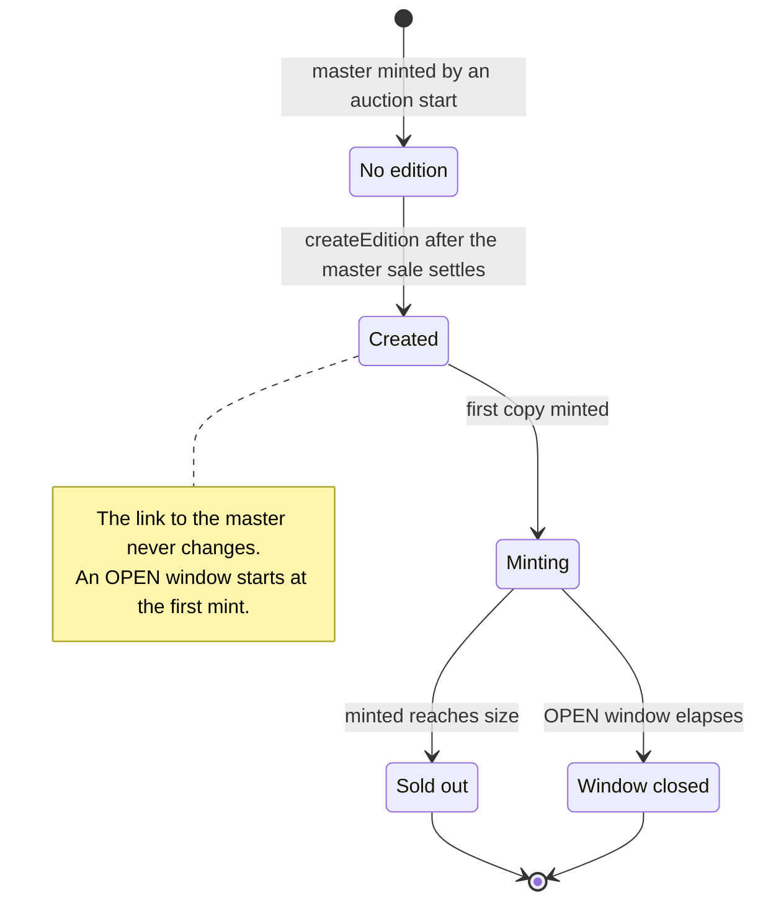
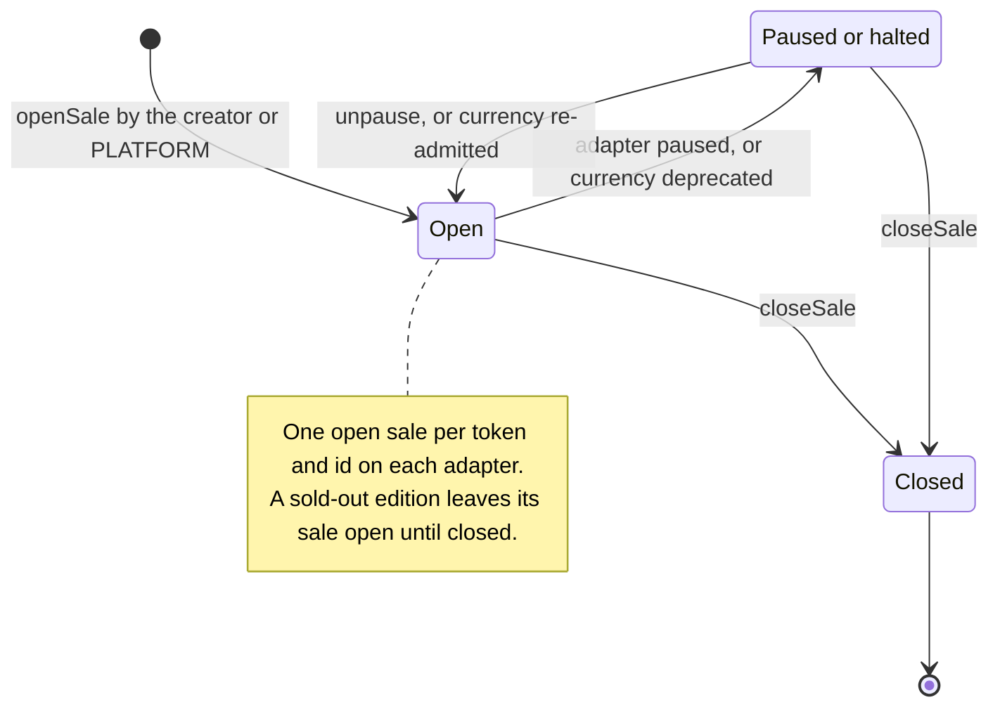
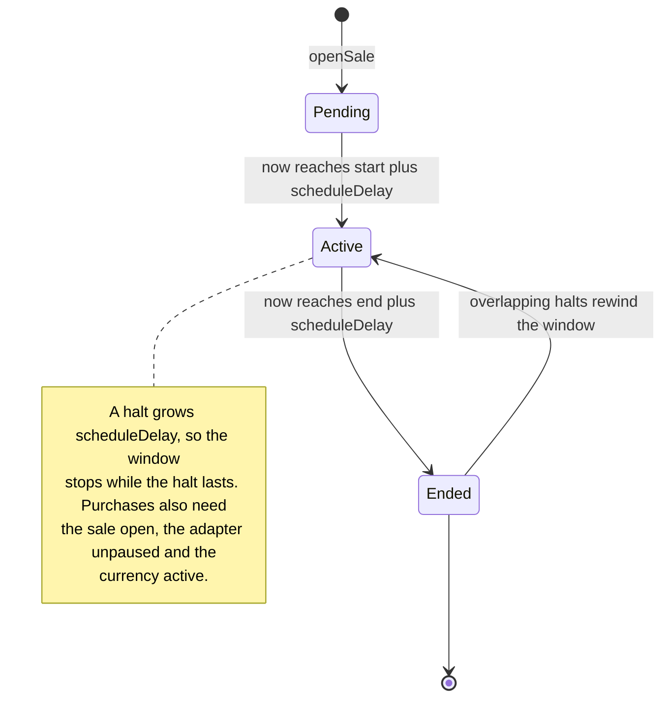
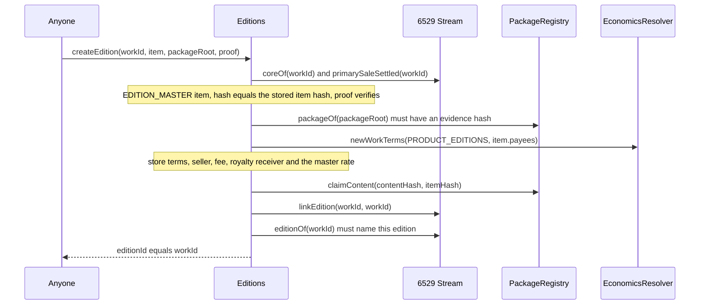
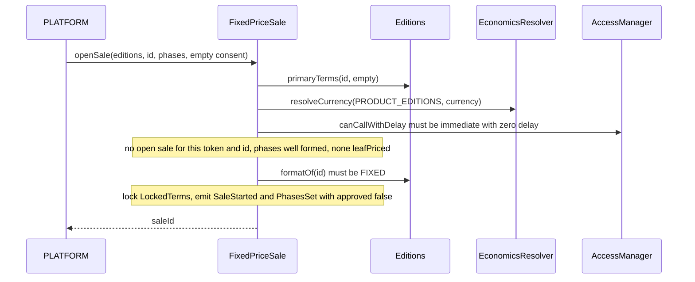
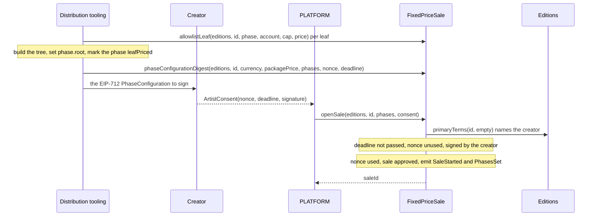
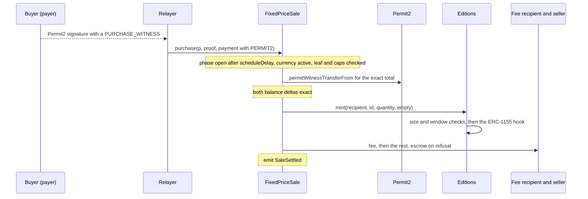
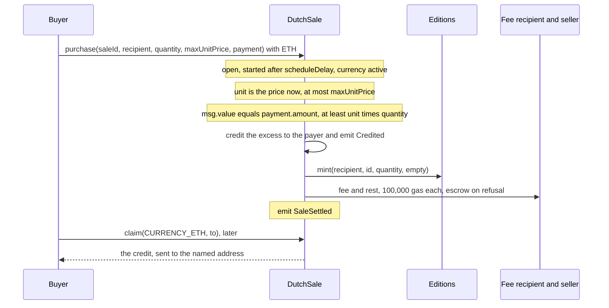
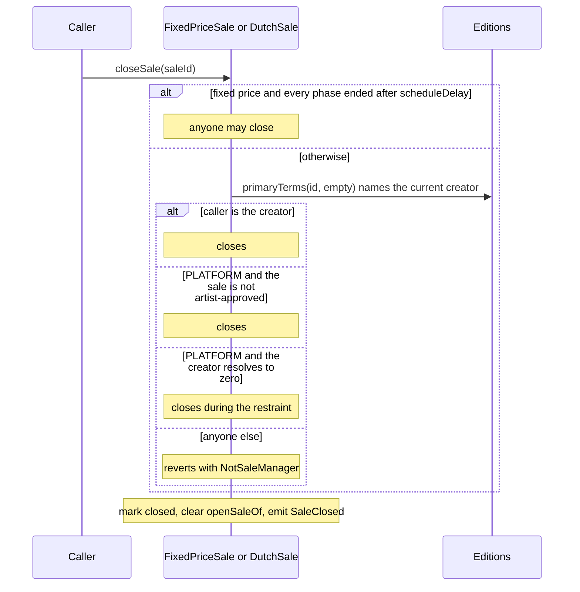

# Editions and sales

6529 Editions is the protocol's one shared ERC-1155. Every edition is anchored by a 6529
Stream work of kind `EDITION_MASTER` (the master): the edition ID is the master's token ID,
and the edition carries the master's media, record, license and content hash. Copies are
sold only through the two shared mint-sale adapters: fixed price, with optional allowlist
phases, and Dutch, a descending price. This page specifies how an edition is created from
its master, what its terms allow, and how the two adapters open, run, halt, pay out and close
sales. It is written for auditors, for integrators who build sale front ends and indexers,
and for operators who hold the PLATFORM or guardian roles. `Editions` and `EditionRules`
implement the edition side; `MintSaleBase`, `FixedPriceSale`, `DutchSale` and
`DutchPricing` implement the sales. The English auction, which sells masters like any other
Stream work, is specified in [Stream and auctions](stream-and-auctions.md).

> **Status.** Pre-audit. This page describes `main` at `c4b3355` (15 October 2026). The ADRs
> record how the design was decided; this page is how it works now. Where they differ, this
> page follows the code and says so under [Differences from the ADRs](#differences-from-the-adrs).

## Contracts

| Contract | Source | Interface | Responsibility |
| --- | --- | --- | --- |
| `Editions` | [`src/editions/Editions.sol`](../../src/editions/Editions.sol) | [`IEditions`](../../src/interfaces/IEditions.sol), [`IMintTarget`](../../src/interfaces/IMintTarget.sol), ERC-1155, ERC-2981, ERC-4906, ERC-7572 | Creates and links editions, enforces size and window on every mint, serves royalties, license and metadata from the master. |
| `EditionRules` (internal library) | [`src/editions/EditionRules.sol`](../../src/editions/EditionRules.sol) | none | The one definition of valid edition terms, used by the package registry at `consume` and by `Editions` at `createEdition`. |
| `MintSaleBase` (abstract) | [`src/sales/MintSaleBase.sol`](../../src/sales/MintSaleBase.sol) | [`ISaleAdapter`](../../src/interfaces/ISaleAdapter.sol) | What both adapters share: targets, terms locked at open, one open sale per `(token, id)`, payment collection, payouts with the escrow fallback, ETH credits, the emergency pause and the schedule delay. |
| `FixedPriceSale` | [`src/sales/FixedPriceSale.sol`](../../src/sales/FixedPriceSale.sol) | [`IFixedPriceSale`](../../src/interfaces/IFixedPriceSale.sol) | Fixed-price sales with up to 16 phases, Merkle allowlists, per-wallet caps and prices, and the artist's signed phase configuration. |
| `DutchSale` | [`src/sales/DutchSale.sol`](../../src/sales/DutchSale.sol) | [`IDutchSale`](../../src/interfaces/IDutchSale.sol) | Descending-price sales on the curve the edition's terms fix. |
| `DutchPricing` (internal library) | [`src/sales/DutchPricing.sol`](../../src/sales/DutchPricing.sol) | none | The price curve and its validity rule. |
| Federation registry (v1.1, not implemented in v1) | none | [`IFederationRegistry`](../../src/interfaces/IFederationRegistry.sol) | What the adapters will read to serve 6529 Stream Federated contracts. v1 installs no registry. |

The types live in [`SaleTypes.sol`](../../src/interfaces/types/SaleTypes.sol) (`SaleKind`,
`Payment`, `PaymentMethod`, `PrimaryTerms`, `LockedTerms`, `DutchParams`),
[`PackageTypes.sol`](../../src/interfaces/types/PackageTypes.sol) (`EditionFormat`,
`EditionTerms`, `PackageItem`) and [`Typehashes.sol`](../../src/interfaces/types/Typehashes.sol)
(`PHASE`, `PHASE_CONFIGURATION`, `PURCHASE_WITNESS`, `DUTCH_PURCHASE_WITNESS`).

These contracts call into others, specified on their own pages:
- 6529 Stream (`coreOf`, `primarySaleSettled`, `linkEdition`, `editionOf`, `rendererOf`):
  [Stream and auctions](stream-and-auctions.md) and [Works and storage](works-and-storage.md).
- The package registry (`packageOf`, `claimContent`, and `EditionRules` at `consume`):
  [Curation](curation.md).
- The economics resolver (`newWorkTerms`, `resolveCurrency`, `networkFeeRecipient`), its
  asset allowlist (`statusClock`), split wallets and the revenue escrow:
  [Economics and payouts](economics-and-payouts.md).
- The artist registry (`activeAuthorityOf`, the sale `creator`):
  [Identity and recovery](identity-and-recovery.md).
- The work-records satellite (`licenseOf`, master re-rates, metadata notifications) and the
  renderer: [Works and storage](works-and-storage.md) and
  [Rendering and tokenURI](rendering-and-tokenuri.md).

## Concepts

Terms used here follow the [glossary](../glossary.md).

### Masters, editions and copies

- A **master** is a Stream work minted from a package item of kind `ItemKind.EDITION_MASTER`.
  It is auctioned like any other work. Its item carries `EditionTerms`, fixed when the
  package was approved.
- An **edition** is the ERC-1155 token ID that the master anchors. The edition ID equals the
  master's Stream token ID, so the link is one number in both contracts. An edition exists
  once `createEdition` succeeds (`exists(id)` is true when its stored content hash is
  nonzero).
- A **copy** is one ERC-1155 unit of an edition. Every copy is minted at purchase, straight
  to the buyer's recipient. There are no numbered editions.
- The link is written once, in both directions, in the `createEdition` transaction, and no
  function changes or removes it. `masterOf(id)` returns `(stream, id, contentHash)`; Stream's
  `editionOf(workId)` returns `(editions, workId)`.

### Edition terms

`EditionTerms` (in [`PackageTypes.sol`](../../src/interfaces/types/PackageTypes.sol)) is part
of the approved item and never changes after approval.

| Field | Meaning |
| --- | --- |
| `format` | `EditionFormat.FIXED` or `EditionFormat.OPEN`. |
| `size` | FIXED: the maximum number of copies ever, nonzero. OPEN: zero for no cap (the code uses `type(uint64).max`), or a cap. |
| `window` | FIXED: must be zero. OPEN: the seconds the edition sells for, counted from the first mint, nonzero. |
| `price` | The unit price for `FIXED_PRICE`, the starting price for `DUTCH`. |
| `currency` | `CURRENCY_ETH` (`address(0)`), an allowlisted ERC-20, or `CURRENCY_DEFAULT` (`address(type(uint160).max)`) only when `price` is zero. |
| `saleKind` | `SaleKind.FIXED_PRICE` or `SaleKind.DUTCH`. Only an adapter reporting this kind may mint. |
| `params` | Empty for `FIXED_PRICE`; exactly `abi.encode(DutchParams)` (96 bytes) for `DUTCH`. |

`EditionRules.isValid` is the one validity rule. It never reverts, and returns true only when:
- a nonzero price names an explicit currency (`CURRENCY_DEFAULT` only with a zero price);
- FIXED has a nonzero `size` and a zero `window`; OPEN has a nonzero `window`;
- `FIXED_PRICE` carries no params; `DUTCH` carries exactly 96 bytes of params, with
  `duration` and `stepSeconds` that fit in `uint64` and a schedule `DutchPricing.isValid`
  accepts (see [Dutch pricing](#dutch-pricing));
- the sale kind is one of those two.

The package registry applies the same rule at `consume` (`PackageRegistry._checkTerms`), so a
master whose edition could not be created, or could not be sold by its adapter, never mints.
`Editions._checkTerms` applies it again at `createEdition`, reporting a priced default
currency with its own error, `PricedDefaultCurrency(workId)`.

### Minting, burning and settlement

- `mint(to, id, amount, data)` requires, in order: an admitted caller (`NotAdmittedMinter`);
  a nonzero `amount` and empty `data` (`InvalidMintRequest`); an existing edition
  (`UnknownEdition`); a caller whose `saleKind()` equals `terms.saleKind`
  (`SaleKindMismatch`); and `amount` within `size - minted` (`EditionUnavailable`). For an
  OPEN edition the first mint sets `windowStart` and emits `EditionWindowOpened`, and any mint
  from `windowStart + window` reverts with `EditionUnavailable`.
- The supply update precedes the ERC-1155 acceptance call, so a reentering receiver sees the
  new `minted`. Minting reads nothing from Stream: a master with an edition has settled, and
  Stream refuses to burn a settled token (`SaleAlreadySettled`).
- `setAdmittedMinter(adapter, admitted)` (SUCCESSOR_SETTER, 30 days, the successor class)
  admits or removes an adapter. Admission requires code, no EIP-7702 delegation and ERC-165
  support for `ISaleAdapter` (`InvalidBinding`); removal is unchecked; only a change emits
  `AdmittedMinterSet`. Genesis admits `FixedPriceSale` and `DutchSale`.
- `burn(id, amount)` burns from the caller's own balance. Any adapter ever admitted may call
  it, including one since removed. Burned copies still count toward the size. The shared
  adapters mint straight to buyers and hold no copies, so in v1 this is the generic
  `IMintTarget` capability, not part of a sale.
- `markPrimarySettled(id)` is a no-op: every copy is sold at mint, so there is nothing to
  settle. Any adapter ever admitted may call it, so a generic adapter never fails there;
  anyone else is refused with `NotAdmittedMinter`.

### Royalties, license and metadata

- `royaltyInfo(id, salePrice)` returns the royalty receiver locked at creation and
  `floor(salePrice × royaltyRate / 100,000)`, read from Editions' own storage with no external
  call. It reverts with `UnknownEdition`.
- The rate starts at the master's current rate. Afterwards only the bound work-records
  satellite changes it, through `setRoyaltyRate(editionId, rate)`, when it re-rates the master
  (`IWorkRecords.setRoyaltyRate`: every party's consent plus a FUNDS_SETTER action, 14 days,
  the funds class). An unknown edition or an unchanged rate is a no-op; a rate above 100,000
  reverts with `InvalidRoyaltyRate`. The receiver never changes, and a later change to the
  `PRODUCT_EDITIONS` defaults never touches an existing edition.
- `licenseOf(id)` returns the master's current license from the work-records satellite. It
  reverts with `UnknownEdition`, or with `RecordNotOpen` until the master's record is open.
- `uri(id)` is `IRenderer(IStream.rendererOf(id)).tokenURI(address(editions), id)`: the
  master's renderer (its pin once finalized, the default before) builds the edition's metadata
  from the master's record and content. It fails closed with the renderer
  ([Rendering and tokenURI](rendering-and-tokenuri.md)).
- ERC-4906 events follow the master (see [Events](#events)).
- `contractURI()` is the ERC-7572 contract metadata, set by `setContractURI` (PARAMETER_SETTER,
  48 hours, the standard class). `owner()` is the marketplace owner, held by 6529 with no
  protocol power, set by `setOwner(expected, next)` (FUNDS_SETTER, 14 days, compare-and-set,
  `ExpectedValueMismatch`).
- `supportsInterface` reports ERC-1155, ERC-2981, `IMintTarget`, `IEditions`, ERC-4906
  (`0x49064906`) and ERC-165.

### Wiring

- The constructor takes the AccessManager, Stream, Stream's reviewed code hash and the
  marketplace owner. Stream must have code, must not be an EIP-7702 delegated account and must
  support `IStream` through ERC-165 (`InvalidBinding`), and its code hash must match
  (`CodeHashMismatch`). The package registry, economics resolver and artist registry are read
  from Stream and stored as immutables (`ZeroAddress` if one is missing).
- Genesis binds Editions in Stream and in the package registry (their one-shot
  `bindEditions`), then calls `Editions.bindWorkRecords` once (ADMIN, genesis only). The target
  must be the work-records satellite Stream bound, with ERC-165 support for `IWorkRecords` and
  no EIP-7702 delegation (`InvalidBinding`, `AlreadyBound`). No edition can be created before
  (`WorkRecordsUnbound`).
- Genesis then admits both adapters on Editions and lists Editions on both adapters
  ([`config/genesis.example.json`](../../config/genesis.example.json), `wiring`).
- `notifyMasterUpdated` and `setRoyaltyRate` accept only the work-records satellite;
  `notifyAllUpdated` accepts it or Stream (`UnboundCaller`).

### Primary terms and locked terms

- `Editions.primaryTerms(id, data)` returns the edition's full `PrimaryTerms`: sale kind,
  the package's currency (unresolved, possibly `CURRENCY_DEFAULT`), price, params, seller,
  fee recipient, fee share and `creator`. `data` is ignored. `mint` returns the same terms.
- An adapter reads these terms when it opens a sale, resolves the currency once, and stores
  them as the sale's `LockedTerms` (`token`, `id`, `currency`, `price`, `seller`,
  `feeRecipient`, `feeShare`). Every purchase in that sale uses the locked terms. A later
  change to a product default affects only sales opened afterwards.
- The seller, fee recipient and fee share are the edition's, locked at `createEdition` from
  `PRODUCT_EDITIONS` economics (see [Creating an edition](#create-an-edition)).

### The creator and PLATFORM

- The **creator** is `PrimaryTerms.creator`: the active authority of the master's lead artist
  (`IArtistRegistry.activeAuthorityOf`), resolved on every read. It needs no role. It may open
  sales, sign phase configurations and close sales. After a recovery, the new key is the
  creator and the old key has none of these powers.
- While an override that would move the artist's authority is pending, `activeAuthorityOf`
  returns zero (the restraint, owner decision 6 and IDENTITY-1). Then nobody acts as the
  creator: no key can open a sale as the creator, no consent verifies (the signature check
  refuses a zero signer), and PLATFORM may close every sale.
- **PLATFORM** is an AccessManager role. The adapters' `openSale` and `closeSale` are not
  `restricted`; they check PLATFORM themselves (`MintSaleBase._isPlatform`), and accept only a
  zero-delay grant for the selector. The creator path needs no role.

### Artist approval (MARKET-6)

A sale is **artist-approved** when the creator opened it, or, for fixed price, when PLATFORM
opened it with the creator's valid signed phase configuration. `sale(saleId)` reports it as
`artistApproved` on fixed price; on Dutch it is stored but not returned.

Alone, PLATFORM may open only:
- a sale of a token listed by governance (not a federated token);
- of an edition whose format is FIXED (`IEditions.formatOf`);
- and, on fixed price, with no `leafPriced` phase.

Everything else needs the artist (`ArtistApprovalRequired` or `PricedLeavesNeedApproval`):
- an OPEN edition, because its one-time window starts at the first mint of whichever sale
  makes it, so opening one decides when the artist's drop is spent;
- any leaf-priced phase, whether the leaf prices are below, equal to or above the package
  price;
- any federated token.

The Dutch adapter has no signed-configuration path: only the creator opens a Dutch sale of an
OPEN edition (`test_MARKET6_PlatformAloneCannotOpenAnOpenDutchEdition`).

### Signed phase configuration

The creator approves a fixed-price phase list by an EIP-712 signature in the fixed-price
adapter's domain (name `Typehashes.FIXED_PRICE_SALE_NAME`, "6529 Works Fixed Price Sale";
version "1"; the chain ID; the adapter's address):

```text
PhaseConfiguration(address token,uint256 id,address currency,uint256 packagePrice,
    Phase[] phases,uint256 nonce,uint64 deadline)
Phase(uint64 start,uint64 end,bytes32 root,uint32 walletCap,bool payerKeyed,bool leafPriced)
```

- `phases` hashes as an EIP-712 array: `keccak256` of the concatenated
  `keccak256(abi.encode(PHASE, phase))` of each phase. Wallets therefore show every window,
  cap and flag.
- `currency` is the **resolved** currency and `packagePrice` the package unit price, so an
  approval never carries over to another currency or price. In a zero-price sale it binds the
  currency a default-currency gift resolves to.
- `phaseConfigurationDigest(token, id, currency, packagePrice, phases, nonce, deadline)`
  returns the digest to sign.
- The consent (`ArtistConsent{nonce, deadline, signature}`) is verified against the creator
  at open by `SignatureVerifier.isValid` (low-s ECDSA, 64 or 65 bytes, or ERC-1271 with a
  200,000-gas cap, `SignatureVerifier.ERC1271_GAS_LIMIT`; at most 4,096 bytes,
  `SignatureVerifier.MAX_SIGNATURE_LENGTH`).
- The nonce is single-use per creator address (`isConsentNonceUsed[creator][nonce]`), and the
  creator may revoke an unused one with `revokeConsentNonce(nonce)`. A key the artist rotated
  away from is never the creator again, so its unused consents stay void.

### Phases and allowlists

A fixed-price sale has 1 to `Limits.MAX_PHASES` (16) phases:

| `Phase` field | Meaning |
| --- | --- |
| `start`, `end` | The window `[start, end)`, moved later by the sale's [schedule delay](#halts-and-the-schedule-delay). `start` must be below `end`. |
| `root` | A Merkle root of allowlist leaves, or zero for a public phase. |
| `walletCap` | A per-wallet limit for the phase; zero means no limit. In an allowlist phase it applies in addition to the leaf's cap. |
| `payerKeyed` | Key the leaf and the caps to the payer instead of the recipient. Only with a nonzero `root`. |
| `leafPriced` | Charge the leaf's `price` instead of the package price. Only with a nonzero `root`, and only in an artist-approved sale. |

The allowlist leaf, exactly as `FixedPriceSale.allowlistLeaf` computes it:

```solidity
keccak256(bytes.concat(keccak256(abi.encode(
    ALLOWLIST_LEAF_DOMAIN, // keccak256("6529WORKS_ALLOWLIST_LEAF_V1")
    block.chainid,
    address(this),         // the FixedPriceSale adapter
    token,
    id,
    phase,                 // the phase index in this sale
    account,
    cap,                   // the purchase's leafCap
    price                  // the purchase's leafPrice
))))
```

- Proofs use OpenZeppelin `MerkleProof.verifyCalldata` (sorted pairs, compatible with
  `StandardMerkleTree`) and have at most `Limits.MAX_PROOF_DEPTH` (32) nodes.
- **`account` is the wallet that receives the copies**, or the payer when the phase is
  `payerKeyed`. The payer is always authenticated: `msg.sender` for DIRECT and PERMIT, the
  Permit2 signer for PERMIT2. Nobody can spend another wallet's leaf to mint to themselves
  (the fix for PR #744's High finding). Anyone may still pay for an allowlisted recipient: the
  copies go to that recipient and count against its cap.
- A purchase names its phase and passes `leafCap` and `leafPrice`. They must match the leaf.
  `leafPrice` is the unit price only when the phase is `leafPriced`; otherwise the unit price
  is the package price and `leafPrice` only has to match the leaf. An allowlist purchase
  always enforces `bought <= leafCap`, so a leaf with a zero cap admits nothing.
- Tooling must emit at most one leaf per account and phase. The Permit2 witness does not bind
  `leafCap` or `leafPrice`, so with two leaves for one account a relayer could choose between
  them.
- **Caps count per `(token, id, phase index, keyed wallet)`, across sales**
  (`purchased(token, id, phase, account)`). Public phases count by phase index too, per
  recipient. Reopening a sale with the same tree never resets a cap.
- **Padding.** A deliberately fresh drop uses new phase indices: the new sale keeps
  placeholder phases (for example, windows that have already ended) at the old indices and
  puts the new phases after them, within the 16-phase limit. Placeholders count toward
  `SaleStarted.startTime`, which is the earliest phase start.

### Payments

A `Payment` is `{method, payer, amount, deadline, nonce, signature}`
([`SaleTypes.sol`](../../src/interfaces/types/SaleTypes.sol)). The payer is the buyer of
record: credits go to it, and a zero `recipient` means the payer.

| Method | Payer | What happens |
| --- | --- | --- |
| `DIRECT` | `msg.sender` | ETH as `msg.value`, which must equal `amount`; or a pull of an ERC-20 the payer approved, with `msg.value` zero. ETH accepts only this method. |
| `PERMIT` | `msg.sender` | An EIP-2612 `permit` for `amount` (a 65-byte `r \|\| s \|\| v`; any other length reverts with `InvalidPayment`), then a pull. A permit someone already submitted is tolerated: the pull uses the allowance it granted. |
| `PERMIT2` | the signer, who may differ from `msg.sender` | Permit2 `permitWitnessTransferFrom`, permitting `amount` and transferring the charge, with a witness that binds the purchase, so a relayer can submit it. |

- **Witnesses.** Fixed price uses `Typehashes.PURCHASE_WITNESS`:
  `Purchase(uint256 saleId,uint256 phase,address recipient,uint256 quantity,uint256 amount,uint256 deadline)`,
  where `amount` is the exact total. Dutch uses `Typehashes.DUTCH_PURCHASE_WITNESS`:
  `DutchPurchase(uint256 saleId,address recipient,uint256 quantity,uint256 maxUnitPrice,uint256 deadline)`.
  The witness carries the purchase's `recipient` as given, so a relayed intent with a zero
  recipient mints to the signer (`test_Kill_L4_RelayedZeroRecipientMintsToTheSigner`).
- **Deadlines.** PERMIT and PERMIT2 revert with `PaymentExpired(deadline)` after `deadline`;
  the adapter checks it itself.
- **Exact amounts.** Fixed price requires `amount` to equal `quantity` times the unit price.
  Dutch treats `amount` as the most the payer will pay: it charges exactly the current price
  times `quantity`, pulls only that for an ERC-20, and credits ETH above it to the payer.
- **Exact balance deltas.** Every ERC-20 pull is checked by balance delta
  (`TokenTransfer.pullExact`). Permit2 does not check deltas, so the adapter reads both
  balances around the call and reverts with `TokenBalanceMismatch` unless the adapter gained
  and the payer lost exactly the charge. Fee-on-transfer, rebasing, no-return and
  false-returning tokens therefore revert.
- Replay protection is the token's or Permit2's nonce, never signature bytes.

### Payouts and credits

Each purchase, in `MintSaleBase._settle`:
1. mints `quantity` copies to the recipient through `IMintTarget.mint(recipient, id,
   quantity, "")`, which runs the recipient's ERC-1155 hook;
2. pays the network fee, `floor(total × feeShare / 100,000)` (`Math.mulDiv`, `Splits.DENOMINATOR`),
   to the fee recipient;
3. pays the rest to the seller, the edition's split wallet (a predicted CREATE2 address that
   may not be deployed yet; the adapter never deploys it);
4. emits `SaleSettled`.

- A zero amount is not paid, so a zero fee share needs no fee recipient, and a gift pays
  nothing.
- An ETH payout forwards exactly `MintSaleBase.PAYOUT_GAS` (100,000) gas and reverts if the
  transaction cannot forward it in full, so a caller cannot force the escrow route by starving
  the call. A wallet that refuses is paid through the revenue escrow (`depositETH`).
- An ERC-20 payout gives the token's `transfer` `RevenuePayment.ERC20_TRANSFER_GAS` (300,000)
  gas. A token that refuses, or blocks the address (as USDC can), is paid through the escrow
  (`depositERC20`). No payee wallet can block a sale. A token that blocks the adapter or the
  escrow itself, or misbehaves in any other way, reverts the purchase: the adapters have no
  fallback frame like the auction's ([economics](economics-and-payouts.md#wallet-payments-and-the-escrow)).
- **Credits.** Only Dutch ETH overpayment creates credits:
  `claimable(account, CURRENCY_ETH)`. `claim(currency, to)` sends all of the caller's credit in
  that currency to `to` (not zero), zeroing it first; an ETH delivery that fails reverts with
  `ClaimFailed` and keeps the credit. Claims work while paused and while the currency is
  deprecated. A fixed-price adapter holds no funds between transactions; a Dutch adapter holds
  exactly its outstanding ETH credits.

### Dutch pricing

The edition's terms fix the curve. `price` is the starting price, and
`params = abi.encode(DutchParams{restingPrice, duration, stepSeconds})`. The sale only fixes
`startTime`.

- `DutchPricing.isValid`: `restingPrice <= startPrice`; a falling price needs a nonzero
  `duration`; `stepSeconds` is zero (linear) or divides `duration`.
- `DutchPricing.priceAt`, with `s = startTime + scheduleDelay(saleId)` and `e = now - s`:
  - `startPrice` while `now <= s`;
  - `restingPrice` once `e >= duration`;
  - otherwise `startPrice - floor((startPrice - restingPrice) × e' / duration)`, where `e'` is
    `e` for a linear curve or `e` rounded down to a multiple of `stepSeconds`.
- The reduction rounds down, so the price never falls below the exact curve. The price never
  rises over time and stays within `[restingPrice, startPrice]`.
- **No clearing price, no rebate.** Each purchase pays the unit price of its block. Copies
  already sold are never repriced. After the curve ends, the price rests at `restingPrice`
  until the edition sells out, its OPEN window closes, or the sale is closed.
- A buyer bounds the price with `maxUnitPrice`; above it the purchase reverts with
  `PriceAboveLimit(price, maxUnitPrice)`.
- `currentPrice(saleId)` returns the unit price now. `SaleStarted.endTime` is
  `startTime + duration`, when the curve reaches its resting price, not when the sale ends.

### Halts and the schedule delay

Two halts stop a sale: a pause of the adapter, and a deprecation of the sale's currency on
the asset allowlist (GUARDIAN, immediate). A halt stops purchases, and since MARKET-1 it also
stops the sale's clock:

- The adapter's halted time for a currency is `pausedTotal` (closed pauses) plus the running
  pause, plus the currency's deprecated time from the allowlist's `statusClock` (closed and
  running).
- A sale records that sum when it opens (`haltedAtOpen`). `scheduleDelay(saleId)` is its
  growth since.
- Fixed-price phase windows and the Dutch curve, including a start not yet reached, run
  `scheduleDelay` seconds later than configured. A halt never uses up an allowlist phase and
  never lets the Dutch price fall. Trading resumes where it stopped.
- The permissionless close of a fixed-price sale uses the moved windows.
- `SaleStarted` and `phases(saleId)` report the configured times. Integrators add
  `scheduleDelay(saleId)`.

**Overlapping halts count twice (accepted limitation).** A pause of the adapter while a
sale's currency is deprecated adds both halts, so the schedule moves by more than the time
trading actually stopped. The schedule then rewinds by the overlap: a Dutch curve climbs back
up (and the sale may read "not open" again), and a fixed-price phase that had ended can
reopen while the one that was running closes. The guardian practice is not to pause an
adapter while a currency is deprecated, and if they must, to ask the creators (or PLATFORM,
for a sale it opened alone) to close and reopen the affected sales once both halts end
([deploy runbook, accounts](../../script/README.md#1-accounts)). The tests
`test_MARKET1_OverlappingHaltsCountTwice_DutchCurveRewinds` and
`test_MARKET1_OverlappingHaltsCountTwice_EndedAllowlistPhaseReopens` pin this behavior.

### Emergency pause

- `pause()` (PAUSER, immediate) makes `openSale` and `purchase` revert with `SalePaused`.
  Pausing a paused adapter reverts with `SalePaused`.
- `closeSale`, `claim` and `revokeConsentNonce` work while paused.
- `unpause()` (UNPAUSER) carries the standard 48-hour execution delay, and the adapter also
  refuses it with `UnpauseTooEarly(allowedAt)` until `pausedAt + Roles.STANDARD` (GOV-5).
  AccessManager counts the UNPAUSER delay from scheduling, so an unpause scheduled before the
  pause could otherwise undo it at once; the adapter counts from the pause, so the guardians
  always have 48 hours to cancel it. Unpausing an unpaused adapter reverts with `NotPaused`.

### Gifts

A gift is a zero-price purchase: a package price of zero, or a leaf price of zero in an
artist-approved `leafPriced` phase. The total is zero, nothing is pulled, and no network fee is
paid, by design (ADR 0003 lists it as an accepted residual). A zero-price edition may name
`CURRENCY_DEFAULT`; the adapter resolves it to the `PRODUCT_EDITIONS` default once, at open.

### Targets and federation

- An adapter serves a token that governance listed (`setTarget(token, true)`,
  SUCCESSOR_SETTER, 30 days, the successor class), or, from v1.1, a token the installed
  federation registry reports active. Genesis lists 6529 Editions on both adapters.
- Unlisting stops new sales of a listed token; running sales finish.
- `setFederationRegistry(expected, next)` (SUCCESSOR_SETTER, compare-and-set) checks ERC-165
  for `IFederationRegistry`, refuses EIP-7702 delegated accounts and pins the code hash; a
  registry whose code later changes is ignored. v1 installs none, so `federationRegistry()`
  is zero.
- A federated token must run the code its registry entry records; its network fee share is
  the entry's, paid to the resolver's `PRODUCT_FEDERATED` fee recipient; its default currency
  resolves under `PRODUCT_FEDERATED`; and every purchase re-checks that it is still active.
  PLATFORM never opens a federated sale alone.

### Roles and delays

| Function | Contract | Who | Delay |
| --- | --- | --- | --- |
| `createEdition` | Editions | anyone | none |
| `bindWorkRecords` | Editions | ADMIN, at genesis only | genesis |
| `setContractURI` | Editions | PARAMETER_SETTER | 48 hours (standard) |
| `setOwner` | Editions | FUNDS_SETTER, compare-and-set | 14 days (funds) |
| `setAdmittedMinter` | Editions | SUCCESSOR_SETTER | 30 days (successor) |
| `openSale` | both adapters | the creator, or PLATFORM with a zero-delay grant | immediate |
| `closeSale` | both adapters | the creator, PLATFORM (see [Close a sale](#close-a-sale)), or anyone for an ended fixed-price sale | immediate |
| `purchase`, `claim` | both adapters | anyone | none |
| `revokeConsentNonce` | FixedPriceSale | the signer, for its own nonces | none |
| `setTarget`, `setFederationRegistry` | both adapters | SUCCESSOR_SETTER | 30 days (successor) |
| `pause` | both adapters | PAUSER | immediate |
| `unpause` | both adapters | UNPAUSER | 48 hours (standard), and no earlier than 48 hours after the pause |

Sources: the selector map in [`config/genesis.example.json`](../../config/genesis.example.json)
and the delays in [`Roles.sol`](../../src/governance/Roles.sol). The full matrix is in
[the audit pack's roles page](../audit/roles.md) and on [Governance](governance.md).

## State machine

### An edition



| Transition | Caller (role) | Delay | Function |
| --- | --- | --- | --- |
| No edition to Created | anyone, once `IStream.primarySaleSettled(workId)` is true | none | `Editions.createEdition` |
| Created to Minting | an admitted adapter whose `saleKind()` matches, for a buyer | none | `Editions.mint` (first copy; OPEN emits `EditionWindowOpened`) |
| Minting to Sold out | an admitted adapter | none | `Editions.mint` when `minted` reaches `size` (FIXED, or OPEN with a cap) |
| Minting to Window closed | time | `window` seconds from the first mint | `Editions.mint` reverts with `EditionUnavailable` from `windowStart + window` |

Burns never return supply: `minted` only grows, and burned copies still count toward the
size. A master with an edition is never burned, because Stream refuses to burn a token whose
primary sale has settled.

### A sale



| Transition | Caller (role) | Delay | Function |
| --- | --- | --- | --- |
| to Open | the creator, or PLATFORM within [its limits](#artist-approval-market-6) | immediate | `openSale` (`SaleAlreadyOpen` if `(token, id)` has an open sale) |
| Open to Paused | PAUSER | immediate | `pause` (every sale on the adapter) |
| Open to Halted | GUARDIAN | immediate | `AssetAllowlist.deprecateAsset` (sales in that currency) |
| Paused to Open | UNPAUSER | 48 hours (standard), and at least 48 hours after the pause | `unpause` |
| Halted to Open | FUNDS_SETTER | 14 days (funds); refused until 14 days after the deprecation | `AssetAllowlist.admitAsset` |
| to Closed | the creator; PLATFORM for a sale that is not artist-approved, or any sale while the creator resolves to zero; anyone once every fixed-price phase has ended | immediate | `closeSale` |

Closing frees `(token, id)` for a new sale on that adapter. A closed sale never reopens; the
sale ID is never reused (IDs are sequential per adapter, from 1).

### A fixed-price phase



| Transition | Caller (role) | Delay | Function |
| --- | --- | --- | --- |
| Pending to Active | time | `start + scheduleDelay(saleId)` | checked in `FixedPriceSale._admit` |
| Active to Ended | time | `end + scheduleDelay(saleId)` | checked in `_admit` and `_ended` |
| Ended to Active | a pause during a deprecation (accepted limitation) | the overlap | `MintSaleBase._halted` |

The Dutch sale has no phases. Its start and curve move with `scheduleDelay` in the same way,
and it accepts purchases from `startTime + scheduleDelay` until it is closed or the edition
stops minting.

## Flows

### Create an edition



Preconditions, all in `Editions._admit` and `_checkTerms`:
- Genesis has bound the work-records satellite (`WorkRecordsUnbound` otherwise).
- No edition exists for `workId` (`EditionExists`).
- The master is live (Stream reverts with `UnknownWork` for an unminted or burned ID) and its
  primary sale has settled: the auction marks it at settlement, before delivery, through
  `IMintTarget.markPrimarySettled`. A master in custody, paused for a dispute, or burned
  gets no edition.
- `item.kind` is `EDITION_MASTER`, `WorksHashing.itemHashCalldata(item)` equals the item hash
  Stream stored, `item.contentHash` is nonzero, and `proof` (at most 32 nodes) places the
  item's leaf in `packageRoot`.
- The package registry registered `packageRoot` (its evidence hash is nonzero). The root may
  have been revoked since: revocation stops a package's unconsumed items, and Stream already
  consumed exactly this one (SIGS-4). A root never registered proves nothing. Any failed check
  above reverts with `NotEditionMaster(workId)`.
- The edition terms pass `EditionRules.isValid`.

Effects:
- Locks `PRODUCT_EDITIONS` economics from `newWorkTerms(PRODUCT_EDITIONS, item.payees)`: the
  seller (the split wallet of the item's payees), the fee recipient and fee share, and the
  royalty receiver (the seller when the fee share is zero, otherwise the royalty split wallet).
- Sets the royalty rate to the master's **current** rate (from `coreOf`), not the product
  default, so a consented re-rate of the master before the edition exists carries over.
- Records the master's lead artist ID, from which `creator` is resolved on every read.
- Emits `EditionCreated` and `MetadataUpdate`, then makes the protocol calls. A reentrant
  `createEdition` hits `EditionExists`.
- The registry accepts only the item Stream consumed for this content hash, once
  (`ClaimNotAllowed`, `ContentUsed`), and emits `ContentClaimed`.
- Stream's `linkEdition` requires an `EDITION_MASTER` that has settled, is not yet linked, and
  an edition ID equal to the token ID (`EditionLinkInvalid`); it emits `EditionLinked` and
  `MetadataUpdate`. Editions then reads `editionOf` back and reverts with `LinkFailed` unless
  it names this contract and ID.

Gas: on Sepolia r2 under Glamsterdam `createEdition` cost 1,118,699 gas and wrote 9 new slots
([flows, section 3](../../deployments/11155111/flows.md#3-6529-editions)); the other figures
are in the [ADR 0004 table](../adr/0004-gas-budgets-under-glamsterdam.md#the-table).

### PLATFORM opens a FIXED sale at the package price



- `MintSaleBase._terms` fails closed unless: the token is a target (`TargetNotAllowed`); the
  terms' sale kind is the adapter's (`SaleKindMismatch`); a priced sale names its currency
  (`PricedDefaultCurrency`); the resolver accepts the currency and, unless it was
  `CURRENCY_DEFAULT`, returns exactly the named one (`CurrencyNotAllowed`,
  `CurrencyMismatch`); a seller is set, a fee recipient is set unless the fee share is zero,
  the fee share is at most 100,000, and neither the seller nor the fee recipient is the
  revenue escrow (`InvalidSaleTerms`, CALLS-1).
- `_checkPhases` refuses an empty list, more than 16 phases, a phase whose `start` is not
  below its `end`, and `payerKeyed` or `leafPriced` without a root (`InvalidPhases`).
- A non-PLATFORM, non-creator caller reverts with `NotSaleManager`; so does a PLATFORM holder
  whose grant carries a delay.
- Gas: the Sepolia r2 `openSale` with one public phase cost 993,668 gas and wrote 8 new
  slots ([flows, section 3](../../deployments/11155111/flows.md#3-6529-editions)).

The Dutch equivalent is `DutchSale.openSale(token, id, startTime)`: `startTime` must not be in
the past (`InvalidSchedule`), the same `_terms` checks run, PLATFORM alone needs a listed FIXED
edition, and the decoded `DutchParams` must pass `DutchPricing.isValid`. It emits
`SaleStarted(saleId, token, id, DUTCH, currency, startPrice, startTime, startTime + duration)`.

### A creator-approved, priced allowlist sale relayed by PLATFORM



- The digest uses the **resolved** currency and the package unit price; a consent signed for
  another currency, price or phase list fails with `InvalidArtistConsent`.
- The consent is checked against the creator now: a consent signed by a key the artist has
  rotated away from, or signed while the creator resolves to zero, fails.
- The same sale may be opened by the creator directly, with an empty consent; it is then
  approved without a signature.
- An approved sale may contain OPEN-edition phases and leaf prices of any level, including
  zero (gifts). PLATFORM cannot close it while the creator is set.

### Purchase with Permit2



Order of checks in `FixedPriceSale.purchase` and `_admit`:
1. adapter not paused (`SalePaused`); the phase exists and the sale is open
   (`PhaseNotOpen`);
2. the locked currency is active (`CurrencyNotActive`) and a federated token is still active
   (`TargetNotAllowed`);
3. `now` is in `[start + delay, end + delay)` (`PhaseNotOpen`); `quantity` is nonzero
   (`InvalidQuantity`);
4. for an allowlist phase, the leaf of the keyed account verifies (`NotAllowlisted`);
5. the purchase keeps the keyed account within the leaf cap and the phase's `walletCap`
   (`WalletCapExceeded`), and is counted;
6. `payment.amount` equals the total (`InvalidPayment`);
7. the payment is collected, then `_settle` mints and pays.

Gas: on Sepolia r2 the purchase that mints an edition's first copy to a new holder cost
468,086 gas ([flows, section 3](../../deployments/11155111/flows.md#3-6529-editions)). The
worst cases (16 phases, a 4 KiB ERC-1271 consent, 32-node proofs, escrowed payouts) fit
EIP-7825's 16,777,216-gas cap (`FixedPriceGasCap.t.sol`, `DutchGasCap.t.sol`).

### Dutch purchase with an ETH credit



- A missing or closed sale, or `now` before `startTime + scheduleDelay`, reverts with
  `SaleNotOpen`. An amount below the charge reverts with `InvalidPayment`.
- For an ERC-20 sale, DIRECT and PERMIT pull exactly the charge, and PERMIT2 permits
  `payment.amount` but transfers only the charge; no credit arises.
- A purchase later on the curve pays less; nobody who bought earlier is rebated.

### Close a sale



- A closed sale reverts with `SaleAlreadyClosed`; an unknown one with `UnknownSale`.
- The creator is read at close time, so after a recovery only the new key closes.
- Nothing closes a sale automatically. A sold-out edition, an elapsed OPEN window or a fixed
  price sale past its last phase stays open until someone calls `closeSale`.
- A Dutch sale has no end, so it has no permissionless close.

## Rules and invariants

| ID | Rule | Enforced in | Proven by |
| --- | --- | --- | --- |
| ED-1 | An edition is created only for a live, settled `EDITION_MASTER` whose exact stored item is proven in a registered package root, revoked or not. | `Editions._admit` | [Editions.t.sol](../../test/editions/Editions.t.sol): `test_CreateEdition_RequiresSettledMaster`, `test_CreateEdition_RefusesOriginalItem`, `test_CreateEdition_RefusesMismatchedItem`, `testFuzz_CreateEdition_RefusesTamperedItem`, `test_CreateEdition_RequiresARegisteredPackageProof`, `test_CreateEdition_ProofDepthBounded`; [MasterEdition.t.sol](../../test/integration/MasterEdition.t.sol): `test_RevokingTheRootDoesNotStrandASoldMastersEdition`, `test_AnEditionNeedsARegisteredRoot` |
| ED-2 | A master has at most one edition, its ID is the master's token ID, both sides are written in one transaction, and the link never changes. | `Editions.createEdition`; `Stream.linkEdition` | [Editions.t.sol](../../test/editions/Editions.t.sol): `test_CreateEdition_LinksBothWaysAndLocksTerms`, `test_CreateEdition_RefusesSecondCreate`, `test_CreateEdition_LinkIsPermanent`, `test_CreateEdition_FailsClosedWhenStreamDoesNotLink`, `test_CreateEdition_ReentryThroughStreamHitsEditionExists`; [Editions.invariant.t.sol](../../test/editions/Editions.invariant.t.sol): `invariant_LinkAndRoyaltyFixed` |
| ED-3 | An edition's content hash is unique among editions and claimable only by the item Stream consumed for it. | `PackageRegistry.claimContent` | [Editions.t.sol](../../test/editions/Editions.t.sol): `test_CreateEdition_ContentHashUniqueAmongEditions`, `test_CreateEdition_RefusesHashClaimedInEditions`, `test_CreateEdition_RefusesHashConsumedByAnotherItem` |
| ED-4 | Edition terms satisfy one rule at `consume` and at `createEdition`; a nonzero price never uses `CURRENCY_DEFAULT`. | `EditionRules.isValid`; `PackageRegistry._checkTerms`; `Editions._checkTerms` | [EditionRules.t.sol](../../test/editions/EditionRules.t.sol): `test_FixedPriceShapes`, `test_SaleKinds`, `test_DefaultCurrencyOnlyWhenFree`, `test_DutchSchedules`, `test_DutchMalformedParams`, `testFuzz_NeverReverts`; [Editions.t.sol](../../test/editions/Editions.t.sol): `test_CreateEdition_RefusesMalformedTerms`, `test_CreateEdition_RefusesPricedDefaultCurrency` |
| ED-5 | Only an admitted adapter whose `saleKind()` equals the edition's mints, with a nonzero amount and empty data. | `Editions.mint` | [Editions.t.sol](../../test/editions/Editions.t.sol): `test_Mint_OnlyAdmittedMinter`, `test_Mint_RequiresMatchingSaleKind`, `test_Mint_RejectsUnknownEditionZeroAmountAndData`, `test_SetAdmittedMinter_GovernedAndChecked` |
| ED-6 | Copies minted never exceed `size` (or `type(uint64).max` for an uncapped OPEN edition); burns never free supply; an OPEN window starts once, at the first mint, and admits no mint from `windowStart + window`. | `Editions.mint`, `Editions.burn` | [Editions.t.sol](../../test/editions/Editions.t.sol): `test_Mint_StopsAtSize`, `testFuzz_Mint_NeverExceedsSize`, `test_Mint_OpenWindowStartsAtFirstMint`, `test_Mint_OpenWindowWithSizeCap`, `test_Mint_OpenWithoutCapStopsAtUint64`; [Editions.invariant.t.sol](../../test/editions/Editions.invariant.t.sol): `invariant_SupplyAccounting`, `invariant_WindowStartsOnce`, `invariant_MintsFollowEditionTerms` |
| ED-7 | The royalty receiver is fixed at creation; the rate starts at the master's current rate and changes only through the work-records satellite, with the master's. | `Editions.createEdition`, `Editions.setRoyaltyRate`; `WorkRecords._applyRate` | [Editions.t.sol](../../test/editions/Editions.t.sol): `test_CreateEdition_InheritsMasterRoyaltyRate`, `test_SetRoyaltyRate_OnlyThroughWorkRecords`, `test_RoyaltyInfo_UnaffectedByNewDefaults`; [MasterEdition.t.sol](../../test/integration/MasterEdition.t.sol): `test_EditionRoyaltyFollowsAMasterRerate`, `test_EditionTakesTheMastersCurrentRate` |
| ED-8 | Only an adapter ever admitted burns, and only from its own balance; `markPrimarySettled` is a no-op for such adapters and refused for anyone else. | `Editions.burn`, `Editions.markPrimarySettled` | [Editions.t.sol](../../test/editions/Editions.t.sol): `test_Burn_OnlyMinterOnlyOwnBalance`, `test_Burn_RemovedAdapterCanStillBurn`, `test_MarkPrimarySettled_NoOpForAdapters` |
| ED-9 | A sale opens only on usable terms read from the token: a target, the adapter's sale kind, a named currency when priced, a currency the resolver accepts unchanged, a seller, a fee recipient for a nonzero fee share, a fee share of at most 100,000, and no escrow as payee. | `MintSaleBase._terms` | [FixedPriceSale.t.sol](../../test/sales/fixed/FixedPriceSale.t.sol): `test_OpenSale_RevertsOnUnadmittedTarget`, `test_OpenSale_RevertsOnSaleKindMismatch`, `test_OpenSale_RevertsOnUnusableTerms`, `test_CALLS1_OpenSaleRefusesTheEscrowAsSellerOrFeeRecipient`, `test_OpenSale_PricedSalesMustNameTheirCurrency`; [ReviewRound2.t.sol](../../test/sales/fixed/ReviewRound2.t.sol): `test_R2_Inverted_ResolverCannotSubstituteANamedCurrency` |
| ED-10 | A sale's currency and terms are locked at open; every purchase needs the locked currency active. | `MintSaleBase._store`, `_purchaseDelay` | [FixedPriceSale.t.sol](../../test/sales/fixed/FixedPriceSale.t.sol): `test_Purchase_CurrencyIsLockedAtOpen`, `test_Purchase_DeprecatingTheLockedCurrencyHaltsTheSale`, `test_OpenSale_GiftResolvesTheDefaultCurrencyOnce`; [ReviewRound2.t.sol](../../test/sales/fixed/ReviewRound2.t.sol): `test_R2_Resolver_NotOnPurchasePath` |
| ED-11 | At most one sale per `(token, id)` is open on an adapter. | `FixedPriceSale.openSale`, `DutchSale.openSale`, `MintSaleBase._close` | [FixedPriceSale.t.sol](../../test/sales/fixed/FixedPriceSale.t.sol): `test_OpenSale_OneOpenSalePerEdition`; [DutchSale.t.sol](../../test/sales/dutch/DutchSale.t.sol): `test_OpenSale_RevertsForStrangerPastStartOrSecondSale` |
| ED-12 | Only the creator or a zero-delay PLATFORM opens; PLATFORM alone opens only a listed FIXED edition with no leaf-priced phase. | `openSale` on both adapters; `MintSaleBase._requirePlatformMayOpen` | [FixedPriceSale.t.sol](../../test/sales/fixed/FixedPriceSale.t.sol): `test_OpenSale_RevertsForStrangerAndDelayedPlatform`, `test_Approval_PlatformAloneCannotPriceLeaves`; [Market6Regression.t.sol](../../test/adv/Market6Regression.t.sol): all five tests; [FederationRegistry.t.sol](../../test/sales/fixed/FederationRegistry.t.sol): `test_FederatedSale_PlatformAloneCannotOpen` |
| ED-13 | A phase consent binds token, ID, resolved currency, package price, every phase, nonce and deadline, verifies against the current creator, and is single-use and revocable. | `FixedPriceSale._consume`, `revokeConsentNonce` | [FixedPriceSale.t.sol](../../test/sales/fixed/FixedPriceSale.t.sol): `test_Approval_RevertsOnInvalidConsent`, `test_Approval_NonceIsSingleUseAndRevocable`, `test_Approval_ContractCreatorSignsByErc1271`; [ReviewRound2.t.sol](../../test/sales/fixed/ReviewRound2.t.sol): `test_R2_PhaseConfigurationDigest_MatchesCheatcode`, `test_R2_ConsentNotReusableUnderAnotherCurrencyOrPrice`, `test_R2_GiftConsentBindsTheResolvedDefault`; [RecoveryRestraint.t.sol](../../test/integration/RecoveryRestraint.t.sol): `test_RestrainedKeyCannotManageTheEditionSale` |
| ED-14 | A sale closes by the creator; by PLATFORM if it is not artist-approved or the creator resolves to zero; by anyone once every moved fixed-price phase has ended. | `MintSaleBase._close`; `FixedPriceSale.closeSale`, `_ended`; `DutchSale.closeSale` | [FixedPriceSale.t.sol](../../test/sales/fixed/FixedPriceSale.t.sol): `test_CloseSale_ByCreatorOrPlatformStopsPurchases`, `test_CloseSale_FollowsTheCurrentCreator`; [ReviewRegressions.t.sol](../../test/sales/fixed/ReviewRegressions.t.sol): `test_AnyoneClosesASaleWhosePhasesEnded`; [ReviewRound2.t.sol](../../test/sales/fixed/ReviewRound2.t.sol): `test_R2_Close_OpenEndedAndFuturePhasesBlockStrangers`, `test_R2_Close_BoundaryAgreesWithPurchaseWindow`; [SalesFollowUpRegression.t.sol](../../test/adv/SalesFollowUpRegression.t.sol): `test_MARKET6_PlatformCannotCloseTheArtistsOwnDutchSale`; [RecoveryRestraint.t.sol](../../test/integration/RecoveryRestraint.t.sol): `test_PlatformClosesTheArtistsSaleDuringTheNotice` |
| ED-15 | An allowlist leaf is checked against the receiving wallet, or the authenticated payer in a payer-keyed phase, and binds chain, adapter, token, ID, phase, cap and price. | `FixedPriceSale._admit`, `_verifyLeaf`, `allowlistLeaf` | [FixedPriceSale.t.sol](../../test/sales/fixed/FixedPriceSale.t.sol): `test_AllowlistLeaf_MatchesTheDefinition`, `test_Regression_PR744High_LeafBindsTheReceivingWallet`, `test_Allowlist_PayerKeyedBindsThePayer`, `test_Allowlist_LeafBindsEditionPhaseAdapterAndChain`, `test_Allowlist_RejectsForgedCapOrPriceAndLongProofs`; [ReviewRegressions.t.sol](../../test/sales/fixed/ReviewRegressions.t.sol): `test_PoC_NoDirectRouteMintsToSelfOnAnotherWalletsLeaf`, `test_PoC_NoPermit2RouteMintsToSelfOnAnotherWalletsLeaf` |
| ED-16 | Purchase counts persist per `(token, id, phase index, keyed wallet)` across sales; no purchase exceeds a leaf cap or a nonzero `walletCap`. | `FixedPriceSale._admit` | [FixedPriceSale.t.sol](../../test/sales/fixed/FixedPriceSale.t.sol): `test_Allowlist_CapsPersistAcrossReopenedSales`, `test_Caps_PerWalletAcrossPhases`, `testFuzz_PublicWalletCapIsNeverExceeded`; [ReviewRegressions.t.sol](../../test/sales/fixed/ReviewRegressions.t.sol): `test_PoC_Inverted_CapsSurviveAReopenedSale_PlatformOnly`; [FixedPriceInvariant.t.sol](../../test/sales/fixed/FixedPriceInvariant.t.sol): `invariant_PerWalletCapsHold`, `invariant_NoOverCapOrForeignLeafPurchaseSucceeds` |
| ED-17 | Payments are exact: a fixed-price amount equals the total, ETH equals `amount`, and every ERC-20 movement, Permit2 included, matches its balance deltas. | `MintSaleBase._collect`, `_permit2`; `TokenTransfer.pullExact` | [FixedPricePayments.t.sol](../../test/sales/fixed/FixedPricePayments.t.sol): `test_Direct_PullsExactlyAndPays`, `test_HostileToken_FeeOnTransferRevertsOnTheDelta`, `test_HostileToken_Permit2CannotSkipTheDeltaCheck`, `test_HostileToken_Permit2UnderReportedPayerBalanceReverts`; [ReviewRegressions.t.sol](../../test/sales/fixed/ReviewRegressions.t.sol): `test_Kill_D1_Permit2InboundShortfallReverts`, `test_Kill_D2_Permit2PayerOverDebitReverts`, `test_Kill_D6_FixedEthOverpaymentReverts` |
| ED-18 | A Permit2 witness binds the purchase: sale, phase, recipient, quantity, amount (or `maxUnitPrice`) and deadline. | `FixedPriceSale.purchase`, `DutchSale.purchase` | [FixedPricePayments.t.sol](../../test/sales/fixed/FixedPricePayments.t.sol): `test_Permit2_WitnessBindsThePurchase`, `test_Permit2_ReplayIsRejectedByTheNonce`, `test_Permit2_PayerKeyedLeafNeedsThePayersSignature`; [ReviewRegressions.t.sol](../../test/sales/fixed/ReviewRegressions.t.sol): `test_Kill_W1_IntentIsBoundToItsPhase`, `test_Kill_L4_RelayedZeroRecipientMintsToTheSigner`; [DutchSale.t.sol](../../test/sales/dutch/DutchSale.t.sol): `test_Erc20_Permit2IntentTakesTheChargeOnly` |
| ED-19 | The fee is `floor(total × feeShare / 100,000)` and the seller gets the rest; a refused payout goes to the escrow; a fixed-price adapter keeps nothing and a Dutch adapter holds exactly its credits. | `MintSaleBase._settle`, `_pay`; `RevenuePayment` | [FixedPriceSale.t.sol](../../test/sales/fixed/FixedPriceSale.t.sol): `test_Purchase_FeeRoundsDownAndConserves`; [FixedPricePayments.t.sol](../../test/sales/fixed/FixedPricePayments.t.sol): `test_HostileWallet_GasBurnersCannotBlockTheSale`, `test_HostileWallet_RefusingSellerIsEscrowed`, `test_HostileToken_BlockedSellerIsPaidThroughEscrow`; [FixedPriceInvariant.t.sol](../../test/sales/fixed/FixedPriceInvariant.t.sol): `invariant_FeesAreExact`, `invariant_EthIsPaidOrEscrowedNeverKept`, `invariant_TokenIsPaidOrEscrowedNeverKept`; [DutchInvariant.t.sol](../../test/sales/dutch/DutchInvariant.t.sol): `invariant_CreditsAreFullyBacked`, `invariant_EthIsConserved` |
| ED-20 | The Dutch price never rises, stays within `[restingPrice, startPrice]`, never falls below the exact curve, is never above the buyer's `maxUnitPrice`, and is never rebated. | `DutchPricing.priceAt`, `isValid`; `DutchSale.purchase` | [DutchPricing.t.sol](../../test/sales/dutch/DutchPricing.t.sol): `testFuzz_PriceNeverRisesOverTime`, `testFuzz_PriceStaysWithinItsBounds`, `testFuzz_LinearRoundsTowardTheSeller`, `testFuzz_SteppedIsConstantWithinAStepAndAboveLinear`; [DutchInvariant.t.sol](../../test/sales/dutch/DutchInvariant.t.sol): `invariant_PriceNeverRises`; [DutchSale.t.sol](../../test/sales/dutch/DutchSale.t.sol): `test_Purchase_NoRebateWhenThePriceFalls`, `test_Purchase_RevertsOnLimitQuantityOrUnderpayment` |
| ED-21 | A pause or a deprecation of the sale's currency moves phase windows and the Dutch curve later by its length; overlapping halts count twice. | `MintSaleBase._halted`, `_scheduleDelay`, `_purchaseDelay` | [Market1Regression.t.sol](../../test/adv/Market1Regression.t.sol): all six tests; [SalesFollowUpRegression.t.sol](../../test/adv/SalesFollowUpRegression.t.sol): `test_MARKET1_OverlappingHaltsCountTwice_DutchCurveRewinds`, `test_MARKET1_OverlappingHaltsCountTwice_EndedAllowlistPhaseReopens`, `test_MARKET1_ARunningDeprecationMovesViewsAndTheCloseRule`, `test_MARKET1_AHaltBeforeTheStartMovesTheDutchStart` |
| ED-22 | A pause stops opening and buying, never closing or claiming; an unpause lands no earlier than 48 hours after the pause. | `MintSaleBase.pause`, `unpause`, `whenNotPaused` | [ReviewRegressions.t.sol](../../test/sales/fixed/ReviewRegressions.t.sol): `test_Pause_StopsOpeningAndBuyingButNotClosingOrClaiming`, `test_Pause_RepeatedPauseOrUnpauseReverts`; [DutchSale.t.sol](../../test/sales/dutch/DutchSale.t.sol): `test_Pause_StopsOpeningAndBuyingButNotClaimingOrClosing`; [Gov5Regression.t.sol](../../test/adv/Gov5Regression.t.sol): `test_GOV5_UnpauseScheduledBeforeThePauseWaitsTwoDaysAfterIt`; [SalesFollowUpRegression.t.sol](../../test/adv/SalesFollowUpRegression.t.sol): `test_GOV5_PauseUnpausePauseRestartsTheClock` |
| ED-23 | Claims are never blocked by a pause or a deprecation; a failed ETH claim keeps the credit. | `MintSaleBase.claim` | [DutchSale.t.sol](../../test/sales/dutch/DutchSale.t.sol): `test_Purchase_ExcessIsCreditedAndClaimed`, `test_Claim_IsNeverBlockedByDeprecation`, `test_Claim_FailedDeliveryKeepsTheCredit`, `test_Claim_ReentryIsBlocked` |
| ED-24 | A federated token sells only while its pinned registry reports it active and it runs its entry's code, at the entry's fee share. | `MintSaleBase._federated`, `_terms`, `_purchaseDelay` | [FederationRegistry.t.sol](../../test/sales/fixed/FederationRegistry.t.sol): `test_IsTarget_FollowsTheRegistry`, `test_IsTarget_IgnoresARegistryWhoseCodeChanged`, `test_FederatedSale_PaysTheRegistryFeeShare`; [ReviewRegressions.t.sol](../../test/sales/fixed/ReviewRegressions.t.sol): `test_PoC_Inverted_DelistedFederatedTokenStopsSelling`, `test_FederatedTokenMustRunItsRegisteredCode` |

## Events

| Event | Contract | Emitted when | Notes |
| --- | --- | --- | --- |
| `EditionCreated(editionId, contentHash, terms)` | Editions | `createEdition` | Both IDs indexed; `terms` is the full `EditionTerms`. |
| `EditionLinked(tokenId, editions, editionId)` | 6529 Stream | `linkEdition`, inside `createEdition` | Stream also emits `MetadataUpdate(tokenId)` for the master. |
| `ContentClaimed(contentHash, itemHash)` | PackageRegistry | `claimContent`, inside `createEdition` | The `PRODUCT_EDITIONS` uniqueness record. |
| `MetadataUpdate(_tokenId)` | Editions | creation; a royalty rate change; `notifyMasterUpdated` from the work-records satellite | ERC-4906. `notifyMasterUpdated` emits only if the edition exists. |
| `BatchMetadataUpdate(0, type(uint256).max)` | Editions | `notifyAllUpdated` from Stream (new default renderer) or the work-records satellite (a global or collection preferred-location change) | ERC-4906; changes no state. |
| `EditionWindowOpened(editionId, closesAt)` | Editions | the first mint of an OPEN edition | `closesAt` is `windowStart + window`, capped at `type(uint64).max`. |
| `TransferSingle` | Editions | every mint (from zero) and burn (to zero) | ERC-1155; emitted inside `purchase`, before `SaleSettled`. |
| `RoyaltyRateChanged(editionId, previous, next)` | Editions | `setRoyaltyRate` from the work-records satellite, when the rate changes | Not emitted for an unchanged rate or a master without an edition. |
| `AdmittedMinterSet(adapter, admitted)` | Editions | `setAdmittedMinter`, only on a change | |
| `Bound(name, target)` | Editions | `bindWorkRecords`, once | `name` is `"WORK_RECORDS"`. |
| `ContractURISet(previous, next)`, `ContractURIUpdated()` | Editions | `setContractURI` | `ContractURIUpdated` is ERC-7572's, without values. |
| `OwnershipTransferred(previousOwner, newOwner)` | Editions | construction and `setOwner` | The marketplace owner; it has no protocol power. |
| `SaleStarted(saleId, token, tokenId, saleKind, currency, price, startTime, endTime)` | both adapters | `openSale` | `currency` is resolved. Fixed price: `price` is the package unit price, times are the earliest phase start and latest phase end, as configured. Dutch: the starting price, and `endTime` is when the curve reaches its resting price. |
| `PhasesSet(saleId, phases, artistApproved)` | FixedPriceSale | `openSale`, after `SaleStarted` | The full `Phase[]`. |
| `SaleSettled(saleId, token, tokenId, buyer, recipient, quantity, currency, price, seller, sellerProceeds, feeRecipient, fee)` | both adapters | every purchase | `price` is the total for `quantity` copies, equal to `sellerProceeds + fee`. `buyer` is the payer. Payouts routed to the escrow are visible as escrow events, not here. |
| `SaleClosed(saleId)` | FixedPriceSale, DutchSale | every successful `closeSale` | Means "no new purchases", not "the last event of the sale" (see below). |
| `Credited(account, currency, saleId, amount)` | DutchSale | ETH paid above the charge | Claimable with `claim`. |
| `Claimed(account, currency, to, amount)` | both adapters | `claim` | |
| `ConsentNonceRevoked(creator, nonce)` | FixedPriceSale | `revokeConsentNonce` | A consumed nonce emits nothing; it is just marked used. |
| `TargetSet(token, listed)` | both adapters | `setTarget` | Emitted even when unchanged. |
| `FederationRegistrySet(previous, next)` | both adapters | `setFederationRegistry` | |
| `Paused(account)`, `Unpaused(account)` | both adapters | `pause`, `unpause` | |

Indexer notes:
- **A purchase's `SaleSettled` can follow its sale's `SaleClosed`.** The recipient's ERC-1155
  hook runs inside `purchase`, and a creator's hook may close the sale there (`closeSale`
  is not guarded against reentry; `purchase` is). Treat `SaleClosed` as "no new purchases"
  (`test_PoC_ReceiverHookCloseReopenIsHarmless` pins the order).
- Sale IDs are sequential **per adapter** and both adapters start at 1, so key sales by
  `(adapter, saleId)`.
- Phase windows and the Dutch curve move by `scheduleDelay(saleId)`; no event reports the
  move. Read the view, or derive it from `Paused`, `Unpaused` and the allowlist's asset events.
- No event marks a sold-out edition. Compare `edition(id).minted` with `terms.size`.

## Failure modes and recovery

| Failure | Effect | Recovery |
| --- | --- | --- |
| The seller wallet or fee recipient refuses ETH, burns gas, or the token blocks it | The payout goes to the revenue escrow; the sale proceeds. | The payee withdraws from the escrow ([Economics and payouts](economics-and-payouts.md)). |
| An ETH claim's recipient refuses it | `ClaimFailed`; the credit is kept. | Claim again to another address. |
| The sale's currency is deprecated | Purchases revert with `CurrencyNotActive`; the schedule stops. New sales in it cannot open (`CurrencyNotAllowed`). | FUNDS_SETTER re-admits it, no earlier than 14 days after the deprecation, and trading resumes where it stopped. A priced edition names its currency, so it cannot be sold in another one. |
| The adapter is paused | `openSale` and `purchase` revert with `SalePaused`; schedules stop. | UNPAUSER unpauses, no earlier than 48 hours after the pause. Closes and claims keep working. |
| A pause overlaps a deprecation | The schedule moves twice; a Dutch curve climbs back or an ended phase reopens. | Avoid it ([guardian practice](../../script/README.md#1-accounts)); otherwise the creator, or PLATFORM for its own sale, closes and reopens the affected sales. |
| The creator's key is compromised | It could open or close the artist's sales and sign consents. | Stage a recovery override: the creator resolves to zero, PLATFORM may close any sale, and the new key takes over at execution. A guardian may also pause the adapter. |
| An edition sells out or its OPEN window ends while its sale is open | `mint` reverts with `EditionUnavailable`, so every purchase reverts. | Close the sale. Fixed price: anyone once its phases end; Dutch: the creator or PLATFORM as allowed. |
| An artist-approved sale must stop, and the creator does not act | PLATFORM cannot close it while the creator is set. | A guardian pauses the adapter (all its sales). |
| An adapter is removed (`setAdmittedMinter(adapter, false)`) | Its purchases revert with `NotAdmittedMinter`. It can still burn copies it holds and call `markPrimarySettled`. | Close its open sales; open new ones on an admitted adapter of the same sale kind. |
| A token is unlisted (`setTarget(token, false)`) | New sales revert with `TargetNotAllowed`; running sales finish. | Re-list it (30 days). |
| A federated token is delisted, or the registry's code changes | Purchases revert with `TargetNotAllowed`; the registry is ignored. | Relist through the registry, or install a new registry (30 days). |
| The recipient's ERC-1155 hook reverts, returns the wrong value, or the recipient cannot hold the token | The whole purchase reverts; nothing is paid. | Buy for another recipient. |
| A consent is stale | `InvalidArtistConsent`: wrong currency, price or phases, expired, nonce used, or signed by a key that is no longer the creator. | The current creator signs a new configuration. |
| `createEdition` before genesis binds the work-records satellite | `WorkRecordsUnbound`. | Genesis binds it once; no edition exists before. |
| Stream does not record the link | `LinkFailed`; nothing is created. | None needed: the transaction reverts. |
| The renderer's code no longer matches its pin | `uri` reverts (fail closed). | A new default renderer or an errata repin ([Rendering and tokenURI](rendering-and-tokenuri.md)). |
| `licenseOf` before the master's record is open | Reverts with `RecordNotOpen`. | Anyone opens the master's record with `openRecord` ([Works and storage](works-and-storage.md)). |

## Parameters and limits

| Parameter | Value | Source |
| --- | --- | --- |
| Phases per fixed-price sale | 16 | `Limits.MAX_PHASES` in [`Limits.sol`](../../src/interfaces/types/Limits.sol) |
| Merkle proof nodes (package item and allowlist) | 32 | `Limits.MAX_PROOF_DEPTH` in [`Limits.sol`](../../src/interfaces/types/Limits.sol) |
| Fee share and royalty denominator | 100,000 | `Splits.DENOMINATOR` in [`Splits.sol`](../../src/economics/Splits.sol) |
| Gas forwarded with an ETH payout | 100,000 | `MintSaleBase.PAYOUT_GAS` |
| Gas given to an ERC-20 payout transfer | 300,000 | `RevenuePayment.ERC20_TRANSFER_GAS` in [`RevenuePayment.sol`](../../src/economics/RevenuePayment.sol) |
| Consent signature length | at most 4,096 bytes | `SignatureVerifier.MAX_SIGNATURE_LENGTH` in [`SignatureVerifier.sol`](../../src/libraries/SignatureVerifier.sol) |
| ERC-1271 gas for a consent check | 200,000 | `SignatureVerifier.ERC1271_GAS_LIMIT` |
| EIP-2612 permit signature | exactly 65 bytes | `MintSaleBase._collect` |
| Allowlist leaf domain | `keccak256("6529WORKS_ALLOWLIST_LEAF_V1")` | `FixedPriceSale.ALLOWLIST_LEAF_DOMAIN` |
| Fixed-price EIP-712 domain | "6529 Works Fixed Price Sale", version "1" | `Typehashes.FIXED_PRICE_SALE_NAME`, `DOMAIN_VERSION` in [`Typehashes.sol`](../../src/interfaces/types/Typehashes.sol) |
| Dutch params | exactly 96 bytes, `abi.encode(DutchParams)` | `EditionRules` |
| Uncapped OPEN edition | `type(uint64).max` copies | `Editions.mint` |
| `CURRENCY_ETH`, `CURRENCY_DEFAULT` | `address(0)`, `address(type(uint160).max)` | [`EconomicsTypes.sol`](../../src/interfaces/types/EconomicsTypes.sol) |
| First sale ID per adapter | 1 | `MintSaleBase.nextSaleId` |
| Unpause floor after a pause | 48 hours | `Roles.STANDARD` in [`Roles.sol`](../../src/governance/Roles.sol) |
| Re-admission floor after a deprecation | 14 days | `IAssetAllowlist.admitAsset` |
| Governed delays | 48 hours, 14 days, 30 days | `Roles.STANDARD`, `FUNDS`, `SUCCESSOR`; [Roles and delays](#roles-and-delays) |
| Per-transaction gas cap the worst cases fit | 16,777,216 | EIP-7825; `FixedPriceGasCap.t.sol`, `DutchGasCap.t.sol` |

## Differences from the ADRs

- **The link is permanent from creation.** ADR 0001 §6 says the link is permanent "once both
  sides are finalized". The code writes both sides in `createEdition` and has no function
  that changes or removes the link, whether or not the master is finalized.
- **A revoked root still creates the edition of a sold master.** ADR 0001 §6 says the link is
  created "only from the approved package". The code requires a root the registry
  registered, revoked or not, because Stream already consumed exactly this item (SIGS-4,
  `test_RevokingTheRootDoesNotStrandASoldMastersEdition`).
- **Adapters are admitted per token, not granted a minter role.** ADR 0001 §5 says a new sale
  type "receives the minter role through a timelocked AccessManager action". Each mint target
  keeps an admitted-adapter mapping written by `setAdmittedMinter` (SUCCESSOR_SETTER, 30
  days), and `mint` also requires the adapter's `saleKind()` to equal the terms'. ADR 0003
  (Governance, "Minting") records this.
- **The artist chooses within the package, and approves anything else.** ADR 0001 §6 says the
  artist chooses size, format and price within the package. The terms are fixed at approval in
  `EditionTerms`; at sale time PLATFORM alone may only sell a FIXED edition at the package
  price. Leaf prices at any level and any OPEN edition sale need the creator (MARKET-6,
  recorded in ADR 0003 "Package format and curation").
- **PLATFORM during the restraint.** ADR 0003 owner decision 6 says "PLATFORM still opens and
  closes edition sales at the package terms during the restraint, and the artist cannot close
  them". In the code PLATFORM alone opens only listed FIXED editions with unpriced phases
  (MARKET-6), and while the creator resolves to zero it may close every sale, including one the
  artist opened or approved (IDENTITY-1 with MARKET-6).
- **Halts stop the clock.** ADR 0003 says deprecating a currency halts running sales. Since
  MARKET-1 a pause or a deprecation also moves the sale's phase windows and Dutch curve
  (`scheduleDelay`), with the overlapping-halts double count as an accepted limitation.
- **Unpause waits 48 hours from the pause.** ADR 0003 says PAUSER pauses and UNPAUSER
  unpauses. The adapters also refuse an unpause until 48 hours after the pause (GOV-5).
- **The anyone-may-close rule uses moved windows.** ADR 0003 says anyone may close a sale
  whose phases have all ended. The code measures "ended" after adding `scheduleDelay`, and the
  rule applies to fixed price only; a Dutch sale has no end.
- **The escrow is never a payee.** Not in the ADRs: since CALLS-1 a sale whose seller or fee
  recipient is the revenue escrow is refused at open.

## References

- Code: [`Editions.sol`](../../src/editions/Editions.sol),
  [`EditionRules.sol`](../../src/editions/EditionRules.sol),
  [`MintSaleBase.sol`](../../src/sales/MintSaleBase.sol),
  [`FixedPriceSale.sol`](../../src/sales/FixedPriceSale.sol),
  [`DutchSale.sol`](../../src/sales/DutchSale.sol),
  [`DutchPricing.sol`](../../src/sales/DutchPricing.sol),
  [`IEditions.sol`](../../src/interfaces/IEditions.sol),
  [`IMintTarget.sol`](../../src/interfaces/IMintTarget.sol),
  [`ISaleAdapter.sol`](../../src/interfaces/ISaleAdapter.sol),
  [`IFixedPriceSale.sol`](../../src/interfaces/IFixedPriceSale.sol),
  [`IDutchSale.sol`](../../src/interfaces/IDutchSale.sol),
  [`IFederationRegistry.sol`](../../src/interfaces/IFederationRegistry.sol),
  [`SaleTypes.sol`](../../src/interfaces/types/SaleTypes.sol),
  [`PackageTypes.sol`](../../src/interfaces/types/PackageTypes.sol),
  [`Typehashes.sol`](../../src/interfaces/types/Typehashes.sol); module READMEs
  [`src/editions`](../../src/editions/README.md) and [`src/sales`](../../src/sales/README.md).
- ADRs: [ADR 0001 §5](../adr/0001-v1-scope.md#5-sales-and-auctions),
  [§6](../adr/0001-v1-scope.md#6-6529-editions) and
  [§16](../adr/0001-v1-scope.md#16-6529-stream-federated);
  [ADR 0003, sales and auctions](../adr/0003-build-time-decisions.md#sales-and-auctions-amends-adr-0001-5-6-and-9),
  [package format and curation](../adr/0003-build-time-decisions.md#package-format-and-curation-amends-adr-0001-3),
  [governance](../adr/0003-build-time-decisions.md#governance-extends-adr-0002) and
  [owner decisions](../adr/0003-build-time-decisions.md#owner-decisions-11-october-2026);
  [ADR 0004, the table](../adr/0004-gas-budgets-under-glamsterdam.md#the-table).
- Tests: [`test/editions/`](../../test/editions/), [`test/sales/fixed/`](../../test/sales/fixed/),
  [`test/sales/dutch/`](../../test/sales/dutch/),
  [`MasterEdition.t.sol`](../../test/integration/MasterEdition.t.sol),
  [`RecoveryRestraint.t.sol`](../../test/integration/RecoveryRestraint.t.sol),
  [`Market1Regression.t.sol`](../../test/adv/Market1Regression.t.sol),
  [`Market6Regression.t.sol`](../../test/adv/Market6Regression.t.sol),
  [`SalesFollowUpRegression.t.sol`](../../test/adv/SalesFollowUpRegression.t.sol),
  [`Gov5Regression.t.sol`](../../test/adv/Gov5Regression.t.sol). How to run them:
  [testing](https://github.com/6529-Collections/6529-works/blob/main/docs/testing/README.md).
- Deployment evidence: [Sepolia flows, section 3](../../deployments/11155111/flows.md#3-6529-editions);
  the runbook's [guardian practice](../../script/README.md#1-accounts).
- Related pages: [Stream and auctions](stream-and-auctions.md), [Curation](curation.md),
  [Economics and payouts](economics-and-payouts.md),
  [Identity and recovery](identity-and-recovery.md), [Works and storage](works-and-storage.md),
  [Rendering and tokenURI](rendering-and-tokenuri.md), [Governance](governance.md);
  integrators: [buying, bidding, settling](../integrators/buying-bidding-settling.md) and
  [events and indexing](../integrators/events-and-indexing.md); audit pack:
  [invariants](../audit/invariants.md) and [known limitations](../audit/known-limitations.md).
