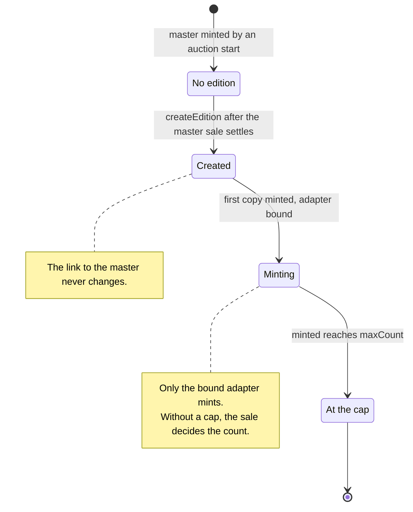
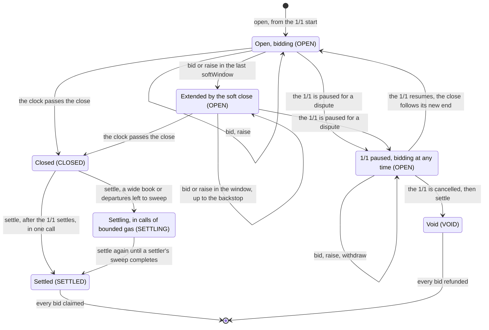
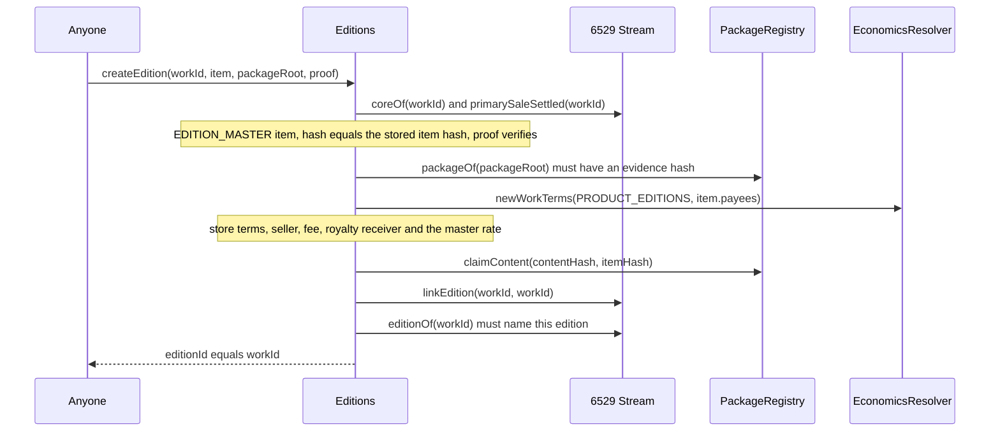
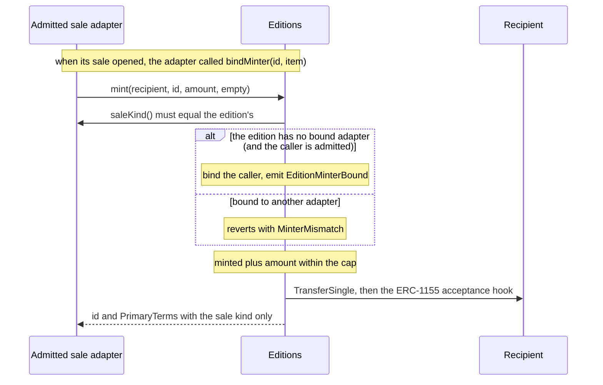
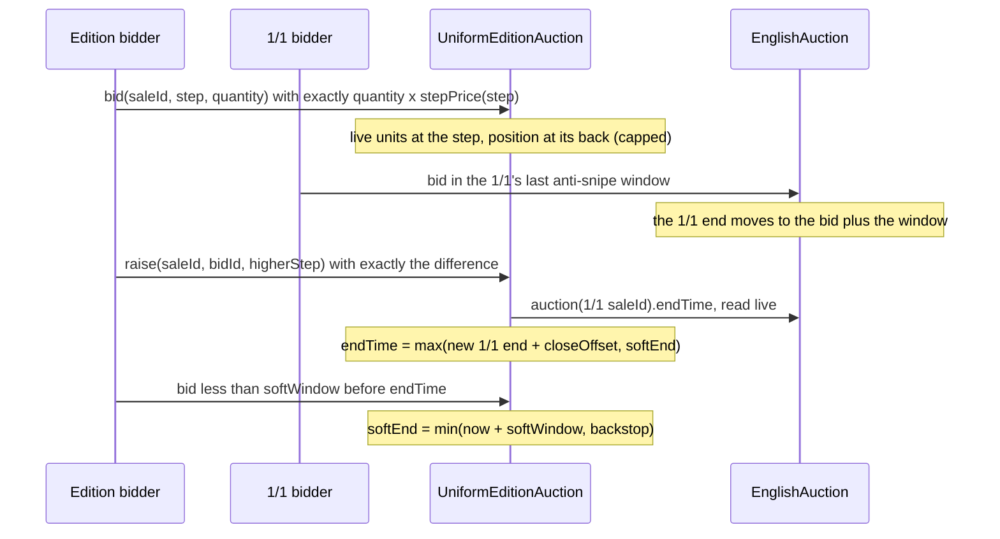
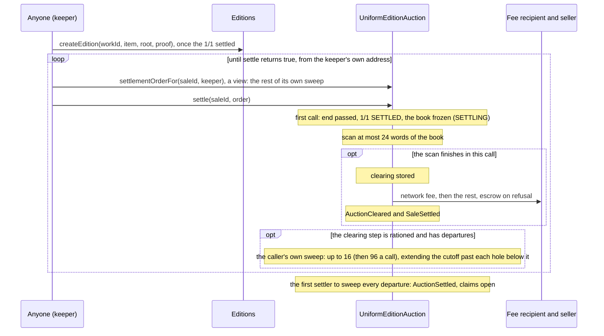
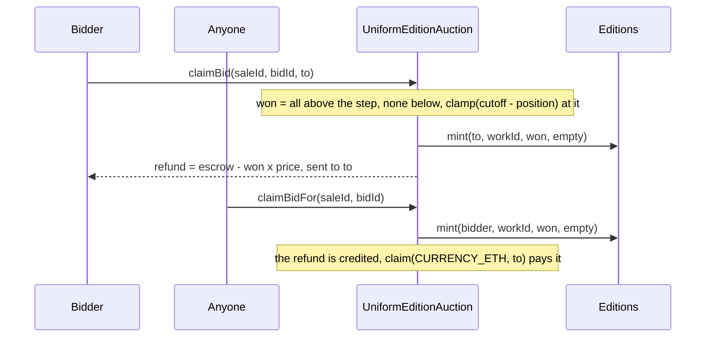
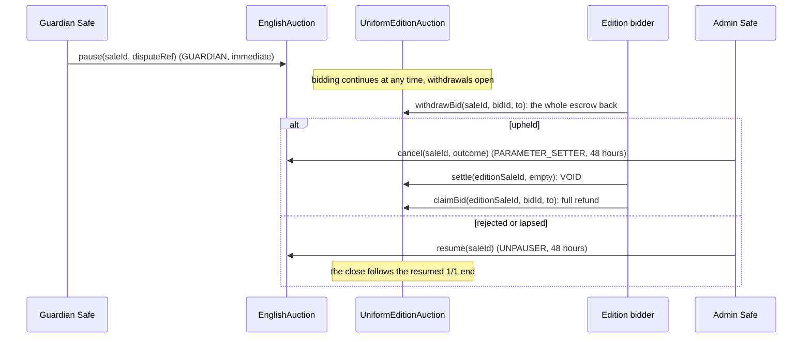

# Editions and sales

6529 Stream Editions (the contract `Editions`) is the protocol's one shared ERC-1155. Every
edition is anchored by a 6529 Stream work of kind `EDITION_MASTER` (the master), whose token ID,
media, record, license and content hash it shares. Copies are minted only by a sale adapter
that governance admits and whose sale kind the edition's terms name, so a new sale method is a
new adapter, never a new token contract
([ADR 0005](../adr/0005-stream-editions-auction.md#3-adding-a-sale-method-decision-14), owner
decision 14). This page specifies how an edition is created and minted, for auditors,
integrators and operators. The master's auction is in [Stream and auctions](stream-and-auctions.md).

> Pre-audit. See the [project status](../../README.md#status).

**The edition auction.** rc.2 sells editions by the uniform-price edition auction
(`UniformEditionAuction`, [ADR 0005](../adr/0005-stream-editions-auction.md), D138 to D141),
which runs alongside the master's 1/1 English auction and closes after it. Anyone bids a
per-copy price on a fixed ladder and a quantity; the clearing decides how many copies exist and
the one price every winner pays; exactly that many are minted as winners claim. Genesis deploys
it, admits it on 6529 Stream Editions and lists Editions as its target. Its rules are `EA-1` to
`EA-16` below. ADR 0005 removed the fixed-price and Dutch adapters, with their rules
(ED-9 to ED-24); they remain at the `v1.0.0-rc.1` tag, and a fixed-price sale can be restored as
a newly admitted adapter without redeploying Editions
([§3](../adr/0005-stream-editions-auction.md#3-adding-a-sale-method-decision-14)).

## Contracts

| Contract | Source | Interface | Responsibility |
| --- | --- | --- | --- |
| `Editions` | [`src/editions/Editions.sol`](../../src/editions/Editions.sol) | [`IEditions`](../../src/interfaces/IEditions.sol), [`IMintTarget`](../../src/interfaces/IMintTarget.sol), ERC-1155, ERC-2981, ERC-4906, ERC-7572 | Creates and links editions; mints for an admitted adapter of the edition's sale kind, within the creator's cap, binding each edition to its first minter; serves royalties, license and metadata from the master. |
| `EditionRules` (internal library) | [`src/editions/EditionRules.sol`](../../src/editions/EditionRules.sol) | none | The one definition of valid edition terms, used by the package registry at `consume` and by `Editions` at `createEdition`. |
| `UniformEditionAuction` | [`src/sales/UniformEditionAuction.sol`](../../src/sales/UniformEditionAuction.sol) | [`IUniformEditionAuction`](../../src/interfaces/IUniformEditionAuction.sol), [`ISaleAdapter`](../../src/interfaces/ISaleAdapter.sol) | The edition auction's writes: opening beside the 1/1, bids and raises, withdrawals during a 1/1 dispute, the soft close, settlement with the cut step's departure sweep, payouts, claims and credits, the governed configuration. |
| `UniformEditionAuctionLens` | [`src/sales/UniformEditionAuctionLens.sol`](../../src/sales/UniformEditionAuctionLens.sol) | [`IUniformEditionAuctionLens`](../../src/interfaces/IUniformEditionAuctionLens.sol) | Its read side, created by its constructor: every view of `IUniformEditionAuction`, answered through the adapter's own address, and the master check `open` consults. |
| `UniformClearing` (internal library) | [`src/sales/UniformClearing.sol`](../../src/sales/UniformClearing.sol) | none | The D138 clearing over step totals and the units a bid wins at the cut step, shared by settlement and the lens. |
| `StepLadder` (internal library) | [`src/interfaces/types/StepLadder.sol`](../../src/interfaces/types/StepLadder.sol) | none | The step ladder: the 192 mantissas, `price(basePrice, stepsPerDecade, step)` and the ladder's bounds. |
| Federation registry (v1.1, not implemented in v1) | none | [`IFederationRegistry`](../../src/interfaces/IFederationRegistry.sol) | What the adapters will read to serve 6529 Stream Federated contracts. v1 installs no registry. |

The types live in [`SaleTypes.sol`](../../src/interfaces/types/SaleTypes.sol) and
[`PackageTypes.sol`](../../src/interfaces/types/PackageTypes.sol); collaborators are specified
on the pages under [References](#references).

**Wiring.** The constructor requires Stream to have code, no EIP-7702 delegation, ERC-165
`IStream` and the reviewed code hash (`InvalidDependency`), and requires it to name a package
registry, economics resolver and artist registry (`ZeroAddress`). It reads all three from Stream
on every use, so a governed replacement in Stream (`setDependency`, owner decision 16) applies
to Editions at once. Genesis binds Editions in Stream and the package registry and calls
`Editions.bindWorkRecords` once (`AlreadyBound`)
([`config/genesis.example.json`](../../config/genesis.example.json), `wiring`); it admits the
uniform-price edition auction as the edition minter (`setAdmittedMinter`, the 30-day
SUCCESSOR_SETTER class for any later one). `notifyMasterUpdated` and `setRoyaltyRate` accept only
that satellite; `notifyAllUpdated` accepts it or Stream (`UnboundCaller`).

**The edition auction's wiring.** Its constructor checks and stores the revenue escrow, Editions
and the English auction, reads Stream from Editions and the economics resolver from Stream (each
checked by ERC-165), installs the launch configuration (`DeployV1.editionAuctionDefaults` at
genesis) and creates its lens. It serves only the tokens `setTarget` lists, which in v1 is
Editions alone; genesis lists it.

## Concepts

The [glossary](../glossary.md) defines [master](../glossary.md#master),
[copy](../glossary.md#copy), [creator](../glossary.md#creator),
[sale kind](../glossary.md#sale-kind), [admitted minter](../glossary.md#admitted-minter),
[edition auction](../glossary.md#edition-auction), [step ladder](../glossary.md#step-ladder),
[clearing price](../glossary.md#clearing-price), [breadth margin](../glossary.md#breadth-margin),
[cut step](../glossary.md#cut-step), [position](../glossary.md#position),
[departure hint](../glossary.md#departure-hint), [soft close](../glossary.md#soft-close) and the
[6529 Network Museum](../glossary.md#6529-network-museum).

### Masters, editions and copies

- A master is auctioned like any other work. Its package item carries `EditionTerms`, fixed
  when the package was approved.
- The edition ID equals the master's Stream token ID. An edition exists once `createEdition`
  succeeds (`exists(id)`); the link is permanent (ED-2): `masterOf(id)` returns
  `(stream, id, contentHash)` and Stream's `editionOf(workId)` returns `(editions, workId)`.
- Every copy is minted by the edition's sale adapter, straight to the recipient it names. The
  sale decides how many copies exist. There are no numbered editions.

### Edition terms

| Field | Meaning |
| --- | --- |
| `maxCount` | The creator's optional cap on the copies ever minted, by every adapter together; 0 for none (the count then stops at 2^48 - 1, as `minted` is a `uint48`). |
| `currency` | The sale method's currency, opaque to Editions and the package registry. The edition auction takes `CURRENCY_ETH` (`address(0)`). |
| `saleKind` | A nonzero sale-kind label ([`SaleKind`](../../src/interfaces/types/SaleTypes.sol)). Only an admitted adapter reporting this kind may mint. rc.2's edition auction is `UNIFORM_AUCTION`; `FIXED_PRICE` and `DUTCH` are reserved labels of the removed rc.1 adapters. |
| `params` | The sale method's parameters, at most 1,024 bytes, opaque to Editions and the package registry. The edition auction takes none. |

The terms fix no size, format, window or price. `EditionRules.isValid` never reverts and
accepts any terms with a nonzero `saleKind` and at most `EditionRules.MAX_PARAMS_BYTES` of
`params`, whatever the cap and currency. The package registry applies it at `consume`
(`PackageRegistry._checkTerms`), so a master whose edition could not be created never mints;
`createEdition` applies it again (`InvalidEditionTerms(workId)`). The adapter validates the
currency and params when it opens a sale and refuses terms it cannot sell. Terms that name a
kind no admitted adapter serves are valid, so such a master mints and its edition waits for an
adapter (LIM-EA-8 in [ADR 0005](../adr/0005-stream-editions-auction.md#known-limitations)).

### Terms and the creator

- `Editions.primaryTerms(id, data)` returns the edition's `PrimaryTerms`: its sale kind, its
  currency and params as approved (the currency unresolved), a zero price (the terms have
  none; a priced method carries its price in its params), the seller, fee recipient and fee
  share (locked from `PRODUCT_EDITIONS` economics when a sale bound the edition before it
  existed, or else at `createEdition`) and `creator`; `data` is
  ignored. An adapter reads them when it opens a sale. `mint` returns only the sale kind, since
  an adapter never reads the rest there (QUALITY-2).
- The creator is the active authority of the master's lead artist
  (`IArtistRegistry.activeAuthorityOf`), resolved on every read; it is zero during a
  [restraint](../glossary.md#restraint). Editions gives it no power of its own; what it may do
  in a sale is the adapter's rule.

### The step ladder

Bids are placed on steps, not on arbitrary prices, so every client computes the same prices and
the clearing reads totals per step.

- Step `i` costs `basePrice × M[(i mod N) × 192 / N] × 10^(i div N) / 100`. `M` is a fixed table
  of 192 three-digit mantissas, `round(100 × 10^(j/192))` (the E192 series), held as bytecode
  constants; `N` is the number of steps per decade.
- Every ladder of 24, 48 or 96 steps per decade is a subset of the 192-step one. The base price
  is a power of ten, so prices are exact integers in wei that read as the table does (0.0464,
  0.0487, 0.0511 ETH on the launch ladder), and they strictly increase (EA-3).
- There is no zero-price step: a book of free bids would tie every count at revenue 0 and mint
  without limit. The smallest bid is one copy at step 0.
- `stepPrice(saleId, step)` returns a price under the sale's locked configuration (under
  `config()` before it opens), and `ladder(saleId)` every price from step 0.

### Bids

- **`bid(saleId, step, quantity)`** pays exactly `quantity × stepPrice(saleId, step)`
  (`IncorrectPayment`), for a step below the locked `stepCount` (`InvalidStep`) and a quantity of
  at least 1, with the step's and the sale's units below 2^32 (`InvalidQuantity`), while bidding
  is open (`BiddingClosed`). It returns the bid ID, from 1 in each sale. More copies means
  another bid.
- **`raise(saleId, bidId, newStep)`** is for the bidder only (`NotBidder`): it moves the whole
  bid to a higher step (`InvalidStep` otherwise) and pays exactly the difference on every unit.
- **Firm bids.** A bid can be neither lowered nor withdrawn before the close, except while the
  1/1 is paused for a dispute (owner decision 2): `withdrawBid(saleId, bidId, to)` then sends its
  whole escrow to `to`; otherwise it reverts with `WithdrawalsClosed`. Firm bids keep the public
  live result honest, make every shill bid a real purchase, and let `R*` only rise.
- **Public.** Every bid is an event (`BidPlaced`, `BidRaised`) and the book is readable
  (`stepTotals`, `bidOf`, `departures`), so anyone can recompute the result.
- **Escrow.** A bid's escrow is `quantity × stepPrice(step)`; it is not stored. The adapter holds
  every live bid's escrow until the bid is claimed or withdrawn.

### The clearing

**Definition (D138).** A bid of `q` copies at step `s` counts as `q` unit bids at `stepPrice(s)`.
With `P(k)` the k-th highest unit price:

- `revenue(k) = k × P(k)`, for `k` up to the creator's cap (any `k` without one);
- `R*` is the highest revenue at any `k`;
- the clearing count is the **largest** `k` with `revenue(k) × 100,000 ≥ R* × (100,000 −
  marginShare)`; the clearing price is `P(k)`.

The [breadth margin](../glossary.md#breadth-margin) trades a little revenue for more collectors:
the count is the most copies whose revenue stays within the margin of the best. Every winner pays
the clearing price; every bid above the clearing step wins in full, every bid below it loses in
full, and only the clearing step can be split.

**The one-pass algorithm.** The adapter scans the used steps from the highest down,
accumulating `D_s`, the units at or above step `s`. Each used step is one candidate, with count
`min(D_s, cap)` and revenue `min(D_s, cap) × stepPrice(s)`; the scan stops below the step where
`D_s` reaches the cap. `R*` is the highest candidate revenue, and the result is the lowest-priced
candidate whose revenue passes the margin test. It equals the definition (EA-6):

- every `k` within a step has the same `P(k)`, so revenue rises with `k` inside a step and each
  step's best count is its top: the highest candidate is `R*`;
- if any `k` inside a step passes the margin test, so does the step's top, so the largest passing
  `k` is the top of the lowest passing step;
- below the step where demand reaches the cap, every step only repeats `k = cap` at a lower price.

Without a cap a step is never split: every unit at or above the clearing step wins.

`clearing(saleId)` returns the result if the sale closed now: the count, step, price,
revenue, network fee, best revenue `R*`, whether the clearing step is rationed, its winning and
live units, and the cutoff its departures give; after the close the book is frozen, so it equals
the settlement, which `settlement(saleId)` stores. `bidOutcome(saleId, bidId)` returns a bid's
copies won, price, escrow, refund and units ahead in its queue, final once the sale is SETTLED
or VOID. `quote(saleId, step, quantity)` returns what a new bid would win, push out or pull in,
and `lowestWinningStep(saleId, quantity)` the lowest step at which it would win at least one unit
(winning is monotone in the step, so it is a binary search). Both treat the bid as new: for a
raise, `quote` counts the bid's units at its old step and its new one, so a client computes a
raise's effect itself. Neither checks a step's capacity (a step's or a sale's units below 2^32),
which `bid` enforces.

### The cut step

When a creator's cap binds inside a step (the **cut step**), that step sells `cutUnits = cap −
D_above` units, fewer than its live units. They are filled by price-time priority (FIFO, owner
decision 1):

- in a capped auction each bid takes a **position** when it enters a step: the units that ever
  entered the step before it. Positions only grow. A raise rejoins at the back of its new step's
  queue; the marginal bid is partly filled;
- a raise out of a step, or a withdrawal during a dispute pause, leaves a **hole** at its old
  position, logged as a departure (`departures(saleId, step)`);
- settlement closes the holes: starting from `cutoff = cutUnits`, it sweeps the clearing step's
  departures in position order, and each departure whose position is below the cutoff adds its
  units to it. The settler supplies that order (the **departure hint**); the adapter requires
  each index in range and each position strictly above the last (`InvalidSettlementOrder`).
  Each settler (`msg.sender`) sweeps on its own ([§9](../adr/0005-stream-editions-auction.md#9-amendment-1-november-2026-each-settler-sweeps-on-its-own)): its progress is its own
  (`sweepOf(saleId, settler)`), each call takes at most one chunk of the rest of its own sweep
  (`settlementOrderFor(saleId, settler)`), and the first settler to sweep every departure fixes
  the cutoff. An order that skips a departure can never finish its sender's sweep and touches no
  other settler's: its sender settles from another address;
- a bid at the cut step then wins `clamp(cutoff − position, 0, quantity)` units: earlier
  positions fill first, and the units won at the step sum to exactly `cutUnits` (EA-8).

Without the sweep a hole below the cutoff would leave copies unminted (10 of 60 in the
[worked example](#a-cap-of-60-with-a-hole-at-the-cut-step)). Uncapped auctions keep no positions
and no departures.

### Timing: alongside the 1/1

- **Opening.** Anyone opens an edition's sale with `open(editions, id, abi.encode(item))`, from
  the 1/1's start until the edition close (`BiddingClosed`); the keeper batches it with the
  1/1's `start`. The item must hash to the item Stream stored for the master, so no proof is
  needed, with edition terms of this sale kind, in ETH and without params (`InvalidSaleTerms`).
  Opening binds the edition to the adapter (`Editions.bindMinter(id, item)`, [ADR 0005 §6](../adr/0005-stream-editions-auction.md#6-amendment-31-october-2026-the-edition-is-bound-when-its-sale-opens)) before it
  records the sale, so a second adapter of the same kind cannot open it (`MinterMismatch`), and
  locks the cap, the current governed configuration and the `PRODUCT_EDITIONS` payout terms (the
  seller split wallet, fee recipient and share). Binding an edition that does not exist yet
  records the same economics in Editions; for one that exists, the sale reads the economics it
  recorded, so the edition always reports the split its sale paid. Opening is refused while the
  adapter is paused (`SalePaused`), for a token it does not serve (`TargetNotAllowed`), for a
  missing or cancelled 1/1 (`NoOneOfOneAuction`) and a second time, voided sales included
  (`AuctionExists`).
- **The close.** `closeAt` is the 1/1's current `endTime` plus `closeOffset`, and the sale ends
  at `endTime = max(closeAt, softEnd)` (D140). The 1/1's `endTime` already includes its
  anti-snipe extensions and any resumed pause, so a late 1/1 bid moves the edition close with it
  (EA-10). `endTimes(saleId)` reads every clock live: the 1/1's end and state, `closeAt`,
  `softEnd`, `endTime`, the backstop, and whether bidding and withdrawals are open.
- **The soft close (D141).** A bid or raise less than `softWindow` before the end sets `softEnd =
  min(now + softWindow, backstop)`, where `backstop = closeAt + maxExtension` (owner decision 5).
  Any bid extends, winning or not. (A bid exactly `softWindow` before the end leaves it where it
  is; the frozen interface's comment says "at or after", and the code is the reference.)
- **A dispute pause of the 1/1.** While the 1/1 is paused, bids and raises are accepted whatever
  the time and move no clock, and bidders may withdraw (owner decision 12). The resumed 1/1 runs
  at least its governed duration, and the edition close follows it.
- **Settling** needs the end passed and the 1/1 SETTLED, so the 1/1's end is final, or the 1/1
  CANCELLED, which voids the sale at once (`SettlementNotReady` otherwise). When copies sold, the edition must exist (`EditionNotCreated`);
  `createEdition` is permissionless once the master's sale settled, and the keeper batches it.
- **A cancelled 1/1** voids the edition auction (owner decision 12): the next `settle` marks it
  VOID, every bid is refunded in full and nothing is minted or paid. A bid is refused once the
  adapter reads the cancellation, which it does for every bid within `softWindow` of the close;
  a bid accepted before then is refunded with the rest.
- **Independence (D141).** Copies sell whether or not the 1/1 drew a bid; an unbid 1/1 goes to the
  [6529 Network Museum](stream-and-auctions.md#settle-with-no-bid) and its editions sell all the
  same. No edition bid means no copies: the auction settles with a count of zero, pays nothing,
  and the edition need not be created.

### Settlement, payouts and claims

- **`settle(saleId, order)`** is permissionless and runs in calls of bounded gas, each of which
  advances the settlement; it returns whether the sale is now SETTLED or VOID. For a cancelled
  1/1 it marks the sale VOID (`AuctionVoided`). Otherwise the first call freezes the book (the
  sale is SETTLING) and each call scans at most 24 of its words, eight steps each, so a book
  spread wider takes several calls. The call that finishes the scan clears the book, stores the
  result and pays the revenue (`AuctionCleared`), last, after every write of the call. When the
  clearing step is rationed and has departures, that call sweeps up to 16 of them from `order`
  and each later call up to 96 of its caller's sweep (`DeparturesSwept`); the first settler to
  sweep them all makes the sale SETTLED (`AuctionSettled`) and claims open. A call on a SETTLED
  sale returns true and changes nothing; on a VOID one it reverts. A keeper calls
  `settle(saleId, settlementOrderFor(saleId, keeper))` from its own address, or its own
  contract, until it returns true: never through a shared public relayer such as Multicall3,
  whose callers would share one sweep ([keeper runbook](../../script/README.md#the-edition-auction-keeper)).
- **Payouts.** Settlement pays `count × price`: the network fee, `floor(revenue × feeShare /
  100,000)`, to the locked fee recipient and the rest to the seller split wallet, each through
  the revenue escrow if refused ([economics](economics-and-payouts.md#wallet-payments-and-the-escrow)).
  It emits `ISaleAdapter.SaleSettled` with a zero buyer and recipient and the count as the
  quantity: the one event the TDH pipeline weights by network share (P29 §1.2).
- **`claimBid(saleId, bidId, to)`** is for the bidder: it mints the copies the bid won to `to`
  through `Editions.mint` and sends `escrow − won × price` in ETH to `to` (`ClaimFailed` if the
  transfer fails). **`claimBidFor(saleId, bidId)`** lets anyone push a claim: the copies go to the
  bidder and the refund is credited to its `claimable` ETH (`Credited`), which
  `claim(CURRENCY_ETH, to)` pays out. A VOID sale's claims refund in full and mint nothing. Each
  bid is claimed once: the claim deletes it.
- **Supply** reaches exactly `count` once every bid is claimed (EA-9). Only the adapter bound at
  open mints the edition (`MinterMismatch` for any other), even after governance removes it, so
  its winners always claim (LIM-EA-10); `Editions` enforces the cap for every minter.

### Reading an edition

- `edition(id)` returns the content hash, the terms as approved, `minted`, the bound adapter
  (`minter`, zero while unbound) and the locked economics (`UnknownEdition` otherwise).
- `royaltyInfo(id, salePrice)` returns the receiver locked at creation and
  `floor(salePrice × royaltyRate / 100,000)` from Editions' own storage, with no external call
  (`UnknownEdition` otherwise). The rate starts at the master's and follows its consented
  re-rates through the work-records satellite (ED-7,
  [works and storage](works-and-storage.md#relicense-royalty-rate-and-errata-repin)); an
  unknown edition or unchanged rate is a no-op, a rate above 100,000 reverts
  (`InvalidRoyaltyRate`), and new `PRODUCT_EDITIONS` defaults never touch an existing edition.
- `licenseOf(id)` returns the master's current license (`UnknownEdition`; `RecordNotOpen`
  until anyone opens the master's record with `openRecord`).
- `uri(id)` is `IRenderer(IStream.rendererOf(id)).tokenURI(address(editions), id)`: the
  master's renderer builds the edition's metadata from the master's record and content, and
  fails closed with it ([Rendering and tokenURI](rendering-and-tokenuri.md)).
- `name()` is "6529 Stream Editions" and `symbol()` is `STREAMEDITIONS` (ADR 0005, D139).
  `owner()` is the marketplace owner, set by `setOwner(expected, next)` (compare-and-set,
  `ExpectedValueMismatch`), with no protocol power. `supportsInterface` reports ERC-1155,
  ERC-2981, `IMintTarget`, `IEditions`, ERC-4906 (`0x49064906`) and ERC-165.

The AccessManager roles and delays of every governed selector on Editions are in the role matrix
under [Editions](../audit/roles.md#editions); the edition auction's join it with the adapter's
genesis wiring.

## State machine

### An edition



| Transition | Caller (role) | Delay | Function |
| --- | --- | --- | --- |
| No edition to Created | anyone, once `IStream.primarySaleSettled(workId)` is true | none | `Editions.createEdition` |
| Unbound to Bound (before or after Created) | an admitted adapter whose `saleKind()` matches, when its sale opens | none | `Editions.bindMinter` (`EditionMinterBound`; before creation, also locks the economics) |
| Created to Minting | the bound adapter, or an admitted adapter whose `saleKind()` matches if none is bound | none | `Editions.mint` (first copy; binds an unbound edition, `EditionMinterBound`) |
| Minting to At the cap | the bound adapter | none | `Editions.mint` when `minted` reaches a nonzero `maxCount` |

- `bindMinter(editionId, item)` requires an admitted caller (`NotAdmittedMinter`) whose
  `saleKind()` equals the edition's (`SaleKindMismatch`): the stored kind once the edition
  exists; before that, the kind in `item`, which must be the master's EDITION_MASTER item, its
  hash equal to the item hash Stream stored (`NotEditionMaster`). It binds an unbound edition
  to the caller (`EditionMinterBound`), is a no-op for the bound adapter, and reverts with
  `MinterMismatch` for any other. Binding before creation also locks the edition's
  `PRODUCT_EDITIONS` economics (seller, fee recipient and share, royalty receiver), in the
  transaction in which the sale locks its own; `createEdition` keeps them and the binding. An
  adapter calls it when its sale opens; the edition auction does so in `open`.
- `mint(to, id, amount, data)` requires, in order: a caller ever admitted
  (`NotAdmittedMinter`); a nonzero `amount` and empty `data` (`InvalidMintRequest`); an
  existing edition (`UnknownEdition`); a caller whose `saleKind()` equals the edition's
  (`SaleKindMismatch`); the edition's bound adapter, even if since removed, or, if none is
  bound, an admitted caller, which becomes it (`NotAdmittedMinter`; `MinterMismatch(editionId,
  minter)` names the bound one); and `amount` within the cap
  minus `minted` (`EditionUnavailable`). The supply update precedes the ERC-1155 acceptance
  call, so a reentering receiver sees the new `minted`. Minting reads nothing from Stream: a
  master with an edition has settled, and Stream never burns a settled token
  (`SaleAlreadySettled`).
- The binding is permanent. A second admitted adapter of the same kind can never open a sale of
  a bound edition nor add copies to a sale another one ran. A removed bound adapter keeps
  minting its edition within the cap, so its winners claim (LIM-EA-10 in
  [ADR 0005](../adr/0005-stream-editions-auction.md#known-limitations)); it binds nothing new,
  and keeps its binding ID if admitted again.
- `setAdmittedMinter(adapter, admitted)` admits an adapter with code, no EIP-7702 delegation
  and ERC-165 `ISaleAdapter` (`InvalidDependency`); removal is unchecked, and only a change emits
  `AdmittedMinterSet`. The first admission gives the adapter its 16-bit binding ID, kept through
  removal and re-admission.
- `burn(id, amount)` burns from the caller's own balance, for any adapter ever admitted; burned
  copies still count toward the cap. `settlePrimary(...)` is a no-op returning nothing for any
  adapter ever admitted (every copy is sold at mint) and refused for anyone else
  (`NotAdmittedMinter`).

### An edition auction

`auction(saleId).status` reports `OPEN`, `CLOSED`, `SETTLING`, `SETTLED` or `VOID`. `CLOSED` is
derived: `OPEN` with its end passed; it can reopen if the 1/1's end moves later (a dispute pause
and its resumption). A sale never opened reverts with `UnknownAuction(saleId)`.



| Transition | Caller (role) | Delay | Function |
| --- | --- | --- | --- |
| None to open | anyone | none | `open` |
| Bidding, extending | anyone (the payer is the bidder); a raise by the bidder only | none | `bid`, `raise` |
| Open to 1/1 paused | GUARDIAN, on the 1/1 | immediate | `EnglishAuction.pause(saleId, disputeRef)` |
| 1/1 paused, a bid withdrawn | the bidder | none | `withdrawBid` |
| 1/1 paused to open | UNPAUSER, on the 1/1 | standard, 48 hours, no earlier than 48 hours after the pause | `EnglishAuction.resume`, or the 7-day lapse |
| 1/1 paused to void | PARAMETER_SETTER on the 1/1, then anyone | standard, 48 hours; between 48 hours and 7 days after the pause | `EnglishAuction.cancel`, then `settle` |
| Open to closed | the clock | none | `block.timestamp` reaches the close |
| Closed to settled or settling | anyone, once the 1/1 settled (and the edition exists when copies sold) | none | `settle` |
| Settling to settled | anyone, each settler sweeping on its own | none | `settle` again: the rest of the scan, then of the caller's own sweep; the first settler to complete it settles the sale |
| A bid claimed | the bidder; anyone for `claimBidFor` | none | `claimBid`, `claimBidFor` |

- **Emergency pause.** `pause()` (PAUSER, immediate) stops new opens (`SalePaused`); running
  sales bid, settle and claim as usual. `unpause()` (UNPAUSER, 48 hours) is refused with
  `UnpauseTooEarly(allowedAt)` until 48 hours after the pause (GOV-5).
- **Targets.** `setTarget(token, listed)` (SUCCESSOR_SETTER, 30 days) lists the tokens the adapter
  serves; genesis lists 6529 Stream Editions. Unlisting stops new opens only.

## Flows

### Create an edition



Preconditions (`Editions._admit`, then `EditionRules.isValid`):
- Genesis has bound the work-records satellite (`WorkRecordsUnbound`), and no edition exists
  for `workId` (`EditionExists`).
- The master is live (Stream reverts with `UnknownWork` for an unminted or burned ID) and its
  primary sale has settled. A master in custody, paused for a dispute, or burned gets no
  edition.
- `item.kind` is `EDITION_MASTER`, `WorksHashing.itemHashCalldata(item)` equals the item hash
  Stream stored, `item.contentHash` is nonzero, and `proof` (at most 32 nodes) places the item
  in `packageRoot`, which the registry registered (nonzero evidence hash). A revoked root still
  counts, because Stream already consumed exactly this item (SIGS-4); a root never registered
  proves nothing. Any failure here reverts with `NotEditionMaster(workId)`.
- The edition terms pass `EditionRules.isValid` (`InvalidEditionTerms`).

Effects:
- Locks `PRODUCT_EDITIONS` economics from `newWorkTerms`: the seller (the split wallet of the
  item's payees), the fee recipient and share, and the royalty receiver (the seller when the
  fee share is zero, otherwise the royalty split wallet).
- Sets the royalty rate to the master's current rate (from `coreOf`), so a consented re-rate of
  the master before the edition exists carries over, and records the lead artist ID from which
  `creator` is resolved.
- Stores the cap and the terms. The edition auction's kind, ETH and empty params are stored as
  zero, so they cost no storage words.
- Emits `EditionCreated` and `MetadataUpdate` before the protocol calls, so a reentrant
  `createEdition` hits `EditionExists`. The registry accepts only the item Stream consumed for
  this content hash, once (`ClaimNotAllowed`, `ContentUsed`); `linkEdition` refuses anything
  but a settled, unlinked master at its own ID (`EditionLinkInvalid`); a wrong readback reverts
  with `LinkFailed`.

Gas for this and the other edition flows is in the
[ADR 0004 table](../adr/0004-gas-budgets-under-glamsterdam.md#the-table); the rc.1 Sepolia
measurements are in [Sepolia flows, section 3](../../deployments/11155111/flows.md#3-6529-editions).

### Mint copies



The adapter decides who buys, at what price, and when it mints: Editions checks only the
adapter, its kind, the binding and the cap.

### Add a sale method

A new edition sale method is a new adapter (ADR 0005 §3):
1. Deploy the adapter. It claims a fresh label, `keccak256("<NAME>")`, from `saleKind()`, and
   validates its own `currency` and `params` when it opens a sale.
2. Governance schedules `Editions.setAdmittedMinter(adapter, true)` (SUCCESSOR_SETTER, 30 days)
   and the adapter's own target and settings, with their selectors in the governance manifest.
3. Packages approved afterwards may name the new kind in their edition terms. The adapter
   calls `bindMinter` when a sale opens. Editions sold by another adapter are untouched: each
   edition stays with the adapter that opened its sale.

Nothing in 6529 Stream or 6529 Stream Editions is redeployed.

### Open beside the 1/1

```mermaid
sequenceDiagram
    participant Keeper as Anyone (keeper)
    participant Auction as EnglishAuction
    participant EA as UniformEditionAuction
    participant Stream as 6529 Stream
    participant Econ as EconomicsResolver
    participant Ed as Editions
    Keeper->>Auction: start(stream, mintData) for an EDITION_MASTER
    Keeper->>EA: open(editions, workId, abi.encode(item)), in the same batch
    EA->>Auction: auction(saleIdOf(stream, workId)): exists, not cancelled, before the close
    EA->>Stream: coreOf(workId): the stored item hash
    Note over EA: hash matches, UNIFORM_AUCTION in ETH, empty params
    alt the edition exists
        EA->>Ed: edition(workId): the economics it recorded
    else not yet
        EA->>Econ: newWorkTerms(PRODUCT_EDITIONS, item.payees)
    end
    EA->>Ed: bindMinter(workId, item)
    Note over Ed: bound to this adapter (EditionMinterBound); before creation, the same economics recorded
    Note over EA: lock cap, configuration, seller, fee recipient and share
    EA-->>Keeper: SaleStarted and AuctionOpened, saleIdOf(editions, workId)
```

### Bid, raise, and the two clocks



### Settle with a departure hint



### Claim



### Dispute: pause, withdraw, cancel



## Worked example

The traces of the design, on the launch ladder (48 steps per decade from 0.0001 ETH) with the
launch margin of 10%.

### The owner's figures

Bids at 1.00, 0.196, 0.100, 0.0511 and 0.0100 ETH (steps 192, 158, 144, 130 and 96) total 1, 10,
30, 80 and 280 units at or above each step:

| Step | Price (ETH) | Count | Revenue (ETH) |
| ---: | ---: | ---: | ---: |
| 192 | 1.00 | 1 | 1.00 |
| 158 | 0.196 | 10 | 1.96 |
| 144 | 0.100 | 30 | 3.00 |
| 130 | 0.0511 | 80 | **4.088** |
| 96 | 0.0100 | 280 | 2.80 |

- `R*` is 4.088 ETH and the threshold 3.679 ETH; 280 at 0.0100 raises only 2.80, so the clearing
  is **80 copies at 0.0511 ETH**: 4.088 ETH, of which 1.022 ETH is the network's 25%.
- One more unit at 0.0464 (step 128) gives 81 × 0.0464 = 3.758 ETH, which passes the threshold:
  the clearing becomes **81 at 0.0464**. A unit at 0.0442 gives 3.58 ETH, below it, so 0.0464 is
  the lowest bid that gets in, and it lowers everyone's price (LIM-EA-2).

### A cap of 60 with a hole at the cut step

- The candidates are 1.00, 1.96, 3.00 and 60 × 0.0511 = **3.066** ETH; the scan stops below step
  130, since 80 ≥ 60. So `count = 60` at 0.0511, and step 130 is the cut step: `cutUnits = 60 −
  30 = 30` of its 50 live units.
- Its queue, in entry order: B1, 20 units at position 0; B2, 15 at 20, later raised to 0.100 (a
  hole at 20); B3, 10 at 35; B4, 20 at 45.
- The sweep starts at `cutoff = 30`; the hole at 20 is below it, so the cutoff becomes 45. B1 wins
  20, B3 wins 10 and B4 wins 0: 30 in all.
- Refunds: B2 wins its 15 at 0.0511 and pays 0.7665 ETH of its 1.5 ETH escrow; B4 gets back all
  1.022 ETH. Revenue is 3.066 ETH, 0.7665 ETH of it to the network.

## Rules and invariants

| ID | Rule | Enforced in | Tested by |
| --- | --- | --- | --- |
| ED-1 | An edition is created only for a live, settled `EDITION_MASTER` whose exact stored item is proven in a registered package root, revoked or not. | `Editions._admit` | [Editions.t.sol](../../test/editions/Editions.t.sol): `test_CreateEdition_RequiresSettledMaster`, `test_CreateEdition_RefusesOriginalItem`, `test_CreateEdition_RefusesMismatchedItem`, `testFuzz_CreateEdition_RefusesTamperedItem`, `test_CreateEdition_RequiresARegisteredPackageProof`, `test_CreateEdition_ProofDepthBounded`; [MasterEdition.t.sol](../../test/integration/MasterEdition.t.sol): `test_RevokingTheRootDoesNotStrandASoldMastersEdition`, `test_AnEditionNeedsARegisteredRoot` |
| ED-2 | A master has at most one edition, its ID is the master's token ID, both sides are written in one transaction, and the link never changes. | `Editions.createEdition`; `Stream.linkEdition` | [Editions.t.sol](../../test/editions/Editions.t.sol): `test_CreateEdition_LinksBothWaysAndLocksTerms`, `test_CreateEdition_RefusesSecondCreate`, `test_CreateEdition_LinkIsPermanent`, `test_CreateEdition_FailsClosedWhenStreamDoesNotLink`, `test_CreateEdition_ReentryThroughStreamHitsEditionExists`; [Editions.invariant.t.sol](../../test/editions/Editions.invariant.t.sol): `invariant_LinkAndRoyaltyFixed` |
| ED-3 | An edition's content hash is unique among editions and claimable only by the item Stream consumed for it. | `PackageRegistry.claimContent` | [Editions.t.sol](../../test/editions/Editions.t.sol): `test_CreateEdition_ContentHashUniqueAmongEditions`, `test_CreateEdition_RefusesHashClaimedInEditions`, `test_CreateEdition_RefusesHashConsumedByAnotherItem` |
| ED-4 | Edition terms satisfy one rule at `consume` and at `createEdition`: a nonzero sale kind and at most 1,024 bytes of params; the cap, currency and params are otherwise the sale method's. | `EditionRules.isValid`; `PackageRegistry._checkTerms`; `Editions.createEdition` | [EditionRules.t.sol](../../test/editions/EditionRules.t.sol): `test_AnyNonzeroKind`, `test_AnyCurrency`, `test_ParamsAreBounded`, `testFuzz_AnyCap`, `testFuzz_MatchesTheRule`; [Editions.t.sol](../../test/editions/Editions.t.sol): `test_CreateEdition_RefusesMalformedTerms`; [PackageRegistry.t.sol](../../test/curation/PackageRegistry.t.sol): `test_invalidItem_masterEditionTermsSharedRule` |
| ED-5 | Only an adapter whose `saleKind()` equals the edition's mints, with a nonzero amount and empty data. An edition is bound to one adapter, the one whose sale opened it (`bindMinter`, which needs an admitted caller and, before creation, the master's stored item) or else the first admitted adapter to mint it; no other adapter opens or mints it, and the bound adapter mints it even after its removal. | `Editions.bindMinter`, `Editions.mint`, `Editions.setAdmittedMinter`; `UniformEditionAuction.open` | [Editions.t.sol](../../test/editions/Editions.t.sol): `test_Mint_OnlyAdmittedMinter`, `test_Mint_RequiresTheEditionsSaleKind`, `test_Mint_RejectsUnknownEditionZeroAmountAndData`, `test_SetAdmittedMinter_GovernedAndChecked`, `test_Mint_ANewSaleMethodAdmittedLaterMints`, `test_Mint_BindsTheEditionToItsFirstMinter`, `test_Mint_RemovedBoundAdapterFinishesItsEditionWithinTheCap`, `test_BindMinter_BeforeTheEditionExists`, `test_BindMinter_ChecksTheMasterAndTheStoredKind`, `test_BindMinter_LocksTheEconomicsTheSalePays`; [EditionAuctionBinding.t.sol](../../test/integration/EditionAuctionBinding.t.sol): `test_Binding_ASecondAdapterOfTheKindCannotOpenABoundEdition`, `test_Binding_ARemovedAdaptersWinnersStillClaim`, `test_Binding_AnAttackerBindsOnlyTheMatchingKind`, `test_Binding_TheEditionReportsTheSplitItsSalePaid`; [Editions.invariant.t.sol](../../test/editions/Editions.invariant.t.sol): `invariant_BoundToTheFirstMinter`; [MasterEdition.t.sol](../../test/integration/MasterEdition.t.sol): `test_ANewSaleMethodIsAdmittedByGovernanceAndMints` |
| ED-6 | Copies minted never exceed the creator's cap, or 2^48 - 1 without one; burns never free the cap. | `Editions.mint`, `Editions.burn` | [Editions.t.sol](../../test/editions/Editions.t.sol): `test_Mint_StopsAtTheCreatorCap`, `testFuzz_Mint_NeverExceedsTheCap`, `test_Mint_UncappedStopsAtUint48`, `test_Mint_MaximumCap`; [Editions.invariant.t.sol](../../test/editions/Editions.invariant.t.sol): `invariant_SupplyAccounting`, `invariant_MintsFollowEditionTerms` |
| ED-7 | The royalty receiver is fixed at creation; the rate starts at the master's current rate and changes only through the work-records satellite, with the master's. | `Editions.createEdition`, `Editions.setRoyaltyRate`; `WorkRecords._applyRate` | [Editions.t.sol](../../test/editions/Editions.t.sol): `test_CreateEdition_InheritsMasterRoyaltyRate`, `test_SetRoyaltyRate_OnlyThroughWorkRecords`, `test_RoyaltyInfo_UnaffectedByNewDefaults`; [MasterEdition.t.sol](../../test/integration/MasterEdition.t.sol): `test_EditionRoyaltyFollowsAMasterRerate`, `test_EditionTakesTheMastersCurrentRate` |
| ED-8 | Only an adapter ever admitted burns, and only from its own balance; `settlePrimary` is a no-op for such adapters and refused for anyone else. | `Editions.burn`, `Editions.settlePrimary` | [Editions.t.sol](../../test/editions/Editions.t.sol): `test_Burn_OnlyMinterOnlyOwnBalance`, `test_Burn_RemovedAdapterCanStillBurn`, `test_SettlePrimary_NoOpForAdapters` |
| EA-1 | Anyone opens an edition's sale, once (voided sales included), from its 1/1's start until the edition close, with the master's stored item, of this sale kind, in ETH and without params, binding the edition to the adapter (`Editions.bindMinter`), so no second adapter of the kind can open it; not while the adapter is paused, for a token it does not serve, or for a missing or cancelled 1/1. | `UniformEditionAuction.open`; `UniformEditionAuctionLens.masterTerms`; `Editions.bindMinter` | [UniformEditionAuction.t.sol](../../test/sales/edition/UniformEditionAuction.t.sol): `test_Open_LocksTermsAndEmits`, `test_Open_ChecksTokenAndId`, `test_Open_NeedsALiveOneOfOne`, `test_Open_ChecksTheItem`, `test_Open_Timing`, `test_Open_AfterTheOneOfOneSettled_BeforeTheClose`; [EditionAuction.t.sol](../../test/integration/EditionAuction.t.sol): `test_Flow_OpenChecksTheMasterOnTheRealStack`; [UniformEditionAuctionLens.t.sol](../../test/sales/edition/UniformEditionAuctionLens.t.sol): `test_Open_BindsTheEditionWithTheItemItReceived`; [EditionAuctionBinding.t.sol](../../test/integration/EditionAuctionBinding.t.sol): `test_Binding_ASecondAdapterOfTheKindCannotOpenABoundEdition`, `test_Binding_AnAttackerBindsOnlyTheMatchingKind` |
| EA-2 | A sale locks at open the creator's cap, the current configuration and the `PRODUCT_EDITIONS` payout terms, which the edition records (or, if it exists, already recorded), so the edition reports the split its sale paid; `setConfig` changes only later sales. | `open`, `setConfig` | [UniformEditionAuction.t.sol](../../test/sales/edition/UniformEditionAuction.t.sol): `test_Open_LocksTermsAndEmits`, `test_Open_ChecksThePayout`, `test_Open_InternsTheFeeRecipient`, `test_SetConfig_CompareAndSetAndLocksPerSale`; [EditionAuctionBinding.t.sol](../../test/integration/EditionAuctionBinding.t.sol): `test_Binding_TheEditionReportsTheSplitItsSalePaid` |
| EA-3 | Step `i` costs `basePrice × M[(i mod N) × 192 / N] × 10^(i div N) / 100`, exact and strictly increasing for every allowed ladder, from one mantissa table every client shares. | `StepLadder.price`, `isValid` | [StepLadder.t.sol](../../test/interfaces/StepLadder.t.sol): `test_MantissasMatchTheGoldenVector`, `test_DefaultLadderMatchesTheGoldenVector`, `test_OtherLaddersMatchTheGoldenVector`, `test_EveryLadderRisesAndNests`, `testFuzz_DecadesAndSteps`; [UniformEditionAuction.t.sol](../../test/sales/edition/UniformEditionAuction.t.sol): `test_StepPrices_MatchStepLadder` |
| EA-4 | A bid pays exactly `quantity × stepPrice(step)` in ETH, for a step on the ladder and a quantity of at least 1, with units below 2^32, while bidding is open; a raise moves a whole bid up for exactly the difference. | `bid`, `raise` | [UniformEditionAuction.t.sol](../../test/sales/edition/UniformEditionAuction.t.sol): `test_Bid_EscrowsExactlyAndEmits`, `test_Bid_Rejects`, `test_Bid_UnitsStayBelow2To32`, `test_Bid_ClosedAfterTheEnd`, `test_Raise_PaysTheDifferenceAndMoves`, `test_Raise_Rejects`; [EditionAuctionInvariant.t.sol](../../test/integration/invariant/EditionAuctionInvariant.t.sol): `invariant_editionAuction` |
| EA-5 | Bids are firm: only the bidder raises, never lowers, and withdraws only while the 1/1 is paused for a dispute, receiving its whole escrow. | `raise`, `withdrawBid` | [UniformEditionAuction.t.sol](../../test/sales/edition/UniformEditionAuction.t.sol): `test_Raise_Rejects`, `test_WithdrawBid_OnlyWhileTheOneOfOneIsPaused`; [EditionAuction.t.sol](../../test/integration/EditionAuction.t.sol): `test_Flow_DisputeWithdrawAndVoid` |
| EA-6 | The clearing is the largest count whose revenue is within the margin of the best, at the k-th highest unit price, within the cap: the one-pass algorithm equals the per-unit definition, and every winner pays that one price. | `UniformClearing`; `settle`; the lens's `clearing` | [UniformEditionAuctionVectors.t.sol](../../test/sales/edition/UniformEditionAuctionVectors.t.sol): `test_Vector_03_Trace2DefaultLadder`, `test_Vector_04_Trace2BreadthTilt`, `test_Vector_06_Trace2Margin50`, `test_Vector_15_DenseBook`; [EditionAuctionDifferential.t.sol](../../test/integration/EditionAuctionDifferential.t.sol): `testFuzz_Clearing_EqualsTheBruteForceReference`; [EditionAuction.t.sol](../../test/integration/EditionAuction.t.sol): `test_Flow_D138WorkedExample`; [EditionAuctionInvariant.t.sol](../../test/integration/invariant/EditionAuctionInvariant.t.sol): `invariant_editionAuction` |
| EA-7 | Without a cap no step is split; when a cap binds inside a step, its units fill in position order, a raise rejoins at the back of its new step, and the marginal bid is partly filled. | `bid`, `raise`, `withdrawBid`; `UniformClearing` | [UniformEditionAuction.t.sol](../../test/sales/edition/UniformEditionAuction.t.sol): `test_Raise_RejoinsAtTheBackInACappedSale`; [UniformEditionAuctionVectors.t.sol](../../test/sales/edition/UniformEditionAuctionVectors.t.sol): `test_Vector_07_Trace3Cap60FifoHole`, `test_Vector_14_FifoHoles`; [UniformEditionAuctionLens.t.sol](../../test/sales/edition/UniformEditionAuctionLens.t.sol): `test_Lens_OutcomesQueueAndQuotesUnderACap`; [EditionAuctionInvariant.t.sol](../../test/integration/invariant/EditionAuctionInvariant.t.sol): `invariant_editionAuction` |
| EA-8 | Settlement sweeps the clearing step's departures in strictly increasing position, all of them, each settler on its own across as many calls as it needs; the first complete sweep fixes the cutoff, and an order that skips a departure strands only its sender's sweep. A bid at the cut step then wins `clamp(cutoff − position, 0, quantity)`, and the units won sum to the step's share. | `settle` | [UniformEditionAuction.t.sol](../../test/sales/edition/UniformEditionAuction.t.sol): `test_Settle_CapWithFifoAndHoles_ChunkedSweep`, `test_Settle_RationedStepWithoutDeparturesSettlesAtOnce`, `test_Settle_RejectsAnOutOfOrderSweep`; [UniformEditionAuctionLens.t.sol](../../test/sales/edition/UniformEditionAuctionLens.t.sol): `test_Lens_SettlementOrderAcrossTheSweep`; [EditionAuction.t.sol](../../test/integration/EditionAuction.t.sol): `test_Flow_CapFifoHole`; [EditionAuctionDifferential.t.sol](../../test/integration/EditionAuctionDifferential.t.sol): `testFuzz_Clearing_EqualsTheBruteForceReference`; [SweepSkipRegression.t.sol](../../test/sales/edition/SweepSkipRegression.t.sol): `test_Settle_ASkippedDepartureCannotStrandTheSale`, `test_Settle_ASkippingSettlerStrandsOnlyItself`, `test_Settle_TwoSettlersInterleaveChunks`; [EditionAuctionInvariant.t.sol](../../test/integration/invariant/EditionAuctionInvariant.t.sol): `invariant_editionAuction` |
| EA-9 | Exactly `count` copies exist once every winning bid is claimed, never more; each bid is claimed once, minting its units won and refunding `escrow − won × price`; only the bound adapter mints, even after its removal. | `claimBid`, `claimBidFor` | [UniformEditionAuction.t.sol](../../test/sales/edition/UniformEditionAuction.t.sol): `test_Settle_PaysAndClaimsMintExactlyK`, `test_Claims_RejectAndCredit`, `test_Claims_RejectAWrongMint`; [PieceLifecycle.t.sol](../../test/integration/PieceLifecycle.t.sol): `test_AOneOfOneAndItsEditionsSellSideBySide`; [EditionAuctionInvariant.t.sol](../../test/integration/invariant/EditionAuctionInvariant.t.sol): `invariant_editionAuction`; [EditionAuctionBinding.t.sol](../../test/integration/EditionAuctionBinding.t.sol): `test_Binding_ARemovedAdaptersWinnersStillClaim` |
| EA-10 | The sale ends at `max(1/1 end + closeOffset, softEnd)`, the 1/1's end read live; a bid or raise within `softWindow` of the end sets `softEnd = min(now + softWindow, backstop)`; while the 1/1 is paused bids are accepted at any time and move no clock. | `bid`, `raise`; the lens's `endTimes` | [UniformEditionAuction.t.sol](../../test/sales/edition/UniformEditionAuction.t.sol): `test_SoftClose_ExtendsOnlyInTheWindow`, `test_SoftClose_Backstop`, `test_Coupling_FollowsTheOneOfOneAntiSnipe`, `test_Coupling_PausedOneOfOneAcceptsBidsWithoutExtending`; [EditionAuction.t.sol](../../test/integration/EditionAuction.t.sol): `test_Flow_OneOfOneAntiSnipeMovesTheEditionClose`; [PieceLifecycle.t.sol](../../test/integration/PieceLifecycle.t.sol): `test_AOneOfOneAndItsEditionsSellSideBySide`; [EditionAuctionInvariant.t.sol](../../test/integration/invariant/EditionAuctionInvariant.t.sol): `invariant_editionAuction` |
| EA-11 | Settlement waits for the end and a settled or cancelled 1/1, and for the edition when copies sold; the live result before settling is the stored one. Copies sell whether or not the 1/1 drew a bid, and no edition bid sells none. | `settle` | [UniformEditionAuction.t.sol](../../test/sales/edition/UniformEditionAuction.t.sol): `test_Settle_NotReady`, `test_Settle_ZeroBidsMintsNothing`; [EditionAuction.t.sol](../../test/integration/EditionAuction.t.sol): `test_Flow_EditionsSellWithoutOneOfOneBids`, `test_Flow_NoEditionBidsNoEditions`; [PieceLifecycle.t.sol](../../test/integration/PieceLifecycle.t.sol): `test_AnUnbidOneOfOneGoesToTheMuseumWhileItsEditionsSell` |
| EA-12 | Settlement pays `count × price` once: the network fee, `floor(revenue × feeShare / 100,000)`, to the locked fee recipient and the rest to the seller, each through the escrow if refused; a sale paying the escrow is refused at open. | `settle`, `open` | [UniformEditionAuction.t.sol](../../test/sales/edition/UniformEditionAuction.t.sol): `test_Settle_PaysAndClaimsMintExactlyK`, `test_Settle_RefusedPayoutsGoToTheEscrow`, `test_Open_ChecksThePayout`; [UniformEditionAuctionHostile.t.sol](../../test/sales/edition/UniformEditionAuctionHostile.t.sol): `test_RefusingAndReentrantWalletsAreEscrowed`, `test_GasBurningSellerIsEscrowedWithinItsAllowance`, `test_Settle_NeedsGasForTheFullPayoutAllowance`; [PieceLifecycle.t.sol](../../test/integration/PieceLifecycle.t.sol): `test_AOneOfOneAndItsEditionsSellSideBySide` |
| EA-13 | A cancelled 1/1 voids its edition sale: the next settlement marks it VOID at once, nothing is minted or paid, and every bid is refunded in full. | `settle`, `bid`, `claimBid` | [UniformEditionAuction.t.sol](../../test/sales/edition/UniformEditionAuction.t.sol): `test_Settle_VoidOnCancel`, `test_Coupling_CancelledOneOfOneRefusesBidsNearTheClose`; [UniformEditionAuctionLens.t.sol](../../test/sales/edition/UniformEditionAuctionLens.t.sol): `test_Lens_VoidSale`; [EditionAuction.t.sol](../../test/integration/EditionAuction.t.sol): `test_Flow_DisputeWithdrawAndVoid` |
| EA-14 | The adapter holds exactly every unclaimed bid's escrow, less its won units at the clearing price once settled, plus its credits. | every value-moving entry point | [EditionAuctionInvariant.t.sol](../../test/integration/invariant/EditionAuctionInvariant.t.sol): `invariant_editionAuction`, `test_EveryActionRuns`; [EditionAuctionDifferential.t.sol](../../test/integration/EditionAuctionDifferential.t.sol): `testFuzz_Clearing_EqualsTheBruteForceReference` |
| EA-15 | `setConfig` is compare-and-set within bounds fixed in code (PARAMETER_SETTER, 48 hours); `pause` stops new opens only, and `unpause` lands no earlier than 48 hours after the pause; the adapter serves only the tokens `setTarget` lists. | `setConfig`, `pause`, `unpause`, `setTarget` | [UniformEditionAuction.t.sol](../../test/sales/edition/UniformEditionAuction.t.sol): `test_SetConfig_CompareAndSetAndLocksPerSale`, `test_SetConfig_Bounds`, `test_Governance_IsRestricted`, `test_Pause_BlocksOpensOnly`, `test_SetTarget_OnlyEditions`, `test_SetFederationRegistry` |
| EA-16 | Claims are never blocked by a pause, never re-entered, and never strand a refund: `claimBidFor` credits it to the bidder and `claim` pays credits out; a bidder whose hook refuses the copies claims to another address. | `claimBid`, `claimBidFor`, `claim` | [UniformEditionAuction.t.sol](../../test/sales/edition/UniformEditionAuction.t.sol): `test_Claims_RejectAndCredit`; [UniformEditionAuctionHostile.t.sol](../../test/sales/edition/UniformEditionAuctionHostile.t.sol): `test_Reentry_ThroughTheCopyHookIsRefused`, `test_Reentry_ThroughTheRefundIsRefused`, `test_CopyRefusingBidder_ClaimsElsewhere` |
| ED-9 to ED-24 | Retired: the fixed-price and Dutch sale rules, removed with their adapters by ADR 0005. The IDs are not reused; the `v1.0.0-rc.1` specification has them. | none | none |

## Events

Event signatures and topic0 values are on the events page, under
[Editions](../integrators/events-and-indexing.md#editions) and
[UniformEditionAuction](../integrators/events-and-indexing.md#uniformeditionauction). No event marks an edition at its
cap: compare `edition(id).minted` with `terms.maxCount`.

## Failure modes and recovery

| Failure | Effect | Recovery |
| --- | --- | --- |
| No admitted adapter serves the edition's sale kind | `createEdition` succeeds, but no copy can be minted (LIM-EA-8). | Governance admits an adapter of that kind (30 days); the curation signer checks for one before attesting. |
| A second admitted adapter of the same kind tries to open or mint a bound edition | `bindMinter` (in its `open`) or `mint` reverts with `MinterMismatch`. | None needed: each edition sells through the adapter that opened its sale. |
| The bound adapter is removed | It still mints its bound editions, within the cap, so winners claim; it opens and binds nothing new (`NotAdmittedMinter`), and no other adapter can mint its editions. | None needed; re-admitting it (30 days) keeps its binding (LIM-EA-10 in ADR 0005). |
| An edition reaches its creator's cap | `mint` reverts with `EditionUnavailable`. | None: the cap is the creator's. |
| The recipient's ERC-1155 hook reverts, returns the wrong value, or the recipient cannot hold the token | The mint reverts. | The adapter's rule; for example, mint to another recipient. |
| A master's sale has not settled, was cancelled, or the master was burned | `createEdition` reverts with `NotEditionMaster` (or Stream's `UnknownWork`). | Wait for settlement; a burned master never gets an edition. |
| Open after the close | `BiddingClosed`; the master has no edition sale, so no copies ever sell | The keeper opens in the same batch as the 1/1's `start`; anyone may open until the close. |
| Open while the adapter is paused, the token unlisted, the 1/1 missing or cancelled, or the edition bound to another adapter | `SalePaused`, `TargetNotAllowed`, `NoOneOfOneAuction`, `MinterMismatch` | Wait for `unpause` (48 hours after the pause) or the relisting; a cancelled master sells no editions. |
| A bid or raise after the end, or once the adapter has read the 1/1's cancellation | `BiddingClosed(saleId, endTime)` | None: bidding is closed. |
| A payment that is not exact | `IncorrectPayment(expected, paid)` | Pay `quantity × stepPrice(step)`, or the exact difference for a raise. |
| A bidder wants out before the close | `WithdrawalsClosed` outside a 1/1 dispute pause: bids are firm | None; a losing bid's escrow comes back in full at its claim. |
| Settle before the end, or before the 1/1 settles or is cancelled, or before the edition exists | `SettlementNotReady`, `EditionNotCreated` | Wait for the end; settle the 1/1; call `createEdition`. |
| A wide book or a long departure sweep | `settle` returns false; the sale stays SETTLING, each call having advanced it | Call `settle(saleId, settlementOrderFor(saleId, settler))` again, from the same address, until it returns true; anyone may. |
| A reordered departure order | `InvalidSettlementOrder(index)`; the caller's sweep stays where it was | Read `settlementOrderFor(saleId, settler)` and call again. |
| An order that skips a departure | Accepted, but its sender's sweep can never finish; no other settler's sweep or the result changes | Settle from another address, which sweeps from scratch. |
| Settling through a shared public relayer (Multicall3) | Every caller of the relayer shares one sweep, which one wrong order strands | Settle directly or through the keeper's own contract ([runbook](../../script/README.md#the-edition-auction-keeper)). |
| The seller wallet or fee recipient refuses ETH or burns gas | The payout goes to the revenue escrow; settlement completes | The payee withdraws from the escrow ([Economics and payouts](economics-and-payouts.md)). |
| A claim's ETH transfer fails | `ClaimFailed(to)`; the bid stays claimable | Claim to another address, or anyone calls `claimBidFor`, which credits the refund. |
| The recipient's ERC-1155 hook reverts | The claim reverts; nothing is lost | Claim to another recipient. |
| The 1/1 is paused for a dispute | Bidding at any time; bidders may withdraw | The dispute's outcome: a resume moves the close; a cancel voids the sale. |
| The 1/1 is cancelled | The sale is VOID at the next `settle` | Every bidder claims a full refund. |

## Parameters and limits

| Parameter | Value | Source |
| --- | --- | --- |
| Merkle proof nodes (package item) | 32 | `Limits.MAX_PROOF_DEPTH` in [`Limits.sol`](../../src/interfaces/types/Limits.sol) |
| Edition params | at most 1,024 bytes | `EditionRules.MAX_PARAMS_BYTES` in [`EditionRules.sol`](../../src/editions/EditionRules.sol) |
| Copies of an edition without a cap | 2^48 - 1 (`type(uint48).max`) | `Editions.UNCAPPED` |
| Adapter admissions per token | at most 65,535 (16-bit binding IDs) | `Editions.setAdmittedMinter` |
| Fee share, royalty and breadth margin denominator | 100,000 | `Splits.DENOMINATOR` in [`Splits.sol`](../../src/economics/Splits.sol) |
| `CURRENCY_ETH`, `CURRENCY_DEFAULT` | `address(0)`, `address(type(uint160).max)` | [`EconomicsTypes.sol`](../../src/interfaces/types/EconomicsTypes.sol) |
| Sale kinds | `UNIFORM_AUCTION` (rc.2's edition auction); `FIXED_PRICE`, `DUTCH` reserved | [`SaleTypes.sol`](../../src/interfaces/types/SaleTypes.sol) |

### The edition auction

Its governed parameters are one `AuctionConfig`, set by `setConfig(expected, next)`
(compare-and-set, PARAMETER_SETTER, 48 hours) within bounds fixed in code; every sale locks the
values current when it opens (D86). The launch values were decided by
[ADR 0005 §4](../adr/0005-stream-editions-auction.md#4-governed-parameters-and-delay-classes),
and genesis deploys them (`DeployV1.editionAuctionDefaults`).

| Parameter | Launch value | Bounds | Source |
| --- | --- | --- | --- |
| Base price (`basePrice`), the price of step 0 and the smallest bid | 0.0001 ETH | a power of ten from 10^12 to 10^17 wei, so prices read as the mantissa table does | `StepLadder.DEFAULT_BASE_PRICE`, `isBasePrice` |
| Steps per decade (`stepsPerDecade`), the step size | 48 (steps 4.3% to 5.3% apart) | 24, 48, 96 or 192 | `StepLadder.DEFAULT_STEPS_PER_DECADE`, `isStepsPerDecade` |
| Steps (`stepCount`) | 336, up to 953 ETH | 64 to 512, with a top step of at least 10 ETH | `StepLadder.DEFAULT_STEP_COUNT`, `MIN_STEP_COUNT`, `MAX_STEP_COUNT`, `MIN_TOP_PRICE` |
| Breadth margin (`marginShare`), out of 100,000 | 10,000 (10%) | 0 to 50,000 | `UniformEditionAuction._MAX_MARGIN_SHARE` |
| Close offset after the 1/1's end (`closeOffset`) | 15 minutes | 0 to 1 day | `_MAX_CLOSE_OFFSET` |
| Soft-close window and extension (`softWindow`) | 5 minutes | 1 minute to 1 hour | `_MIN_SOFT_WINDOW`, `_MAX_SOFT_WINDOW` |
| Extension backstop past `closeAt` (`maxExtension`) | 24 hours | 1 hour to 7 days | `_MIN_MAX_EXTENSION`, `_MAX_MAX_EXTENSION` |

Fixed in code, and changed only by a new adapter: the clearing rule, firm bids, ETH, FIFO at
the cut step, the mantissa table and the bounds.

| Limit | Value | Source |
| --- | --- | --- |
| Gas forwarded with each payout | 100,000; a refusal is escrowed | `UniformEditionAuction.PAYOUT_GAS` |
| Book words scanned per `settle` call | at most 24, eight steps each; a wider book takes more calls | `_SCAN_WORDS` |
| Departures swept per `settle` call | at most 16 in the call that clears the book, 96 in each later call, of the caller's own sweep | `_SWEEP_FIRST`, `_SWEEP_CHUNK` |
| Sales | one per edition; the sale ID is `saleIdOf(editions, id)` | `open` |
| Units | a step's live units and a sale's live units below 2^32, and in a capped sale a step's entered units too | `bid`, `raise` |
| Bid IDs | from 1 in each sale | `bid` |
| Unpause floor after a pause | 48 hours | `Roles.STANDARD` in [`Roles.sol`](../../src/governance/Roles.sol) |

Gas: the budgets in [ADR 0005 §5](../adr/0005-stream-editions-auction.md#5-gas-budgets-adr-0004) and the measured figures in the [ADR 0004 table](../adr/0004-gas-budgets-under-glamsterdam.md#the-table).

## Differences from the ADRs

See the [register](README.md#differences-from-the-adrs).

## References

- Code: [`Editions.sol`](../../src/editions/Editions.sol),
  [`EditionRules.sol`](../../src/editions/EditionRules.sol),
  [`IEditions.sol`](../../src/interfaces/IEditions.sol),
  [`IMintTarget.sol`](../../src/interfaces/IMintTarget.sol),
  [`ISaleAdapter.sol`](../../src/interfaces/ISaleAdapter.sol),
  [`UniformEditionAuction.sol`](../../src/sales/UniformEditionAuction.sol),
  [`UniformEditionAuctionLens.sol`](../../src/sales/UniformEditionAuctionLens.sol),
  [`UniformClearing.sol`](../../src/sales/UniformClearing.sol),
  [`StepLadder.sol`](../../src/interfaces/types/StepLadder.sol),
  [`IUniformEditionAuction.sol`](../../src/interfaces/IUniformEditionAuction.sol),
  [`IFederationRegistry.sol`](../../src/interfaces/IFederationRegistry.sol); module READMEs
  [`src/editions`](../../src/editions/README.md) and [`src/sales`](../../src/sales/README.md).
- ADRs: [ADR 0001 §5](../adr/0001-v1-scope.md#5-sales-and-auctions),
  [§6](../adr/0001-v1-scope.md#6-6529-editions) and
  [§16](../adr/0001-v1-scope.md#16-6529-stream-federated);
  [ADR 0003, sales and auctions](../adr/0003-build-time-decisions.md#sales-and-auctions-amends-adr-0001-5-6-and-9),
  [package format and curation](../adr/0003-build-time-decisions.md#package-format-and-curation-amends-adr-0001-3) and
  [governance](../adr/0003-build-time-decisions.md#governance-extends-adr-0002);
  [ADR 0004, the table](../adr/0004-gas-budgets-under-glamsterdam.md#the-table);
  [ADR 0005](../adr/0005-stream-editions-auction.md), which amends all three for editions.
- Tests: [`test/editions/`](../../test/editions/), [`test/sales/edition/`](../../test/sales/edition/),
  [`MasterEdition.t.sol`](../../test/integration/MasterEdition.t.sol),
  [`EditionAuction.t.sol`](../../test/integration/EditionAuction.t.sol),
  [`PieceLifecycle.t.sol`](../../test/integration/PieceLifecycle.t.sol),
  [`EditionAuctionDifferential.t.sol`](../../test/integration/EditionAuctionDifferential.t.sol) and
  [`EditionAuctionInvariant.t.sol`](../../test/integration/invariant/EditionAuctionInvariant.t.sol).
  How to run them: [testing](../testing/README.md).
- Deployment evidence (rc.1):
  [Sepolia flows, section 3](../../deployments/11155111/flows.md#3-6529-editions).
- Related pages: [Stream and auctions](stream-and-auctions.md), [Curation](curation.md),
  [Economics and payouts](economics-and-payouts.md),
  [Identity and recovery](identity-and-recovery.md), [Works and storage](works-and-storage.md),
  [Rendering and tokenURI](rendering-and-tokenuri.md), [Governance](governance.md);
  integrators: [buying, bidding, settling](../integrators/buying-bidding-settling.md) and
  [events and indexing](../integrators/events-and-indexing.md); audit pack:
  [invariants](../audit/invariants.md), [roles](../audit/roles.md) and
  [known limitations](../audit/known-limitations.md).
