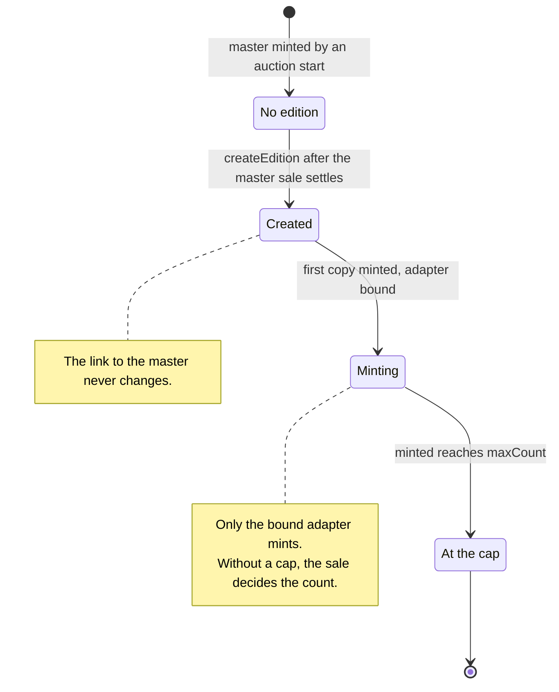
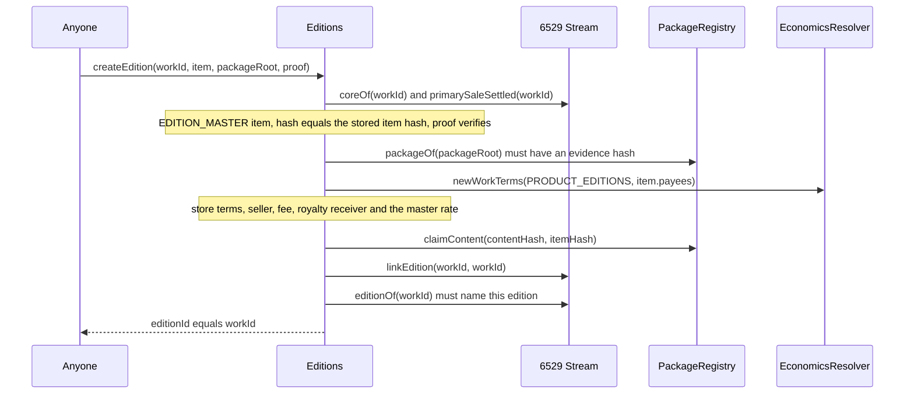
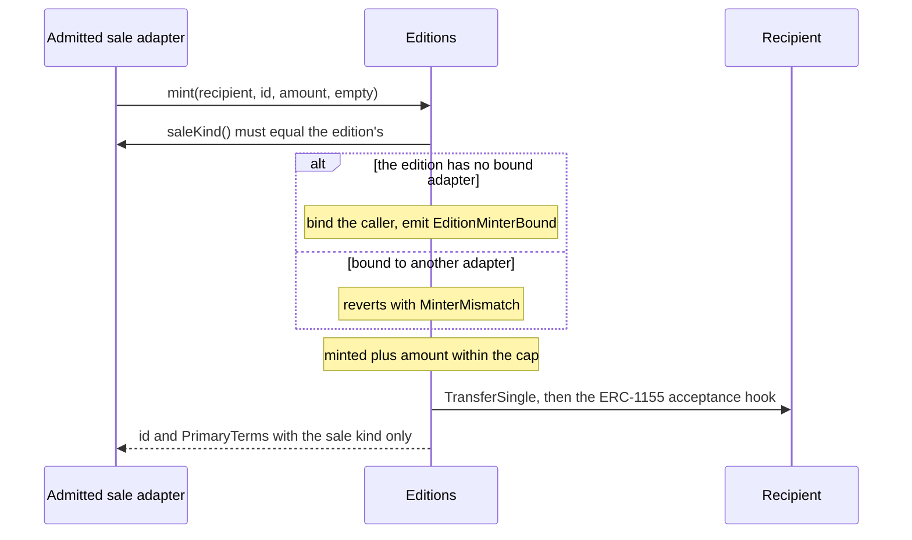

# Editions and sales

6529 Stream Editions (the contract `Editions`) is the protocol's one shared ERC-1155. Every
edition is anchored by a 6529 Stream work of kind `EDITION_MASTER` (the master), whose token ID,
media, record, license and content hash it shares. Copies are minted only by a sale adapter
that governance admits and whose sale kind the edition's terms name, so a new sale method is a
new adapter, never a new token contract
([ADR 0005](../adr/0005-stream-editions-auction.md#3-adding-a-sale-method-decision-14), owner
decision 14). This page specifies how an edition is created and minted, for auditors,
integrators and operators. The master's auction is in [Stream and auctions](stream-and-auctions.md).

> Pre-audit. See the [project status](../../README.md#status).

**Sale methods.** rc.2 sells editions by the uniform-price edition auction
(`UniformEditionAuction`, [ADR 0005 §2](../adr/0005-stream-editions-auction.md#2-design-summary)).
Its adapter is not in `src/` yet, and genesis admits no edition sale adapter until it lands.
Its rules (`EA-*`) are being written by the specification lane and will be added to this page
with it. ADR 0005 removed the fixed-price and Dutch adapters, with their rules (ED-9 to ED-24);
they remain at the `v1.0.0-rc.1` tag, and a fixed-price sale can be restored as a newly
admitted adapter without redeploying Editions
([§3](../adr/0005-stream-editions-auction.md#3-adding-a-sale-method-decision-14)).

## Contracts

| Contract | Source | Interface | Responsibility |
| --- | --- | --- | --- |
| `Editions` | [`src/editions/Editions.sol`](../../src/editions/Editions.sol) | [`IEditions`](../../src/interfaces/IEditions.sol), [`IMintTarget`](../../src/interfaces/IMintTarget.sol), ERC-1155, ERC-2981, ERC-4906, ERC-7572 | Creates and links editions; mints for an admitted adapter of the edition's sale kind, within the creator's cap, binding each edition to its first minter; serves royalties, license and metadata from the master. |
| `EditionRules` (internal library) | [`src/editions/EditionRules.sol`](../../src/editions/EditionRules.sol) | none | The one definition of valid edition terms, used by the package registry at `consume` and by `Editions` at `createEdition`. |
| Edition sale adapters | none in `src/` yet | [`ISaleAdapter`](../../src/interfaces/ISaleAdapter.sol); rc.2's is [`IUniformEditionAuction`](../../src/interfaces/IUniformEditionAuction.sol) (frozen) | Sell copies through `IMintTarget.mint`. Any adapter governance admits on Editions. |
| Federation registry (v1.1, not implemented in v1) | none | [`IFederationRegistry`](../../src/interfaces/IFederationRegistry.sol) | What the adapters will read to serve 6529 Stream Federated contracts. v1 installs no registry. |

The types live in [`SaleTypes.sol`](../../src/interfaces/types/SaleTypes.sol) and
[`PackageTypes.sol`](../../src/interfaces/types/PackageTypes.sol); collaborators are specified
on the pages under [References](#references).

**Wiring.** The constructor requires Stream to have code, no EIP-7702 delegation, ERC-165
`IStream` and the reviewed code hash (`InvalidDependency`), and requires it to name a package
registry, economics resolver and artist registry (`ZeroAddress`). It reads all three from Stream
on every use, so a governed replacement in Stream (`setDependency`, owner decision 16) applies
to Editions at once.
Genesis binds Editions in Stream and the package registry and calls `Editions.bindWorkRecords`
once (`AlreadyBound`) ([`config/genesis.example.json`](../../config/genesis.example.json),
`wiring`); it admits no edition sale adapter yet, so no copy can be minted until governance
admits one. `notifyMasterUpdated` and `setRoyaltyRate` accept only that satellite;
`notifyAllUpdated` accepts it or Stream (`UnboundCaller`).

## Concepts

The [glossary](../glossary.md) defines [master](../glossary.md#master),
[copy](../glossary.md#copy), [creator](../glossary.md#creator),
[sale kind](../glossary.md#sale-kind) and [admitted minter](../glossary.md#admitted-minter).

### Masters, editions and copies

- A master is auctioned like any other work. Its package item carries `EditionTerms`, fixed
  when the package was approved.
- The edition ID equals the master's Stream token ID. An edition exists once `createEdition`
  succeeds (`exists(id)`); the link is permanent (ED-2): `masterOf(id)` returns
  `(stream, id, contentHash)` and Stream's `editionOf(workId)` returns `(editions, workId)`.
- Every copy is minted by the edition's sale adapter, straight to the recipient it names. The
  sale decides how many copies exist. There are no numbered editions.

### Edition terms

| Field | Meaning |
| --- | --- |
| `maxCount` | The creator's optional cap on the copies ever minted, by every adapter together; 0 for none (the count then stops at 2^48 - 1, as `minted` is a `uint48`). |
| `currency` | The sale method's currency, opaque to Editions and the package registry. The edition auction takes `CURRENCY_ETH` (`address(0)`). |
| `saleKind` | A nonzero sale-kind label ([`SaleKind`](../../src/interfaces/types/SaleTypes.sol)). Only an admitted adapter reporting this kind may mint. rc.2's edition auction is `UNIFORM_AUCTION`; `FIXED_PRICE` and `DUTCH` are reserved labels of the removed rc.1 adapters. |
| `params` | The sale method's parameters, at most 1,024 bytes, opaque to Editions and the package registry. The edition auction takes none. |

The terms fix no size, format, window or price. `EditionRules.isValid` never reverts and
accepts any terms with a nonzero `saleKind` and at most `EditionRules.MAX_PARAMS_BYTES` of
`params`, whatever the cap and currency. The package registry applies it at `consume`
(`PackageRegistry._checkTerms`), so a master whose edition could not be created never mints;
`createEdition` applies it again (`InvalidEditionTerms(workId)`). The adapter validates the
currency and params when it opens a sale and refuses terms it cannot sell. Terms that name a
kind no admitted adapter serves are valid, so such a master mints and its edition waits for an
adapter (LIM-EA-8 in [ADR 0005](../adr/0005-stream-editions-auction.md#known-limitations)).

### Terms and the creator

- `Editions.primaryTerms(id, data)` returns the edition's `PrimaryTerms`: its sale kind, its
  currency and params as approved (the currency unresolved), a zero price (the terms have
  none; a priced method carries its price in its params), the seller, fee recipient and fee
  share (locked at `createEdition` from `PRODUCT_EDITIONS` economics) and `creator`; `data` is
  ignored. An adapter reads them when it opens a sale. `mint` returns only the sale kind, since
  an adapter never reads the rest there (QUALITY-2).
- The creator is the active authority of the master's lead artist
  (`IArtistRegistry.activeAuthorityOf`), resolved on every read; it is zero during a
  [restraint](../glossary.md#restraint). Editions gives it no power of its own; what it may do
  in a sale is the adapter's rule.

### Reading an edition

- `edition(id)` returns the content hash, the terms as approved, `minted`, the bound adapter
  (`minter`, zero before the first mint) and the locked economics (`UnknownEdition` otherwise).
- `royaltyInfo(id, salePrice)` returns the receiver locked at creation and
  `floor(salePrice × royaltyRate / 100,000)` from Editions' own storage, with no external call
  (`UnknownEdition` otherwise). The rate starts at the master's and follows its consented
  re-rates through the work-records satellite (ED-7,
  [works and storage](works-and-storage.md#relicense-royalty-rate-and-errata-repin)); an
  unknown edition or unchanged rate is a no-op, a rate above 100,000 reverts
  (`InvalidRoyaltyRate`), and new `PRODUCT_EDITIONS` defaults never touch an existing edition.
- `licenseOf(id)` returns the master's current license (`UnknownEdition`; `RecordNotOpen`
  until anyone opens the master's record with `openRecord`).
- `uri(id)` is `IRenderer(IStream.rendererOf(id)).tokenURI(address(editions), id)`: the
  master's renderer builds the edition's metadata from the master's record and content, and
  fails closed with it ([Rendering and tokenURI](rendering-and-tokenuri.md)).
- `name()` is "6529 Stream Editions" and `symbol()` is `STREAMEDITIONS` (ADR 0005, D139).
  `owner()` is the marketplace owner, set by `setOwner(expected, next)` (compare-and-set,
  `ExpectedValueMismatch`), with no protocol power. `supportsInterface` reports ERC-1155,
  ERC-2981, `IMintTarget`, `IEditions`, ERC-4906 (`0x49064906`) and ERC-165.

The AccessManager roles and delays of every governed selector on Editions are in the role
matrix under [Editions](../audit/roles.md#editions).

## State machine

### An edition

| Transition | Caller (role) | Delay | Function |
| --- | --- | --- | --- |
| No edition to Created | anyone, once `IStream.primarySaleSettled(workId)` is true | none | `Editions.createEdition` |
| Created to Minting | an admitted adapter whose `saleKind()` matches, for a buyer | none | `Editions.mint` (first copy; binds the adapter, `EditionMinterBound`) |
| Minting to At the cap | the bound adapter | none | `Editions.mint` when `minted` reaches a nonzero `maxCount` |

- `mint(to, id, amount, data)` requires, in order: an admitted caller (`NotAdmittedMinter`); a
  nonzero `amount` and empty `data` (`InvalidMintRequest`); an existing edition
  (`UnknownEdition`); a caller whose `saleKind()` equals the edition's (`SaleKindMismatch`);
  the edition's bound adapter, or none yet, in which case the caller becomes it
  (`MinterMismatch(editionId, minter)` names the bound one); and `amount` within the cap
  minus `minted` (`EditionUnavailable`). The supply update precedes the ERC-1155 acceptance
  call, so a reentering receiver sees the new `minted`. Minting reads nothing from Stream: a
  master with an edition has settled, and Stream never burns a settled token
  (`SaleAlreadySettled`).
- The binding is permanent. A second admitted adapter of the same kind can never add copies to
  a sale another one ran; a removed adapter that is admitted again keeps its binding.
- `setAdmittedMinter(adapter, admitted)` admits an adapter with code, no EIP-7702 delegation
  and ERC-165 `ISaleAdapter` (`InvalidDependency`); removal is unchecked, and only a change emits
  `AdmittedMinterSet`. The first admission gives the adapter its 16-bit binding ID, kept through
  removal and re-admission.
- `burn(id, amount)` burns from the caller's own balance, for any adapter ever admitted; burned
  copies still count toward the cap. `settlePrimary(...)` is a no-op returning nothing for any
  adapter ever admitted (every copy is sold at mint) and refused for anyone else
  (`NotAdmittedMinter`).

## Flows

### Create an edition

Preconditions (`Editions._admit`, then `EditionRules.isValid`):
- Genesis has bound the work-records satellite (`WorkRecordsUnbound`), and no edition exists
  for `workId` (`EditionExists`).
- The master is live (Stream reverts with `UnknownWork` for an unminted or burned ID) and its
  primary sale has settled. A master in custody, paused for a dispute, or burned gets no
  edition.
- `item.kind` is `EDITION_MASTER`, `WorksHashing.itemHashCalldata(item)` equals the item hash
  Stream stored, `item.contentHash` is nonzero, and `proof` (at most 32 nodes) places the item
  in `packageRoot`, which the registry registered (nonzero evidence hash). A revoked root still
  counts, because Stream already consumed exactly this item (SIGS-4); a root never registered
  proves nothing. Any failure here reverts with `NotEditionMaster(workId)`.
- The edition terms pass `EditionRules.isValid` (`InvalidEditionTerms`).

Effects:
- Locks `PRODUCT_EDITIONS` economics from `newWorkTerms`: the seller (the split wallet of the
  item's payees), the fee recipient and share, and the royalty receiver (the seller when the
  fee share is zero, otherwise the royalty split wallet).
- Sets the royalty rate to the master's current rate (from `coreOf`), so a consented re-rate of
  the master before the edition exists carries over, and records the lead artist ID from which
  `creator` is resolved.
- Stores the cap and the terms. The edition auction's kind, ETH and empty params are stored as
  zero, so they cost no storage words.
- Emits `EditionCreated` and `MetadataUpdate` before the protocol calls, so a reentrant
  `createEdition` hits `EditionExists`. The registry accepts only the item Stream consumed for
  this content hash, once (`ClaimNotAllowed`, `ContentUsed`); `linkEdition` refuses anything
  but a settled, unlinked master at its own ID (`EditionLinkInvalid`); a wrong readback reverts
  with `LinkFailed`.

Gas for this and the other edition flows is in the
[ADR 0004 table](../adr/0004-gas-budgets-under-glamsterdam.md#the-table); the rc.1 Sepolia
measurements are in [Sepolia flows, section 3](../../deployments/11155111/flows.md#3-6529-editions).

### Mint copies

The adapter decides who buys, at what price, and when it mints: Editions checks only the
adapter, its kind, the binding and the cap.

### Add a sale method

A new edition sale method is a new adapter (ADR 0005 §3):
1. Deploy the adapter. It claims a fresh label, `keccak256("<NAME>")`, from `saleKind()`, and
   validates its own `currency` and `params` when it opens a sale.
2. Governance schedules `Editions.setAdmittedMinter(adapter, true)` (SUCCESSOR_SETTER, 30 days)
   and the adapter's own target and settings, with their selectors in the governance manifest.
3. Packages approved afterwards may name the new kind in their edition terms. Editions sold by
   another adapter are untouched: each edition stays with its first minter.

Nothing in 6529 Stream or 6529 Stream Editions is redeployed.

## Rules and invariants

| ID | Rule | Enforced in | Tested by |
| --- | --- | --- | --- |
| ED-1 | An edition is created only for a live, settled `EDITION_MASTER` whose exact stored item is proven in a registered package root, revoked or not. | `Editions._admit` | [Editions.t.sol](../../test/editions/Editions.t.sol): `test_CreateEdition_RequiresSettledMaster`, `test_CreateEdition_RefusesOriginalItem`, `test_CreateEdition_RefusesMismatchedItem`, `testFuzz_CreateEdition_RefusesTamperedItem`, `test_CreateEdition_RequiresARegisteredPackageProof`, `test_CreateEdition_ProofDepthBounded`; [MasterEdition.t.sol](../../test/integration/MasterEdition.t.sol): `test_RevokingTheRootDoesNotStrandASoldMastersEdition`, `test_AnEditionNeedsARegisteredRoot` |
| ED-2 | A master has at most one edition, its ID is the master's token ID, both sides are written in one transaction, and the link never changes. | `Editions.createEdition`; `Stream.linkEdition` | [Editions.t.sol](../../test/editions/Editions.t.sol): `test_CreateEdition_LinksBothWaysAndLocksTerms`, `test_CreateEdition_RefusesSecondCreate`, `test_CreateEdition_LinkIsPermanent`, `test_CreateEdition_FailsClosedWhenStreamDoesNotLink`, `test_CreateEdition_ReentryThroughStreamHitsEditionExists`; [Editions.invariant.t.sol](../../test/editions/Editions.invariant.t.sol): `invariant_LinkAndRoyaltyFixed` |
| ED-3 | An edition's content hash is unique among editions and claimable only by the item Stream consumed for it. | `PackageRegistry.claimContent` | [Editions.t.sol](../../test/editions/Editions.t.sol): `test_CreateEdition_ContentHashUniqueAmongEditions`, `test_CreateEdition_RefusesHashClaimedInEditions`, `test_CreateEdition_RefusesHashConsumedByAnotherItem` |
| ED-4 | Edition terms satisfy one rule at `consume` and at `createEdition`: a nonzero sale kind and at most 1,024 bytes of params; the cap, currency and params are otherwise the sale method's. | `EditionRules.isValid`; `PackageRegistry._checkTerms`; `Editions.createEdition` | [EditionRules.t.sol](../../test/editions/EditionRules.t.sol): `test_AnyNonzeroKind`, `test_AnyCurrency`, `test_ParamsAreBounded`, `testFuzz_AnyCap`, `testFuzz_MatchesTheRule`; [Editions.t.sol](../../test/editions/Editions.t.sol): `test_CreateEdition_RefusesMalformedTerms`; [PackageRegistry.t.sol](../../test/curation/PackageRegistry.t.sol): `test_invalidItem_masterEditionTermsSharedRule` |
| ED-5 | Only an admitted adapter whose `saleKind()` equals the edition's mints, with a nonzero amount and empty data; the first adapter to mint an edition is bound to it, and no other adapter mints it again. | `Editions.mint`, `Editions.setAdmittedMinter` | [Editions.t.sol](../../test/editions/Editions.t.sol): `test_Mint_OnlyAdmittedMinter`, `test_Mint_RequiresTheEditionsSaleKind`, `test_Mint_RejectsUnknownEditionZeroAmountAndData`, `test_SetAdmittedMinter_GovernedAndChecked`, `test_Mint_ANewSaleMethodAdmittedLaterMints`, `test_Mint_BindsTheEditionToItsFirstMinter`, `test_Mint_BindingSurvivesRemovalAndReadmission`; [Editions.invariant.t.sol](../../test/editions/Editions.invariant.t.sol): `invariant_BoundToTheFirstMinter`; [MasterEdition.t.sol](../../test/integration/MasterEdition.t.sol): `test_ANewSaleMethodIsAdmittedByGovernanceAndMints` |
| ED-6 | Copies minted never exceed the creator's cap, or 2^48 - 1 without one; burns never free the cap. | `Editions.mint`, `Editions.burn` | [Editions.t.sol](../../test/editions/Editions.t.sol): `test_Mint_StopsAtTheCreatorCap`, `testFuzz_Mint_NeverExceedsTheCap`, `test_Mint_UncappedStopsAtUint48`, `test_Mint_MaximumCap`; [Editions.invariant.t.sol](../../test/editions/Editions.invariant.t.sol): `invariant_SupplyAccounting`, `invariant_MintsFollowEditionTerms` |
| ED-7 | The royalty receiver is fixed at creation; the rate starts at the master's current rate and changes only through the work-records satellite, with the master's. | `Editions.createEdition`, `Editions.setRoyaltyRate`; `WorkRecords._applyRate` | [Editions.t.sol](../../test/editions/Editions.t.sol): `test_CreateEdition_InheritsMasterRoyaltyRate`, `test_SetRoyaltyRate_OnlyThroughWorkRecords`, `test_RoyaltyInfo_UnaffectedByNewDefaults`; [MasterEdition.t.sol](../../test/integration/MasterEdition.t.sol): `test_EditionRoyaltyFollowsAMasterRerate`, `test_EditionTakesTheMastersCurrentRate` |
| ED-8 | Only an adapter ever admitted burns, and only from its own balance; `settlePrimary` is a no-op for such adapters and refused for anyone else. | `Editions.burn`, `Editions.settlePrimary` | [Editions.t.sol](../../test/editions/Editions.t.sol): `test_Burn_OnlyMinterOnlyOwnBalance`, `test_Burn_RemovedAdapterCanStillBurn`, `test_SettlePrimary_NoOpForAdapters` |
| ED-9 to ED-24 | Retired: the fixed-price and Dutch sale rules, removed with their adapters by ADR 0005. The IDs are not reused; the `v1.0.0-rc.1` specification has them. | none | none |

## Events

Event signatures and topic0 values are on the events page, under
[Editions](../integrators/events-and-indexing.md#editions). No event marks an edition at its
cap: compare `edition(id).minted` with `terms.maxCount`.

## Failure modes and recovery

| Failure | Effect | Recovery |
| --- | --- | --- |
| No admitted adapter serves the edition's sale kind | `createEdition` succeeds, but no copy can be minted (LIM-EA-8). | Governance admits an adapter of that kind (30 days); the curation signer checks for one before attesting. |
| A second admitted adapter of the same kind tries to mint a bound edition | `mint` reverts with `MinterMismatch`. | None needed: each edition sells through its first minter. |
| The bound adapter is removed | Its mints revert with `NotAdmittedMinter`; no other adapter can mint the edition. | Re-admit it (30 days), which keeps the binding; governance removes an adapter only once its settled sales are claimed (LIM-EA-10 in ADR 0005). |
| An edition reaches its creator's cap | `mint` reverts with `EditionUnavailable`. | None: the cap is the creator's. |
| The recipient's ERC-1155 hook reverts, returns the wrong value, or the recipient cannot hold the token | The mint reverts. | The adapter's rule; for example, mint to another recipient. |
| A master's sale has not settled, was cancelled, or the master was burned | `createEdition` reverts with `NotEditionMaster` (or Stream's `UnknownWork`). | Wait for settlement; a burned master never gets an edition. |

## Parameters and limits

| Parameter | Value | Source |
| --- | --- | --- |
| Merkle proof nodes (package item) | 32 | `Limits.MAX_PROOF_DEPTH` in [`Limits.sol`](../../src/interfaces/types/Limits.sol) |
| Edition params | at most 1,024 bytes | `EditionRules.MAX_PARAMS_BYTES` in [`EditionRules.sol`](../../src/editions/EditionRules.sol) |
| Copies of an edition without a cap | 2^48 - 1 (`type(uint48).max`) | `Editions.UNCAPPED` |
| Adapter admissions per token | at most 65,535 (16-bit binding IDs) | `Editions.setAdmittedMinter` |
| Fee share and royalty denominator | 100,000 | `Splits.DENOMINATOR` in [`Splits.sol`](../../src/economics/Splits.sol) |
| `CURRENCY_ETH`, `CURRENCY_DEFAULT` | `address(0)`, `address(type(uint160).max)` | [`EconomicsTypes.sol`](../../src/interfaces/types/EconomicsTypes.sol) |
| Sale kinds | `UNIFORM_AUCTION` (rc.2's edition auction); `FIXED_PRICE`, `DUTCH` reserved | [`SaleTypes.sol`](../../src/interfaces/types/SaleTypes.sol) |

## Differences from the ADRs

See the [register](README.md#differences-from-the-adrs).

## References

- Code: [`Editions.sol`](../../src/editions/Editions.sol),
  [`EditionRules.sol`](../../src/editions/EditionRules.sol),
  [`IEditions.sol`](../../src/interfaces/IEditions.sol),
  [`IMintTarget.sol`](../../src/interfaces/IMintTarget.sol),
  [`ISaleAdapter.sol`](../../src/interfaces/ISaleAdapter.sol),
  [`IUniformEditionAuction.sol`](../../src/interfaces/IUniformEditionAuction.sol),
  [`IFederationRegistry.sol`](../../src/interfaces/IFederationRegistry.sol); module READMEs
  [`src/editions`](../../src/editions/README.md) and [`src/sales`](../../src/sales/README.md).
- ADRs: [ADR 0001 §5](../adr/0001-v1-scope.md#5-sales-and-auctions),
  [§6](../adr/0001-v1-scope.md#6-6529-editions) and
  [§16](../adr/0001-v1-scope.md#16-6529-stream-federated);
  [ADR 0003, sales and auctions](../adr/0003-build-time-decisions.md#sales-and-auctions-amends-adr-0001-5-6-and-9),
  [package format and curation](../adr/0003-build-time-decisions.md#package-format-and-curation-amends-adr-0001-3) and
  [governance](../adr/0003-build-time-decisions.md#governance-extends-adr-0002);
  [ADR 0004, the table](../adr/0004-gas-budgets-under-glamsterdam.md#the-table);
  [ADR 0005](../adr/0005-stream-editions-auction.md), which amends all three for editions.
- Tests: [`test/editions/`](../../test/editions/),
  [`MasterEdition.t.sol`](../../test/integration/MasterEdition.t.sol). How to run them:
  [testing](../testing/README.md).
- Deployment evidence (rc.1):
  [Sepolia flows, section 3](../../deployments/11155111/flows.md#3-6529-editions).
- Related pages: [Stream and auctions](stream-and-auctions.md), [Curation](curation.md),
  [Economics and payouts](economics-and-payouts.md),
  [Identity and recovery](identity-and-recovery.md), [Works and storage](works-and-storage.md),
  [Rendering and tokenURI](rendering-and-tokenuri.md), [Governance](governance.md);
  integrators: [buying, bidding, settling](../integrators/buying-bidding-settling.md) and
  [events and indexing](../integrators/events-and-indexing.md); audit pack:
  [invariants](../audit/invariants.md), [roles](../audit/roles.md) and
  [known limitations](../audit/known-limitations.md).
