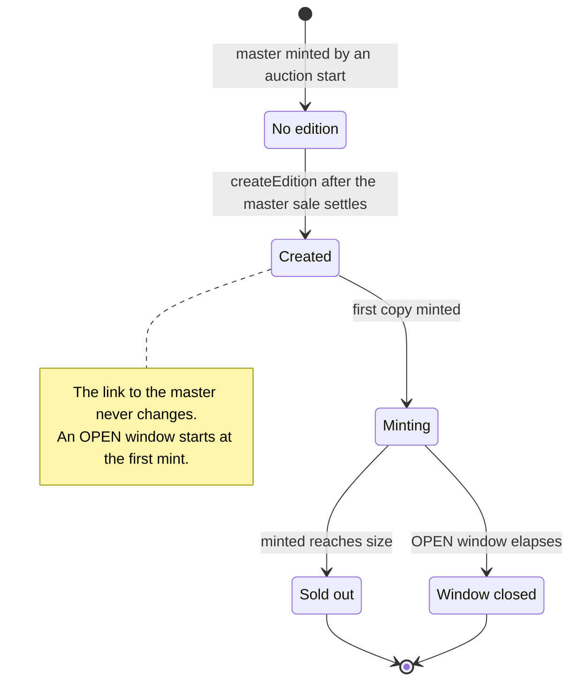
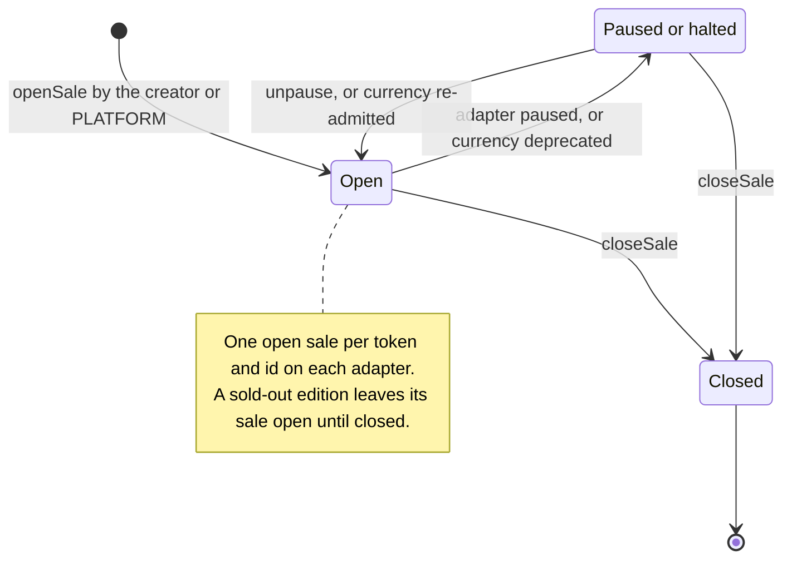
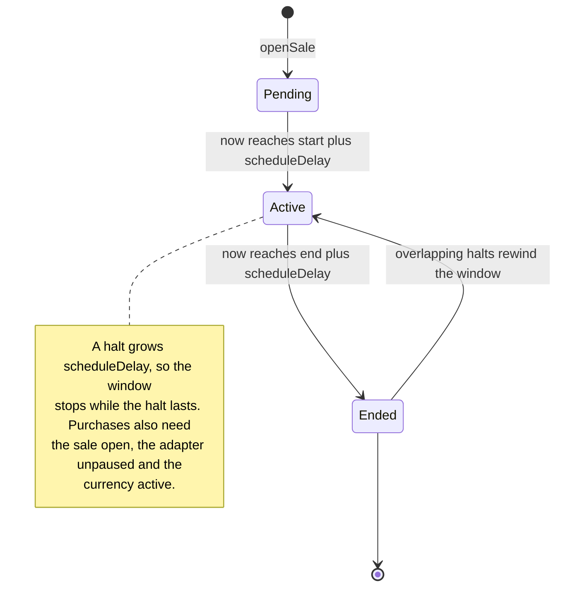
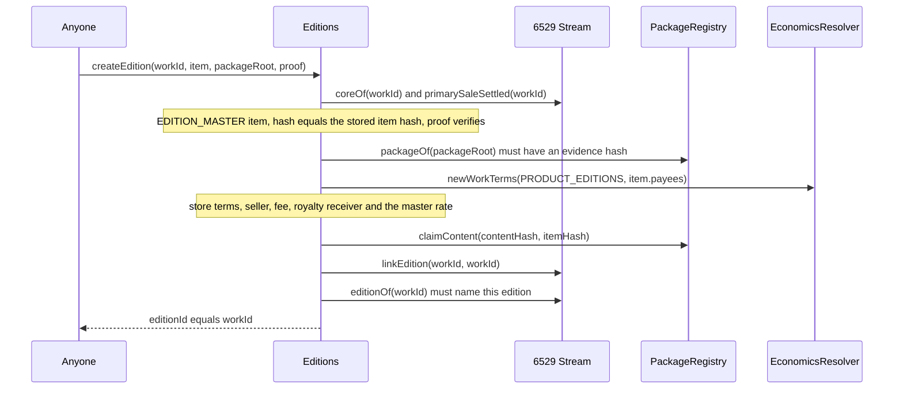
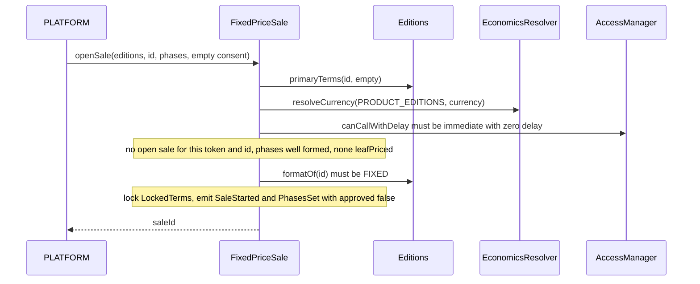
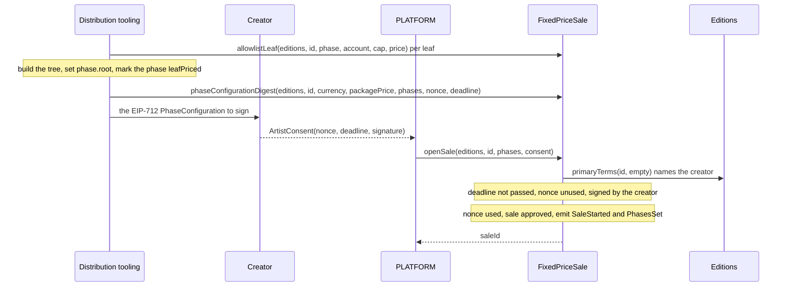
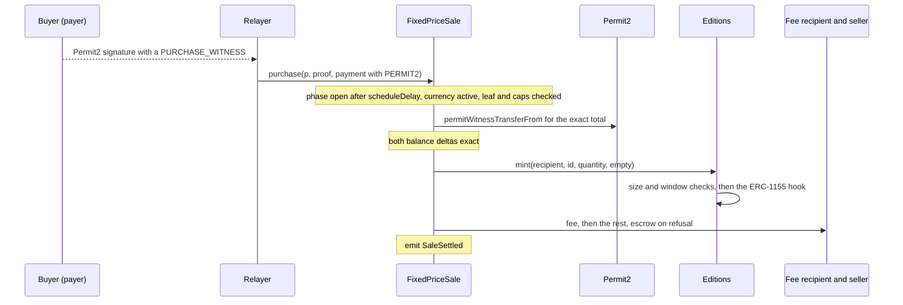
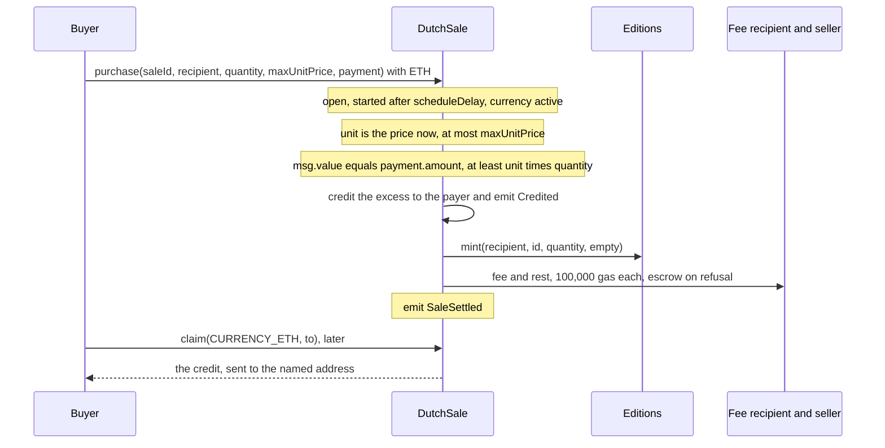
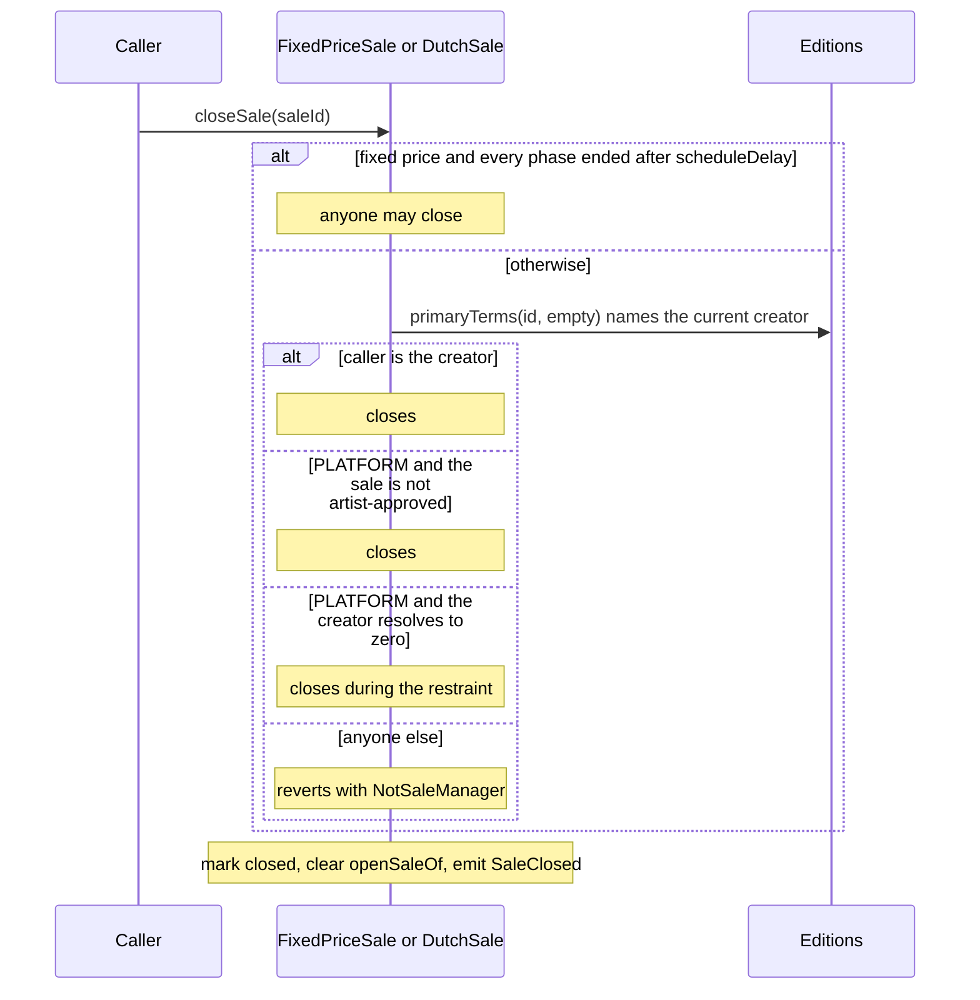

# Editions and sales

6529 Editions is the protocol's one shared ERC-1155. Every edition is anchored by a 6529
Stream work of kind `EDITION_MASTER` (the master): the edition ID is the master's token ID,
and the edition carries the master's media, record, license and content hash. Copies are
sold only through two shared mint-sale adapters: fixed price, with optional allowlist phases,
and Dutch, a descending price. This page specifies how an edition is created and how the
adapters open, run, halt, pay out and close sales, for auditors, integrators and the operators
who hold the PLATFORM or guardian roles. The auction that sells masters is specified in
[Stream and auctions](stream-and-auctions.md).

> Pre-audit. See the [project status](../../README.md#status).

## Contracts

| Contract | Source | Interface | Responsibility |
| --- | --- | --- | --- |
| `Editions` | [`src/editions/Editions.sol`](../../src/editions/Editions.sol) | [`IEditions`](../../src/interfaces/IEditions.sol), [`IMintTarget`](../../src/interfaces/IMintTarget.sol), ERC-1155, ERC-2981, ERC-4906, ERC-7572 | Creates and links editions, enforces size and window on every mint, serves royalties, license and metadata from the master. |
| `EditionRules` (internal library) | [`src/editions/EditionRules.sol`](../../src/editions/EditionRules.sol) | none | The one definition of valid edition terms, used by the package registry at `consume` and by `Editions` at `createEdition`. |
| `MintSaleBase` (abstract) | [`src/sales/MintSaleBase.sol`](../../src/sales/MintSaleBase.sol) | [`ISaleAdapter`](../../src/interfaces/ISaleAdapter.sol) | What both adapters share: targets, terms locked at open, one open sale per `(token, id)`, payment collection, payouts with the escrow fallback, ETH credits, the emergency pause and the schedule delay. |
| `FixedPriceSale` | [`src/sales/FixedPriceSale.sol`](../../src/sales/FixedPriceSale.sol) | [`IFixedPriceSale`](../../src/interfaces/IFixedPriceSale.sol) | Fixed-price sales with up to 16 phases, Merkle allowlists, per-wallet caps and prices, and the artist's signed phase configuration. |
| `DutchSale`, `DutchPricing` (internal library) | [`src/sales/DutchSale.sol`](../../src/sales/DutchSale.sol), [`src/sales/DutchPricing.sol`](../../src/sales/DutchPricing.sol) | [`IDutchSale`](../../src/interfaces/IDutchSale.sol) | Descending-price sales on the curve the edition's terms fix; the curve and its validity rule. |
| Federation registry (v1.1, not implemented in v1) | none | [`IFederationRegistry`](../../src/interfaces/IFederationRegistry.sol) | What the adapters will read to serve 6529 Stream Federated contracts. v1 installs no registry. |

The types live in [`SaleTypes.sol`](../../src/interfaces/types/SaleTypes.sol),
[`PackageTypes.sol`](../../src/interfaces/types/PackageTypes.sol) and
[`Typehashes.sol`](../../src/interfaces/types/Typehashes.sol); collaborators are specified on
the pages under [References](#references).

**Wiring.** The constructor requires Stream to have code, no EIP-7702 delegation, ERC-165
`IStream` (`InvalidBinding`) and the reviewed code hash (`CodeHashMismatch`), and reads the
package registry, economics resolver and artist registry from it as immutables (`ZeroAddress`).
Genesis binds Editions in Stream and the package registry, calls `Editions.bindWorkRecords` once
with the satellite Stream bound (ERC-165 `IWorkRecords`, no delegation; `AlreadyBound`), admits
both adapters on Editions and lists Editions on both
([`config/genesis.example.json`](../../config/genesis.example.json), `wiring`).
`notifyMasterUpdated` and `setRoyaltyRate` accept only that satellite; `notifyAllUpdated`
accepts it or Stream (`UnboundCaller`).

## Concepts

The [glossary](../glossary.md) defines [master](../glossary.md#master),
[copy](../glossary.md#copy), [creator](../glossary.md#creator),
[restraint](../glossary.md#restraint), [phase](../glossary.md#phase),
[allowlist leaf](../glossary.md#allowlist-leaf), [schedule delay](../glossary.md#schedule-delay),
[gift](../glossary.md#gift) and [LockedTerms](../glossary.md#lockedterms).

### Masters, editions and copies

- A master is auctioned like any other work. Its package item carries `EditionTerms`, fixed
  when the package was approved.
- The edition ID equals the master's Stream token ID. An edition exists once `createEdition`
  succeeds (`exists(id)`: its stored content hash is nonzero). The link is written once, in
  both directions, in that transaction, and no function changes or removes it: `masterOf(id)`
  returns `(stream, id, contentHash)` and Stream's `editionOf(workId)` returns
  `(editions, workId)`.
- Every copy is minted at purchase, straight to the buyer's recipient. There are no numbered
  editions.

### Edition terms

| Field | Meaning |
| --- | --- |
| `format` | `EditionFormat.FIXED` or `EditionFormat.OPEN`. |
| `size` | FIXED: the maximum number of copies ever, nonzero. OPEN: zero for no cap (the code uses `type(uint64).max`), or a cap. |
| `window` | FIXED: must be zero. OPEN: the seconds the edition sells for, counted from the first mint, nonzero. |
| `price` | The unit price for `FIXED_PRICE`, the starting price for `DUTCH`. |
| `currency` | `CURRENCY_ETH` (`address(0)`), an allowlisted ERC-20, or `CURRENCY_DEFAULT` (`address(type(uint160).max)`) only when `price` is zero. |
| `saleKind` | `SaleKind.FIXED_PRICE` or `SaleKind.DUTCH`. Only an adapter reporting this kind may mint. |
| `params` | Empty for `FIXED_PRICE`; exactly `abi.encode(DutchParams)` (96 bytes) for `DUTCH`. |

`EditionRules.isValid` never reverts, and returns true only when a nonzero price names an
explicit currency; FIXED has a nonzero `size` and a zero `window`, and OPEN a nonzero `window`;
`FIXED_PRICE` carries no params and `DUTCH` exactly 96 bytes, with `duration` and `stepSeconds`
that fit in `uint64` and a schedule `DutchPricing.isValid` accepts; and the sale kind is one of
the two. The package registry applies it at `consume` (`PackageRegistry._checkTerms`), so a
master whose edition could not be created or sold never mints; `Editions._checkTerms` applies
it again at `createEdition`, reporting a priced default currency as
`PricedDefaultCurrency(workId)`.

### Terms, the creator and PLATFORM

- `Editions.primaryTerms(id, data)` returns the edition's `PrimaryTerms`: sale kind, the
  package's currency (unresolved), price, params, seller, fee recipient, fee share (locked at
  `createEdition` from `PRODUCT_EDITIONS` economics) and `creator`; `data` is ignored. An
  adapter reads them when it opens a sale, resolves the currency once, and stores them as the
  sale's `LockedTerms`, which every purchase in that sale uses.
- The creator is the active authority of the master's lead artist
  (`IArtistRegistry.activeAuthorityOf`), resolved on every read. It needs no role, and may open
  sales, sign phase configurations and close sales. After a recovery only the new key has these
  powers. During a restraint `activeAuthorityOf` is zero: nobody acts as the creator, no
  consent verifies, and PLATFORM may close every sale.
- The adapters' `openSale` and `closeSale` are not `restricted`; they check PLATFORM themselves
  (`MintSaleBase._isPlatform`) and accept only a zero-delay grant for the selector.

### Artist approval (MARKET-6)

A sale is **artist-approved** when the creator opened it, or, for fixed price, when PLATFORM
opened it with the creator's valid signed phase configuration. `sale(saleId)` reports
`artistApproved` on fixed price; on Dutch it is stored but not returned. PLATFORM alone may open
only a sale of a token listed by governance (not a federated token), of a FIXED edition
(`IEditions.formatOf`), and, on fixed price, with no `leafPriced` phase. Everything else needs
the artist (`ArtistApprovalRequired`, `PricedLeavesNeedApproval`): an OPEN edition, because its
one-time window starts at the first mint of whichever sale makes it; any leaf-priced phase,
whatever its prices; and any federated token. The Dutch adapter has no signed-configuration
path, so only the creator opens a Dutch sale of an OPEN edition.

### Reading an edition

- `royaltyInfo(id, salePrice)` returns the receiver locked at creation and
  `floor(salePrice × royaltyRate / 100,000)` from Editions' own storage, with no external call
  (`UnknownEdition` otherwise). The rate starts at the master's current rate; afterwards only
  the work-records satellite changes it, when it re-rates the master (every party's consent
  plus a FUNDS_SETTER action, 14 days, the funds class). An unknown edition or unchanged rate
  is a no-op; a rate above 100,000 reverts (`InvalidRoyaltyRate`). A later change to the
  `PRODUCT_EDITIONS` defaults never touches an existing edition.
- `licenseOf(id)` returns the master's current license (`UnknownEdition`; `RecordNotOpen`
  until the master's record is open).
- `uri(id)` is `IRenderer(IStream.rendererOf(id)).tokenURI(address(editions), id)`: the
  master's renderer builds the edition's metadata from the master's record and content, and
  fails closed with it ([Rendering and tokenURI](rendering-and-tokenuri.md)).
- `owner()` is the marketplace owner, set by `setOwner(expected, next)` (compare-and-set,
  `ExpectedValueMismatch`), with no protocol power. `supportsInterface` reports ERC-1155,
  ERC-2981, `IMintTarget`, `IEditions`, ERC-4906 (`0x49064906`) and ERC-165.

The AccessManager roles and delays of every governed selector on these contracts are in the
role matrix for [Editions](../audit/roles.md#editions),
[FixedPriceSale](../audit/roles.md#fixedpricesale) and [DutchSale](../audit/roles.md#dutchsale).

## State machine

### An edition



| Transition | Caller (role) | Delay | Function |
| --- | --- | --- | --- |
| No edition to Created | anyone, once `IStream.primarySaleSettled(workId)` is true | none | `Editions.createEdition` |
| Created to Minting | an admitted adapter whose `saleKind()` matches, for a buyer | none | `Editions.mint` (first copy; OPEN emits `EditionWindowOpened`) |
| Minting to Sold out | an admitted adapter | none | `Editions.mint` when `minted` reaches `size` (FIXED, or OPEN with a cap) |
| Minting to Window closed | time | `window` seconds from the first mint | `Editions.mint` reverts with `EditionUnavailable` from `windowStart + window` |

- `mint(to, id, amount, data)` requires, in order: an admitted caller (`NotAdmittedMinter`); a
  nonzero `amount` and empty `data` (`InvalidMintRequest`); an existing edition
  (`UnknownEdition`); a caller whose `saleKind()` equals `terms.saleKind`
  (`SaleKindMismatch`); and `amount` within `size - minted` (`EditionUnavailable`). The supply
  update precedes the ERC-1155 acceptance call, so a reentering receiver sees the new
  `minted`. Minting reads nothing from Stream: a master with an edition has settled, and Stream
  never burns a settled token (`SaleAlreadySettled`).
- `setAdmittedMinter(adapter, admitted)` admits an adapter with code, no EIP-7702 delegation
  and ERC-165 `ISaleAdapter` (`InvalidBinding`); removal is unchecked, and only a change emits
  `AdmittedMinterSet`.
- `burn(id, amount)` burns from the caller's own balance, for any adapter ever admitted; burned
  copies still count toward the size. The shared adapters hold no copies, so in v1 this is the
  generic `IMintTarget` capability. `markPrimarySettled(id)` is a no-op for any adapter ever
  admitted (every copy is sold at mint) and refused for anyone else (`NotAdmittedMinter`).

### A sale



| Transition | Caller (role) | Delay | Function |
| --- | --- | --- | --- |
| to Open | the creator, or PLATFORM within [its limits](#artist-approval-market-6) | immediate | `openSale` (`SaleAlreadyOpen` if `(token, id)` has an open sale) |
| Open to Paused | PAUSER | immediate | `pause` (every sale on the adapter) |
| Open to Halted | GUARDIAN | immediate | `AssetAllowlist.deprecateAsset` (sales in that currency) |
| Paused to Open | UNPAUSER | standard, 48 hours, and at least 48 hours after the pause | `unpause` |
| Halted to Open | FUNDS_SETTER | funds, 14 days; refused until 14 days after the deprecation | `AssetAllowlist.admitAsset` |
| to Closed | the creator; PLATFORM for a sale that is not artist-approved, or any sale while the creator resolves to zero; anyone once every fixed-price phase has ended | immediate | `closeSale` |

Closing frees `(token, id)` for a new sale on that adapter. A closed sale never reopens, and
sale IDs (sequential per adapter, from 1) are never reused.

- **Emergency pause.** `pause()` makes `openSale` and `purchase` revert with `SalePaused`
  (also on a second pause); `closeSale`, `claim` and `revokeConsentNonce` keep working. The
  adapter refuses `unpause()` with `UnpauseTooEarly(allowedAt)` until `pausedAt +
  Roles.STANDARD` (GOV-5), so an unpause scheduled before the pause cannot undo it at once.
  Unpausing an unpaused adapter reverts with `NotPaused`.
- **Halts stop the clock** (MARKET-1). A pause or a deprecation of the sale's currency stops
  purchases and also the sale's schedule. The adapter's halted time for a currency is its
  closed pauses (`pausedTotal`) plus the running pause, plus the currency's deprecated time
  from the allowlist's `statusClock`. A sale records that sum when it opens (`haltedAtOpen`);
  `scheduleDelay(saleId)` is its growth since. Phase windows and the Dutch curve, including a
  start not yet reached, run `scheduleDelay` seconds later than configured, so a halt never
  uses up a phase or lets the Dutch price fall, and the permissionless close uses the moved
  windows. `SaleStarted` and `phases(saleId)` report the configured times.
- **Overlapping halts count twice.** A pause while the sale's currency is deprecated adds
  both, so the schedule then rewinds by the overlap: a Dutch curve climbs back up and an ended
  fixed-price phase can reopen (LIM-SAL-2 in
  [known limitations](../audit/known-limitations.md#sales-and-auctions); the guardian practice
  is in the [deploy runbook](../../script/README.md#1-accounts)).

### A fixed-price phase



| Transition | Caller (role) | Delay | Function |
| --- | --- | --- | --- |
| Pending to Active | time | `start + scheduleDelay(saleId)` | checked in `FixedPriceSale._admit` |
| Active to Ended | time | `end + scheduleDelay(saleId)` | checked in `_admit` and `_ended` |
| Ended to Active | a pause during a deprecation | the overlap | `MintSaleBase._halted` |

The Dutch sale has no phases. It accepts purchases from `startTime + scheduleDelay` until it is
closed or the edition stops minting.

## Flows

### Create an edition



Preconditions (`Editions._admit`, `_checkTerms`):
- Genesis has bound the work-records satellite (`WorkRecordsUnbound`), and no edition exists
  for `workId` (`EditionExists`).
- The master is live (Stream reverts with `UnknownWork` for an unminted or burned ID) and its
  primary sale has settled. A master in custody, paused for a dispute, or burned gets no
  edition.
- `item.kind` is `EDITION_MASTER`, `WorksHashing.itemHashCalldata(item)` equals the item hash
  Stream stored, `item.contentHash` is nonzero, and `proof` (at most 32 nodes) places the item
  in `packageRoot`, which the registry registered (nonzero evidence hash). A revoked root still
  counts, because Stream already consumed exactly this item (SIGS-4); a root never registered
  proves nothing. Any failure here reverts with `NotEditionMaster(workId)`.
- The edition terms pass `EditionRules.isValid`.

Effects:
- Locks `PRODUCT_EDITIONS` economics from `newWorkTerms`: the seller (the split wallet of the
  item's payees), the fee recipient and share, and the royalty receiver (the seller when the
  fee share is zero, otherwise the royalty split wallet).
- Sets the royalty rate to the master's current rate (from `coreOf`), so a consented re-rate of
  the master before the edition exists carries over, and records the lead artist ID from which
  `creator` is resolved.
- Emits `EditionCreated` and `MetadataUpdate`, then makes the protocol calls; a reentrant
  `createEdition` hits `EditionExists`. The registry accepts only the item Stream consumed for
  this content hash, once (`ClaimNotAllowed`, `ContentUsed`). Stream's `linkEdition` requires a
  settled, unlinked `EDITION_MASTER` and an edition ID equal to the token ID
  (`EditionLinkInvalid`); Editions reads `editionOf` back and reverts with `LinkFailed` unless it
  names this contract and ID.

Gas for this and the other edition flows is in the
[ADR 0004 table](../adr/0004-gas-budgets-under-glamsterdam.md#the-table) and
[Sepolia flows, section 3](../../deployments/11155111/flows.md#3-6529-editions).

### PLATFORM opens a FIXED sale at the package price



- `MintSaleBase._terms` fails closed unless: the token is a target (`TargetNotAllowed`); the
  terms' sale kind is the adapter's (`SaleKindMismatch`); a priced sale names its currency
  (`PricedDefaultCurrency`); the resolver accepts the currency and, unless it was
  `CURRENCY_DEFAULT`, returns exactly the named one (`CurrencyNotAllowed`, `CurrencyMismatch`);
  a seller is set, a fee recipient is set unless the fee share is zero, the fee share is at
  most 100,000, and neither the seller nor the fee recipient is the revenue escrow
  (`InvalidSaleTerms`, CALLS-1).
- `_checkPhases` refuses an empty list, more than 16 phases, a phase whose `start` is not
  below its `end`, and `payerKeyed` or `leafPriced` without a root (`InvalidPhases`).
- Any other caller, or a PLATFORM holder whose grant carries a delay, reverts with
  `NotSaleManager`.
- **Targets.** An adapter serves a token governance listed (`setTarget`; unlisting stops new
  sales only), or, from v1.1, one the installed federation registry reports active.
  `setFederationRegistry` is compare-and-set, checks ERC-165 `IFederationRegistry`, refuses
  EIP-7702 delegated accounts and pins the code hash (a registry whose code changes is ignored).
  A federated token must run the code its entry records; its fee share is the entry's, paid to
  the `PRODUCT_FEDERATED` fee recipient, its default currency resolves under
  `PRODUCT_FEDERATED`, and every purchase re-checks that it is active.

The Dutch equivalent is `DutchSale.openSale(token, id, startTime)`: `startTime` must not be in
the past (`InvalidSchedule`), the same `_terms` checks run, PLATFORM alone needs a listed FIXED
edition, and the decoded `DutchParams` must pass `DutchPricing.isValid`. `SaleStarted` then
carries `startPrice`, `startTime` and `startTime + duration`.

### A creator-approved, priced allowlist sale relayed by PLATFORM



The consent is an EIP-712 signature in the fixed-price adapter's domain (name
`Typehashes.FIXED_PRICE_SALE_NAME`, "6529 Works Fixed Price Sale"; version "1"; the chain ID;
the adapter's address):

```text
PhaseConfiguration(address token,uint256 id,address currency,uint256 packagePrice,
    Phase[] phases,uint256 nonce,uint64 deadline)
Phase(uint64 start,uint64 end,bytes32 root,uint32 walletCap,bool payerKeyed,bool leafPriced)
```

- `phases` hashes as an EIP-712 array (`keccak256` of the concatenated
  `keccak256(abi.encode(PHASE, phase))`), so wallets show every window, cap and flag.
  `currency` is the resolved currency and `packagePrice` the package unit price, so a consent
  never carries over to another currency, price or phase list (`InvalidArtistConsent`); in a
  zero-price sale it binds the currency a default-currency gift resolves to.
- `SignatureVerifier.isValid` checks the consent against the creator at open (low-s ECDSA, or
  ERC-1271 with a 200,000-gas cap), so a key the artist rotated away from, or any key during a
  restraint, fails. The nonce is single-use per creator address
  (`isConsentNonceUsed[creator][nonce]`); `revokeConsentNonce(nonce)` voids an unused one. The
  creator may instead open the sale directly, with an empty consent.
- An approved sale may contain OPEN-edition phases and leaf prices of any level, zero included
  (gifts). PLATFORM cannot close it while the creator is set.

| `Phase` field | Meaning |
| --- | --- |
| `start`, `end` | The window `[start, end)`, moved later by the sale's schedule delay; `start` below `end`. |
| `root` | A Merkle root of allowlist leaves, or zero for a public phase. |
| `walletCap` | A per-wallet limit for the phase, zero for none; in an allowlist phase it applies in addition to the leaf's cap. |
| `payerKeyed` | Key the leaf and the caps to the payer instead of the recipient. Only with a nonzero `root`. |
| `leafPriced` | Charge the leaf's `price` instead of the package price. Only with a nonzero `root`, in an artist-approved sale. |

The allowlist leaf, exactly as `FixedPriceSale.allowlistLeaf` computes it:

```solidity
keccak256(bytes.concat(keccak256(abi.encode(
    ALLOWLIST_LEAF_DOMAIN, // keccak256("6529WORKS_ALLOWLIST_LEAF_V1")
    block.chainid,
    address(this),         // the FixedPriceSale adapter
    token,
    id,
    phase,                 // the phase index in this sale
    account,
    cap,                   // the purchase's leafCap
    price                  // the purchase's leafPrice
))))
```

- Proofs use OpenZeppelin `MerkleProof.verifyCalldata` (sorted pairs, compatible with
  `StandardMerkleTree`), at most 32 nodes.
- **`account` is the wallet that receives the copies**, or the payer in a `payerKeyed` phase.
  The payer is authenticated (`msg.sender` for DIRECT and PERMIT, the Permit2 signer for
  PERMIT2), so nobody spends another wallet's leaf to mint to themselves (the fix for
  6529Stream PR #744's High finding). Anyone may still pay for an allowlisted recipient: the
  copies go to it and count against its cap (LIM-SAL-6).
- A purchase passes `leafCap` and `leafPrice`, which must match the leaf. `leafPrice` is the
  unit price only in a `leafPriced` phase. An allowlist purchase always enforces
  `bought <= leafCap`, so a zero cap admits nothing. Tooling must emit at most one leaf per
  account and phase: the Permit2 witness binds neither value, so with two leaves a relayer
  could choose.
- **Caps count per `(token, id, phase index, keyed wallet)`, across sales**
  (`purchased(token, id, phase, account)`), so reopening a sale never resets a cap. A fresh
  drop uses new phase indices, keeping placeholder phases (for example, ended windows) at the
  old ones; placeholders count toward `SaleStarted.startTime`.

### Purchase with Permit2



Checks in `FixedPriceSale.purchase` and `_admit`, in order: the adapter is not paused
(`SalePaused`); the phase exists and the sale is open (`PhaseNotOpen`); the locked currency is
active (`CurrencyNotActive`) and a federated token still active (`TargetNotAllowed`); `now` is
in `[start + delay, end + delay)` (`PhaseNotOpen`); `quantity` is nonzero (`InvalidQuantity`);
an allowlist leaf of the keyed account verifies (`NotAllowlisted`); the purchase keeps the keyed
account within the leaf cap and `walletCap` (`WalletCapExceeded`) and is counted;
`payment.amount` equals the total (`InvalidPayment`); then the payment is collected and
`_settle` mints and pays.

A `Payment` is `{method, payer, amount, deadline, nonce, signature}`. The payer is the buyer of
record; a zero `recipient` means the payer.

| Method | Payer | What happens |
| --- | --- | --- |
| `DIRECT` | `msg.sender` | ETH as `msg.value`, equal to `amount`; or `TokenTransfer.pullExact` of an approved ERC-20, with `msg.value` zero. ETH accepts only this method. |
| `PERMIT` | `msg.sender` | An EIP-2612 `permit` for `amount` (65 bytes, `r \|\| s \|\| v`; another length reverts with `InvalidPayment`), then the same pull. A permit someone already submitted is tolerated. |
| `PERMIT2` | the signer | Permit2 `permitWitnessTransferFrom`, permitting `amount` and transferring the charge, with a witness that binds the purchase, so a relayer can submit it. |

- **Witnesses.** Fixed price: `Typehashes.PURCHASE_WITNESS`,
  `Purchase(uint256 saleId,uint256 phase,address recipient,uint256 quantity,uint256 amount,uint256 deadline)`,
  with `amount` the exact total. Dutch: `Typehashes.DUTCH_PURCHASE_WITNESS`,
  `DutchPurchase(uint256 saleId,address recipient,uint256 quantity,uint256 maxUnitPrice,uint256 deadline)`.
  The witness carries `recipient` as given, so a relayed intent with a zero recipient mints to
  the signer. PERMIT and PERMIT2 revert with `PaymentExpired(deadline)` after `deadline`.
  Replay protection is the token's or Permit2's nonce, never signature bytes.
- **ERC-20 checks.** Every ERC-20 movement is checked by exact balance delta: a token whose
  balances do not move by exactly the amount fails on every path. `TokenTransfer` (DIRECT and
  PERMIT pulls, payouts, claims) also counts a token call only when it returns exactly one word
  holding `true`. Permit2 does not check deltas, so `_permit2` reads both balances around the
  call and reverts with `TokenBalanceMismatch` unless the adapter gained and the payer lost
  exactly the charge; that path does not check the token's return value itself. The real guard
  against non-standard tokens is governance admitting only standard ERC-20s
  (`AssetAllowlist.admitAsset`; LIM-SAL-7 in
  [known limitations](../audit/known-limitations.md#sales-and-auctions)).
- **Payouts** (`MintSaleBase._settle`): mint the copies to the recipient (running its ERC-1155
  hook), pay the fee, `floor(total × feeShare / 100,000)`, then the rest to the seller (the
  edition's split wallet, a predicted address the adapter never deploys), and emit
  `SaleSettled`. A zero amount is not paid. An ETH payout forwards exactly `PAYOUT_GAS`
  (100,000), reverting if the caller cannot forward it in full; an ERC-20 payout gives the
  token's `transfer` 300,000 gas. A refusing or blocked payee is paid through the escrow. A token
  that blocks the adapter or the escrow, or misbehaves otherwise, reverts the purchase: the
  adapters have no fallback frame like the auction's
  ([economics](economics-and-payouts.md#wallet-payments-and-the-escrow)).
- **Gifts.** A zero package price, or a zero leaf price in an approved `leafPriced` phase,
  pulls nothing and pays no network fee, by design (LIM-SAL-5). A zero-price edition may name
  `CURRENCY_DEFAULT`, resolved to the `PRODUCT_EDITIONS` default once, at open.

The worst cases (16 phases, a 4 KiB ERC-1271 consent, 32-node proofs, escrowed payouts) fit
EIP-7825's 16,777,216-gas cap (`FixedPriceGasCap.t.sol`, `DutchGasCap.t.sol`).

### Dutch purchase with an ETH credit



- **The curve.** `price` is the starting price and
  `params = abi.encode(DutchParams{restingPrice, duration, stepSeconds})`; the sale fixes only
  `startTime`. `DutchPricing.isValid` requires `restingPrice <= startPrice`, a nonzero
  `duration` for a falling price, and `stepSeconds` zero (linear) or a divisor of `duration`.
  With `s = startTime + scheduleDelay(saleId)` and `e = now - s`, `DutchPricing.priceAt` is
  `startPrice` while `now <= s`, `restingPrice` once `e >= duration`, and otherwise
  `startPrice - floor((startPrice - restingPrice) × e' / duration)`, where `e'` is `e` (linear)
  or `e` rounded down to a multiple of `stepSeconds`. The price never rises, never falls below
  the exact curve, and stays within `[restingPrice, startPrice]`; after the curve it rests at
  `restingPrice`. `currentPrice(saleId)` returns it.
- **No clearing price, no rebate.** Each purchase pays its block's unit price, at most
  `maxUnitPrice` (`PriceAboveLimit(price, maxUnitPrice)`).
- A missing or closed sale, or `now` before `startTime + scheduleDelay`, reverts with
  `SaleNotOpen`; an amount below the charge with `InvalidPayment`. An ERC-20 sale takes exactly
  the charge (PERMIT2 permits `payment.amount` but transfers only the charge).
- **Credits.** Only Dutch ETH overpayment creates credits (`claimable(account,
  CURRENCY_ETH)`). `claim(currency, to)` sends all of the caller's credit to `to` (not zero),
  zeroing it first; a failed ETH delivery reverts with `ClaimFailed` and keeps the credit.
  Claims work while paused and while the currency is deprecated. A fixed-price adapter holds no
  funds between transactions; a Dutch adapter holds exactly its outstanding ETH credits.

### Close a sale



- A closed sale reverts with `SaleAlreadyClosed`; an unknown one with `UnknownSale`.
- Nothing closes a sale automatically: a sold-out edition, an elapsed OPEN window or a
  fixed-price sale past its last phase stays open until someone calls `closeSale`. A Dutch sale
  has no end, so it has no permissionless close.

## Rules and invariants

| ID | Rule | Enforced in | Tested by |
| --- | --- | --- | --- |
| ED-1 | An edition is created only for a live, settled `EDITION_MASTER` whose exact stored item is proven in a registered package root, revoked or not. | `Editions._admit` | [Editions.t.sol](../../test/editions/Editions.t.sol): `test_CreateEdition_RequiresSettledMaster`, `test_CreateEdition_RefusesOriginalItem`, `test_CreateEdition_RefusesMismatchedItem`, `testFuzz_CreateEdition_RefusesTamperedItem`, `test_CreateEdition_RequiresARegisteredPackageProof`, `test_CreateEdition_ProofDepthBounded`; [MasterEdition.t.sol](../../test/integration/MasterEdition.t.sol): `test_RevokingTheRootDoesNotStrandASoldMastersEdition`, `test_AnEditionNeedsARegisteredRoot` |
| ED-2 | A master has at most one edition, its ID is the master's token ID, both sides are written in one transaction, and the link never changes. | `Editions.createEdition`; `Stream.linkEdition` | [Editions.t.sol](../../test/editions/Editions.t.sol): `test_CreateEdition_LinksBothWaysAndLocksTerms`, `test_CreateEdition_RefusesSecondCreate`, `test_CreateEdition_LinkIsPermanent`, `test_CreateEdition_FailsClosedWhenStreamDoesNotLink`, `test_CreateEdition_ReentryThroughStreamHitsEditionExists`; [Editions.invariant.t.sol](../../test/editions/Editions.invariant.t.sol): `invariant_LinkAndRoyaltyFixed` |
| ED-3 | An edition's content hash is unique among editions and claimable only by the item Stream consumed for it. | `PackageRegistry.claimContent` | [Editions.t.sol](../../test/editions/Editions.t.sol): `test_CreateEdition_ContentHashUniqueAmongEditions`, `test_CreateEdition_RefusesHashClaimedInEditions`, `test_CreateEdition_RefusesHashConsumedByAnotherItem` |
| ED-4 | Edition terms satisfy one rule at `consume` and at `createEdition`; a nonzero price never uses `CURRENCY_DEFAULT`. | `EditionRules.isValid`; `PackageRegistry._checkTerms`; `Editions._checkTerms` | [EditionRules.t.sol](../../test/editions/EditionRules.t.sol): `test_FixedPriceShapes`, `test_SaleKinds`, `test_DefaultCurrencyOnlyWhenFree`, `test_DutchSchedules`, `test_DutchMalformedParams`, `testFuzz_NeverReverts`; [Editions.t.sol](../../test/editions/Editions.t.sol): `test_CreateEdition_RefusesMalformedTerms`, `test_CreateEdition_RefusesPricedDefaultCurrency` |
| ED-5 | Only an admitted adapter whose `saleKind()` equals the edition's mints, with a nonzero amount and empty data. | `Editions.mint` | [Editions.t.sol](../../test/editions/Editions.t.sol): `test_Mint_OnlyAdmittedMinter`, `test_Mint_RequiresMatchingSaleKind`, `test_Mint_RejectsUnknownEditionZeroAmountAndData`, `test_SetAdmittedMinter_GovernedAndChecked` |
| ED-6 | Copies minted never exceed `size` (or `type(uint64).max` for an uncapped OPEN edition); burns never free supply; an OPEN window starts once, at the first mint, and admits no mint from `windowStart + window`. | `Editions.mint`, `Editions.burn` | [Editions.t.sol](../../test/editions/Editions.t.sol): `test_Mint_StopsAtSize`, `testFuzz_Mint_NeverExceedsSize`, `test_Mint_OpenWindowStartsAtFirstMint`, `test_Mint_OpenWindowWithSizeCap`, `test_Mint_OpenWithoutCapStopsAtUint64`; [Editions.invariant.t.sol](../../test/editions/Editions.invariant.t.sol): `invariant_SupplyAccounting`, `invariant_WindowStartsOnce`, `invariant_MintsFollowEditionTerms` |
| ED-7 | The royalty receiver is fixed at creation; the rate starts at the master's current rate and changes only through the work-records satellite, with the master's. | `Editions.createEdition`, `Editions.setRoyaltyRate`; `WorkRecords._applyRate` | [Editions.t.sol](../../test/editions/Editions.t.sol): `test_CreateEdition_InheritsMasterRoyaltyRate`, `test_SetRoyaltyRate_OnlyThroughWorkRecords`, `test_RoyaltyInfo_UnaffectedByNewDefaults`; [MasterEdition.t.sol](../../test/integration/MasterEdition.t.sol): `test_EditionRoyaltyFollowsAMasterRerate`, `test_EditionTakesTheMastersCurrentRate` |
| ED-8 | Only an adapter ever admitted burns, and only from its own balance; `markPrimarySettled` is a no-op for such adapters and refused for anyone else. | `Editions.burn`, `Editions.markPrimarySettled` | [Editions.t.sol](../../test/editions/Editions.t.sol): `test_Burn_OnlyMinterOnlyOwnBalance`, `test_Burn_RemovedAdapterCanStillBurn`, `test_MarkPrimarySettled_NoOpForAdapters` |
| ED-9 | A sale opens only on usable terms read from the token: a target, the adapter's sale kind, a named currency when priced, a currency the resolver accepts unchanged, a seller, a fee recipient for a nonzero fee share, a fee share of at most 100,000, and no escrow as payee. | `MintSaleBase._terms` | [FixedPriceSale.t.sol](../../test/sales/fixed/FixedPriceSale.t.sol): `test_OpenSale_RevertsOnUnadmittedTarget`, `test_OpenSale_RevertsOnSaleKindMismatch`, `test_OpenSale_RevertsOnUnusableTerms`, `test_CALLS1_OpenSaleRefusesTheEscrowAsSellerOrFeeRecipient`, `test_OpenSale_PricedSalesMustNameTheirCurrency`; [ReviewRound2.t.sol](../../test/sales/fixed/ReviewRound2.t.sol): `test_R2_Inverted_ResolverCannotSubstituteANamedCurrency` |
| ED-10 | A sale's currency and terms are locked at open; every purchase needs the locked currency active. | `MintSaleBase._store`, `_purchaseDelay` | [FixedPriceSale.t.sol](../../test/sales/fixed/FixedPriceSale.t.sol): `test_Purchase_CurrencyIsLockedAtOpen`, `test_Purchase_DeprecatingTheLockedCurrencyHaltsTheSale`, `test_OpenSale_GiftResolvesTheDefaultCurrencyOnce`; [ReviewRound2.t.sol](../../test/sales/fixed/ReviewRound2.t.sol): `test_R2_Resolver_NotOnPurchasePath` |
| ED-11 | At most one sale per `(token, id)` is open on an adapter. | `FixedPriceSale.openSale`, `DutchSale.openSale`, `MintSaleBase._close` | [FixedPriceSale.t.sol](../../test/sales/fixed/FixedPriceSale.t.sol): `test_OpenSale_OneOpenSalePerEdition`; [DutchSale.t.sol](../../test/sales/dutch/DutchSale.t.sol): `test_OpenSale_RevertsForStrangerPastStartOrSecondSale` |
| ED-12 | Only the creator or a zero-delay PLATFORM opens; PLATFORM alone opens only a listed FIXED edition with no leaf-priced phase. | `openSale` on both adapters; `MintSaleBase._requirePlatformMayOpen` | [FixedPriceSale.t.sol](../../test/sales/fixed/FixedPriceSale.t.sol): `test_OpenSale_RevertsForStrangerAndDelayedPlatform`, `test_Approval_PlatformAloneCannotPriceLeaves`; [Market6Regression.t.sol](../../test/adv/Market6Regression.t.sol): all five tests; [FederationRegistry.t.sol](../../test/sales/fixed/FederationRegistry.t.sol): `test_FederatedSale_PlatformAloneCannotOpen` |
| ED-13 | A phase consent binds token, ID, resolved currency, package price, every phase, nonce and deadline, verifies against the current creator, and is single-use and revocable. | `FixedPriceSale._consume`, `revokeConsentNonce` | [FixedPriceSale.t.sol](../../test/sales/fixed/FixedPriceSale.t.sol): `test_Approval_RevertsOnInvalidConsent`, `test_Approval_NonceIsSingleUseAndRevocable`, `test_Approval_ContractCreatorSignsByErc1271`; [ReviewRound2.t.sol](../../test/sales/fixed/ReviewRound2.t.sol): `test_R2_PhaseConfigurationDigest_MatchesCheatcode`, `test_R2_ConsentNotReusableUnderAnotherCurrencyOrPrice`, `test_R2_GiftConsentBindsTheResolvedDefault`; [RecoveryRestraint.t.sol](../../test/integration/RecoveryRestraint.t.sol): `test_RestrainedKeyCannotManageTheEditionSale` |
| ED-14 | A sale closes by the creator; by PLATFORM if it is not artist-approved or the creator resolves to zero; by anyone once every moved fixed-price phase has ended. | `MintSaleBase._close`; `FixedPriceSale.closeSale`, `_ended`; `DutchSale.closeSale` | [FixedPriceSale.t.sol](../../test/sales/fixed/FixedPriceSale.t.sol): `test_CloseSale_ByCreatorOrPlatformStopsPurchases`, `test_CloseSale_FollowsTheCurrentCreator`; [ReviewRegressions.t.sol](../../test/sales/fixed/ReviewRegressions.t.sol): `test_AnyoneClosesASaleWhosePhasesEnded`; [ReviewRound2.t.sol](../../test/sales/fixed/ReviewRound2.t.sol): `test_R2_Close_OpenEndedAndFuturePhasesBlockStrangers`, `test_R2_Close_BoundaryAgreesWithPurchaseWindow`; [SalesFollowUpRegression.t.sol](../../test/adv/SalesFollowUpRegression.t.sol): `test_MARKET6_PlatformCannotCloseTheArtistsOwnDutchSale`; [RecoveryRestraint.t.sol](../../test/integration/RecoveryRestraint.t.sol): `test_PlatformClosesTheArtistsSaleDuringTheNotice` |
| ED-15 | An allowlist leaf is checked against the receiving wallet, or the authenticated payer in a payer-keyed phase, and binds chain, adapter, token, ID, phase, cap and price. | `FixedPriceSale._admit`, `_verifyLeaf`, `allowlistLeaf` | [FixedPriceSale.t.sol](../../test/sales/fixed/FixedPriceSale.t.sol): `test_AllowlistLeaf_MatchesTheDefinition`, `test_Regression_PR744High_LeafBindsTheReceivingWallet`, `test_Allowlist_PayerKeyedBindsThePayer`, `test_Allowlist_LeafBindsEditionPhaseAdapterAndChain`, `test_Allowlist_RejectsForgedCapOrPriceAndLongProofs`; [ReviewRegressions.t.sol](../../test/sales/fixed/ReviewRegressions.t.sol): `test_PoC_NoDirectRouteMintsToSelfOnAnotherWalletsLeaf`, `test_PoC_NoPermit2RouteMintsToSelfOnAnotherWalletsLeaf` |
| ED-16 | Purchase counts persist per `(token, id, phase index, keyed wallet)` across sales; no purchase exceeds a leaf cap or a nonzero `walletCap`. | `FixedPriceSale._admit` | [FixedPriceSale.t.sol](../../test/sales/fixed/FixedPriceSale.t.sol): `test_Allowlist_CapsPersistAcrossReopenedSales`, `test_Caps_PerWalletAcrossPhases`, `testFuzz_PublicWalletCapIsNeverExceeded`; [ReviewRegressions.t.sol](../../test/sales/fixed/ReviewRegressions.t.sol): `test_PoC_Inverted_CapsSurviveAReopenedSale_PlatformOnly`; [FixedPriceInvariant.t.sol](../../test/sales/fixed/FixedPriceInvariant.t.sol): `invariant_PerWalletCapsHold`, `invariant_NoOverCapOrForeignLeafPurchaseSucceeds` |
| ED-17 | Payments are exact: a fixed-price amount equals the total, ETH equals `amount`, and every ERC-20 movement, Permit2 included, matches its balance deltas. | `MintSaleBase._collect`, `_permit2`; `TokenTransfer.pullExact` | [FixedPricePayments.t.sol](../../test/sales/fixed/FixedPricePayments.t.sol): `test_Direct_PullsExactlyAndPays`, `test_HostileToken_FeeOnTransferRevertsOnTheDelta`, `test_HostileToken_Permit2CannotSkipTheDeltaCheck`, `test_HostileToken_Permit2UnderReportedPayerBalanceReverts`; [ReviewRegressions.t.sol](../../test/sales/fixed/ReviewRegressions.t.sol): `test_Kill_D1_Permit2InboundShortfallReverts`, `test_Kill_D2_Permit2PayerOverDebitReverts`, `test_Kill_D6_FixedEthOverpaymentReverts` |
| ED-18 | A Permit2 witness binds the purchase: sale, phase, recipient, quantity, amount (or `maxUnitPrice`) and deadline. | `FixedPriceSale.purchase`, `DutchSale.purchase` | [FixedPricePayments.t.sol](../../test/sales/fixed/FixedPricePayments.t.sol): `test_Permit2_WitnessBindsThePurchase`, `test_Permit2_ReplayIsRejectedByTheNonce`, `test_Permit2_PayerKeyedLeafNeedsThePayersSignature`; [ReviewRegressions.t.sol](../../test/sales/fixed/ReviewRegressions.t.sol): `test_Kill_W1_IntentIsBoundToItsPhase`, `test_Kill_L4_RelayedZeroRecipientMintsToTheSigner`; [DutchSale.t.sol](../../test/sales/dutch/DutchSale.t.sol): `test_Erc20_Permit2IntentTakesTheChargeOnly` |
| ED-19 | The fee is `floor(total × feeShare / 100,000)` and the seller gets the rest; a refused payout goes to the escrow; a fixed-price adapter keeps nothing and a Dutch adapter holds exactly its credits. | `MintSaleBase._settle`, `_pay`; `RevenuePayment` | [FixedPriceSale.t.sol](../../test/sales/fixed/FixedPriceSale.t.sol): `test_Purchase_FeeRoundsDownAndConserves`; [FixedPricePayments.t.sol](../../test/sales/fixed/FixedPricePayments.t.sol): `test_HostileWallet_GasBurnersCannotBlockTheSale`, `test_HostileWallet_RefusingSellerIsEscrowed`, `test_HostileToken_BlockedSellerIsPaidThroughEscrow`; [FixedPriceInvariant.t.sol](../../test/sales/fixed/FixedPriceInvariant.t.sol): `invariant_FeesAreExact`, `invariant_EthIsPaidOrEscrowedNeverKept`, `invariant_TokenIsPaidOrEscrowedNeverKept`; [DutchInvariant.t.sol](../../test/sales/dutch/DutchInvariant.t.sol): `invariant_CreditsAreFullyBacked`, `invariant_EthIsConserved` |
| ED-20 | The Dutch price never rises, stays within `[restingPrice, startPrice]`, never falls below the exact curve, is never above the buyer's `maxUnitPrice`, and is never rebated. | `DutchPricing.priceAt`, `isValid`; `DutchSale.purchase` | [DutchPricing.t.sol](../../test/sales/dutch/DutchPricing.t.sol): `testFuzz_PriceNeverRisesOverTime`, `testFuzz_PriceStaysWithinItsBounds`, `testFuzz_LinearRoundsTowardTheSeller`, `testFuzz_SteppedIsConstantWithinAStepAndAboveLinear`; [DutchInvariant.t.sol](../../test/sales/dutch/DutchInvariant.t.sol): `invariant_PriceNeverRises`; [DutchSale.t.sol](../../test/sales/dutch/DutchSale.t.sol): `test_Purchase_NoRebateWhenThePriceFalls`, `test_Purchase_RevertsOnLimitQuantityOrUnderpayment` |
| ED-21 | A pause or a deprecation of the sale's currency moves phase windows and the Dutch curve later by its length; overlapping halts count twice. | `MintSaleBase._halted`, `_scheduleDelay`, `_purchaseDelay` | [Market1Regression.t.sol](../../test/adv/Market1Regression.t.sol): all six tests; [SalesFollowUpRegression.t.sol](../../test/adv/SalesFollowUpRegression.t.sol): `test_MARKET1_OverlappingHaltsCountTwice_DutchCurveRewinds`, `test_MARKET1_OverlappingHaltsCountTwice_EndedAllowlistPhaseReopens`, `test_MARKET1_ARunningDeprecationMovesViewsAndTheCloseRule`, `test_MARKET1_AHaltBeforeTheStartMovesTheDutchStart` |
| ED-22 | A pause stops opening and buying, never closing or claiming; an unpause lands no earlier than 48 hours after the pause. | `MintSaleBase.pause`, `unpause`, `whenNotPaused` | [ReviewRegressions.t.sol](../../test/sales/fixed/ReviewRegressions.t.sol): `test_Pause_StopsOpeningAndBuyingButNotClosingOrClaiming`, `test_Pause_RepeatedPauseOrUnpauseReverts`; [DutchSale.t.sol](../../test/sales/dutch/DutchSale.t.sol): `test_Pause_StopsOpeningAndBuyingButNotClaimingOrClosing`; [Gov5Regression.t.sol](../../test/adv/Gov5Regression.t.sol): `test_GOV5_UnpauseScheduledBeforeThePauseWaitsTwoDaysAfterIt`; [SalesFollowUpRegression.t.sol](../../test/adv/SalesFollowUpRegression.t.sol): `test_GOV5_PauseUnpausePauseRestartsTheClock` |
| ED-23 | Claims are never blocked by a pause or a deprecation; a failed ETH claim keeps the credit. | `MintSaleBase.claim` | [DutchSale.t.sol](../../test/sales/dutch/DutchSale.t.sol): `test_Purchase_ExcessIsCreditedAndClaimed`, `test_Claim_IsNeverBlockedByDeprecation`, `test_Claim_FailedDeliveryKeepsTheCredit`, `test_Claim_ReentryIsBlocked` |
| ED-24 | A federated token sells only while its pinned registry reports it active and it runs its entry's code, at the entry's fee share. | `MintSaleBase._federated`, `_terms`, `_purchaseDelay` | [FederationRegistry.t.sol](../../test/sales/fixed/FederationRegistry.t.sol): `test_IsTarget_FollowsTheRegistry`, `test_IsTarget_IgnoresARegistryWhoseCodeChanged`, `test_FederatedSale_PaysTheRegistryFeeShare`; [ReviewRegressions.t.sol](../../test/sales/fixed/ReviewRegressions.t.sol): `test_PoC_Inverted_DelistedFederatedTokenStopsSelling`, `test_FederatedTokenMustRunItsRegisteredCode` |

## Events

Event signatures and topic0 values are on the events page, under
[Editions](../integrators/events-and-indexing.md#editions),
[FixedPriceSale](../integrators/events-and-indexing.md#fixedpricesale) and
[DutchSale](../integrators/events-and-indexing.md#dutchsale). No event marks a sold-out edition:
compare `edition(id).minted` with `terms.size`.

## Failure modes and recovery

| Failure | Effect | Recovery |
| --- | --- | --- |
| The seller wallet or fee recipient refuses ETH, burns gas, or the token blocks it | The payout goes to the revenue escrow; the sale proceeds. | The payee withdraws from the escrow ([Economics and payouts](economics-and-payouts.md)). |
| The sale's currency is deprecated | Purchases revert with `CurrencyNotActive`; the schedule stops; new sales in it cannot open (`CurrencyNotAllowed`). | Re-admission (from day 14); trading resumes where it stopped. A priced edition cannot be sold in another currency. |
| The adapter is paused | `openSale` and `purchase` revert with `SalePaused`; schedules stop. | Unpause, no earlier than 48 hours after the pause. |
| A pause overlaps a deprecation | The schedule moves twice (LIM-SAL-2). | The creator, or PLATFORM for its own sale, closes and reopens the affected sales once both halts end. |
| The creator's key is compromised | It could open or close the artist's sales and sign consents. | Stage a recovery override: the creator resolves to zero, PLATFORM may close any sale, and the new key takes over at execution. A guardian may also pause the adapter. |
| An edition sells out or its OPEN window ends while its sale is open | `mint` reverts with `EditionUnavailable`, so every purchase reverts. | Close the sale. Fixed price: anyone once its phases end; Dutch: the creator or PLATFORM as allowed. |
| An artist-approved sale must stop, and the creator does not act | PLATFORM cannot close it while the creator is set. | A guardian pauses the adapter (all its sales). |
| An adapter is removed | Its purchases revert with `NotAdmittedMinter`. | Close its open sales; reopen on an admitted adapter of the same sale kind. |
| A token is unlisted, or a federated token delisted or its registry's code changed | New sales (unlisted) or purchases (federated) revert with `TargetNotAllowed`. | Re-list it (30 days), relist through the registry, or install a new registry. |
| The recipient's ERC-1155 hook reverts, returns the wrong value, or the recipient cannot hold the token | The whole purchase reverts; nothing is paid. | Buy for another recipient. |
| A consent is stale | `InvalidArtistConsent`: wrong currency, price or phases, expired, nonce used, or signed by a key that is no longer the creator. | The current creator signs a new configuration. |
| `licenseOf` before the master's record is open | Reverts with `RecordNotOpen`. | Anyone opens the master's record with `openRecord` ([Works and storage](works-and-storage.md)). |

## Parameters and limits

| Parameter | Value | Source |
| --- | --- | --- |
| Phases per fixed-price sale | 16 | `Limits.MAX_PHASES` in [`Limits.sol`](../../src/interfaces/types/Limits.sol) |
| Merkle proof nodes (package item and allowlist) | 32 | `Limits.MAX_PROOF_DEPTH` in [`Limits.sol`](../../src/interfaces/types/Limits.sol) |
| Fee share and royalty denominator | 100,000 | `Splits.DENOMINATOR` in [`Splits.sol`](../../src/economics/Splits.sol) |
| Gas forwarded with an ETH payout | 100,000 | `MintSaleBase.PAYOUT_GAS` |
| Gas given to an ERC-20 payout transfer | 300,000 | `RevenuePayment.ERC20_TRANSFER_GAS` in [`RevenuePayment.sol`](../../src/economics/RevenuePayment.sol) |
| Consent signature length; ERC-1271 gas | at most 4,096 bytes; 200,000 | `SignatureVerifier.MAX_SIGNATURE_LENGTH`, `ERC1271_GAS_LIMIT` in [`SignatureVerifier.sol`](../../src/libraries/SignatureVerifier.sol) |
| EIP-2612 permit signature | exactly 65 bytes | `MintSaleBase._collect` |
| Allowlist leaf domain | `keccak256("6529WORKS_ALLOWLIST_LEAF_V1")` | `FixedPriceSale.ALLOWLIST_LEAF_DOMAIN` |
| Fixed-price EIP-712 domain | "6529 Works Fixed Price Sale", version "1" | `Typehashes.FIXED_PRICE_SALE_NAME`, `DOMAIN_VERSION` in [`Typehashes.sol`](../../src/interfaces/types/Typehashes.sol) |
| Dutch params | exactly 96 bytes, `abi.encode(DutchParams)` | `EditionRules` |
| Uncapped OPEN edition | `type(uint64).max` copies | `Editions.mint` |
| `CURRENCY_ETH`, `CURRENCY_DEFAULT` | `address(0)`, `address(type(uint160).max)` | [`EconomicsTypes.sol`](../../src/interfaces/types/EconomicsTypes.sol) |
| First sale ID per adapter | 1 | `MintSaleBase.nextSaleId` |
| Unpause floor after a pause; re-admission floor after a deprecation | 48 hours; 14 days | `Roles.STANDARD` in [`Roles.sol`](../../src/governance/Roles.sol); `IAssetAllowlist.admitAsset` |
| Per-transaction gas cap the worst cases fit | 16,777,216 | EIP-7825; `FixedPriceGasCap.t.sol`, `DutchGasCap.t.sol` |

## Differences from the ADRs

See the [register](README.md#differences-from-the-adrs).

## References

- Code: [`Editions.sol`](../../src/editions/Editions.sol),
  [`EditionRules.sol`](../../src/editions/EditionRules.sol),
  [`MintSaleBase.sol`](../../src/sales/MintSaleBase.sol),
  [`FixedPriceSale.sol`](../../src/sales/FixedPriceSale.sol),
  [`DutchSale.sol`](../../src/sales/DutchSale.sol),
  [`DutchPricing.sol`](../../src/sales/DutchPricing.sol),
  [`TokenTransfer.sol`](../../src/economics/TokenTransfer.sol),
  [`IEditions.sol`](../../src/interfaces/IEditions.sol),
  [`IMintTarget.sol`](../../src/interfaces/IMintTarget.sol),
  [`ISaleAdapter.sol`](../../src/interfaces/ISaleAdapter.sol),
  [`IFixedPriceSale.sol`](../../src/interfaces/IFixedPriceSale.sol),
  [`IDutchSale.sol`](../../src/interfaces/IDutchSale.sol),
  [`IFederationRegistry.sol`](../../src/interfaces/IFederationRegistry.sol); module READMEs
  [`src/editions`](../../src/editions/README.md) and [`src/sales`](../../src/sales/README.md).
- ADRs: [ADR 0001 §5](../adr/0001-v1-scope.md#5-sales-and-auctions),
  [§6](../adr/0001-v1-scope.md#6-6529-editions) and
  [§16](../adr/0001-v1-scope.md#16-6529-stream-federated);
  [ADR 0003, sales and auctions](../adr/0003-build-time-decisions.md#sales-and-auctions-amends-adr-0001-5-6-and-9),
  [package format and curation](../adr/0003-build-time-decisions.md#package-format-and-curation-amends-adr-0001-3),
  [governance](../adr/0003-build-time-decisions.md#governance-extends-adr-0002) and
  [owner decisions](../adr/0003-build-time-decisions.md#owner-decisions-11-october-2026);
  [ADR 0004, the table](../adr/0004-gas-budgets-under-glamsterdam.md#the-table).
- Tests: [`test/editions/`](../../test/editions/), [`test/sales/fixed/`](../../test/sales/fixed/),
  [`test/sales/dutch/`](../../test/sales/dutch/),
  [`MasterEdition.t.sol`](../../test/integration/MasterEdition.t.sol),
  [`RecoveryRestraint.t.sol`](../../test/integration/RecoveryRestraint.t.sol),
  [`Market1Regression.t.sol`](../../test/adv/Market1Regression.t.sol),
  [`Market6Regression.t.sol`](../../test/adv/Market6Regression.t.sol),
  [`SalesFollowUpRegression.t.sol`](../../test/adv/SalesFollowUpRegression.t.sol),
  [`Gov5Regression.t.sol`](../../test/adv/Gov5Regression.t.sol). How to run them:
  [testing](https://github.com/6529-Collections/6529-works/blob/main/docs/testing/README.md).
- Deployment evidence: [Sepolia flows, section 3](../../deployments/11155111/flows.md#3-6529-editions).
- Related pages: [Stream and auctions](stream-and-auctions.md), [Curation](curation.md),
  [Economics and payouts](economics-and-payouts.md),
  [Identity and recovery](identity-and-recovery.md), [Works and storage](works-and-storage.md),
  [Rendering and tokenURI](rendering-and-tokenuri.md), [Governance](governance.md);
  integrators: [buying, bidding, settling](../integrators/buying-bidding-settling.md) and
  [events and indexing](../integrators/events-and-indexing.md); audit pack:
  [invariants](../audit/invariants.md), [roles](../audit/roles.md) and
  [known limitations](../audit/known-limitations.md).
