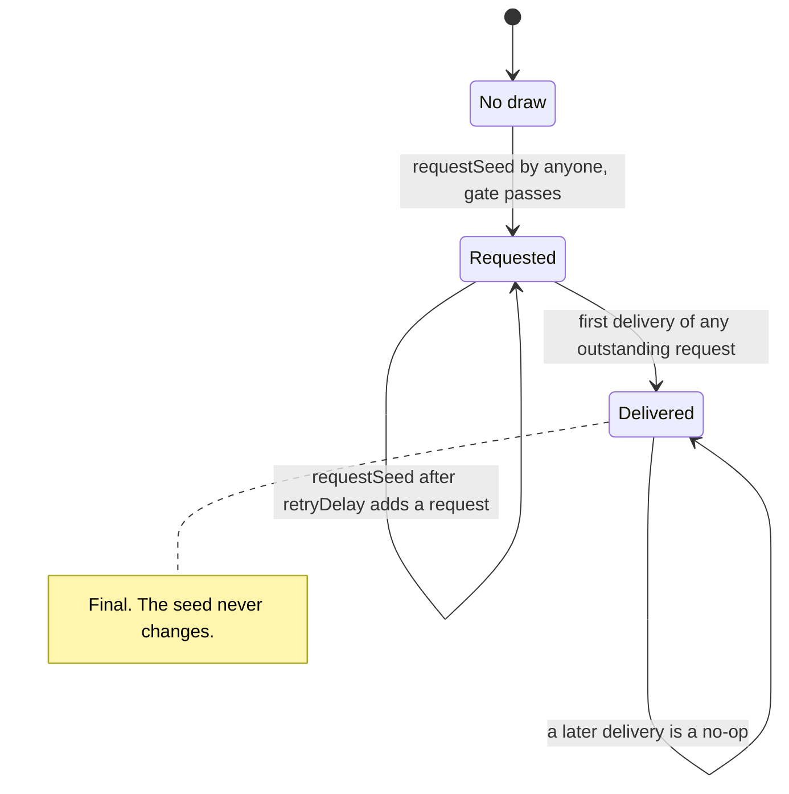
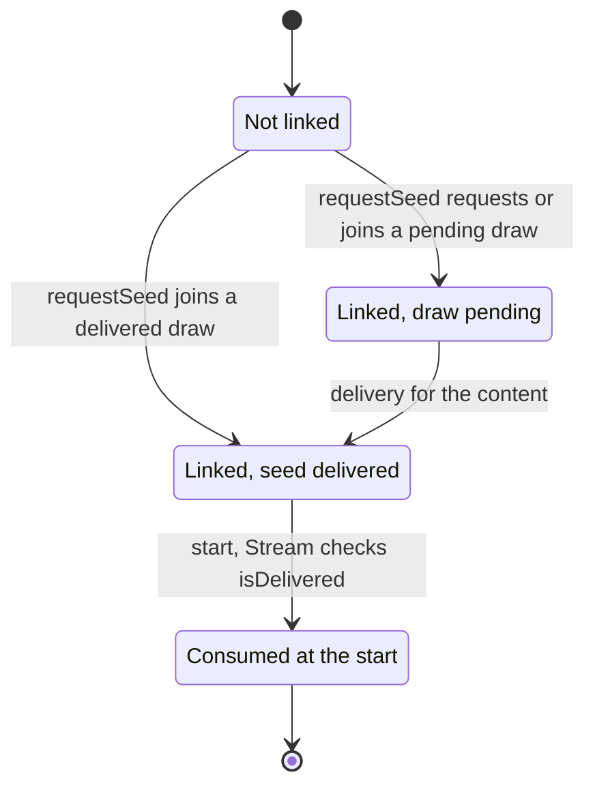
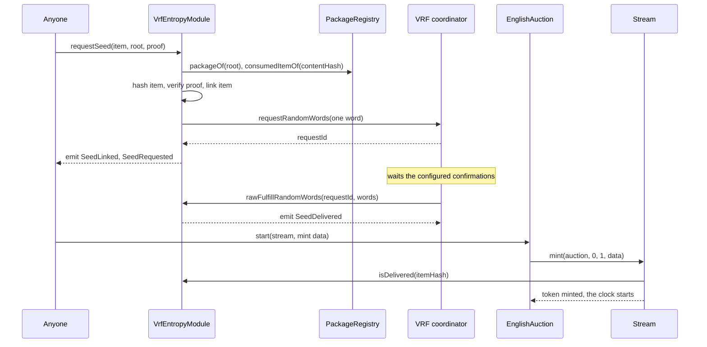
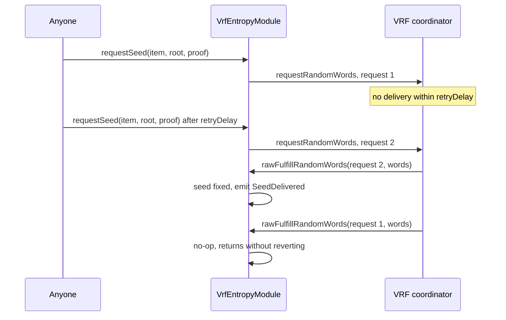
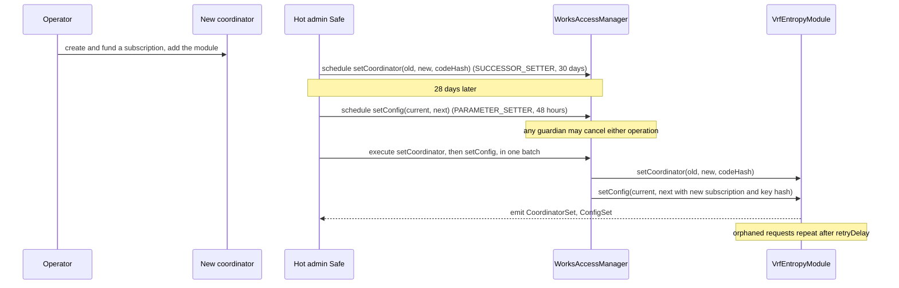

# Entropy (optional VRF seeds)

A seeded 1/1 on 6529 Stream gets its seed in one of two ways: the artist commits it in the
package, or the work opts into a Chainlink VRF v2.5 draw that is delivered before the work's
auction can start. This page covers the second way. `VrfEntropyModule` requests one random word
per work's content hash, stores the first delivery for good, and answers `isDelivered` and
`seedOf` by item hash; 6529 Stream refuses to start a VRF work until its seed is delivered. The
module is optional per deployment: 6529 Stream pins it immutably, or pins zero and refuses VRF
items. This page is for auditors, integrators, and the operators who run the VRF subscription.

> **Status.** Pre-audit. This page describes `main` at `c4b3355` (15 October 2026). The ADRs
> record how the design was decided; this page is how it works now. Where they differ, this
> page follows the code and says so under [Differences from the ADRs](#differences-from-the-adrs).

## Contracts

| Contract | Source | Interface | Responsibility |
| --- | --- | --- | --- |
| `VrfEntropyModule` | [`src/entropy/VrfEntropyModule.sol`](../../src/entropy/VrfEntropyModule.sol) | [`IEntropyModule`](../../src/interfaces/IEntropyModule.sol) | Gates and makes seed requests, links items to their content's draw, accepts the coordinator's delivery, answers `isDelivered`, `seedOf` and `requestOf`; governed `setConfig`, `lowerCallbackGasLimit` and `setCoordinator`. |
| `IVRFCoordinatorV2Plus` | [`src/entropy/IVRFCoordinatorV2Plus.sol`](../../src/entropy/IVRFCoordinatorV2Plus.sol) | none | The one coordinator function the module calls (`requestRandomWords`), declared locally: the repository has no Chainlink dependency. |
| `Stream` | [`src/stream/Stream.sol`](../../src/stream/Stream.sol) | [`IStream`](../../src/interfaces/IStream.sol) | Holds the module's address immutably (`entropyModule`); `mint` refuses a VRF item without a delivered seed. |
| `WorkRecords` | [`src/stream/WorkRecords.sol`](../../src/stream/WorkRecords.sol) | [`IWorkRecords`](../../src/interfaces/IWorkRecords.sol) | `seedOf(tokenId)` returns the work's seed: the stored ARTIST seed, or the module's seed by item hash. |
| `PackageRegistry` | [`src/curation/PackageRegistry.sol`](../../src/curation/PackageRegistry.sol) | [`IPackageRegistry`](../../src/interfaces/IPackageRegistry.sol) | Answers the request gate: is the root approved, is the content consumed. See [curation.md](curation.md). |

## Concepts

Terms used here are defined in the [glossary](../glossary.md).

### Seed policies

`PackageItem.seedPolicy` ([`PackageTypes.sol`](../../src/interfaces/types/PackageTypes.sol))
is part of the approved item, so it cannot change without a new approval.

| Policy | `seed` in the package | Where the seed comes from | When it is readable |
| --- | --- | --- | --- |
| `NONE` | zero | No seed. | `WorkRecords.seedOf` returns zero. |
| `ARTIST` (the default for seeded works) | nonzero, chosen by the artist | The package. `WorkRecords` stores it when the record opens. | After `openRecord`. The renderer shows it from then on (`test_ArtistSeedAppearsOnceTheRecordOpens`). |
| `VRF` | zero | `VrfEntropyModule`, drawn before the start. | From delivery, by item hash. The renderer shows it before and after the record opens. |

The package registry and 6529 Stream both require a nonzero seed exactly under `ARTIST`
(`PackageRegistry._checkTerms`, `Stream._checkItem`). Stream also refuses a `VRF` item when its
`entropyModule` is zero (`InvalidMintRequest`). Copies never get their own seeds.

### One draw per content hash

A draw is keyed by the item's `contentHash`, the package registry's uniqueness key, not by the
item hash (review finding DEPS-1). Every approved item that carries the same work (a revised
package, or the rightful artist's item after an upheld dispute released the content) reads the
same seed. A work has exactly one seed, whichever package lists it.

### The item link

Reads are keyed by item hash, through a link that `requestSeed` records
(`itemHash => contentHash`). The first `requestSeed` for an item links it and emits
`SeedLinked`. If its content already has a pending or delivered draw, the item only joins it:
the call returns zero and the coordinator is not asked. An item that never called `requestSeed`
reads as undelivered and cannot start, even if its content's seed exists. Joining costs one
storage slot and no oracle request (`test_Request_NewStorageSlots`).

### The request gate

Each request spends subscription funds, so `requestSeed` accepts only an item the network has
curated and that needs a seed. Anyone may call it; there is no role and no fee. Every failure is
`NotRequestable(itemHash)`:

1. `item.seedPolicy` is `VRF`, and `item.contentHash` is nonzero. The module hashes the whole
   item itself (`WorksHashing.itemHash`), so a policy flipped to `VRF` is a different,
   unapproved item.
2. `packageRegistry.packageOf(packageRoot)` is `APPROVED`. A guardian's `revokePackage` stops
   requests at once.
3. The proof has at most 32 hashes and places `WorksHashing.leaf(itemHash)` under the root.
4. `packageRegistry.consumedItemOf(item.contentHash)` is zero: no item, this one or another,
   has consumed the content.

The gate runs on every call, repeats included. The total possible spend is one draw per approved
VRF content, plus one repeat per `retryDelay` for each content whose draw never arrived.

### First delivery wins

Chainlink VRF v2.5 never expires a pending request on-chain, so a request can still be
delivered after a repeat was made. The module accepts a delivery for any request it made through
the current coordinator, as long as the content's seed is not fixed. The first delivery fixes
the seed. Every later delivery for that content returns without reverting, so the oracle's
fulfilment succeeds and nothing can be re-drawn. A repeat never invalidates an earlier request:
otherwise an observer who saw a disliked word pending in the mempool could front-run a repeat to
discard it. The seed is the random word unchanged, so anyone can check it against the oracle's
proof. A zero word is a valid seed; delivery is tracked by a flag.

### Retry delay

`retryDelay` is immutable, set at construction between 3 and 30 days. It is not an expiry. A
content whose latest request is still undelivered `retryDelay` seconds after it was made may be
requested again by anyone; earlier, `requestSeed` reverts with `RequestPending(itemHash,
retryAt)` (or, for an item joining the draw for the first time, links it and returns zero).

### Request memory per coordinator

Every request is remembered under the coordinator that issued it
(`coordinator => requestId => contentHash`), and never removed. Only the current coordinator may
call `rawFulfillRandomWords`, and only for a request ID it issued to this module. After a swap,
the old coordinator can no longer deliver, the new one cannot deliver what the old one issued,
and the two may use the same numbers, even across a swap from A to B and back to A. Requests the
old coordinator still held are orphaned and requested again after `retryDelay`. Delivered seeds
never change.

### How the seed is read

- **Start gate.** `Stream.mint` consumes the item through the package registry, then reverts
  with `SeedNotDelivered(itemHash)` if the item is `VRF` and
  `IEntropyModule(entropyModule).isDelivered(itemHash)` is false; the revert undoes the consume.
  The auction does not check the seed itself ([`EnglishAuction.sol`](../../src/sales/EnglishAuction.sol)).
- **Stream** stores the item hash and seed policy in the token record. It never stores a VRF seed.
- **`WorkRecords.seedOf(tokenId)`** (after `openRecord`) reads the item hash and policy from
  Stream and, for `VRF`, returns `IEntropyModule.seedOf(itemHash)`.
- **The renderer** reads the seed through `WorkRecords` once the record is open; before that it
  reads `IStream.entropyModule()` and then `seedOf(itemHash)` directly, with a bounded gas
  allowance ([`Renderer.sol`](../../src/content/Renderer.sol), `_seed`).
- **`requestOf(itemHash)`** returns the content's latest request ID (zero once delivered) and
  when it was made.

## State machine

### A content's draw

A coordinator swap leaves a pending draw pending: its requests are orphaned, and the next
repeat after `retryDelay` goes to the new coordinator.

### An item's link

Once the content is consumed, the gate refuses further requests for any item that carries it;
reads continue to work (`test_Gate_ConsumptionAfterDeliveryBlocksNothingRead`).

| Transition | Caller (role) | Delay | Function |
| --- | --- | --- | --- |
| Item linked; first request for a content | Anyone | none | `VrfEntropyModule.requestSeed` |
| Item joins a pending or delivered draw | Anyone | none | `VrfEntropyModule.requestSeed` (returns zero) |
| Repeat request | Anyone, once `retryDelay` has passed since the latest request | `retryDelay` (3 to 30 days) | `VrfEntropyModule.requestSeed` |
| Seed delivered | The current coordinator only | none | `VrfEntropyModule.rawFulfillRandomWords` |
| Work started | Anyone, through the auction | none | `EnglishAuction.start`, `Stream.mint` |
| Request parameters changed; gas limit raised | `PARAMETER_SETTER` | standard, 48 hours | `VrfEntropyModule.setConfig` |
| Gas limit lowered | `SUCCESSOR_SETTER` | successor, 30 days | `VrfEntropyModule.lowerCallbackGasLimit` |
| Coordinator replaced | `SUCCESSOR_SETTER` | successor, 30 days | `VrfEntropyModule.setCoordinator` |

Role mappings are from [`config/genesis.example.json`](../../config/genesis.example.json); see
[governance.md](governance.md). Guardians may cancel any scheduled operation during its delay.

## Flows

### Request, fulfil, start

- **Request.** The gate passes; the item is linked; the content's request time is written, then
  the coordinator is called with the current `keyHash`, `subscriptionId`, confirmations,
  callback gas limit, one word, and `extraArgs` tagged `VRF ExtraArgsV1` with the
  native-payment flag. The coordinator's request ID must be nonzero and unused for that
  coordinator (`InvalidRequestId`); it is recorded under the coordinator and stored as the
  content's current request.
- **Delivery.** Only the coordinator, whose code must still have the pinned hash, for a request
  ID it issued (`UnknownRequest`), with exactly one word (`InvalidRandomWords`). The word
  overwrites the request ID, so the callback creates no storage slot (DEPS-2).
- **Start.** The auction calls `Stream.mint`, which consumes the item and checks `isDelivered`.
  Nothing is in custody while a seed is outstanding, so a missing delivery delays a work but
  never strands one.
- **Reentrancy.** The request time is written before the coordinator is called and the request ID
  only after, so a reentrant `requestSeed` finds a pending request and the new ID cannot be
  delivered inside the call. A reentrant delivery of an earlier request is valid; the new request
  is then recorded but not announced, and no `SeedRequested` is emitted.
- **Gas.** A first request for a content creates 4 slots in the module (the item's link, the
  draw's two words and the request record); a joining item creates 1
  (`test_Request_NewStorageSlots`). On Sepolia r2, deployed from an earlier source,
  `requestSeed` used 171,149 Prague gas and both seeds arrived five blocks after the request
  ([flows.md, section 6](../../deployments/11155111/flows.md#6-vrf)). The request is off the
  start path; `start` of a VRF work measures 299,486 Prague gas against the 350,000
  budget, including the `isDelivered` read
  ([ADR 0004](../adr/0004-gas-budgets-under-glamsterdam.md#the-table)).

### Retry

- **Preconditions.** The gate passes; the seed is not delivered (`SeedAlreadyDelivered`
  otherwise); `block.timestamp >= requestedAt + retryDelay` (`RequestPending` otherwise).
- **Effects.** A new request under the current configuration and coordinator; the request time
  moves to now. Either request may deliver first; the other is a no-op
  (`test_RetryAfterThreeDaysAndFirstDeliveryWins`).
- **Causes.** An unfunded subscription, an oracle outage, a malformed delivery (which reverts and
  is absorbed by the coordinator), or a coordinator swap that orphaned the request.

### Coordinator change

6529 Stream pins the module immutably, so when Chainlink retires a coordinator the module must
follow it. A new coordinator needs a new subscription, so the change takes two
scheduled operations executed back to back
([`src/entropy/README.md`](../../src/entropy/README.md), "Operations").

- **Why one batch.** Between the two operations, a request would go to a coordinator that does not
  know the configured subscription (or the reverse) and revert. In the example genesis the hot
  admin Safe holds both setter roles ([`config/genesis.example.json`](../../config/genesis.example.json)),
  so it can execute both in one Safe transaction.
- **`setCoordinator` preconditions.** `expected` is the current coordinator
  (`ExpectedValueMismatch`); `next` differs from it, has code, is not an EIP-7702 delegated
  account (`InvalidCoordinator`), and has `nextCodeHash` (`CodeHashMismatch`). The coordinator
  has no ERC-165, so it gets the code and hash checks only. Unlike the curation verifier, a
  replaced coordinator is not retired: a swap back is allowed.
- **`setConfig` preconditions.** `expected` equals the whole current configuration
  (`ExpectedValueMismatch`), so a `lowerCallbackGasLimit` or another `setConfig` executed in
  between makes it revert; schedule it against the configuration that will be current.
- **Effects.** Delivered seeds are unaffected. Pending draws stay pending; their old requests
  can no longer deliver and are repeated after `retryDelay`.
- **Chainlink's `migrate` cannot be used.** It calls `setCoordinator(address)` on each consumer;
  this module has no such function.

### Lowering the callback gas limit

Chainlink can lower its coordinator's maximum callback gas. A limit above that maximum makes
every request revert at the coordinator, which would end VRF works for the deployment, because
6529 Stream pins the module (DEPS-5). `setConfig` only raises the limit, so a 48-hour setter
cannot starve the callback. `lowerCallbackGasLimit(expected, next)` lowers it in the 30-day
class: `expected` must equal the current limit, and `next` must be strictly lower and at least
`MIN_CALLBACK_GAS` (`InvalidConfig`)
(`test_ALoweredCoordinatorMaximumIsFollowedInTheSuccessorClass`).

## Rules and invariants

| ID | Rule | Enforced in | Proven by |
| --- | --- | --- | --- |
| ENT-1 | A request is accepted only for a `VRF` item with a nonzero content hash, placed by a proof of at most 32 hashes under an `APPROVED` root, whose content is unconsumed; checked on every call. | `VrfEntropyModule._requestable` | [`VrfEntropyModule.t.sol`](../../test/entropy/VrfEntropyModule.t.sol): `test_Gate_RejectsAnUnknownOrRevokedPackage`, `test_Gate_RejectsAnItemThatIsNotInThePackage`, `test_Gate_ATamperedItemIsADifferentItem`, `test_Gate_RejectsAnItemWhoseSeedPolicyIsNotVrf`, `test_Gate_ThePolicyCannotBeFlippedToVrf`, `test_Gate_RejectsAConsumedItem`, `test_Gate_RejectsAnOverlongProof`, `test_Gate_RejectsAnItemWithoutAContentHash`, `test_Gate_RevocationStopsARepeatButNotTheReads`; [`VrfEntropyFuzz.t.sol`](../../test/entropy/VrfEntropyFuzz.t.sol): `testFuzz_OnlyItemsOfAnApprovedPackageCanBeRequested`, `testFuzz_OnlyApprovedRootsPass`, `testFuzz_NonVrfItemsAreAlwaysRefused` |
| ENT-2 | One draw per content hash: every linked item carrying the content reads the same seed, and joining never asks the coordinator. | `VrfEntropyModule.requestSeed` | [`VrfEntropyModule.t.sol`](../../test/entropy/VrfEntropyModule.t.sol): `test_Content_TheFirstRequestLinksTheItem`, `test_Content_ASecondItemJoinsTheDeliveredDrawWithoutARequest`, `test_Content_ASecondItemJoinsAPendingDrawAndSharesItsClock`; [`VrfEntropyInvariant.t.sol`](../../test/entropy/VrfEntropyInvariant.t.sol): `invariant_ItemsThatShareContentReadOneSeed`; [`VrfWork.t.sol`](../../test/integration/VrfWork.t.sol): `test_ARevisionOfTheWorkReadsTheSameSeed`, `test_ARevisionJoinsAPendingDraw`; [`Dispute.t.sol`](../../test/integration/Dispute.t.sol): `test_TheRightfulVrfItemReadsTheContentsSeed` |
| ENT-3 | An item never linked reads as undelivered; `seedOf` reverts until delivery. | `VrfEntropyModule.isDelivered`, `seedOf` | [`VrfEntropyModule.t.sol`](../../test/entropy/VrfEntropyModule.t.sol): `test_Content_AnUnlinkedItemReadsAsUndelivered`, `test_SeedOf_RevertsBeforeDelivery` |
| ENT-4 | The first delivery fixes the seed for good; a later delivery for the content is a no-op that does not revert; no request is accepted after delivery. | `VrfEntropyModule.rawFulfillRandomWords`, `requestSeed` | [`VrfEntropyModule.t.sol`](../../test/entropy/VrfEntropyModule.t.sol): `test_Fulfill_TheFirstDeliveryWinsInEitherOrder`, `test_Fulfill_ADoubleFulfilIsANoOp`, `test_Fulfill_ALateDeliverySucceedsAtTheCoordinator`, `test_NoRequestAfterDelivery`; [`VrfEntropyFuzz.t.sol`](../../test/entropy/VrfEntropyFuzz.t.sol): `testFuzz_TheFirstDeliveryOfManyRequestsWins`, `testFuzz_SeedIsTheDeliveredWord`; [`VrfEntropyInvariant.t.sol`](../../test/entropy/VrfEntropyInvariant.t.sol): `invariant_AtMostOneSeedPerItemAndItNeverChanges` |
| ENT-5 | A repeat is possible only once `retryDelay` has passed since the latest request; it adds a request and never invalidates an earlier one. | `VrfEntropyModule.requestSeed` | [`VrfEntropyModule.t.sol`](../../test/entropy/VrfEntropyModule.t.sol): `test_Repeat_BeforeTheTimeoutReverts`, `test_Repeat_AfterTheTimeoutIsOpenToAnyone`, `test_Repeat_EveryOutstandingRequestMayDeliverAndTheFirstWins`, `test_Fulfill_AnEarlierRequestStillDeliversAfterARepeat`, `test_Fulfill_ARepeatCannotDiscardAPendingDelivery`, `test_Repeat_UsesTheCurrentConfiguration`, `test_Repeat_OfOneItemLeavesOthersUntouched`; [`VrfEntropyFuzz.t.sol`](../../test/entropy/VrfEntropyFuzz.t.sol): `testFuzz_RetryWindow`; [`VrfEntropyInvariant.t.sol`](../../test/entropy/VrfEntropyInvariant.t.sol): `invariant_TheCurrentRequestIsTheLastIssued` |
| ENT-6 | Only the current coordinator delivers, only a request it issued to this module, with exactly one word. | `VrfEntropyModule.rawFulfillRandomWords` | [`VrfEntropyModule.t.sol`](../../test/entropy/VrfEntropyModule.t.sol): `test_Fulfill_OnlyTheCoordinatorMay`, `test_Fulfill_AnUnissuedRequestIdReverts`, `test_Fulfill_ExactlyOneWordIsRequired`, `test_Fulfill_AMalformedDeliveryRevertsAndTheItemStaysUndelivered`; [`VrfEntropyFuzz.t.sol`](../../test/entropy/VrfEntropyFuzz.t.sol): `testFuzz_OnlyTheCoordinatorMayFulfill`, `testFuzz_UnissuedRequestIdsNeverDeliver`, `testFuzz_RequestIdsRouteToTheirOwnItems` |
| ENT-7 | The coordinator's pinned code hash is checked at install, at every request and at every delivery. | `VrfEntropyModule._checkCodeHash` | [`VrfEntropyModule.t.sol`](../../test/entropy/VrfEntropyModule.t.sol): `test_Constructor_PinsTheCoordinatorCodeHash`, `test_Pin_ACoordinatorWhoseCodeChangedIsRefused`; [`VrfEntropyGovernance.t.sol`](../../test/entropy/VrfEntropyGovernance.t.sol): `test_SetCoordinator_PinsTheCodeHash` |
| ENT-8 | Request IDs are scoped to their coordinator: a swap orphans the old coordinator's requests, the new one cannot deliver them, and delivered seeds survive. | `VrfEntropyModule._requests`, `rawFulfillRandomWords` | [`VrfEntropyGovernance.t.sol`](../../test/entropy/VrfEntropyGovernance.t.sol): `test_SetCoordinator_OldCoordinatorCanNoLongerDeliver`, `test_SetCoordinator_OrphanedRequestIsRerequestedThroughTheNewOne`, `test_SetCoordinator_RequestIdsAreScopedToTheirCoordinator`, `test_SetCoordinator_DeliveredSeedsSurviveTheSwap`; [`VrfEntropyModule.t.sol`](../../test/entropy/VrfEntropyModule.t.sol): `test_Repeat_RequestIdsDoNotMixAcrossCoordinators` |
| ENT-9 | `setCoordinator` is `SUCCESSOR_SETTER` (30 days), compare-and-set, never a no-op, and refuses a codeless or delegated coordinator. | `VrfEntropyModule.setCoordinator`; genesis role map | [`VrfEntropyGovernance.t.sol`](../../test/entropy/VrfEntropyGovernance.t.sol): `test_SetCoordinator_SwapsAndEmits`, `test_SetCoordinator_NeedsTheSuccessorClassRole`, `test_SetCoordinator_RejectsStaleAndCodelessValues`, `test_SetCoordinator_ASwapToTheCurrentCoordinatorIsRefused`; [`VrfEntropyManaged.t.sol`](../../test/entropy/VrfEntropyManaged.t.sol): `test_SetCoordinatorIsInTheSuccessorClass`, `test_AGuardianCancelsAPendingCoordinatorSwap` |
| ENT-10 | `setConfig` is `PARAMETER_SETTER` (48 hours), compare-and-set on the whole configuration, within bounds; the callback gas limit only rises, at most doubling per step, never above 2,500,000. | `VrfEntropyModule.setConfig`, `_validate`; `BoundedParameter.raise` | [`VrfEntropyGovernance.t.sol`](../../test/entropy/VrfEntropyGovernance.t.sol): `test_SetConfig_UpdatesAndEmits`, `test_SetConfig_NeedsTheStandardClassRole`, `test_SetConfig_StaleExpectedValueReverts`, `test_SetConfig_AnUnchangedGasLimitIsAllowed`, `test_SetConfig_GasLimitCanOnlyBeRaised`, `test_SetConfig_GasLimitAtMostDoublesPerStep`, `test_SetConfig_RejectsInvalidFields`, `testFuzz_SetConfig_GasLimitRule`, `test_SetConfig_ScheduledThroughTheManagerAndStaleOperationsRevert`; [`VrfEntropyManaged.t.sol`](../../test/entropy/VrfEntropyManaged.t.sol): `test_SetConfigIsInTheStandardClass` |
| ENT-11 | `lowerCallbackGasLimit` is `SUCCESSOR_SETTER` (30 days), compare-and-set, strictly lower, never below 100,000. | `VrfEntropyModule.lowerCallbackGasLimit` | [`VrfEntropyManaged.t.sol`](../../test/entropy/VrfEntropyManaged.t.sol): `test_ALoweredCoordinatorMaximumIsFollowedInTheSuccessorClass`, `test_ALoweringStaysAboveTheFloorAndBelowTheCurrentLimit`, `test_OnlyTheSettersCanCallTheGovernedFunctions` |
| ENT-12 | A `VRF` work starts only once its item's seed is delivered, and only on a Stream deployed with an entropy module. | `Stream.mint`, `Stream._checkItem` | [`Stream.t.sol`](../../test/stream/Stream.t.sol): `test_mint_vrfNeedsDeliveredSeed`, `test_mint_vrfRejectedWithoutEntropyModule`; [`VrfWork.t.sol`](../../test/integration/VrfWork.t.sol): `test_SeedRequestedDeliveredThenStartedAndRendered` |
| ENT-13 | The callback creates no storage slot and its cost stays at most half the 100,000 floor under Glamsterdam pricing. | `VrfEntropyModule.rawFulfillRandomWords` | [`VrfEntropyModule.t.sol`](../../test/entropy/VrfEntropyModule.t.sol): `test_Callback_CreatesNoStorageSlot`, `test_Callback_UsesUnderHalfTheFloorUnderGlamsterdam`, `test_Callback_GasStaysUnderTheConfiguredLimit` |
| ENT-14 | A reentrant call during a request cannot deliver the new request or overwrite a seed delivered meanwhile. | `VrfEntropyModule.requestSeed` | [`VrfEntropyModule.t.sol`](../../test/entropy/VrfEntropyModule.t.sol): `test_Request_ReentrancyFromTheCoordinatorFindsNothingToUse`, `test_Repeat_AnEarlierRequestDeliveredDuringTheRepeatIsNotOverwritten` |
| ENT-15 | A coordinator's request ID must be nonzero and unused; a failing coordinator leaves no state. | `VrfEntropyModule.requestSeed` | [`VrfEntropyModule.t.sol`](../../test/entropy/VrfEntropyModule.t.sol): `test_Request_RejectsAZeroRequestId`, `test_Request_RejectsADuplicateRequestId`, `test_Request_CoordinatorFailureLeavesNoState` |
| ENT-16 | Installation checks: `retryDelay` within 3 to 30 days; a valid configuration; the registry has code, is not delegated, answers ERC-165 for `IPackageRegistry` and has its pinned code hash. | `VrfEntropyModule` constructor | [`VrfEntropyModule.t.sol`](../../test/entropy/VrfEntropyModule.t.sol): `test_Constructor_RejectsBadRetryDelay`, `test_Constructor_TheMinimumRetryDelayIsThreeDays`, `test_Constructor_RejectsAnInvalidCoordinator`, `test_Constructor_RejectsARegistryWithoutErc165Support`, `test_Constructor_PinsTheRegistryCodeHash`, `test_Constructor_RejectsADelegatedRegistry`, `test_Constructor_RejectsInvalidConfig` |
| ENT-17 | Anyone may request, under the real AccessManager; nothing is payable. | `VrfEntropyModule` | [`VrfEntropyManaged.t.sol`](../../test/entropy/VrfEntropyManaged.t.sol): `test_AnyoneMayRequestASeedUnderTheRealManager`, `test_NothingIsPayable`; [`VrfEntropyModule.t.sol`](../../test/entropy/VrfEntropyModule.t.sol): `test_Request_NoRoleIsNeeded`, `test_Request_IsNonPayable` |

## Events

| Event | Contract | Emitted when | Notes |
| --- | --- | --- | --- |
| `SeedLinked(bytes32 indexed itemHash, bytes32 indexed contentHash)` | `VrfEntropyModule` | An item is linked to its content's draw, on its first `requestSeed`. | Once per item. |
| `SeedRequested(bytes32 indexed itemHash, uint256 requestId)` | `VrfEntropyModule` | A request (first or repeat) is made and the seed is still undelivered when the call returns. | Not emitted when an item only joins, or when a reentrant delivery fixed the seed during the call. |
| `SeedDelivered(bytes32 indexed contentHash, uint256 requestId, bytes32 seed)` | `VrfEntropyModule` | The first delivery for a content. | Keyed by content hash; map items through `SeedLinked`. |
| `CoordinatorSet(address previous, address next, bytes32 codeHash)` | `VrfEntropyModule` | Construction (previous zero) and every swap. | |
| `ConfigSet(VrfConfig previous, VrfConfig next)` | `VrfEntropyModule` | Construction (previous all zero), `setConfig`, `lowerCallbackGasLimit`. | |
| `WorkMinted(...)` | `Stream` | The start of any work, VRF included. | Carries the item hash and content hash; see [stream-and-auctions.md](stream-and-auctions.md). |

## Failure modes and recovery

| Failure | Effect | Recovery |
| --- | --- | --- |
| The oracle does not deliver (outage, unfunded subscription). | The work cannot start. Nothing is in custody. | Fund the subscription; anyone repeats the request after `retryDelay`. |
| A delivery is malformed (not exactly one word). | It reverts and the coordinator absorbs the failure; the content stays undelivered. | A repeat after `retryDelay`. |
| Code at the coordinator's address no longer has the pinned hash. | Requests and deliveries revert with `CodeHashMismatch`. | `setCoordinator` to a reviewed coordinator (30 days), with the subscription runbook. |
| Chainlink lowers the coordinator's maximum callback gas below the module's limit. | Every request reverts at the coordinator. | `lowerCallbackGasLimit` (30 days), never below 100,000. |
| Chainlink retires the coordinator. | No new requests; pending requests may never deliver. | The coordinator change above; orphaned requests repeat after `retryDelay`. |
| A request was made before its root was revoked. | It still delivers. | None needed: the item can no longer mint. |
| A media revision of a VRF work is approved. | It is a new content hash and draws a new seed. | The curation runbook revokes the old root before approving such a revision ([curation.md](curation.md)). |
| A mistaken `setConfig` or `setCoordinator` is scheduled. | It would take effect after its delay. | Any guardian cancels it; compare-and-set makes stale operations revert. |
| The old subscription has a request that never delivers. | The coordinator is expected to refuse to cancel a subscription with a pending request (the entropy README asks operators to confirm this against Chainlink's documentation), and VRF v2.5 never expires the request. | Keep the old subscription funded until its requests deliver; do not count on recovering its balance quickly. |

### Accepted residual risks

- **Ordering of two outstanding deliveries.** While two requests for one content are outstanding,
  whoever orders their deliveries (a searcher or a block builder) chooses which of two
  independent random words becomes the seed. The 3-day minimum `retryDelay` keeps that window
  rare; it is not closed.
- **A hostile approved package drains the subscription.** A package with many VRF items can spend
  one draw per content, plus repeats, until a guardian revokes it
  ([ADR 0003, "Security impact"](../adr/0003-build-time-decisions.md#security-impact)). A
  dedicated subscription with a modest, topped-up balance bounds the loss
  ([`src/entropy/README.md`](../../src/entropy/README.md)).

### Subscription operations

- **Use a dedicated subscription,** with this module as its only consumer. A shared subscription
  can be drained by its other consumers, which the module cannot see or limit.
- **Add the module as a consumer** before the first request; the subscription pays, never the
  caller.
- **Keep the balance modest and topped up.** The gate bounds spend per approved VRF content; the
  balance bounds what a hostile package can spend before a guardian revokes it.
- **Do not use Chainlink's `migrate`.** Change coordinators with the two scheduled operations.
- **On Sepolia,** each instance has its own subscription, paid in native currency, with a 200,000
  callback gas limit and 3 confirmations; the entropy module is its only consumer
  ([`deployments/11155111/README.md`](../../deployments/11155111/README.md)).

## Parameters and limits

| Parameter | Value | Source |
| --- | --- | --- |
| Callback gas limit floor | 100,000 | `VrfEntropyModule.MIN_CALLBACK_GAS` |
| Callback gas limit ceiling | 2,500,000 | `VrfEntropyModule.MAX_CALLBACK_GAS` |
| Callback gas limit raise step | at most 2x per `setConfig` | `BoundedParameter.raise`, [`BoundedParameter.sol`](../../src/governance/BoundedParameter.sol) |
| Confirmations | 3 to 200 | `MIN_CONFIRMATIONS`, `MAX_CONFIRMATIONS` |
| `retryDelay` (immutable) | 3 days to 30 days | `MIN_RETRY_DELAY`, `MAX_RETRY_DELAY` |
| Proof length | at most 32 hashes | `MAX_PROOF_LENGTH` |
| Subscription ID, key hash | nonzero | `VrfEntropyModule._validate` |
| Words per request | 1 | `VrfEntropyModule.requestSeed` |
| `extraArgs` tag | `0x92fd1338`, `bytes4(keccak256("VRF ExtraArgsV1"))` | `EXTRA_ARGS_V1_TAG`; `test_ExtraArgsTagIsTheV25Tag` |
| Deploy defaults | callback gas 200,000; 3 confirmations; `retryDelay` 3 days; LINK payment unless `VRF_NATIVE_PAYMENT=1` | [`script/Deploy.s.sol`](../../script/Deploy.s.sol) |
| Deploying without VRF | an explicit `NO_VRF=1` off a local chain | [`script/Deploy.s.sol`](../../script/Deploy.s.sol); `test_ReviewPoC_TheEntropyModuleIsAnExplicitChoice` |
| `setConfig` | `PARAMETER_SETTER`, 48 hours | [`config/genesis.example.json`](../../config/genesis.example.json) |
| `setCoordinator`, `lowerCallbackGasLimit` | `SUCCESSOR_SETTER`, 30 days | [`config/genesis.example.json`](../../config/genesis.example.json) |
| Callback cost | about 34,000 gas under Glamsterdam, no new slot | [ADR 0004, "Security impact"](../adr/0004-gas-budgets-under-glamsterdam.md#security-impact) |
| `start` of a VRF work | 299,486 Prague gas, 6 new slots, 350,000 budget | [ADR 0004](../adr/0004-gas-budgets-under-glamsterdam.md#the-table) |

## Differences from the ADRs

- **When randomness is requested.** ADR 0001 §9 has the start transaction request randomness
  and the 24-hour clock start when the seed is delivered. The code requests before any token
  exists, and `start` requires a delivered seed; the clock starts at the start (decision D4;
  [ADR 0003, "Sales and auctions"](../adr/0003-build-time-decisions.md#sales-and-auctions-amends-adr-0001-5-6-and-9)).
- **Re-requests.** ADR 0001 §9 says a request that never delivered may be re-requested. The
  code makes a repeat additive after `retryDelay` (at least 3 days): every outstanding request
  may deliver and the first delivery wins (ADR 0003).
- **What a draw is keyed by.** ADR 0001 §9 speaks of a module "enabled per work". The code draws
  once per content hash, shared by every approved item that carries the content (DEPS-1, ADR
  0003); the deployment enables the module once, and each item opts in with `SeedPolicy.VRF`.
- **Raise-only gas parameters.** ADR 0001 §13.9 makes gas parameters raise-only. The callback gas
  limit can also be lowered, in the 30-day class and never below 100,000 (DEPS-5, ADR 0003).
- **Spend bound.** ADR 0003's security impact says a hostile approved package can spend "one
  randomness draw per VRF item". Since DEPS-1 the bound is one draw per VRF content, plus one
  repeat per `retryDelay` for each content whose draw has not arrived.
- **Callback storage.** The Sepolia measurement (r1, about 62% of a 200,000-gas limit) was taken
  when the callback wrote one new slot, and the Sepolia flows record still describes it that
  way. Since DEPS-2 the seed overwrites the request ID and the callback creates no slot, as
  [ADR 0004, "Security impact"](../adr/0004-gas-budgets-under-glamsterdam.md#security-impact)
  records.

## References

- Code: [`VrfEntropyModule.sol`](../../src/entropy/VrfEntropyModule.sol),
  [`IVRFCoordinatorV2Plus.sol`](../../src/entropy/IVRFCoordinatorV2Plus.sol),
  [`IEntropyModule.sol`](../../src/interfaces/IEntropyModule.sol),
  [`BoundedParameter.sol`](../../src/governance/BoundedParameter.sol),
  [`Stream.sol`](../../src/stream/Stream.sol), [`WorkRecords.sol`](../../src/stream/WorkRecords.sol),
  [`src/entropy/README.md`](../../src/entropy/README.md).
- ADRs: [ADR 0001 §9](../adr/0001-v1-scope.md#9-seeded-and-generative-11s),
  [ADR 0003, "Sales and auctions"](../adr/0003-build-time-decisions.md#sales-and-auctions-amends-adr-0001-5-6-and-9),
  [ADR 0003, "Security impact"](../adr/0003-build-time-decisions.md#security-impact),
  [ADR 0004, "Security impact"](../adr/0004-gas-budgets-under-glamsterdam.md#security-impact).
- Tests: [`test/entropy/`](../../test/entropy/),
  [`VrfWork.t.sol`](../../test/integration/VrfWork.t.sol),
  [`Dispute.t.sol`](../../test/integration/Dispute.t.sol),
  [`Stream.t.sol`](../../test/stream/Stream.t.sol). How to run them:
  [testing docs](https://github.com/6529-Collections/6529-works/blob/main/docs/testing/README.md).
- Related pages: [curation.md](curation.md), [stream-and-auctions.md](stream-and-auctions.md),
  [rendering-and-tokenuri.md](rendering-and-tokenuri.md), [governance.md](governance.md),
  [Sepolia flows, section 6](../../deployments/11155111/flows.md#6-vrf).
