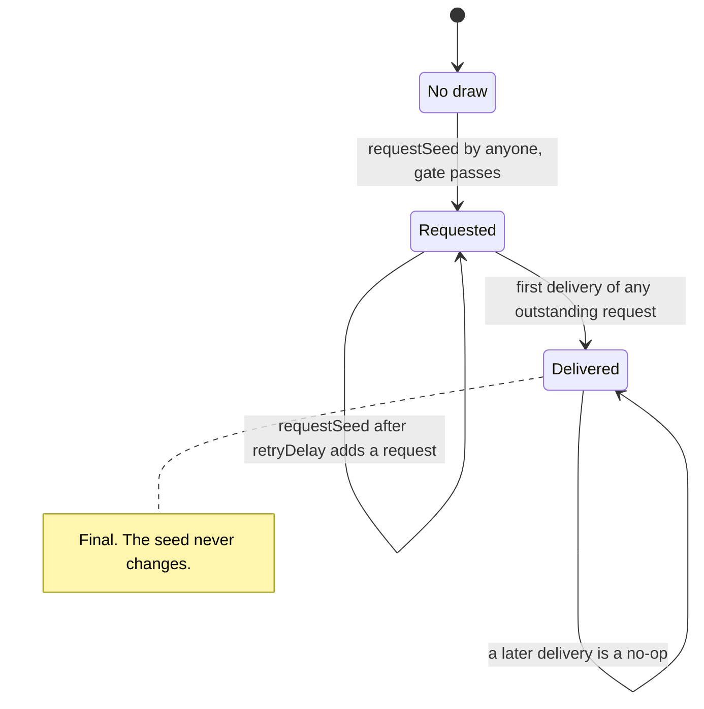
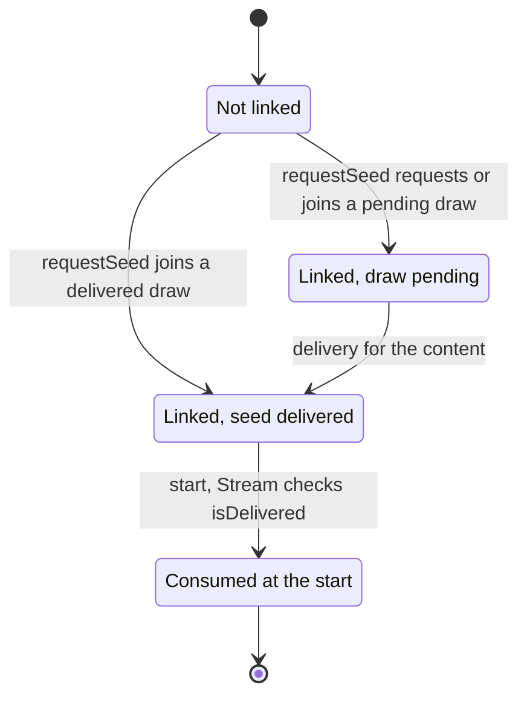
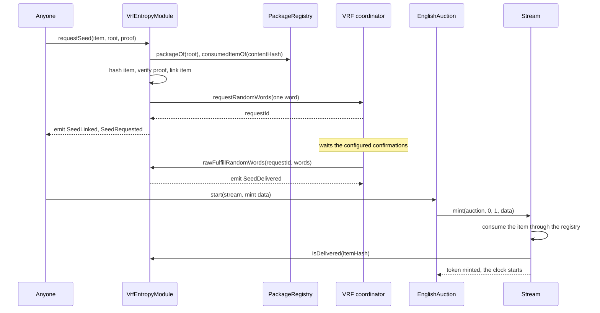
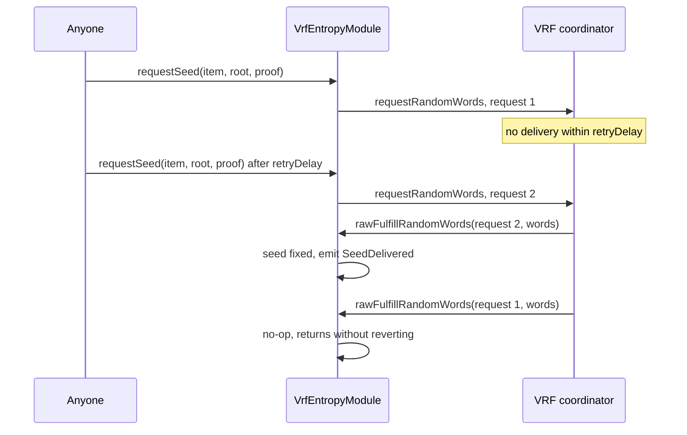
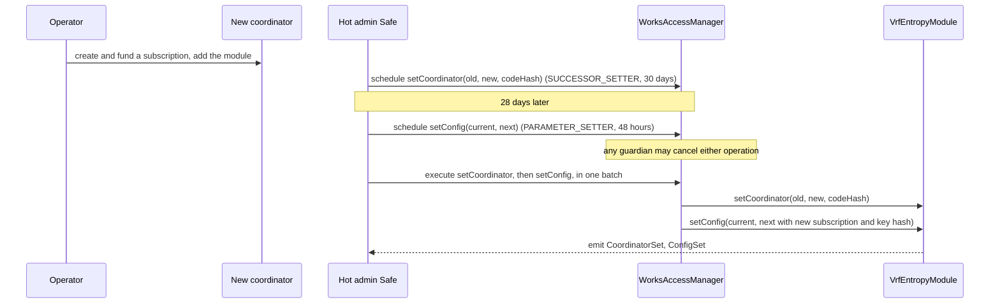

# Entropy (optional VRF seeds)

A seeded 1/1 on 6529 Stream gets its seed in one of two ways: the artist commits it in the
package, or the work opts into a Chainlink VRF v2.5 draw that is delivered before the work's
auction can start. This page covers the second way. `VrfEntropyModule` requests one random word
per work's content hash, stores the first delivery for good, and answers `isDelivered` and
`seedOf` by item hash; 6529 Stream refuses to start a VRF work until its seed is delivered. The
module is optional per deployment: 6529 Stream pins it immutably, or pins zero and refuses VRF
items. This page is for auditors, integrators, and the operators who run the VRF subscription.

> Pre-audit. See the [project status](../../README.md#status).

## Contracts

| Contract | Source | Interface | Responsibility |
| --- | --- | --- | --- |
| `VrfEntropyModule` | [`src/entropy/VrfEntropyModule.sol`](../../src/entropy/VrfEntropyModule.sol) | [`IEntropyModule`](../../src/interfaces/IEntropyModule.sol) | Gates and makes seed requests, links items to their content's draw, accepts the coordinator's delivery, answers `isDelivered`, `seedOf` and `requestOf`; governed `setConfig`, `lowerCallbackGasLimit` and `setCoordinator`. |
| `IVRFCoordinatorV2Plus` | [`src/entropy/IVRFCoordinatorV2Plus.sol`](../../src/entropy/IVRFCoordinatorV2Plus.sol) | none | The one coordinator function the module calls (`requestRandomWords`), declared locally: the repository has no Chainlink dependency. |
| `Stream` | [`src/stream/Stream.sol`](../../src/stream/Stream.sol) | [`IStream`](../../src/interfaces/IStream.sol) | Holds the module's address immutably (`entropyModule`); `mint` refuses a VRF item without a delivered seed. |
| `WorkRecords` | [`src/stream/WorkRecords.sol`](../../src/stream/WorkRecords.sol) | [`IWorkRecords`](../../src/interfaces/IWorkRecords.sol) | `seedOf(tokenId)` returns the work's seed: the stored ARTIST seed, or the module's seed by item hash. |
| `PackageRegistry` | [`src/curation/PackageRegistry.sol`](../../src/curation/PackageRegistry.sol) | [`IPackageRegistry`](../../src/interfaces/IPackageRegistry.sol) | Answers the request gate: is the root approved, is the content consumed. See [curation.md](curation.md). |

## Concepts

[Seed](../glossary.md#seed), [seed policy](../glossary.md#seed-policy),
[VRF](../glossary.md#vrf) and [entropy module](../glossary.md#entropy-module) are defined in the
glossary.

### Seed policies

`PackageItem.seedPolicy` ([`PackageTypes.sol`](../../src/interfaces/types/PackageTypes.sol))
is part of the approved item, so it cannot change without a new approval.

| Policy | `seed` in the package | Source of the seed | Readable |
| --- | --- | --- | --- |
| `NONE` | zero | No seed. | `WorkRecords.seedOf` returns zero. |
| `ARTIST` (the default for seeded works) | nonzero, chosen by the artist | The package; `WorkRecords` stores it when the record opens. | After `openRecord` (`test_ArtistSeedAppearsOnceTheRecordOpens`). |
| `VRF` | zero | `VrfEntropyModule`, drawn before the start. | From delivery, by item hash, before and after the record opens. |

The package registry and 6529 Stream both require a nonzero seed exactly under `ARTIST`; Stream
also refuses a `VRF` item when its `entropyModule` is zero (`InvalidMintRequest`). Copies never get
their own seeds.

### One draw per content hash

A draw is keyed by the item's `contentHash`, the package registry's uniqueness key, not by the
item hash (review finding DEPS-1). Every approved item that carries the same work (a revised
package, or the rightful artist's item after an upheld dispute released the content) reads the
same seed.

### The item link

Reads are keyed by item hash, through a link (`itemHash => contentHash`) that `requestSeed`
records on an item's first call, emitting `SeedLinked`. If the content already has a pending or
delivered draw, the item only joins it: the call returns zero and the coordinator is not asked.
An item that never called `requestSeed` reads as undelivered and cannot start, even if its
content's seed exists.

### The request gate

Each request spends subscription funds, so `requestSeed` accepts only a curated item that needs
a seed. Anyone may call it; there is no role and no fee. Every failure is
`NotRequestable(itemHash)`:

1. `item.seedPolicy` is `VRF` and `item.contentHash` is nonzero. The module hashes the whole item
   itself, so a policy flipped to `VRF` is a different, unapproved item.
2. `packageRegistry.packageOf(packageRoot)` is `APPROVED`, so a guardian's `revokePackage` stops
   requests at once.
3. The proof has at most 32 hashes and places the item's leaf under the root.
4. `packageRegistry.consumedItemOf(item.contentHash)` is zero: no item has consumed the content.

The gate runs on every call, repeats included.

### First delivery wins

Chainlink VRF v2.5 never expires a pending request. The module accepts a delivery for any
request it made through the current coordinator until the content's seed is fixed; later
deliveries return without reverting, so the oracle's fulfilment succeeds and nothing is
re-drawn. A repeat never invalidates an earlier request, or an observer who saw a disliked word
pending could front-run a repeat to discard it. The seed is the random word unchanged, checkable
against the oracle's proof; a zero word is valid, since delivery is a flag.

### Retry delay

`retryDelay` is immutable, between 3 and 30 days. It is not an expiry: once a content's latest
request is `retryDelay` old and undelivered, anyone may request again. Earlier, `requestSeed`
reverts with `RequestPending(itemHash, retryAt)`, or, for an item joining for the first time,
links it and returns zero.

### Request memory per coordinator

Every request is remembered under the coordinator that issued it
(`coordinator => requestId => contentHash`), never removed, and only the current coordinator
delivers, only its own requests. After a swap (even A to B and back to A) neither coordinator can
deliver the other's requests; a pending draw stays pending and is repeated after `retryDelay`
through the new one. Delivered seeds never change.

### How the seed is read

- **Start gate.** `Stream.mint` consumes the item through the package registry, then reverts
  with `SeedNotDelivered(itemHash)` if the item is `VRF` and `isDelivered(itemHash)` is false; the
  revert undoes the consume. The auction does not check the seed itself.
- **Reads.** Stream never stores a VRF seed. `WorkRecords.seedOf(tokenId)` (after `openRecord`)
  returns the module's `seedOf(itemHash)`; before the record opens the renderer reads
  `IStream.entropyModule()` directly, with a bounded gas allowance
  ([`Renderer.sol`](../../src/content/Renderer.sol), `_seed`).
- **`requestOf(itemHash)`** returns the content's latest request ID (zero once delivered) and
  when it was made.

## State machine

### A content's draw

### An item's link

Once the content is consumed, the gate refuses further requests for any item that carries it;
reads continue to work (`test_Gate_ConsumptionAfterDeliveryBlocksNothingRead`).

| Transition | Caller (role) | Delay | Function |
| --- | --- | --- | --- |
| Item linked; first request for a content | Anyone | none | `VrfEntropyModule.requestSeed` |
| Item joins a pending or delivered draw | Anyone | none | `VrfEntropyModule.requestSeed` (returns zero) |
| Repeat request | Anyone, once `retryDelay` has passed since the latest request | `retryDelay` (3 to 30 days) | `VrfEntropyModule.requestSeed` |
| Seed delivered | The current coordinator only | none | `VrfEntropyModule.rawFulfillRandomWords` |
| Work started | Anyone, through the auction | none | `EnglishAuction.start`, `Stream.mint` |
| Request parameters changed; gas limit raised | `PARAMETER_SETTER` | standard, 48 hours | `VrfEntropyModule.setConfig` |
| Gas limit lowered | `SUCCESSOR_SETTER` | successor, 30 days | `VrfEntropyModule.lowerCallbackGasLimit` |
| Coordinator replaced | `SUCCESSOR_SETTER` | successor, 30 days | `VrfEntropyModule.setCoordinator` |

Role mappings are from [`config/genesis.example.json`](../../config/genesis.example.json); the
selector matrix is [roles.md](../audit/roles.md). Guardians may cancel any scheduled operation
during its delay.

## Flows

### Request, fulfil, start

- **Request.** The request time is written, then the coordinator is called with the current
  configuration, one word and `VRF ExtraArgsV1` carrying the native-payment flag. The returned
  ID must be nonzero and unused for that coordinator (`InvalidRequestId`).
- **Delivery.** Only the coordinator, whose code must still have the pinned hash, for a request
  ID it issued (`UnknownRequest`), with exactly one word (`InvalidRandomWords`). The word
  overwrites the request ID, so the callback creates no storage slot (DEPS-2).
- **Reentrancy.** The request ID is stored only after the coordinator returns, so a reentrant
  `requestSeed` finds a pending request and the new ID cannot be delivered inside the call. A
  reentrant delivery of an earlier request is valid; the new request is then recorded but not
  announced (no `SeedRequested`).
- **Gas.** A first request for a content creates 4 slots in the module, a joining item 1
  (`test_Request_NewStorageSlots`). The request is off the start path; `start` of a VRF work
  measures 299,486 Prague gas against the 350,000 budget, the `isDelivered` read included
  ([ADR 0004](../adr/0004-gas-budgets-under-glamsterdam.md#the-table)). Sepolia figures are in
  [flows.md, section 6](../../deployments/11155111/flows.md#6-vrf).

### Retry

- **Preconditions.** The gate passes; the seed is not delivered (`SeedAlreadyDelivered`);
  `block.timestamp >= requestedAt + retryDelay` (`RequestPending`).
- **Effects.** A new request under the current configuration and coordinator; the request time
  moves to now.

### Coordinator change

6529 Stream pins the module immutably, so when Chainlink retires a coordinator the module must
follow it. A new coordinator needs a new subscription, so the change takes two scheduled
operations executed back to back ([`src/entropy/README.md`](../../src/entropy/README.md),
"Operations").

- **Why one batch.** Between the two, a request would go to a coordinator that does not know the
  configured subscription, and revert. In the example genesis the hot admin Safe holds both
  setter roles, so one Safe transaction executes both.
- **`setCoordinator`.** `expected` is the current coordinator (`ExpectedValueMismatch`); `next`
  differs from it, has code, is not EIP-7702 delegated (`InvalidCoordinator`), and has
  `nextCodeHash` (`CodeHashMismatch`). The coordinator has no ERC-165. Unlike the curation
  verifier, a replaced coordinator is not retired: a swap back is allowed.
- **`setConfig`.** `expected` equals the whole current configuration (`ExpectedValueMismatch`), so
  schedule it against the configuration that will be current when it executes.
- **Chainlink's `migrate` cannot be used.** It calls `setCoordinator(address)` on each consumer;
  this module has no such function.

### Lowering the callback gas limit

A limit above the coordinator's maximum makes every request revert at the coordinator, which
would end VRF works for the deployment, because 6529 Stream pins the module (DEPS-5). `setConfig`
only raises the limit, so a 48-hour setter cannot starve the callback.
`lowerCallbackGasLimit(expected, next)` lowers it in the 30-day class: `expected` is the current
limit, and `next` is strictly lower and at least `MIN_CALLBACK_GAS` (`InvalidConfig`).

## Rules and invariants

| ID | Rule | Enforced in | Tested by |
| --- | --- | --- | --- |
| ENT-1 | A request is accepted only for a `VRF` item with a nonzero content hash, placed by a proof of at most 32 hashes under an `APPROVED` root, whose content is unconsumed; checked on every call. | `VrfEntropyModule._requestable` | [`VrfEntropyModule.t.sol`](../../test/entropy/VrfEntropyModule.t.sol): `test_Gate_RejectsAnUnknownOrRevokedPackage`, `test_Gate_RejectsAnItemThatIsNotInThePackage`, `test_Gate_ThePolicyCannotBeFlippedToVrf`, `test_Gate_RejectsAConsumedItem`, `test_Gate_RejectsAnItemWithoutAContentHash`, `test_Gate_RevocationStopsARepeatButNotTheReads`; [`VrfEntropyFuzz.t.sol`](../../test/entropy/VrfEntropyFuzz.t.sol): `testFuzz_OnlyItemsOfAnApprovedPackageCanBeRequested`, `testFuzz_NonVrfItemsAreAlwaysRefused` |
| ENT-2 | One draw per content hash: every linked item carrying the content reads the same seed, and joining never asks the coordinator. | `VrfEntropyModule.requestSeed` | [`VrfEntropyModule.t.sol`](../../test/entropy/VrfEntropyModule.t.sol): `test_Content_ASecondItemJoinsTheDeliveredDrawWithoutARequest`, `test_Content_ASecondItemJoinsAPendingDrawAndSharesItsClock`; [`VrfEntropyInvariant.t.sol`](../../test/entropy/VrfEntropyInvariant.t.sol): `invariant_ItemsThatShareContentReadOneSeed`; [`VrfWork.t.sol`](../../test/integration/VrfWork.t.sol): `test_ARevisionOfTheWorkReadsTheSameSeed`; [`Dispute.t.sol`](../../test/integration/Dispute.t.sol): `test_TheRightfulVrfItemReadsTheContentsSeed` |
| ENT-3 | An item never linked reads as undelivered; `seedOf` reverts until delivery. | `VrfEntropyModule.isDelivered`, `seedOf` | [`VrfEntropyModule.t.sol`](../../test/entropy/VrfEntropyModule.t.sol): `test_Content_AnUnlinkedItemReadsAsUndelivered`, `test_SeedOf_RevertsBeforeDelivery` |
| ENT-4 | The first delivery fixes the seed for good; a later delivery for the content is a no-op that does not revert; no request is accepted after delivery. | `VrfEntropyModule.rawFulfillRandomWords`, `requestSeed` | [`VrfEntropyModule.t.sol`](../../test/entropy/VrfEntropyModule.t.sol): `test_Fulfill_TheFirstDeliveryWinsInEitherOrder`, `test_Fulfill_ADoubleFulfilIsANoOp`, `test_NoRequestAfterDelivery`; [`VrfEntropyFuzz.t.sol`](../../test/entropy/VrfEntropyFuzz.t.sol): `testFuzz_TheFirstDeliveryOfManyRequestsWins`, `testFuzz_SeedIsTheDeliveredWord`; [`VrfEntropyInvariant.t.sol`](../../test/entropy/VrfEntropyInvariant.t.sol): `invariant_AtMostOneSeedPerItemAndItNeverChanges` |
| ENT-5 | A repeat is possible only once `retryDelay` has passed since the latest request; it adds a request and never invalidates an earlier one. | `VrfEntropyModule.requestSeed` | [`VrfEntropyModule.t.sol`](../../test/entropy/VrfEntropyModule.t.sol): `test_Repeat_BeforeTheTimeoutReverts`, `test_Repeat_AfterTheTimeoutIsOpenToAnyone`, `test_Fulfill_AnEarlierRequestStillDeliversAfterARepeat`, `test_Fulfill_ARepeatCannotDiscardAPendingDelivery`, `test_Repeat_UsesTheCurrentConfiguration`; [`VrfEntropyFuzz.t.sol`](../../test/entropy/VrfEntropyFuzz.t.sol): `testFuzz_RetryWindow`; [`VrfEntropyInvariant.t.sol`](../../test/entropy/VrfEntropyInvariant.t.sol): `invariant_TheCurrentRequestIsTheLastIssued` |
| ENT-6 | Only the current coordinator delivers, only a request it issued to this module, with exactly one word. | `VrfEntropyModule.rawFulfillRandomWords` | [`VrfEntropyModule.t.sol`](../../test/entropy/VrfEntropyModule.t.sol): `test_Fulfill_OnlyTheCoordinatorMay`, `test_Fulfill_AnUnissuedRequestIdReverts`, `test_Fulfill_ExactlyOneWordIsRequired`, `test_Fulfill_AMalformedDeliveryRevertsAndTheItemStaysUndelivered`; [`VrfEntropyFuzz.t.sol`](../../test/entropy/VrfEntropyFuzz.t.sol): `testFuzz_OnlyTheCoordinatorMayFulfill`, `testFuzz_RequestIdsRouteToTheirOwnItems` |
| ENT-7 | The coordinator's pinned code hash is checked at install, at every request and at every delivery. | `VrfEntropyModule._checkCodeHash` | [`VrfEntropyModule.t.sol`](../../test/entropy/VrfEntropyModule.t.sol): `test_Constructor_PinsTheCoordinatorCodeHash`, `test_Pin_ACoordinatorWhoseCodeChangedIsRefused`; [`VrfEntropyGovernance.t.sol`](../../test/entropy/VrfEntropyGovernance.t.sol): `test_SetCoordinator_PinsTheCodeHash` |
| ENT-8 | Request IDs are scoped to their coordinator: a swap orphans the old coordinator's requests, the new one cannot deliver them, and delivered seeds survive. | `VrfEntropyModule._requests`, `rawFulfillRandomWords` | [`VrfEntropyGovernance.t.sol`](../../test/entropy/VrfEntropyGovernance.t.sol): `test_SetCoordinator_OldCoordinatorCanNoLongerDeliver`, `test_SetCoordinator_OrphanedRequestIsRerequestedThroughTheNewOne`, `test_SetCoordinator_RequestIdsAreScopedToTheirCoordinator`, `test_SetCoordinator_DeliveredSeedsSurviveTheSwap`; [`VrfEntropyModule.t.sol`](../../test/entropy/VrfEntropyModule.t.sol): `test_Repeat_RequestIdsDoNotMixAcrossCoordinators` |
| ENT-9 | `setCoordinator` is `SUCCESSOR_SETTER` (30 days), compare-and-set, never a no-op, and refuses a codeless or delegated coordinator. | `VrfEntropyModule.setCoordinator`; genesis role map | [`VrfEntropyGovernance.t.sol`](../../test/entropy/VrfEntropyGovernance.t.sol): `test_SetCoordinator_NeedsTheSuccessorClassRole`, `test_SetCoordinator_RejectsStaleAndCodelessValues`, `test_SetCoordinator_ASwapToTheCurrentCoordinatorIsRefused`; [`VrfEntropyManaged.t.sol`](../../test/entropy/VrfEntropyManaged.t.sol): `test_SetCoordinatorIsInTheSuccessorClass`, `test_AGuardianCancelsAPendingCoordinatorSwap` |
| ENT-10 | `setConfig` is `PARAMETER_SETTER` (48 hours), compare-and-set on the whole configuration, within bounds; the callback gas limit only rises, at most doubling per step, never above 2,500,000. | `VrfEntropyModule.setConfig`, `_validate`; `BoundedParameter.raise` | [`VrfEntropyGovernance.t.sol`](../../test/entropy/VrfEntropyGovernance.t.sol): `test_SetConfig_NeedsTheStandardClassRole`, `test_SetConfig_StaleExpectedValueReverts`, `test_SetConfig_GasLimitCanOnlyBeRaised`, `test_SetConfig_GasLimitAtMostDoublesPerStep`, `testFuzz_SetConfig_GasLimitRule`, `test_SetConfig_ScheduledThroughTheManagerAndStaleOperationsRevert`; [`VrfEntropyManaged.t.sol`](../../test/entropy/VrfEntropyManaged.t.sol): `test_SetConfigIsInTheStandardClass` |
| ENT-11 | `lowerCallbackGasLimit` is `SUCCESSOR_SETTER` (30 days), compare-and-set, strictly lower, never below 100,000. | `VrfEntropyModule.lowerCallbackGasLimit` | [`VrfEntropyManaged.t.sol`](../../test/entropy/VrfEntropyManaged.t.sol): `test_ALoweredCoordinatorMaximumIsFollowedInTheSuccessorClass`, `test_ALoweringStaysAboveTheFloorAndBelowTheCurrentLimit`, `test_OnlyTheSettersCanCallTheGovernedFunctions` |
| ENT-12 | A `VRF` work starts only once its item's seed is delivered, and only on a Stream deployed with an entropy module. | `Stream.mint`, `Stream._checkItem` | [`Stream.t.sol`](../../test/stream/Stream.t.sol): `test_mint_vrfNeedsDeliveredSeed`, `test_mint_vrfRejectedWithoutEntropyModule`; [`VrfWork.t.sol`](../../test/integration/VrfWork.t.sol): `test_SeedRequestedDeliveredThenStartedAndRendered` |
| ENT-13 | The callback creates no storage slot and its cost stays at most half the 100,000 floor under Glamsterdam pricing. | `VrfEntropyModule.rawFulfillRandomWords` | [`VrfEntropyModule.t.sol`](../../test/entropy/VrfEntropyModule.t.sol): `test_Callback_CreatesNoStorageSlot`, `test_Callback_UsesUnderHalfTheFloorUnderGlamsterdam`, `test_Callback_GasStaysUnderTheConfiguredLimit` |
| ENT-14 | A reentrant call during a request cannot deliver the new request or overwrite a seed delivered meanwhile. | `VrfEntropyModule.requestSeed` | [`VrfEntropyModule.t.sol`](../../test/entropy/VrfEntropyModule.t.sol): `test_Request_ReentrancyFromTheCoordinatorFindsNothingToUse`, `test_Repeat_AnEarlierRequestDeliveredDuringTheRepeatIsNotOverwritten` |
| ENT-15 | A coordinator's request ID must be nonzero and unused; a failing coordinator leaves no state. | `VrfEntropyModule.requestSeed` | [`VrfEntropyModule.t.sol`](../../test/entropy/VrfEntropyModule.t.sol): `test_Request_RejectsAZeroRequestId`, `test_Request_RejectsADuplicateRequestId`, `test_Request_CoordinatorFailureLeavesNoState` |
| ENT-16 | Installation checks: `retryDelay` within 3 to 30 days; a valid configuration; the registry has code, is not delegated, answers ERC-165 for `IPackageRegistry` and has its pinned code hash. | `VrfEntropyModule` constructor | [`VrfEntropyModule.t.sol`](../../test/entropy/VrfEntropyModule.t.sol): `test_Constructor_RejectsBadRetryDelay`, `test_Constructor_TheMinimumRetryDelayIsThreeDays`, `test_Constructor_RejectsARegistryWithoutErc165Support`, `test_Constructor_PinsTheRegistryCodeHash`, `test_Constructor_RejectsADelegatedRegistry` |
| ENT-17 | Anyone may request, under the real AccessManager; nothing is payable. | `VrfEntropyModule` | [`VrfEntropyManaged.t.sol`](../../test/entropy/VrfEntropyManaged.t.sol): `test_AnyoneMayRequestASeedUnderTheRealManager`, `test_NothingIsPayable`; [`VrfEntropyModule.t.sol`](../../test/entropy/VrfEntropyModule.t.sol): `test_Request_NoRoleIsNeeded`, `test_Request_IsNonPayable` |

## Events

Signatures and topic0 are under
[VrfEntropyModule](../integrators/events-and-indexing.md#vrfentropymodule). `SeedDelivered` is
keyed by content hash, not item hash: map items to it through `SeedLinked`.

## Failure modes and recovery

| Failure | Effect | Recovery |
| --- | --- | --- |
| The oracle does not deliver (outage, unfunded subscription). | The work cannot start. Nothing is in custody. | Fund the subscription; anyone repeats the request after `retryDelay`. |
| A delivery is malformed (not exactly one word). | It reverts and the coordinator absorbs the failure. | A repeat after `retryDelay`. |
| Code at the coordinator's address no longer has the pinned hash. | Requests and deliveries revert with `CodeHashMismatch`. | `setCoordinator` to a reviewed coordinator (30 days). |
| Chainlink lowers the coordinator's maximum callback gas below the module's limit. | Every request reverts at the coordinator. | `lowerCallbackGasLimit` (30 days), never below 100,000. |
| Chainlink retires the coordinator. | No new requests; pending ones may never deliver. | The coordinator change above; orphaned requests repeat after `retryDelay`. |
| A request was made before its root was revoked. | It still delivers. | None needed: the item can no longer mint. |
| A media revision of a VRF work is approved. | It has a new content hash and draws a new seed. | The curation runbook revokes the old root before approving such a revision ([curation.md](curation.md)). |
| A mistaken `setConfig` or `setCoordinator` is scheduled. | It would take effect after its delay. | Any guardian cancels it; compare-and-set makes stale operations revert. |
| Two deliveries for one content are outstanding. | Whoever orders them chooses which of two random words becomes the seed. | Accepted risk [LIM-ENT-1](../audit/known-limitations.md#entropy); the 3-day minimum `retryDelay` keeps it rare. |
| A hostile approved package requests many VRF draws. | It spends one draw per content, plus repeats, until a guardian revokes it. | Accepted risk [LIM-ENT-2](../audit/known-limitations.md#entropy); a dedicated subscription with a modest, topped-up balance bounds the loss. |

**Subscription operations** ([LIM-ENT-3](../audit/known-limitations.md#entropy),
[`src/entropy/README.md`](../../src/entropy/README.md)): use a dedicated subscription with this
module as its only consumer, added before the first request (the subscription pays, never the
caller); keep the balance modest and topped up; never use Chainlink's `migrate`; and keep an old
subscription funded until its requests deliver, since VRF v2.5 never expires them. On Sepolia
each instance has its own native-paid subscription with a 200,000 callback gas limit and 3
confirmations ([`deployments/11155111/README.md`](../../deployments/11155111/README.md)).

## Parameters and limits

| Parameter | Value | Source |
| --- | --- | --- |
| Callback gas limit floor | 100,000 | `VrfEntropyModule.MIN_CALLBACK_GAS` |
| Callback gas limit ceiling | 2,500,000 | `VrfEntropyModule.MAX_CALLBACK_GAS` |
| Callback gas limit raise step | at most 2x per `setConfig` | `BoundedParameter.raise`, [`BoundedParameter.sol`](../../src/governance/BoundedParameter.sol) |
| Confirmations | 3 to 200 | `MIN_CONFIRMATIONS`, `MAX_CONFIRMATIONS` |
| `retryDelay` (immutable) | 3 days to 30 days | `MIN_RETRY_DELAY`, `MAX_RETRY_DELAY` |
| Proof length | at most 32 hashes | `MAX_PROOF_LENGTH` |
| Subscription ID, key hash | nonzero | `VrfEntropyModule._validate` |
| Words per request | 1 | `VrfEntropyModule.requestSeed` |
| `extraArgs` tag | `0x92fd1338`, `bytes4(keccak256("VRF ExtraArgsV1"))` | `EXTRA_ARGS_V1_TAG`; `test_ExtraArgsTagIsTheV25Tag` |
| Deploy defaults | callback gas 200,000; 3 confirmations; `retryDelay` 3 days; LINK payment unless `VRF_NATIVE_PAYMENT=1` | [`script/Deploy.s.sol`](../../script/Deploy.s.sol) |
| Deploying without VRF | an explicit `NO_VRF=1` off a local chain | [`script/Deploy.s.sol`](../../script/Deploy.s.sol); `test_ReviewPoC_TheEntropyModuleIsAnExplicitChoice` |
| Callback cost | about 34,000 gas under Glamsterdam, no new slot | [ADR 0004, "Security impact"](../adr/0004-gas-budgets-under-glamsterdam.md#security-impact) |

## Differences from the ADRs

See the [register](README.md#differences-from-the-adrs).

## References

- Code: [`VrfEntropyModule.sol`](../../src/entropy/VrfEntropyModule.sol),
  [`IVRFCoordinatorV2Plus.sol`](../../src/entropy/IVRFCoordinatorV2Plus.sol),
  [`IEntropyModule.sol`](../../src/interfaces/IEntropyModule.sol),
  [`BoundedParameter.sol`](../../src/governance/BoundedParameter.sol),
  [`Stream.sol`](../../src/stream/Stream.sol), [`WorkRecords.sol`](../../src/stream/WorkRecords.sol),
  [`src/entropy/README.md`](../../src/entropy/README.md).
- ADRs: [ADR 0001 §9](../adr/0001-v1-scope.md#9-seeded-and-generative-11s),
  [ADR 0003, "Sales and auctions"](../adr/0003-build-time-decisions.md#sales-and-auctions-amends-adr-0001-5-6-and-9),
  [ADR 0003, "Security impact"](../adr/0003-build-time-decisions.md#security-impact),
  [ADR 0004, "Security impact"](../adr/0004-gas-budgets-under-glamsterdam.md#security-impact).
- Tests: [`test/entropy/`](../../test/entropy/),
  [`VrfWork.t.sol`](../../test/integration/VrfWork.t.sol),
  [`Dispute.t.sol`](../../test/integration/Dispute.t.sol),
  [`Stream.t.sol`](../../test/stream/Stream.t.sol). How to run them:
  [testing docs](https://github.com/6529-Collections/6529-works/blob/main/docs/testing/README.md).
- Related pages: [curation.md](curation.md), [stream-and-auctions.md](stream-and-auctions.md),
  [rendering-and-tokenuri.md](rendering-and-tokenuri.md), [governance.md](governance.md),
  [Sepolia flows, section 6](../../deployments/11155111/flows.md#6-vrf).
