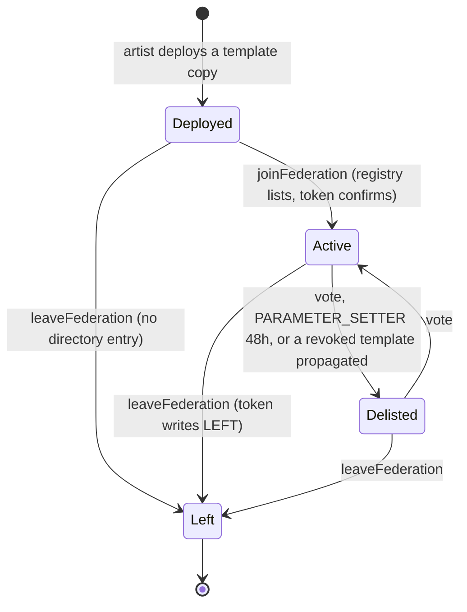
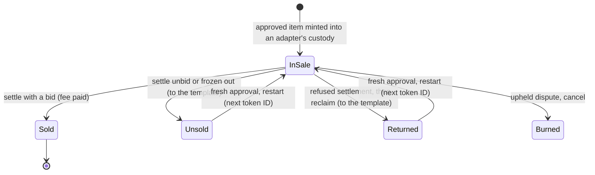

# Federation

6529 Stream Federated: an artist's own token contracts, full copies of the network's audited
templates, listed in the network's permanent directory without curation, sold through the
network's shared sale adapters, paying the network a locked 10% of primary sales and royalties,
and earning no TDH ([ADR 0008](../adr/0008-federation.md)).

> Pre-audit. See the [project status](../../README.md#status).

## Contracts

| Contract | Role | Permanence |
| --- | --- | --- |
| `FederatedStream` | The 1/1 template (ERC-721, `IMintTarget`, ERC-2981, ERC-4906) | Permanent for its artist once deployed; no network power over it |
| `FederatedEditions` | The pair's ERC-1155 template | Same |
| `FederationRegistry` | Template code hashes, admitted adapters, joining, delisting | Replaceable, governed |
| `FederatedEditionAuction` and its lens | The uniform-price edition auction for federated pairs | Replaceable adapter |
| `ArtistRegistry` (directory) | The permanent, logs-only list of every federated contract (ID-33 to ID-39) | Permanent |
| `EnglishAuction` | Sells federated 1/1s (AUC-28, AUC-45 to AUC-48) | Replaceable adapter |
| `SplitLedger` | Derives and deploys every payout vault; the network pulls its royalty share there | Permanent |

## Concepts

### What the registry bargain guarantees

The 10% is what an artist pays for the registry: the listing, the shared adapters and
infrastructure, recognition. A contract that is listed pays it on everything it sells through a
network adapter (the adapter computes the fee from data locked at start and pays it to the
network's recipient itself) and on every royalty paid for a work minted while listed (the
royalty receiver is a split-ledger vault paying the network's governed fee vault 10%, fixed at
deployment). It cannot stay listed while routing around it: its code is a reviewed template
version recognised by code hash, with no setter for either term and no other way to mint. An
artist who does not want to pay may deploy any contract outside the registry; nothing here
restricts that. Exit is one-way and leaves tokens, ownership and funds owed untouched.

### A genuine template, without a factory

Templates carry no immutables: every deployment of a version has the same runtime code hash, so
the registry's table of approved hashes is the whole check. The token itself initiates its
listing (`joinFederation`) and confirms it in the same transaction (`FederationJoined`), so a
listing made by anyone else first is never its own.

### Entries composed on read

The registry stores no entry. `entry(token)` is composed from the artist registry's directory
(artist, status), the token's locked storage (fee share, partner) and the template table (form,
version), and only for an approved code hash. A replacement registry inherits every listing.

### What a federated work has, and does not have

It has: an item hash (`WorksHashing.itemHash` of a `PackageItem`), the record file (changeable
by the artist until finalize), the media list (checked against the content store at mint), a
license (fixed by the item), an artist seed or none, a royalty rate (lowered only), artist-set
locators, an on-chain-complete flag (`syncOnChain`), and a renderer pinned at finalize. It does
not have: curation or a package root, parties' on-chain consents, VRF, collections beyond the
contract, governed amendments (relicense, errata repin), the delivery satellite, store adapters
other than the content store, statement-log artist resolution, network-wide content uniqueness,
the museum or rescue, or TDH.

## State machines

### A federated contract

### A federated 1/1 token

## Rules and invariants

| ID | Rule | Enforced in | Tested by |
| --- | --- | --- | --- |
| FED-1 | A template carries no immutable; every deployment of a version has one runtime code hash, its compiled runtime code's | templates | `test_Template_EveryCopyRunsTheCompiledRuntimeCode` |
| FED-2 | The artist registry, split ledger, artist, fee share and fee recipient are fixed at construction (`FederationTermsLocked`); no setter | `FederatedMembership` | `test_Join_RefusesAnUnapprovedCopyAndWrongFeeTerms` |
| FED-3 | Every artist power is checked against the artist registry's active authority of the locked artist (nobody while restrained); before the artist has an identity, the account whose address is the artist ID acts | `_onlyArtist` | `test_Join_OnlyTheArtist`, `test_GasRule_ArtistActionsReadTheArtistRegistryWithAllGas` |
| FED-4 | The network holds no power over a deployed template | templates | (no restricted function exists) |
| FED-5 | Before joining, nothing mints | `isAdmittedMinter` | `test_Mint_OnlyAfterJoiningAndOnlyAnApprovedItem` |
| FED-6 | `joinFederation` lists the token through the current registry and requires that it was unlisted before and is listed now under its artist, ACTIVE (`FederationStateInvalid`), then emits `FederationJoined` | `FederatedMembership` | `test_Join_CreatesTheIdentityAndListsTheTokenWithItsTrueFacts`, `test_Join_AListingSomeoneElseMadeFirstIsNeverConfirmed` |
| FED-7 | While joined and not left, a mint needs the registry's `canMint` for the calling adapter | `isAdmittedMinter` | `test_Suspension_IsImmediateAndStopsOnlyNewWorks`, `test_Adapters_RemovalStopsNewWorksButTheAdapterStillSettles` |
| FED-8 | `leaveFederation` is one-way; it writes LEFT through the token if listed; running sales finish; works minted before keep their terms | `FederatedMembership` | `test_Exit_IsOneWayRunningSalesFinishAndOldWorksKeepTheirSplit`, `test_Exit_BeforeJoiningNeedsNoDirectory` |
| FED-9 | After the exit, the artist admits its own minters (refused before); new works and sales carry no network share | `setAdmittedMinter`, `_feeTerms` | `test_Exit_TheArtistAdmitsItsOwnMintersAndNewWorksPayNoFee` |
| FED-10 | A work is a `PackageItem` with its media list; `itemHash` is `WorksHashing.itemHash` | `FederatedStream.mint` | `test_Mint_OnlyAfterJoiningAndOnlyAnApprovedItem` |
| FED-11 | `approveItem` approves one mint (or restart) and sets a new work's royalty rate (at most 100,000, no floor); `revokeItem` withdraws it | `FederatedStream` | `test_Unbid_StaysInTheTemplatesCustodyAndRestarts` |
| FED-12 | `mint` takes `to == msg.sender`, `id` 0, `amount` 1 and `abi.encode(FederatedMint)` of an approved ETH item; anything else reverts `InvalidMintRequest` | `FederatedStream.mint` | `test_Mint_NeverDirectly`, `test_Mint_OnlyAfterJoiningAndOnlyAnApprovedItem` |
| FED-13 | The first mint checks the media list against the item's commitment and each file's SHA-256 against the content store, at most 32 files, kind ORIGINAL or EDITION_MASTER (a master needs a partner), seed NONE or ARTIST | `_open` | `test_GasRule_MintReadsTheContentStoreWithAllGas` |
| FED-14 | The first mint deploys the seller vault of the item's payees and, while listed, the 90/10 royalty vault | `_open` | `test_Mint_DeploysThePayoutVaultsBeforeAnythingIsOwed` |
| FED-15 | The terms a sale gets are fixed at mint: seller vault, the locked fee terms (zero after the exit), the template as creator, ETH | `mint`, `settlePrimary`, `primaryTerms` | `test_Sold_TheNetworkGetsItsLockedTenPercentAndTheSellerTheRest` |
| FED-16 | Only the minting adapter settles a token, once; SOLD needs a buyer; settlement makes no external call and reads no identity state | `settlePrimary` | `test_SettlePrimary_OnlyTheMintingAdapterOnce`, `test_RealTemplate_SettlementFitsTheRefusalGasBudget` |
| FED-17 | UNBID and FROZEN_OUT move the token into the template's own custody (no receiver call), never to a person | `settlePrimary` | `test_Unbid_StaysInTheTemplatesCustodyAndRestarts`, `test_Revocation_EndsRunningSalesUnsoldAndTheWorkStaysHome` |
| FED-18 | A restart needs a fresh approval, burns the unsold token held by the template and mints the next token ID for the same work; refused for a sold work and for an edition master whose edition sale began | `_restart` | `test_Unbid_StaysInTheTemplatesCustodyAndRestarts`, `test_Restart_RefusedForASoldWork`, `test_Pair_AMasterWhoseEditionSaleBeganNeverRestarts` |
| FED-19 | A refused settlement's work is claimable only by the template (`reclaim`), back into its custody (`WorkReturned`) | `reclaim`, `onERC721Received` | `test_FaultyTemplate_RefusedSaleCreditsTheBidAndTheWorkComesHome`, `test_Reclaim_OnlyAnUnsettledTokenHeldByItsAdapter` |
| FED-20 | The template accepts no ERC-721 safe transfer but its own token's return from its minting adapter | `onERC721Received` | `test_OnERC721Received_RefusesEverythingButItsOwnReturn` |
| FED-21 | `primarySale` answers NONE until the minting adapter settles (guarantee 2) | `primarySale` | `test_FaultyTemplate_RefusedSaleCreditsTheBidAndTheWorkComesHome` |
| FED-22 | The minting adapter burns a token in its custody before settlement (dispute cancel); the work keeps its record and has no live token | `burn` | `test_Burn_OnlyTheMintingAdapterBeforeSettlement` |
| FED-23 | `royaltyInfo`: the 90/10 vault for works minted while listed, else the seller vault; exact `floor(price * rate / 100,000)` | `royaltyInfo` | `test_Royalty_RoutesNinetyTenThroughTheLedger` |
| FED-24 | The royalty rate only falls | `setRoyaltyRate` | `test_Royalty_OnlyFalls` |
| FED-25 | The record file changes until finalize; finalize pins the default renderer with its code hash; `rendererOf` fails closed on a changed code hash | `setRecord`, `finalize`, `rendererOf` | `test_Record_ChangesUntilFinalizeThenThePinHolds` |
| FED-26 | The renderer surface: `work`, `collection(1)` (the contract), `workRecords()` (itself), `isOpen`, `record`, `mediaOf`, `preferredLocator`, `licenseOf`, `seedOf` | `FederatedStream` | `test_Render_TheSharedRendererReadsTheTemplatesRecord` |
| FED-27 | Locators: one per media file, set by the artist (kind zero clears) | `setLocator` | `test_Locator_TheArtistPointsEachFileSomewhere` |
| FED-28 | `syncOnChain` marks a work on-chain complete once every file is complete in the content store; permissionless | `syncOnChain` | `test_SyncOnChain_OnlyOnceEveryFileIsComplete` |
| FED-29 | `linkEditions` names the pair's editions once, before joining | `linkEditions` | `test_Pair_*` |
| FED-30 | Every call out forwards all gas and reverts on any failure: a dependency costing 1x to 100x changes no outcome; a shortfall never answers | templates | `test_GasRule_*` |
| FED-31 | An edition's ID is its master's token ID; `createEdition` is permissionless once the master's sale settled, with the master's item | `FederatedEditions` | `test_Pair_EditionSalePaysTheLockedShareAndMintsWithinTheSeal` |
| FED-32 | An edition binds to the first admitted adapter that opens it, whose sale kind must be the item's; no other adapter binds or mints it | `bindMinter` | `test_Pair_TheEditionsBindToOneAdapter` |
| FED-33 | The bound adapter seals the supply once, at its sale's count; a mint past the maximum reverts | `sealSupply`, `mint` | `test_Pair_EditionSalePaysTheLockedShareAndMintsWithinTheSeal` |
| FED-34 | Mints carry ETH and the unit price (`EditionPrimaryMint`); a bound adapter no longer admitted mints only after its seal | `mint` | `test_Pair_EditionSalePaysTheLockedShareAndMintsWithinTheSeal` |
| FED-35 | An edition pays the master's seller vault, the locked share while listed, and royalties to the master's 90/10 vault at the master's current rate | `_lock`, `_terms` | `test_Pair_EditionSalePaysTheLockedShareAndMintsWithinTheSeal` |
| FED-36 | `uri` is the master's renderer's | `uri` | `test_Pair_EditionSalePaysTheLockedShareAndMintsWithinTheSeal` |
| FED-41 | The registry stores no entry; `entry`, `isActive`, `canMint` are composed from the directory, the token's locked storage and the template table | `FederationRegistry` | `test_Replacement_InheritsEveryListingWithNothingToMigrate` |
| FED-42 | `isActive`: listed ACTIVE or LEFT, template approved or suspended. `canMint`: admitted adapter, listed ACTIVE, template approved | `FederationRegistry` | `test_Suspension_IsImmediateAndStopsOnlyNewWorks`, `test_Revocation_EndsRunningSalesUnsoldAndTheWorkStaysHome` |
| FED-43 | `register` (called by the token): approved unsuspended code hash, canonical artist registry and ledger, the resolver's federated fee share and recipient now, a consistent pair; creates the identity from the artist's signature if needed; lists the token | `register` | `test_Join_*` |
| FED-44 | A template code hash is approved once (SUCCESSOR_SETTER, 30 days) | `approveTemplate` | `test_Templates_ApprovedOnceAndOnlyByGovernance` |
| FED-45 | Suspension (GUARDIAN, immediate) stops new joins and works; running sales finish; lifted by PARAMETER_SETTER (48 hours) | `suspendTemplate`, `resumeTemplate` | `test_Suspension_IsImmediateAndStopsOnlyNewWorks` |
| FED-46 | Revocation (SUCCESSOR_SETTER, 30 days) is terminal: the contracts are no longer served; running sales end unsold with refunds | `revokeTemplate` | `test_Revocation_EndsRunningSalesUnsoldAndTheWorkStaysHome` |
| FED-47 | `propagateRevocation` writes a revoked template's ACTIVE listings DELISTED (reference: the code hash); permissionless, batched, idempotent | `propagateRevocation` | `test_Revocation_EndsRunningSalesUnsoldAndTheWorkStaysHome` |
| FED-48 | Delisting and relisting by vote (PARAMETER_SETTER, 48 hours), batched; never out of LEFT | `setStatus` | `test_Delisting_ByVoteStopsSalesAndRelistingRestores`, `test_Exit_IsOneWayRunningSalesFinishAndOldWorksKeepTheirSplit` |
| FED-49 | Adapter admission (SUCCESSOR_SETTER, 30 days), ERC-165 `ISaleAdapter`; removal stops new works only | `setAdapter` | `test_Adapters_*` |
| FED-50 | A delisting or revocation never touches tokens, ownership, records, vaults or credits | (by construction) | `test_Delisting_ByVoteStopsSalesAndRelistingRestores` |
| FED-51 | Federation never changes 6529 Stream, a curated artist's identity or canonical state | (by construction) | `invariant_FederationNeverTouchesCanonicalState` |
| FED-52 | On every sold federated sale the network receives exactly price × the locked share, and nothing on any other outcome; the auction holds exactly its credits and live bids | `EnglishAuction` | `invariant_TheNetworkIsPaidItsShareExactlyOnSoldSales`, `invariant_TheAuctionHoldsExactlyCreditsAndLiveBids`, `testFuzz_Sold_FeeIsExactlyTheLockedShare` |
| FED-53 | The federated edition auction sells any contract the current registry serves, recorded per sale; its master is the contract's partner | `FederatedEditionAuction`, lens | `test_Pair_OnlyServedContractsOpen` |
| FED-54 | Its fee is the registry entry's share paid to the resolver's federated recipient, locked at open, never the token's answer | lens `feeTerms` | `test_Pair_ATokenThatReportsNoFeeStillPaysTheRegistryShare`, `test_Pair_TheEditionTakesTheFeeFromTheRegistryNotTheToken` |
| FED-55 | A sale of a contract the registry stops serving reads its 1/1 as cancelled: bidding closes and the sale voids with full refunds | lens `clock` | `test_Pair_ADelistingVoidsTheRunningEditionSaleWithRefunds` |
| FED-56 | An abandoned sale's seal at zero is best effort; a shortfall reverts | `_sealVoid` | (abandonment suite of the shared base) |
| FED-57 | Every other rule of the edition auction is the shared base's (EA-1 onward) | `UniformEditionAuctionBase` | the edition auction suites |
| FED-58 | Its lens views read the English auction directly; a delisted sale's views show its 1/1 as it is, while bids and settlement treat it as cancelled | lens | (documented) |

## Events

The directory's `FederatedContractListed` and `FederatedContractStatus` (artist registry) are
the logs-only record of every federated contract. A listing is the token's own when its
`FederationJoined` follows in the same transaction with the same facts (and its constructor's
`FederationTermsLocked`). Each template logs every state change: `ItemApproval`, `WorkOpened`
(the whole item and media list), `TokenMinted`, `PrimarySaleSettled`, `WorkReturned`,
`RecordChanged`, `Finalized`, `RoyaltyRateChanged`, `LocatorSet`, `OnChainComplete`,
`DefaultRendererSet`, `EditionsLinked`, `FederationLeft`, `MinterSet`, the ERC-721/1155
transfers; the editions template `EditionCreated`, `EditionTermsLocked`, `EditionMinterBound`,
`EditionPrimaryMint`, `EditionSupplySealed`. The registry logs `TemplateSet`, `AdapterSet`,
`Registered`. Payout vaults are logged by the split ledger. Federated contracts earn no TDH.

## Failure modes and recovery

| Failure | Effect | Recovery |
| --- | --- | --- |
| A template version is found buggy | Its deployed copies keep the bug (code never changes) | GUARDIAN suspends at once (new works stop); revocation in 30 days ends its sales unsold; the artist leaves and redeploys a fixed version |
| A token whose settlement fails (a faulty version) | The bid is held until the refusal delay | `settleOrRefund` closes it with the bid credited; `reclaim` returns the work |
| The registry is replaced or disappears | Nothing listed is lost (entries are composed) | A new registry approves the hashes and adapters; with none, the artist leaves and admits its own minters |
| A registry lists a genuine token first, wrongly | The token can never confirm it, so never sells under it | The artist leaves and redeploys |
| A delisted pair's edition sale is running | It voids with full refunds | Relist, open a new sale |

## Residual leakage (accepted)

Marketplaces that ignore ERC-2981; a 0% royalty rate; self-bids at the opening bid followed by
an off-chain sale; side payments; works sold after an exit; and (governance risk) a replacement
registry or adapter taking a different fee, behind the 30-day swap and the guardian veto.

## Parameters and limits

No number in a template is a policy number: the 32-media bound is the record's structural bound
(`Limits.MAX_MEDIA_FILES`), `UNCAPPED` (2^40 - 1) is a storage-width safety bound, the
100,000 denominator is the share unit. The fee share and recipient are each contract's own,
fixed at deployment. Gas rows and deployment costs (Prague, and Glamsterdam estimates with the
arithmetic) are in [ADR 0004's table](../adr/0004-gas-budgets-under-glamsterdam.md#the-table)
and [ADR 0008](../adr/0008-federation.md).

## Differences from the ADRs

- ADR 0001 §16 "only the factory can add entries": there is no factory; a contract whose code
  hash is an approved template version joins itself.
- ADR 0005 decision 9: an unbid federated work stays in the template's custody and restarts.
- Study H's federated registry entries are not stored; they are composed on read.

## References

[ADR 0008](../adr/0008-federation.md) · [ADR 0007](../adr/0007-permanence.md) ·
[Stream and auctions](stream-and-auctions.md) (AUC-28, AUC-45 to AUC-48, the nine template
guarantees) · [Editions and sales](editions-and-sales.md) ·
[Identity and recovery](identity-and-recovery.md) (the directory) ·
[`src/federated`](../../src/federated/README.md)
