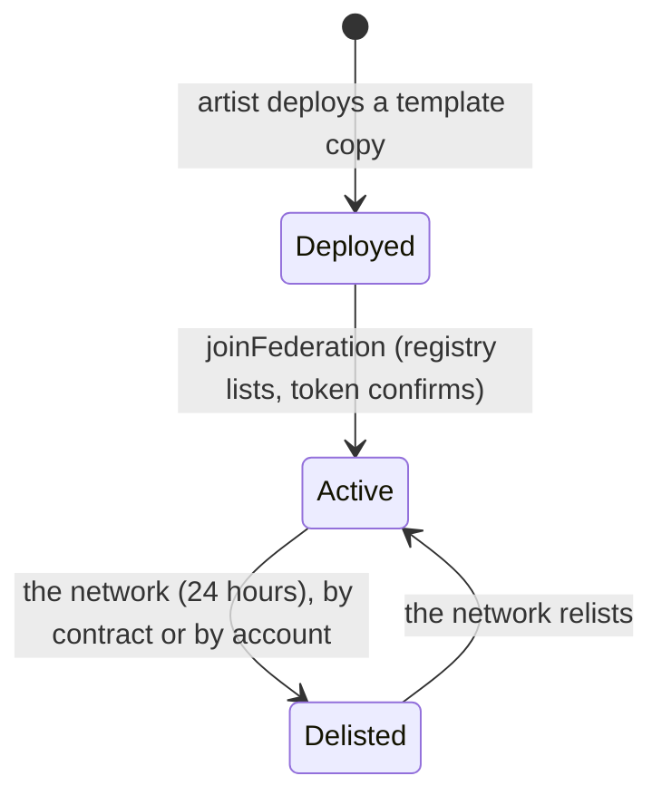
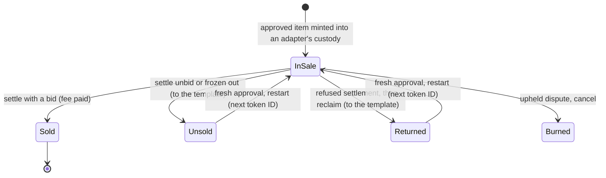

# Federation

6529 Stream Federated: an artist's own token contracts, full copies of the network's
governance-approved templates, listed in the network's permanent directory without curation, sold through the
network's shared sale adapters, paying the network 10% of primary sales and royalties (a share
the network can lower, never raise), and earning no TDH ([ADR 0008](../adr/0008-federation.md)).

> Pre-audit. See the [project status](../../README.md#status).

## Contracts

| Contract | Role | Permanence |
| --- | --- | --- |
| `FederatedStream` | The 1/1 template (ERC-721, `IMintTarget`, ERC-2981, ERC-4906) | Permanent per copy once deployed; a joined copy stays in the federation |
| `FederatedEditions` | The pair's ERC-1155 template | Same |
| `FederationRegistry` | Template versions (runtime code hash bound to creation code), published creation code, admitted adapters, joining, delisting | Replaceable, governed |
| `FederatedEditionAuction` and its lens | The uniform-price edition auction for federated pairs | Replaceable adapter |
| `Renderer` | The shared default renderer: reads a federated work as it reads a 6529 Stream work (FED-61) | Pinned per work at finalize |
| `ArtistRegistry` (directory) | The permanent, logs-only list of every federated contract (ID-33 to ID-39) | Permanent |
| `EnglishAuction` | Sells federated 1/1s (AUC-28, AUC-45 to AUC-48) | Replaceable adapter |
| `SplitLedger` | Derives and deploys every payout vault; the network pulls its royalty share there | Permanent |

## Concepts

### What the registry bargain guarantees

The network share (10% at deployment) is what an artist pays for the registry: the listing, the
shared adapters and infrastructure, recognition. A joined contract pays it on everything it
sells through a network adapter (the adapter computes the fee from the registry entry at start
and pays it to the network's recipient itself) and on every royalty (the royalty receiver is a
split-ledger vault paying the network's governed fee vault its share). The share in force is the
smaller of the share fixed at deployment and the artist registry's record for the contract,
which the network can lower and nothing can raise. Joining is for good: there is no exit, and a
joined contract mints only through adapters the current registry admits, while listed ACTIVE on
an approved template. Its code is a reviewed template version, deployed from that version's
creation code (so its starting storage is the constructor's), with no other way to mint. An
artist who does not want to pay may deploy any contract outside the registry; nothing here
restricts that.

### A genuine template, without a factory with power

Templates carry no immutables: every deployment of a version has the same runtime code hash. A
code hash does not fix the storage a constructor leaves, so a copy joins only if its version's
deployer recorded it (FED-64): one ownerless `FederatedDeployer` per version, which holds that
version's creation code in data contracts written at genesis, CREATE2s it with the constructor
arguments any caller gives (under a caller-bound salt) and records every address it created. A
contract deployed any other way, at any address, is never recorded. The token itself initiates
its listing (`joinFederation`) and confirms it in the same transaction (`FederationJoined`), so
a listing made by anyone else first is never its own; and the permanent artist registry lists
nothing without the artist's own signature for that contract and its facts (FED-65).

### Entries composed on read

The registry stores no entry. `entry(token)` is composed from the artist registry's directory
(artist, status), the token's locked storage (fee share, partner) and the template table (form,
version), and only for a known code hash. A replacement registry inherits every listing: the
network re-approves the template versions and adapters in it, and existing listings sell with no
artist signature (C3). The entry's share is the share in force (FED-73).

### What a federated work has, and does not have

It has: an item hash (`WorksHashing.itemHash` of a `PackageItem`), the record file (changeable
by the artist until finalize), the media list (checked against the content store at mint), a
license (fixed by the item, its ID under the mint rule), an artist seed, a VRF seed or none,
its parties (the artist first, each collaborator consenting on chain), a royalty rate
(lowered only), artist-set locators (printable ASCII), an on-chain-complete flag
(`syncOnChain`), the contract as its one collection with the work ID as its serial, and a
renderer pinned at finalize.

Compared with a canonical 6529 Stream work it lacks:

| Canonical work has | A federated work |
| --- | --- |
| Curation: a registered package root, the curation signer's approval | None: the artist alone approves an item on chain (`approveItem`) |
| Every party's signed consent (`PartyAcceptance`) | Every party after the artist consents on chain, from any wallet of its account, for this contract (FED-60, FED-71) |
| Collections and serials curated in 6529 Stream | One collection, the contract (its ERC-721 name), the work ID as the serial |
| VRF seeds from the network's subscription | VRF seeds the requester pays for, keyed by contract and content (FED-72) |
| Governed amendments (relicensing, errata repin) and the delivery satellite | None; one artist-set locator per media file |
| Added stores beside the content store | The content store only |
| Network-wide content uniqueness (one work per primary SHA-256) | Uniqueness within the network is not checked; within the contract, one work per item |
| Statement-log artist resolution, the museum and rescue | None: an unsold work stays with the template; there is no rescue |
| A permanent home (6529 Stream is never redeployed) | The artist's own contract: a template version's bug stays in its copies |
| TDH and the network's consensus weight | None |

### What a logs-only reader should show

A federated contract is the artist's only when the directory's `FederatedContractListed` is
followed in the same transaction by the token's own `FederationJoined` with the same artist, fee
share, fee recipient and partner, and by the registry's `Registered(token, artistId, codeHash,
deployer)`, from a registry the artist registry named then, whose `TemplateSet` approved that
code hash with that deployer; the deployer's `Deployed(token, caller, salt, config)` and
`CreationCodeStored` show the token was created from the approved creation code with `config`,
which proves its starting storage (ADR 0008 §12). The artist's consent to those facts needs no
log: the artist registry lists nothing without it. A `FederationTermsLocked` from a contract
never so listed attributes nothing to anyone. A federated work's `WorkOpened` names the whole
item: its first party is the contract's artist and every later party consented on chain, for
this contract (FED-71), so a reader credits the work to those parties. A fixed payee is a payout
address, not a credit. `WorkOpened` also gives the share in force when the work opened; later
changes of the share are the artist registry's events. A reader shows federated works apart
from 6529 Stream's (the contract is not 6529 Stream, the collection is the contract), never as
curated, and counts them for no TDH.

## State machines

### A federated contract

### A federated 1/1 token

## Rules and invariants

| ID | Rule | Enforced in | Tested by |
| --- | --- | --- | --- |
| FED-1 | A template carries no immutable; every deployment of a version has one runtime code hash, its compiled runtime code's; a version is that hash bound to its deployer (FED-64) | templates | `test_Template_EveryCopyRunsTheCompiledRuntimeCode` |
| FED-2 | The artist registry, split ledger, artist, fee share and fee recipient are fixed at construction (`FederationTermsLocked`); no setter | `FederatedMembership` | `test_Join_RefusesAnUnapprovedCopyAndWrongFeeTerms` |
| FED-3 | Every artist power asks the artist registry whether the caller is a wallet of the artist's account now (`IAccounts.isWallet`): any wallet of the consolidated account, none while it is frozen; before the artist has an identity, the address that is the artist ID | `_onlyArtist` | `test_Join_OnlyTheArtist`, `test_Artist_AnyWalletOfTheAccountActsAndNoneWhileFrozen`, `test_GasRule_ArtistActionsReadTheArtistRegistryWithAllGas` |
| FED-4 | No restricted function exists on a deployed template. The network reaches it only through the artist registry (who acts for the artist, the share in force, an account's delisting) and the replaceable registry (which adapters may mint new works, a listing's status) | templates | (no restricted function exists); `test_Adapters_RemovalStopsNewWorksButTheAdapterStillSettles`; `check_noRestrictedFunction_onATemplate` |
| FED-5 | Before joining, nothing mints; `setAdmittedMinter` always reverts (`FederationStateInvalid`): there are no minters of the artist's own | `isAdmittedMinter`, `setAdmittedMinter` | `test_Mint_OnlyAfterJoiningAndOnlyAnApprovedItem`, `test_NoExit_ANeverJoinedCopyMintsNothing`; `invariant_NoMintBeforeJoiningOrWhileDelisted`, `check_beforeJoining_nothingMints` |
| FED-6 | `joinFederation(Join)` lists the token through the current registry, passing its CREATE2 salt, constructor arguments, identity fields and the artist's signatures, and requires that it was unlisted before and is listed now under its artist, ACTIVE (`FederationStateInvalid`), then emits `FederationJoined` | `FederatedMembership` | `test_Join_CreatesTheIdentityAndListsTheTokenWithItsTrueFacts`, `test_Join_AListingSomeoneElseMadeFirstIsNeverConfirmed` |
| FED-7 | Once joined, for good, a mint needs the registry's `canMint` for the calling adapter: a contract delisted (by contract or by account) or of a suspended or revoked template mints nothing, restarts nothing and binds no edition, through any adapter, one admitted before included | `isAdmittedMinter` | `test_C1_ADelistedContractMintsRestartsAndBindsNothing`, `test_C1_AnAccountDelistingStopsEveryContractOfTheAccount`, `test_C1_ASuspendedTemplateMintsNothingAndOpensNoSale`; `invariant_NoMintBeforeJoiningOrWhileDelisted` |
| FED-8 | There is no exit: no function leaves the federation (`IFederatedToken`'s interface ID has none), and the directory has no LEFT status | `IFederatedToken` | `test_NoExit_TheTokenInterfacesHaveNoWayOut` |
| FED-9 | (Removed in the second pass: there are no minters of the artist's own.) | | |
| FED-10 | A work is a `PackageItem` with its media list; `itemHash` is `WorksHashing.itemHash` | `FederatedStream.mint` | `test_Mint_OnlyAfterJoiningAndOnlyAnApprovedItem` |
| FED-11 | `approveItem` approves one mint (or restart) and sets a new work's royalty rate (at most 100,000, no floor); `revokeItem` withdraws it. Anyone may start an approved item, at any time, through any admitted adapter of its sale kind (a keeper): the artist times a sale by when it approves | `FederatedStream` | `test_Unbid_StaysInTheTemplatesCustodyAndRestarts` |
| FED-12 | `mint` takes `to == msg.sender`, `id` 0, `amount` 1 and `abi.encode(FederatedMint)` of an approved ETH item; anything else reverts `InvalidMintRequest` | `FederatedStream.mint` | `test_Mint_NeverDirectly`, `test_Mint_OnlyAfterJoiningAndOnlyAnApprovedItem` |
| FED-13 | The first mint checks the media list against the item's commitment and each file's SHA-256 against the content store, at most 32 files (each role, 0 to 15, kept in four bits below the count), kind ORIGINAL or EDITION_MASTER (a master needs a partner listed ACTIVE, FED-67), seed NONE, ARTIST or VRF (FED-72), the parties' consents (FED-71), a license ID under the mint rule (`SpdxId`: 1 to `MAX_LICENSE_ID_BYTES` of `[A-Za-z0-9.+-]`), so the renderer can always show it, and a license text that is a registered SHA-256 content-store file of at most 16 chunks (`InvalidLicenseText`), the rule 6529 Stream's records apply to a frozen license, since a federated license never changes | `_open` | `test_GasRule_MintReadsTheContentStoreWithAllGas`, `test_Mint_TheItemNamesOnlyConsentingParties`, `test_License_TheTextIsARegisteredSha256FileOfAtMostSixteenChunks`, `test_Roles_ThirtyTwoFilesKeepEveryRoleAndTheCount`, `test_Packed_TheApprovalWordKeepsTheHighestRateBesideTheWork`, `test_Packed_TheSaleWordKeepsCurrencyAndPriceApart` |
| FED-14 | The first mint deploys the seller vault of the item's payees and the royalty vault at the share in force | `_open` | `test_Mint_DeploysThePayoutVaultsBeforeAnythingIsOwed` |
| FED-15 | The terms a sale gets are fixed at mint: seller vault, the template as creator, ETH; the fee is the registry entry's share, locked by the adapter at start; `settlePrimary` reports no fee terms | `mint`, `settlePrimary`, `primaryTerms` | `test_Sold_TheNetworkGetsItsLockedTenPercentAndTheSellerTheRest` |
| FED-16 | Only the minting adapter settles a token, once; SOLD needs a buyer; settlement makes no external call and reads no identity state | `settlePrimary` | `test_SettlePrimary_OnlyTheMintingAdapterOnce`, `test_RealTemplate_SettlementFitsTheRefusalGasBudget`; `invariant_SettledOnceByTheMintingAdapter`, `check_settle_onlyTheMintingAdapterOnce` |
| FED-17 | UNBID and FROZEN_OUT move the token into the template's own custody (no receiver call), never to a person | `settlePrimary` | `test_Unbid_StaysInTheTemplatesCustodyAndRestarts`, `test_Revocation_EndsRunningSalesUnsoldAndTheWorkStaysHome`; `invariant_UnsoldWorksStayInTheTemplatesCustody` |
| FED-18 | A restart needs a fresh approval (an unsold master with no bound edition sale has no edition, FED-31, so it stays free to restart), burns the unsold token held by the template and mints the next token ID for the same work; refused for a sold work, for a dispute-cancelled work (no live token: the upheld dispute is final), for an edition master whose edition sale began (a refused master whose edition sale bound is never settled, so its edition is never created; that sale voids with refunds), and for an edition master while its editions are not listed ACTIVE (FED-67) | `_restart` | `test_Unbid_StaysInTheTemplatesCustodyAndRestarts`, `test_Restart_RefusedForASoldWork`, `test_Pair_AMasterWhoseEditionSaleBeganNeverRestarts`, `test_Pair_AMasterRestartsOnlyWhileItsEditionsAreListed` |
| FED-19 | A refused settlement's work is claimable only by the template (`reclaim`), back into its custody (`WorkReturned`) | `reclaim`, `onERC721Received` | `test_FaultyTemplate_RefusedSaleCreditsTheBidAndTheWorkComesHome`, `test_Reclaim_OnlyAnUnsettledTokenHeldByItsAdapter` |
| FED-20 | The template accepts no ERC-721 safe transfer but its own token's return from its minting adapter | `onERC721Received` | `test_OnERC721Received_RefusesEverythingButItsOwnReturn` |
| FED-21 | `primarySale` answers NONE until the minting adapter settles (guarantee 2) | `primarySale` | `test_FaultyTemplate_RefusedSaleCreditsTheBidAndTheWorkComesHome` |
| FED-22 | The minting adapter burns a token in its custody before settlement (dispute cancel); the work keeps its record and has no live token | `burn` | `test_Burn_OnlyTheMintingAdapterBeforeSettlement` |
| FED-23 | `royaltyInfo`: the vault of the seller and the fee recipient at the share in force (the seller vault at a zero share); exact `floor(price * rate / 100,000)` | `royaltyInfo` | `test_Royalty_RoutesNinetyTenThroughTheLedger` |
| FED-24 | The royalty rate only falls | `setRoyaltyRate` | `test_Royalty_OnlyFalls`; `invariant_RoyaltyRateOnlyFalls`, `check_royaltyRate_onlyFalls` |
| FED-25 | The record file changes until finalize; finalize needs the license text complete in the content store (anyone may write its chunks, so no work is stuck) and pins the default renderer with its code hash; `rendererOf` fails closed on a changed code hash; the artist's `setDefaultRenderer` is compare-and-set (`ExpectedValueMismatch`) and `DefaultRendererSet` names the renderer replaced | `setRecord`, `finalize`, `rendererOf`, `setDefaultRenderer` | `test_Record_ChangesUntilFinalizeThenThePinHolds`, `test_License_FinalizeNeedsTheTextOnChain`, `test_Renderer_CompareAndSetNamingThePrevious` |
| FED-26 | The record surface the renderer reads: `coreOf`, `extsload` (FED-61), `workRecords()` (itself), `isOpen`, `record`, `mediaOf`, `preferredLocator`, `licenseOf`, `seedOf`, `rendererOf`; `work` and `collection(1)` answer integrators as `IStreamViews` does | `FederatedStream` | `test_Render_TheSharedRendererReadsTheTemplatesRecord` |
| FED-27 | Locators: one per media file, set by the artist (kind zero clears); a URI is at most `Limits.MAX_URI_BYTES` of printable ASCII (`0x21` to `0x7e`) without `"` or `\` (`InvalidLocator`), WS-40's rule, so no locator can break the work's metadata | `setLocator` | `test_Locator_TheArtistPointsEachFileSomewhere`, `test_Locator_OnlyPrintableAsciiWithinTheBound` |
| FED-28 | `syncOnChain` marks a work on-chain complete once every file is complete in the content store; permissionless. It calls `isComplete` for each file, which walks the chunks no attestation covers, so those walks together must fit one transaction (about 2,500 cold chunks under the EIP-7825 cap); a work with more must have its files attested complete in pieces first (`ContentStore.attestComplete`, WS-55) | `syncOnChain` | `test_SyncOnChain_OnlyOnceEveryFileIsComplete` |
| FED-29 | `linkEditions` names the pair's editions once, before joining | `linkEditions` | `test_Pair_*` |
| FED-30 | Every call out forwards all gas and reverts on any failure: a dependency costing 1x to 100x changes no outcome; a shortfall never answers | templates | `test_GasRule_*` |
| FED-31 | An edition's ID is its master's token ID; `createEdition` is permissionless with the master's item, and needs a SOLD master or a bound edition sale (an edition sale that reached its abandon path creates the edition for any completed 1/1, unbid included: R16, owner 17 November 2026); an unsold master with no bound sale stays free to restart | `FederatedEditions` | `test_Pair_EditionSalePaysTheLockedShareAndMintsWithinTheSeal`, `test_Pair_AnUnsoldUnboundMasterGetsNoEditionAndRestarts`, `test_Pair_ABoundSaleStillGetsItsEditionAfterAnUnsoldMaster` |
| FED-32 | An edition binds to the first admitted adapter that opens it, whose sale kind must be the item's; no other adapter binds or mints it | `bindMinter` | `test_Pair_TheEditionsBindToOneAdapter` |
| FED-33 | The bound adapter seals the supply once, at its sale's count; a mint past the maximum reverts | `sealSupply`, `mint` | `test_Pair_EditionSalePaysTheLockedShareAndMintsWithinTheSeal`; `invariant_SealedEditionSupply` |
| FED-34 | Mints carry ETH and the unit price (`EditionPrimaryMint`); a bound adapter no longer admitted mints only after its seal; effects precede the ERC-1155 acceptance call, so a re-entered mint (only the bound adapter mints) sees the raised count and the maximum holds without a guard | `mint` | `test_Pair_EditionSalePaysTheLockedShareAndMintsWithinTheSeal` |
| FED-35 | An edition pays the master's seller vault, the share in force, and royalties to the vault at that share at the master's current rate | `_lock`, `_terms` | `test_Pair_EditionSalePaysTheLockedShareAndMintsWithinTheSeal` |
| FED-36 | `uri` is the master's renderer's | `uri` | `test_Pair_EditionSalePaysTheLockedShareAndMintsWithinTheSeal` |
| FED-41 | The registry stores no entry; `entry`, `isActive`, `canMint` are composed from the directory, the token's locked storage and the template table | `FederationRegistry` | `test_Replacement_InheritsEveryListingWithNothingToMigrate` |
| FED-42 | `isActive`: listed ACTIVE, template approved or suspended. `canMint`: admitted adapter, listed ACTIVE, template approved, and for an editions contract its partner listed ACTIVE with its partner's template APPROVED. `entry`: none (all zero) for a contract not listed, or of an unknown code hash | `FederationRegistry` | `test_Suspension_IsTheNetworksAndStopsOnlyNewWorks`, `test_Revocation_EndsRunningSalesUnsoldAndTheWorkStaysHome`, `test_C1_ADelistedContractMintsRestartsAndBindsNothing`, `test_Pair_ASuspended1of1TemplateOpensNoEditionSale` |
| FED-43 | `register` (called by the token): approved unsuspended code hash, the provenance of FED-64, canonical artist registry, ledger and (1/1) content store, the resolver's federated fee share and recipient now, a consistent pair whose 1/1 half joins after its editions; creates the identity from the artist's signature if needed; lists the token with the artist's consent to its facts (FED-65); logs `Registered` with the deployer | `register` | `test_Join_*`, `test_Provenance_*` |
| FED-44 | A template code hash is approved once, bound to its deployer (the network); suspension and revocation act on the code hash, so on every copy its deployer recorded | `approveTemplate` | `test_Templates_ApprovedOnceAndOnlyByGovernance` |
| FED-45 | Suspension (the network) stops new joins, works and sales (binding an edition asks `canMint`); running sales finish; lifted by the network | `suspendTemplate`, `resumeTemplate` | `test_Suspension_IsTheNetworksAndStopsOnlyNewWorks` |
| FED-46 | Revocation (the network): the contracts are no longer served; running sales end unsold with refunds; the network can reverse it (FED-74). Suspending or revoking the 1/1 template also stops new edition sales of its editions contracts (`canMint` checks the partner's template). A revocation writes no listing | `revokeTemplate` | `test_Revocation_EndsRunningSalesUnsoldAndTheWorkStaysHome` |
| FED-47 | (Removed by the review fixes of the second pass: the revocation propagation call is gone. A revocation writes no listing; it acts through `isActive` and `canMint`, and running sales end through the adapters' target check.) | | |
| FED-48 | Delisting and relisting by the network (24 hours), by contract or for every contract of an artist's account (`ArtistRegistry.setFederationDelisted`), batched (at most `MAX_BATCH`, 256, per call, so a scheduled batch always fits a transaction); a batch skips what it cannot change (an unlisted contract) instead of reverting | `setStatus`, `setFederatedStatus` | `test_Delisting_ByVoteStopsSalesAndRelistingRestores`, `test_C1_AnAccountDelistingStopsEveryContractOfTheAccount`, `test_Delisting_ABatchSkipsWhatItCannotChange`, `test_Batch_BoundedAtMaxBatch` |
| FED-49 | Adapter admission (the network), ERC-165 `ISaleAdapter`; removal stops new works only | `setAdapter` | `test_Adapters_*` |
| FED-50 | A delisting or revocation never touches tokens, ownership, records, vaults or credits | (by construction) | `test_Delisting_ByVoteStopsSalesAndRelistingRestores` |
| FED-51 | Federation never changes 6529 Stream, a curated artist's identity or canonical state | (by construction) | `invariant_FederationNeverTouchesCanonicalState`; `invariant_FederationNeverTouchesStreamOrIdentity` |
| FED-52 | On every sold federated sale the network receives exactly `price − floor(price × (100,000 − share) / 100,000)` at the locked share (the leftover wei included, R18), and nothing on any other outcome; the auction holds exactly its credits and live bids | `EnglishAuction` | `invariant_TheNetworkIsPaidItsShareExactlyOnSoldSales`, `invariant_TheAuctionHoldsExactlyCreditsAndLiveBids`, `testFuzz_Sold_FeeIsExactlyTheLockedShare` |
| FED-53 | The federated edition auction sells any contract the current registry serves, recorded per sale; its master is the contract's partner | `FederatedEditionAuction`, lens | `test_Pair_OnlyServedContractsOpen` |
| FED-54 | Its fee is the registry entry's share, locked at open, never the token's answer, paid to the economics resolver's Federated recipient read at settlement (or the edition's recorded recipient when the resolver names none); a federated edition sale opens only while the registry's `canMint(editions, adapter)` is true, so a suspended template opens no sale (C26); the lens deploys a sale's wallets only through the canonical split ledger, refusing a token that names another | lens `feeTerms`, `_factory` | `test_Pair_ATokenThatReportsNoFeeStillPaysTheRegistryShare`, `test_Pair_TheEditionTakesTheFeeFromTheRegistryNotTheToken`, `test_Pair_TheEditionFeeRecipientIsTheOneCurrentAtSettlement`, `test_FeeRecipient_TheOneCurrentAtSettlement`, `test_Pair_ATokenNamingAnotherLedgerOpensNoSale` |
| FED-55 | A sale of a contract the registry stops serving reads its 1/1 as cancelled and voids with full refunds; every bid and raise checks the registry, so bidding closes at the delisting, not only near the close (`BiddingClosed`, end zero); a settle call while the scan has paid nothing checks it again, so a delisting between settle calls still voids the sale, and once the clearing call has paid the clearing stands | lens `clock`, `isTarget`; `bid`, `raise`, `settle` | `test_Pair_ADelistingVoidsTheRunningEditionSaleWithRefunds`, `test_Pair_ADelistedSaleTakesNoBidOrRaiseLongBeforeTheClose`, `test_Pair_ADelistingMidScanVoidsBeforeAnyPayout` |
| FED-56 | `abandon` of a federated edition sale needs its 1/1 closed first (settled, or closed by the refusal exit 2 days after its end), then 21 days after the edition close; an abandoned sale's seal at zero is best effort; a shortfall reverts | `abandon`, `_sealVoid` | `test_Abandon_AFederatedSaleAfterARefusedMaster`, `test_Abandon_ARefusedSealLeavesTheEditionDeadForGood` |
| FED-57 | Every other rule of the edition auction is the shared base's (EA-1 onward) | `UniformEditionAuctionBase` | the edition auction suites |
| FED-58 | Its lens views read the English auction directly; a delisted sale's views show its 1/1 as it is, while bids and settlement treat it as cancelled | lens | `test_Pair_ADelistedSalesViewsShowItsOneOfOneAsItIs` |
| FED-59 | (Removed in the second pass: there is no exit, so no left contract.) | | |
| FED-60 | An item's first party is the contract's artist (its ID as an address); every artist-resolved payee is a party's ID with a payout address now (`InvalidMintRequest`), so an unregistered collaborator is paid at a fixed address; fixed payees are accounts the parties agreed to pay. No other artist's payout, standing or directory entry is touched by a federated work | `_checkParties` | `test_Mint_TheItemNamesOnlyConsentingParties`, `test_Collaborators_ArtistResolvedPayeesNeedAPartyWithAPayout` |
| FED-61 | The shared renderer reads a federated work through the native path it uses for 6529 Stream, never through a replaceable contract: `coreOf`, and `extsload` at `StreamLayout`'s slots, where the template keeps its token words (slot 18: the minting adapter in bits 0-159, the work ID, shown as the serial, in 160-191) and its one collection (slot 17: the ERC-721 name two slots into the entry, written at construction). A template version's code, and so this layout, never changes | `FederatedStream` storage | `test_Layout_TheTemplateAnswersTheRenderersNativeReads` |
| FED-62 | (Removed in the second pass: the abandonment wait is a fixed 21 days after the edition close for every sale, so nothing reads a rescue delay.) | | |
| FED-63 | Genesis wires the federation: the artist registry's one-shot bind, the English auction's registry (code hash pinned), both shared adapters admitted, and the two v1 template versions approved, each code hash computed from the build (`DeployV1.templateCodeHash`, never a literal) bound to its deployer, which genesis deploys with the build's creation code; `VerifyV1.checkFederation` reads each back and `checkTemplate` checks the deployer's code is the build's `FederatedDeployer` and rehashes its creation code, so a rebuilt artifact or another deployer fails | `DeployV1`, `VerifyV1`, `GovernanceConfig.isGenesisSelector` | `test_GenesisWiresTheFederation`, `test_CheckTemplate_RefusesARebuiltArtifact` |
| FED-64 | A copy joins only if its version's approved deployer recorded it: the deployer, ownerless and immutable (no owner, role, fee, upgrade, delegatecall or selfdestruct), holds one creation code in data contracts it wrote at construction, deploys it for anyone with the caller's constructor arguments under the salt `keccak256(caller, salt)`, records each address and emits `Deployed`; so a listed copy's starting storage is its constructor's, whatever any other initcode wrote at any address (immune to CREATE2 address collisions) | `FederatedDeployer`, `register` | `test_Provenance_ACopyNotRecordedByTheApprovedDeployerNeverJoins`, `test_Provenance_OnlyTheApprovedDeployersRecordCounts`, `test_Deployer_DeploysOnlyItsCodeAndRecordsEveryCopy`, `test_Provenance_ACopyAnyoneDeploysIsInertUntilItsArtistJoins`, `test_Gas_DeployStreamThroughItsDeployer`, `test_Gas_DeployEditionsThroughItsDeployer` |
| FED-65 | The artist registry lists a contract only with a `FederatedListing(artistId, token, form, partner, feeShare, feeRecipient, deadline)` consent signed by a wallet of the artist's account, given as a proof `abi.encodePacked(wallet, signature)` and verified there (ECDSA, EIP-7702 or ERC-1271), so no federation registry lists a contract under an artist who did not sign for it, nor with facts the artist did not sign | `ArtistRegistry.listFederatedContract` | `test_Directory_NoRegistryListsUnderAnArtistWhoDidNotSign`; FD `test_List_TheConsentCoversTheFacts`, `test_List_*`; `test_EveryFederationEventReplaysToTheSameState` |
| FED-66 | (Removed in the second pass: no LEFT or LEFT_DELISTED status.) | | |
| FED-67 | The pair as one: the 1/1 half joins only after its editions are listed ACTIVE under the same artist; an editions contract mints through the registry only while its partner is listed ACTIVE; a 1/1 contract mints or restarts an EDITION_MASTER only while its editions are listed ACTIVE. So an edition sells only while both halves are ACTIVE | `register`, `canMint`, `_open`, `_restart` | `test_Pair_The1of1JoinsOnlyAfterItsEditions`, `test_Pair_AMasterRestartsOnlyWhileItsEditionsAreListed`, `test_Pair_EditionsWithoutAListed1of1MintNothing` |
| FED-68 | A 1/1 template names its content store at construction (`ContentStoreSet`, `contentStore()`); the registry lists only one naming the canonical store | `FederatedStream`, `register` | `test_Join_RefusesAContentStoreOtherThanTheCanonicalOne` |
| FED-69 | Once replaced in the artist registry, a registry answers `entry`, `isActive` and `canMint` as the current one does (unless the current one asks), so the English auction's own pointer never disagrees with the templates' | `FederationRegistry._forwards` | `test_Replacement_TheEnglishAuctionAnswersAsTheCurrentRegistry`, `test_GasRule_MintReadsTheRegistryWithAllGas` |
| FED-70 | Each genesis setter reaches only a target declaring its interface (ERC-165): the sale adapters' `setFederationRegistry` and `setTarget` need `ISaleAdapter`, the registry's `setAdapter` and `approveTemplate` `IFederationRegistry`, `setAdmittedMinter` `IMintTarget`; the artist registry's `setFederationRegistry` is never wired | `GovernanceConfig.genesisInterface`, `validateWiring` | `test_GenesisSelectorsReachOnlyTheirTargets` |
| FED-71 | Collaborators: `FederatedMint.consents` holds one consent per party after the first; each is `abi.encodePacked(wallet, signature)` over the artist registry's `consentDigest(this contract, itemHash)` (`IAccounts.requireConsent`), by any wallet of that party's account now: consent is unanimous and counted by account, and a consent is good for one contract only. No storage and no accept step | `_checkParties` | `test_Collaborators_AWorkMintsOnlyWithEveryPartysConsent`, `test_Collaborators_AnyWalletOfTheAccountConsents`, `test_Collaborators_AConsentForOneContractIsRefusedByAnother` |
| FED-72 | VRF: a VRF item mints only once the entropy module the current registry names (`entropyModule()`, 6529 Stream's module) has delivered the seed for this contract and the item's content (`federatedSeedOf`); the template stores the seed at the first mint and `seedOf` answers it. The request is paid by the requester (ENT-20) | `_vrfSeed`, `seedOf` | `test_Vrf_AWorkMintsOnlyAfterDeliveryAndKeepsItsSeed` |
| FED-73 | The share in force is `min(share fixed at deployment, IAccounts.federatedFeeShare(token))`, computed by the token (`_feeTerms`) and by the registry's `entry` alike: sales, edition terms, the royalty receiver and `primaryTerms` follow it, so a lowered share is used and no answer can raise it. Royalties go to the vault at the share in force, which the template deploys at each work's mint and edition's lock; after a lowering anyone can deploy the new vault (money sent before then is safe at its address) | `_feeTerms`, `_royaltyReceiver`, `entry` | `test_FeeShare_TheLoweredShareIsUsed`, `test_FeeShare_AHigherRecordChangesNothing`, `test_FeeShare_AZeroShareRoutesRoyaltiesToTheSeller`, `testFuzz_FeeShare_NeverAboveTheDeployedShare`; `check_feeShareInForce_isTheMinimum` |
| FED-74 | `reinstateTemplate` (the network, 24 hours) moves a REVOKED template back to APPROVED; a reinstatement serves every contract of the template again as listed | `reinstateTemplate` | `test_C26_AReinstatedTemplateMintsAgain`, `test_C26_ReinstateOnlyAReverseOfARevocation` |
| FED-75 | Account delisting (C5) is the artist registry's flag per account; it reports every contract of the account DELISTED, so every gate here (`isActive`, `canMint`, the templates' partner checks) stops them with no batch, and no new contract of the account is listed | `ArtistRegistry`, read through `federatedListing` | `test_C1_AnAccountDelistingStopsEveryContractOfTheAccount` |

## Events

The directory's `FederatedContractListed` and `FederatedContractStatus` (artist registry) are
the logs-only record of every federated contract. A listing is the token's own when its
`FederationJoined` follows in the same transaction with the same facts (and its constructor's
`FederationTermsLocked`). Each template logs every state change: `ItemApproval`, `WorkOpened`
(the whole item and media list), `TokenMinted`, `PrimarySaleSettled`, `WorkReturned`,
`RecordChanged`, `Finalized`, `RoyaltyRateChanged`, `LocatorSet`, `OnChainComplete`,
`DefaultRendererSet`, `EditionsLinked`, `ContentStoreSet`, the ERC-721/1155
transfers; the editions template `EditionCreated`, `EditionTermsLocked`, `EditionMinterBound`,
`EditionPrimaryMint`, `EditionSupplySealed`. The registry logs `TemplateSet` (with the deployer
and its creation code hash, also on reinstatement), `AdapterSet`, `Registered` (with the
deployer); the entropy module logs `FederatedSeedRequested` and `SeedDelivered`; each deployer logs
`CreationCodeStored` once and `Deployed` (with the caller, salt and constructor arguments) for
every copy. Payout vaults are logged by the split ledger. Federated contracts earn no TDH.

## The nine template guarantees, as met

[Stream and auctions](stream-and-auctions.md#what-a-federated-template-must-guarantee) lists
what a federated template must guarantee for the English auction's refusal exit to stay fair.
The v1 templates meet each:

| # | Guarantee | How the v1 template meets it | Tested by |
| --- | --- | --- | --- |
| 1 | Gas: the whole settlement within the refusal gas less the auction's worst case | `settlePrimary` makes no external call and reads only its own storage; a sold settlement executes about 95,000 gas | `test_RealTemplate_SettlementFitsTheRefusalGasBudget` |
| 2 | `primarySale` answers NONE until the adapter settles | The token's state is IN_SALE from mint to `settlePrimary`; `primarySale` answers NONE for it | `test_FaultyTemplate_RefusedSaleCreditsTheBidAndTheWorkComesHome` |
| 3 | No third-party guards | Settlement calls nothing: no escrow, wallet or vault is touched | `test_RealTemplate_SettlementFitsTheRefusalGasBudget` |
| 4 | No buyer or recipient code | `settlePrimary`, `ownerOf` and `primaryTerms` call nothing; an unsold token moves into the template's custody with no receiver call | `test_Unbid_StaysInTheTemplatesCustodyAndRestarts` |
| 5 | No identity dependency for a sale | Settlement reads no identity state; even an unsold one names the template, not the artist, as creator | `test_SettlePrimary_OnlyTheMintingAdapterOnce` |
| 6 | Locked payees | The seller vault and the creator are written at mint; the adapter locks the fee from the registry entry at start; the seller is a split-ledger vault address, never zero, the escrow or the auction | `test_Sold_TheNetworkGetsItsLockedTenPercentAndTheSellerTheRest` |
| 7 | An honest ledger | OpenZeppelin's ERC-721 `ownerOf` and `safeTransferFrom`, unmodified, starting from the constructor's storage only (FED-64: no hidden approval or pre-seeded token) | `test_FaultyTemplate_RefusedSaleCreditsTheBidAndTheWorkComesHome`, `test_Provenance_ACopyNotRecordedByTheApprovedDeployerNeverJoins` |
| 8 | One settlement, by its adapter | Only the minting adapter, once (`NotMintingAdapter`, `SaleAlreadySettled`); SOLD returns `holder` zero; UNBID and FROZEN_OUT return the template, which the adapter records as taken | `test_SettlePrimary_OnlyTheMintingAdapterOnce` |
| 9 | Fixed code | No proxy, no delegatecall, no immutables: the code hash the registry approved is the code that runs, deployed from the approved creation code | `test_Template_EveryCopyRunsTheCompiledRuntimeCode` |

## Failure modes and recovery

| Failure | Effect | Recovery |
| --- | --- | --- |
| A template version is found buggy | Its deployed copies keep the bug (code never changes) | The network suspends it (new works and sales stop) or revokes it (its sales end unsold); the artist deploys a copy of a fixed version and joins with it; the network can reinstate a revoked version |
| A token whose settlement fails (a faulty version) | The bid is held until the refusal delay | `settleOrRefund` closes it with the bid credited; `reclaim` returns the work |
| The registry is replaced or disappears | Nothing listed is lost (entries are composed) | A new registry approves every template version (with its deployer) and admits the adapters **before** the artist registry's pointer moves, or running sales freeze out with refunds; existing listings then sell with no artist signature |
| A registry lists a genuine token first, wrongly | The token can never confirm it, so never sells under it; it needs the artist's own consent signature for that token | The artist deploys a new copy and joins with it |
| A delisted pair's edition sale is running | It voids with full refunds | Relist, open a new sale |
| An edition sale voids while its best-effort seal is refused (a faulty token) | The edition stays bound to that adapter's void sale: no adapter reopens or binds it, and no minter mints it, ever | None needed: no copy can exist |

## Residual leakage (accepted)

Marketplaces that ignore ERC-2981; a 0% royalty rate (the artist's choice, no floor); self-bids
at the opening bid followed by an off-chain sale; side payments; and a replacement registry or
adapter taking a different fee, behind the network's delay. None of these lets a listed contract
sell through a network adapter without paying the share in force.

## Parameters and limits

No number in a template is a policy number: the 32-media bound is the record's structural bound
(`Limits.MAX_MEDIA_FILES`), `UNCAPPED` (2^40 - 1) is a storage-width safety bound, the
100,000 denominator is the share unit. The fee recipient each contract names is fixed at
deployment (the network's fee vault, whose destination the network sets) and is the network's
payee in its royalty vaults; sales through the network adapters pay the economics resolver's
Federated recipient, read at settlement (R18). The share in force is
the smaller of the deployed share and the artist registry's record, which only falls. Gas rows and deployment costs (Prague, and Glamsterdam estimates with the
arithmetic) are in [ADR 0004's table](../adr/0004-gas-budgets-under-glamsterdam.md#the-table)
and [ADR 0008](../adr/0008-federation.md).

## Differences from the ADRs

- ADR 0001 §16 "only the factory can add entries": there is no factory with power; a contract its
  version's ownerless deployer recorded joins itself, with its artist's consent.
- ADR 0005 decision 9: an unbid federated work stays in the template's custody and restarts.
- Study H's federated registry entries are not stored; they are composed on read.
- ADR 0007's genesis wiring list (`GovernanceConfig.isGenesisSelector`) also admits the
  federation's first configuration: the English auction's `setFederationRegistry` and the
  registry's `setAdapter` and `approveTemplate`, each scoped to targets declaring its interface
  (FED-70); every later change waits its class.

## References

[ADR 0008](../adr/0008-federation.md) · [ADR 0007](../adr/0007-permanence.md) ·
[Stream and auctions](stream-and-auctions.md) (AUC-28, AUC-45 to AUC-48, the nine template
guarantees) · [Editions and sales](editions-and-sales.md) ·
[Identity and recovery](identity-and-recovery.md) (the directory) ·
[`src/federated`](../../src/federated/README.md)
