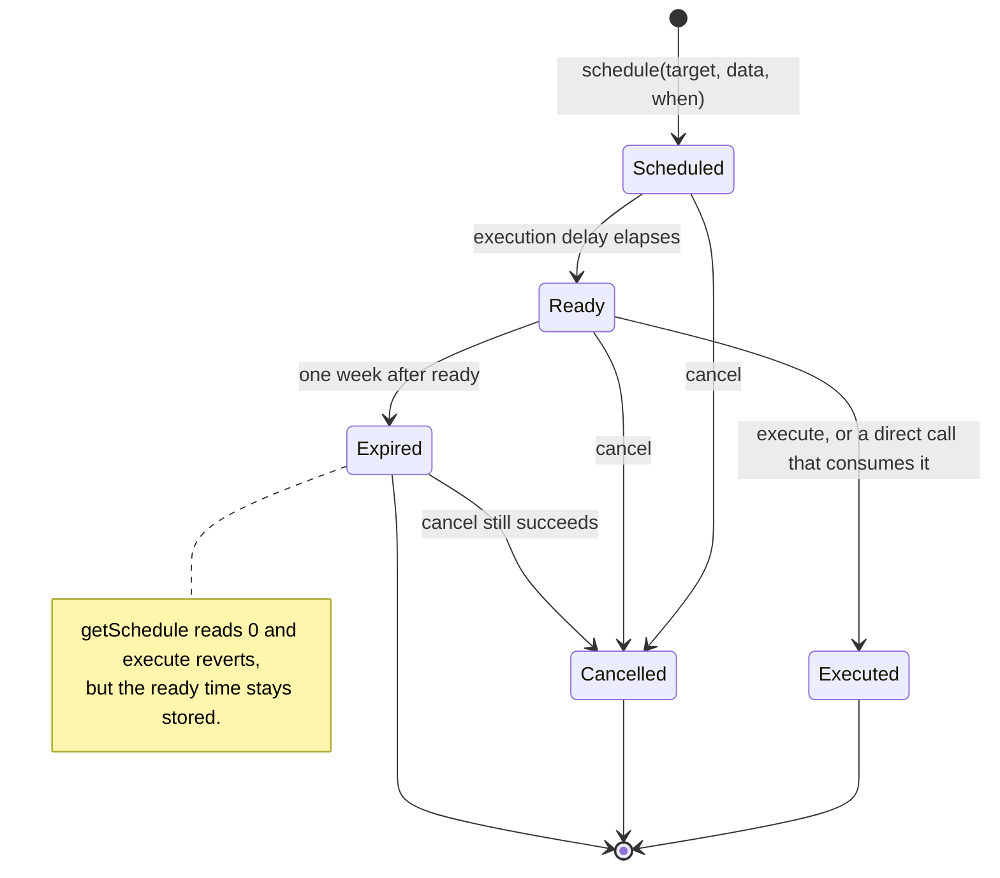
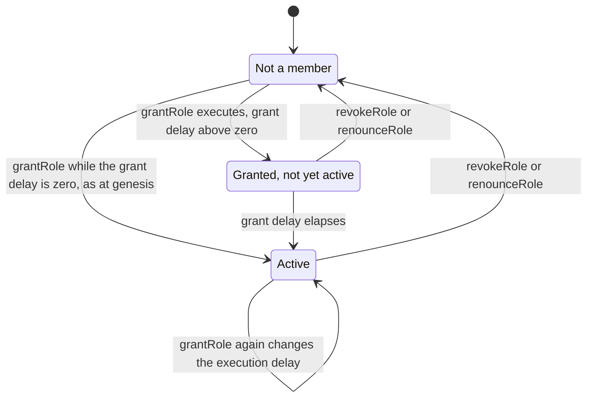
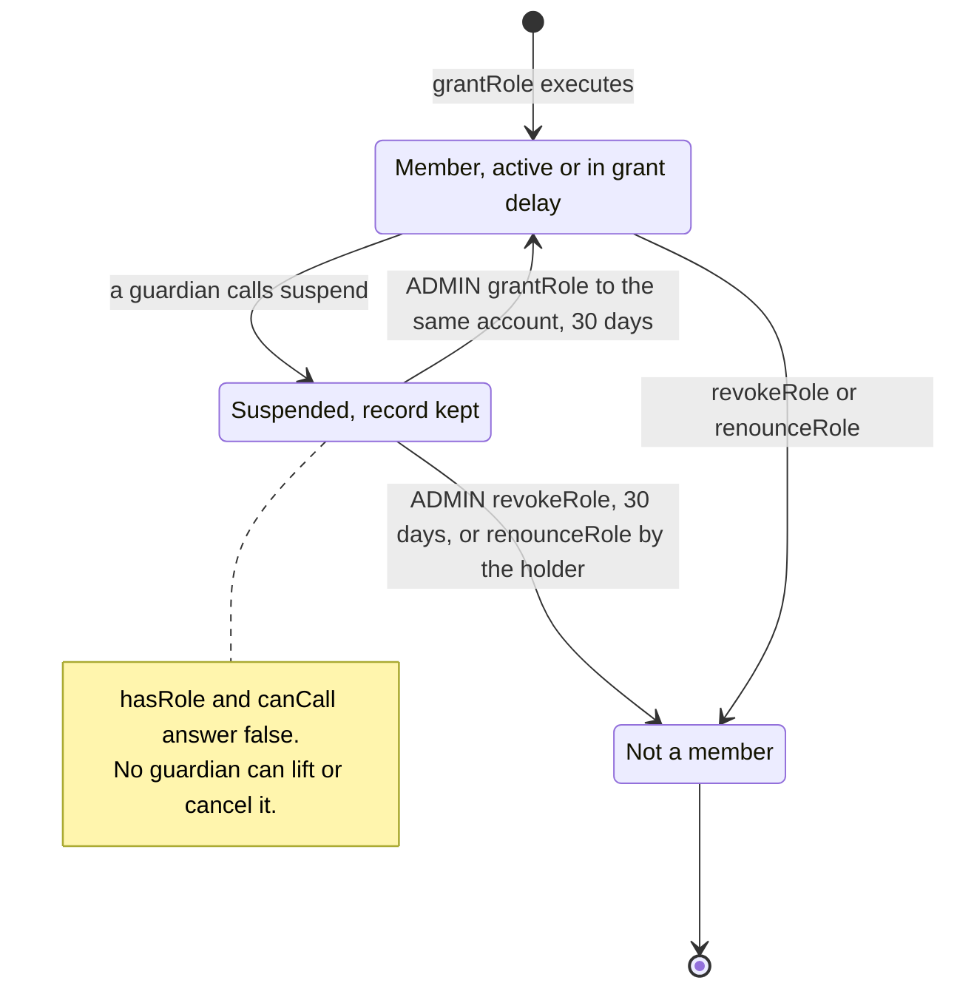
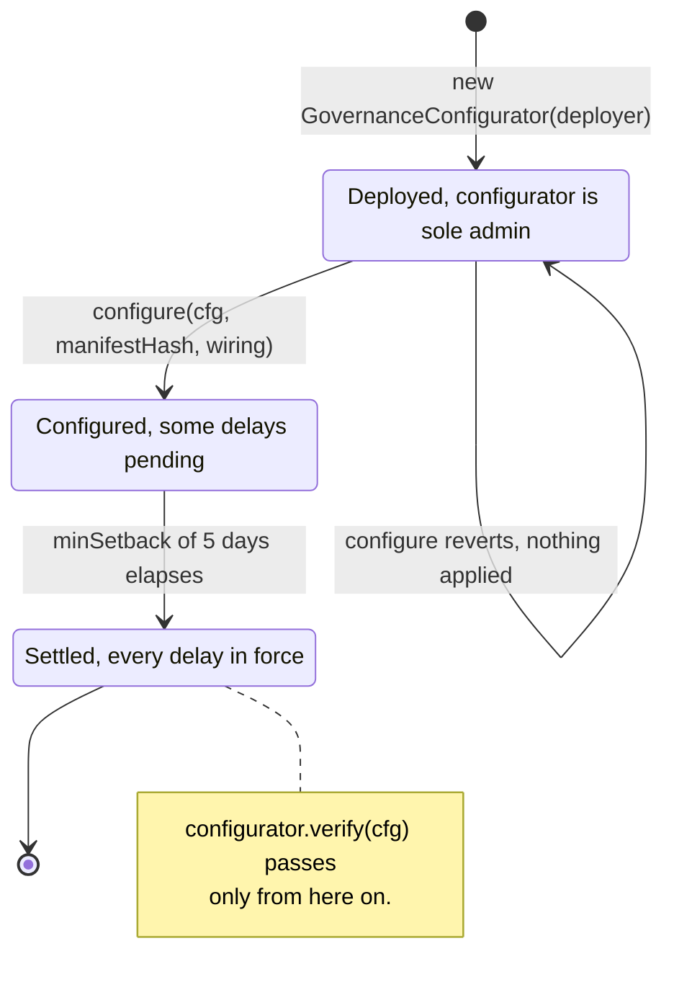
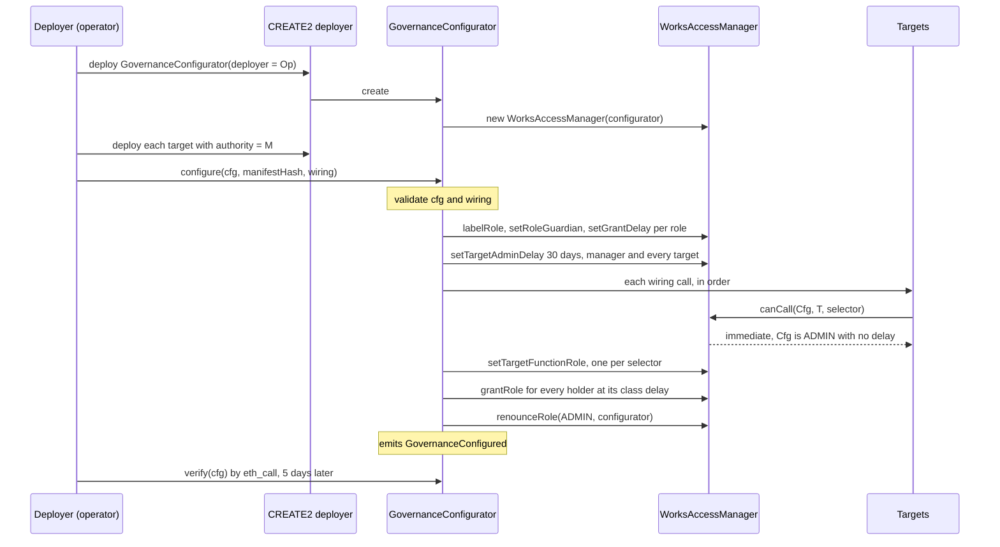
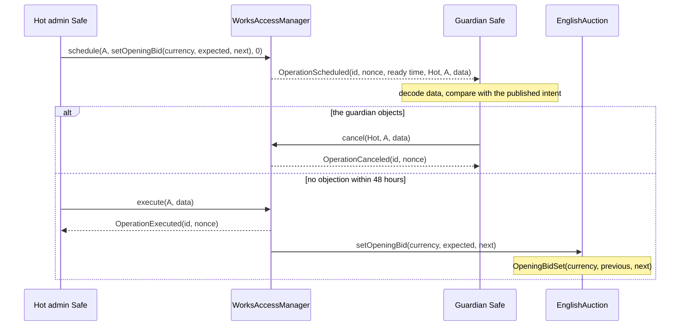
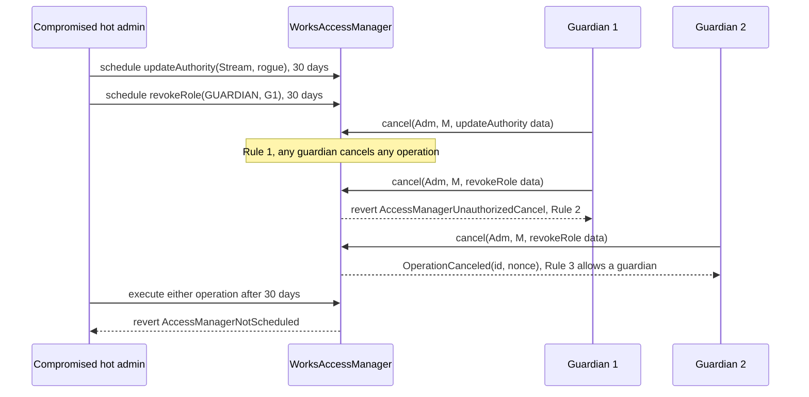
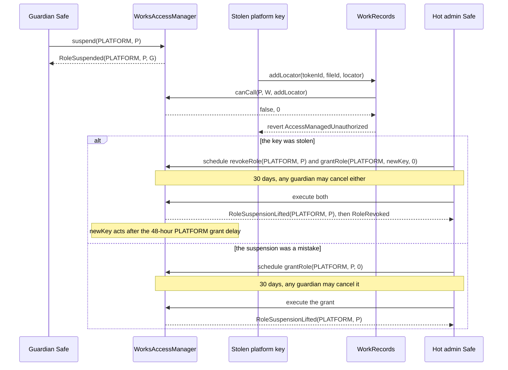
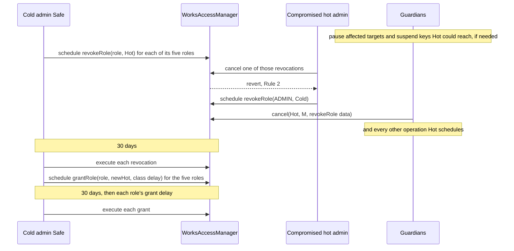
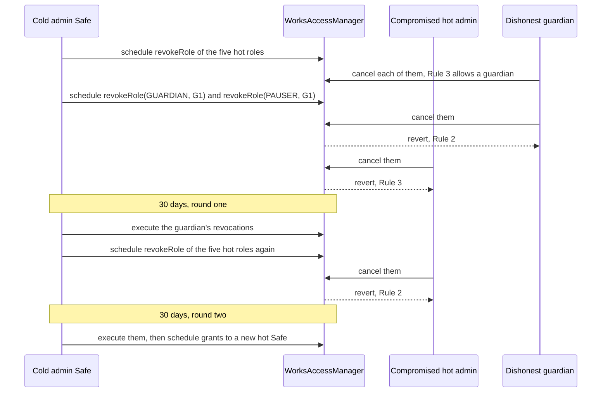

# Governance

One OpenZeppelin 5.7.0 `AccessManager`, subclassed as `WorksAccessManager`, governs every
6529 Works contract. It maps each restricted function to one role, makes that role's holders
wait the role's delay class, and lets the guardian Safes cancel any scheduled operation and
suspend a compromised operational key at once. `GovernanceConfigurator` installs the whole
genesis configuration in one transaction and renounces its own admin role. This page gives
the role model and the rules for auditors, Safe operators and governance monitors; the
selector-by-selector view is the generated [role and permission matrix](../audit/roles.md).

> Pre-audit. See the [project status](../../README.md#status).

## Contracts

| Contract | Source | Interface | Responsibility |
| --- | --- | --- | --- |
| `WorksAccessManager` | [`src/governance/WorksAccessManager.sol`](../../src/governance/WorksAccessManager.sol) | OpenZeppelin `IAccessManager`, plus `suspend` and `isSuspended` | Stock `AccessManager` 5.7.0 with four overrides: `_canCancel` adds the [cancellation rules](#cancellation-rules); `hasRole` reports a [suspended](#suspension-of-operational-keys) holder as not a member; `_grantRole` and `_revokeRole` lift a suspension. |
| `GovernanceConfigurator` | [`src/governance/GovernanceConfigurator.sol`](../../src/governance/GovernanceConfigurator.sol) | Its own: `configure`, `verify`, `worksManager`, `deployer` | Deploys its own manager, installs the genesis configuration and wiring, renounces `ADMIN`, emits `GovernanceConfigured`, and reads the manager back. |
| `GovernanceConfig` | [`src/governance/GovernanceConfig.sol`](../../src/governance/GovernanceConfig.sol) | Internal library | `validate`, `validateWiring`, `isGenesisSelector`, `install`, `verify` and `hasRecord`. |
| `Roles` | [`src/governance/Roles.sol`](../../src/governance/Roles.sol) | Internal library | Role IDs 0 to 12, the four delay classes, each role's execution delay, grant delay and label, and `isSuspendable`. No contract hard-codes a role ID. |
| `BoundedParameter` | [`src/governance/BoundedParameter.sol`](../../src/governance/BoundedParameter.sol) | Internal library | Raise-only parameters: at most double per step, never above a ceiling fixed in the target's code. |
| Every governed contract | for example [`src/stream/Stream.sol`](../../src/stream/Stream.sol) | OpenZeppelin `IAccessManaged` | `authority()` is the manager, and each governed function is `restricted`. |

Off chain, [`script/DeployV1.sol`](../../script/DeployV1.sol) builds the configuration and
wiring from the genesis JSON, and [`Deploy.s.sol`](../../script/Deploy.s.sol) and
[`Verify.s.sol`](../../script/Verify.s.sol) enforce the genesis policy with the checks in
[`DeployGuards.sol`](../../script/DeployGuards.sol) ([deploy runbook](../../script/README.md)).

## Concepts

Terms are also in the [glossary](../glossary.md). On this page "epoch" means a
[configuration epoch](../glossary.md#configuration-epoch) and "manifest" the
[governance manifest](../glossary.md#governance-manifest).

### How the manager decides

- **Target.** A contract whose `authority()` is the manager. Each `restricted` function asks
  the manager `canCall(caller, target, selector)` before it runs.
- **Function role.** Each (target, selector) maps to one role. An unmapped selector resolves
  to role 0, `ADMIN`.
- **Execution delay.** Each holder carries one per role. With zero delay the holder calls the
  target directly; otherwise it calls `schedule`, waits, and calls `execute` or the target.
- **Grant delay.** Per role: a new holder becomes active that long after its grant executes.
- **Target admin delay.** Per target: remapping its selectors, closing it or moving its
  authority waits at least that long, and at least the admin's own execution delay.
- **Setback.** A new grant delay or target admin delay takes effect after
  [`minSetback()`](../glossary.md#minsetback) (5 days), or after the size of the cut if
  longer. A cut to an execution delay takes effect after the size of the cut; a raise applies
  at once (OpenZeppelin `Time.Delay.withUpdate`).

A delay belongs to a (role, holder) pair, so a [delay class](../glossary.md#delay-class) is
a role whose holders always carry the class delay, and every governed selector maps to exactly
one role. The classes are immediate (0, `Roles.IMMEDIATE`), standard (48 hours,
`Roles.STANDARD`), funds (14 days, `Roles.FUNDS`) and successor (30 days, `Roles.SUCCESSOR`),
which also holds all meta-governance. `GovernanceConfig.install` takes every delay and role
guardian from `Roles`, so a configuration names only holders and selector mappings.

### Roles

Holders are those of the committed
[`config/genesis.example.json`](../../config/genesis.example.json); a deployment replaces the
addresses, not the structure. Delays come from `Roles.executionDelay` and `Roles.grantDelay`.

| Role | ID | Holder at genesis | Execution delay | Grant delay | Used for |
| --- | --- | --- | --- | --- | --- |
| `ADMIN` | 0 | Hot admin Safe; cold recovery admin Safe | 30 days | 30 days | Every unmapped selector: the one-shot `bind*` calls, each target's `setAuthority`, the manager's own functions |
| `GUARDIAN` | 1 | Three guardian Safes | Immediate | 30 days | The auction's dispute pause, `vetoChange`, `revokePackage`, `disableSigner`, `deprecateAsset`, `DependencyRegistry.deprecate`; the manager itself checks it for cancelling and `suspend` |
| `PAUSER` | 2 | The same three guardian Safes | Immediate | 48 hours | `pause()` on the English auction |
| `UNPAUSER` | 3 | Hot admin Safe | 48 hours | 48 hours | The English auction's `unpause()` and `resume(saleId)` |
| `CURATION_SIGNER` | 4 | Two curation signer keys (EOAs) | Immediate | 30 days | Nothing is mapped: the curation verifier reads membership |
| `STORAGE_OPERATOR` | 5 | Storage operator key | Immediate | 48 hours | WorkRecords' preferred-location setters |
| `MINTER` | 6 | None | Immediate | 30 days | Unused in v1 |
| `KEEPER` | 7 | None | Immediate | 48 hours | Unused in v1 |
| `PLATFORM` | 8 | Platform key | Immediate | 48 hours | `Stream.createCollection`, `StatementLog.appendPlatform`; read by hand for `addLocator` |
| `PARAMETER_SETTER` | 9 | Hot admin Safe | 48 hours | 48 hours | Auction settings and opening bids, defaults for new works, contract URIs, dispute outcomes, `relicense`, `stageOverride`, the entropy module's `setConfig` |
| `FUNDS_SETTER` | 10 | Hot admin Safe | 14 days | 14 days | Network fee terms, `setOwner`, `WorkRecords.setRoyaltyRate`, asset admission, default currencies, `RevenueEscrow.recover` |
| `SUCCESSOR_SETTER` | 11 | Hot admin Safe | 30 days | 30 days | Verifier, renderer, consolidation source, artist resolver, VRF and federation registry swaps; `lowerCallbackGasLimit`; re-enabling a signer; admitted minters and sale targets; `resolveContested`; `appendGovernanceManifest` |
| `CURATOR` | 12 | Curator key | Immediate | 30 days | `StatementLog.appendCurator` (curation evidence) |
| `PUBLIC` | `type(uint64).max` | Everyone | none | none | Never mapped: `GovernanceConfig` rejects it |

- **Role admin and guardian.** Every role's admin is `ADMIN` (`install` never calls
  `setRoleAdmin`), so every grant or revocation is a 30-day `ADMIN` operation. `GUARDIAN` is
  the guardian of roles 1 to 12; OpenZeppelin locks `ADMIN`'s to `ADMIN`.
- **Grant delay is never shorter than execution delay** (ADR 0001 §13.1), so immediate roles
  with code-level power (`GUARDIAN`, `CURATION_SIGNER`, `MINTER`, `CURATOR`) take 30 days to
  grant.
- **Unused roles.** Genesis grants `MINTER` and `KEEPER` to nobody (`unusedRoles` in the
  genesis JSON). Sale adapters mint through each token's admitted-minter mapping instead
  (ADR 0003, "Governance"), and upkeep such as `refreshStanding` is permissionless.
- **[Suspendable roles](../glossary.md#suspendable-role)** are `PLATFORM`, `CURATOR` and
  `STORAGE_OPERATOR` (`Roles.isSuspendable`): the zero-delay roles held by single keys that
  call contracts. `GenesisConfig.t.sol` and [`tools/check_genesis.py`](../../tools/check_genesis.py)
  check the genesis JSON's `suspendable` flags against it.

### One-shot bindings instead of a SYSTEM role

A shared role for contract-to-contract calls would let any holder call every hook. Each
target instead holds per-pair [bindings](../glossary.md#binding) (`bindWorkRecords`,
`bindEditions`, `bindStream`, `bindPackageRegistry`, `bindSplitFactory`, `bindStatementLog`),
each resolving to `ADMIN`, run once by genesis wiring (GV-24). A bind checks the bound
contract (code, no EIP-7702 delegation, ERC-165 where implemented; Stream's binds also require
`stream() == address(this)`), and the callee then checks `msg.sender` without the manager.

### Roles that targets read directly

Some contracts read a role from the manager by hand instead of using `restricted`:

- **`addLocator`.** The work's artist acts directly before finalize; anyone else needs an
  immediate answer for the `PLATFORM` mapping (`WorkRecords._checkCanCall`), which
  `VerifyV1.checkPlatformPath` confirms. Scope: [works and storage](works-and-storage.md).
- **Relayed statements.** `StatementLog.appendSigned` accepts a `CURATOR` or `PLATFORM`
  signer only when `canCallWithDelay` on `appendCurator` or `appendPlatform` answers
  immediately.
- **Curation signers.** `Eip712CurationVerifier.isSignerActive` requires `CURATION_SIGNER`
  membership with zero execution delay, and that the signer is not disabled.

Each check reaches `WorksAccessManager.hasRole`, so a
[suspension](#suspension-of-operational-keys) closes it in the same block as the key's
`restricted` calls (`test_AGuardianSuspendsThePlatformKeyAtOnce`).

### Configuration epochs and governance manifests

Each epoch (the roles, holders, delays and selector mappings in force) has a signed JSON
manifest. At genesis, `configure` emits its SHA-256 in `GovernanceConfigured`, and the wiring
appends it to the statement log as a `GOVERNANCE_MANIFEST` statement with subject
`(manager, 0)`. For a later epoch the admin schedules `StatementLog.appendGovernanceManifest`
(`SUCCESSOR_SETTER`, 30 days, the only writer of that kind, signed as the manager) with the
epoch's operations, so the hash is public before they take effect.

## State machine

### Scheduled operation

| Transition | Caller (role) | Delay | Function |
| --- | --- | --- | --- |
| Schedule | A holder of the role the call resolves to, with a nonzero execution delay: `ADMIN`, `UNPAUSER` or a setter role | Ready at the earliest now plus the delay | `AccessManager.schedule` |
| Ready | Nobody: time passes | The caller's execution delay; for the manager's own functions, [below](#the-managers-own-functions) | none |
| Execute | Only the scheduler: the operation ID is `keccak256(abi.encode(caller, target, data))` | none | `AccessManager.execute`, or the target's `restricted` check through `consumeScheduledOp` |
| Cancel | As in [Cancellation rules](#cancellation-rules) | Immediate | `cancel` (`_canCancel`) |
| Expire | Nobody | One week after ready (`AccessManager.expiration`) | none: `execute` reverts with `AccessManagerExpired` |

An executed, cancelled or expired operation can be scheduled again, with a new nonce and the
full delay; a live one cannot (`AccessManagerAlreadyScheduled`). A guardian can never
schedule (GV-6).

#### The manager's own functions

Nothing maps the manager's selectors, so `canCall(account, manager, selector)` reports only
`ADMIN` membership (`(false, 30 days)` for an admin, `(false, 0)` otherwise) and is no guide to
delays there. OpenZeppelin's private `_getAdminRestrictions` decides: every admin function
needs `ADMIN` and waits 30 days, or the target's admin delay if longer; `renounceRole` needs
only the holder and is immediate, and `suspend` checks `GUARDIAN` itself. The
[matrix](../audit/roles.md#the-accessmanagers-own-functions) lists each function.

### Cancellation rules

Stock OpenZeppelin lets the scheduler, any `ADMIN` holder and a holder of the target
function's guardian role cancel. `WorksAccessManager._canCancel` adds one permission and two
restrictions:

1. **Rule 1: any active `GUARDIAN` holder can cancel any scheduled operation,** on any target,
   the manager included.
2. **Rule 2: nobody but its scheduler can cancel an operation that revokes one of the
   canceller's own roles.** It covers every role and every canceller, `ADMIN` included. A
   scheduler may still withdraw its own proposal, even one that removes itself.
3. **Rule 3: a `revokeRole` on the manager that another account scheduled can be cancelled
   only by an active guardian.** No admin can cancel it, Rule 2 still bars the account it
   names, and its scheduler may cancel its own.

Every other operation is open to an active guardian (Rule 1) and to whoever stock
OpenZeppelin allows, so an admin still cancels another admin's grants, remaps and authority
moves (`test_AdminStillCancelsAnotherAdminsOtherOperations`).

- **Why Rule 1.** Stock cancellation is selector-scoped, so guardians could not cancel the
  admin's operations on the manager (`ADMIN_ROLE`'s guardian is locked to `ADMIN`), a
  `setAuthority(rogue)` scheduled directly on a target, or any unmapped target selector
  ([`GuardianCancel.t.sol`](../../test/governance/GuardianCancel.t.sol):
  `test_StockManagerLeavesGuardiansPowerlessOverManagerOperations`,
  `test_StockManagerCannotStopDirectSetAuthority`,
  `test_StockManagerCannotStopUnmappedTargetSelector`).
- **Why Rule 2.** Whether an operation removes the canceller depends on its arguments, which no
  per-selector setting can express. Without it a guardian could veto its own removal, and a
  compromised hot admin the cold admin's `revokeRole(ADMIN, hot)`
  (`test_StockManagerLetsAdminCancelItsOwnRevocation`).
- **Why Rule 3** (review finding GOV-1,
  [ADR 0002 addendum](../adr/0002-access-manager-hardening.md#addendum-review-of-14-october-2026)).
  It keeps the cold admin's recovery finite when the hot admin and one guardian act together
  ([flow](#if-a-guardian-cancels-the-recovery)). In exchange, only the other guardians can
  defend a guardian against an admin's revocation
  ([LIM-GV-12](../audit/known-limitations.md#trust-and-governance)). Rule 3 reads only the
  `revokeRole` selector: a `grantRole` that raises a holder's execution delay demotes it and
  keeps the stock rules (`test_DemotionsByGrantStayCancellable`).

**Wrappers cannot smuggle a revocation past Rules 2 and 3** (GV-3):

- A revocation inside `multicall` or a nested `execute` can be scheduled but never executes:
  inside `execute` the manager is the caller, and only the outer selector is authorized.
- A scheduled `renounceRole(role, account)` fails at execution
  (`AccessManagerBadConfirmation`): the caller is then the manager.
- A dirty address word escapes Rule 2 (Rule 3 still applies) but cannot execute; a dirty role
  ID cannot be scheduled.
- The rules protect roles on the manager only; a target function that shares `revokeRole`'s
  selector is an ordinary operation (`test_Rule2OnlyProtectsRolesOnTheManager`).

`multicall` called directly is a self-delegatecall in which each batched call keeps the
original caller and consumes its own schedule: the one sanctioned exemption to the
no-delegatecall rule (ADR 0002, "Security impact").

### Role membership

| Transition | Caller (role) | Delay | Function |
| --- | --- | --- | --- |
| Grant | `ADMIN` (every role's admin) | 30 days, then the role's grant delay before the holder is active | `AccessManager.grantRole(role, account, executionDelay)` |
| Change execution delay | `ADMIN` | 30 days, then as under [Setback](#how-the-manager-decides) | `grantRole` on an existing member |
| Revoke | `ADMIN` | 30 days, cancellable under Rules 2 and 3 | `AccessManager.revokeRole` |
| Renounce | The holder itself | Immediate | `AccessManager.renounceRole(role, self)` |

`hasRole` reports a pending member as not a member, so a guardian in its 30-day grant delay
cannot yet cancel anything.

### Suspension of operational keys

Revoking a role waits 30 days, and most targets of the zero-delay operational roles have no
pause. `WorksAccessManager.suspend(roleId, account)` therefore lets any guardian stop a
holder of a suspendable role at once (review finding GOV-2,
[ADR 0002 addendum](../adr/0002-access-manager-hardening.md#addendum-review-of-14-october-2026)).

| Transition | Caller (role) | Delay | Function |
| --- | --- | --- | --- |
| Suspend | Any active `GUARDIAN` holder | Immediate | `WorksAccessManager.suspend(roleId, account)` |
| Lift by grant | `ADMIN` | 30 days, cancellable by any guardian; an existing member gets no new grant delay | `AccessManager.grantRole(roleId, account, executionDelay)` |
| Lift by revocation | `ADMIN` | 30 days, cancellable under Rules 2 and 3 | `AccessManager.revokeRole(roleId, account)` |
| Lift by renouncing | The holder itself | Immediate | `AccessManager.renounceRole(roleId, account)` |

Each lift emits `RoleSuspensionLifted`: the override of `_grantRole` and `_revokeRole` clears
the flag, and OpenZeppelin runs `renounceRole` through `_revokeRole`. A suspension is never
scheduled, so nothing can cancel it.

- **Who and which.** An active guardian calls the manager directly, or batches several in
  `multicall`; anyone else reverts with `AccessManagerUnauthorizedAccount(caller, GUARDIAN)`.
  Another role reverts with `RoleNotSuspendable(roleId)`; an account with no record for the
  role, or one already suspended, with `NotSuspendable(roleId, account)`.
- **Effect.** `hasRole` reports the holder as not a member, so `canCall` answers `(false, 0)`
  and every `restricted` function and manual check of that role refuses it in the same block.
  The record stays (`getAccess` still shows it), the account's other roles are unaffected, and
  a holder suspended in its grant delay never becomes active while suspended. Readback fails
  (`HolderMismatch`; `VerifyV1.check`'s `HolderSuspended`).
- **Not suspendable:** every other role, so the cancel rules and the admin functions rest on
  stock membership. A curation signer is cut off by the verifier's one-way `disableSigner`.

**How long a suspension lasts.** The `ADMIN` lifts stay in the 30-day class (GV-4,
ADR 0001 §13). A mistaken suspension
lasts 30 days; one by a dishonest guardian, which cancels each lift until its own removal
executes, about 60 (`test_ADishonestGuardiansSuspensionLastsAboutSixtyDays`); about 90
with a compromised hot admin alongside
([LIM-GV-14](../audit/known-limitations.md#trust-and-governance)).

### The manager at genesis

| Transition | Caller (role) | Delay | Function |
| --- | --- | --- | --- |
| Deploy | Anyone; normally the operator, by CREATE2 | none | `GovernanceConfigurator` constructor, which deploys `WorksAccessManager(address(this))` |
| Configure | Only `deployer`, a constructor argument | Immediate (the configurator is `ADMIN` with zero delay) | `GovernanceConfigurator.configure` |
| Settle | Nobody: time passes | `minSetback()`, 5 days | none |
| Read back | Anyone, by `eth_call` | none | `GovernanceConfigurator.verify` |

## Flows

### Genesis configure

- **Preconditions.** The caller is `deployer` (`NotDeployer` otherwise, GV-11). Every target
  already exists with `authority()` equal to the configurator's manager. `cfg` and `wiring`
  pass `validate` and `validateWiring` ([GV-8 to GV-12](#rules-and-invariants)).
- **Wiring runs before mapping,** so a wired selector that `cfg` maps to a 30-day role, such
  as `setAdmittedMinter`, still runs at once. The installer cannot grant itself
  (`InvalidGrant`).
- **Effects.** Every holder is active at once: the grant delays set earlier in the transaction
  are still pending, so the grants see zero. Until they settle 5 days later, the admins'
  30-day execution delay still bounds every admin action. The configurator ends with no role,
  so a second `configure` reverts (`AccessManagerUnauthorizedAccount`).
- **Failure.** A reverting wiring call reverts `configure` with its revert data, or with
  `WiringCallFailed(index)` when it gave none; nothing is applied, and the deployer can retry.
- **Gas.** Even with the maximum 64 wiring calls, `configure` fits the EIP-7825 transaction
  cap ([Parameters and limits](#parameters-and-limits)).

**The wiring allow-list.** `GovernanceConfig.isGenesisSelector` admits only these selectors.
Anything else, such as a verifier swap or a recipient change, reverts with
`WiringSelectorNotAllowed`. A wiring call must target a configured target, never the manager
(`InvalidWiringCall`). There are at most `GovernanceConfig.MAX_WIRING_CALLS` (64) calls; the
committed example's 15 are listed in order in the [matrix](../audit/roles.md#genesis-wiring).

| Selector | Why it is wired |
| --- | --- |
| `bindWorkRecords`, `bindEditions`, `bindStream`, `bindPackageRegistry`, `bindSplitFactory`, `bindStatementLog` | The one-shot bindings |
| `bindFederationRegistry` (artist registry) | Allowed but not wired: the federation registry ships in v1.1, then bound by a 30-day `ADMIN` action |
| `setAdmittedMinter(address,bool)` | Admits each sale adapter to its token. A later one is admitted the same way, in the 30-day class; for 6529 Stream the review checks that the adapter sends an unbid or frozen-out work to the museum, never to the artist, and the other obligations ADR 0005 lists: burns only on an upheld dispute, settles, pays the locked shares, keeps a constant sale kind (ADR 0005, owner decision 15) |
| `setTarget(address,bool)` | Lists each token on its sale adapter |
| `setDefaultCurrency(bytes32,uint64,address)` | Each product's first default currency, ETH, the only active asset at genesis. Without it no auction could start for 14 days, because `EnglishAuction.start` reads `PRODUCT_STREAM`'s. |
| `appendGovernanceManifest(...)` | The epoch-0 manifest |

**Readback** (`GovernanceConfigurator.verify`, by `eth_call`, at least 5 days later). It
reverts on the first difference:

- the configurator still has any `ADMIN` record (`ConfiguratorStillAdmin`);
- a role's admin, guardian or grant delay differs from `Roles` (`RoleMismatch`);
- a target, the manager included, is closed or lacks the 30-day admin delay
  (`TargetMismatch`);
- a selector maps to another role (`FunctionRoleMismatch`);
- a configured holder is missing, not yet active, suspended, or has another or a pending
  execution delay (`HolderMismatch`);
- a guardian holds or awaits any role other than `PAUSER`, or a pauser also has an `UNPAUSER`
  record.

`verify` cannot see a pending grant-delay or target-admin-delay change (OpenZeppelin has no
getter: `test_Limitation_ReadbackCannotSeePendingDelayReductions`), a holder outside `cfg`,
or what the wiring did ([LIM-GV-6](../audit/known-limitations.md#trust-and-governance)).
[`script/Verify.s.sol`](../../script/Verify.s.sol) covers these from events and getters and
repeats the deploy's guards on chain (review finding GOV-3; GV-14, GV-15, GV-29 to GV-34;
runbook [step 2](../../script/README.md#2-safe-pre-flight),
[step 10](../../script/README.md#10-simulate-then-broadcast),
[step 11](../../script/README.md#11-verify-after-5-days)).

### A 48-hour parameter change with a guardian watching

- `EnglishAuction.setOpeningBid` maps to `PARAMETER_SETTER` (48 hours). At execution it
  reverts if the opening bid changed since the operation was written (`ExpectedValueMismatch`,
  GV-19) or the value is above its ceiling (`OpeningBidAboveCeiling`).

### A guardian cancels a hostile admin operation

- A guardian cannot cancel its own removal, so at least two honest guardians must be online
  at all times ([LIM-GV-5](../audit/known-limitations.md#trust-and-governance)). The cold
  admin can cancel the `updateAuthority`, but not the revocation of `G1` (Rule 3,
  `test_TheGuardianVetoIsUnchanged`).
- **Tested by** `test_GuardiansCancelHostileAdminOperations` in
  [`Genesis.t.sol`](../../test/integration/Genesis.t.sol).

### A guardian suspends a compromised platform key

- **Effects.** In the same block `P` fails every `PLATFORM` path: `createCollection`,
  `appendPlatform`, `addLocator` and relayed `PLATFORM` statements. The same flow stops a
  `CURATOR` or `STORAGE_OPERATOR` key.
- **Lift** as under [suspension](#suspension-of-operational-keys); in an admin recovery the
  cold admin lifts once the hot admin is removed. If the stolen key is also the marketplace
  owner, schedule `setOwner` on Stream and Editions too (`FUNDS_SETTER`, 14 days).
- **Tested by** the GV-26 to GV-28 tests, and end to end by
  `test_AGuardianSuspendsThePlatformKeyAtOnce` and `test_ReplacingASuspendedKey` in
  [`GovernanceRecovery.t.sol`](../../test/integration/GovernanceRecovery.t.sol).

### Cold-admin recovery from a compromised hot admin

- **The five roles** of the hot admin Safe are `ADMIN`, `UNPAUSER`, `PARAMETER_SETTER`,
  `FUNDS_SETTER` and `SUCCESSOR_SETTER`.
- **Revocations first.** While the hot admin holds `ADMIN` it can cancel any operation but a
  revocation, including grants to its replacement, so the cold admin schedules the grants
  after the revocations execute.
- **Tested by** `test_ColdAdminRecoversFromACompromisedHotAdmin` in
  [`Hardening.t.sol`](../../test/governance/Hardening.t.sol),
  `test_ColdAdminRemovesTheHotAdmin` in [`Genesis.t.sol`](../../test/integration/Genesis.t.sol)
  and `test_ReverifyAfterAdminRecoveryPassesInEpochMode` in
  [`DeployScript.t.sol`](../../test/deploy/DeployScript.t.sol). The step-by-step procedure is
  the runbook's [Admin recovery](../../script/README.md#admin-recovery).

#### If a guardian cancels the recovery

A dishonest guardian acting with the hot admin can cancel the cold admin's revocations of the
hot admin (Rule 3) but not its own removal (Rules 2 and 3), so recovery takes two 30-day
rounds.

Tested by `test_ColdAdminRemovesAHotAdminAndAGuardianActingTogether` in
[`GovernanceRecovery.t.sol`](../../test/integration/GovernanceRecovery.t.sol).

## Operating procedures

Guardian liveness and monitoring, emergencies, operation expiry, rotations, onboarding a target
and publishing an epoch are in the runbook's [Operating procedures](../../script/README.md#operating-procedures).

## Rules and invariants

Rule IDs use the prefix `GV`; the internal review's findings are cited as "review finding
GOV-n".

**The manager and its configuration.**

| ID | Rule | Enforced in | Tested by |
| --- | --- | --- | --- |
| GV-1 | Any active `GUARDIAN` holder can cancel any scheduled operation, on any target, the manager included. A `PAUSER`-only account or an outsider cannot. | `WorksAccessManager._canCancel` | [`GuardianCancel.t.sol`](../../test/governance/GuardianCancel.t.sol): `test_GuardianCancelsEveryManagerAdminSelector`, `test_EveryGuardianCancelsManagerOperations`, `test_GuardianCancelsTargetClassOperations`, `test_GuardianCancelsDirectSetAuthorityOnTarget`, `test_GuardianCancelsUnmappedTargetSelector`, `test_PauserOnlyAccountCannotCancel`, `test_OutsiderCannotCancel` |
| GV-2 | Nobody but its scheduler can cancel a `revokeRole(role, account)` on the manager when `account` is the canceller, for every role, `ADMIN` included. | `WorksAccessManager._canCancel`, `_revokesRoleOf` | `GuardianCancel.t.sol`: `test_GuardianCannotCancelItsOwnReplacement`, `test_CompromisedAdminCannotCancelItsOwnRevocation`, `testFuzz_NobodyCancelsTheirOwnRevocation`, `test_RevocationWithTrailingCalldataIsStillProtected`, `test_SchedulerCanWithdrawItsOwnSelfRevocation`, `test_Rule2OnlyProtectsRolesOnTheManager` |
| GV-3 | A revocation wrapped in `multicall` or a nested `execute` never executes, and a scheduled `renounceRole` of another account fails. | OpenZeppelin `AccessManager._canCallSelf` (execution identifier) and `renounceRole` (confirmation) | `GuardianCancel.t.sol`: `test_MulticallWrappedRevocationNeverExecutes`, `test_NestedExecuteRevocationNeverExecutes`, `test_ScheduledRenounceCannotRemoveGuardian`, `test_MalformedRevocationCanAlwaysBeCancelled`, `test_DirtyRoleIdRevocationCannotBeScheduled` |
| GV-4 | Meta-governance is never faster than the slowest class: `ADMIN` has a 30-day execution delay, every target (the manager included) a 30-day admin delay, and every grant delay is at least its role's execution delay. | `Roles.executionDelay`, `Roles.grantDelay`, `GovernanceConfig.install` (`TARGET_ADMIN_DELAY`) | [`Hardening.t.sol`](../../test/governance/Hardening.t.sol): `test_MetaGovernanceIsNeverFasterThanTheSlowestClass`, `test_RemappingAFundsSelectorToAFasterRoleTakesThirtyDays`; [`Roles.t.sol`](../../test/governance/Roles.t.sol): `test_GrantDelayNeverShorterThanExecutionDelay`, `test_ExecutionDelayTable`, `test_GrantDelayTable` |
| GV-5 | Shortening a delay waits: after its 30-day operation, a grant-delay or target-admin-delay cut applies after the longer of 5 days and the cut, an execution-delay cut after the cut. A fresh zero-delay holder waits 30 days plus the grant delay. | OpenZeppelin `Time.Delay.withUpdate`, `AccessManager._grantRole` | `Hardening.t.sol`: `test_AdminCannotShortenGrantDelayWithoutWaiting`, `test_AdminCannotShortenTargetAdminDelayWithoutWaiting`, `test_AdminCannotShortenItsOwnExecutionDelayWithoutWaiting`, `test_FreshZeroDelayHolderWaitsScheduleAndGrantDelay` |
| GV-6 | A guardian cannot schedule an operation: it holds only zero-delay roles, and `schedule` reverts for a caller with no delay. | `GovernanceConfig._checkPair` and `verify` (guardians hold only `GUARDIAN` and `PAUSER`), `AccessManager.schedule` | `Hardening.t.sol`: `test_GuardianCannotSchedule` |
| GV-7 | A scheduled operation executes only after its delay and only within one week of becoming ready. Its ID binds it to its scheduler, and executing consumes it. | OpenZeppelin `AccessManager.execute`, `hashOperation`, `_consumeScheduledOp` | `Hardening.t.sol`: `test_ScheduledOperationExpiresAfterOneWeek`, `test_ExpiredMetaOperationCannotBeExecuted`; `GuardianCancel.t.sol`: `test_AdminCannotExecuteBeforeTheDelay` |
| GV-8 | A configuration has at least two guardians and a holder for `ADMIN`, `PAUSER` and `UNPAUSER`; a guardian holds only `GUARDIAN` and `PAUSER`; nobody holds both `PAUSER` and `UNPAUSER`; no grant is to the zero address, repeated, of an unknown role, or to the installer. | `GovernanceConfig._validateGrants`, `_checkPair`, `install` | [`GovernanceConfigurator.t.sol`](../../test/governance/GovernanceConfigurator.t.sol): `test_RejectsFewerThanTwoGuardians`, `test_AcceptsTheTwoGuardianFloor`, `test_RejectsMissingAdminPauserOrUnpauser`, `test_RejectsInvalidGrants`, `test_RejectsGuardianHoldingAnyOtherRole`, `test_RejectsSharedPauseAndUnpauseHolder` |
| GV-9 | Every configured target has code, is not the manager, appears once, and answers `authority()` with this manager. | `GovernanceConfig.validate` | `GovernanceConfigurator.t.sol`: `test_RejectsInvalidTargets`, `test_RejectsDuplicateTarget`, `test_TargetGovernedByAStockManagerIsRejected`, `test_PreSeededManagerIsRejected` |
| GV-10 | One selector, one class: a selector appears once per target and never maps to `ADMIN`, `CURATION_SIGNER` or `PUBLIC`. | `GovernanceConfig._validateFunctions` | `GovernanceConfigurator.t.sol`: `test_RejectsOneSelectorInTwoClasses`, `test_RejectsFunctionRolesThatMustNotCall`, `test_CuratorAndPlatformMapToZeroDelayWriters`; `Hardening.t.sol`: `test_EachGovernedSelectorHasExactlyOneClass` |
| GV-11 | Only `deployer` can configure, once; the configurator governs only the manager it deployed, and ends with no role. | `GovernanceConfigurator.configure`, constructor | `GovernanceConfigurator.t.sol`: `test_OnlyDeployerCanConfigure`, `test_ConfigureIsOneShot`, `test_DeployerIsTheConstructorArgumentNotTheSender`, `test_AForeignConfiguratorOnlyGovernsItsOwnManager`, `test_ConfiguratorDeploysAndOwnsAWorksAccessManager`; [`GenesisWiring.t.sol`](../../test/governance/GenesisWiring.t.sol): `test_ConfiguratorEndsWithNoRoleAfterWiring` |
| GV-12 | Genesis wiring has at most 64 calls, each on a configured target with an allow-listed selector; it runs before any selector is mapped, and any revert aborts the whole configuration. | `GovernanceConfig.validateWiring`, `isGenesisSelector`, `install` | `GenesisWiring.t.sol`: `test_GenesisSelectorsAreExactlyTheAllowList`, `testFuzz_OnlyGenesisSelectorsPassValidation`, `test_WiringRunsBeforeSelectorsAreMapped`, `test_RevertingWiringCallAbortsTheWholeConfiguration`, `test_SilentWiringRevertIsNamedByIndex`, `test_RejectsZeroDelaySwapsThroughWiring`, `test_RejectsWiringOnAnUnconfiguredTarget`, `test_RejectsMoreThanTheWiringBound`, `test_AllowListRejectsManagerCallsEvenIfTheManagerWereATarget` |
| GV-13 | Readback reverts on any difference between the manager and `cfg` that `AccessManager` exposes (listed under [Genesis configure](#genesis-configure)). | `GovernanceConfigurator.verify`, `GovernanceConfig.verify` | `GovernanceConfigurator.t.sol`: `test_ReadbackDetectsRemappedSelector`, `test_ReadbackDetectsPendingExecutionDelayReduction`, `test_ReadbackDetectsAdminDelayReduction`, `test_ReadbackDetectsGuardianGainingAnyOtherRole`, `test_ReadbackDetectsPauserGrantedUnpause`, `test_ReadbackDetectsClosedTargetAndChangedGuardian`, `test_ReadbackDetectsMissingHolder`, `test_ReadbackFailsBeforeDelaysSettle`, `test_VerifyRejectsAManagerTheConfiguratorStillAdministers`; [`Suspension.t.sol`](../../test/governance/Suspension.t.sol): `test_ReadbackRejectsASuspendedHolder` |
| GV-14 | Off anvil, the deploy refuses unreachable or placeholder holders, fewer than two admin Safes, three guardian Safes or two curation signers, a signer shared by any two admin or guardian Safes, a policy or wiring other than the committed example, an unpinned CC0 text, a missing fee recipient and dropped modules. | `Deploy.s.sol` (`prepare`, `checkDeployment`), `DeployGuards` | [`DeployScript.t.sol`](../../test/deploy/DeployScript.t.sol): `test_OffAnvilAdminsAndGuardiansMustBeSafesWithAThreshold`, `test_OffAnvilNeedsTwoAdminSafes`, `test_OffAnvilAdminSafesShareNoSigner`, `test_OneKeyBehindEveryGuardianSafeIsRefused`, `test_OffAnvilNeedsThreeGuardiansAndTwoCurationSigners`, `test_ARemappedSelectorIsRefused`, `test_ChangedWiringIsRefused`, `test_TheCc0TextMustBeTheCanonicalOne`, `test_OffAnvilTheFeeRecipientMustExist`, `test_NothingTheGenesisNamesMayBeDropped`, `test_HoldersCannotBeDeploymentContracts` |
| GV-15 | Deployment CI fails on a pending grant-delay or target-admin-delay change, an unexpected grant, mismatched event hashes, an unapplied wire, a suspended configured holder, or a closed PLATFORM path. | `Verify.s.sol`, `VerifyV1.check` | `DeployScript.t.sol`: `test_VerifyCatchesPendingDelayChanges`, `test_VerifyCatchesAnUnexpectedGrant`, `test_VerifyRecomputesTheEventHashes`; [`DeployV1.t.sol`](../../test/deploy/DeployV1.t.sol): `test_ReadbackCatchesAnUnappliedWire`, `test_ReadbackNeedsPlatformsImmediatePath`, `test_ReadbackCatchesATargetMovedToAnotherAuthority`, `test_ReadbackCatchesARoleGrantedToTheConfigurator`, `test_ReadbackRejectsASuspendedHolder` |
| GV-16 | Under random hostile admin operations and benign rotations, with vigilant guardians, no hostile operation executes and role membership matches the model. | All of the above | [`GovernanceInvariant.t.sol`](../../test/governance/GovernanceInvariant.t.sol): `invariant_GovernanceStaysContained` |

**Rules every target follows.**

| ID | Rule | Enforced in | Tested by |
| --- | --- | --- | --- |
| GV-17 | Every `restricted` function of every concrete contract is mapped to exactly one class role, or listed as genesis-only (a bind genesis wires) or deferred. Nothing falls back to `ADMIN` unlisted. | [`tools/check_genesis.py`](../../tools/check_genesis.py) in CI; [`GenesisConfig.t.sol`](../../test/governance/GenesisConfig.t.sol) | `GenesisConfig.t.sol`: `test_JsonMatchesTheCompiledSelectors`, `test_EveryEntryMatchesItsSignatureAndClassDelay`, `test_WiringIsGenesisOnlyAndComplete`; `Hardening.t.sol`: `test_UnmappedSelectorFallsBackToAdminDelay`; [`tools/test_check_genesis.py`](../../tools/test_check_genesis.py) |
| GV-18 | Governed functions are non-payable: `AccessManager.execute` forwards `msg.value`. | Each target (no governed function is `payable`) | `Hardening.t.sol`: `test_GovernedFunctionsRejectValueThroughExecute`, `test_EveryGovernedSelectorIsNonPayable`, `test_NonPayableProbeFlagsAPayableGovernedFunction`; per module, for example [`AssetAllowlist.t.sol`](../../test/economics/AssetAllowlist.t.sol): `test_GovernedFunctionsAreNonPayable` |
| GV-19 | Setters for funds, recipients, verifiers, renderers and sale parameters are compare-and-set: they take the expected current value (or revision), so a stale operation reverts. | Each setter (`ExpectedValueMismatch`, revision checks) | `Hardening.t.sol`: `test_StaleCompareAndSetOperationReverts`; `AssetAllowlist.t.sol`: `test_QueuedAdmissionCannotReviveAfterEmergencyDeprecation`, `test_DefaultCurrencyIsCompareAndSet` |
| GV-20 | Every governed setter emits an event: value setters the old and the new value, per-key toggles (`setTarget`, `setAdmittedMinter`) the key and its new state. | Each setter's event | [`VrfEntropyGovernance.t.sol`](../../test/entropy/VrfEntropyGovernance.t.sol): `test_SetConfig_UpdatesAndEmits`, `test_SetCoordinator_SwapsAndEmits`; [`StatementLog.t.sol`](../../test/records/StatementLog.t.sol): `test_SetArtistResolver_SwapsAndEmits`; `Hardening.t.sol`: `test_DirectionRulesLiveInTheTarget` |
| GV-21 | Raise-only parameters use `BoundedParameter`: a nonzero initial value within the ceiling, and each raise above the current value, at most double it, and never above the ceiling. The one v1 user is the entropy callback gas limit (`setConfig`, ceiling `MAX_CALLBACK_GAS`); its separate 30-day `lowerCallbackGasLimit` sets a value below the current limit and at least `MIN_CALLBACK_GAS`. | `BoundedParameter.initial`, `raise`; `VrfEntropyModule` | [`BoundedParameter.t.sol`](../../test/governance/BoundedParameter.t.sol): `testFuzz_RaiseMatchesSpecification`, `testFuzz_RaiseSequenceStaysBounded`, `test_RaiseRejectsMoreThanDouble`; `VrfEntropyGovernance.t.sol`: `test_SetConfig_GasLimitCanOnlyBeRaised`; [`VrfEntropyManaged.t.sol`](../../test/entropy/VrfEntropyManaged.t.sol): `test_ALoweringStaysAboveTheFloorAndBelowTheCurrentLimit` |
| GV-22 | Dependencies installed by governed setters are checked for code, no EIP-7702 delegation and ERC-165 where implemented. Sale targets are listed with the same check (ERC-721 on the English auction; the edition auction lists only the Editions its constructor checked). All but admitted minters and sale targets are also pinned to a code hash re-checked at every use (DEPS-6). | `Dependency` (the one shared check), used by `PackageRegistry.setVerifier` and `registerPackage`, `VrfEntropyModule`, `StatementLog`, `EnglishAuction` (`isTarget`), `UniformEditionAuction` (constructor, `setFederationRegistry`), `Stream.rendererOf`, `WorkRecords.pinnedRenderer`, `ArtistRegistry` | [`PackageRegistry.t.sol`](../../test/curation/PackageRegistry.t.sol): `test_registerPackage_refusesAVerifierWhoseCodeChanged`; [`VrfEntropyModule.t.sol`](../../test/entropy/VrfEntropyModule.t.sol): `test_Pin_ACoordinatorWhoseCodeChangedIsRefused`; `StatementLog.t.sol`: `test_Artist_AResolverWhoseCodeChangedIsRefused`; [`EnglishAuctionFederation.t.sol`](../../test/sales/auction/EnglishAuctionFederation.t.sol): `test_Federation_CodeHashesArePinned`; [`EnglishAuctionDisputes.t.sol`](../../test/sales/auction/EnglishAuctionDisputes.t.sol): `test_SetTarget_RejectsNonTokens`; [`UniformEditionAuction.t.sol`](../../test/sales/edition/UniformEditionAuction.t.sol): `test_SetTarget_OnlyEditions`, `test_SetFederationRegistry`; [`RendererCodePin.t.sol`](../../test/integration/RendererCodePin.t.sol): `test_PinnedRendererWithChangedCodeIsRefused`, `test_FinalizeRefusesADefaultRendererWhoseCodeChanged`; [`ArtistRegistry.t.sol`](../../test/identity/ArtistRegistry.t.sol): `test_ConsolidationSource_CodeHashRecheckedAtUse` |
| GV-23 | A delay that reverses a tightening action counts from that action, not from scheduling: `unpause`, `resume` and the dispute `cancel` run no earlier than 48 hours after the pause (review finding GOV-5), a re-admission no earlier than 14 days after the deprecation (MARKET-2). | `EnglishAuction._requireUnpausable`, `UniformEditionAuction.unpause`, `AssetAllowlist.admitAsset` | [`PauseWindow.t.sol`](../../test/sales/PauseWindow.t.sol): `test_Unpause_ScheduledBeforeThePauseWaitsTwoDaysAfterIt`, `test_Resume_ScheduledBeforeThePauseWaitsTwoDaysAfterIt`; `AssetAllowlist.t.sol`: `test_DeprecateThenReadmit`; [`UniformEditionAuction.t.sol`](../../test/sales/edition/UniformEditionAuction.t.sol): `test_Pause_BlocksOpensOnly` |
| GV-24 | Contract-to-contract calls use one-shot bindings, not roles: each bind resolves to `ADMIN`, runs once, and genesis wires all of v1's. | Each `bind*` (`AlreadyBound`), `GovernanceConfig.isGenesisSelector` | `GenesisWiring.t.sol`: `test_RepeatedOneShotBindAbortsTheWholeConfiguration`, `test_WiringExecutesGenesisCallsInTheConfiguringTransaction`; [`Genesis.t.sol`](../../test/integration/Genesis.t.sol): `test_WiringIsInPlaceAndTheReadbackPasses` |

**Rule 3, suspension and the deployment checks** (review findings GOV-1 to GOV-4, DEPS-3 and
DEPS-4).

| ID | Rule | Enforced in | Tested by |
| --- | --- | --- | --- |
| GV-25 | A `revokeRole` on the manager that another account scheduled can be cancelled only by an active guardian, never by an admin, and never by the account it names (Rule 2); its scheduler can always cancel it. Admins keep the stock power over every other operation; a demotion by `grantRole` is not a revocation. | `WorksAccessManager._canCancel` (Rule 3) | [`GuardianCancel.t.sol`](../../test/governance/GuardianCancel.t.sol): `test_AdminCannotCancelAnotherAccountsRevocation`, `test_AdminCannotCancelAnotherAdminsRevocationOfAKey`, `test_AdminStillCancelsAnotherAdminsOtherOperations`, `testFuzz_OnlyGuardiansCancelAnotherAccountsRevocation`; [`GovernanceRecovery.t.sol`](../../test/integration/GovernanceRecovery.t.sol): `test_ColdAdminRemovesAHotAdminAndAGuardianActingTogether`, `test_TheGuardianVetoIsUnchanged`, `test_DemotionsByGrantStayCancellable` |
| GV-26 | Only an active guardian can suspend, only a `PLATFORM`, `CURATOR` or `STORAGE_OPERATOR` record (active or pending), and only once; a suspension through `execute` is refused. | `WorksAccessManager.suspend`, `Roles.isSuspendable` | [`Suspension.t.sol`](../../test/governance/Suspension.t.sol): `test_SuspendableRolesAreTheZeroDelayOperationalKeys`, `test_OnlyGuardiansSuspend`, `testFuzz_OnlyOperationalRolesCanBeSuspended`, `test_NonMembersAndTheSuspendedCannotBeSuspendedAgain`, `test_SuspensionThroughExecuteIsRefused`, `test_AGuardianBatchesSuspensionsInMulticall`; `GovernanceRecovery.t.sol`: `test_EveryOperationalRoleCanBeSuspended` |
| GV-27 | A suspended holder fails `hasRole`, and so every check built on it, in the same block; its record and other roles stay, and a holder suspended in its grant delay never becomes active while suspended. Guardian, pauser and admin membership is never affected. | `WorksAccessManager.hasRole` | `Suspension.t.sol`: `test_AGuardianSuspendsAKeyInTheSameBlock`, `test_APendingGrantCanBeSuspended`, `test_GuardiansAndAdminsAreNeverSuspendedByRole`; `GovernanceRecovery.t.sol`: `test_AGuardianSuspendsThePlatformKeyAtOnce` |
| GV-28 | Only a grant or a revocation of the same role to the same account (`ADMIN`, 30 days, guardian-vetoable), or the holder's own renounce, lifts a suspension. No guardian can lift or cancel one. | `WorksAccessManager._grantRole`, `_revokeRole`, `_lift` | `Suspension.t.sol`: `test_OnlyAnAdminGrantLiftsItAndAGuardianCanVetoThat`, `test_ARevocationClearsItAndTheKeyCanRenounce`; `GovernanceRecovery.t.sol`: `test_ReplacingASuspendedKey`, `test_ADishonestGuardiansSuspensionLastsAboutSixtyDays` |
| GV-29 | Off anvil, every admin and guardian Safe has a threshold of at least 2, plain-key owners (no contract, no EIP-7702 delegation), a canonical Safe 1.3.0 or 1.4.1 singleton with its code hash, and no module or transaction guard, at deploy and again at readback. | `DeployGuards.checkHolders` (`requireSafe`, `requireBareSafe`, `ownersOf`), `checkHoldersAgainst`; `Verify.s.sol` (`_checkGuards`) | [`DeployScript.t.sol`](../../test/deploy/DeployScript.t.sol): `test_OneKeyBehindEveryGuardianSafeIsRefused`, `test_ANestedSafeOwnerIsRefused`, `test_ASafeWithAModuleIsRefused`, `test_ASafeWithAGuardIsRefused`, `test_ASafeOnAnotherSingletonIsRefused`, `test_TheCanonicalSafeSingletonsArePinned`, `test_VerifyRefusesAModuleEnabledAfterGenesis`, `test_VerifyRepeatsTheHolderGuards`, `test_VerifyRefusesADeploymentContractAsAHolder` |
| GV-30 | Under the invariant campaign, no admin cancels another account's revocation, only suspendable roles are suspended, a suspended holder never passes `hasRole` or `canCall`, and suspensions match the model. | All of the above | `GovernanceInvariant.t.sol`: `invariant_GovernanceStaysContained`, `invariant_SuspensionsStayContained` |
| GV-31 | On mainnet the VRF coordinator (recorded and live) and the delegation contract are the canonical contracts with their pinned code hashes, and Permit2 the canonical address with code, at deploy and readback; off mainnet an optional `VRF_COORDINATOR_CODEHASH` must match. | `Deploy.s.sol` (`_vrf`), `DeployGuards.CANONICAL_VRF_COORDINATOR`, `Verify.s.sol` (`_checkCanonical`) | `DeployScript.t.sol`: `test_TheMainnetCoordinatorIsPinned`, `test_MainnetRefusesANonCanonicalCoordinator`, `test_TheCoordinatorCodeHashCanBePinnedOffMainnet`, `test_VerifyRefusesNonCanonicalDependenciesOnMainnet`, `test_VerifyChecksTheLiveCoordinatorAndItsCode`, `test_VerifyChecksTheCanonicalCoordinatorsCode` |
| GV-32 | Off anvil, Verify requires the entropy module to be its VRF subscription's only consumer; on mainnet the subscription's owner must hold `ADMIN` and `PARAMETER_SETTER` (the hot admin Safe), and an unreadable subscription fails. | `Verify.s.sol` (`_checkSubscription`) | `DeployScript.t.sol`: `test_VerifyChecksTheSubscriptionConsumers`, `test_VerifyOnMainnetTheSubscriptionOwnerIsTheHotAdminSafe` |
| GV-33 | Verify fails on any manager operation that can still execute, unless `ALLOW_PENDING_OPERATIONS=1`. In epoch mode it checks the current holders, requires dropped genesis holders to hold no record, and binds the epoch manifest (`GOVERNANCE_MANIFEST_PATH`). | `Verify.s.sol` (`_checkPendingOperations`, `_checkRemoved`, `_checkEpochManifest`) | `DeployScript.t.sol`: `test_VerifyReportsPendingOperations`, `test_AnExpiredOperationIsNotPending`, `test_ReverifyAfterAdminRecoveryPassesInEpochMode`, `test_EpochModeRequiresDroppedHoldersToBeRevoked`, `test_EpochModeBindsTheEpochManifest` |
| GV-34 | The deploy refuses an EIP-7702 delegated sender, and off anvil requires an explicit `DEPLOY_NAMESPACE` under which every address predictable before the broadcast is free. | `Deploy.s.sol` (`prepare`, `params`, `checkAddressesFree`) | `DeployScript.t.sol`: `test_ADelegatedDeployerIsRefused`, `test_OffAnvilTheNamespaceIsExplicit`, `test_ATakenAddressIsRefusedBeforeTheBroadcast` |

## Events

The manager's and the configurator's events are on the
[events page](../integrators/events-and-indexing.md#governanceconfigurator-and-worksaccessmanager);
each governed setter's event is on its module's page (GV-20). `RoleRevoked` fires whenever the
account had a record for the role, active or pending, and never when it had none. An operation
expires with no event, yet a later `cancel` still emits `OperationCanceled`.

## Failure modes and recovery

| Failure | Effect | Recovery |
| --- | --- | --- |
| Compromised hot admin Safe | It can schedule anything its five roles allow, but not act at once or cancel another account's revocation (Rule 3). On mainnet it can cancel the VRF subscription at once, outside governance. | Guardians cancel its operations and suspend keys it could reach; the cold admin revokes its roles ([flow](#cold-admin-recovery-from-a-compromised-hot-admin)). VRF works stop until the new hot Safe moves the module to a new subscription ([LIM-ENT-5](../audit/known-limitations.md#entropy)). |
| Compromised cold admin Safe | It can schedule 30-day admin operations. | Guardians cancel them. The hot admin schedules `revokeRole(ADMIN, cold)`, which the cold admin cannot cancel (Rule 2). |
| Both admin Safes compromised | The guardians can cancel every operation indefinitely, but nobody can remove the admins (ADR 0002, decision 5). | None on chain beyond continued vetoes. |
| Compromised guardian Safe | It can cancel any operation and take every immediate tightening action (pause, suspend, revoke a package root, which is final), but cannot schedule, lift a suspension, move funds or change identities ([LIM-GV-13](../audit/known-limitations.md#trust-and-governance)). | An admin schedules `revokeRole(GUARDIAN, g)` and `revokeRole(PAUSER, g)`, which neither `g` nor another admin can cancel (Rules 2 and 3); then grants the replacement and lifts `g`'s suspensions (about 60 days in all). |
| Compromised `PLATFORM`, `CURATOR` or `STORAGE_OPERATOR` key | It acts for its role at once: collections, locators, sales it may open, statements, preferences. | Any guardian suspends it in the same block; the admin revokes it and grants a replacement, or lifts a mistaken suspension ([flow](#a-guardian-suspends-a-compromised-platform-key)). |
| Fewer than two honest guardians online, or colluding guardians | A compromised admin removes the one online guardian in 30 days, then nothing stops a takeover (`test_Residual_LivenessNeedsTwoHonestGuardiansOnline`). Colluding guardians shield each other from removal (`test_Residual_ColludingGuardiansCanShieldEachOther`). | Prevention only: three or more independent, monitored guardians ([LIM-GV-4, LIM-GV-5](../audit/known-limitations.md#trust-and-governance)). |
| Compromised curation signer | It can sign approvals. | A guardian calls `disableSigner` at once, which also ends its signer epoch; revoking the role takes 30 days. |
| The configurator's or another predictable address is taken | The deploy stops before the broadcast (`ConfiguratorAddressTaken`, `AddressTaken`). A squatted configurator obeys only the operator. | A new `DEPLOY_NAMESPACE`, kept private until the broadcast, and a private RPC on mainnet. |
| An admin or guardian Safe gains a module, a guard, a contract or delegated owner, or a shared signer after genesis | Nothing on chain stops it; Verify fails (GV-29, [LIM-GV-15](../audit/known-limitations.md#trust-and-governance)). | Make the Safe bare again, or rotate it. |
| An operation expires or is stale | `execute` reverts (`AccessManagerExpired`, or the setter's `ExpectedValueMismatch`). | Schedule it again, with the current value. |
| A delay reduction executes | It is pending and invisible to `verify` until it lands. | Verify's event scan fails. Guardians should have cancelled it; only another 30-day operation restores the delay. |
| A target's authority is moved (`updateAuthority` executed) | The target leaves this manager for good. | Prevention only: guardians cancel during the 30 days. Verify fails with `WrongAuthority`. |

## Parameters and limits

| Parameter | Value | Source |
| --- | --- | --- |
| Delay classes | 0, 48 hours, 14 days, 30 days; each role's delays as in [Roles](#roles) | `Roles.IMMEDIATE`, `STANDARD`, `FUNDS`, `SUCCESSOR` |
| Role IDs | 0 to 12 (`Roles.COUNT` is 13); `PUBLIC` is `type(uint64).max` | `Roles` |
| Target admin delay, every target and the manager | 30 days | `GovernanceConfig.TARGET_ADMIN_DELAY` |
| Setback for a new grant delay or target admin delay | 5 days, or the size of a cut if longer | OpenZeppelin `AccessManager.minSetback`, `Time.Delay.withUpdate` |
| Operation expiry | One week after ready | OpenZeppelin `AccessManager.expiration` |
| Minimum guardians (code) | 2 | `GovernanceConfig.MIN_GUARDIANS` |
| Minimum admin Safes, guardian Safes, curation signers (off anvil) | 2, 3, 2 | `DeployGuards.MIN_ADMINS`, `MIN_GUARDIANS`, `MIN_CURATION_SIGNERS` |
| Safe thresholds | At least 2 off anvil; recommended 2-of-3 for each guardian, 3-of-5 for the cold admin | `DeployGuards.MIN_THRESHOLD`; [ADR 0003, owner decisions 2 and 3](../adr/0003-build-time-decisions.md#owner-decisions-11-october-2026) |
| Allowed Safe singletons (off anvil) | Safe 1.3.0 L1 and L2 (each at two addresses) and Safe 1.4.1 L1 and L2, each with its pinned runtime code hash | `DeployGuards.canonicalSafeSingletons`; [runbook, step 2](../../script/README.md#2-safe-pre-flight) |
| Mainnet VRF coordinator | `0xD7f86b4b8Cae7D942340FF628F82735b7a20893a` (Chainlink VRF v2.5), with its pinned runtime code hash | `DeployGuards.CANONICAL_VRF_COORDINATOR`, `CANONICAL_VRF_COORDINATOR_CODEHASH` |
| Placeholder holder range refused off anvil | Addresses up to `0xFFFF` | `DeployGuards.MAX_PLACEHOLDER` |
| Genesis wiring calls | At most 64; 17 in the committed example | `GovernanceConfig.MAX_WIRING_CALLS`; `wiring` in [`config/genesis.example.json`](../../config/genesis.example.json) |
| Genesis `configure` gas | 6,792,419 with 64 wiring calls on cold accounts (Prague pricing), 40.5% of the EIP-7825 cap of 16,777,216, gated below 60%; Sepolia's in [`deployments/11155111/README.md`](../../deployments/11155111/README.md), other budgets in [ADR 0004](../adr/0004-gas-budgets-under-glamsterdam.md#the-table) | [`GenesisConfig.t.sol`](../../test/governance/GenesisConfig.t.sol) `test_MaximumWiringFitsTheTransactionGasCap`; `Genesis.t.sol` `test_GenesisConfigureFitsTheTransactionCap` |
| Raise step and ceiling | At most double per step; ceiling fixed per target | `BoundedParameter.raise` |
| Entropy callback gas limit | Raised to at most 2,500,000; lowered to at least 100,000 | `VrfEntropyModule.MAX_CALLBACK_GAS`, `MIN_CALLBACK_GAS` |

## Differences from the ADRs

See the [register](README.md#differences-from-the-adrs).

## References

- **Code:** [`WorksAccessManager.sol`](../../src/governance/WorksAccessManager.sol),
  [`GovernanceConfigurator.sol`](../../src/governance/GovernanceConfigurator.sol),
  [`GovernanceConfig.sol`](../../src/governance/GovernanceConfig.sol),
  [`Roles.sol`](../../src/governance/Roles.sol),
  [`BoundedParameter.sol`](../../src/governance/BoundedParameter.sol), the
  [governance README](../../src/governance/README.md),
  [OpenZeppelin `AccessManager` v5.7.0](https://github.com/OpenZeppelin/openzeppelin-contracts/blob/v5.7.0/contracts/access/manager/AccessManager.sol).
- **Configuration and deployment:**
  [`config/genesis.example.json`](../../config/genesis.example.json),
  [`config/README.md`](../../config/README.md), the
  [deploy runbook](../../script/README.md), [`tools/check_genesis.py`](../../tools/check_genesis.py),
  [`deployments/11155111/README.md`](../../deployments/11155111/README.md).
- **ADRs:** [ADR 0001 §13](../adr/0001-v1-scope.md#13-governance),
  [ADR 0002](../adr/0002-access-manager-hardening.md) and its
  [addendum](../adr/0002-access-manager-hardening.md#addendum-review-of-14-october-2026),
  [ADR 0003, Governance](../adr/0003-build-time-decisions.md#governance-extends-adr-0002),
  its [owner decisions](../adr/0003-build-time-decisions.md#owner-decisions-11-october-2026) and
  [addendum](../adr/0003-build-time-decisions.md#addendum-review-of-14-october-2026),
  [ADR 0004](../adr/0004-gas-budgets-under-glamsterdam.md#decision).
- **Tests:** [`test/governance/`](../../test/governance/),
  [`test/integration/Genesis.t.sol`](../../test/integration/Genesis.t.sol),
  [`test/integration/GovernanceRecovery.t.sol`](../../test/integration/GovernanceRecovery.t.sol),
  [`test/deploy/`](../../test/deploy/) and
  [`test/sales/PauseWindow.t.sol`](../../test/sales/PauseWindow.t.sol). How to run them:
  [testing docs](../testing/README.md).
- **Related pages:** [role and permission matrix](../audit/roles.md),
  [trust assumptions](../audit/trust-assumptions.md),
  [threat model](../audit/threat-model.md), [invariants](../audit/invariants.md),
  [known limitations](../audit/known-limitations.md),
  [architecture: governance map](../architecture.md#governance-map),
  [deployed addresses](../integrators/addresses.md),
  [events and indexing](../integrators/events-and-indexing.md), the [glossary](../glossary.md).
