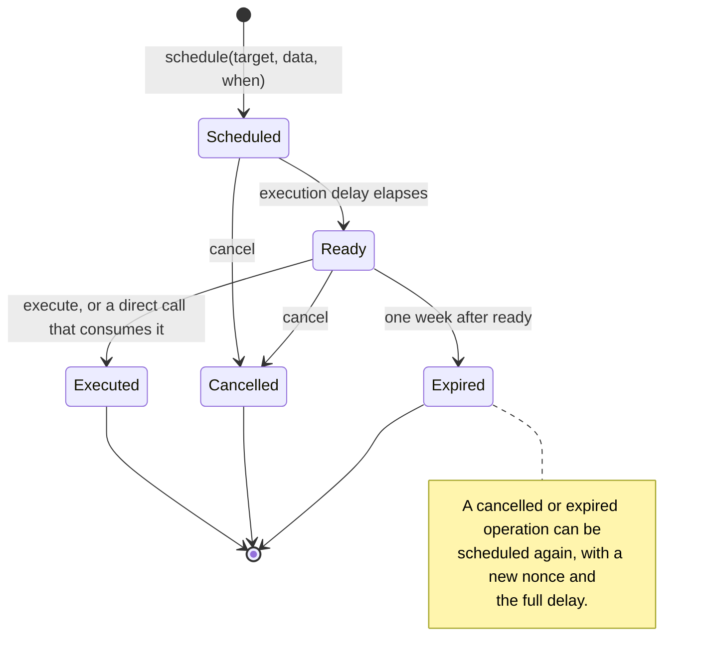
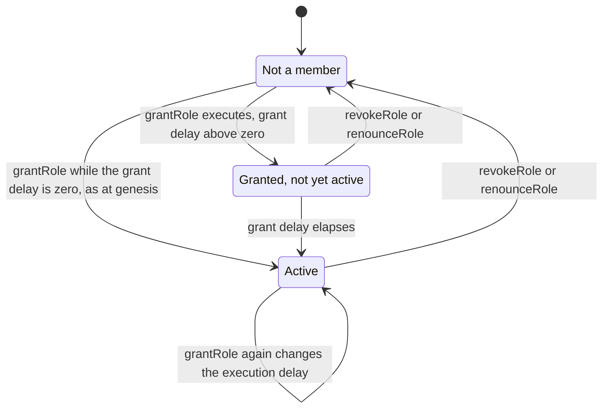
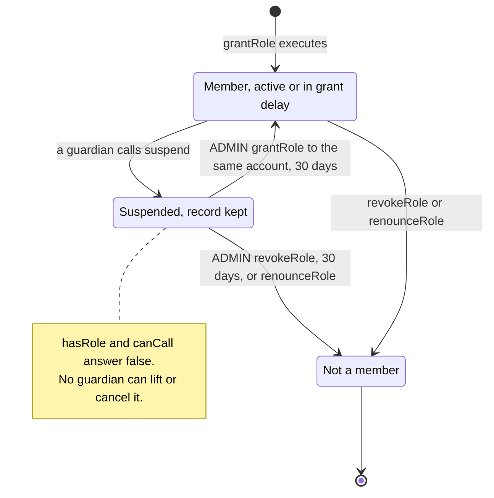
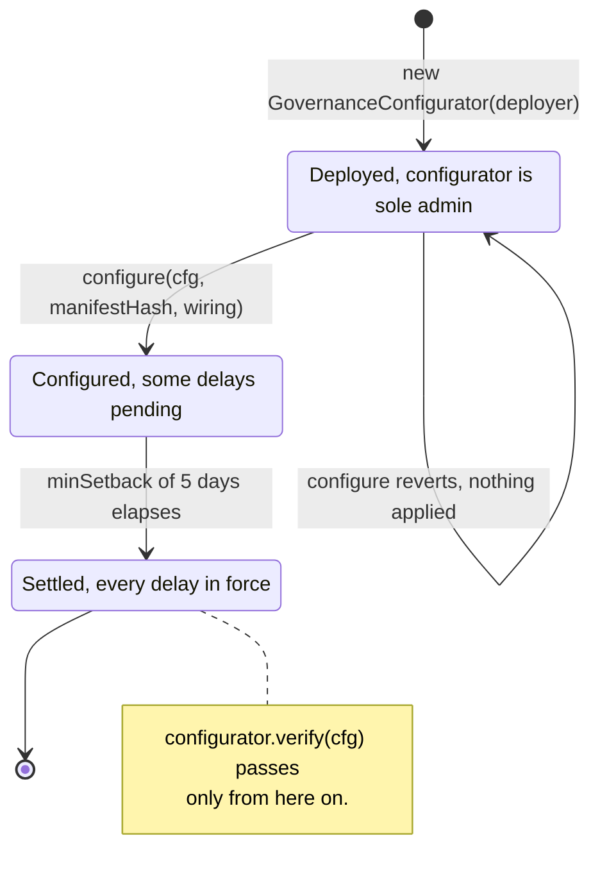
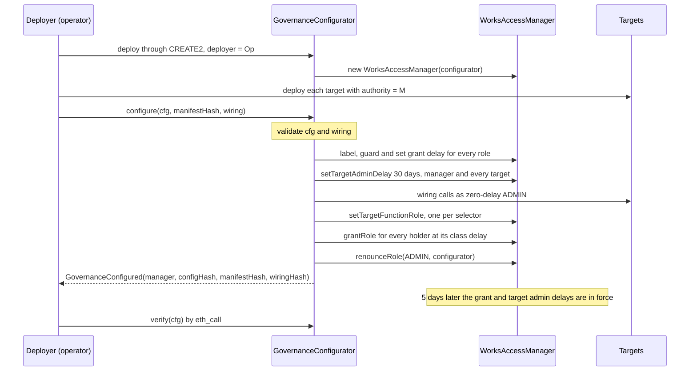
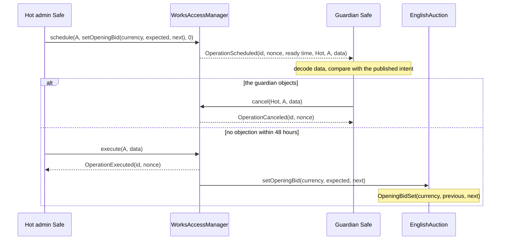
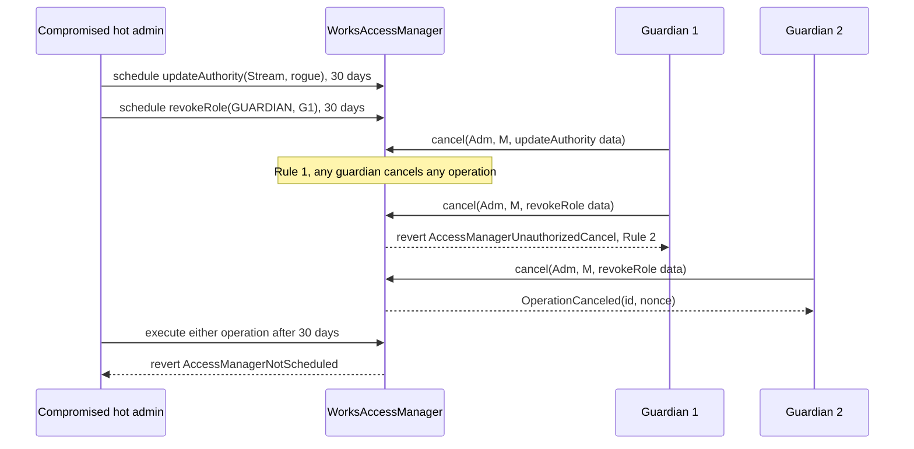
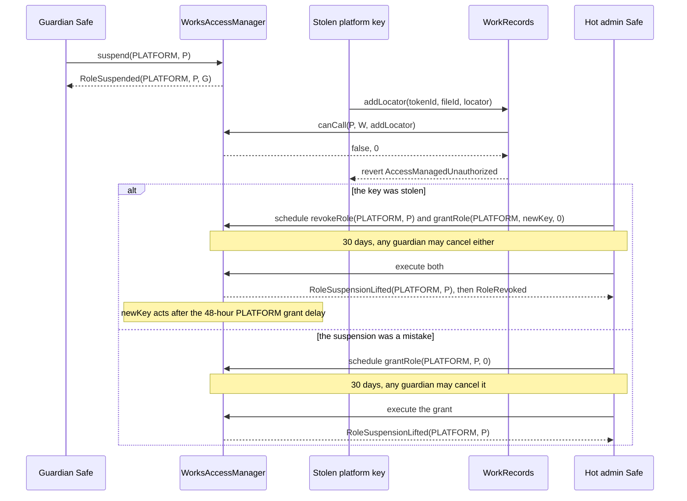
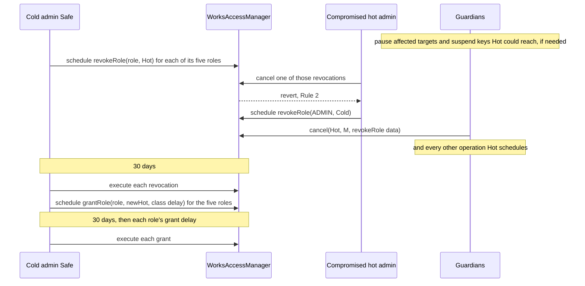
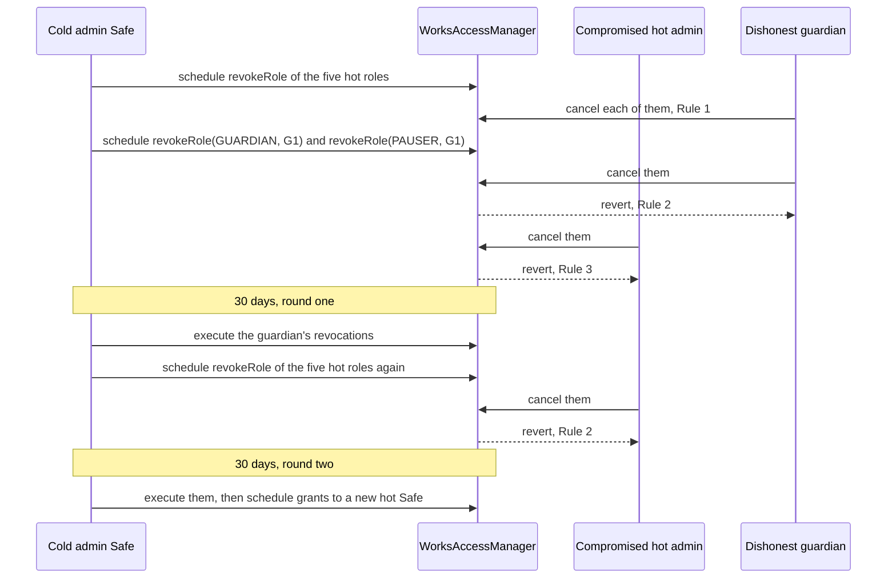

# Governance

One OpenZeppelin 5.7.0 `AccessManager`, subclassed as `WorksAccessManager`, governs every
6529 Works contract: 6529 Stream and WorkRecords, 6529 Editions, and each satellite. It maps
every restricted function to one role, makes that role's holders wait the role's delay
class, lets the guardian Safes cancel any scheduled operation, and lets them suspend a
compromised operational key at once. `GovernanceConfigurator`
deploys the manager, installs the whole genesis configuration in one transaction, and
renounces its own admin role. This page is for auditors, for the people who operate the
admin and guardian Safes, and for integrators who monitor governance. It gives the role model
and the rules. The selector-by-selector matrix is generated from
[`config/genesis.example.json`](../../config/genesis.example.json) into the
[role and permission matrix](../audit/roles.md); this page does not repeat it.

> **Status.** Pre-audit. This page describes `main` at `46941d6` (15 October 2026). The ADRs
> record how the design was decided; this page is how it works now. Where they differ, this
> page follows the code and says so under [Differences from the ADRs](#differences-from-the-adrs).

## Contracts

| Contract | Source | Interface | Responsibility |
| --- | --- | --- | --- |
| `WorksAccessManager` | [`src/governance/WorksAccessManager.sol`](../../src/governance/WorksAccessManager.sol) | OpenZeppelin `IAccessManager`, plus its own `suspend` and `isSuspended` | The manager. Stock `AccessManager` 5.7.0 with four overrides: `_canCancel` adds the three [cancellation rules](#cancellation-rules); `hasRole` reports a suspended holder as not a member; `_grantRole` and `_revokeRole` lift a suspension. `suspend` is the guardians' [suspension of an operational key](#suspension-of-operational-keys). |
| `GovernanceConfigurator` | [`src/governance/GovernanceConfigurator.sol`](../../src/governance/GovernanceConfigurator.sol) | Its own: `configure`, `verify`, `worksManager`, `deployer` | Deploys its own manager, installs the genesis configuration and wiring, renounces `ADMIN`, emits `GovernanceConfigured`, and reads the manager back. |
| `GovernanceConfig` | [`src/governance/GovernanceConfig.sol`](../../src/governance/GovernanceConfig.sol) | Internal library | `validate`, `validateWiring`, `isGenesisSelector`, `install`, `verify` and `hasRecord`. |
| `Roles` | [`src/governance/Roles.sol`](../../src/governance/Roles.sol) | Internal library | Role IDs 0 to 12, the four delay classes, and each role's execution delay, grant delay and label. Every contract imports it; no role ID is hard-coded. |
| `BoundedParameter` | [`src/governance/BoundedParameter.sol`](../../src/governance/BoundedParameter.sol) | Internal library | Raise-only parameters: at most double per step, never above a ceiling fixed in the target's code. |
| Every governed contract | for example [`src/stream/Stream.sol`](../../src/stream/Stream.sol) | OpenZeppelin `IAccessManaged` | Inherits `AccessManaged` with `authority()` set to the manager, and marks each governed function `restricted`. |

The deployment code is not deployed on chain, but it enforces the genesis policy:
[`script/DeployV1.sol`](../../script/DeployV1.sol) builds the configuration and wiring from the
genesis JSON, [`script/DeployGuards.sol`](../../script/DeployGuards.sol) holds the off-anvil
checks, [`script/Deploy.s.sol`](../../script/Deploy.s.sol) runs them, and
[`script/VerifyV1.sol`](../../script/VerifyV1.sol) and
[`script/Verify.s.sol`](../../script/Verify.s.sol) read a deployment back. The OpenZeppelin
source is
[`AccessManager.sol` at v5.7.0](https://github.com/OpenZeppelin/openzeppelin-contracts/blob/v5.7.0/contracts/access/manager/AccessManager.sol).

## Concepts

Terms used here are also in the [glossary](../glossary.md). On this page, "epoch" always means
a configuration epoch, and "manifest" always means the governance manifest, not a
content-store file manifest.

### How the manager decides

- **Target.** A contract whose `authority()` is the manager. Each `restricted` function asks
  the manager `canCall(caller, target, selector)` before it runs.
- **Function role.** The manager maps each (target, selector) to one role. A selector that was
  never mapped resolves to role 0, `ADMIN`.
- **Execution delay.** Each holder carries one per role. With zero delay the holder calls the
  target directly. With a delay it first calls `schedule`, waits, and then calls `execute`
  (or calls the target directly, which consumes the schedule).
- **Grant delay.** Set per role. A new holder becomes active that long after its grant
  executes.
- **Target admin delay.** Set per target. Remapping a target's selectors, closing it or moving
  its authority waits at least that long, and at least the admin's own execution delay.
- **Setback.** Lowering a grant delay or a target admin delay takes effect only after
  `minSetback()` (5 days, OpenZeppelin `AccessManager.minSetback`) or the size of the cut,
  whichever is longer. Lowering a holder's execution delay takes effect after the size of the
  cut (OpenZeppelin `Time.Delay.withUpdate`).
- **Expiry.** A scheduled operation must execute within one week (`AccessManager.expiration`)
  of becoming ready.

A delay in `AccessManager` belongs to a (role, holder) pair, not to a function. A **delay
class** is therefore a role whose holders always carry the class delay, and "one selector,
one class" means every governed selector maps to exactly one role (`Roles` NatSpec).
`GovernanceConfig.install` takes every delay, role admin and role guardian from `Roles`, so a
configuration names only holders and selector mappings and cannot pick a wrong delay.

### Delay classes

| Class | Delay | Constant | Used for |
| --- | --- | --- | --- |
| Immediate | 0 | `Roles.IMMEDIATE` | Tightening actions and pauses: vetoes, package revocations, deprecations, pauses; also the zero-delay operational roles |
| Standard | 48 hours | `Roles.STANDARD` | Sale parameters, defaults for new works, dispute outcomes, unpausing |
| Funds | 14 days | `Roles.FUNDS` | Funds and network-level recipients, asset admission, default currencies |
| Successor | 30 days | `Roles.SUCCESSOR` | Verifier, renderer and successor-level swaps, admitted minters and sale targets, governance manifests, and all meta-governance (the manager's own functions) |

### Roles

Holders are those of the committed example
[`config/genesis.example.json`](../../config/genesis.example.json); a deployment replaces the
addresses but not the structure. Delays come from `Roles.executionDelay` and
`Roles.grantDelay`.

| Role | ID | Holder at genesis | Execution delay | Grant delay | Role admin | Role guardian |
| --- | --- | --- | --- | --- | --- | --- |
| `ADMIN` | 0 | Hot admin Safe; cold recovery admin Safe (`ADMIN` only) | 30 days | 30 days | `ADMIN` | `ADMIN` (locked by OpenZeppelin) |
| `GUARDIAN` | 1 | Three guardian Safes | Immediate | 30 days | `ADMIN` | `GUARDIAN` |
| `PAUSER` | 2 | The same three guardian Safes | Immediate | 48 hours | `ADMIN` | `GUARDIAN` |
| `UNPAUSER` | 3 | Hot admin Safe | 48 hours | 48 hours | `ADMIN` | `GUARDIAN` |
| `CURATION_SIGNER` | 4 | Two curation signer keys (EOAs) | Immediate | 30 days | `ADMIN` | `GUARDIAN` |
| `STORAGE_OPERATOR` | 5 | Storage operator key | Immediate | 48 hours | `ADMIN` | `GUARDIAN` |
| `MINTER` | 6 | None (unused in v1) | Immediate | 30 days | `ADMIN` | `GUARDIAN` |
| `KEEPER` | 7 | None (unused in v1) | Immediate | 48 hours | `ADMIN` | `GUARDIAN` |
| `PLATFORM` | 8 | Platform key | Immediate | 48 hours | `ADMIN` | `GUARDIAN` |
| `PARAMETER_SETTER` | 9 | Hot admin Safe | 48 hours | 48 hours | `ADMIN` | `GUARDIAN` |
| `FUNDS_SETTER` | 10 | Hot admin Safe | 14 days | 14 days | `ADMIN` | `GUARDIAN` |
| `SUCCESSOR_SETTER` | 11 | Hot admin Safe | 30 days | 30 days | `ADMIN` | `GUARDIAN` |
| `CURATOR` | 12 | Curator key | Immediate | 30 days | `ADMIN` | `GUARDIAN` |
| `PUBLIC` | `type(uint64).max` | Everyone | none | none | locked | locked |

- **Role admin.** `install` never calls `setRoleAdmin`, so every role keeps OpenZeppelin's
  default admin, `ADMIN`. Granting or revoking any role is therefore an `ADMIN` operation and
  waits 30 days.
- **Role guardian.** `install` sets `GUARDIAN` as the guardian of roles 1 to 12. OpenZeppelin
  locks `ADMIN`'s guardian to `ADMIN`. Rule 1 below makes the per-role guardian redundant for
  cancelling, but readback still checks it.
- **Grant delay is never shorter than execution delay** (`Roles.grantDelay` NatSpec,
  ADR 0001 §13.1). Roles whose holders act immediately but hold code-level power
  (`GUARDIAN`, `CURATION_SIGNER`, `MINTER`, `CURATOR`) take 30 days to grant.
- **`PUBLIC`** is never mapped to a governed selector: `GovernanceConfig` rejects it (it is not
  a known role ID).
- **Suspendable roles** are `PLATFORM`, `CURATOR` and `STORAGE_OPERATOR` (`Roles.isSuspendable`):
  the zero-delay roles held by single keys that call contracts. A guardian can stop such a
  holder at once ([Suspension of operational keys](#suspension-of-operational-keys)). The
  genesis JSON marks each role's `suspendable` flag. `GenesisConfig.t.sol` checks every flag
  against `Roles.isSuspendable`; [`tools/check_genesis.py`](../../tools/check_genesis.py) checks
  that no role with a delay, and never `GUARDIAN`, `PAUSER` or `CURATION_SIGNER`, is marked.

What maps to each role, in summary (the [role and permission matrix](../audit/roles.md) lists
every selector):

| Role | What maps to it |
| --- | --- |
| `ADMIN` | Nothing explicitly. Unmapped selectors fall back to it: the one-shot `bind*` calls (wired at genesis), `ArtistRegistry.bindFederationRegistry` (deferred to v1.1), each target's `setAuthority`, and the manager's own admin functions. |
| `GUARDIAN` | Immediate tightening actions: the auction's per-sale dispute pause `pause(saleId, disputeRef)`, `ArtistRegistry.vetoChange`, `PackageRegistry.revokePackage`, `Eip712CurationVerifier.disableSigner`, `AssetAllowlist.deprecateAsset`, `DependencyRegistry.deprecate`. Cancelling (Rule 1) and `WorksAccessManager.suspend` are separate powers, checked by the manager itself, not mappings. The genesis JSON lists `suspend` under `manager.functions`. |
| `PAUSER` | `pause()` on the three sale adapters. |
| `UNPAUSER` | `unpause()` on the three sale adapters, and the auction's `resume(saleId)`. |
| `CURATION_SIGNER` | Nothing. The curation verifier reads membership to decide whose approvals count. |
| `STORAGE_OPERATOR` | WorkRecords' preferred-location setters (`setPreferredKind`, `setCollectionPreferredKind`, `setFilePreference`). |
| `MINTER`, `KEEPER` | Nothing (see [Unused roles](#unused-roles)). |
| `PLATFORM` | `Stream.createCollection` and `StatementLog.appendPlatform`. The mapping also serves `openSale` and `closeSale` on the fixed-price and Dutch adapters and `WorkRecords.addLocator`, which check it by hand (see [Roles that targets read directly](#roles-that-targets-read-directly)). |
| `PARAMETER_SETTER` | Auction settings and opening bids, defaults for new works (royalty rate, license), contract URIs, `AssetAllowlist.setIncrementFloor`, `DependencyRegistry.register`, the entropy module's `setConfig`, dispute outcomes (`EnglishAuction.cancel`, `Stream.releaseContent`), `WorkRecords.relicense`, `ArtistRegistry.stageOverride`. |
| `FUNDS_SETTER` | Network fee terms, `Stream.setOwner` and `Editions.setOwner`, `WorkRecords.setRoyaltyRate`, asset admission and default currencies, `RevenueEscrow.recover`. |
| `SUCCESSOR_SETTER` | The curation verifier, default renderer and errata repin, consolidation source, artist resolver, VRF coordinator and lowering its callback gas limit; re-enabling a curation signer; admitted minters and sale targets; the adapters' federation registry; `ArtistRegistry.resolveContested`; `StatementLog.appendGovernanceManifest`. |
| `CURATOR` | `StatementLog.appendCurator`, which writes `CURATION_EVIDENCE` statements. |

The functions themselves are specified on their own pages:
[curation](curation.md), [stream and auctions](stream-and-auctions.md),
[editions and sales](editions-and-sales.md), [economics and payouts](economics-and-payouts.md),
[identity and recovery](identity-and-recovery.md),
[disputes and statements](disputes-and-statements.md), [entropy](entropy.md),
[rendering and tokenURI](rendering-and-tokenuri.md) and
[works and storage](works-and-storage.md).

### Unused roles

`Roles` defines two roles that no v1 selector maps to, and the genesis configuration grants
them to nobody (`unusedRoles` in the genesis JSON). Genesis still labels them and sets their
guardian and grant delay, so a later grant behaves as designed.

- **`MINTER`.** Sale adapters mint through each token's admitted-minter mapping
  (`setAdmittedMinter`, in the 30-day class), not through a role. A mint therefore checks one
  mapping instead of calling the manager (ADR 0003, "Governance").
- **`KEEPER`.** No v1 function needs a keeper. Upkeep such as
  `ArtistRegistry.refreshStanding` is permissionless.

### One-shot bindings instead of a SYSTEM role

There is no shared role for contract-to-contract calls. A shared role would let any holder call
every hook. Instead, each target holds per-pair caller bindings (`bindWorkRecords`,
`bindEditions`, `bindStream`, `bindPackageRegistry`, `bindSplitFactory`, `bindStatementLog`):

- each bind is `restricted` and left unmapped, so it resolves to `ADMIN`;
- each can run once (`AlreadyBound`), and genesis wiring runs them all;
- each checks that the bound address has code and is not an EIP-7702 delegated account, and
  checks ERC-165 where the bound contract implements it. `bindSplitFactory` checks only for
  code and no EIP-7702 delegation (the factory has no ERC-165); `bindStatementLog` checks that the log's `artistResolver()` is the registry; Stream's
  binds also require the satellite to point back (`stream() == address(this)`).

The bound callee then checks `msg.sender` against the binding, with no call to the manager.

### Roles that targets read directly

Some contracts read a role from the manager instead of using `restricted`. In each case the
manager's mapping or membership is still the single source of truth.

- **Two paths into `openSale`, `closeSale` and `addLocator`.** The token's creator (on the
  fixed-price and Dutch adapters) or the work's artist (on `WorkRecords.addLocator`, before
  finalize) acts directly. Anyone else needs the `PLATFORM` mapping, checked by hand:
  `MintSaleBase._isPlatform` requires an immediate, zero-delay answer from
  `AuthorityUtils.canCallWithDelay`, and `WorkRecords.addLocator` calls `_checkCanCall`. The
  genesis JSON maps these selectors to `PLATFORM` only. `VerifyV1.checkPlatformPath` confirms
  the configured `PLATFORM` holder gets an immediate answer for all five. What `PLATFORM` may
  do on each path (for example, close only a sale it opened without the artist's approval) is
  specified in [editions and sales](editions-and-sales.md) and
  [works and storage](works-and-storage.md).
- **Relayed curator and platform statements.** `StatementLog.appendSigned` accepts a `CURATOR`
  or `PLATFORM` signer only when `canCallWithDelay` on `appendCurator` or `appendPlatform`
  answers immediately with zero delay.
- **Curation signers.** `Eip712CurationVerifier.isSignerActive` requires `CURATION_SIGNER`
  membership with zero execution delay, and that the signer is not disabled.

Every one of these checks reaches `WorksAccessManager.hasRole`, through `canCall` or directly.
A [suspension](#suspension-of-operational-keys) of a `PLATFORM` or `CURATOR` key therefore
closes the manual paths in the same block as its `restricted` calls, with no change to the
targets (`test_GOV2_AGuardianSuspendsThePlatformKeyAtOnce` in
[`GovernanceRecovery.t.sol`](../../test/integration/GovernanceRecovery.t.sol)). The creator's
and the artist's own paths need no role and stay open. `CURATION_SIGNER` is not suspendable;
`disableSigner` is its kill switch.

### Cancellation rules

`WorksAccessManager._canCancel` decides who may cancel. Stock OpenZeppelin lets three accounts
cancel a scheduled operation: its scheduler, any `ADMIN` holder, and a holder of the guardian
role of the target function's role. `WorksAccessManager` adds one permission and two
restrictions:

1. **Rule 1: any active `GUARDIAN` holder can cancel any scheduled operation,** on any target,
   the manager included.
2. **Rule 2: only its scheduler can cancel an operation that revokes one of the canceller's own
   roles.** It applies when the canceller is not the scheduler, the target is the manager, and
   the calldata is `revokeRole(anyRole, canceller)`. It applies to every role and every
   canceller, `ADMIN` included. A scheduler may still withdraw its own proposal, even one that
   removes itself.
3. **Rule 3: only a guardian, or its scheduler, can cancel a role revocation on the manager.**
   It applies when the canceller is not the scheduler, the target is the manager, and the
   calldata is any `revokeRole`. No admin can cancel another account's revocation, and Rule 2
   still excludes the guardian the revocation names.

The code checks them as follows. A `revokeRole` on the manager that another account scheduled
is refused to the account it names (Rule 2), then allowed only to an active guardian (Rule 3). Every other operation is allowed to an active guardian (Rule 1) or to whoever
OpenZeppelin allows. An admin therefore still cancels another admin's grants, remaps and
authority moves, for example while the guardians are offline
(`test_AdminStillCancelsAnotherAdminsOtherOperations`).

**Why Rule 1.** Stock cancellation is selector-scoped, and three kinds of operation fall
outside every guardian's reach on a stock manager:

- the admin's operations on the manager itself: its admin functions resolve to `ADMIN_ROLE`,
  whose guardian is locked to `ADMIN`;
- `setAuthority(rogue)` scheduled directly on a target: `canCall` special-cases that selector
  and `setTargetFunctionRole` refuses to map it, so after 30 days the admin owns the target;
- any target selector left unmapped, which resolves to `ADMIN`.

[`GuardianCancel.t.sol`](../../test/governance/GuardianCancel.t.sol) proves each gap on a stock
manager (`test_StockManagerLeavesGuardiansPowerlessOverManagerOperations`,
`test_StockManagerCannotStopDirectSetAuthority`,
`test_StockManagerCannotStopUnmappedTargetSelector`) and its closure here.

**Why Rule 2.** Whether an operation removes the canceller depends on the call's arguments, so
no per-selector setting can express it. Without it, a guardian could veto its own removal, and
a compromised hot admin could cancel the cold admin's `revokeRole(ADMIN, hot)`: stock
OpenZeppelin lets any admin cancel any operation
(`test_StockManagerLetsAdminCancelItsOwnRevocation`).

**Why Rule 3.** It keeps the cold admin's recovery finite (review finding GOV-1, ADR 0002
addendum). Stock OpenZeppelin lets any admin cancel another account's revocation, so the
recovery could not be relied on to finish when the hot admin and one guardian act together.
With Rule 3 only the other guardians can veto a revocation, so the cold admin removes the
dishonest guardian in one 30-day round and the hot admin in the next (`test_GOV1_ColdAdminRemovesAHotAdminAndAGuardianActingTogether`
in [`GovernanceRecovery.t.sol`](../../test/integration/GovernanceRecovery.t.sol)). The
trade-off: an admin can no longer defend a guardian against another admin's revocation. That
defence rests on the other guardians, which is the documented liveness assumption.

**What Rule 3 does not cover.** It reads only the `revokeRole` selector. A `grantRole` that
raises an existing holder's execution delay demotes it without revoking it, so it keeps the
stock rules: the cold admin can cancel a demotion of itself, and a guardian a demotion of
itself (`test_GOV1_DemotionsByGrantStayCancellable`).

**Wrappers cannot smuggle a revocation past Rules 2 and 3.**

- A revocation scheduled inside `multicall` can be scheduled, but never executes. Inside
  `execute` the manager is the caller, and only the outer selector is authorized.
- A revocation scheduled inside a nested `execute` never executes, for the same reason.
- A scheduled `renounceRole(role, account)` fails at execution
  (`AccessManagerBadConfirmation`), because the caller is then the manager, not `account`.
- Calldata with trailing bytes is still protected. A revocation with a dirty address word is
  not protected by Rule 2 (Rule 3 still leaves its cancel to the guardians), but it cannot
  execute; one with a dirty role ID cannot be scheduled.
- Rules 2 and 3 protect roles on the manager only. A target function that happens to share
  `revokeRole`'s selector is an ordinary operation (`test_Rule2OnlyProtectsRolesOnTheManager`,
  `test_AdminStillCancelsAnotherAdminsOtherOperations`).

`multicall` called directly (not scheduled) is OpenZeppelin `Multicall`'s self-delegatecall:
each batched admin call keeps the original caller and consumes its own schedule. It is the one
sanctioned exemption to the no-delegatecall rule (ADR 0002, "Security impact").

**`canCall` on the manager's own selectors.** Nothing maps the manager's selectors, so
`canCall(account, manager, selector)` reports `ADMIN` membership and delay: every admin sees
`(false, 30 days)` and everyone else `(false, 0)`. The authoritative check is OpenZeppelin's
private `_getAdminRestrictions`:

- `labelRole`, `setRoleAdmin`, `setRoleGuardian`, `setGrantDelay` and `setTargetAdminDelay`
  need `ADMIN` and wait its execution delay;
- `updateAuthority`, `setTargetClosed` and `setTargetFunctionRole` need `ADMIN` and wait the
  longer of the target's admin delay and the admin's execution delay;
- `grantRole` and `revokeRole` need the role's admin, which is `ADMIN` for every role;
- `renounceRole` needs only the holder itself and is immediate.

Apart from `renounceRole`, every one of these is a 30-day operation in practice. A tool that
reports delays should use these rules, not `canCall`, for calls into the manager. The manager's
own `suspend` is not an OpenZeppelin admin function: it checks `GUARDIAN` itself, so `canCall`
misreports it in the same way, and an admin who schedules it gets nothing, because inside
`execute` the manager is the sender (`test_SuspensionThroughExecuteIsRefused`).

### Suspension of operational keys

Revoking a role is an `ADMIN` operation and waits 30 days, and most targets of the zero-delay
operational roles have no pause. `WorksAccessManager.suspend(roleId, account)` therefore lets any
guardian stop a holder of a suspendable role at once (review finding GOV-2,
[ADR 0002 addendum](../adr/0002-access-manager-hardening.md#addendum-review-of-14-october-2026)).
It is a tightening action, like a pause, and it is one way for the guardians.

- **Who.** Any active `GUARDIAN` holder, calling the manager directly; a guardian can batch
  several in `multicall`. Anyone else, a `PAUSER`-only account included, reverts with
  `AccessManagerUnauthorizedAccount(caller, GUARDIAN)`.
- **Which roles.** `PLATFORM`, `CURATOR` and `STORAGE_OPERATOR` (`Roles.isSuspendable`). Any
  other role reverts with `RoleNotSuspendable(roleId)`. The account must have a record for the
  role, active or still in its grant delay, and must not be suspended already
  (`NotSuspendable(roleId, account)`).
- **Effect.** `hasRole(roleId, account)` reports the holder as not a member. So `canCall`
  answers `(false, 0)`, every `restricted` function of that role refuses it, and so do the
  manual checks built on `canCall`: the adapters' `openSale` and `closeSale`,
  `WorkRecords.addLocator`, and relayed `CURATOR` and `PLATFORM` statements in
  `StatementLog.appendSigned`. All close in the same block. The record stays (`getAccess` still
  shows it), the account's other roles are unaffected, and a holder suspended during its grant
  delay never becomes active while suspended.
- **Lift.** The flag clears, with `RoleSuspensionLifted`, when a `grantRole` or `revokeRole` of
  that role to that account executes (`_grantRole`, `_revokeRole`). Both are `ADMIN` operations
  in the 30-day class that any guardian can cancel. A grant to an existing member has no grant
  delay, so the key acts again as soon as the lift executes. A revocation lifts the flag and
  removes the role; so does the holder's own `renounceRole`, which OpenZeppelin runs through
  `_revokeRole`. Replacing the key (revoke the old one, grant a new one) leaves no suspension
  behind.
- **One way.** No guardian can lift a suspension, and no other guardian can cancel one: it takes
  effect at once and is never scheduled.
- **Not suspendable.** `ADMIN`, `GUARDIAN`, `PAUSER`, `UNPAUSER`, the three setter roles,
  `MINTER`, `KEEPER` and `CURATION_SIGNER`. The cancel rules and the admin functions therefore
  rest on stock membership checks. A curation signer is cut off by the verifier's one-way
  `disableSigner` instead, which also ends its signer epoch; a lift by grant would not.
- **Readback.** `GovernanceConfigurator.verify` sees a suspended configured holder as a missing
  member (`HolderMismatch`); `VerifyV1.check` names it first (`HolderSuspended`).

**How long a suspension lasts.** The lift stays in the 30-day class, because a faster lift on
the manager's own functions would make meta-governance faster than the slowest class (ADR 0001
§13). The governance README and the ADR 0002 addendum give the durations:

- a suspension made by mistake: 30 days, the lift's own delay;
- one dishonest guardian: about 60 days. It cancels each lift until its own removal executes
  (30 days), and the lift then takes another 30 days
  (`test_GOV2_ADishonestGuardiansSuspensionLastsAboutSixtyDays`);
- a dishonest guardian acting with a compromised hot admin: about 90 days. The cold admin
  removes the guardian (30 days), then the hot admin (30 days), then lifts (30 days).

### Configuration epochs and governance manifests

A configuration epoch is the set of roles, holders, delays and selector mappings in force. Each
epoch has a signed JSON governance manifest describing it.

- **Epoch 0.** `configure` takes the manifest's hash as `manifestHash` and emits it in
  `GovernanceConfigured`. The genesis wiring also appends the manifest to the statement log as
  a `GOVERNANCE_MANIFEST` statement whose subject is `(manager, 0)`, so the manifest chain
  starts at genesis. The deploy script takes the SHA-256 of the file at `MANIFEST_PATH`.
- **Later epochs.** The admin schedules
  `StatementLog.appendGovernanceManifest(statement)` (`SUCCESSOR_SETTER`, 30 days) alongside
  the epoch's operations, so the hash is public before the changes take effect.
  `appendGovernanceManifest` is the only way to write `GOVERNANCE_MANIFEST`, and it records the
  manager as the signer. The log cannot enforce the delay itself; it comes from the mapping.

## State machine

### Scheduled operation

| Transition | Caller (role) | Delay | Function |
| --- | --- | --- | --- |
| Schedule | A holder of the role the call resolves to, with a nonzero execution delay: `ADMIN`, `UNPAUSER` or a setter role | The operation's ready time is at least now plus the delay | `AccessManager.schedule` |
| Ready | Nobody: time passes | The caller's execution delay; for the manager's admin functions, as listed under [Cancellation rules](#cancellation-rules) | none |
| Execute | Only the scheduler: the operation ID is `keccak256(abi.encode(caller, target, data))` | none | `AccessManager.execute`, or the target's `restricted` check through `consumeScheduledOp` |
| Cancel | The scheduler; any active `GUARDIAN` (Rule 1); any `ADMIN` and the role's guardian, as in stock OpenZeppelin. For another account's `revokeRole` on the manager, only an active guardian (Rule 3), and never the account it names (Rule 2) | Immediate | `WorksAccessManager.cancel` (`_canCancel`) |
| Expire | Nobody | One week after ready (`AccessManager.expiration`) | none: `execute` reverts with `AccessManagerExpired` |

A holder can have only one live copy of an identical operation
(`AccessManagerAlreadyScheduled`). A guardian can never schedule: it holds only zero-delay
roles, and `schedule` reverts for a caller whose delay is zero.

### Role membership

| Transition | Caller (role) | Delay | Function |
| --- | --- | --- | --- |
| Grant | `ADMIN` (every role's admin) | 30-day execution delay, then the role's grant delay before the holder is active | `AccessManager.grantRole(role, account, executionDelay)` |
| Change execution delay | `ADMIN` | 30 days to schedule. An increase applies at once; a decrease applies after the size of the cut | `grantRole` on an existing member |
| Revoke | `ADMIN` | 30 days. Only a guardian or the scheduler can cancel it (Rule 3), and the account being removed cannot, unless it scheduled it (Rule 2) | `AccessManager.revokeRole` |
| Renounce | The holder itself | Immediate | `AccessManager.renounceRole(role, self)` |

`hasRole` reports a pending member as not a member, so a guardian in its 30-day grant delay
cannot yet cancel anything. It also reports a suspended holder of a suspendable role as not a
member; [Suspended holder](#suspended-holder) adds that state.

### Suspended holder

For `PLATFORM`, `CURATOR` and `STORAGE_OPERATOR` only. The rules are under
[Suspension of operational keys](#suspension-of-operational-keys).

| Transition | Caller (role) | Delay | Function |
| --- | --- | --- | --- |
| Suspend | Any active `GUARDIAN` holder | Immediate | `WorksAccessManager.suspend(roleId, account)` |
| Lift by grant | `ADMIN` | 30 days, cancellable by any guardian; no grant delay for an existing member | `AccessManager.grantRole(roleId, account, executionDelay)` |
| Lift by revocation | `ADMIN` | 30 days, cancellable only by a guardian or the scheduler (Rule 3) | `AccessManager.revokeRole(roleId, account)` |
| Lift by renouncing | The holder itself | Immediate | `AccessManager.renounceRole(roleId, account)` |

### The manager at genesis

| Transition | Caller (role) | Delay | Function |
| --- | --- | --- | --- |
| Deploy | Anyone, normally the operator through the CREATE2 factory | none | `GovernanceConfigurator` constructor, which deploys `WorksAccessManager(address(this))` |
| Configure | Only `deployer`, a constructor argument | Immediate (the configurator is `ADMIN` with zero delay) | `GovernanceConfigurator.configure` |
| Settle | Nobody: time passes | `minSetback()`, 5 days | none |
| Read back | Anyone, by `eth_call` | none | `GovernanceConfigurator.verify` |

## Flows

### Genesis configure

**Preconditions.**
- The caller is `deployer` (`NotDeployer` otherwise). A configurator deployed by anyone else,
  naming any deployer, governs only the new manager it created itself.
- Every target already exists with `authority()` equal to the configurator's manager.
- `cfg` and `wiring` pass `GovernanceConfig.validate` and `validateWiring` (rules
  [GV-8 to GV-12](#rules-and-invariants)).

**Order of installation** (`GovernanceConfig.install`):
1. For roles 1 to 12: `labelRole`, `setRoleGuardian(role, GUARDIAN)` and
   `setGrantDelay(role, Roles.grantDelay(role))`. Then `setGrantDelay(ADMIN, 30 days)`.
2. `setTargetAdminDelay(30 days)` on the manager, then on every target.
3. The wiring calls, in order. No selector is mapped yet, so every wired selector still
   resolves to the configurator's zero-delay `ADMIN`, even one that `cfg` then maps to a
   30-day role, such as `setAdmittedMinter`.
4. `setTargetFunctionRole`, one selector at a time.
5. `grantRole` for every holder at `Roles.executionDelay(role)`. The installer cannot grant
   itself (`InvalidGrant`).

`configure` then renounces `ADMIN` and emits `GovernanceConfigured`.

**The wiring allow-list.** `GovernanceConfig.isGenesisSelector` admits only these selectors.
Anything else, such as a verifier swap or a recipient change, reverts with
`WiringSelectorNotAllowed`.

| Selector | Why it is wired |
| --- | --- |
| `bindWorkRecords`, `bindEditions` (Stream; `bindWorkRecords` also on Editions; `bindEditions` also on the package registry) | One-shot bindings |
| `bindStream` (package registry and artist registry) | One-shot binding |
| `bindPackageRegistry`, `bindSplitFactory`, `bindStatementLog` (artist registry) | One-shot bindings |
| `bindFederationRegistry` (artist registry) | Allowed, but not wired in v1: the federation registry ships in v1.1, and binding it then is a 30-day `ADMIN` action |
| `setAdmittedMinter(address,bool)` | Admits each sale adapter to its token |
| `setTarget(address,bool)` | Lists each token on its sale adapter |
| `setDefaultCurrency(bytes32,uint64,address)` | Each product's first default currency (ETH). `EnglishAuction.start` reads `PRODUCT_STREAM`'s, so without it no auction could start for 14 days. Only an already active asset can be set, and at genesis only ETH is active. |
| `appendGovernanceManifest(...)` | The epoch-0 manifest |

- A wiring call must target a configured target, which is never the manager
  (`InvalidWiringCall`), and carry at least a selector.
- There are at most `GovernanceConfig.MAX_WIRING_CALLS` (64) calls. The committed example has
  19.
- **Failure.** A reverting call reverts the whole `configure` with the callee's revert data,
  or with `WiringCallFailed(index)` when it gave none. Nothing is applied, the configurator
  still holds `ADMIN`, and the deployer can fix the inputs and call `configure` again.

**Effects.**
- Every holder is active at once: the grant delays set in step 1 are still pending, so the
  grants in step 5 see a grant delay of zero. During the 5 days before the delays settle, the
  admins' 30-day execution delay still bounds every admin action.
- The configurator holds no role. A second `configure` reverts with
  `AccessManagerUnauthorizedAccount`.

**Readback** (`GovernanceConfigurator.verify`, by `eth_call`, at least 5 days later). It reverts
on the first difference:
- the configurator still has any `ADMIN` record (`ConfiguratorStillAdmin`);
- a role's admin, guardian or grant delay differs from `Roles` (`RoleMismatch`);
- a target, the manager included, is closed or lacks the 30-day admin delay
  (`TargetMismatch`);
- a selector maps to another role (`FunctionRoleMismatch`);
- a configured holder is missing, not yet active, suspended, or has another or a pending
  execution delay (`HolderMismatch`; a suspended holder fails `hasRole`,
  `test_ReadbackRejectsASuspendedHolder` in
  [`Suspension.t.sol`](../../test/governance/Suspension.t.sol));
- a guardian holds or is pending for any role other than `PAUSER`, or a pauser also has an
  `UNPAUSER` record.

**What readback cannot see**, and how deployment CI covers it
([`script/Verify.s.sol`](../../script/Verify.s.sol)):
- **Pending delay reductions.** OpenZeppelin has no getter for a pending grant-delay or
  target-admin-delay change, so `verify` passes until a reduction lands
  (`test_Limitation_ReadbackCannotSeePendingDelayReductions`). Verify scans every
  `RoleGrantDelayChanged` and `TargetAdminDelayUpdated` event and fails on one whose effect time
  is in the future, other than genesis setting the configured value. Pending execution-delay
  changes are visible through `getAccess`, and `verify` rejects them.
- **Holders not in `cfg`.** `AccessManager` cannot enumerate members. Verify fails on any
  `RoleGranted` since genesis to an account outside `cfg`, other than the configurator's own
  initial `ADMIN`.
- **What the wiring did.** `VerifyV1.checkWired` reads each wired getter back, including each
  default currency at its genesis revision and the manifest chain's length.
- **Other roles of the configurator, target authority, suspensions, PLATFORM's paths.**
  `VerifyV1.check` checks that the configurator holds no role at all, that every target
  answers `authority()` with this manager, that no configured holder is suspended
  (`HolderSuspended`), and `checkPlatformPath`.
- **The event.** Verify recomputes `configHash`, `manifestHash` and `wiringHash` from the
  committed inputs and compares them with the one `GovernanceConfigured` event.
- **Pending operations.** Verify fails on any operation scheduled on the manager since genesis
  that can still execute, naming its ID, caller, target, selector and ready time; with
  `ALLOW_PENDING_OPERATIONS=1` it logs them instead (`test_VerifyReportsPendingOperations`,
  `test_AnExpiredOperationIsNotPending`).
- **The VRF subscription** (DEPS-4). Off anvil, Verify reads `getSubscription` from the entropy
  module's live coordinator and requires the module to be the only consumer. On mainnet the
  owner must be the configured holder of both `ADMIN` and `PARAMETER_SETTER`, the hot admin
  Safe, and a coordinator that does not report the subscription fails Verify; off mainnet only a
  coordinator without `getSubscription` (an empty revert) is skipped
  (`test_DEPS4_VerifyChecksTheSubscriptionConsumers`,
  `test_DEPS4_OnMainnetTheSubscriptionOwnerIsTheHotAdminSafe`).
- **Canonical dependencies on mainnet** (DEPS-3). Verify requires the recorded VRF coordinator
  and the entropy module's live `coordinator()` to be the canonical coordinator with its pinned
  code hash, the delegation contract to be the canonical one with its pinned code hash and no
  mock, and Permit2 to be at its canonical address with code. Permit2's code hash is not pinned.

**Epoch mode.** Verify reads back the genesis configuration. After a legitimate change, such as
an admin recovery or a key rotation, set `GOVERNANCE_CONFIG` to a copy of the genesis file with
the current holders. The current-state checks then use that copy, the genesis event checks keep
the recorded genesis file, past grants to accounts since removed are accepted and logged, and
every genesis holder the copy drops must hold no record for that role
(`HolderNotRemoved`). With `GOVERNANCE_MANIFEST_PATH`, the epoch's governance manifest must be
recorded on the manager's statement chain and name the copy's SHA-256 (`ManifestNotRecorded`,
`ManifestConfigMismatch`). The wiring readback stays genesis readback, so a later
default-currency change still fails it (`test_ReverifyAfterAdminRecoveryPassesInEpochMode`,
`test_EpochModeBindsTheEpochManifest`, `test_EpochModeRequiresDroppedHoldersToBeRevoked`).

**Deployment guards.** Off anvil, `Deploy.s.sol` runs these checks in its simulation, before
anything is broadcast. `Verify.s.sol` repeats the holder and policy guards against the chain as
it is at readback (review finding GOV-3, `_checkGuards`), so a Safe changed after genesis in a way
the deploy would refuse fails Verify
([`script/README.md`](../../script/README.md#2-safe-pre-flight)):
- the genesis file is not the committed example, and names no placeholder holder (address at
  or below `DeployGuards.MAX_PLACEHOLDER`, `0xFFFF`) and no system address;
- every `ADMIN` and `GUARDIAN` holder is a deployed Safe (`DeployGuards.requireSafe`,
  `requireBareSafe`):
  - it has code, is not an EIP-7702 delegated EOA, and answers `getOwners()` with a list;
  - its threshold is at least `DeployGuards.MIN_THRESHOLD` (2) (`ThresholdTooLow`);
  - every owner is a plain key: an owner with code (a nested Safe, a passkey signer or any
    other contract) is refused (`NestedOwner`), and so is an EIP-7702 delegated owner
    (`DelegatedOwner`);
  - its proxy points to a canonical Safe singleton, 1.3.0 or 1.4.1, L1 or L2, by address and
    runtime code hash (`NotACanonicalSafe`);
  - it has no enabled module (`SafeHasModules`) and no transaction guard (`SafeHasGuard`);
- there are at least `DeployGuards.MIN_ADMINS` (2) admin Safes, `MIN_GUARDIANS` (3) guardian
  Safes and `MIN_CURATION_SIGNERS` (2) curation signers;
- no two of the admin and guardian Safes share a signer, guardians with guardians included
  (`SharedSigner`, review finding GOV-4);
- no holder is a contract of the deployment or one of its dependencies;
- the governed targets and the wiring equal what the committed
  [`config/genesis.example.json`](../../config/genesis.example.json) produces for the same
  deployment (`DeployGuards.checkPolicy`); only holders and substituted addresses may differ;
- nothing the genesis names is dropped, except the entropy module when declined with
  `NO_VRF=1`;
- the CC0 text hashes to the pinned `DeployV1.CC0_LEGALCODE_SHA256`;
- the network fee recipient exists (code, a balance or a nonce);
- on mainnet, the VRF coordinator is the canonical Chainlink v2.5 coordinator
  (`DeployGuards.CANONICAL_VRF_COORDINATOR`) with its pinned runtime code hash, as Permit2 and
  the delegation contract are canonical (review finding DEPS-3); off mainnet, an optional
  `VRF_COORDINATOR_CODEHASH` must match when set;
- `DEPLOY_NAMESPACE` is given explicitly (no default off anvil), the configurator's CREATE2
  address and every other address predictable before the broadcast are free
  (`ConfiguratorAddressTaken`, `AddressTaken`), `--sender` is given, and the RPC's chain ID
  matches.

On anvil too, the deploy refuses an EIP-7702 delegated sender (`DelegatedDeployer`): the
deployer alone may call `configure` until genesis completes.

**Gas.** With the committed example and the maximum 64 wiring calls, `configure` measures about
6.6M gas in Prague pricing, 39% of the EIP-7825 cap of 16,777,216
(`GovernanceConfig.MAX_WIRING_CALLS` NatSpec); `GenesisConfig.t.sol` and `Genesis.t.sol` gate
it at 60%. On Sepolia under Glamsterdam, r2's `configure` with 19 wiring calls used 15,528,379
gas ([`deployments/11155111/README.md`](../../deployments/11155111/README.md)). For how the cap
applies under Glamsterdam, see
[ADR 0004](../adr/0004-gas-budgets-under-glamsterdam.md#decision).

### A 48-hour parameter change with a guardian watching

- **Preconditions.** The hot admin Safe holds `PARAMETER_SETTER` (48 hours), to which
  `EnglishAuction.setOpeningBid` maps.
- **Compare-and-set.** If the opening bid changed after the operation was written, the call
  reverts with `ExpectedValueMismatch`; the admin reschedules with the current value.
- **Ceiling.** `setOpeningBid` refuses a value above its ceiling
  (`OpeningBidAboveCeiling`), however long the operation waited.
- **Window.** The admin must execute within one week of the ready time, or the operation
  expires.

### A guardian cancels a hostile admin operation

- A guardian cannot cancel its own removal; another guardian can. This is why at least two
  honest guardians must be online at all times (see [Operating procedures](#operating-procedures)).
- The cold admin cannot cancel the revocation of `G1` either: only a guardian cancels another
  account's revocation (Rule 3, `test_GOV1_TheGuardianVetoIsUnchanged` in
  [`GovernanceRecovery.t.sol`](../../test/integration/GovernanceRecovery.t.sol)). It can still
  cancel the `updateAuthority`, as any admin can.
- The same holds for a hostile `setTargetFunctionRole`, `setAdmittedMinter`, `setGrantDelay`
  or any other scheduled call. `test_GuardiansCancelHostileAdminOperations` in
  [`test/integration/Genesis.t.sol`](../../test/integration/Genesis.t.sol) runs this flow on the
  real contracts.

### A guardian suspends a compromised platform key

- **Preconditions.** `G` is an active guardian. `P` holds `PLATFORM`, or awaits it in its grant
  delay, and is not suspended already.
- **Effects.** In the same block `P` fails every `PLATFORM` path: `Stream.createCollection`,
  `StatementLog.appendPlatform`, `WorkRecords.addLocator`, `openSale` and `closeSale` on the
  fixed-price and Dutch adapters (`NotSaleManager`), and relayed `PLATFORM` statements. The
  artist's own paths stay open: the creator still opens and closes its own sales. Nothing on
  the targets changes. The same flow stops a `CURATOR` or `STORAGE_OPERATOR` key.
- **Lift.** Only `ADMIN` lifts it, by a grant or a revocation of that role to that account, in
  the 30-day class. A replacement key is granted fresh and never suspended. In an admin recovery
  the cold admin lifts instead, after the hot admin is removed.
- **Other duties of the key.** If the stolen key is also the marketplace owner, schedule
  `setOwner` on Stream and Editions as well (`FUNDS_SETTER`, 14 days;
  [script README](../../script/README.md)).
- **How long.** 30 days for a mistake, about 60 days if a dishonest guardian keeps cancelling
  the lift, about 90 days if it acts with a compromised hot admin
  ([Suspension of operational keys](#suspension-of-operational-keys)).
- **Proven by** `test_GOV2_AGuardianSuspendsThePlatformKeyAtOnce`,
  `test_GOV2_EveryOperationalRoleCanBeSuspended`, `test_GOV2_ReplacingASuspendedKey` and
  `test_GOV2_ADishonestGuardiansSuspensionLastsAboutSixtyDays` in
  [`GovernanceRecovery.t.sol`](../../test/integration/GovernanceRecovery.t.sol), and
  `test_OnlyAnAdminGrantLiftsItAndAGuardianCanVetoThat` in
  [`Suspension.t.sol`](../../test/governance/Suspension.t.sol).

### Cold-admin recovery from a compromised hot admin

- **The five roles** of the hot admin Safe are `ADMIN`, `UNPAUSER`, `PARAMETER_SETTER`,
  `FUNDS_SETTER` and `SUCCESSOR_SETTER`.
- **Revocations first.** Rules 2 and 3 protect only revocations. While the hot admin still
  holds `ADMIN` it can cancel any other operation, including the cold admin's grants to a
  replacement. The cold admin therefore schedules the grants once the revocations have
  executed. (Grants scheduled earlier are not refused, but the hot admin can cancel them.)
- **The cold admin cannot cancel its own removal.** Only the guardians can stop the hot
  admin's counter-move. The guardians must know of the recovery, let the cold admin's
  operations through, and keep cancelling the hot admin's.
- **Effects.** Executing a revocation removes the role at once, and any operation the hot Safe
  still has scheduled through that role can no longer execute. The new hot Safe holds each role
  after its grant delay: 48 hours for `UNPAUSER` and `PARAMETER_SETTER`, 14 days for
  `FUNDS_SETTER`, 30 days for `SUCCESSOR_SETTER` and `ADMIN`.
- **The VRF subscription.** On mainnet the hot Safe owns it (Verify requires it, DEPS-4), and
  governance cannot take it over. The new hot Safe creates and funds a subscription with the
  module as its only consumer and schedules the module's `setConfig` to it (`PARAMETER_SETTER`,
  48 hours). VRF works may stop for about 64 days or more meanwhile
  ([Failure modes](#failure-modes-and-recovery)).
- **Afterwards.** Re-run Verify in epoch mode, with `GOVERNANCE_CONFIG` naming the new holders
  (see [Genesis configure](#genesis-configure)), and publish the change as a governance
  manifest.
- `test_ColdAdminRecoversFromACompromisedHotAdmin` in
  [`Hardening.t.sol`](../../test/governance/Hardening.t.sol) and
  `test_ColdAdminRemovesTheHotAdmin` in
  [`Genesis.t.sol`](../../test/integration/Genesis.t.sol) run the revocation part;
  `test_ReverifyAfterAdminRecoveryPassesInEpochMode` in
  [`DeployScript.t.sol`](../../test/deploy/DeployScript.t.sol) runs the re-verification. The
  runbook is [Admin recovery](../../script/README.md#admin-recovery) in the script README.

#### If a guardian cancels the recovery

A dishonest guardian acting with the hot admin can cancel the cold admin's revocations of the hot
admin (Rule 1). It cannot cancel its own removal (Rule 2), and the hot admin cannot cancel it for
the guardian (Rule 3), so the recovery takes two 30-day rounds.

- The honest guardians let the cold admin's operations through and keep cancelling the hot
  admin's. Only they could cancel the revocation of `G1`.
- `test_GOV1_ColdAdminRemovesAHotAdminAndAGuardianActingTogether` in
  [`GovernanceRecovery.t.sol`](../../test/integration/GovernanceRecovery.t.sol) runs both rounds
  on the genesis deployment, and the grant to the new hot Safe after them.

## Operating procedures

These procedures come from the [governance README](../../src/governance/README.md#operating-procedures)
and the [script README](../../script/README.md). The contracts do not enforce them; they make the
enforced rules effective.

- **Guardian liveness.** Safety needs at least two honest guardians online at all times. One may
  be the target of a hostile revocation, which it cannot veto itself; the other cancels it. With
  one guardian online, a compromised admin removes it in 30 days and nothing then stops a target
  takeover (`test_Residual_LivenessNeedsTwoHonestGuardiansOnline`). The code floor is two
  guardians (`GovernanceConfig.MIN_GUARDIANS`); deployments off anvil need three
  (`DeployGuards.MIN_GUARDIANS`), 2-of-3 each (ADR 0003, owner decision 3).
- **Monitoring.** Alert every guardian on the manager's `OperationScheduled`, `RoleGranted`,
  `RoleGrantDelayChanged`, `TargetAdminDelayUpdated` and `RoleSuspended`. The pending set is
  every `OperationScheduled` not followed by `OperationExecuted` or `OperationCanceled` with the
  same operation ID and nonce, and not yet one week past its ready time; Verify fails while any
  is pending, unless `ALLOW_PENDING_OPERATIONS=1`. On mainnet, also alert on the VRF
  coordinator's `SubscriptionCanceled`, `SubscriptionConsumerRemoved` and
  `SubscriptionOwnerTransferRequested` for the subscription ID
  ([script README, step 7](../../script/README.md#7-chainlink-vrf-the-entropy-module)).
- **Emergencies.**
  - Pausing is immediate (`PAUSER`). Unpausing is a 48-hour `UNPAUSER` operation that any
    guardian can cancel. The adapters and the auction also refuse an unpause, a `resume` or a
    dispute `cancel` until 48 hours after the pause they end (review finding GOV-5), so one
    scheduled before the pause cannot land inside it.
  - Revoking a role waits 30 days. A compromised `PLATFORM`, `CURATOR` or `STORAGE_OPERATOR`
    key is suspended at once by any guardian while its revocation matures
    ([flow](#a-guardian-suspends-a-compromised-platform-key)); pause the affected targets as
    well where they have a pause.
  - A compromised curation signer is cut off at once by the verifier's one-way
    `disableSigner` (`GUARDIAN`). Re-enabling it is a 30-day `SUCCESSOR_SETTER` action and starts
    a new curation signer epoch, so no earlier approval counts again.
- **Operation expiry.** An operation must execute within one week of becoming ready. After that
  it is dead and must be rescheduled with the full delay.
- **Rotating a guardian (cooperative).** Grant the replacement first, then revoke:
  1. Schedule `grantRole(GUARDIAN, new, 0)` and `grantRole(PAUSER, new, 0)`.
  2. Once both are active (30 days to execute, then the 30-day `GUARDIAN` grant delay), schedule
     `revokeRole(GUARDIAN, old)` and `revokeRole(PAUSER, old)`.

  The departing guardian cannot cancel its own removal; the others can. The guardian count never
  drops below the configured number.
- **Removing a compromised guardian.** Revoke first. The guardian cannot cancel its own
  revocation (Rule 2), and no admin can (Rule 3); only the other guardians can. While active it
  can still cancel a grant to its replacement (`test_GuardianCanCancelGrantOfAReplacement`), and
  any suspension it made outlasts its removal until an admin lifts it.
- **Rotating the hot admin Safe (cooperative).**
  1. The old admin schedules grants of `ADMIN`, `UNPAUSER` and the three setters to the new Safe,
     each at its class delay.
  2. Guardians, the old admin or the cold admin cancel every other pending operation of the old
     admin. A revocation the old admin scheduled can be cancelled only by itself or a guardian
     (Rule 3).
  3. Execute the grants after 30 days and wait for the grant delays.
  4. The old admin renounces every role, which is immediate. Its remaining scheduled operations
     can no longer execute.
  5. On mainnet, transfer the VRF subscription to the new Safe (Verify requires its owner to
     hold `ADMIN` and `PARAMETER_SETTER`), and re-run Verify in epoch mode.
- **Recovering from a compromised hot admin.** See
  [the flow above](#cold-admin-recovery-from-a-compromised-hot-admin).
- **Onboarding a target after genesis.** Deploy it with `authority` set to the manager, then:
  1. schedule `setTargetAdminDelay(newTarget, 30 days)` and one `setTargetFunctionRole` per
     selector, each a 30-day admin operation the guardians can cancel;
  2. execute them, for example in one `multicall`;
  3. wait `minSetback()` (5 days);
  4. re-run readback with the target added to `cfg` (`test_OnboardATargetAfterGenesis`).
- **Publishing a configuration epoch.** Schedule `appendGovernanceManifest` with the epoch's
  other operations (see [Configuration epochs](#configuration-epochs-and-governance-manifests)).

## Rules and invariants

Rule IDs on this page use the prefix `GV`, so they never collide with the internal review's
finding IDs (`GOV-1` to `GOV-5`), which are cited as "review finding GOV-n".

**The manager and its configuration.**

| ID | Rule | Enforced in | Proven by |
| --- | --- | --- | --- |
| GV-1 | Any active `GUARDIAN` holder can cancel any scheduled operation, on any target, the manager included. A `PAUSER`-only account or an outsider cannot. | `WorksAccessManager._canCancel` | [`GuardianCancel.t.sol`](../../test/governance/GuardianCancel.t.sol): `test_GuardianCancelsEveryManagerAdminSelector`, `test_EveryGuardianCancelsManagerOperations`, `test_GuardianCancelsTargetClassOperations`, `test_GuardianCancelsDirectSetAuthorityOnTarget`, `test_GuardianCancelsUnmappedTargetSelector`, `test_PauserOnlyAccountCannotCancel`, `test_OutsiderCannotCancel` |
| GV-2 | Nobody but its scheduler can cancel a `revokeRole(role, account)` on the manager when `account` is the canceller, for every role, `ADMIN` included. | `WorksAccessManager._canCancel`, `_revokesRoleOf` | `GuardianCancel.t.sol`: `test_GuardianCannotCancelItsOwnReplacement`, `test_CompromisedAdminCannotCancelItsOwnRevocation`, `testFuzz_NobodyCancelsTheirOwnRevocation`, `test_RevocationWithTrailingCalldataIsStillProtected`, `test_SchedulerCanWithdrawItsOwnSelfRevocation`, `test_Rule2OnlyProtectsRolesOnTheManager` |
| GV-3 | A revocation wrapped in `multicall` or a nested `execute` never executes, and a scheduled `renounceRole` of another account fails. | OpenZeppelin `AccessManager._canCallSelf` (execution identifier) and `renounceRole` (confirmation) | `GuardianCancel.t.sol`: `test_MulticallWrappedRevocationNeverExecutes`, `test_NestedExecuteRevocationNeverExecutes`, `test_ScheduledRenounceCannotRemoveGuardian`, `test_MalformedRevocationCanAlwaysBeCancelled`, `test_DirtyRoleIdRevocationCannotBeScheduled` |
| GV-4 | Meta-governance is never faster than the slowest class: `ADMIN` has a 30-day execution delay, every target (the manager included) a 30-day admin delay, and every role's grant delay is at least its execution delay. Remapping a selector to a faster role takes 30 days. | `Roles.executionDelay`, `Roles.grantDelay`, `GovernanceConfig.install` (`TARGET_ADMIN_DELAY`) | [`Hardening.t.sol`](../../test/governance/Hardening.t.sol): `test_MetaGovernanceIsNeverFasterThanTheSlowestClass`, `test_RemappingAFundsSelectorToAFasterRoleTakesThirtyDays`; [`Roles.t.sol`](../../test/governance/Roles.t.sol): `test_GrantDelayNeverShorterThanExecutionDelay`, `test_ExecutionDelayTable`, `test_GrantDelayTable` |
| GV-5 | Shortening a delay waits: a grant-delay or target-admin-delay cut applies the longer of 5 days and the cut after its 30-day operation executes; an execution-delay cut applies after the cut. A fresh zero-delay holder still waits 30 days plus the grant delay. | OpenZeppelin `Time.Delay.withUpdate`, `AccessManager._grantRole` | `Hardening.t.sol`: `test_AdminCannotShortenGrantDelayWithoutWaiting`, `test_AdminCannotShortenTargetAdminDelayWithoutWaiting`, `test_AdminCannotShortenItsOwnExecutionDelayWithoutWaiting`, `test_FreshZeroDelayHolderWaitsScheduleAndGrantDelay` |
| GV-6 | A guardian cannot schedule an operation: it holds only zero-delay roles, and `schedule` reverts for a caller with no delay. | `GovernanceConfig._checkPair` and `verify` (guardians hold only `GUARDIAN` and `PAUSER`), `AccessManager.schedule` | `Hardening.t.sol`: `test_GuardianCannotSchedule` |
| GV-7 | A scheduled operation executes only after its delay and only within one week of becoming ready. Its ID binds it to its scheduler, and executing consumes it. | OpenZeppelin `AccessManager.execute`, `hashOperation`, `_consumeScheduledOp` | `Hardening.t.sol`: `test_ScheduledOperationExpiresAfterOneWeek`, `test_ExpiredMetaOperationCannotBeExecuted`; `GuardianCancel.t.sol`: `test_AdminCannotExecuteBeforeTheDelay` |
| GV-8 | A configuration has at least two guardians and a holder for `ADMIN`, `PAUSER` and `UNPAUSER`. A guardian holds only `GUARDIAN` and `PAUSER`. No account holds both `PAUSER` and `UNPAUSER`. No grant is to the zero address, repeated, of an unknown role, or to the installer. | `GovernanceConfig._validateGrants`, `_checkPair`, `install` | [`GovernanceConfigurator.t.sol`](../../test/governance/GovernanceConfigurator.t.sol): `test_RejectsFewerThanTwoGuardians`, `test_AcceptsTheTwoGuardianFloor`, `test_RejectsMissingAdminPauserOrUnpauser`, `test_RejectsInvalidGrants`, `test_RejectsGuardianHoldingAnyOtherRole`, `test_RejectsSharedPauseAndUnpauseHolder` |
| GV-9 | Every configured target has code, is not the manager, appears once, and answers `authority()` with this manager. | `GovernanceConfig.validate` | `GovernanceConfigurator.t.sol`: `test_RejectsInvalidTargets`, `test_RejectsDuplicateTarget`, `test_TargetGovernedByAStockManagerIsRejected`, `test_PreSeededManagerIsRejected` |
| GV-10 | One selector, one class: a selector appears once per target and never maps to `ADMIN`, `CURATION_SIGNER` or `PUBLIC`. | `GovernanceConfig._validateFunctions` | `GovernanceConfigurator.t.sol`: `test_RejectsOneSelectorInTwoClasses`, `test_RejectsFunctionRolesThatMustNotCall`, `test_CuratorAndPlatformMapToZeroDelayWriters`; `Hardening.t.sol`: `test_EachGovernedSelectorHasExactlyOneClass` |
| GV-11 | Only `deployer` can configure, once; the configurator governs only the manager it deployed, and ends with no role. | `GovernanceConfigurator.configure`, constructor | `GovernanceConfigurator.t.sol`: `test_OnlyDeployerCanConfigure`, `test_ConfigureIsOneShot`, `test_DeployerIsTheConstructorArgumentNotTheSender`, `test_AForeignConfiguratorOnlyGovernsItsOwnManager`, `test_ConfiguratorDeploysAndOwnsAWorksAccessManager`; [`GenesisWiring.t.sol`](../../test/governance/GenesisWiring.t.sol): `test_ConfiguratorEndsWithNoRoleAfterWiring` |
| GV-12 | Genesis wiring has at most 64 calls, each on a configured target with an allow-listed selector; it runs before any selector is mapped, and any revert aborts the whole configuration. | `GovernanceConfig.validateWiring`, `isGenesisSelector`, `install` | `GenesisWiring.t.sol`: `test_GenesisSelectorsAreExactlyTheAllowList`, `testFuzz_OnlyGenesisSelectorsPassValidation`, `test_WiringRunsBeforeSelectorsAreMapped`, `test_RevertingWiringCallAbortsTheWholeConfiguration`, `test_SilentWiringRevertIsNamedByIndex`, `test_RejectsZeroDelaySwapsThroughWiring`, `test_RejectsWiringOnAnUnconfiguredTarget`, `test_RejectsMoreThanTheWiringBound`, `test_AllowListRejectsManagerCallsEvenIfTheManagerWereATarget` |
| GV-13 | Readback reverts on any difference between the manager and `cfg` that `AccessManager` exposes (listed under [Genesis configure](#genesis-configure)). | `GovernanceConfigurator.verify`, `GovernanceConfig.verify` | `GovernanceConfigurator.t.sol`: `test_ReadbackDetectsRemappedSelector`, `test_ReadbackDetectsPendingExecutionDelayReduction`, `test_ReadbackDetectsAdminDelayReduction`, `test_ReadbackDetectsGuardianGainingAnyOtherRole`, `test_ReadbackDetectsPauserGrantedUnpause`, `test_ReadbackDetectsClosedTargetAndChangedGuardian`, `test_ReadbackDetectsMissingHolder`, `test_ReadbackFailsBeforeDelaysSettle`, `test_VerifyRejectsAManagerTheConfiguratorStillAdministers`; [`Suspension.t.sol`](../../test/governance/Suspension.t.sol): `test_ReadbackRejectsASuspendedHolder` |
| GV-14 | Off anvil, the deploy refuses unreachable or placeholder holders, fewer than two admin Safes, three guardian Safes or two curation signers, a signer shared by any two of the admin and guardian Safes (guardians with guardians included), a policy or wiring that differs from the committed example, an unpinned CC0 text, a missing fee recipient and dropped modules. | `Deploy.s.sol` (`prepare`, `checkDeployment`), `DeployGuards` | [`DeployScript.t.sol`](../../test/deploy/DeployScript.t.sol): `test_OffAnvilAdminsAndGuardiansMustBeSafesWithAThreshold`, `test_OffAnvilNeedsTwoAdminSafes`, `test_OffAnvilAdminSafesShareNoSigner`, `test_GOV4_OneKeyBehindEveryGuardianSafeIsRefused`, `test_OffAnvilNeedsThreeGuardiansAndTwoCurationSigners`, `test_ReviewPoC_ARemappedSelectorIsRefused`, `test_ChangedWiringIsRefused`, `test_ReviewPoC_TheCc0TextMustBeTheCanonicalOne`, `test_OffAnvilTheFeeRecipientMustExist`, `test_NothingTheGenesisNamesMayBeDropped`, `test_HoldersCannotBeDeploymentContracts` |
| GV-15 | Deployment CI fails on a pending grant-delay or target-admin-delay change, an unexpected grant, mismatched event hashes, an unapplied wire, a suspended configured holder, or a closed PLATFORM path. | `Verify.s.sol`, `VerifyV1.check` | `DeployScript.t.sol`: `test_VerifyCatchesPendingDelayChanges`, `test_VerifyCatchesAnUnexpectedGrant`, `test_VerifyRecomputesTheEventHashes`; [`DeployV1.t.sol`](../../test/deploy/DeployV1.t.sol): `test_ReadbackCatchesAnUnappliedWire`, `test_ReadbackNeedsPlatformsImmediatePath`, `test_ReadbackCatchesATargetMovedToAnotherAuthority`, `test_ReadbackCatchesARoleGrantedToTheConfigurator`, `test_ReadbackRejectsASuspendedHolder` |
| GV-16 | Under random hostile admin operations and benign rotations, with vigilant guardians, no hostile operation executes and role membership matches the model. The campaign also runs the Rule 3 and suspension actions (GV-30). | All of the above | [`GovernanceInvariant.t.sol`](../../test/governance/GovernanceInvariant.t.sol): `invariant_GovernanceStaysContained` |

**Rules every target follows.**

| ID | Rule | Enforced in | Proven by |
| --- | --- | --- | --- |
| GV-17 | Every `restricted` function of every concrete contract is mapped to exactly one class role, listed as genesis-only (an `ADMIN` bind that genesis wires), or listed as deferred. Nothing falls back to `ADMIN` unlisted. | [`tools/check_genesis.py`](../../tools/check_genesis.py) in CI; [`GenesisConfig.t.sol`](../../test/governance/GenesisConfig.t.sol) | `GenesisConfig.t.sol`: `test_JsonMatchesTheCompiledSelectors`, `test_EveryEntryMatchesItsSignatureAndClassDelay`, `test_WiringIsGenesisOnlyAndComplete`; `Hardening.t.sol`: `test_UnmappedSelectorFallsBackToAdminDelay`; [`tools/test_check_genesis.py`](../../tools/test_check_genesis.py) |
| GV-18 | Governed functions are non-payable: `AccessManager.execute` forwards `msg.value`. | Each target (no governed function is `payable`) | `Hardening.t.sol`: `test_GovernedFunctionsRejectValueThroughExecute`, `test_EveryGovernedSelectorIsNonPayable`, `test_NonPayableProbeFlagsAPayableGovernedFunction`; per module, for example [`AssetAllowlist.t.sol`](../../test/economics/AssetAllowlist.t.sol): `test_GovernedFunctionsAreNonPayable` |
| GV-19 | Setters for funds, recipients, verifiers, renderers and sale parameters are compare-and-set: they take the expected current value (or revision), so a stale operation reverts. | Each setter (`ExpectedValueMismatch`, revision checks) | `Hardening.t.sol`: `test_StaleCompareAndSetOperationReverts`; `AssetAllowlist.t.sol`: `test_QueuedAdmissionCannotReviveAfterEmergencyDeprecation`, `test_DefaultCurrencyIsCompareAndSet` |
| GV-20 | Every governed setter emits an event for the change. Value setters emit the old and the new value; per-key toggles (`setTarget`, `setAdmittedMinter`) emit the key and its new state. | Each setter's event | [`VrfEntropyGovernance.t.sol`](../../test/entropy/VrfEntropyGovernance.t.sol): `test_SetConfig_UpdatesAndEmits`, `test_SetCoordinator_SwapsAndEmits`; [`StatementLog.t.sol`](../../test/records/StatementLog.t.sol): `test_SetArtistResolver_SwapsAndEmits`; `Hardening.t.sol`: `test_DirectionRulesLiveInTheTarget` |
| GV-21 | Raise-only parameters use `BoundedParameter`: a nonzero initial value within the ceiling, and each raise above the current value, at most double it, and never above the ceiling. In v1 the one user is the entropy module's callback gas limit (`VrfEntropyModule.setConfig`, ceiling `MAX_CALLBACK_GAS`); lowering it is a separate 30-day path, `lowerCallbackGasLimit`, above `MIN_CALLBACK_GAS`. | `BoundedParameter.initial`, `raise`; `VrfEntropyModule` | [`BoundedParameter.t.sol`](../../test/governance/BoundedParameter.t.sol): `testFuzz_RaiseMatchesSpecification`, `testFuzz_RaiseSequenceStaysBounded`, `test_RaiseRejectsMoreThanDouble`; `VrfEntropyGovernance.t.sol`: `test_SetConfig_GasLimitCanOnlyBeRaised`; [`VrfEntropyManaged.t.sol`](../../test/entropy/VrfEntropyManaged.t.sol): `test_ALoweringStaysAboveTheFloorAndBelowTheCurrentLimit` |
| GV-22 | Dependencies installed by governed setters are checked at install for code, no EIP-7702 delegation and ERC-165 support where the dependency implements it; all but the admitted minters and sale targets (`setAdmittedMinter`, `setTarget`) are also pinned to a code hash. These are re-checked against the pinned hash at every use (DEPS-6): the curation verifier, the VRF coordinator, the statement log's artist resolver, the sale adapters' federation registry, the default renderer, a finalized work's pinned renderer, and the consolidation source. | `PackageRegistry.setVerifier` and `registerPackage`, `VrfEntropyModule`, `StatementLog`, `MintSaleBase` and `EnglishAuction` (`isTarget`), `Stream.rendererOf`, `WorkRecords.pinnedRenderer`, `ArtistRegistry` | [`PackageRegistry.t.sol`](../../test/curation/PackageRegistry.t.sol): `test_registerPackage_refusesAVerifierWhoseCodeChanged`; [`VrfEntropyModule.t.sol`](../../test/entropy/VrfEntropyModule.t.sol): `test_Pin_ACoordinatorWhoseCodeChangedIsRefused`; `StatementLog.t.sol`: `test_Artist_AResolverWhoseCodeChangedIsRefused`; [`FederationRegistry.t.sol`](../../test/sales/fixed/FederationRegistry.t.sol): `test_IsTarget_IgnoresARegistryWhoseCodeChanged`; [`RendererCodePin.t.sol`](../../test/integration/RendererCodePin.t.sol): `test_PinnedRendererWithChangedCodeIsRefused`, `test_FinalizeRefusesADefaultRendererWhoseCodeChanged`; [`ArtistRegistry.t.sol`](../../test/identity/ArtistRegistry.t.sol): `test_ConsolidationSource_CodeHashRecheckedAtUse` |
| GV-23 | A delay that reverses a tightening action counts from the tightening action, not from scheduling: an adapter's `unpause`, the auction's `resume` and dispute `cancel` not before 48 hours after the pause (review finding GOV-5); re-admitting a deprecated asset not before 14 days after the deprecation (MARKET-2). | `MintSaleBase.unpause`, `EnglishAuction._requireUnpausable`, `AssetAllowlist.admitAsset` | [`Gov5Regression.t.sol`](../../test/adv/Gov5Regression.t.sol): `test_GOV5_UnpauseScheduledBeforeThePauseWaitsTwoDaysAfterIt`, `test_GOV5_ResumeScheduledBeforeThePauseWaitsTwoDaysAfterIt`; `AssetAllowlist.t.sol`: `test_DeprecateThenReadmit` |
| GV-24 | Contract-to-contract calls use one-shot bindings, not roles: each bind resolves to `ADMIN`, runs once, and genesis wires all of v1's. | Each `bind*` (`AlreadyBound`), `GovernanceConfig.isGenesisSelector` | `GenesisWiring.t.sol`: `test_RepeatedOneShotBindAbortsTheWholeConfiguration`, `test_WiringExecutesGenesisCallsInTheConfiguringTransaction`; [`Genesis.t.sol`](../../test/integration/Genesis.t.sol): `test_WiringIsInPlaceAndTheReadbackPasses` |

**Rule 3, suspension and the deployment checks** (review findings GOV-1 to GOV-4, DEPS-3 and
DEPS-4, merged in `46941d6`).

| ID | Rule | Enforced in | Proven by |
| --- | --- | --- | --- |
| GV-25 | Only an active guardian, or its scheduler, can cancel a `revokeRole` on the manager; no admin cancels another account's revocation, of any role. Rule 2 still excludes the account the revocation names. Admins keep the stock power over every other operation, and a demotion by `grantRole` is not a revocation. | `WorksAccessManager._canCancel` (Rule 3) | [`GuardianCancel.t.sol`](../../test/governance/GuardianCancel.t.sol): `test_AdminCannotCancelAnotherAccountsRevocation`, `test_AdminCannotCancelAnotherAdminsRevocationOfAKey`, `test_AdminStillCancelsAnotherAdminsOtherOperations`, `testFuzz_OnlyGuardiansCancelAnotherAccountsRevocation`; [`GovernanceRecovery.t.sol`](../../test/integration/GovernanceRecovery.t.sol): `test_GOV1_ColdAdminRemovesAHotAdminAndAGuardianActingTogether`, `test_GOV1_TheGuardianVetoIsUnchanged`, `test_GOV1_DemotionsByGrantStayCancellable` |
| GV-26 | Only an active guardian can suspend, only a holder of `PLATFORM`, `CURATOR` or `STORAGE_OPERATOR`, only one with a record for the role (active or pending), and only once. A suspension scheduled through `execute` is refused. | `WorksAccessManager.suspend`, `Roles.isSuspendable` | [`Suspension.t.sol`](../../test/governance/Suspension.t.sol): `test_SuspendableRolesAreTheZeroDelayOperationalKeys`, `test_OnlyGuardiansSuspend`, `testFuzz_OnlyOperationalRolesCanBeSuspended`, `test_NonMembersAndTheSuspendedCannotBeSuspendedAgain`, `test_SuspensionThroughExecuteIsRefused`, `test_AGuardianBatchesSuspensionsInMulticall`; `GovernanceRecovery.t.sol`: `test_GOV2_EveryOperationalRoleCanBeSuspended` |
| GV-27 | A suspended holder fails `hasRole`, and so `canCall` and every check built on them, in the same block; its record stays, its other roles are unaffected, and a holder suspended in its grant delay never becomes active while suspended. Guardian, pauser and admin membership is never affected. | `WorksAccessManager.hasRole` | `Suspension.t.sol`: `test_AGuardianSuspendsAKeyInTheSameBlock`, `test_APendingGrantCanBeSuspended`, `test_GuardiansAndAdminsAreNeverSuspendedByRole`; `GovernanceRecovery.t.sol`: `test_GOV2_AGuardianSuspendsThePlatformKeyAtOnce` |
| GV-28 | Only a grant or a revocation of the same role to the same account (`ADMIN`, 30 days, guardian-vetoable), or the holder's own renounce, lifts a suspension. No guardian can lift or cancel one. | `WorksAccessManager._grantRole`, `_revokeRole`, `_lift` | `Suspension.t.sol`: `test_OnlyAnAdminGrantLiftsItAndAGuardianCanVetoThat`, `test_ARevocationClearsItAndTheKeyCanRenounce`; `GovernanceRecovery.t.sol`: `test_GOV2_ReplacingASuspendedKey`, `test_GOV2_ADishonestGuardiansSuspensionLastsAboutSixtyDays` |
| GV-29 | Off anvil, every admin and guardian Safe has a threshold of at least 2, plain-key owners (no contract, no EIP-7702 delegation), a canonical Safe 1.3.0 or 1.4.1 singleton with its code hash, no enabled module and no transaction guard. The deploy refuses the genesis otherwise, and Verify repeats every holder guard against the chain at readback. | `DeployGuards.checkHolders` (`requireSafe`, `requireBareSafe`, `ownersOf`), `checkHoldersAgainst`; `Verify.s.sol` (`_checkGuards`) | [`DeployScript.t.sol`](../../test/deploy/DeployScript.t.sol): `test_GOV4_OneKeyBehindEveryGuardianSafeIsRefused`, `test_GOV4_ANestedOwnerIsRefused`, `test_ASafeWithAModuleIsRefused`, `test_ASafeWithAGuardIsRefused`, `test_ASafeOnAnotherSingletonIsRefused`, `test_TheCanonicalSafeSingletonsArePinned`, `test_VerifyRefusesAModuleEnabledAfterGenesis`, `test_GOV3_VerifyRepeatsTheHolderGuards`, `test_GOV3_VerifyRefusesADeploymentContractAsAHolder` |
| GV-30 | Under the invariant campaign, no admin ever cancels another account's revocation, no role that is not suspendable is ever suspended, a suspended holder never passes `hasRole` or `canCall`, and the suspension state matches the model. | All of the above | `GovernanceInvariant.t.sol`: `invariant_GovernanceStaysContained`, `invariant_SuspensionsStayContained` |
| GV-31 | On mainnet the VRF coordinator and the delegation contract are the canonical contracts with their pinned code hashes, and Permit2 is the canonical address with code, at deploy and at readback (the recorded coordinator and the module's live one); off mainnet an optional `VRF_COORDINATOR_CODEHASH` must match. | `Deploy.s.sol` (`_vrf`), `DeployGuards.CANONICAL_VRF_COORDINATOR`, `Verify.s.sol` (`_checkCanonical`) | `DeployScript.t.sol`: `test_DEPS3_TheMainnetCoordinatorIsPinned`, `test_DEPS3_MainnetRefusesANonCanonicalCoordinator`, `test_DEPS3_TheCoordinatorCodeHashCanBePinnedOffMainnet`, `test_DEPS3_VerifyRefusesNonCanonicalDependenciesOnMainnet`, `test_DEPS3_VerifyChecksTheLiveCoordinatorAndItsCode`, `test_DEPS3_VerifyChecksTheCanonicalCoordinatorsCode` |
| GV-32 | Off anvil, Verify requires the entropy module to be its VRF subscription's only consumer; on mainnet the subscription's owner must hold `ADMIN` and `PARAMETER_SETTER` (the hot admin Safe), and an unreadable subscription fails. | `Verify.s.sol` (`_checkSubscription`) | `DeployScript.t.sol`: `test_DEPS4_VerifyChecksTheSubscriptionConsumers`, `test_DEPS4_OnMainnetTheSubscriptionOwnerIsTheHotAdminSafe` |
| GV-33 | Verify fails on any operation scheduled on the manager since genesis that can still execute, unless `ALLOW_PENDING_OPERATIONS=1`. In epoch mode it checks the current holders, requires every dropped genesis holder to hold no record, and with `GOVERNANCE_MANIFEST_PATH` binds the epoch manifest. | `Verify.s.sol` (`_checkPendingOperations`, `_checkRemoved`, `_checkEpochManifest`) | `DeployScript.t.sol`: `test_VerifyReportsPendingOperations`, `test_AnExpiredOperationIsNotPending`, `test_ReverifyAfterAdminRecoveryPassesInEpochMode`, `test_EpochModeRequiresDroppedHoldersToBeRevoked`, `test_EpochModeBindsTheEpochManifest` |
| GV-34 | The deploy refuses an EIP-7702 delegated sender, and off anvil requires an explicit `DEPLOY_NAMESPACE` under which every address predictable before the broadcast is free. | `Deploy.s.sol` (`prepare`, `params`, `checkAddressesFree`) | `DeployScript.t.sol`: `test_ADelegatedDeployerIsRefused`, `test_OffAnvilTheNamespaceIsExplicit`, `test_ATakenAddressIsRefusedBeforeTheBroadcast` |

## Events

| Event | Contract | Emitted when | Notes |
| --- | --- | --- | --- |
| `GovernanceConfigured(address indexed manager, bytes32 indexed configHash, bytes32 indexed manifestHash, bytes32 wiringHash)` | `GovernanceConfigurator` | `configure` succeeds | Once per configurator. `configHash` is `keccak256(abi.encode(cfg))` and `wiringHash` is `keccak256(abi.encode(wiring))`; Verify recomputes all three. |
| `OperationScheduled(bytes32 indexed operationId, uint32 indexed nonce, uint48 schedule, address caller, address target, bytes data)` | `WorksAccessManager` | `schedule` | The guardians' main alert. `schedule` is the ready time; decode `data` to see the call. |
| `OperationExecuted(bytes32 indexed operationId, uint32 indexed nonce)` | `WorksAccessManager` | A scheduled operation is consumed, by `execute` or by a target's `restricted` check | Emitted before the call runs. Not emitted for immediate calls. |
| `OperationCanceled(bytes32 indexed operationId, uint32 indexed nonce)` | `WorksAccessManager` | `cancel` | OpenZeppelin's spelling, with one "l". |
| `RoleGranted(uint64 indexed roleId, address indexed account, uint32 delay, uint48 since, bool newMember)` | `WorksAccessManager` | `grantRole`, including at genesis | For a new member, `since` is when it becomes active; otherwise it is when the new execution delay applies. Verify fails on any account outside `cfg`. |
| `RoleRevoked(uint64 indexed roleId, address indexed account)` | `WorksAccessManager` | `revokeRole` or `renounceRole` | Not emitted when the account was not a member. |
| `RoleSuspended(uint64 indexed roleId, address indexed account, address indexed guardian)` | `WorksAccessManager` | A guardian calls `suspend` | The holder fails `hasRole` from this block on. No `RoleRevoked` follows: `getAccess` still shows the record, so read `isSuspended(roleId, account)`. Alert every guardian on it. |
| `RoleSuspensionLifted(uint64 indexed roleId, address indexed account)` | `WorksAccessManager` | A `grantRole`, `revokeRole` or `renounceRole` of a suspended (role, account) runs | Emitted just before that call's `RoleGranted` or `RoleRevoked`, in the same transaction. |
| `RoleLabel(uint64 indexed roleId, string label)` | `WorksAccessManager` | `labelRole` | Genesis labels roles 1 to 12 with their `Roles` names. |
| `RoleAdminChanged(uint64 indexed roleId, uint64 indexed admin)` | `WorksAccessManager` | `setRoleAdmin` | Never emitted at genesis. Any occurrence is a 30-day admin operation to review. |
| `RoleGuardianChanged(uint64 indexed roleId, uint64 indexed guardian)` | `WorksAccessManager` | `setRoleGuardian` | Genesis sets `GUARDIAN` for roles 1 to 12. |
| `RoleGrantDelayChanged(uint64 indexed roleId, uint32 delay, uint48 since)` | `WorksAccessManager` | `setGrantDelay` | A future `since` is a pending change that `verify` cannot see. |
| `TargetAdminDelayUpdated(address indexed target, uint32 delay, uint48 since)` | `WorksAccessManager` | `setTargetAdminDelay` | As above. |
| `TargetFunctionRoleUpdated(address indexed target, bytes4 selector, uint64 indexed roleId)` | `WorksAccessManager` | `setTargetFunctionRole` | Genesis emits one per mapped selector. |
| `TargetClosed(address indexed target, bool closed)` | `WorksAccessManager` | `setTargetClosed` | Not used in v1. A closed target refuses every restricted call. |
| `AuthorityUpdated(address authority)` | Each target (`AccessManaged`) | `setAuthority`, reachable only through the manager | The target has left this manager. |
| `StatementAppended(...)` with `kind = GOVERNANCE_MANIFEST` | `StatementLog` | `appendGovernanceManifest` | The manifest chain, subject `(manager, 0)`, with the manager as `signer`. See [disputes and statements](disputes-and-statements.md). |
| Each setter's own event, for example `OpeningBidSet`, `ConfigSet`, `VerifierSet`, `SignerDisabled`, `Bound` | Each target | A governed setter runs | Value setters carry the old and the new value (GV-20). Specified on each module's page. |

The [events and indexing guide](../integrators/events-and-indexing.md) covers how integrators
consume these.

## Failure modes and recovery

| Failure | Effect | Recovery |
| --- | --- | --- |
| Compromised hot admin Safe | It can schedule anything its five roles allow and execute it after the class delay. It cannot act immediately, and it cannot cancel another account's revocation (Rule 3). On mainnet it owns the VRF subscription, which it can cancel at once, outside governance. | Guardians cancel its operations and suspend any operational key it could reach. The cold admin revokes its roles ([flow](#cold-admin-recovery-from-a-compromised-hot-admin)). VRF works stop until the new hot Safe moves the module to a new subscription: about 64 days or more (removal 30 days, new grant 30 days plus the 48-hour `PARAMETER_SETTER` grant delay, `setConfig` 48 hours), 30 days more if a guardian acts with it ([script README, step 7](../../script/README.md#7-chainlink-vrf-the-entropy-module)). |
| Compromised cold admin Safe | It can schedule 30-day admin operations. | Guardians cancel them. The hot admin schedules `revokeRole(ADMIN, cold)`, which the cold admin cannot cancel (Rule 2). |
| Both admin Safes compromised | The guardians can cancel every operation indefinitely, but nobody can remove the admins (ADR 0002, decision 5). | None on chain beyond continued vetoes. |
| Compromised guardian Safe | It can cancel any operation, pause the adapters, suspend the operational keys, and take the other immediate tightening actions (some are final, such as a revoked package root). It cannot schedule, lift a suspension, move funds or change identities. | The admin schedules `revokeRole(GUARDIAN, g)` and `revokeRole(PAUSER, g)`, which neither it nor any admin can cancel (Rules 2 and 3); the other guardians let them through. Grant the replacement after the revocation, then lift its suspensions (about 60 days in all). |
| Compromised `PLATFORM`, `CURATOR` or `STORAGE_OPERATOR` key | It can act for its role at once: collections, locators, sales it may open, statements, preferences. | Any guardian suspends it in the same block. The admin revokes it and grants a replacement (30 days, then the role's grant delay) ([flow](#a-guardian-suspends-a-compromised-platform-key)). |
| A suspension made by mistake | The key cannot act for its role. | The admin schedules `grantRole` of the same role to the same account; it acts again after 30 days. |
| Fewer than two honest guardians online | A compromised admin removes the one online guardian in 30 days, then nothing stops a takeover (`test_Residual_LivenessNeedsTwoHonestGuardiansOnline`). | Prevention only: three or more independent, monitored guardians. |
| Colluding guardians | They can shield each other from removal and stall governance by cancelling everything (`test_Residual_ColludingGuardiansCanShieldEachOther`). | Prevention only: guardian independence. |
| Compromised curation signer | It can sign approvals. | A guardian calls `disableSigner` at once (`CURATION_SIGNER` cannot be suspended); revoking the role takes 30 days. |
| A wiring call reverts at genesis | `configure` reverts; nothing is applied. | Fix the wiring or targets and call `configure` again; the configurator is still sole admin. |
| The configurator's CREATE2 address, or any other address predictable under the namespace, is taken | The deploy stops before the broadcast with `ConfiguratorAddressTaken` or `AddressTaken`. The squatted configurator obeys only the operator. | Use a new `DEPLOY_NAMESPACE`, kept private until the broadcast, and a private RPC on mainnet. |
| An admin or guardian Safe gains a module, a guard, a nested or delegated owner, or a shared signer after genesis | Nothing on chain stops it; Verify fails (GV-29). | Remove the module, guard or delegation, or rotate the Safe. Verify passes again once the Safe is bare. |
| Verify after a legitimate governance change | The genesis readback fails on the new holders. | Re-run in epoch mode (`GOVERNANCE_CONFIG`). |
| An operation is not executed within one week of ready | It expires (`AccessManagerExpired`). | Schedule it again with the full delay. |
| A compare-and-set operation is stale | It reverts at execution. | Schedule it again with the current value. |
| A delay reduction is executed | It is pending and invisible to `verify` until it lands. | Verify's event scan fails. Guardians should cancel the scheduling operation during its 30 days; once executed, only another 30-day operation restores the delay. |
| A target's authority is moved (`updateAuthority` executed) | The target leaves this manager for good. | Prevention only: guardians cancel during the 30 days. Verify fails with `WrongAuthority`. |
| An unpause is scheduled before or just after a pause | It cannot run before 48 hours after the pause (GV-23), and guardians can cancel it. | Cancel it, or let it run once the pause has lasted 48 hours. |

## Parameters and limits

| Parameter | Value | Source |
| --- | --- | --- |
| Delay classes | 0, 48 hours, 14 days, 30 days | `Roles.IMMEDIATE`, `STANDARD`, `FUNDS`, `SUCCESSOR` |
| Role IDs | 0 to 12 (`Roles.COUNT` is 13); `PUBLIC` is `type(uint64).max` | `Roles` |
| `ADMIN` execution delay and grant delay | 30 days each | `Roles.executionDelay`, `Roles.grantDelay` |
| Target admin delay, every target and the manager | 30 days | `GovernanceConfig.TARGET_ADMIN_DELAY` |
| Setback for lowering grant and target admin delays | 5 days, or the size of the cut if longer | OpenZeppelin `AccessManager.minSetback`, `Time.Delay.withUpdate` |
| Operation expiry | One week after ready | OpenZeppelin `AccessManager.expiration` |
| Minimum guardians (code) | 2 | `GovernanceConfig.MIN_GUARDIANS` |
| Minimum admin Safes, guardian Safes, curation signers (off anvil) | 2, 3, 2 | `DeployGuards.MIN_ADMINS`, `MIN_GUARDIANS`, `MIN_CURATION_SIGNERS` |
| Recommended Safe thresholds | Guardians 2-of-3 each; cold admin 3-of-5 | [ADR 0003, owner decisions 2 and 3](../adr/0003-build-time-decisions.md#owner-decisions-11-october-2026); `holders` labels in the genesis JSON |
| Minimum threshold of every admin and guardian Safe (off anvil) | 2 | `DeployGuards.MIN_THRESHOLD` |
| Allowed Safe singletons (off anvil) | Safe 1.3.0 L1 and L2 (each at two addresses) and Safe 1.4.1 L1 and L2, each with its pinned runtime code hash | `DeployGuards.canonicalSafeSingletons`; [script README, step 2](../../script/README.md#2-safe-pre-flight) |
| Suspendable roles | `PLATFORM`, `CURATOR`, `STORAGE_OPERATOR` | `Roles.isSuspendable` |
| Delay to lift a suspension | 30 days (an `ADMIN` grant or revocation) | `Roles.executionDelay(ADMIN)` |
| Mainnet VRF coordinator | `0xD7f86b4b8Cae7D942340FF628F82735b7a20893a` (Chainlink VRF v2.5), with its pinned runtime code hash | `DeployGuards.CANONICAL_VRF_COORDINATOR`, `CANONICAL_VRF_COORDINATOR_CODEHASH` |
| Placeholder holder range refused off anvil | Addresses up to `0xFFFF` | `DeployGuards.MAX_PLACEHOLDER` |
| Genesis wiring calls | At most 64; 19 in the committed example | `GovernanceConfig.MAX_WIRING_CALLS`; `wiring` in [`config/genesis.example.json`](../../config/genesis.example.json) |
| Genesis `configure` gas gate | Under 60% of 16,777,216 (Prague pricing) | `GenesisConfig.t.sol` `test_MaximumWiringFitsTheTransactionGasCap`; `Genesis.t.sol` `test_GenesisConfigureFitsTheTransactionCap` |
| Raise step and ceiling | At most double per step; ceiling fixed per target | `BoundedParameter.raise` |
| Entropy callback gas limit | Raised to at most 2,500,000; lowered to no less than 100,000 | `VrfEntropyModule.MAX_CALLBACK_GAS`, `MIN_CALLBACK_GAS` |

## Differences from the ADRs

- **ADR 0001 §13, hardening requirement 2** offered a meta role guarded by the guardian, or a
  TimelockController with the guardian as canceller. The code uses neither: `WorksAccessManager`
  Rule 1 lets any guardian cancel any operation, and there is no META role
  ([ADR 0002](../adr/0002-access-manager-hardening.md), decisions 1 and 2). Neither option could
  reach a direct `setAuthority` or an unmapped selector.
- **ADR 0001 §13, "a guardian cannot cancel its own replacement"** is generalized by Rule 2 to
  every role and every canceller, `ADMIN` included (ADR 0002, decision 1).
- **ADR 0002, decision 1, two cancellation rules.** The code has three: Rule 3 leaves another
  account's revocation to the guardians alone (review finding GOV-1,
  [ADR 0002 addendum](../adr/0002-access-manager-hardening.md#addendum-review-of-14-october-2026)).
- **ADR 0001 §13, "guardians only veto".** Guardians also suspend operational keys at once
  (review finding GOV-2, ADR 0002 addendum). It is a tightening action and guardians still never
  propose. The addendum says a suspension is lifted by an admin grant "or ... through revocation
  and a new grant"; in the code a revocation alone lifts it, and so does the holder's own
  `renounceRole`, because OpenZeppelin runs both through `_revokeRole`
  (`test_ARevocationClearsItAndTheKeyCanRenounce`).
- **ADR 0001 §13, hardening requirement 3, "the guardian set cannot change while a terminal
  action is pending"** is not implemented. Every guardian change is a 30-day operation the other
  guardians can veto (ADR 0002, decision 4).
- **ADR 0001 §13, "a guardian is never a proposer"** has no dedicated check. It follows from
  guardians holding only zero-delay roles (`GovernanceConfig._checkPair`) and `schedule`
  refusing a zero-delay caller (`test_GuardianCannotSchedule`).
- **ADR 0001 §13 role holders** name one admin Safe and one guardian Safe. The code supports
  several, and the deploy requires two admin Safes and three guardian Safes off anvil
  (ADR 0002, decision 5; ADR 0003, owner decisions 2 and 3). The code floor stays at two
  guardians. The deploy and Verify also require each of these Safes to be independent and bare
  (GV-29, [ADR 0003 addendum](../adr/0003-build-time-decisions.md#addendum-review-of-14-october-2026)).
- **ADR 0001 §13, "keeper roles are added as needed"**: `KEEPER` exists but nothing maps to it.
  `MINTER` exists but is unused; adapters are admitted per token instead (ADR 0003,
  "Governance").
- **ADR 0001 §13, "the manifest ... hash is emitted in an event"**: at genesis the hash is in
  `GovernanceConfigured`, and the wiring also appends the epoch-0 manifest to the statement log.
  Later epochs are `GOVERNANCE_MANIFEST` statements in the 30-day class (ADR 0002, decision 6).
- **ADR 0001 §13, hardening requirement 6, "freezes are one-way and in the 30-day class"**: no
  governed freeze function exists on `main`. `Roles` keeps the 30-day class for them.
- **ADR 0001 §13, hardening requirement 9 (gas parameters raise-only)**: `BoundedParameter` has
  one user, the entropy callback gas limit. The 14 October 2026 review added a separate 30-day
  lowering path above a floor (ADR 0002, decision 7 table). The auction's opening bid is a
  price, not a gas parameter: it moves either way under a ceiling.
- **ADR 0003, "Genesis wiring ... performs every binding and minter admission"**: genesis also
  wires the sale targets, each product's first default currency (ADR 0003, "Decisions from
  integration") and the epoch-0 manifest. `bindFederationRegistry` is allowed but deferred to
  v1.1.
- **ADR 0002, decision 3, "its readback rejects ... any unexpected admin"**: `verify` rejects the
  configurator still holding `ADMIN` and checks the configured admins, but it cannot see an
  admin added by a later grant. Only Verify's `RoleGranted` scan catches that.
- **ADR 0002, decision 7, an upheld dispute "scheduled by day 5 of the 7-day pause"**: the code
  also refuses `cancel` and `resume` before 48 hours after the pause (review finding GOV-5), so
  an operation scheduled before the pause cannot land inside it.
- **ADR 0003 Governance table, "sale adapters `openSale`, `closeSale`: zero-delay PLATFORM"**:
  these functions are not `restricted`. They check the `PLATFORM` mapping by hand, beside the
  creator's own path, and `PLATFORM` alone may open only a listed FIXED edition at the package
  terms (MARKET-6).

## References

- **Code:** [`WorksAccessManager.sol`](../../src/governance/WorksAccessManager.sol),
  [`GovernanceConfigurator.sol`](../../src/governance/GovernanceConfigurator.sol),
  [`GovernanceConfig.sol`](../../src/governance/GovernanceConfig.sol),
  [`Roles.sol`](../../src/governance/Roles.sol) (`isSuspendable`),
  [`BoundedParameter.sol`](../../src/governance/BoundedParameter.sol), the
  [governance README](../../src/governance/README.md),
  [OpenZeppelin `AccessManager` v5.7.0](https://github.com/OpenZeppelin/openzeppelin-contracts/blob/v5.7.0/contracts/access/manager/AccessManager.sol).
- **Configuration and deployment:**
  [`config/genesis.example.json`](../../config/genesis.example.json),
  [`config/README.md`](../../config/README.md),
  [`script/README.md`](../../script/README.md) (the Sepolia runbook and
  [Admin recovery](../../script/README.md#admin-recovery)),
  [`script/DeployV1.sol`](../../script/DeployV1.sol),
  [`script/DeployGuards.sol`](../../script/DeployGuards.sol),
  [`script/Deploy.s.sol`](../../script/Deploy.s.sol),
  [`script/VerifyV1.sol`](../../script/VerifyV1.sol),
  [`script/Verify.s.sol`](../../script/Verify.s.sol),
  [`tools/check_genesis.py`](../../tools/check_genesis.py),
  [`deployments/11155111/README.md`](../../deployments/11155111/README.md).
- **ADRs:** [ADR 0001 §13](../adr/0001-v1-scope.md#13-governance),
  [ADR 0002](../adr/0002-access-manager-hardening.md) and its
  [addendum](../adr/0002-access-manager-hardening.md#addendum-review-of-14-october-2026),
  [ADR 0003 addendum](../adr/0003-build-time-decisions.md#addendum-review-of-14-october-2026),
  [ADR 0003, Governance](../adr/0003-build-time-decisions.md#governance-extends-adr-0002) and
  [owner decisions](../adr/0003-build-time-decisions.md#owner-decisions-11-october-2026),
  [ADR 0004](../adr/0004-gas-budgets-under-glamsterdam.md#decision).
- **Tests:** [`test/governance/`](../../test/governance/):
  [`GuardianCancel.t.sol`](../../test/governance/GuardianCancel.t.sol),
  [`Suspension.t.sol`](../../test/governance/Suspension.t.sol),
  [`Hardening.t.sol`](../../test/governance/Hardening.t.sol),
  [`GovernanceInvariant.t.sol`](../../test/governance/GovernanceInvariant.t.sol),
  [`GovernanceConfigurator.t.sol`](../../test/governance/GovernanceConfigurator.t.sol),
  [`GenesisConfig.t.sol`](../../test/governance/GenesisConfig.t.sol),
  [`GenesisWiring.t.sol`](../../test/governance/GenesisWiring.t.sol),
  [`Roles.t.sol`](../../test/governance/Roles.t.sol),
  [`BoundedParameter.t.sol`](../../test/governance/BoundedParameter.t.sol);
  [`test/integration/Genesis.t.sol`](../../test/integration/Genesis.t.sol),
  [`test/integration/GovernanceRecovery.t.sol`](../../test/integration/GovernanceRecovery.t.sol);
  [`test/deploy/`](../../test/deploy/): [`DeployScript.t.sol`](../../test/deploy/DeployScript.t.sol),
  [`DeployV1.t.sol`](../../test/deploy/DeployV1.t.sol),
  [`GenesisFlows.t.sol`](../../test/deploy/GenesisFlows.t.sol);
  [`test/adv/Gov5Regression.t.sol`](../../test/adv/Gov5Regression.t.sol). How to run them:
  [testing docs](https://github.com/6529-Collections/6529-works/blob/main/docs/testing/README.md).
- **Related pages:** [role and permission matrix](../audit/roles.md),
  [trust assumptions](../audit/trust-assumptions.md),
  [threat model](../audit/threat-model.md), [invariants](../audit/invariants.md),
  [known limitations](../audit/known-limitations.md),
  [architecture: governance map](../architecture.md#governance-map),
  [deployed addresses](../integrators/addresses.md),
  [events and indexing](../integrators/events-and-indexing.md), the [glossary](../glossary.md).
