# Governance

One OpenZeppelin 5.7.0 `AccessManager`, subclassed as `WorksAccessManager`, governs every
6529 Works contract. It maps each restricted function to one role, makes that role's holders
wait the role's delay class, and lets the guardian Safes cancel any scheduled operation and
suspend a compromised operational key at once. Four additions let it outlive its first holders:
a [bounded veto](#bounded-veto-and-the-escalated-lane), [dead-admin recovery](#dead-admin-recovery),
a [pre-registered successor](#successor-and-migration) that every governed contract moves to in
one `migrate`, and [seat caps](#seats-and-the-managers-own-configuration).
`GovernanceConfigurator` installs the whole genesis configuration in one transaction and
renounces its own admin role. This page gives
the role model and the rules for auditors, Safe operators and governance monitors; the
selector-by-selector view is the generated [role and permission matrix](../audit/roles.md).

> Pre-audit. See the [project status](../../README.md#status).

## Contracts

| Contract | Source | Interface | Responsibility |
| --- | --- | --- | --- |
| `WorksAccessManager` | [`src/governance/WorksAccessManager.sol`](../../src/governance/WorksAccessManager.sol) | OpenZeppelin `IAccessManager`, plus `suspend`, `isSuspended`, the slow-lane setters (`setParameter`, `setRecoveryAddress`, `registerSuccessor`), `acceptSuccession`, `migrate`, the recovery calls (`heartbeat`, `openRecovery`, `approveRecovery`, `objectToRecovery`, `completeRecovery`) and their views | Stock `AccessManager` 5.7.0 with overrides: `_canCancel` adds the [cancellation rules](#cancellation-rules) and the [escalated lane](#bounded-veto-and-the-escalated-lane); `schedule` and `cancel` add the slow and escalated delays, strikes and guardian votes; `hasRole` reports a [suspended](#suspension-of-operational-keys) holder, and everyone once handed over, as not a member; `canCall` answers nothing once handed over; `_grantRole` and `_revokeRole` keep the seat lists, the class-delay floor and suspensions; the target setters keep the managed list and refuse to configure the manager itself. |
| `GovernanceConfigurator` | [`src/governance/GovernanceConfigurator.sol`](../../src/governance/GovernanceConfigurator.sol) | Its own: `configure`, `verify`, `worksManager`, `deployer` | Deploys its own manager, installs the genesis configuration and wiring, renounces `ADMIN`, emits `GovernanceConfigured`, and reads the manager back. |
| `GovernanceConfig` | [`src/governance/GovernanceConfig.sol`](../../src/governance/GovernanceConfig.sol) | Internal library | `validate`, `validateWiring`, `isGenesisSelector`, `install`, `verify` and `hasRecord`. |
| `SuccessionProbe` | [`src/governance/SuccessionProbe.sol`](../../src/governance/SuccessionProbe.sol) | OpenZeppelin `IAccessManaged` only | A stock `AccessManaged` contract `registerSuccessor` creates with the proposed successor as its authority; the successor proves it can re-point a contract by moving it to the manager before it accepts. |
| `Roles` | [`src/governance/Roles.sol`](../../src/governance/Roles.sol) | Internal library | Role IDs 0 to 12, the four delay classes, each role's execution delay, grant delay and label, and `isSuspendable`. No contract hard-codes a role ID. |
| `BoundedParameter` | [`src/governance/BoundedParameter.sol`](../../src/governance/BoundedParameter.sol) | Internal library | Raise-only parameters: at most double per step, never above a ceiling fixed in the target's code. |
| Every governed contract | for example [`src/stream/Stream.sol`](../../src/stream/Stream.sol) | OpenZeppelin `IAccessManaged` | `authority()` is the manager, and each governed function is `restricted`. |

Off chain, [`script/DeployV1.sol`](../../script/DeployV1.sol) builds the configuration and
wiring from the genesis JSON, and [`Deploy.s.sol`](../../script/Deploy.s.sol) and
[`Verify.s.sol`](../../script/Verify.s.sol) enforce the genesis policy with the checks in
[`DeployGuards.sol`](../../script/DeployGuards.sol) ([deploy runbook](../../script/README.md)).

## Concepts

Terms are also in the [glossary](../glossary.md). On this page "epoch" means a
[configuration epoch](../glossary.md#configuration-epoch) and "manifest" the
[governance manifest](../glossary.md#governance-manifest).

### How the manager decides

- **Target.** A contract whose `authority()` is the manager. Each `restricted` function asks
  the manager `canCall(caller, target, selector)` before it runs.
- **Function role.** Each (target, selector) maps to one role. An unmapped selector resolves
  to role 0, `ADMIN`.
- **Execution delay.** Each holder carries one per role. With zero delay the holder calls the
  target directly; otherwise it calls `schedule`, waits, and calls `execute` or the target.
- **Grant delay.** Per role: a new holder becomes active that long after its grant executes.
- **Target admin delay.** Per target: remapping its selectors, closing it or moving its
  authority waits at least that long, and at least the admin's own execution delay.
- **Setback.** A new grant delay or target admin delay takes effect after
  [`minSetback()`](../glossary.md#minsetback) (5 days), or after the size of the cut if
  longer. A cut to an execution delay takes effect after the size of the cut; a raise applies
  at once (OpenZeppelin `Time.Delay.withUpdate`).

A delay belongs to a (role, holder) pair, so a [delay class](../glossary.md#delay-class) is
a role whose holders always carry the class delay, and every governed selector maps to exactly
one role. The manager enforces it: any grant or re-grant of a role in `Roles` below the role's
class delay reverts (`DelayBelowClass`), whoever the role's admin is (GV-38). The classes are immediate (0, `Roles.IMMEDIATE`), standard (48 hours,
`Roles.STANDARD`), funds (14 days, `Roles.FUNDS`) and successor (30 days, `Roles.SUCCESSOR`),
which also holds all meta-governance. `GovernanceConfig.install` takes every delay and role
guardian from `Roles`, so a configuration names only holders and selector mappings.

### Roles

Holders are those of the committed
[`config/genesis.example.json`](../../config/genesis.example.json); a deployment replaces the
addresses, not the structure. Delays come from `Roles.executionDelay` and `Roles.grantDelay`.

| Role | ID | Holder at genesis | Execution delay | Grant delay | Used for |
| --- | --- | --- | --- | --- | --- |
| `ADMIN` | 0 | Hot admin Safe; cold recovery admin Safe; third admin Safe | 30 days | 30 days | Every unmapped selector: the one-shot `bind*` calls, each target's `setAuthority`, the manager's own functions |
| `GUARDIAN` | 1 | Three guardian Safes | Immediate | 30 days | The auction's dispute pause, `vetoChange`, `revokePackage`, `disableSigner`, `deprecateAsset`, `DependencyRegistry.deprecate`; the manager itself checks it for cancelling and `suspend` |
| `PAUSER` | 2 | The same three guardian Safes | Immediate | 48 hours | `pause()` on the English auction |
| `UNPAUSER` | 3 | Hot admin Safe | 48 hours | 48 hours | The English auction's `unpause()` and `resume(saleId)` |
| `CURATION_SIGNER` | 4 | Two curation signer keys (EOAs) | Immediate | 30 days | Nothing is mapped: the curation verifier reads membership |
| `STORAGE_OPERATOR` | 5 | Storage operator key | Immediate | 48 hours | The delivery contract's (`WorkDelivery`) preferred-location setters |
| `MINTER` | 6 | None | Immediate | 30 days | Unused in v1 |
| `KEEPER` | 7 | None | Immediate | 48 hours | Unused in v1 |
| `PLATFORM` | 8 | Platform key | Immediate | 48 hours | `Stream.createCollection`, `StatementLog.appendPlatform`; `WorkDelivery.addLocator` |
| `PARAMETER_SETTER` | 9 | Hot admin Safe | 48 hours | 48 hours | Auction settings and limits (`setConfig`, the edition auction's `setLimits`), opening bids (`AssetAllowlist.setOpeningBid`), defaults for new works, contract URIs, dispute outcomes, `relicense`, `stageOverride`, the entropy module's `setConfig` |
| `FUNDS_SETTER` | 10 | Hot admin Safe | 14 days | 14 days | Network fee terms, `setOwner`, `WorkRecords.setRoyaltyRate`, asset admission, default currencies, `RevenueEscrow.recover` and `sweepExcess`, the fee vault's `setDestination`, the resolver's `setMuseum` |
| `SUCCESSOR_SETTER` | 11 | Hot admin Safe | 30 days | 30 days | Verifier, renderer, consolidation source, artist resolver, VRF and federation registry swaps; Stream's dependencies (`setDependency`, owner decision 16) and the artist registry's `register` caller (`setPackageRegistry`); `lowerCallbackGasLimit`; re-enabling a signer; admitted minters and sale targets; `resolveContested`; `WorkRecords.setDelivery` and `addStore`; `appendGovernanceManifest`; the museum vault's `setDestination` (it holds existing works) |
| `CURATOR` | 12 | Curator key | Immediate | 30 days | `StatementLog.appendCurator` (curation evidence) |
| `PUBLIC` | `type(uint64).max` | Everyone | none | none | Never mapped: `GovernanceConfig` rejects it |

- **Role admin and guardian.** Every role's admin is `ADMIN` (`install` never calls
  `setRoleAdmin`), so every grant or revocation is a 30-day `ADMIN` operation. `GUARDIAN` is
  the guardian of roles 1 to 12; OpenZeppelin locks `ADMIN`'s to `ADMIN`.
- **Grant delay is never shorter than execution delay** (ADR 0001 §13.1), so immediate roles
  with code-level power (`GUARDIAN`, `CURATION_SIGNER`, `MINTER`, `CURATOR`) take 30 days to
  grant.
- **Unused roles.** Genesis grants `MINTER` and `KEEPER` to nobody (`unusedRoles` in the
  genesis JSON). Sale adapters mint through each token's admitted-minter mapping instead
  (ADR 0003, "Governance"), and upkeep such as `refreshStanding` is permissionless.
- **[Suspendable roles](../glossary.md#suspendable-role)** are `PLATFORM`, `CURATOR` and
  `STORAGE_OPERATOR` (`Roles.isSuspendable`): the zero-delay roles held by single keys that
  call contracts. `GenesisConfig.t.sol` and [`tools/check_genesis.py`](../../tools/check_genesis.py)
  check the genesis JSON's `suspendable` flags against it.

### One-shot bindings instead of a SYSTEM role

A shared role for contract-to-contract calls would let any holder call every hook. Each
target instead holds per-pair [bindings](../glossary.md#binding) (`bindWorkRecords`,
`bindEditions`, `bindStream`, `bindPackageRegistry`, `bindSplitFactory`, `bindStatementLog`),
each resolving to `ADMIN`, run once by genesis wiring (GV-24). A bind checks the bound
contract (code, no EIP-7702 delegation, ERC-165 where implemented; Stream's binds also require
`stream() == address(this)`), and the callee then checks `msg.sender` without the manager.

### Roles that targets read directly

Some contracts read a role from the manager by hand instead of using `restricted`:

- **`addLocator`.** The work's artist acts directly before finalize; anyone else needs an
  immediate answer for the `PLATFORM` mapping (`WorkRecords._checkCanCall`), which
  `VerifyV1.checkPlatformPath` confirms. Scope: [works and storage](works-and-storage.md).
- **Relayed statements.** `StatementLog.appendSigned` accepts a `CURATOR` or `PLATFORM`
  signer only when `canCallWithDelay` on `appendCurator` or `appendPlatform` answers
  immediately.
- **Curation signers.** `Eip712CurationVerifier.isSignerActive` requires `CURATION_SIGNER`
  membership with zero execution delay, and that the signer is not disabled.

Each check reaches `WorksAccessManager.hasRole`, so a
[suspension](#suspension-of-operational-keys) closes it in the same block as the key's
`restricted` calls (`test_AGuardianSuspendsThePlatformKeyAtOnce`).

### Configuration epochs and governance manifests

Each epoch (the roles, holders, delays and selector mappings in force) has a signed JSON
manifest. At genesis, `configure` emits its SHA-256 in `GovernanceConfigured`, and the wiring
appends it to the statement log as a `GOVERNANCE_MANIFEST` statement with subject
`(manager, 0)`. For a later epoch the admin schedules `StatementLog.appendGovernanceManifest`
(`SUCCESSOR_SETTER`, 30 days, the only writer of that kind, signed as the manager) with the
epoch's operations, so the hash is public before they take effect.

## State machine

### Scheduled operation

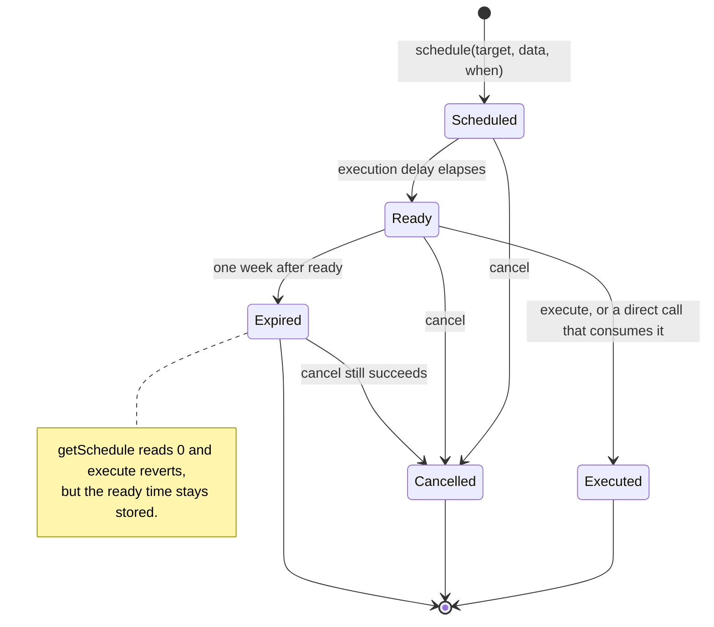

| Transition | Caller (role) | Delay | Function |
| --- | --- | --- | --- |
| Schedule | A holder of the role the call resolves to, with a nonzero execution delay: `ADMIN`, `UNPAUSER` or a setter role | Ready at the earliest now plus the delay | `AccessManager.schedule` |
| Ready | Nobody: time passes | The caller's execution delay; for the manager's own functions, [below](#the-managers-own-functions) | none |
| Execute | Only the scheduler: the operation ID is `keccak256(abi.encode(caller, target, data))` | none | `AccessManager.execute`, or the target's `restricted` check through `consumeScheduledOp` |
| Cancel | As in [Cancellation rules](#cancellation-rules) | Immediate | `cancel` (`_canCancel`) |
| Expire | Nobody | One week after ready (`AccessManager.expiration`) | none: `execute` reverts with `AccessManagerExpired` |

An executed, cancelled or expired operation can be scheduled again, with a new nonce and the
full delay; a live one cannot (`AccessManagerAlreadyScheduled`). A guardian can never
schedule (GV-6).

#### The manager's own functions

Nothing maps the manager's selectors, so `canCall(account, manager, selector)` reports only
`ADMIN` membership (`(false, 30 days)` for an admin, `(false, 0)` otherwise) and is no guide to
delays there. OpenZeppelin's private `_getAdminRestrictions` decides: every admin function
needs `ADMIN` and waits 30 days, or the target's admin delay if longer; `renounceRole` needs
only the holder and is immediate, and `suspend` checks `GUARDIAN` itself. The
[matrix](../audit/roles.md#the-accessmanagers-own-functions) lists each function.

### Cancellation rules

Stock OpenZeppelin lets the scheduler, any `ADMIN` holder and a holder of the target
function's guardian role cancel. `WorksAccessManager._canCancel` adds one permission and two
restrictions:

1. **Rule 1: any active `GUARDIAN` holder can cancel any scheduled operation,** on any target,
   the manager included.
2. **Rule 2: outside the escalated lane, nobody but its scheduler can cancel an operation that
   revokes one of the canceller's own roles.** It covers every role and every canceller,
   `ADMIN` included. A scheduler may still withdraw its own proposal, even one that removes
   itself. In the [escalated lane](#bounded-veto-and-the-escalated-lane) a cancellation is a
   guardian-majority decision instead, in which the guardian a removal names votes with its
   seat like any other seated guardian and never decides alone (a majority of the seats and
   at least two votes); Rule 2 does not apply there.
3. **Rule 3: a `revokeRole` on the manager that another account scheduled can be cancelled
   only by an active guardian.** No admin can cancel it, Rule 2 still bars the account it
   names, and its scheduler may cancel its own.

Every other operation is open to an active guardian (Rule 1) and to whoever stock
OpenZeppelin allows, so an admin still cancels another admin's grants, remaps and authority
moves (`test_AdminStillCancelsAnotherAdminsOtherOperations`). The one exception is an
operation in the [escalated lane](#bounded-veto-and-the-escalated-lane): only its scheduler or a
guardian majority stops it.

- **Why Rule 1.** Stock cancellation is selector-scoped, so guardians could not cancel the
  admin's operations on the manager (`ADMIN_ROLE`'s guardian is locked to `ADMIN`), a
  `setAuthority(rogue)` scheduled directly on a target, or any unmapped target selector
  ([`GuardianCancel.t.sol`](../../test/governance/GuardianCancel.t.sol):
  `test_StockManagerLeavesGuardiansPowerlessOverManagerOperations`,
  `test_StockManagerCannotStopDirectSetAuthority`,
  `test_StockManagerCannotStopUnmappedTargetSelector`).
- **Why Rule 2.** Whether an operation removes the canceller depends on its arguments, which no
  per-selector setting can express. Without it a guardian could veto its own removal, and a
  compromised hot admin the cold admin's `revokeRole(ADMIN, hot)`
  (`test_StockManagerLetsAdminCancelItsOwnRevocation`).
- **Why Rule 3** (review finding GOV-1,
  [ADR 0002 addendum](../adr/0002-access-manager-hardening.md#addendum-review-of-14-october-2026)).
  It keeps the cold admin's recovery finite when the hot admin and one guardian act together
  ([flow](#if-a-guardian-cancels-the-recovery)). In exchange, only the other guardians can
  defend a guardian against an admin's revocation
  ([LIM-GV-12](../audit/known-limitations.md#trust-and-governance)). Rule 3 reads only the
  `revokeRole` selector: a `grantRole` that raises a holder's execution delay demotes it and
  keeps the stock rules (`test_DemotionsByGrantStayCancellable`).

**Wrappers cannot smuggle a revocation past Rules 2 and 3** (GV-3):

- A revocation inside `multicall` or a nested `execute` can be scheduled but never executes:
  inside `execute` the manager is the caller, and only the outer selector is authorized.
- A scheduled `renounceRole(role, account)` fails at execution
  (`AccessManagerBadConfirmation`): the caller is then the manager.
- A dirty address word escapes Rule 2 (Rule 3 still applies) but cannot execute; a dirty role
  ID cannot be scheduled.
- The rules protect roles on the manager only; a target function that shares `revokeRole`'s
  selector is an ordinary operation (`test_Rule2OnlyProtectsRolesOnTheManager`).

`multicall` called directly is a self-delegatecall in which each batched call keeps the
original caller and consumes its own schedule: the one sanctioned exemption to the
no-delegatecall rule (ADR 0002, "Security impact").

### Role membership

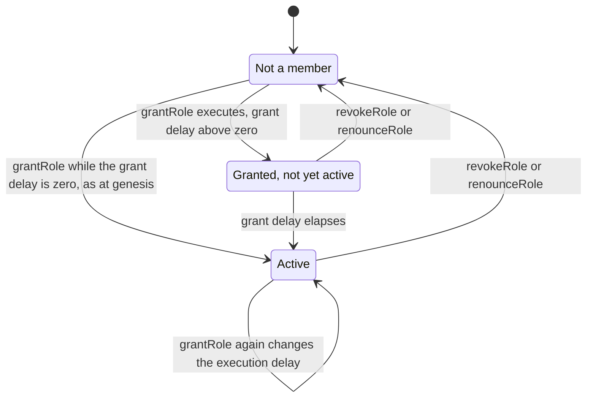

| Transition | Caller (role) | Delay | Function |
| --- | --- | --- | --- |
| Grant | `ADMIN` (every role's admin) | 30 days, then the role's grant delay before the holder is active | `AccessManager.grantRole(role, account, executionDelay)` |
| Change execution delay | `ADMIN` | 30 days, then as under [Setback](#how-the-manager-decides) | `grantRole` on an existing member |
| Revoke | `ADMIN` | 30 days, cancellable under Rules 2 and 3 | `AccessManager.revokeRole` |
| Renounce | The holder itself | Immediate | `AccessManager.renounceRole(role, self)` |

`hasRole` reports a pending member as not a member, so a guardian in its 30-day grant delay
cannot yet cancel anything.

### Suspension of operational keys

Revoking a role waits 30 days, and most targets of the zero-delay operational roles have no
pause. `WorksAccessManager.suspend(roleId, account)` therefore lets any guardian stop a
holder of a suspendable role at once (review finding GOV-2,
[ADR 0002 addendum](../adr/0002-access-manager-hardening.md#addendum-review-of-14-october-2026)).

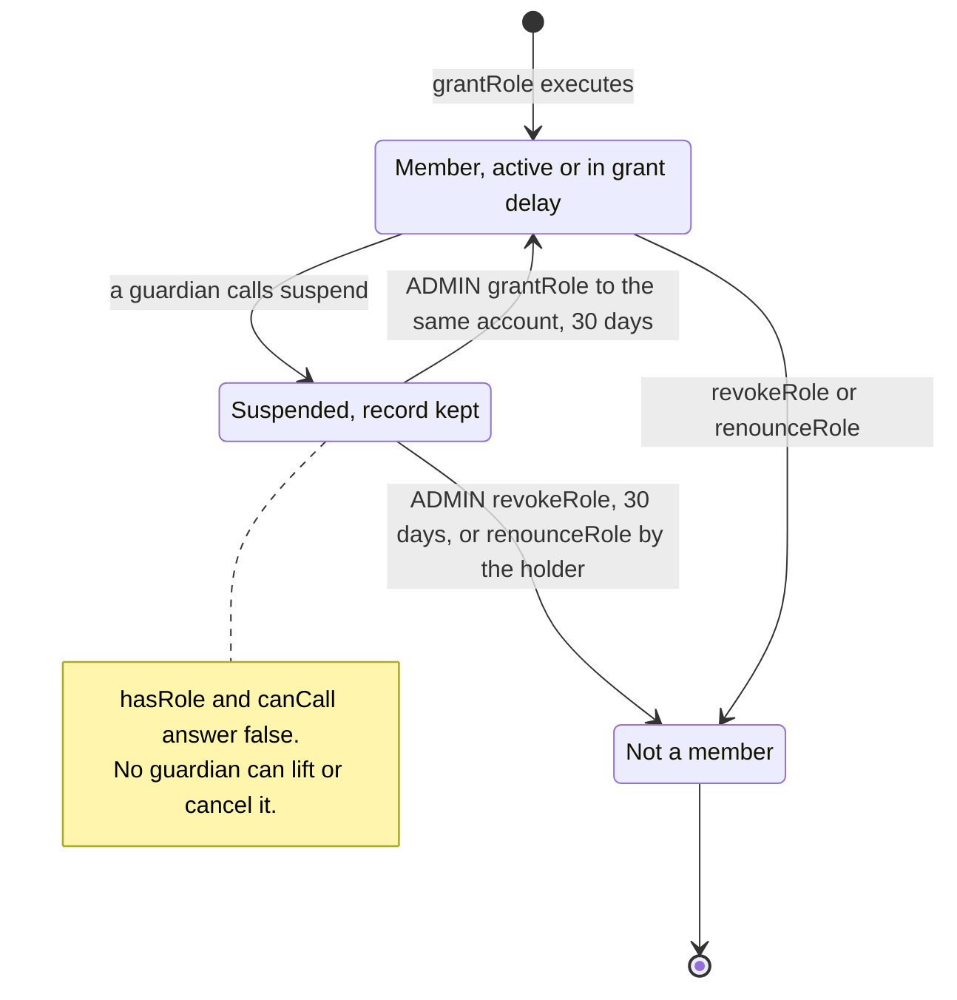

| Transition | Caller (role) | Delay | Function |
| --- | --- | --- | --- |
| Suspend | Any active `GUARDIAN` holder | Immediate | `WorksAccessManager.suspend(roleId, account)` |
| Lift by grant | `ADMIN` | 30 days, cancellable by any guardian; an existing member gets no new grant delay | `AccessManager.grantRole(roleId, account, executionDelay)` |
| Lift by revocation | `ADMIN` | 30 days, cancellable under Rules 2 and 3 | `AccessManager.revokeRole(roleId, account)` |
| Lift by renouncing | The holder itself | Immediate | `AccessManager.renounceRole(roleId, account)` |

Each lift emits `RoleSuspensionLifted`: the override of `_grantRole` and `_revokeRole` clears
the flag, and OpenZeppelin runs `renounceRole` through `_revokeRole`. A suspension is never
scheduled, so nothing can cancel it.

- **Who and which.** An active guardian calls the manager directly, or batches several in
  `multicall`; anyone else reverts with `AccessManagerUnauthorizedAccount(caller, GUARDIAN)`.
  Another role reverts with `RoleNotSuspendable(roleId)`; an account with no record for the
  role, or one already suspended, with `NotSuspendable(roleId, account)`.
- **Effect.** `hasRole` reports the holder as not a member, so `canCall` answers `(false, 0)`
  and every `restricted` function and manual check of that role refuses it in the same block.
  The record stays (`getAccess` still shows it), the account's other roles are unaffected, and
  a holder suspended in its grant delay never becomes active while suspended. Readback fails
  (`HolderMismatch`; `VerifyV1.check`'s `HolderSuspended`).
- **Not suspendable:** every other role, so the cancel rules and the admin functions rest on
  stock membership. A curation signer is cut off by the verifier's one-way `disableSigner`.

**How long a suspension lasts.** The `ADMIN` lifts stay in the 30-day class (GV-4,
ADR 0001 §13). A mistaken suspension
lasts 30 days; one by a dishonest guardian, which cancels each lift until its own removal
executes, about 60 (`test_ADishonestGuardiansSuspensionLastsAboutSixtyDays`); about 90
with a compromised hot admin alongside
([LIM-GV-14](../audit/known-limitations.md#trust-and-governance)).

### Bounded veto and the escalated lane

Rules 1 to 3 let any guardian cancel any operation, and only guardians cancel another
account's revocation, so any two guardians could cancel each other's removal, and every
handover, for good (LIM-GV-4). The bounded veto (GV-37) keeps the single-guardian veto for
everything except two protected actions, and bounds it there:

- **Protected actions** (`actionOf`): a guardian's removal, `revokeRole(GUARDIAN,
  account)` or `revokeRole(PAUSER, account)` on the manager, keyed on the account alone; and a
  successor registration, `registerSuccessor(next)`, keyed on `next`. The scheduler is not part of
  the key, trailing bytes do not change it, and a call with a dirty argument word (one that cannot
  execute) is not protected, so it cannot strike the clean action.
- **Strike.** When an active guardian cancels an operation on a protected action that it did not
  schedule, the action is struck (`ActionStruck`). The first cancellation works exactly as
  before. A scheduler withdrawing its own proposal, or an admin cancelling a successor
  registration, is no strike, so neither one compromised admin nor two can push an action into
  the escalated lane; the strike on a removal ends once the account holds neither role.
- **Escalated lane.** Every later proposal of a struck action is scheduled at least
  `ESCALATED_DELAY` (default 120 days) ahead (`OperationEscalated`). Its scheduler may withdraw
  it. Anyone else's `cancel` is a vote, accepted only from a guardian seated when it was
  scheduled (`NotAVoter`, `AlreadyVoted`), and it is cancelled once the votes reach a majority
  of the guardian seats counted when it was scheduled, never fewer than two guardians
  (`GuardianVoted`, then `OperationCanceled`). No admin can stop it.
- **Seats, not signatures.** A seat is an account with a `GUARDIAN` record, active or pending;
  a Safe's threshold does not matter. The count and the set of voters are fixed when the
  operation is scheduled: a guardian seated later cannot vote, and the vote of one removed later
  still counts.
- **The named guardian votes.** In its own removal a guardian votes with its seat, so an honest
  majority always stops a compromised admin. This is where Rule 2 gives way: the lane's
  decision is the majority's, the named guardian's vote counts like any other, and no single
  guardian ever decides alone. Excluding that vote (the 16 November 2026 automated review's
  variant) shifts both thresholds by one vote and is better in neither direction at every seat
  count: with s seats and the named guardian's vote counted, a compromised admin with d
  dishonest guardians is stopped when s - d > s/2, and c colluders shield one of them when
  c > s/2. Without it (seats still counted) the honest side needs s - d - 1 > s/2 and the
  colluders c - 1 > s/2; with the named seat also left out of the count, s - d - 1 > (s - 1)/2
  and c - 1 > (s - 1)/2. At 3 seats the variants let a compromised admin with one dishonest
  guardian remove the honest ones (the honest votes are one, not a majority), in exchange for
  stopping a colluding pair; at 4 seats the first variant is worse against the admin (two
  honest votes of four are no majority) and the second is the same as counting the vote; at 5
  and 7 seats either variant protects against one fewer dishonest guardian in exchange for
  needing one more colluder. Since no variant is better in one direction without being worse
  in the other, the named guardian keeps its vote.

| Guardian seats | Majority | Two colluding guardians | A compromised admin with one dishonest guardian |
| --- | --- | --- | --- |
| 2 | 2 | They are the whole body and shield each other | Removes the honest one after the escalated delay: no honest majority exists |
| 3 (genesis) | 2 | They are a majority and still shield each other (residual, LIM-GV-4) | The two honest guardians stop it |
| 4 | 3 | Cannot shield each other: two votes of four are no majority, so each is removed after the escalated delay | The three honest guardians stop it; with one of them offline, two honest votes no longer do |
| 5 | 3 | Cannot shield each other | The three honest guardians stop it |
| 7 (cap) | 4 | Three colluding guardians cannot shield each other either | The four honest guardians stop it |

The bounded veto therefore bites against a colluding pair from four guardian seats; with the
three of the genesis layout it changes nothing for them
(`test_Residual_TwoColludingGuardiansOfThreeAreAMajority`,
`test_TwoColludingGuardiansOfFiveCannotShieldEachOther`). It bounds the veto, not the time: a
struck removal completes no sooner than the first proposal's 30 days plus `ESCALATED_DELAY`
(at least 60 days, 120 by default), so at least 90 days. A replaceable contract whose own
timer assumes a guardian is removed sooner must not rely on that; the English auction's 60-day
freeze exit is one (LIM-SAL-15).

### Seats and the manager's own configuration

- **Seat caps** (GV-40). At most `ADMIN_SEATS` (default 5, bounds 3 to 16) `ADMIN` records
  and `GUARDIAN_SEATS` (default 7, bounds 3 to 16) `GUARDIAN` records, active or pending; a grant
  over the cap reverts with `SeatCapReached`. A lower cap refuses new seats only.
  `seatHolders(role)` lists them, so "majority" is well defined and neither role can be diluted.
  The configurator's constructor seat counts for no cap, so genesis can name up to five admins
  and seven guardians; the genesis layout names three admins, leaving two admin seats of
  headroom (`test_GenesisNamesThreeFourOrFiveAdmins`; `tools/check_genesis.py` check 9 refuses a
  genesis file over the default caps).
- **Class-delay floor** (GV-38). Every grant or re-grant of a role in `Roles` carries at least
  that role's class delay (`DelayBelowClass`): 30 days for `ADMIN` and `SUCCESSOR_SETTER`, 14
  days for `FUNDS_SETTER`, 48 hours for `PARAMETER_SETTER` and `UNPAUSER`. Only the
  configurator's own seat in the constructor is exempt, and recovery installs its candidate at
  30 days. A fresh zero-delay admin or setter is impossible, so every admin action, the slow and
  escalated lanes included, and every setter action is scheduled and cancellable for its class
  delay. The floor binds holders, not functions: it never stops a remap. Moving a selector to
  another role (a faster class, a role outside `Roles`, which has no class, or `PUBLIC`) is
  `setTargetFunctionRole`, an `ADMIN` operation that waits the target admin delay (30 days, at
  least the admin's own 30-day execution delay; GV-4) and that any one guardian can cancel,
  every time (no slow lane and no bounded veto, so no strike limits the cancels). Only after it
  executes does the selector take the new role's delay, which for `PUBLIC` or a role granted at
  zero is none (review E, N-5; `test_RemappingAFundsSelectorToAFasterRoleTakesThirtyDays`).
  Deployment CI flags every remap outside the configuration (GV-15).
- **The manager configures nothing on itself** (GV-39): `setTargetFunctionRole` and
  `setTargetClosed` on the manager revert with `ManagerSelfConfiguration`. Its added functions
  therefore always resolve to `ADMIN` and cannot be closed off.

### Governed parameters

Every number of the manager's own is a parameter, changed by `setParameter(which, expected,
value)` (`ADMIN`, slow lane, compare-and-set, any guardian may cancel) within bounds compiled into
the manager (GV-41). The lower bound is the guarantee; the default is only the starting value.

| Parameter | Default | Bounds | Guarantee |
| --- | --- | --- | --- |
| `SLOW_DELAY`: successor and recovery-address registration, parameter changes | 60 days | 30 to 365 days | Never faster than the 30-day class |
| `ESCALATED_DELAY`: a re-proposal after a strike | 120 days | 60 to 730 days | At least twice the admin delay for the guardians to gather a majority |
| `RECOVERY_SILENCE`: admin inactivity before a recovery opens | 365 days | 180 to 1,095 days | Half a year of total admin silence at least |
| `RECOVERY_DELAY`: public delay before it completes | 180 days | 90 to 730 days | With the silence, at least 270 days, against 30 for a compromised admin |
| `ADMIN_SEATS` | 5 | 3 to 16 | Room for the three genesis admins and two more; 16 bounds the recovery's loop |
| `GUARDIAN_SEATS` | 7 | 3 to 16 | Room for three guardians; 16 bounds the work |

### Dead-admin recovery

If every admin is lost, nothing else can grant, revoke or move a target. Recovery (GV-42)
replaces them, and cannot run while any admin is alive.

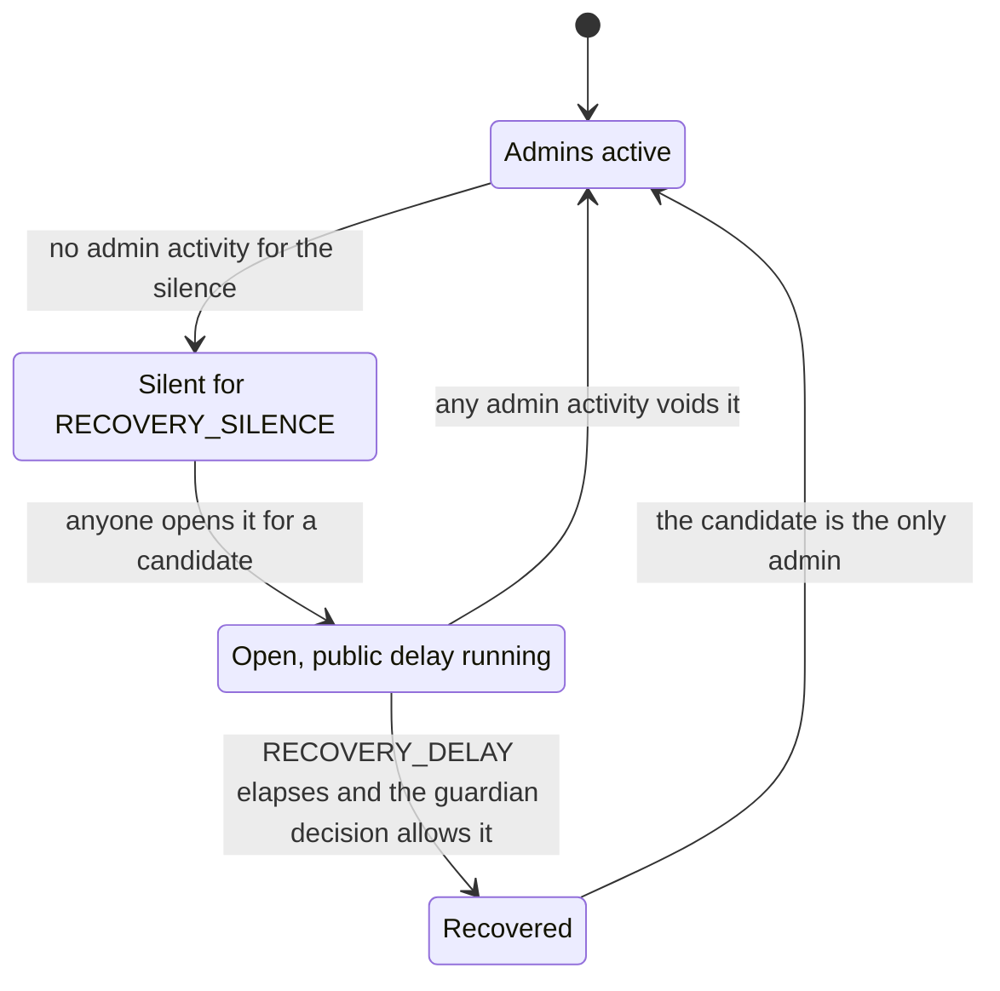

- **Activity.** `lastAdminActivity` moves whenever an active `ADMIN` holder schedules, executes
  (an immediate call as well as a scheduled one), consumes or cancels an operation, or calls
  `heartbeat`; a failed call moves nothing (it reverts). A direct `restricted` call on a managed
  contract counts only on the delayed path: the contract then calls the manager's
  `consumeScheduledOp`, which records activity for the scheduling admin if still active. A direct
  immediate call never reaches the manager's state (it only asks `canCall`, a view), so it cannot
  count: admins act through `execute`, a delayed call, or heartbeat. A recovery is live only while it opened
  after the last activity, so any admin action voids it and restarts the clock.
- **Open.** Anyone, after `RECOVERY_SILENCE` (`AdminsNotSilent` before), for one candidate
  (`RecoveryOpened`); a candidate has at most one live recovery.
- **Who decides.** The guardians, the only other body on chain, counted by seat as in the
  escalated lane (seated when it opened, a majority, at least two). For an ordinary candidate a
  majority must approve (`approveRecovery`). For the recovery address the admins pre-registered
  (`setRecoveryAddress`, slow lane, any guardian may cancel) it completes unless a majority objects
  (`objectToRecovery`).
- **Complete.** Anyone, after `RECOVERY_DELAY`: every `ADMIN` record is revoked and the candidate
  becomes the only admin, active at once with the 30-day delay (`RecoveryCompleted`). From there it
  rebuilds the roles through the ordinary lanes, guardians watching. A candidate that holds or
  awaits `GUARDIAN` or `PAUSER` is refused (`InvalidCandidate`): a guardian majority cannot make
  one of its own seats the only admin while it keeps its veto, the separation
  `GovernanceConfig` requires at genesis. A guardian that should become the admin leaves the
  guardian body first (`test_ARecoveryCannotSeatAGuardianAsAdmin`).
- **Not a shortcut.** It needs a year of total admin silence and 180 more public days (at least
  270 days at the floors), and a guardian majority or the admins' own choice of recovery address;
  compromising a live admin needs 30 days and is stopped by one guardian.

| Lost | What recovers |
| --- | --- |
| Every admin, guardians alive | A guardian majority installs a candidate, or the recovery address unless a majority objects |
| Every guardian, admins alive | No recovery is needed: nobody is left to cancel the admins' grants of new guardians (30 days, then the 30-day grant delay) |
| Every admin and every guardian | Only the pre-registered recovery address. Without one nothing recovers, ever (`test_Residual_AdminsAndGuardiansBothDeadWithNoRecoveryAddressNothingRecovers`) |

### Successor and migration

The manager is not upgradeable; its successor is any authority meeting the requirements below.

1. **Propose** (GV-43). `registerSuccessor(next)`, `ADMIN`, slow lane, bounded veto keyed on
   `next`. `next` must have code and answer `canCall` with two words (`InvalidSuccessor`). It only
   records `pendingSuccessor` and creates a `SuccessionProbe` whose authority is `next`
   (`SuccessorProposed(next, probe)`). The manager keeps every power: guardians cancel, suspend
   and vote, admins schedule, recovery runs. A later `registerSuccessor` under the same rules
   replaces the proposal; `registerSuccessor(address(0))` withdraws it. A replaced or withdrawn
   proposal can never accept. Executing a registration ends its strike, so a re-proposal after
   a withdrawal starts in the slow lane again.
2. **Accept** (GV-43). The pending successor itself, through its own governance, first calls
   `setAuthority(manager)` on its probe (only it can: a stock `AccessManaged.setAuthority`
   accepts only its authority as caller), then calls `acceptSuccession()`
   (`NotPendingSuccessor` for anyone else, the manager itself included; `SuccessionUnproven`
   while the probe does not name the manager). Only then is the manager handed over
   (`SuccessorAccepted`): from then on `canCall` and `hasRole` answer nothing, so no role, no
   scheduled operation and no recovery has any power left.
3. **Managed list** (GV-44). Every target the manager configures, at genesis or later, joins
   `managedTargets()` (`TargetManaged`): setting a target's admin delay or mapping one of its
   selectors enrols it. A contract that is never configured is never listed and stays under the
   old manager after a handover: onboarding sets the target's admin delay.
4. **Migrate** (GV-45). `migrate(from, to)`, anyone, once the successor has accepted: every
   listed target in that index range that still names the manager is moved to the successor
   (`setAuthority(next)`, forwarding all gas; the targets emit `AuthorityUpdated`). A piece is all
   or nothing, a moved target is skipped, and the range is the caller's choice, so a failing
   target blocks only the pieces that include it. The successor can accept and migrate in one
   `multicall` on the manager. The whole genesis stack (17 targets) migrates in one call of
   about 112,000 gas (`test_EveryGovernedContractMovesInOneTransaction`).

**What acceptance proves, and what it cannot.** The genesis manager's succession code is the
only route to any later authority, so a successor that answers `canCall` but cannot itself make
calls must never take over: it would freeze every governed function of every permanent
contract for good (review D, M-1; `test_ASuccessorThatCannotCallNeverTakesOver`,
`test_ASuccessorThatCannotCallNeverTakesOverTheStack`). Acceptance establishes, on the day it
happens, that the successor can originate a call to an arbitrary target with an arbitrary
selector, and that a stock `AccessManaged.setAuthority`, the exact call every permanent
contract needs to hand over again, succeeds when it makes it (through its delayed path too, if
it schedules one). It does not establish that the successor's `canCall` answers the permanent
contracts' selectors as intended, that its own lanes stay working, or that it can still make
calls later: a successor that can act today but loses the ability later (an upgradeable proxy
pointed at a broken implementation, a governor whose quorum can no longer be reached) is the
successor's own design risk, which no check in this manager can remove. The checklist below
states what the successor's design must guarantee. A successor hardwired to make exactly these
two calls and nothing else would pass too; review of the successor is not optional.

**Per-target moves.** `updateAuthority(target, x)`, an `execute` of `target.setAuthority(x)`
and remapping a target's selectors are 30-day admin operations (the target admin delay) with no
slow lane and no bounded veto: any one guardian can stop each, every time, and none checks
anything about `x`. They reach for one target what succession reaches for all, sooner, so the
guardians' real window against a compromised admin's hostile hand-over is 30 days, not the slow
lane's 60. They stay: moving one replaceable contract, or rescuing a target that refuses
`migrate`, needs them, and slowing two of the three paths would not change the window, since a
selector remap reaches the same end. The slow lane and the probe exist for the whole-system
handover: time for the network to examine the successor, a veto a guardian minority cannot hold
forever, and proof the successor can act.

#### What a successor must implement

Checked against the permanent contracts' code and exercised by
[`GovernanceHandover.t.sol`](../../test/integration/GovernanceHandover.t.sol) with a minimal
authority that is not an OpenZeppelin `AccessManager`:

1. Code at its address, and `canCall(caller, target, selector)` returning `(bool, uint32)`. A
   reverting or short answer locks every `restricted` function (OpenZeppelin `AuthorityUtils`).
   `AuthorityUtils` forwards all gas and reads a `canCall` that ran out of gas as "not allowed",
   so an expensive `canCall` (a TDH tally, say) fails closed: the governed call reverts with an
   authorization error and succeeds with more gas. No permanent contract turns that answer into
   a success, so it can never fail open; keep `canCall` cheap and bounded all the same.
2. `consumeScheduledOp(caller, data)` if it ever answers a delay; the target calls it while
   `isConsumingScheduledOp` holds.
3. A way to call any target, `setAuthority` included, so it can hand over again; while doing so
   it answers `canCall` for itself only for the call in progress.
4. For Stream's `setDependency`: replacement dependencies governed by the successor itself
   (GV-35).
5. For the curation verifier: `hasRole(CURATION_SIGNER, signer)` and `getAccess` with a
   `since`, or a verifier that does not read them installed first.
6. Separate accounts for `PLATFORM` and `CURATOR` (the authority cannot sign statements) with
   immediate answers for relayed statements; governance manifests move to the successor's subject.
7. Its own delay classes, an immediate emergency lane for the tightening selectors and suspension,
   and its own successor and recovery paths.
8. The two acceptance calls, made by the successor itself: `setAuthority(manager)` on its
   `SuccessionProbe`, then `acceptSuccession()` on the manager.
9. Lasting ability to act: the successor must keep, for as long as it governs, a working path
   to call any governed target (`setAuthority` included) and to answer `canCall` for every
   permanent contract's selectors. Acceptance proves this only on its own day; an upgrade or
   reconfiguration that removes it later freezes every contract the successor governs, with no
   remedy here. If the successor can be upgraded, the upgrade path itself must be governed at
   least as slowly as this manager's slow lane and veto-able.

### Contract-account seats

The manager authorises `msg.sender` only and never checks a signature, so a contract account
(a smart wallet with any signature scheme, a multisig of passkeys or post-quantum keys) can hold
`ADMIN` or `GUARDIAN`, schedule, execute, cancel, vote and send a `heartbeat`, and can rotate its
key without its roles changing (GV-46, `ContractSeat.t.sol`). The deploy policy is what refuses
such holders today (GV-29).

### The manager at genesis

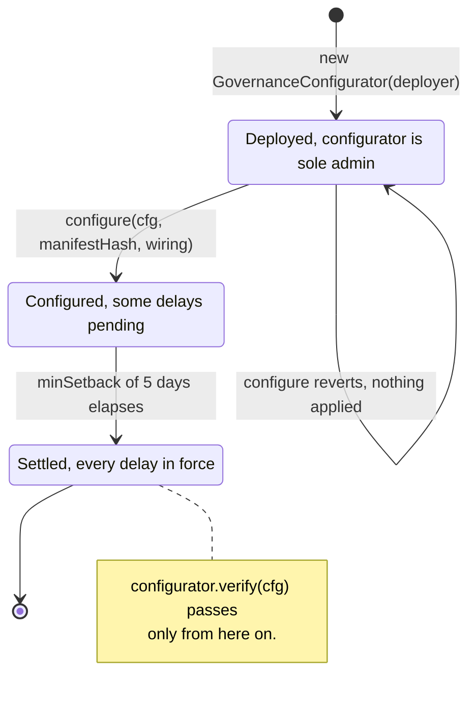

| Transition | Caller (role) | Delay | Function |
| --- | --- | --- | --- |
| Deploy | Anyone; normally the operator, by CREATE2 | none | `GovernanceConfigurator` constructor, which deploys `WorksAccessManager(address(this))` |
| Configure | Only `deployer`, a constructor argument | Immediate (the configurator is `ADMIN` with zero delay) | `GovernanceConfigurator.configure` |
| Settle | Nobody: time passes | `minSetback()`, 5 days | none |
| Read back | Anyone, by `eth_call` | none | `GovernanceConfigurator.verify` |

## Flows

### Genesis configure

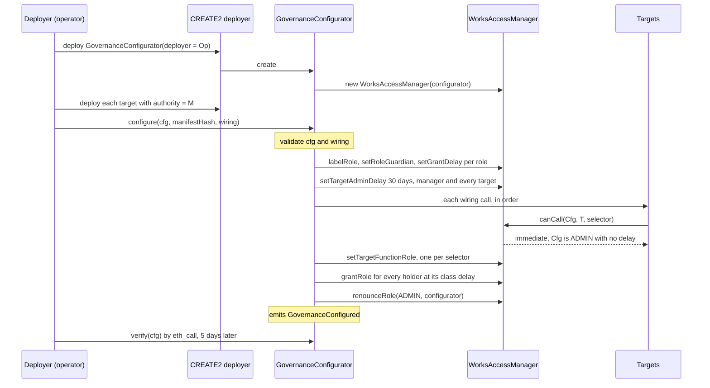

- **Preconditions.** The caller is `deployer` (`NotDeployer` otherwise, GV-11). Every target
  already exists with `authority()` equal to the configurator's manager. `cfg` and `wiring`
  pass `validate` and `validateWiring` ([GV-8 to GV-12](#rules-and-invariants)).
- **Wiring runs before mapping,** so a wired selector that `cfg` maps to a 30-day role, such
  as `setAdmittedMinter`, still runs at once. The installer cannot grant itself
  (`InvalidGrant`).
- **Effects.** Every holder is active at once: the grant delays set earlier in the transaction
  are still pending, so the grants see zero. Until they settle 5 days later, the admins'
  30-day execution delay still bounds every admin action. The configurator ends with no role,
  so a second `configure` reverts (`AccessManagerUnauthorizedAccount`).
- **Failure.** A reverting wiring call reverts `configure` with its revert data, or with
  `WiringCallFailed(index)` when it gave none; nothing is applied, and the deployer can retry.
- **Gas.** Even with the maximum 64 wiring calls, `configure` fits the EIP-7825 transaction
  cap ([Parameters and limits](#parameters-and-limits)).

**The wiring allow-list.** `GovernanceConfig.isGenesisSelector` admits only these selectors.
Anything else, such as a verifier swap or a recipient change, reverts with
`WiringSelectorNotAllowed`. A wiring call must target a configured target, never the manager
(`InvalidWiringCall`). There are at most `GovernanceConfig.MAX_WIRING_CALLS` (64) calls; the
committed example's 15 are listed in order in the [matrix](../audit/roles.md#genesis-wiring).

| Selector | Why it is wired |
| --- | --- |
| `bindWorkRecords`, `bindEditions`, `bindStream`, `bindPackageRegistry`, `bindSplitFactory`, `bindStatementLog` | The one-shot bindings |
| `bindFederationRegistry` (artist registry) | Allowed but not wired: the federation registry is in v1, specified by a later ADR, and is bound when it ships by a 30-day `ADMIN` action (later replaced by `setFederationRegistry`, SUCCESSOR_SETTER) |
| `setAdmittedMinter(address,bool)` | Admits each sale adapter to its token. A later one is admitted the same way, in the 30-day class; for 6529 Stream the review checks that the adapter reports each sale's true outcome to Stream (Stream itself moves an unbid or frozen-out work to the museum, owner decision 17), and the other obligations ADR 0005 lists: burns only on an upheld dispute, settles, pays the locked shares (ADR 0005, owner decision 15) |
| `setTarget(address,bool)` | Lists each token on its sale adapter |
| `setDefaultCurrency(bytes32,uint64,address)` | Each product's first default currency, ETH, the only active asset at genesis. Without it no auction could start for 14 days, because `EnglishAuction.start` reads `PRODUCT_STREAM`'s. |
| `setOpeningBid(address,uint64,uint256)` (asset allowlist) | ETH's opening bid, 0.05 ETH (owner decision 19), which the English auction locks at start, so a 1/1's first bid is at least that from the first sale; later a 48-hour PARAMETER_SETTER action |
| `appendGovernanceManifest(...)` | The epoch-0 manifest |

**Readback** (`GovernanceConfigurator.verify`, by `eth_call`, at least 5 days later). It
reverts on the first difference:

- the configurator still has any `ADMIN` record (`ConfiguratorStillAdmin`);
- a role's admin, guardian or grant delay differs from `Roles` (`RoleMismatch`);
- a target, the manager included, is closed or lacks the 30-day admin delay
  (`TargetMismatch`);
- a selector maps to another role (`FunctionRoleMismatch`);
- a configured holder is missing, not yet active, suspended, or has another or a pending
  execution delay (`HolderMismatch`);
- a guardian holds or awaits any role other than `PAUSER`, or a pauser also has an `UNPAUSER`
  record;
- a configured target is missing from the managed list (`TargetMismatch`), or the manager has been
  handed over (`HandedOver`).

`verify` cannot see a pending grant-delay or target-admin-delay change (OpenZeppelin has no
getter: `test_Limitation_ReadbackCannotSeePendingDelayReductions`), a holder outside `cfg`,
or what the wiring did ([LIM-GV-6](../audit/known-limitations.md#trust-and-governance)).
[`script/Verify.s.sol`](../../script/Verify.s.sol) covers these from events and getters and
repeats the deploy's guards on chain (review finding GOV-3; GV-14, GV-15, GV-29 to GV-34;
runbook [step 2](../../script/README.md#2-safe-pre-flight),
[step 10](../../script/README.md#10-simulate-then-broadcast),
[step 11](../../script/README.md#11-verify-after-5-days)).

### A 48-hour parameter change with a guardian watching

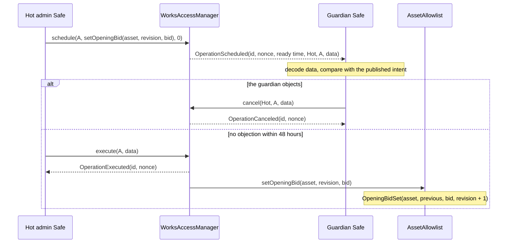

- `AssetAllowlist.setOpeningBid` maps to `PARAMETER_SETTER` (48 hours). At execution it
  reverts if any change to the asset (its status, floor or opening bid) bumped its revision
  since the operation was written (`RevisionMismatch`, GV-19) or the value is above its ceiling
  (`OpeningBidAboveCeiling`). The English auction locks the value at each start.

### A guardian cancels a hostile admin operation

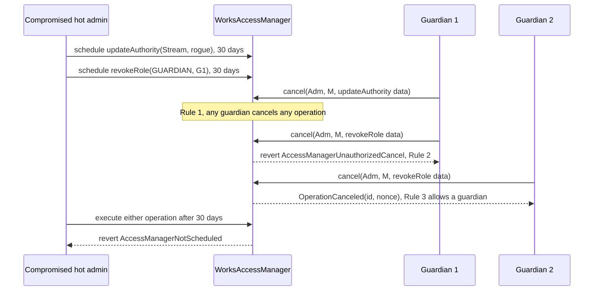

- A guardian cannot cancel its own removal, so at least two honest guardians must be online
  at all times ([LIM-GV-5](../audit/known-limitations.md#trust-and-governance)). The cold
  admin can cancel the `updateAuthority`, but not the revocation of `G1` (Rule 3,
  `test_TheGuardianVetoIsUnchanged`).
- **Tested by** `test_GuardiansCancelHostileAdminOperations` in
  [`Genesis.t.sol`](../../test/integration/Genesis.t.sol).

### A guardian suspends a compromised platform key

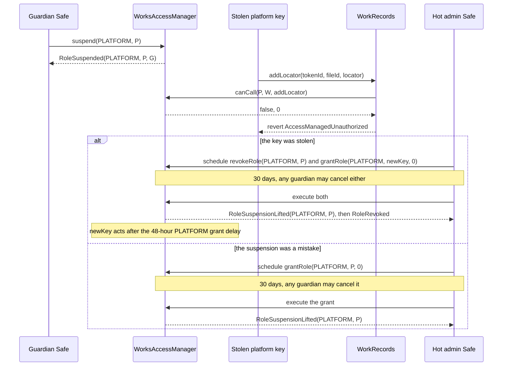

- **Effects.** In the same block `P` fails every `PLATFORM` path: `createCollection`,
  `appendPlatform`, `addLocator` and relayed `PLATFORM` statements. The same flow stops a
  `CURATOR` or `STORAGE_OPERATOR` key.
- **Lift** as under [suspension](#suspension-of-operational-keys); in an admin recovery the
  cold admin lifts once the hot admin is removed. If the stolen key is also the marketplace
  owner, schedule `setOwner` on Stream and Editions too (`FUNDS_SETTER`, 14 days).
- **Tested by** the GV-26 to GV-28 tests, and end to end by
  `test_AGuardianSuspendsThePlatformKeyAtOnce` and `test_ReplacingASuspendedKey` in
  [`GovernanceRecovery.t.sol`](../../test/integration/GovernanceRecovery.t.sol).

### Cold-admin recovery from a compromised hot admin

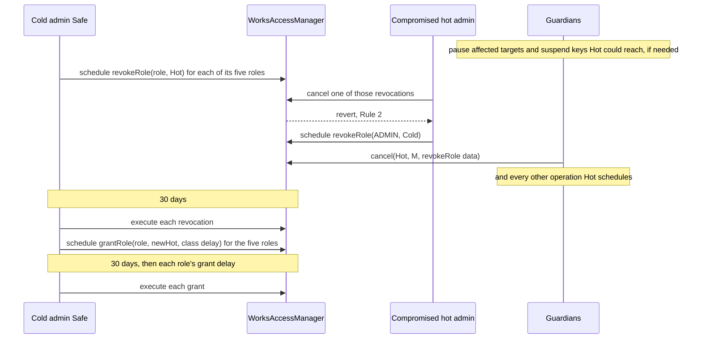

- **The five roles** of the hot admin Safe are `ADMIN`, `UNPAUSER`, `PARAMETER_SETTER`,
  `FUNDS_SETTER` and `SUCCESSOR_SETTER`.
- **Revocations first.** While the hot admin holds `ADMIN` it can cancel any operation but a
  revocation, including grants to its replacement, so the cold admin schedules the grants
  after the revocations execute.
- **Tested by** `test_ColdAdminRecoversFromACompromisedHotAdmin` in
  [`Hardening.t.sol`](../../test/governance/Hardening.t.sol),
  `test_ColdAdminRemovesTheHotAdmin` in [`Genesis.t.sol`](../../test/integration/Genesis.t.sol)
  and `test_ReverifyAfterAdminRecoveryPassesInEpochMode` in
  [`DeployScript.t.sol`](../../test/deploy/DeployScript.t.sol). The step-by-step procedure is
  the runbook's [Admin recovery](../../script/README.md#admin-recovery).

#### If a guardian cancels the recovery

A dishonest guardian acting with the hot admin can cancel the cold admin's revocations of the
hot admin (Rule 3) but not its own removal (Rules 2 and 3), so recovery takes two 30-day
rounds.

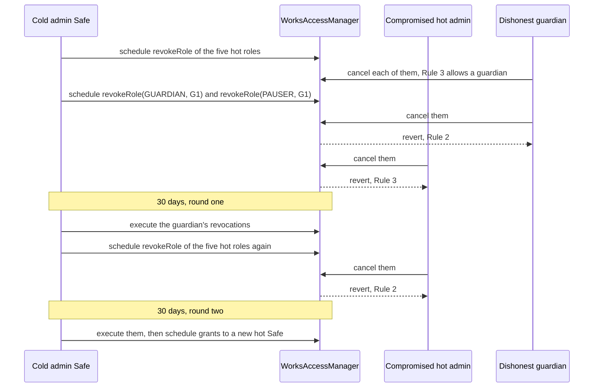

Tested by `test_ColdAdminRemovesAHotAdminAndAGuardianActingTogether` in
[`GovernanceRecovery.t.sol`](../../test/integration/GovernanceRecovery.t.sol).

## Operating procedures

Guardian liveness and monitoring, emergencies, operation expiry, rotations, onboarding a target
and publishing an epoch are in the runbook's [Operating procedures](../../script/README.md#operating-procedures).

## Rules and invariants

Rule IDs use the prefix `GV`; the internal review's findings are cited as "review finding
GOV-n".

**The manager and its configuration.**

| ID | Rule | Enforced in | Tested by |
| --- | --- | --- | --- |
| GV-1 | Any active `GUARDIAN` holder can cancel any scheduled operation, on any target, the manager included. A `PAUSER`-only account or an outsider cannot. | `WorksAccessManager._canCancel` | [`GuardianCancel.t.sol`](../../test/governance/GuardianCancel.t.sol): `test_GuardianCancelsEveryManagerAdminSelector`, `test_EveryGuardianCancelsManagerOperations`, `test_GuardianCancelsTargetClassOperations`, `test_GuardianCancelsDirectSetAuthorityOnTarget`, `test_GuardianCancelsUnmappedTargetSelector`, `test_PauserOnlyAccountCannotCancel`, `test_OutsiderCannotCancel` |
| GV-2 | Nobody but its scheduler can cancel a `revokeRole(role, account)` on the manager when `account` is the canceller, for every role, `ADMIN` included. | `WorksAccessManager._canCancel`, `_revokesRoleOf` | `GuardianCancel.t.sol`: `test_GuardianCannotCancelItsOwnReplacement`, `test_CompromisedAdminCannotCancelItsOwnRevocation`, `testFuzz_NobodyCancelsTheirOwnRevocation`, `test_RevocationWithTrailingCalldataIsStillProtected`, `test_SchedulerCanWithdrawItsOwnSelfRevocation`, `test_Rule2OnlyProtectsRolesOnTheManager` |
| GV-3 | A revocation wrapped in `multicall` or a nested `execute` never executes, and a scheduled `renounceRole` of another account fails. | OpenZeppelin `AccessManager._canCallSelf` (execution identifier) and `renounceRole` (confirmation) | `GuardianCancel.t.sol`: `test_MulticallWrappedRevocationNeverExecutes`, `test_NestedExecuteRevocationNeverExecutes`, `test_ScheduledRenounceCannotRemoveGuardian`, `test_MalformedRevocationCanAlwaysBeCancelled`, `test_DirtyRoleIdRevocationCannotBeScheduled` |
| GV-4 | Meta-governance is never faster than the slowest class: `ADMIN` has a 30-day execution delay, every target (the manager included) a 30-day admin delay, and every grant delay is at least its role's execution delay. | `Roles.executionDelay`, `Roles.grantDelay`, `GovernanceConfig.install` (`TARGET_ADMIN_DELAY`) | [`Hardening.t.sol`](../../test/governance/Hardening.t.sol): `test_MetaGovernanceIsNeverFasterThanTheSlowestClass`, `test_RemappingAFundsSelectorToAFasterRoleTakesThirtyDays`; [`Roles.t.sol`](../../test/governance/Roles.t.sol): `test_GrantDelayNeverShorterThanExecutionDelay`, `test_ExecutionDelayTable`, `test_GrantDelayTable` |
| GV-5 | Shortening a delay waits: after its 30-day operation, a grant-delay or target-admin-delay cut applies after the longer of 5 days and the cut, an execution-delay cut after the cut. A fresh zero-delay holder waits 30 days plus the grant delay. | OpenZeppelin `Time.Delay.withUpdate`, `AccessManager._grantRole` | `Hardening.t.sol`: `test_AdminCannotShortenGrantDelayWithoutWaiting`, `test_AdminCannotShortenTargetAdminDelayWithoutWaiting`, `test_AdminCannotShortenItsOwnExecutionDelayWithoutWaiting`, `test_AFreshHolderCarriesTheClassDelayAndWaitsTheGrantDelay` |
| GV-6 | A guardian cannot schedule an operation: it holds only zero-delay roles, and `schedule` reverts for a caller with no delay. | `GovernanceConfig._checkPair` and `verify` (guardians hold only `GUARDIAN` and `PAUSER`), `AccessManager.schedule` | `Hardening.t.sol`: `test_GuardianCannotSchedule` |
| GV-7 | A scheduled operation executes only after its delay and only within one week of becoming ready. Its ID binds it to its scheduler, and executing consumes it. | OpenZeppelin `AccessManager.execute`, `hashOperation`, `_consumeScheduledOp` | `Hardening.t.sol`: `test_ScheduledOperationExpiresAfterOneWeek`, `test_ExpiredMetaOperationCannotBeExecuted`; `GuardianCancel.t.sol`: `test_AdminCannotExecuteBeforeTheDelay` |
| GV-8 | A configuration has at least two guardians and a holder for `ADMIN`, `PAUSER` and `UNPAUSER`; a guardian holds only `GUARDIAN` and `PAUSER`; nobody holds both `PAUSER` and `UNPAUSER`; no grant is to the zero address, repeated, of an unknown role, or to the installer. | `GovernanceConfig._validateGrants`, `_checkPair`, `install` | [`GovernanceConfigurator.t.sol`](../../test/governance/GovernanceConfigurator.t.sol): `test_RejectsFewerThanTwoGuardians`, `test_AcceptsTheTwoGuardianFloor`, `test_RejectsMissingAdminPauserOrUnpauser`, `test_RejectsInvalidGrants`, `test_RejectsGuardianHoldingAnyOtherRole`, `test_RejectsSharedPauseAndUnpauseHolder` |
| GV-9 | Every configured target has code, is not the manager, appears once, and answers `authority()` with this manager. | `GovernanceConfig.validate` | `GovernanceConfigurator.t.sol`: `test_RejectsInvalidTargets`, `test_RejectsDuplicateTarget`, `test_TargetGovernedByAStockManagerIsRejected`, `test_PreSeededManagerIsRejected` |
| GV-10 | One selector, one class: a selector appears once per target and never maps to `ADMIN`, `CURATION_SIGNER` or `PUBLIC`. | `GovernanceConfig._validateFunctions` | `GovernanceConfigurator.t.sol`: `test_RejectsOneSelectorInTwoClasses`, `test_RejectsFunctionRolesThatMustNotCall`, `test_CuratorAndPlatformMapToZeroDelayWriters`; `Hardening.t.sol`: `test_EachGovernedSelectorHasExactlyOneClass` |
| GV-11 | Only `deployer` can configure, once; the configurator governs only the manager it deployed, and ends with no role. | `GovernanceConfigurator.configure`, constructor | `GovernanceConfigurator.t.sol`: `test_OnlyDeployerCanConfigure`, `test_ConfigureIsOneShot`, `test_DeployerIsTheConstructorArgumentNotTheSender`, `test_AForeignConfiguratorOnlyGovernsItsOwnManager`, `test_ConfiguratorDeploysAndOwnsAWorksAccessManager`; [`GenesisWiring.t.sol`](../../test/governance/GenesisWiring.t.sol): `test_ConfiguratorEndsWithNoRoleAfterWiring` |
| GV-12 | Genesis wiring has at most 64 calls, each on a configured target with an allow-listed selector; it runs before any selector is mapped, and any revert aborts the whole configuration. | `GovernanceConfig.validateWiring`, `isGenesisSelector`, `install` | `GenesisWiring.t.sol`: `test_GenesisSelectorsAreExactlyTheAllowList`, `testFuzz_OnlyGenesisSelectorsPassValidation`, `test_WiringRunsBeforeSelectorsAreMapped`, `test_RevertingWiringCallAbortsTheWholeConfiguration`, `test_SilentWiringRevertIsNamedByIndex`, `test_RejectsZeroDelaySwapsThroughWiring`, `test_RejectsWiringOnAnUnconfiguredTarget`, `test_RejectsMoreThanTheWiringBound`, `test_AllowListRejectsManagerCallsEvenIfTheManagerWereATarget` |
| GV-13 | Readback reverts on any difference between the manager and `cfg` that `AccessManager` exposes (listed under [Genesis configure](#genesis-configure)), on a configured target missing from the managed list, and on a handed-over manager. | `GovernanceConfigurator.verify`, `GovernanceConfig.verify` | `GovernanceConfigurator.t.sol`: `test_ReadbackDetectsRemappedSelector`, `test_ReadbackDetectsPendingExecutionDelayReduction`, `test_ReadbackDetectsAdminDelayReduction`, `test_ReadbackDetectsGuardianGainingAnyOtherRole`, `test_ReadbackDetectsPauserGrantedUnpause`, `test_ReadbackDetectsClosedTargetAndChangedGuardian`, `test_ReadbackDetectsMissingHolder`, `test_ReadbackFailsBeforeDelaysSettle`, `test_VerifyRejectsAManagerTheConfiguratorStillAdministers`; [`Suspension.t.sol`](../../test/governance/Suspension.t.sol): `test_ReadbackRejectsASuspendedHolder` |
| GV-14 | Off anvil, the deploy refuses unreachable or placeholder holders, fewer than three admin Safes (the third admin seat, ADR 0007), three guardian Safes or two curation signers, a signer shared by any two admin or guardian Safes, a policy or wiring other than the committed example, an unpinned CC0 text, a missing fee recipient and dropped modules. | `Deploy.s.sol` (`prepare`, `checkDeployment`), `DeployGuards` | [`DeployScript.t.sol`](../../test/deploy/DeployScript.t.sol): `test_OffAnvilAdminsAndGuardiansMustBeSafesWithAThreshold`, `test_OffAnvilNeedsThreeAdminSafes`, `test_OffAnvilAdminSafesShareNoSigner`, `test_OneKeyBehindEveryGuardianSafeIsRefused`, `test_OffAnvilNeedsThreeGuardiansAndTwoCurationSigners`, `test_ARemappedSelectorIsRefused`, `test_ChangedWiringIsRefused`, `test_TheCc0TextMustBeTheCanonicalOne`, `test_OffAnvilTheFeeRecipientMustExist`, `test_NothingTheGenesisNamesMayBeDropped`, `test_HoldersCannotBeDeploymentContracts` |
| GV-15 | Deployment CI fails on a pending grant-delay or target-admin-delay change, an unexpected grant, mismatched event hashes, an unapplied wire, a suspended configured holder, or a closed PLATFORM path. It also fails on any selector remap, role-admin change, role-guardian change or target closure since genesis that does not match the configuration: a configured selector keeps its role, every other selector stays with ADMIN, every role's admin is ADMIN, a configured role's guardian is GUARDIAN and any other role's ADMIN, and no target is closed. In epoch mode the configuration is the epoch's: a past change that does not match it, a genesis mapping the epoch dropped or changed included, is accepted and logged only when the manager's current state matches the epoch configuration (ADMIN for a selector it no longer maps). | `Verify.s.sol` (`_checkRoleMap`), `VerifyV1.check` | `DeployScript.t.sol`: `test_VerifyCatchesPendingDelayChanges`, `test_VerifyCatchesAnUnexpectedGrant`, `test_VerifyRecomputesTheEventHashes`, `test_VerifyCatchesARemappedGenesisOnlySelector`, `test_VerifyCatchesTheDeferredBindMappedToThePublicRole`, `test_VerifyCatchesARemapToANewRoleSinceRestored`, `test_VerifyCatchesARoleAdminChangeOnAnUnlistedRole`, `test_VerifyCatchesARoleGuardianChangeOnAnUnlistedRole`, `test_VerifyCatchesATargetClosure`, `test_VerifyAcceptsChangesThatMatchTheConfiguration`, `test_EpochModeAcceptsARestoredRemapOnly`, `test_EpochModeRefusesAMappingTheEpochDropped`; [`DeployV1.t.sol`](../../test/deploy/DeployV1.t.sol): `test_ReadbackCatchesAnUnappliedWire`, `test_ReadbackNeedsPlatformsImmediatePath`, `test_ReadbackCatchesATargetMovedToAnotherAuthority`, `test_ReadbackCatchesARoleGrantedToTheConfigurator`, `test_ReadbackRejectsASuspendedHolder` |
| GV-16 | Under random hostile admin operations and benign rotations, with vigilant guardians, no hostile operation executes and role membership matches the model. | All of the above | [`GovernanceInvariant.t.sol`](../../test/governance/GovernanceInvariant.t.sol): `invariant_GovernanceStaysContained` |

**Rules every target follows.**

| ID | Rule | Enforced in | Tested by |
| --- | --- | --- | --- |
| GV-17 | Every `restricted` function of every concrete contract is mapped to exactly one class role, or listed as genesis-only (a bind genesis wires) or deferred. Nothing falls back to `ADMIN` unlisted. | [`tools/check_genesis.py`](../../tools/check_genesis.py) in CI; [`GenesisConfig.t.sol`](../../test/governance/GenesisConfig.t.sol) | `GenesisConfig.t.sol`: `test_JsonMatchesTheCompiledSelectors`, `test_EveryEntryMatchesItsSignatureAndClassDelay`, `test_WiringIsGenesisOnlyAndComplete`; `Hardening.t.sol`: `test_UnmappedSelectorFallsBackToAdminDelay`; [`tools/test_check_genesis.py`](../../tools/test_check_genesis.py) |
| GV-18 | Governed functions are non-payable: `AccessManager.execute` forwards `msg.value`. | Each target (no governed function is `payable`) | `Hardening.t.sol`: `test_GovernedFunctionsRejectValueThroughExecute`, `test_EveryGovernedSelectorIsNonPayable`, `test_NonPayableProbeFlagsAPayableGovernedFunction`; per module, for example [`AssetAllowlist.t.sol`](../../test/economics/AssetAllowlist.t.sol): `test_GovernedFunctionsAreNonPayable` |
| GV-19 | Setters for funds, recipients, verifiers, renderers and sale parameters are compare-and-set: they take the expected current value (or revision), so a stale operation reverts. | Each setter (`ExpectedValueMismatch`, revision checks) | `Hardening.t.sol`: `test_StaleCompareAndSetOperationReverts`; `AssetAllowlist.t.sol`: `test_QueuedAdmissionCannotReviveAfterEmergencyDeprecation`, `test_DefaultCurrencyIsCompareAndSet` |
| GV-20 | Every governed setter emits an event: value setters the old and the new value, per-key toggles (`setTarget`, `setAdmittedMinter`) the key and its new state. | Each setter's event | [`VrfEntropyGovernance.t.sol`](../../test/entropy/VrfEntropyGovernance.t.sol): `test_SetConfig_UpdatesAndEmits`, `test_SetCoordinator_SwapsAndEmits`; [`StatementLog.t.sol`](../../test/records/StatementLog.t.sol): `test_SetArtistResolver_SwapsAndEmits`; `Hardening.t.sol`: `test_DirectionRulesLiveInTheTarget` |
| GV-21 | Raise-only parameters use `BoundedParameter`: a nonzero initial value within the ceiling, and each raise above the current value, at most double it, and never above the ceiling. The one v1 user is the entropy callback gas limit (`setConfig`, ceiling `MAX_CALLBACK_GAS`); its separate 30-day `lowerCallbackGasLimit` sets a value below the current limit and at least `MIN_CALLBACK_GAS`. | `BoundedParameter.initial`, `raise`; `VrfEntropyModule` | [`BoundedParameter.t.sol`](../../test/governance/BoundedParameter.t.sol): `testFuzz_RaiseMatchesSpecification`, `testFuzz_RaiseSequenceStaysBounded`, `test_RaiseRejectsMoreThanDouble`; `VrfEntropyGovernance.t.sol`: `test_SetConfig_GasLimitCanOnlyBeRaised`; [`VrfEntropyManaged.t.sol`](../../test/entropy/VrfEntropyManaged.t.sol): `test_ALoweringStaysAboveTheFloorAndBelowTheCurrentLimit` |
| GV-22 | Dependencies installed by governed setters are checked for code, no EIP-7702 delegation and ERC-165 where implemented. Sale targets are listed with the same check (ERC-721 on the English auction; the edition auction lists only the Editions its constructor checked). All but admitted minters and sale targets are also pinned to a code hash re-checked at every use (DEPS-6). | `Dependency` (the one shared check), used by `PackageRegistry.setVerifier` and `registerPackage`, `VrfEntropyModule`, `StatementLog`, `EnglishAuction` (`isTarget`), `UniformEditionAuction` (constructor, `setFederationRegistry`), `Stream.setDependency`, `Stream.rendererOf`, `WorkRecords.pinnedRenderer`, `ArtistRegistry` | [`PackageRegistry.t.sol`](../../test/curation/PackageRegistry.t.sol): `test_registerPackage_refusesAVerifierWhoseCodeChanged`; [`VrfEntropyModule.t.sol`](../../test/entropy/VrfEntropyModule.t.sol): `test_Pin_ACoordinatorWhoseCodeChangedIsRefused`; `StatementLog.t.sol`: `test_Artist_AResolverWhoseCodeChangedIsRefused`; [`EnglishAuctionFederation.t.sol`](../../test/sales/auction/EnglishAuctionFederation.t.sol): `test_Federation_CodeHashesArePinned`; [`EnglishAuctionDisputes.t.sol`](../../test/sales/auction/EnglishAuctionDisputes.t.sol): `test_SetTarget_RejectsNonTokens`; [`UniformEditionAuction.t.sol`](../../test/sales/edition/UniformEditionAuction.t.sol): `test_SetTarget_OnlyEditions`, `test_SetFederationRegistry_IsRefused`; [`RendererCodePin.t.sol`](../../test/integration/RendererCodePin.t.sol): `test_PinnedRendererWithChangedCodeIsRefused`, `test_FinalizeRefusesADefaultRendererWhoseCodeChanged`; [`ArtistRegistry.t.sol`](../../test/identity/ArtistRegistry.t.sol): `test_ConsolidationSource_CodeHashRecheckedAtUse` |
| GV-23 | A delay that reverses a tightening action counts from that action, not from scheduling: `unpause`, `resume` and the dispute `cancel` run no earlier than 48 hours after the pause (review finding GOV-5), a re-admission no earlier than 14 days after the deprecation (MARKET-2). | `EnglishAuction._requireUnpausable`, `UniformEditionAuction.unpause`, `AssetAllowlist.admitAsset` | [`PauseWindow.t.sol`](../../test/sales/PauseWindow.t.sol): `test_Unpause_ScheduledBeforeThePauseWaitsTwoDaysAfterIt`, `test_Resume_ScheduledBeforeThePauseWaitsTwoDaysAfterIt`; `AssetAllowlist.t.sol`: `test_DeprecateThenReadmit`; [`UniformEditionAuction.t.sol`](../../test/sales/edition/UniformEditionAuction.t.sol): `test_Pause_BlocksOpensOnly` |
| GV-24 | Contract-to-contract calls use one-shot bindings, not roles: each bind resolves to `ADMIN`, runs once, and genesis wires all of v1's. | Each `bind*` (`AlreadyBound`), `GovernanceConfig.isGenesisSelector` | `GenesisWiring.t.sol`: `test_RepeatedOneShotBindAbortsTheWholeConfiguration`, `test_WiringExecutesGenesisCallsInTheConfiguringTransaction`; [`Genesis.t.sol`](../../test/integration/Genesis.t.sol): `test_WiringIsInPlaceAndTheReadbackPasses` |

**Rule 3, suspension and the deployment checks** (review findings GOV-1 to GOV-4, DEPS-3 and
DEPS-4).

| ID | Rule | Enforced in | Tested by |
| --- | --- | --- | --- |
| GV-25 | A `revokeRole` on the manager that another account scheduled can be cancelled only by an active guardian, never by an admin, and never by the account it names (Rule 2); its scheduler can always cancel it. Admins keep the stock power over every other operation; a demotion by `grantRole` is not a revocation. | `WorksAccessManager._canCancel` (Rule 3) | [`GuardianCancel.t.sol`](../../test/governance/GuardianCancel.t.sol): `test_AdminCannotCancelAnotherAccountsRevocation`, `test_AdminCannotCancelAnotherAdminsRevocationOfAKey`, `test_AdminStillCancelsAnotherAdminsOtherOperations`, `testFuzz_OnlyGuardiansCancelAnotherAccountsRevocation`; [`GovernanceRecovery.t.sol`](../../test/integration/GovernanceRecovery.t.sol): `test_ColdAdminRemovesAHotAdminAndAGuardianActingTogether`, `test_TheGuardianVetoIsUnchanged`, `test_DemotionsByGrantStayCancellable` |
| GV-26 | Only an active guardian can suspend, only a `PLATFORM`, `CURATOR` or `STORAGE_OPERATOR` record (active or pending), and only once; a suspension through `execute` is refused. | `WorksAccessManager.suspend`, `Roles.isSuspendable` | [`Suspension.t.sol`](../../test/governance/Suspension.t.sol): `test_SuspendableRolesAreTheZeroDelayOperationalKeys`, `test_OnlyGuardiansSuspend`, `testFuzz_OnlyOperationalRolesCanBeSuspended`, `test_NonMembersAndTheSuspendedCannotBeSuspendedAgain`, `test_SuspensionThroughExecuteIsRefused`, `test_AGuardianBatchesSuspensionsInMulticall`; `GovernanceRecovery.t.sol`: `test_EveryOperationalRoleCanBeSuspended` |
| GV-27 | A suspended holder fails `hasRole`, and so every check built on it, in the same block; its record and other roles stay, and a holder suspended in its grant delay never becomes active while suspended. Guardian, pauser and admin membership is never affected. | `WorksAccessManager.hasRole` | `Suspension.t.sol`: `test_AGuardianSuspendsAKeyInTheSameBlock`, `test_APendingGrantCanBeSuspended`, `test_GuardiansAndAdminsAreNeverSuspendedByRole`; `GovernanceRecovery.t.sol`: `test_AGuardianSuspendsThePlatformKeyAtOnce` |
| GV-28 | Only a grant or a revocation of the same role to the same account (`ADMIN`, 30 days, guardian-vetoable), or the holder's own renounce, lifts a suspension. No guardian can lift or cancel one. | `WorksAccessManager._grantRole`, `_revokeRole`, `_lift` | `Suspension.t.sol`: `test_OnlyAnAdminGrantLiftsItAndAGuardianCanVetoThat`, `test_ARevocationClearsItAndTheKeyCanRenounce`; `GovernanceRecovery.t.sol`: `test_ReplacingASuspendedKey`, `test_ADishonestGuardiansSuspensionLastsAboutSixtyDays` |
| GV-29 | Off anvil, every admin and guardian Safe has a threshold of at least 2, plain-key owners (no contract, no EIP-7702 delegation), a canonical Safe 1.3.0 or 1.4.1 singleton with its code hash, and no module or transaction guard, at deploy and again at readback. | `DeployGuards.checkHolders` (`requireSafe`, `requireBareSafe`, `ownersOf`), `checkHoldersAgainst`; `Verify.s.sol` (`_checkGuards`) | [`DeployScript.t.sol`](../../test/deploy/DeployScript.t.sol): `test_OneKeyBehindEveryGuardianSafeIsRefused`, `test_ANestedSafeOwnerIsRefused`, `test_ASafeWithAModuleIsRefused`, `test_ASafeWithAGuardIsRefused`, `test_ASafeOnAnotherSingletonIsRefused`, `test_TheCanonicalSafeSingletonsArePinned`, `test_VerifyRefusesAModuleEnabledAfterGenesis`, `test_VerifyRepeatsTheHolderGuards`, `test_VerifyRefusesADeploymentContractAsAHolder` |
| GV-30 | Under the invariant campaign, no admin cancels another account's revocation, only suspendable roles are suspended, a suspended holder never passes `hasRole` or `canCall`, and suspensions match the model. | All of the above | `GovernanceInvariant.t.sol`: `invariant_GovernanceStaysContained`, `invariant_SuspensionsStayContained` |
| GV-31 | On mainnet the VRF coordinator (recorded and live) and the delegation contract are the canonical contracts with their pinned code hashes, and Permit2 the canonical address with code, at deploy and readback; off mainnet an optional `VRF_COORDINATOR_CODEHASH` must match. | `Deploy.s.sol` (`_vrf`), `DeployGuards.CANONICAL_VRF_COORDINATOR`, `Verify.s.sol` (`_checkCanonical`) | `DeployScript.t.sol`: `test_TheMainnetCoordinatorIsPinned`, `test_MainnetRefusesANonCanonicalCoordinator`, `test_TheCoordinatorCodeHashCanBePinnedOffMainnet`, `test_VerifyRefusesNonCanonicalDependenciesOnMainnet`, `test_VerifyChecksTheLiveCoordinatorAndItsCode`, `test_VerifyChecksTheCanonicalCoordinatorsCode` |
| GV-32 | Off anvil, Verify requires the entropy module to be its VRF subscription's only consumer; on mainnet the subscription's owner must hold `ADMIN` and `PARAMETER_SETTER` (the hot admin Safe), and an unreadable subscription fails. On mainnet the deploy applies the same check in its simulation, after deploying the contracts and before `configure`, so nothing is broadcast unless the subscription already lists the module the run deploys. | `DeployGuards.checkSubscription`; `Verify.s.sol` (`_checkSubscription`), `Deploy.s.sol` (`checkDeployment`) | `DeployScript.t.sol`: `test_VerifyChecksTheSubscriptionConsumers`, `test_VerifyOnMainnetTheSubscriptionOwnerIsTheHotAdminSafe`, `test_MainnetDeployChecksTheSubscriptionBeforeTheBroadcast` |
| GV-33 | Verify fails on any manager operation that can still execute, unless `ALLOW_PENDING_OPERATIONS=1`. In epoch mode it checks the current holders, requires dropped genesis holders to hold no record, and binds the epoch manifest (`GOVERNANCE_MANIFEST_PATH`). | `Verify.s.sol` (`_checkPendingOperations`, `_checkRemoved`, `_checkEpochManifest`) | `DeployScript.t.sol`: `test_VerifyReportsPendingOperations`, `test_AnExpiredOperationIsNotPending`, `test_ReverifyAfterAdminRecoveryPassesInEpochMode`, `test_EpochModeRequiresDroppedHoldersToBeRevoked`, `test_EpochModeBindsTheEpochManifest` |
| GV-34 | The deploy refuses an EIP-7702 delegated sender, and off anvil requires an explicit `DEPLOY_NAMESPACE` under which every address predictable before the broadcast is free. | `Deploy.s.sol` (`prepare`, `params`, `checkAddressesFree`) | `DeployScript.t.sol`: `test_ADelegatedDeployerIsRefused`, `test_OffAnvilTheNamespaceIsExplicit`, `test_ATakenAddressIsRefusedBeforeTheBroadcast` |
| GV-35 | A replacement Stream dependency (`setDependency`) that answers `authority()` with one word must name Stream's own AccessManager, so a package registry, artist registry, economics resolver or entropy module governed by another manager is never installed; one with no one-word `authority()` answer passes, and a word that is not an address is refused. The read forwards all gas (the gas rule, ADR 0007): a failure that leaves at most 1/8 of the gas reverts with `BoundedCallShortfall`, never passing as "no answer". | `Stream.setDependency` | [`StreamDependencies.t.sol`](../../test/integration/StreamDependencies.t.sol): `test_AReplacementUnderAForeignAuthorityIsRefused`, `test_AReplacementWithNoAuthorityAnswerInstalls`, `test_ASlowAuthorityAnswerIsStillRead`, `test_GasRule_setDependencyAuthorityProbe` |
| GV-36 | On mainnet (chain 1), the deploy and Verify refuse a genesis that names the deployer EOA as any role holder, or whose community council roles (ADMIN, UNPAUSER, PARAMETER_SETTER, FUNDS_SETTER, SUCCESSOR_SETTER), security council roles (GUARDIAN, PAUSER) and curation signers (CURATION_SIGNER) share an account across groups (owner decision 18). The security council holds the three guardian Safes GOV-4 requires, with disjoint signers. They also refuse the deployer EOA as the museum, the marketplace owner or the network fee recipient. | `DeployGuards.checkRoleGroups`, `roleGroup`, `checkRecipients`; `Deploy.s.sol` (`prepare`), `Verify.s.sol` (`_checkGuards`) | `DeployScript.t.sol`: `test_MainnetSeparatesTheRoleGroupsFromEachOtherAndTheDeployer`, `test_VerifyRepeatsTheRoleGroupGuardOnMainnet`, `test_RoleGroupsAreTheDecidedOnes`, `test_MainnetRefusesTheDeployerAsAPinnedRecipient`, `test_VerifyRefusesTheDeployerAsAPinnedRecipientOnMainnet` |
| GV-37 | Bounded veto: a guardian's cancellation of a protected action it did not schedule strikes it; a later proposal of a struck action waits `ESCALATED_DELAY` and is stopped only by its scheduler or by a majority of the guardian seats counted when it was scheduled, never fewer than two, each voter seated then; no admin can stop it. | `WorksAccessManager.schedule`, `cancel`, `_canCancel`, `actionOf` | [`BoundedVeto.t.sol`](../../test/governance/BoundedVeto.t.sol): `test_AGuardiansFirstCancellationWorksAsBeforeAndStrikesTheAction`, `test_OnlyAGuardiansCancellationStrikes`, `test_AReProposalEntersTheEscalatedLane`, `test_TheSameActionWhoeverProposesItAndWithTrailingBytes`, `test_DirtyArgumentsAreNotProtectedAndCannotStrikeTheCleanAction`, `test_ASingleGuardianCannotStopAnEscalatedOperation`, `test_AMajorityOfTheSeatsStopsIt`, `test_NoAdminOrOutsiderCanStopItButTheSchedulerMayWithdraw`, `test_ItExecutesAfterTheEscalatedDelayAndTheStrikeEndsWithTheRemoval`, `test_TheNamedGuardianVotesWithItsSeat`, `test_Residual_TwoColludingGuardiansOfThreeAreAMajority`, `test_TwoColludingGuardiansOfFiveCannotShieldEachOther`, `test_WithTwoSeatsBothGuardiansMustVote`, `test_ASoleGuardianNeverStopsAnEscalatedOperation`, `test_SeatChangesMidFlightDoNotMoveTheCount`, `test_ASuccessorRegistrationHasTheBoundedVetoToo`, `test_AWithdrawalIsItsOwnActionAndCannotShieldAProposal`; `Succession.t.sol`: `test_AnAdminCannotAcceptForTheSuccessor` |
| GV-38 | Every grant or re-grant of a role in `Roles` carries at least that role's class delay (30 days for `ADMIN`), whoever the role's admin is, except the configurator's constructor seat. It binds holders, not functions: remapping a selector to a faster role, a role outside `Roles` or `PUBLIC` is a 30-day `ADMIN` operation any guardian can cancel (GV-4). | `WorksAccessManager._grantRole` | [`SeatsAndParameters.t.sol`](../../test/governance/SeatsAndParameters.t.sol): `test_AnAdminDelayBelowThirtyDaysIsRefused`, `test_EveryDelayedRoleRefusesAGrantBelowItsClass`, `test_AReGrantCannotCutAHolderBelowItsClass`, `test_ARoleAdminChangeCannotGrantBelowTheClass`, `testFuzz_AGrantExecutesOnlyAtOrAboveItsClass`; `Hardening.t.sol`: `test_AdminCannotShortenItsOwnExecutionDelayWithoutWaiting`, `test_AFreshHolderCarriesTheClassDelayAndWaitsTheGrantDelay` |
| GV-39 | The manager's own selectors cannot be remapped and the manager cannot be closed. | `WorksAccessManager._setTargetFunctionRole`, `_setTargetClosed` | `SeatsAndParameters.t.sol`: `test_TheManagersOwnSelectorsCannotBeRemapped`; `GovernanceConfigurator.t.sol`: `test_ReadbackDetectsTheManagerClosedAsATarget`; `BoundedVeto.t.sol`: `test_AWrappedRegistrationNeverExecutes` |
| GV-40 | At most `ADMIN_SEATS` admin and `GUARDIAN_SEATS` guardian records, active or pending, the configurator's constructor seat not counted; a lower cap refuses new seats only; the seat lists match the records. | `WorksAccessManager._grantRole`, `_revokeRole`, `seatHolders`; `tools/check_genesis.py` (check 9) | `SeatsAndParameters.t.sol`: `test_SeatsAreCountedFromGenesis`, `test_GenesisNamesThreeFourOrFiveAdmins`, `test_AdminSeatsAreCappedAndAFreedSeatCanBeFilled`, `test_GuardianSeatsAreCappedAndPendingGrantsCount`, `test_ARegrantToAnExistingHolderTakesNoNewSeat`, `test_ALowerSeatCapRefusesNewSeatsOnly` |
| GV-41 | Each manager parameter changes only by `setParameter`, `ADMIN` in the slow lane, compare-and-set, within its compiled bounds; `setRecoveryAddress` and `registerSuccessor` also wait `SLOW_DELAY`. | `WorksAccessManager.setParameter`, `parameterBounds`, `schedule` | `SeatsAndParameters.t.sol`: `test_DefaultsAndCompiledBounds`, `test_AParameterMovesThroughTheSlowLaneWithinItsBounds`, `test_AnyGuardianStopsAParameterChangeWithoutAStrike`, `test_TheRecoveryAddressIsSetInTheSlowLane` |
| GV-42 | A recovery opens only after `RECOVERY_SILENCE` without admin activity, completes only `RECOVERY_DELAY` later with no admin activity since it opened, and then only with a guardian majority's approval or, for the recovery address, without a majority's objection; it revokes every admin and installs the candidate with the 30-day delay; a candidate holding or awaiting `GUARDIAN` or `PAUSER` is refused. | `WorksAccessManager.openRecovery`, `approveRecovery`, `objectToRecovery`, `completeRecovery`, `heartbeat`, `_touch` | [`DeadAdminRecovery.t.sol`](../../test/governance/DeadAdminRecovery.t.sol): every test, among them `test_AnAdminsImmediateExecuteCountsAndKeepsRecoveryClosed`, `test_ARecoveryCannotSeatAGuardianAsAdmin`, `test_AnyAdminActionDuringTheDelayVoidsTheRecovery`, `test_RecoveryIsNeverFasterThanCompromisingAnAdmin`, `test_AdminsAndGuardiansBothDead_OnlyTheRecoveryAddressRecovers` |
| GV-43 | `registerSuccessor` needs a code-bearing authority that answers `canCall` and only proposes it (zero withdraws); the manager keeps every power until the pending successor itself re-points its probe to the manager and calls `acceptSuccession`; from then on the manager answers no `canCall` and no `hasRole`, so nothing can be scheduled, executed, suspended or recovered. | `WorksAccessManager.registerSuccessor`, `acceptSuccession`, `canCall`, `hasRole`; `SuccessionProbe` | [`Succession.t.sol`](../../test/governance/Succession.t.sol): `test_RegistrationWaitsTheSlowDelayAndOnlyProposes`, `test_AcceptanceEndsTheManagersPower`, `test_ASuccessorThatCannotCallNeverTakesOver`, `test_AnAdminCannotAcceptForTheSuccessor`, `test_AcceptanceNeedsTheProbeRepointed`, `test_AReplacedOrWithdrawnProposalCannotAccept`, `test_WhilePendingRecoveryAndGuardiansStillWork`, `test_ASuccessorMustHaveCodeAndAnswerCanCall`; [`GovernanceHandover.t.sol`](../../test/integration/GovernanceHandover.t.sol): `test_TheOldManagerKeepsNoPower`, `test_ASuccessorThatCannotCallNeverTakesOverTheStack` |
| GV-44 | Every target the manager configures, at genesis or later, is on the managed list once; never the manager. Readback requires every configured target, and every deployed contract the manager governs, listed, and the manager not handed over. | `WorksAccessManager._setTargetAdminDelay`, `_setTargetFunctionRole`, `_manage`; `GovernanceConfigurator.verify`; `VerifyV1.check` | `Succession.t.sol`: `test_GenesisTargetsAndLaterTargetsAreManaged`; `GovernanceHandover.t.sol`: `test_EveryGovernedContractMovesInOneTransaction`, `test_AContractAddedAfterGenesisMovesToo`; [`VerifyGenesisState.t.sol`](../../test/deploy/VerifyGenesisState.t.sol): `test_AGovernedButUnmanagedContractFails` |
| GV-45 | `migrate(from, to)` is open to anyone once handed over, moves every listed target in the range that still names the manager, forwards all gas, and reverts as a whole if any of them fails. Under the successor every managed contract keeps working. | `WorksAccessManager.migrate` | `Succession.t.sol`: `test_OneTransactionMovesEveryManagedTarget`, `test_TheSuccessorAcceptsAndMigratesInOneMulticall`, `test_PiecesAreIdempotentAndSkipTargetsThatLeftEarlier`, `test_ARefusingTargetBlocksOnlyThePiecesThatContainIt`, `test_Stress_ATargetThatBurnsMoreGasStillMoves`; `GovernanceHandover.t.sol`: `test_ImmediateDelayedAndCancelledCallsWorkUnderTheSuccessor`, `test_EveryManagedContractOperatesUnderTheSuccessor`, `test_RelayedStatementsAndTheLocatorCheckAskTheSuccessor`, `test_ACuratedSaleRunsUnderTheSuccessor`, `test_TheSuccessorCanMoveContractsOnAgain`, `test_TheSuccessorMovesEveryContractOnAgain` |
| GV-46 | A contract account can hold `ADMIN` or `GUARDIAN` and use every power of the seat. | `WorksAccessManager` (authorises `msg.sender` only) | [`ContractSeat.t.sol`](../../test/governance/ContractSeat.t.sol): `test_AContractAdminSeatSchedulesExecutesAndProvesLiveness`, `test_AContractGuardianSeatCancelsAndVotes`, `test_ASeatRotatesItsKeyAndKeepsItsRoles` |
| GV-47 | Under stateful campaigns: an escalated operation is stopped exactly when a guardian majority voted; no recovery completes after an admin acted or before silence plus delay; every successful `migrate` piece moves its whole range; no grant exceeds a seat cap. | All of GV-37 to GV-45 | [`PermanenceInvariant.t.sol`](../../test/governance/PermanenceInvariant.t.sol): `invariant_OnlyAGuardianMajorityStopsTheEscalatedLane`, `invariant_RecoveryNeverCompletesWhileAnAdminActs`, `invariant_MigrateIsAllOrNothingPerPiece`, `invariant_SeatCapsHold` |

## Events

The manager's and the configurator's events are on the
[events page](../integrators/events-and-indexing.md#governanceconfigurator-and-worksaccessmanager);
each governed setter's event is on its module's page (GV-20). `RoleRevoked` fires whenever the
account had a record for the role, active or pending, and never when it had none. An operation
expires with no event, yet a later `cancel` still emits `OperationCanceled`.

## Failure modes and recovery

| Failure | Effect | Recovery |
| --- | --- | --- |
| Compromised hot admin Safe | It can schedule anything its five roles allow, but not act at once or cancel another account's revocation (Rule 3). On mainnet it can cancel the VRF subscription at once, outside governance. | Guardians cancel its operations and suspend keys it could reach; the cold admin revokes its roles ([flow](#cold-admin-recovery-from-a-compromised-hot-admin)). VRF works stop until the new hot Safe moves the module to a new subscription ([LIM-ENT-5](../audit/known-limitations.md#entropy)). |
| Compromised cold admin Safe | It can schedule 30-day admin operations. | Guardians cancel them. The hot admin schedules `revokeRole(ADMIN, cold)`, which the cold admin cannot cancel (Rule 2). |
| Both admin Safes compromised | The guardians can cancel every operation indefinitely, but nobody can remove the admins (ADR 0002, decision 5); a recovery never completes while they act. | None on chain beyond continued vetoes. |
| Every admin Safe lost | No grant, revocation, remap or handover. | [Dead-admin recovery](#dead-admin-recovery) after a year of silence and 180 public days. |
| Every admin and guardian lost | As above, and no guardian decision. | Only the pre-registered recovery address; without one, none. |
| Compromised guardian Safe | It can cancel any operation and take every immediate tightening action (pause, suspend, revoke a package root, which is final), but cannot schedule, lift a suspension, move funds or change identities ([LIM-GV-13](../audit/known-limitations.md#trust-and-governance)). | An admin schedules `revokeRole(GUARDIAN, g)` and `revokeRole(PAUSER, g)`, which neither `g` nor another admin can cancel (Rules 2 and 3); then grants the replacement and lifts `g`'s suspensions (about 60 days in all). |
| Compromised `PLATFORM`, `CURATOR` or `STORAGE_OPERATOR` key | It acts for its role at once: collections, locators, sales it may open, statements, preferences. | Any guardian suspends it in the same block; the admin revokes it and grants a replacement, or lifts a mistaken suspension ([flow](#a-guardian-suspends-a-compromised-platform-key)). |
| Fewer than two honest guardians online, or colluding guardians | A compromised admin removes the one online guardian in 30 days, then nothing stops a takeover (`test_Residual_LivenessNeedsTwoHonestGuardiansOnline`). Colluding guardians shield each other from removal, and block a handover, only while they are a majority of the guardian seats: with three seats any two are (`test_Residual_TwoColludingGuardiansOfThreeAreAMajority`); from four seats a pair is removed after the escalated delay, at least 90 days after the first proposal. Meanwhile they can keep a deprecated ERC-20 from being re-admitted, so live auctions in it reach the English auction's 60-day freeze exit and end unsold (no funds lost; LIM-SAL-15). | The [bounded veto](#bounded-veto-and-the-escalated-lane); four or more independent, monitored guardian seats ([LIM-GV-4, LIM-GV-5](../audit/known-limitations.md#trust-and-governance)). |
| Compromised curation signer | It can sign approvals. | A guardian calls `disableSigner` at once, which also ends its signer epoch; revoking the role takes 30 days. |
| The configurator's or another predictable address is taken | The deploy stops before the broadcast (`ConfiguratorAddressTaken`, `AddressTaken`). A squatted configurator obeys only the operator. | A new `DEPLOY_NAMESPACE`, kept private until the broadcast, and a private RPC on mainnet. |
| An admin or guardian Safe gains a module, a guard, a contract or delegated owner, or a shared signer after genesis | Nothing on chain stops it; Verify fails (GV-29, [LIM-GV-15](../audit/known-limitations.md#trust-and-governance)). | Make the Safe bare again, or rotate it. |
| An operation expires or is stale | `execute` reverts (`AccessManagerExpired`, or the setter's `ExpectedValueMismatch`). | Schedule it again, with the current value. |
| A delay reduction executes | It is pending and invisible to `verify` until it lands. | Verify's event scan fails. Guardians should have cancelled it; only another 30-day operation restores the delay. |
| A target's authority is moved (`updateAuthority` executed) | The target leaves this manager for good; nothing checks the new authority, so a dead one freezes that target. | Prevention only: guardians cancel during the 30 days. Verify fails with `WrongAuthority`. |
| A successor is proposed | Nothing changes yet: the manager keeps every power. A successor that cannot act never accepts. | The admins replace or withdraw the proposal in the slow lane. |
| A successor accepts | The manager loses all power; listed targets still naming it are frozen until someone runs `migrate`. | Anyone runs `migrate`; the successor accepts and migrates in one `multicall`. |

## Parameters and limits

| Parameter | Value | Source |
| --- | --- | --- |
| Delay classes | 0, 48 hours, 14 days, 30 days; each role's delays as in [Roles](#roles) | `Roles.IMMEDIATE`, `STANDARD`, `FUNDS`, `SUCCESSOR` |
| Role IDs | 0 to 12 (`Roles.COUNT` is 13); `PUBLIC` is `type(uint64).max` | `Roles` |
| Target admin delay, every target and the manager | 30 days | `GovernanceConfig.TARGET_ADMIN_DELAY` |
| Setback for a new grant delay or target admin delay | 5 days, or the size of a cut if longer | OpenZeppelin `AccessManager.minSetback`, `Time.Delay.withUpdate` |
| Operation expiry | One week after ready | OpenZeppelin `AccessManager.expiration` |
| Minimum guardians (code) | 2 | `GovernanceConfig.MIN_GUARDIANS` |
| Slow lane, escalated lane, recovery silence and delay, seat caps | Defaults 60 days, 120 days, 365 days, 180 days, 5 admin and 7 guardian seats, each within compiled bounds | `WorksAccessManager.Parameter`, `parameterBounds` ([Governed parameters](#governed-parameters)) |
| Minimum admin execution delay | 30 days | `Roles.SUCCESSOR`, enforced by `WorksAccessManager._grantRole` |
| Minimum admin Safes, guardian Safes, curation signers (off anvil) | 3, 3, 2 | `DeployGuards.MIN_ADMINS`, `MIN_GUARDIANS`, `MIN_CURATION_SIGNERS` |
| Safe thresholds | At least 2 off anvil; recommended 2-of-3 for each guardian, 3-of-5 for the cold admin | `DeployGuards.MIN_THRESHOLD`; [ADR 0003, owner decisions 2 and 3](../adr/0003-build-time-decisions.md#owner-decisions-11-october-2026) |
| Allowed Safe singletons (off anvil) | Safe 1.3.0 L1 and L2 (each at two addresses) and Safe 1.4.1 L1 and L2, each with its pinned runtime code hash | `DeployGuards.canonicalSafeSingletons`; [runbook, step 2](../../script/README.md#2-safe-pre-flight) |
| Mainnet VRF coordinator | `0xD7f86b4b8Cae7D942340FF628F82735b7a20893a` (Chainlink VRF v2.5), with its pinned runtime code hash | `DeployGuards.CANONICAL_VRF_COORDINATOR`, `CANONICAL_VRF_COORDINATOR_CODEHASH` |
| Placeholder holder range refused off anvil | Addresses up to `0xFFFF` | `DeployGuards.MAX_PLACEHOLDER` |
| Genesis wiring calls | At most 64; 18 in the committed example | `GovernanceConfig.MAX_WIRING_CALLS`; `wiring` in [`config/genesis.example.json`](../../config/genesis.example.json) |
| Genesis `configure` gas | 8,436,744 with 64 wiring calls on cold accounts and worst-case calldata (Prague pricing), 50.3% of the EIP-7825 cap of 16,777,216, gated below 60%; Sepolia's in [`deployments/11155111/README.md`](../../deployments/11155111/README.md), other budgets in [ADR 0004](../adr/0004-gas-budgets-under-glamsterdam.md#the-table) | [`GenesisConfig.t.sol`](../../test/governance/GenesisConfig.t.sol) `test_MaximumWiringFitsTheTransactionGasCap`; `Genesis.t.sol` `test_GenesisConfigureFitsTheTransactionCap` |
| Raise step and ceiling | At most double per step; ceiling fixed per target | `BoundedParameter.raise` |
| Entropy callback gas limit | Raised to at most 2,500,000; lowered to at least 100,000 | `VrfEntropyModule.MAX_CALLBACK_GAS`, `MIN_CALLBACK_GAS` |

## Differences from the ADRs

See the [register](README.md#differences-from-the-adrs).

## References

- **Code:** [`WorksAccessManager.sol`](../../src/governance/WorksAccessManager.sol),
  [`GovernanceConfigurator.sol`](../../src/governance/GovernanceConfigurator.sol),
  [`GovernanceConfig.sol`](../../src/governance/GovernanceConfig.sol),
  [`Roles.sol`](../../src/governance/Roles.sol),
  [`BoundedParameter.sol`](../../src/governance/BoundedParameter.sol), the
  [governance README](../../src/governance/README.md),
  [OpenZeppelin `AccessManager` v5.7.0](https://github.com/OpenZeppelin/openzeppelin-contracts/blob/v5.7.0/contracts/access/manager/AccessManager.sol).
- **Configuration and deployment:**
  [`config/genesis.example.json`](../../config/genesis.example.json),
  [`config/README.md`](../../config/README.md), the
  [deploy runbook](../../script/README.md), [`tools/check_genesis.py`](../../tools/check_genesis.py),
  [`deployments/11155111/README.md`](../../deployments/11155111/README.md).
- **ADRs:** [ADR 0001 §13](../adr/0001-v1-scope.md#13-governance),
  [ADR 0002](../adr/0002-access-manager-hardening.md) and its
  [addendum](../adr/0002-access-manager-hardening.md#addendum-review-of-14-october-2026),
  [ADR 0003, Governance](../adr/0003-build-time-decisions.md#governance-extends-adr-0002),
  its [owner decisions](../adr/0003-build-time-decisions.md#owner-decisions-11-october-2026) and
  [addendum](../adr/0003-build-time-decisions.md#addendum-review-of-14-october-2026),
  [ADR 0004](../adr/0004-gas-budgets-under-glamsterdam.md#decision).
- **Tests:** [`test/governance/`](../../test/governance/),
  [`test/integration/Genesis.t.sol`](../../test/integration/Genesis.t.sol),
  [`test/integration/GovernanceRecovery.t.sol`](../../test/integration/GovernanceRecovery.t.sol),
  [`test/deploy/`](../../test/deploy/) and
  [`test/sales/PauseWindow.t.sol`](../../test/sales/PauseWindow.t.sol). How to run them:
  [testing docs](../testing/README.md).
- **Related pages:** [role and permission matrix](../audit/roles.md),
  [trust assumptions](../audit/trust-assumptions.md),
  [threat model](../audit/threat-model.md), [invariants](../audit/invariants.md),
  [known limitations](../audit/known-limitations.md),
  [architecture: governance map](../architecture.md#governance-map),
  [deployed addresses](../integrators/addresses.md),
  [events and indexing](../integrators/events-and-indexing.md), the [glossary](../glossary.md).
