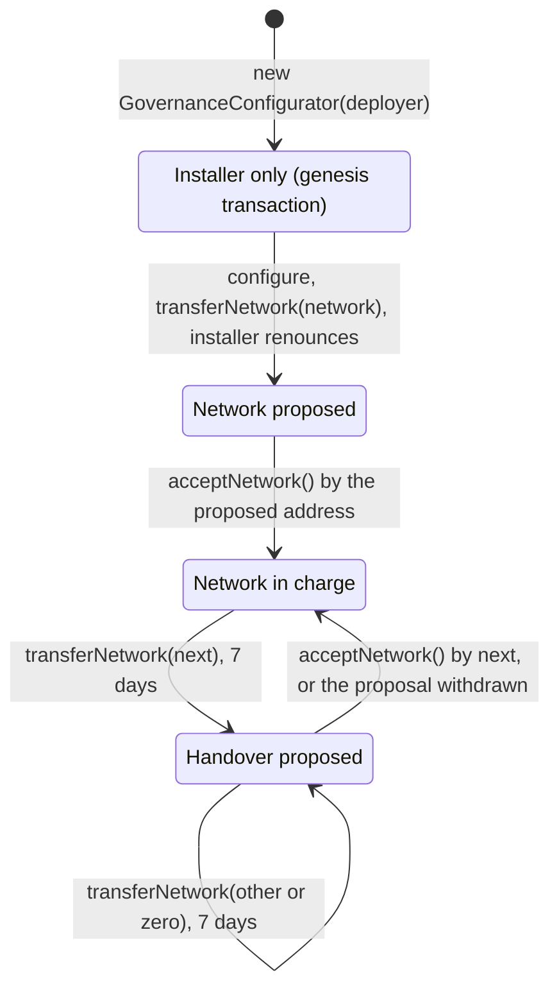
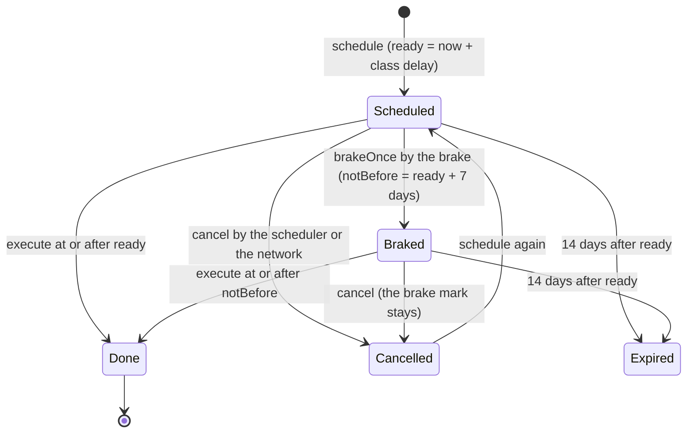
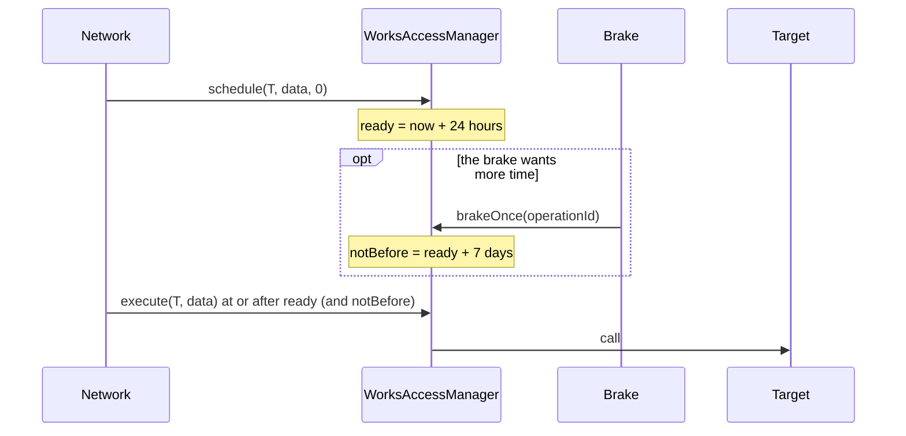

# Governance

One OpenZeppelin 5.7.0 `AccessManager`, subclassed as `WorksAccessManager`, governs every
6529 Works contract. The design is deliberately small:

- **One authority, the network.** A single address holds every network power. Today that is one
  6529 Safe; later it is the executor of TDH governance, bridged from 6529chain. The network can
  hand over to a new address in two steps.
- **Three fixed delays.** Each network power is in a class: at once, 24 hours, 3 days or 7 days.
  The numbers are compiled into the code, but a class's delay holds for a function only until a
  7-day remap changes it: the network (ADMIN, 7 days) can move a selector to another role, to
  NETWORK (immediate) or to a new manager. The waits a contract enforces in its own code (a
  replacement's notice, a freeze's length, the 180-day expiries, a rescue's 14 days, the edition
  timers) are what no remap changes.
- **One optional brake.** A second address that can make one scheduled network action wait 7
  more days, once. It cannot cancel, act or delay anything twice. There may be no brake at all.
- **Operational keys.** Pauser, curation signers, storage operator, platform and curator keys
  are ordinary roles that the network grants and revokes.

`GovernanceConfigurator` installs the whole genesis configuration in one transaction. This page
gives the role model and the rules; the selector-by-selector view is the generated
[role and permission matrix](../audit/roles.md).

> Pre-audit. See the [project status](../../README.md#status).

## Contracts

| Contract | Source | Responsibility |
| --- | --- | --- |
| `WorksAccessManager` | [`src/governance/WorksAccessManager.sol`](../../src/governance/WorksAccessManager.sol) | Stock `AccessManager` plus `network`, `pendingNetwork`, `brake`, `transferNetwork`, `acceptNetwork`, `setBrake`, `brakeOnce`, `notBefore` and `grantCount` (how many grants made an account a member of a role). `hasRole` answers the network roles from the `network` slot; `_grantRole` refuses them; `_consumeScheduledOp` holds a braked operation; `expiration` is 14 days; the manager cannot remap or close itself. |
| `GovernanceConfigurator` | [`src/governance/GovernanceConfigurator.sol`](../../src/governance/GovernanceConfigurator.sol) | Deploys its own manager, installs the genesis configuration and wiring, proposes the network, renounces its installer record, emits `GovernanceConfigured`, and reads the manager back (`verify`). |
| `GovernanceConfig` | [`src/governance/GovernanceConfig.sol`](../../src/governance/GovernanceConfig.sol) | Internal library: `validate`, `validateWiring`, `isGenesisSelector`, `install`, `verify` and `hasRecord`. |
| `Roles` | [`src/governance/Roles.sol`](../../src/governance/Roles.sol) | Internal library: role IDs, the fixed delays, `isNetworkRole`, `executionDelay`, `label`. No contract hard-codes a role ID. |
| `BoundedParameter` | [`src/governance/BoundedParameter.sol`](../../src/governance/BoundedParameter.sol) | Internal library for raise-only parameters: at most double per step, never above a ceiling fixed in the target's code. |
| Every governed contract | for example [`src/stream/Stream.sol`](../../src/stream/Stream.sol) | `authority()` is the manager, and each governed function is `restricted`. |

Off chain, [`script/DeployV1.sol`](../../script/DeployV1.sol) builds the configuration and
wiring from the genesis JSON ([deploy runbook](../../script/README.md)).

## Concepts

### How the manager decides

- **Target.** A contract whose `authority()` is the manager. Each `restricted` function asks the
  manager `canCall(caller, target, selector)` before it runs.
- **Function role.** Each (target, selector) maps to one role. An unmapped selector resolves to
  role 0, `ADMIN`: the network at 7 days.
- **Delay.** A caller with a delay calls `schedule`, waits, and then calls `execute` (or the
  target directly). A caller with no delay calls the target directly. A scheduled operation
  that is not run within 14 days of its ready time expires.

### Roles

| Role | ID | Held by | Delay | Used for |
| --- | --- | --- | --- | --- |
| `ADMIN` | 0 | The network | 7 days | The manager's own administration (remapping selectors, closing targets, moving a contract to another manager, `transferNetwork`, `setBrake`) and every unmapped selector |
| `NETWORK` | 1 | The network | none | Powers the network uses at once |
| `PAUSER` | 2 | Operational keys | none | `pause` selectors |
| (unused) | 3 | | | Was a separate unpause role |
| `CURATION_SIGNER` | 4 | Operational keys | none | Nothing is mapped: the curation verifier reads membership |
| `STORAGE_OPERATOR` | 5 | Operational key | none | The delivery contract's preferred-location setters |
| `MINTER` | 6 | Nobody | none | Unused in v1 |
| `KEEPER` | 7 | Nobody | none | Unused in v1: upkeep is permissionless |
| `PLATFORM` | 8 | Operational key | none | Collections, locators, platform statements |
| `PARAMETER_SETTER` | 9 | The network | 24 hours | The 24-hour class |
| `FUNDS_SETTER` | 10 | The network | 3 days | The 3-day class: money and recipients |
| `SUCCESSOR_SETTER` | 11 | The network | 7 days | The 7-day class on managed contracts: dependency swaps and other long changes |
| `CURATOR` | 12 | Operational key | none | Curator statements |
| `PUBLIC` | `type(uint64).max` | Everyone | none | Never mapped: `GovernanceConfig` rejects it |

Which selector is in which class is in the [role and permission matrix](../audit/roles.md),
generated from [`config/genesis.example.json`](../../config/genesis.example.json).

### One-shot bindings instead of a SYSTEM role

A shared role for contract-to-contract calls would let any holder call every hook. Each target
instead holds per-pair [bindings](../glossary.md#binding) (`bindWorkRecords`, `bindEditions`,
`bindStream`, `bindPackageRegistry`, `bindSplitFactory`, `bindStatementLog`), each resolving to
`ADMIN`, run once by genesis wiring (GV-22). A bind checks the bound contract (code, no EIP-7702
delegation, ERC-165 where implemented; Stream's binds also require `stream() == address(this)`),
and the callee then checks `msg.sender` without the manager.

### Roles that targets read directly

Some contracts read a role from the manager by hand instead of using `restricted`:

- **`addLocator`.** The work's artist acts directly before finalize; anyone else needs an
  immediate answer for the `PLATFORM` mapping (`WorkRecords._checkCanCall`).
- **Relayed statements.** `StatementLog.appendSigned` accepts a `CURATOR` or `PLATFORM` signer
  only when `canCallWithDelay` on `appendCurator` or `appendPlatform` answers immediately.
- **Curation signers.** `Eip712CurationVerifier.isSignerActive` requires `CURATION_SIGNER`
  membership with zero execution delay, and that the signer is not disabled.

Each check reaches `WorksAccessManager.hasRole`, so a revoked key fails all of them in the same
block as its `restricted` calls.

### Configuration epochs and governance manifests

Each epoch (the roles, holders, delays and selector mappings in force) has a signed JSON
manifest. At genesis, `configure` emits its hash in `GovernanceConfigured`, and the wiring
appends it to the statement log as a `GOVERNANCE_MANIFEST` statement with subject
`(manager, 0)`. For a later epoch the network schedules `StatementLog.appendGovernanceManifest`
(7 days) with the epoch's operations, so the hash is public before they take effect.

## State machine

### The network



- Between `configure` and `acceptNetwork` nobody holds the network roles. The operational keys
  work.
- On `acceptNetwork` the former network holds nothing: it cannot act, and its scheduled
  operations can no longer run. The new network can cancel them.

### A scheduled network action



The brake mark is kept per operation ID until the operation runs, so cancelling and scheduling
it again does not clear it, and the brake cannot delay it a second time. Once it runs, the same
call scheduled later is a new action the brake may delay once more.

## Cancellation rules

Cancellation is stock OpenZeppelin: the account that scheduled an operation can cancel it, and so
can the network (as `ADMIN`, the default guardian of every role). The brake, pausers and
outsiders cannot.

## Suspension of operational keys

There is no separate suspension. To stop an operational key, the network revokes its role
at once (`NETWORK` administers every operational role); the key can also drop its own role at once with `renounceRole`. A compromised curation
signer is stopped at once through the curation verifier's own `disableSigner`.

## Flows

### Genesis configure

```mermaid
sequenceDiagram
    participant Op as Deployer (operator)
    participant Cfg as GovernanceConfigurator
    participant M as WorksAccessManager
    participant T as Targets
    participant N as Network Safe
    Op->>Cfg: deploy GovernanceConfigurator(deployer = Op)
    Cfg->>M: new WorksAccessManager(configurator)
    Op->>T: deploy each target with authority = M
    Op->>Cfg: configure(cfg, manifestHash, wiring)
    Note over Cfg: validate cfg and wiring
    Cfg->>M: labelRole per role; setRoleAdmin(operational, NETWORK)
    Cfg->>T: each wiring call, in order (installer acts with no delay)
    Cfg->>M: setTargetFunctionRole, one per selector
    Cfg->>M: grantRole for every operational key, no delay
    Cfg->>M: setBrake(brake) if one is named; transferNetwork(network)
    Cfg->>M: renounceRole(ADMIN, configurator)
    N->>M: acceptNetwork()
    Op->>Cfg: verify(cfg) by eth_call
```

- **Preconditions.** The caller is `deployer` (`NotDeployer` otherwise). Every target already
  exists with `authority()` equal to the configurator's manager. `cfg` names a network and passes
  `validate` and `validateWiring` (GV-10 to GV-12).
- **The installer.** Until it renounces, the configurator holds every network role with no
  delay. That is how genesis lands in one transaction. It can never be granted again.
- **Wiring runs before mapping,** so a wired selector that `cfg` maps to a delayed class, such as
  `setAdmittedMinter`, still runs at once.
- **Failure.** A reverting wiring call reverts `configure` with its revert data, or with
  `WiringCallFailed(index)` when it gave none; nothing is applied.

**The wiring allow-list.** `GovernanceConfig.isGenesisSelector` admits only one-shot binds, admitted
minters, sale targets, the first default currencies, ETH's opening bid, the federation's first
registry, adapters and template versions, and the epoch-0 manifest. Each setter is scoped to the
targets that declare its interface through ERC-165 (`genesisInterface`). A wiring call must
target a configured target, never the manager, and there are at most 64.

**Readback** (`GovernanceConfigurator.verify`, by `eth_call`, after the network accepted). It
reverts on the first difference: the configurator still has its installer record
(`ConfiguratorStillAdmin`); the network or brake differs (`NetworkMismatch`); a role's admin,
guardian or grant delay differs from what `install` set (`RoleMismatch`); a target is closed
(`TargetMismatch`); a selector maps to another role (`FunctionRoleMismatch`); a configured key
is missing or has a delay (`HolderMismatch`).

### A 24-hour change, with the brake



### Handing the network over

1. The network schedules `transferNetwork(next)` and runs it 7 days later. Nothing changes yet.
2. `next` calls `acceptNetwork()`. This proves it can make calls. From that block `next` holds
   every network role and the former network holds none.

A contract can also be moved to a different manager with the stock
`updateAuthority(target, newManager)`, at 7 days, one contract at a time.

## Rules and invariants

Rule IDs use the prefix `GV`.

**The manager and its configuration.**

| ID | Rule | Enforced in | Tested by |
| --- | --- | --- | --- |
| GV-1 | Only `network()` holds the network roles (`ADMIN`, `NETWORK`, `PARAMETER_SETTER`, `FUNDS_SETTER`, `SUCCESSOR_SETTER`); nobody can be granted one; the zero address never holds one. The installer holds them with no delay only until it renounces. | `WorksAccessManager.hasRole`, `_grantRole` | [`NetworkAndBrake.t.sol`](../../test/governance/NetworkAndBrake.t.sol): `test_NobodyCanBeGrantedANetworkRole`, `testFuzz_OnlyTheNetworkHoldsTheNetworkRoles`, `test_NoNetworkBeforeAcceptance`; [`GovernanceConfigurator.t.sol`](../../test/governance/GovernanceConfigurator.t.sol): `test_ConfiguratorDeploysAndOwnsAWorksAccessManager`; `test_SafeAcceptedTheNetworkAtGenesis`, `test_HandoverToASecondSafe` |
| GV-2 | The network acts with a fixed delay per class: `NETWORK` none, `PARAMETER_SETTER` 24 hours, `FUNDS_SETTER` 3 days, `SUCCESSOR_SETTER` and `ADMIN` 7 days. Nothing runs before its delay while its selector stays in that class; a remap (ADMIN, 7 days) can move a selector to another class, so a class's delay holds until a 7-day remap changes it. | `Roles.executionDelay`, OpenZeppelin `schedule` and `_consumeScheduledOp` | `NetworkAndBrake.t.sol`: `test_EachClassRunsAtItsDelayAndNotBefore`, `test_ManagerAdministrationIsTheSevenDayClass`, `test_TheNetworkActsAtOnceThroughTheNetworkRole`, `test_UnmappedSelectorFallsBackToTheSevenDayClass`; [`Roles.t.sol`](../../test/governance/Roles.t.sol); `test_SafeSchedulesAndExecutesTwoFundsSettersInOneBatch`, `test_DelayedSetterCalledDirectlyIsRefused` |
| GV-3 | Operational keys act with no delay. The network grants and revokes them at once (their role admin is `NETWORK`); a key can renounce its own role at once. | `GovernanceConfig.install` (`setRoleAdmin`) | `NetworkAndBrake.t.sol`: `test_OperationalKeysAreGrantedAndRevokedAtOnce`; `GovernanceConfigurator.t.sol`: `test_EveryRoleIsLabelledAndOperationalKeysAnswerToTheNetworkAtOnce` |
| GV-4 | `transferNetwork(next)` (7 days) only proposes; `next` takes over only by calling `acceptNetwork` itself; a new proposal or zero replaces or withdraws it. After acceptance the former network holds nothing and its scheduled operations cannot run. | `WorksAccessManager.transferNetwork`, `acceptNetwork`, `hasRole` | `NetworkAndBrake.t.sol`: `test_TransferNetworkTakesEffectOnlyOnAccept`, `test_TransferCanBeWithdrawnOrReplaced`, `test_OnlyTheNetworkCanStartATransfer` |
| GV-5 | `setBrake(next)` is the network at 7 days; zero means no brake. | `WorksAccessManager.setBrake` | `NetworkAndBrake.t.sol`: `test_OnlyTheBrakeCanBrake`, `test_TheBrakeCanDelayItsOwnRemovalOnce`; `GovernanceConfigurator.t.sol`: `test_NoBrakeIsAllowed`; `test_BrakeSafeDelaysAScheduledSafeOperation` |
| GV-6 | Only the brake can call `brakeOnce`, only on a scheduled, unexpired operation, and only once until that operation runs. The operation then cannot run, by `execute` or by a direct call on the target, before its ready time plus 7 days. Cancelling and scheduling again keeps the mark. An action with no delay is never scheduled, so it cannot be braked. | `WorksAccessManager.brakeOnce`, `_consumeScheduledOp` | `NetworkAndBrake.t.sol`: `test_TheBrakeDelaysAnOperationOnce`, `test_TheBrakeAlsoHoldsADirectDelayedCall`, `test_CancelAndRescheduleDoesNotEscapeTheBrake`, `test_OnlyTheBrakeCanBrake`, `test_AnActionWithNoDelayCannotBeBraked`, `test_ACancelledExecutedOrExpiredOperationCannotBeBraked` |
| GV-7 | A scheduled operation expires 14 days after its ready time (one week, plus the brake's 7 days so a braked operation keeps a week to run). | `WorksAccessManager.expiration` | `NetworkAndBrake.t.sol`: `test_ABrakedOperationDoesNotExpireBeforeItCanRun` |
| GV-8 | Only the scheduler or the network can cancel an operation. | OpenZeppelin `_canCancel` (the network is `ADMIN` and every role's guardian) | `NetworkAndBrake.t.sol`: `test_CancellationIsTheSchedulerOrTheNetwork` |
| GV-9 | The manager's own selectors cannot be remapped and the manager cannot be closed. | `WorksAccessManager._setTargetFunctionRole`, `_setTargetClosed` | `NetworkAndBrake.t.sol`: `test_TheManagerCannotBeRemappedOrClosed` |
| GV-10 | A configuration names a network. Grants are of known operational roles only, to nonzero accounts other than the installer, never repeated. Every target has code, is not the manager, appears once and answers `authority()` with this manager. A selector appears once per target and never maps to `ADMIN`, `CURATION_SIGNER`, an unknown role or `PUBLIC`. | `GovernanceConfig.validate`, `_validateGrants`, `_validateFunctions`, `install` | `GovernanceConfigurator.t.sol`: `test_RejectsAMissingNetwork`, `test_RejectsGrantsOfNetworkRoles`, `test_RejectsInvalidGrants`, `test_RejectsInvalidTargets`, `test_RejectsDuplicateTarget`, `test_RejectsOneSelectorInTwoClasses`, `test_RejectsFunctionRolesThatMustNotCall`, `test_TargetGovernedByAStockManagerIsRejected` |
| GV-11 | Only `deployer` can configure, once; the configurator governs only the manager it deployed, and ends with no role. | `GovernanceConfigurator.configure`, constructor | `GovernanceConfigurator.t.sol`: `test_OnlyDeployerCanConfigure`, `test_ConfigureIsOneShot`, `test_DeployerIsTheConstructorArgumentNotTheSender`, `test_AForeignConfiguratorOnlyGovernsItsOwnManager`; [`GenesisWiring.t.sol`](../../test/governance/GenesisWiring.t.sol): `test_ConfiguratorEndsWithNoRoleAfterWiring` |
| GV-12 | Genesis wiring has at most 64 calls, each on a configured target with an allow-listed selector that target declares the interface for (one-shot binds and the selectors only one v1 contract declares reach any configured target); it runs before any selector is mapped, and any revert aborts the whole configuration. | `GovernanceConfig.validateWiring`, `isGenesisSelector`, `genesisInterface`, `install` | `GenesisWiring.t.sol` `test_RejectsMoreThanTheWiringBound`, `test_GenesisSelectorsReachOnlyTheirTargets`, `test_RejectsWiringOnAnUnconfiguredTarget`, `test_WiringRunsBeforeSelectorsAreMapped`, `test_RevertingWiringCallAbortsTheWholeConfiguration` |
| GV-13 | Readback reverts on any difference listed under [Genesis configure](#genesis-configure). | `GovernanceConfigurator.verify`, `GovernanceConfig.verify` | `GovernanceConfigurator.t.sol`: `test_ConfigureInstallsTheWholeEpochInOneTransaction`, `test_ReadbackDetectsRemappedSelector`, `test_ReadbackDetectsAKeyGivenADelay`, `test_ReadbackDetectsMissingHolder`, `test_ReadbackDetectsClosedTargetAndChangedRoleSettings`, `test_ReadbackDetectsAChangedNetworkOrBrake`, `test_VerifyRejectsAManagerTheConfiguratorStillAdministers` |
| GV-14 | Whatever random actors do (hand over, accept, try to grant themselves network roles, grant and revoke keys, brake, run operations), exactly one address holds the network roles, it is `network()`, and it carries each class's delay. | All of the above | [`GovernanceInvariant.t.sol`](../../test/governance/GovernanceInvariant.t.sol): `invariant_ExactlyOneAddressHoldsTheNetworkRoles` |

**Rules every target follows.**

| ID | Rule | Enforced in | Tested by |
| --- | --- | --- | --- |
| GV-15 | Every `restricted` function of every concrete contract is mapped to exactly one class role, or listed as genesis-only (a bind genesis wires) or deferred. | [`tools/check_genesis.py`](../../tools/check_genesis.py) in CI; [`GenesisConfig.t.sol`](../../test/governance/GenesisConfig.t.sol) | `GenesisConfig.t.sol` `test_JsonMatchesTheCompiledSelectors`, `test_EveryEntryMatchesItsSignatureAndClassDelay`, `test_WiringIsGenesisOnlyAndComplete`; [`tools/test_check_genesis.py`](../../tools/test_check_genesis.py) |
| GV-16 | Governed functions are non-payable: `AccessManager.execute` forwards `msg.value`. | Each target | `NetworkAndBrake.t.sol`: `test_GovernedFunctionsRejectValueThroughExecute`, `test_EveryGovernedSelectorIsNonPayable` |
| GV-17 | Setters for funds, recipients, verifiers, renderers and sale parameters are compare-and-set, so a stale operation reverts. | Each setter | `NetworkAndBrake.t.sol`: `test_StaleCompareAndSetOperationReverts` |
| GV-18 | Every governed setter emits an event with the old and the new value, or the key and its new state. | Each setter's event | Per module |
| GV-19 | Raise-only parameters use `BoundedParameter`: a nonzero initial value within the ceiling, and each raise above the current value, at most double it, and never above the ceiling. | `BoundedParameter.initial`, `raise` | [`BoundedParameter.t.sol`](../../test/governance/BoundedParameter.t.sol) `test_InitialRejectsZero`, `test_InitialRejectsAboveCeiling`, `test_RaiseRejectsEqualOrLower`, `test_RaiseRejectsMoreThanDouble`, `test_RaiseRejectsAboveCeiling`, `testFuzz_RaiseMatchesSpecification` |
| GV-20 | Dependencies installed by governed setters are checked for code, no EIP-7702 delegation and ERC-165 where implemented, and pinned to a code hash re-checked at every use where the module says so. | `Dependency`, each setter | Per module |
| GV-21 | Reversing a tightening action takes no wait of its own, except a re-admission of an asset, which runs no earlier than 3 days after its deprecation. `unpause` and the dispute `resume` and `cancel` are the network's, with no delay (C30). | `EnglishAuction.unpause`, `UniformEditionAuction.unpause`, `AssetAllowlist.admitAsset` | [`PauseWindow.t.sol`](../../test/sales/PauseWindow.t.sol) `test_Unpause_TheNetworkUnpausesAtOnce`, `test_Resume_TheNetworkResumesAtOnce`, `test_Cancel_TheNetworkCancelsAtOnce`; [`AssetAllowlist.t.sol`](../../test/economics/AssetAllowlist.t.sol) `test_DeprecateThenReadmit` |
| GV-22 | Contract-to-contract calls use one-shot bindings, not roles: each bind resolves to `ADMIN`, runs once, and genesis wires all of v1's. | Each `bind*`, `GovernanceConfig.isGenesisSelector` | `GenesisWiring.t.sol`: `test_RepeatedOneShotBindAbortsTheWholeConfiguration`, `test_WiringExecutesGenesisCallsInTheConfiguringTransaction` |

**Deployment checks.** The deploy and readback scripts' checks on holders (`Deploy.s.sol`,
`Verify.s.sol`, `DeployGuards.sol`) are described in the [deploy runbook](../../script/README.md).

## Events

The manager's and the configurator's events are on the
[events page](../integrators/events-and-indexing.md#governanceconfigurator-and-worksaccessmanager).
The manager adds `NetworkTransferStarted(network, next)`, `NetworkTransferred(previous, next)`,
`BrakeSet(previous, next)` and `OperationBraked(operationId, notBefore)` to OpenZeppelin's events,
so the network, the brake and every brake mark can be rebuilt from logs alone.

## Failure modes and recovery

| Failure | Effect | Recovery |
| --- | --- | --- |
| The network's key is compromised | It can schedule anything, each at its class delay, and use the at-once powers. | Everyone sees each scheduled action for at least its delay; the brake, if there is one, can add 7 days once per action. The network's holders replace the address through `transferNetwork`. |
| The network address is lost | No change can be made through the manager. | None on chain. Before the TDH bridge, the network is a Safe whose signers can rotate. |
| The brake is compromised | It can delay each scheduled action once by 7 days, nothing more. | The network replaces or removes it with `setBrake` (7 days; the brake can delay that once too). |
| An operational key is compromised | It acts for its role at once. | The network revokes it at once; a curation signer is disabled at once through the verifier. |
| A proposed network cannot make calls | It never accepts, and the current network keeps every power. | The network proposes another address. |
| An operation expires or is stale | `execute` reverts (`AccessManagerExpired`, or the setter's mismatch error). | Schedule it again, with the current value. |
| A target's authority is moved (`updateAuthority`) | The target leaves this manager for good. | Prevention only: the move takes 7 days and is public. |

## Parameters and limits

| Parameter | Value | Source |
| --- | --- | --- |
| Delay classes | none, 24 hours, 3 days, 7 days | `Roles.DELAY_24H`, `DELAY_3D`, `DELAY_7D` |
| Brake delay | 7 days past the ready time, once per operation | `Roles.BRAKE_DELAY` |
| Operation expiry | 14 days after the ready time | `WorksAccessManager.expiration` |
| Role IDs | 0 to 12, 3 unused (`Roles.COUNT` is 13); `PUBLIC` is `type(uint64).max` | `Roles` |
| Genesis wiring calls | At most 64 | `GovernanceConfig.MAX_WIRING_CALLS` |
| Raise step and ceiling | At most double per step; ceiling fixed per target | `BoundedParameter.raise` |

Each number is compiled in. A role delay holds until a 7-day remap changes it (above); a wait a
contract enforces in its own code is the guarantee, and no remap changes it.

## Differences from the ADRs

See the [register](README.md#differences-from-the-adrs).

## References

- **Code:** [`WorksAccessManager.sol`](../../src/governance/WorksAccessManager.sol),
  [`GovernanceConfigurator.sol`](../../src/governance/GovernanceConfigurator.sol),
  [`GovernanceConfig.sol`](../../src/governance/GovernanceConfig.sol),
  [`Roles.sol`](../../src/governance/Roles.sol),
  [`BoundedParameter.sol`](../../src/governance/BoundedParameter.sol), the
  [governance README](../../src/governance/README.md),
  [OpenZeppelin `AccessManager` v5.7.0](https://github.com/OpenZeppelin/openzeppelin-contracts/blob/v5.7.0/contracts/access/manager/AccessManager.sol).
- **Configuration and deployment:**
  [`config/genesis.example.json`](../../config/genesis.example.json),
  [`config/README.md`](../../config/README.md), the [deploy runbook](../../script/README.md).
- **Tests:** [`test/governance/`](../../test/governance/),
  [`test/integration/Genesis.t.sol`](../../test/integration/Genesis.t.sol),
  [`test/deploy/`](../../test/deploy/). How to run them: [testing docs](../testing/README.md).
- **Related pages:** [role and permission matrix](../audit/roles.md),
  [trust assumptions](../audit/trust-assumptions.md), [known limitations](../audit/known-limitations.md),
  [events and indexing](../integrators/events-and-indexing.md), the [glossary](../glossary.md).
