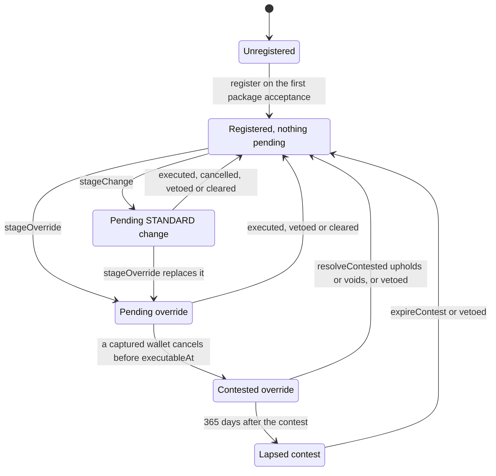
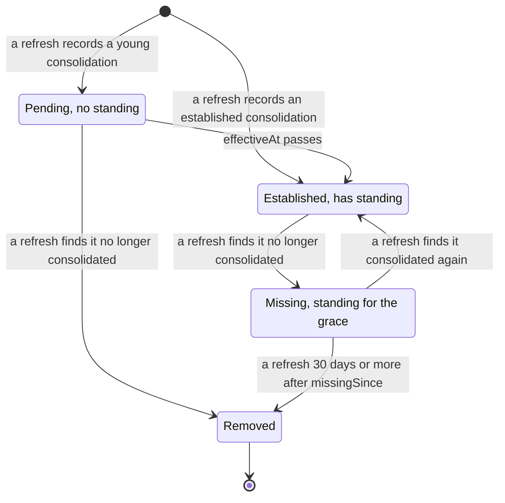
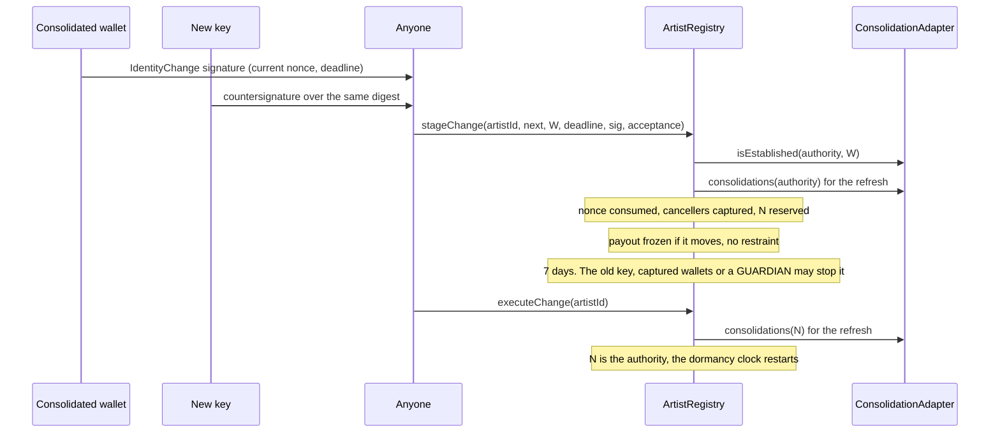
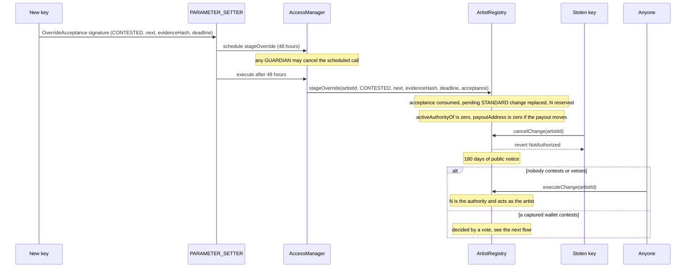
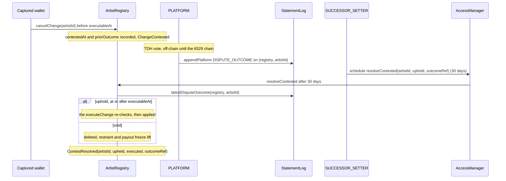
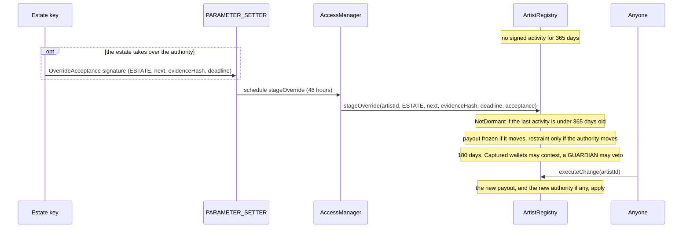
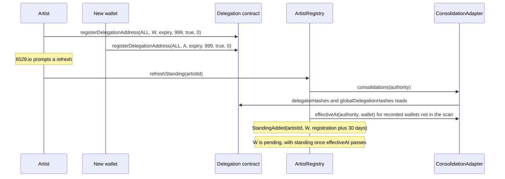
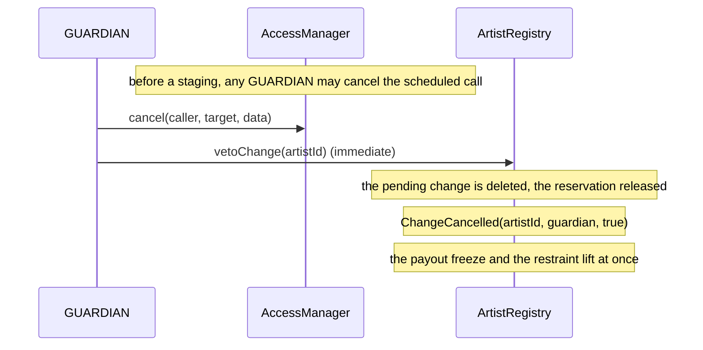

# Identity and recovery

This area gives every artist a stable artist ID, records which key acts for the artist (the
authority) and where the artist's money goes (the payout address), and lets an artist recover
from a lost or stolen key without trusting a single party; every other module asks it who the
artist is. `ArtistRegistry` holds identities, staged changes, overrides, contests and recovery
standing; `ConsolidationAdapter` reads 6529 consolidations from the 6529 delegation contract.
This page is for auditors, integrators and whoever operates recovery.

> Pre-audit. See the [project status](../../README.md#status).

## Contracts

| Contract | Source | Interface | Responsibility |
| --- | --- | --- | --- |
| `ArtistRegistry` | [`src/identity/ArtistRegistry.sol`](../../src/identity/ArtistRegistry.sol) | [`IArtistRegistry`](../../src/interfaces/IArtistRegistry.sol), which extends [`IArtistRoleResolver`](../../src/interfaces/IArtistRoleResolver.sol) and [`IArtistPayoutResolver`](../../src/economics/interfaces/IArtistPayoutResolver.sol) | Artist IDs, authority, payout and profile fields; STANDARD changes, overrides and contests; the sticky standing snapshot; `isArtist` for the statement log; `payoutAddress` for split wallets. Its address never changes: split wallets pin it, and the consolidation source is swapped inside it. |
| `ConsolidationAdapter` | [`src/identity/ConsolidationAdapter.sol`](../../src/identity/ConsolidationAdapter.sol) | `IConsolidationSource`, declared in [`IArtistRegistry.sol`](../../src/interfaces/IArtistRegistry.sol) | Reads use-case-999, all-collections consolidations, with their age and expiry, from the 6529 delegation contract. Stateless and view-only; fails closed. |

Shared code the registry relies on:

| Code | Source | Used for |
| --- | --- | --- |
| `SignatureVerifier` | [`src/libraries/SignatureVerifier.sol`](../../src/libraries/SignatureVerifier.sol) | Every identity signature: low-s ECDSA (65 bytes or ERC-2098), EIP-7702 delegated EOAs, and ERC-1271 capped at 200,000 gas with an exact magic value. It never tracks replay. |
| `DelegatedEOA` | [`src/libraries/DelegatedEOA.sol`](../../src/libraries/DelegatedEOA.sol) | Refuses EIP-7702 delegated accounts as bindings and as the consolidation source. |
| `BoundedCall` | [`src/libraries/BoundedCall.sol`](../../src/libraries/BoundedCall.sol) | The gas check before each adapter read, and the bounded `artistResolver()` read in `bindStatementLog`. |
| `ProtocolContracts` | [`src/libraries/ProtocolContracts.sol`](../../src/libraries/ProtocolContracts.sol) | Recognises, by ERC-165, protocol contracts that cannot pull a payout. |
| `Typehashes`, identity types | [`Typehashes.sol`](../../src/interfaces/types/Typehashes.sol), [`IdentityTypes.sol`](../../src/interfaces/types/IdentityTypes.sol) | The EIP-712 domain name and the two identity typehashes; `ArtistIdentity`, `ChangeKind`, `PendingChange`, `Standing`. |

## Concepts

The glossary defines [authority](../glossary.md#authority),
[active authority](../glossary.md#active-authority), [payout address](../glossary.md#payout-address),
[override](../glossary.md#override), [contest](../glossary.md#contest),
[restraint](../glossary.md#restraint), [standing](../glossary.md#standing),
[consolidation](../glossary.md#consolidation) and [dormancy](../glossary.md#dormancy). The module
[README](../../src/identity/README.md) maps the code.

### Artist ID, authority and payout

- **[Artist ID](../glossary.md#artist-id).** `uint256(uint160(account))` of the account whose
  first package acceptance created the identity through `register` (ID-1; anyone may relay the
  acceptance). The identity starts with the account as
  authority and payout, nonce 0 and the block time as its last activity.
- **`artistIdOf(account)`** is the artist ID of any present or past authority, otherwise zero.
  Consumers take it when nonzero, otherwise `uint160(account)`, so a package naming an old
  authority still reaches the identity.
- **Authority and active authority.** `authorityOf` identifies the artist and is never zero.
  `activeAuthorityOf` is the authority, or zero while [restrained](#restrained-authority); every
  consumer that treats a key as the artist acting reads it.
- **Payout address.** Where artist-resolved split payees pay. It starts as the first authority,
  reads as zero for an unknown artist and during a
  [payout freeze](#payout-validation-and-the-payout-freeze), and changing it needs no consent from
  the new address.
- **Profile ID and profile document hash** are bound into every identity signature and package
  acceptance but are unverified claims (LIM-ID-13); later acceptances must repeat them
  (`ProfileMismatch`).
- **[Reservation](../glossary.md#reserved-authority).** A staged change that moves the authority
  reserves the new authority until the change ends, so the new key's own package acceptance
  cannot create a separate artist and void the change (IDENTITY-2, ID-3).
- **No return to an earlier authority.** A new authority must be the current authority or an
  account that has never been an authority of any artist, checked at staging and at execution:
  A, then B, then A reverts with `AccountTaken(A)` (SIGS-3, ID-2, LIM-ID-1). Every consumer of an
  artist's signature checks it against the active authority when it is used, so a rotated-away
  key's unused signatures stay void without an authority epoch in any typehash. Signed release
  authorizations bind the payout address instead, which may return to an earlier value.

### Change kinds

One change may be pending per artist (`pendingChange`; kind `NONE` when none).

| Kind | Staged by | Wait before execution | Also needs | Who can stop it |
| --- | --- | --- | --- | --- |
| `STANDARD` | Anyone, relaying the signature of the authority or of an established consolidated wallet (`stageChange`) | 7 days (`CHANGE_DELAY`) | The new authority's countersignature, when the authority moves | The previous authority or a captured wallet cancels; a GUARDIAN vetoes |
| `CONTESTED` | PARAMETER_SETTER (`stageOverride`), 48 hours (standard class) | 180 days (`OVERRIDE_DELAY`) | A nonzero evidence hash; the new authority's `OverrideAcceptance`, when the authority moves | A captured wallet contests; a GUARDIAN vetoes; never the previous authority |
| `ESTATE` | As `CONTESTED` | 180 days | As `CONTESTED`, plus 365 days without signed activity (`DORMANCY`) | As `CONTESTED` |
| `LOST_KEY` | As `CONTESTED` | 180 days | As `ESTATE` | As `CONTESTED` |

- "Override" means any of `CONTESTED`, `ESTATE` and `LOST_KEY`. The evidence hash commits to the
  public record of the circumstances; the code does not check them, so `ESTATE` and `LOST_KEY`
  differ only in their label.
- An override replaces a pending STANDARD change, so a key holder cannot block one by keeping a
  change staged, but never another override (ID-4). Payout changes use the registry's 7-day wait,
  not the 14-day funds class of network recipients
  ([ADR 0001 §11](../adr/0001-v1-scope.md#11-artist-identity-and-recovery)).

### Signed payloads

Both payloads use the EIP-712 domain `6529 Works Artist Registry` (`Typehashes.ARTIST_REGISTRY_NAME`),
version `1`, the chain ID and the registry's address:

```text
IdentityChange(uint256 artistId,address authority,address payout,bytes32 profileId,bytes32 profileDocHash,uint256 nonce,uint64 deadline)

OverrideAcceptance(uint256 artistId,uint8 kind,address authority,address payout,bytes32 profileId,bytes32 profileDocHash,bytes32 evidenceHash,uint64 deadline)
```

| Typehash | Value | Digest helper |
| --- | --- | --- |
| `Typehashes.IDENTITY_CHANGE` | `0xa474bd174aa5ecb19efe75995251c1fb8289b62bca04bc6c19e869f254e190f0` | `ArtistRegistry.changeDigest(artistId, next, nonce, deadline)` |
| `Typehashes.OVERRIDE_ACCEPTANCE` | `0xe94c9e2e1a4e3c2652a414f70c177a61fc880d94ede3aaaf03a976666431f9a3` | `ArtistRegistry.overrideDigest(artistId, kind, next, evidenceHash, deadline)` |

`test_Golden_TypehashesAndSelectors` and `test_Golden_DigestsAreStandardEip712` pin these
([`ArtistRegistry.t.sol`](../../test/identity/ArtistRegistry.t.sol)). `kind` is 2 for
`CONTESTED`, 3 for `ESTATE` and 4 for `LOST_KEY`.

- **`IdentityChange`** binds the artist's `changeNonce`, which every staging consumes and
  `revokeNonce` (the authority) burns. Its signer is the authority or a wallet established with
  it at that moment (a live `isEstablished` check, not the snapshot); the new authority
  countersigns the same digest when the authority moves (ID-5). The deadline is inclusive.
- **`OverrideAcceptance`** is signed by the new authority, only when the override moves the
  authority. It binds no nonce, so a key holder cannot void it, and is consumed once by digest
  (`AcceptanceUsed`, ID-12). Its deadline is checked when the scheduled `stageOverride` executes,
  after its 48 hours.

### Signed activity and dormancy

`ESTATE` and `LOST_KEY` overrides can be staged only when the artist's last signed activity is at
least 365 days old (`NotDormant`). Only the artist's own signed calls count, never governed
overrides, vetoes or refreshes (ID-19); the
[estate flow](#estate-or-lost-key-without-a-wallet) lists them. Dormancy is checked at staging,
never at execution, so activity during the 180-day notice does not stop the override (owner
option L4, not implemented: LIM-ID-10).

### Payout validation and the payout freeze

Artist-resolved split payees are pull-only, so a payout that cannot call `release` would strand
funds. `ArtistRegistry._payoutAllowed` refuses the zero address, the registry, the bound package
registry, 6529 Stream and its Editions once Stream is bound, any split wallet of the bound factory
(`isWallet`), and any contract that declares, by ERC-165, the interface of the revenue escrow, the
claim router, a sale adapter, a mint target, the artist or package registry or the work records
(`ProtocolContracts`). A refusal reverts at registration and staging (`InvalidIdentity`), and at
execution clears the change instead of applying it, so a stale change cannot keep the payout
frozen (ID-17). A predicted split wallet has no code before deployment and passes until then
(LIM-ID-12). Contracts that declare none of these interfaces (the release verifier, the content
store, the statement log, the AccessManager, the renderer) are not recognised.

**The [payout freeze](../glossary.md#payout-freeze).** `payoutAddress` returns zero while a
pending change of any kind would move the payout, unless its contest has lapsed (ID-16). Split
wallets then revert with `PayoutUnresolved`, so accrued balances wait for the outcome instead of
following a disputed redirect. A change that keeps the payout does not freeze it. A thief holding
a stolen key that is still the payout cannot pull while a recovery override moves it; the
artist's own pulls pause too (LIM-ID-6).

### Restrained authority

While a pending, unlapsed override would move the authority, `activeAuthorityOf` returns zero and
nobody acts as the artist (IDENTITY-1,
[ADR 0003 owner decision 6](../adr/0003-build-time-decisions.md#owner-decisions-11-october-2026)).
The restraint starts at the override's staging and ends when it executes, is vetoed, is voided by
a vote, is cleared at execution, or its contest lapses; a contest does not end it. A STANDARD
change or a payout-only override restrains nothing (ID-18). The powers it withholds, and what
keeps running, are under [the stolen-key flow](#stolen-key-override-and-restraint). A
`restrained` flag in the authority's storage word records whether the pending change is an
override that moves the authority; every staging sets it and every end of a change clears it,
so `activeAuthorityOf` reads the pending change only while it is set.

### Recovery standing

Each artist has a [sticky standing snapshot](../glossary.md#sticky-standing-snapshot)
(`standingOf`) of at most 16 consolidated wallets (`Limits.MAX_CANCELLERS`). Each entry holds the
wallet, its `effectiveAt` (when its consolidation is or was 30 days old) and `missingSince`. An
entry is **pending** before `effectiveAt` (no standing), **established** after it, and
**missing** once a refresh finds it no longer consolidated; a missing entry keeps standing for
30 days (`STANDING_GRACE`). The [refresh flow](#refreshing-standing) lists what refreshes it.

- **A full snapshot evicts nothing.** Slots free up only as missing entries pass their grace, so
  a key holder cannot push recorded wallets out by consolidating more (ID-20). After a rotation
  the previous authority's wallets stay, missing but with standing, for the grace.
- **Captured cancellers.** Each staging refreshes, then captures the entries with standing
  (missing ones within their grace included) into `PendingChange.cancellers`, fixed for the
  life of that change (ID-23).
- **What the snapshot protects.** The authority key controls the live consolidation data
  (revoking, reordering, or adding through a use-case-998 sub-delegate), but cannot strip a
  recorded, established wallet of standing without a public missing mark and 30 days (ID-21).
- **Only recorded wallets have standing.** Artists pay for their own refresh; 6529.io prompts one
  right after an artist links a wallet, and one refresh any time after consolidating is enough
  ([ADR 0003 owner decision 4](../adr/0003-build-time-decisions.md#owner-decisions-11-october-2026);
  LIM-ID-5).

### The consolidation adapter

`ConsolidationAdapter` reads the [6529 delegation contract](../glossary.md#delegation-contract)
(`0x2202CB9c00487e7e8EF21e6d8E914B32e709f43d` on mainnet, a constructor argument; on Sepolia the
official deployment at `0x8f86c644f845A077999939C69Bc787662377d915`, whose runtime bytecode is
identical, per [deployments/11155111/README.md](../../deployments/11155111/README.md)). `wallet`
is consolidated with `account` when each has a live (`expiryDate > now`) registration of the
other for all collections under use case 999. `effectiveAt` is the later side's earliest live
registration plus 30 days (`MIN_AGE`), and `isEstablished` is true once it has passed (ID-24).
Specific-collection consolidations and other use cases never count. The source is a full-trust
dependency: it decides who may sign STANDARD changes and heartbeats, and who gains standing. Its
reads, bounds and replacement are under [refreshing standing](#refreshing-standing).

## State machine

An artist identity:



"Executed" returns to Registered with the new identity installed. A lapsed contest no longer
freezes the payout or restrains the authority, but it still occupies the pending slot until
`expireContest` or a veto.

| Transition | Caller (role) | Delay | Function |
| --- | --- | --- | --- |
| Unregistered to Registered | The bound package registry, on the account's first acceptance | None | `register` |
| Registered to Pending STANDARD | Anyone, relaying the signatures | None | `stageChange` |
| Registered or Pending STANDARD to Pending override | PARAMETER_SETTER | 48 hours (standard) | `stageOverride` |
| Pending STANDARD to Registered (cancelled) | The previous authority or a captured wallet | Immediate | `cancelChange` |
| Pending to Registered (executed) | Anyone | 7 days (STANDARD) or 180 days (override) after staging | `executeChange` |
| Pending to Registered (cleared) | The registry, when the payout is refused or the authority taken at execution | At execution | `executeChange`, or an upholding `resolveContested` |
| Pending override to Contested | A captured wallet | Before `executableAt` | `cancelChange` |
| Contested to Registered (upheld or voided) | SUCCESSOR_SETTER | 30 days (successor); an uphold not before `executableAt` | `resolveContested(artistId, uphold, outcomeRef)` |
| Contested to Lapsed | Nobody: time passes | 365 days after `contestedAt` (`CONTEST_TIMEOUT`) | None |
| Lapsed to Registered | Anyone | None | `expireContest` |
| Any pending state to Registered (vetoed) | GUARDIAN | Immediate | `vetoChange` |

A standing entry:



Every transition but "effectiveAt passes" is made by a refresh (any trigger in the
[refresh table](#refreshing-standing)); new entries take free slots only.

The one-shot [bindings](governance.md#one-shot-bindings-instead-of-a-system-role)
(`bindPackageRegistry`, `bindStream`, `bindSplitFactory`, `bindStatementLog`) are made at
genesis (ID-29); the statement log's `artistResolver()` must name this registry. The package
registry, the only `register` caller, is replaceable afterwards with Stream's successor
registry (`setPackageRegistry`, SUCCESSOR_SETTER, 30 days, compare-and-set, the same install
check; owner decision 16, ID-30).
`bindFederationRegistry` is deferred to v1.1, and only that registry may call
`listFederatedContract` (at most 64 per artist). Roles and delays: [roles](../audit/roles.md).

## Flows

### Lost key with a consolidated wallet

The authority key is lost, and a wallet has been consolidated with it for at least 30 days.



- **Preconditions.** Nothing pending; the signer is established with the authority now; the new
  key passes the no-return and reservation checks; the payout is allowed.
- **Effects.** Accrued balances follow the new payout
  (`test_RecoveryByConsolidatedWalletThenSplitWalletPull`).
- **If the key was stolen, not lost,** the thief is the previous authority and can cancel any
  STANDARD change (LIM-ID-7). Use the override below.

### Stolen key: override and restraint

A thief holds the authority key.



- **Effects.** The thief can still call `heartbeat` and `revokeNonce` (identity calls, not
  creator powers), which do not affect a `CONTESTED` override; the staging already consumed the
  nonce, voiding its pre-signed changes, and a pending override blocks new STANDARD changes
  (`ChangePending`).
- **Guardians** watch scheduled `stageOverride` operations and, when vetoing one, also cancel any
  other override queued for the same artist (LIM-ID-2).

From the staging, the restraint withholds these powers from the key being recovered from; the
reserved new key gains none of them until execution:

| Power | Contract and function | While restrained |
| --- | --- | --- |
| The sale `creator` | `Stream.primaryTerms`, `Editions.primaryTerms` | Zero |
| Start an approved, unminted work; revoke a move nonce | `PackageRegistry` (`consume`, `revokeMove`) | `InvalidSignature`; `NotAuthority` |
| Accept a package for an existing artist ID | `PackageRegistry.acceptPackage` | `InvalidSignature` |
| Receive a no-bid federated auction's work (v1.1) | `EnglishAuction.settle` | Reverts with `InvalidRecipient(0)`; the work stays in custody until the outcome. A 6529 Stream work never waits: Stream itself moves it to the museum when the auction reports UNBID (owner decision 17, [AUC-24](stream-and-auctions.md#rules-and-invariants)) |
| Set or finalize a record; add the artist's locators | `WorkRecords.setRecord`, `finalize`, `addLocator` | `NotWorkArtist`; `addLocator` falls through to the AccessManager check |
| Party consents and the artist's errata repin signature | `WorkRecords` | `InvalidConsent` |
| ARTIST statements | `StatementLog`, through `isArtist` | `NotAuthorized` |

- For the statement log the restraint is a permitted exception to the resolver rule: a
  withholding the guardian can veto, which never grants or redirects the answer
  ([`IArtistRoleResolver`](../../src/interfaces/IArtistRoleResolver.sol)).
- **The restraint never reaches back.** An auction with a bid settles as usual, with the artist's
  share frozen in the seller wallet. A no-bid auction's work goes to the new authority after
  execution, or to the old one after a veto, void or lapse. A delivery recorded for the old
  authority before the staging can still be claimed by it.
- Tested by `test_Attack_ThiefCannotPullDuringARecoveryOverride`
  ([`ArtistRegistry.t.sol`](../../test/identity/ArtistRegistry.t.sol)),
  `test_PendingNextAuthorityIsReservedUntilTheRecoveryExecutes`
  ([`IdentityRecovery.t.sol`](../../test/integration/IdentityRecovery.t.sol)) and
  [`RecoveryRestraint.t.sol`](../../test/integration/RecoveryRestraint.t.sol).

### Contest and vote

A thief who held the key for a month may have consolidated a wallet of its own, which a refresh
recorded and the override captured. That wallet's cancel contests the override
([ADR 0003 owner decision 1](../adr/0003-build-time-decisions.md#owner-decisions-11-october-2026)).



- **The contest** is possible only before `executableAt` (`ContestWindowClosed`), so a late
  contest cannot front-run a due execution. It records `contestedAt` and `priorOutcome`, the
  artist's latest DISPUTE_OUTCOME then. Further cancels do nothing, and `executeChange` refuses
  the override (`OverrideContested`); the freeze and the restraint continue.
- **The vote.** PLATFORM records the outcome as a DISPUTE_OUTCOME statement on
  `(registry, artistId)` ([disputes and statements](disputes-and-statements.md)); until the
  6529 chain exists the admin Safe is trusted to apply it.
- **The resolution.** `outcomeRef` must be nonzero, equal `latestDisputeOutcome(registry,
  artistId)` (`OutcomeNotRecorded`) and differ from `priorOutcome` (`OutcomePredatesContest`), so
  only a vote recorded after this contest qualifies (ID-14). An uphold re-checks as
  `executeChange` does; `executed` is false for a void and for an uphold the re-checks cleared.
- **Scheduling.** Schedule an uphold no earlier than `executableAt` minus 30 days: it reverts with
  `ChangeNotDue` before `executableAt`, and the AccessManager drops an operation not executed
  within 7 days of maturing. A later DISPUTE_OUTCOME on the same subject invalidates a scheduled
  resolution. The window between `executableAt` and the lapse is always at least 185 days
  (`testFuzz_Contest_TheUpholdWindowIsAlwaysOpen`).
- **Other ends.** A guardian can still veto; an unresolved contest lapses after 365 days (ID-15,
  LIM-ID-3).
- Tested by `test_ContestedOverrideUpheldByARecordedVote`
  ([`IdentityRecovery.t.sol`](../../test/integration/IdentityRecovery.t.sol)) and
  `test_PowersReturnWhenAVoteVoidsTheOverride`
  ([`RecoveryRestraint.t.sol`](../../test/integration/RecoveryRestraint.t.sol)).

### Estate or lost key without a wallet

The artist has had no signed activity for 365 days. Governance stages an `ESTATE` (or `LOST_KEY`)
override, to an estate payout alone or to a new authority that accepts.



- A payout-only override needs no acceptance, restrains nothing and needs no consent from the
  artist (LIM-ID-8). A `CONTESTED` override has no dormancy requirement.

The calls that count as signed activity and reset the dormancy clock:

| Call | Sets the last activity |
| --- | --- |
| `register`, `stageChange`, `revokeNonce`; `heartbeat` by the authority or an established wallet | Yes (`register` emits `ArtistRegistered`, not `ActivityRecorded`) |
| `cancelChange` of a STANDARD change, or one that contests an override | Yes |
| `executeChange`, or a `resolveContested` that upholds and applies | Yes: the clock restarts for the identity installed |
| `cancelChange` of an override already contested | No: it does nothing |
| `stageOverride`, `vetoChange`, a voiding `resolveContested`, `expireContest`, `refreshStanding`, later package acceptances | No |

### Refreshing standing

The artist links a new wallet on 6529.io, which then prompts the artist to refresh.



What refreshes the snapshot:

| Refresh trigger (for the current authority) | When the source cannot read |
| --- | --- |
| `register` | Skips the refresh (`StandingRefreshSkipped`) |
| `stageChange`, `stageOverride`, `heartbeat` | Reverts |
| `executeChange`, an upholding `resolveContested` (for the authority installed) | Skips the refresh |
| `refreshStanding(artistId)`: anyone, and not activity | Reverts |

A refresh (`ArtistRegistry._refresh`, `_update`) does this, in order:
1. **Scans** `consolidations(authority)`: up to 32 live two-way consolidations, each with its
   `effectiveAt`. A longer answer, or arrays of different lengths, reverts with `InvalidSource`.
2. **Updates recorded entries.** A recorded wallet absent from the scan is checked directly
   (`effectiveAt(authority, wallet)`), so a wallet still consolidated beyond the scan is never
   marked missing. A wallet still consolidated is restored if missing; a pending entry adopts its
   live `effectiveAt`, an established entry's only moves earlier (no event for either). A wallet no
   longer consolidated is marked missing if established, and removed at once if pending
   (IDENTITY-3): it never had standing (ID-22). A wallet missing for 30 days is removed.
3. **Records** new consolidations in free slots, established before pending, in delegate-list
   order.

Refresh promptly after revoking: the registry cannot tell when a consolidation ended, only when
a refresh saw it, so an entry first found unconsolidated after its `effectiveAt` keeps the grace.

The adapter's reads:
- **Getters.** `delegatorHashes` for an account's delegate list and `globalDelegationHashes` for
  each pair's registrations. The vendored `checkConsolidationStatus` ignores age and expiry,
  which is why the adapter walks the dates.
- **Bounded walks.** At most 32 delegate entries are scanned and 4 registrations read per
  direction, so one pair costs at most 8 reads; a live registration behind four others is not
  seen. Each getter call forwards exactly 200,000 gas (`READ_GAS`) or the read reverts
  (`BoundedCallInsufficientGas`), so a caller cannot truncate a walk by choosing its gas limit.
- **Fail closed.** Only a revert with no data that did not exhaust the stipend ends a walk, which
  is how the deployed getters answer an index past an array's end. Anything else reverts with
  `DelegationReadFailed`, never "not consolidated", which would mark every recorded wallet
  missing (ID-25). Outages and code-hash mismatches follow the trigger table above (ID-26,
  LIM-ID-9); only those two are skipped, and skipping removes nobody's standing.
- **Swapping the source.** `setConsolidationSource(expected, next, nextCodeHash)`
  (SUCCESSOR_SETTER, 30 days) pins the new source's code hash, re-checked at every use (DEPS-6,
  ID-27).

Gas is in the [ADR 0004 table](../adr/0004-gas-budgets-under-glamsterdam.md#the-table); the
adversarial worst case is under Parameters.

### Guardian veto



- A veto deletes any pending change: STANDARD, override, contested or lapsed. The guardian has no
  path that writes an identity (ID-10). A single dishonest guardian can veto every change until
  its removal executes (LIM-GV-13).

## Rules and invariants

Test files: [`ArtistRegistry.t.sol`](../../test/identity/ArtistRegistry.t.sol) (AR),
[`ArtistRegistryStanding.t.sol`](../../test/identity/ArtistRegistryStanding.t.sol) (ARR),
[`ContestedOverrides.t.sol`](../../test/identity/ContestedOverrides.t.sol) (CO),
[`ConsolidationAdapter.t.sol`](../../test/identity/ConsolidationAdapter.t.sol) (CA),
[`ArtistRegistry.invariant.t.sol`](../../test/identity/ArtistRegistry.invariant.t.sol) (INV),
[`IdentityRecovery.t.sol`](../../test/integration/IdentityRecovery.t.sol) (IR),
[`RecoveryRestraint.t.sol`](../../test/integration/RecoveryRestraint.t.sol) (RR) and
[`RecipientValidation.t.sol`](../../test/integration/RecipientValidation.t.sol) (RV).

| ID | Rule | Enforced in | Tested by |
| --- | --- | --- | --- |
| ID-1 | An artist ID is `uint160` of its first authority, created only by the bound package registry. | `ArtistRegistry.register` | AR `testFuzz_Register_ArtistIdIsTheFirstAuthority`, `test_Register_RevertsForAnyoneButThePackageRegistry`, `test_Register_RevertsForTakenAccount` |
| ID-2 | Every past authority keeps resolving to its artist and never becomes an authority again, of any artist. | `ArtistRegistry._taken`, `_checkNext`, `_apply`, `register` | AR `test_StageChange_RevertsForAPreviousAuthority`, `test_Register_PastAuthoritiesStayTaken`; IR `test_RotationBackToAPreviousAuthorityIsRefused`; INV `invariant_PastAuthoritiesResolveToTheArtist` |
| ID-3 | A staged authority change reserves exactly its new authority until the change ends, however it ends. | `ArtistRegistry._stage`, `_clear`, `_apply`, `_taken` | AR `test_Reservation_FollowsThePendingChange`, `test_Reservation_ReleasedWhenExecutionClears`; IR `test_PendingNextAuthorityIsReservedUntilTheRecoveryExecutes`; INV `invariant_OnlyThePendingNextAuthorityIsReserved` |
| ID-4 | At most one change is pending; an override replaces a pending STANDARD change but never another override. | `ArtistRegistry.stageChange`, `stageOverride` | AR `test_StageChange_RevertsWhenPending`, `test_Override_RevertsWhenAnOverrideIsPending`, `test_Override_ReplacesAPendingStandardChange` |
| ID-5 | A STANDARD change needs an unexpired `IdentityChange` signature by the authority or a wallet established now, plus the new authority's countersignature when it moves. | `ArtistRegistry.stageChange`, `_requireSigner` | AR `test_StageChange_ByEstablishedWallet`, `test_StageChange_RevertsForFreshlyConsolidatedWallet`, `test_StageChange_AuthorityChangeNeedsTheNewKey`, `test_StageChange_RevertsForExpiredDeadline` |
| ID-6 | Every staging consumes the nonce; replay keys on the nonce, never on signature bytes; signatures bind the registry's domain. | `ArtistRegistry._stage`, `changeDigest` | AR `test_Replay_ConsumedNonceRejected`, `test_Replay_CompactFormOfAUsedSignatureRejected`, `test_Replay_OtherRegistryRejected` |
| ID-7 | Only the authority burns its nonce; that voids unused STANDARD payloads but not override acceptances. | `ArtistRegistry.revokeNonce` | AR `test_RevokeNonce_VoidsAPresignedPayload`, `test_RevokeNonce_RevertsForAnyoneButTheAuthority`, `test_Override_AcceptanceSurvivesANonceBurn` |
| ID-8 | A STANDARD change executes no earlier than 7 days after staging, an override no earlier than 180 days. | `ArtistRegistry.executeChange`, `resolveContested` | AR `testFuzz_ExecuteChange_RespectsTheDelay`, `test_Override_ContestedWaits180Days`; INV `invariant_PendingChangeIsWellFormed` |
| ID-9 | A STANDARD change is cancelled by its previous authority or a captured wallet; an override only by a captured wallet's contest, never by the previous authority; standing is fixed at staging. | `ArtistRegistry.cancelChange` | AR `test_Cancel_ByTheOldKey`, `test_Cancel_ByACapturedWallet`, `test_Cancel_WalletEstablishedAfterStagingCannotCancel`, `test_Attack_OldKeyCannotCancelAnOverride` |
| ID-10 | The guardian can delete any pending change and has no path that writes an identity. | `ArtistRegistry.vetoChange`; genesis role map | AR `test_Veto_ByGuardian`, `test_Veto_StopsAnOverride`, `test_Attack_GuardianCannotRedirect`; CO `test_Contest_GuardianVetoVoids` |
| ID-11 | An override needs an override kind and a nonzero evidence hash; `ESTATE` and `LOST_KEY` need 365 days without activity at staging. | `ArtistRegistry.stageOverride` | AR `test_Override_RevertsForInvalidKindOrEvidence`, `test_Override_EstateRevertsBeforeOneYearOfDormancy`, `test_Override_LostKeyBlockedByRecentHeartbeat` |
| ID-12 | An override that moves the authority needs the new authority's unexpired acceptance, consumed once by digest; a payout-only override needs none. | `ArtistRegistry.stageOverride` | AR `test_Override_AuthorityChangeNeedsTheNewAuthority`, `test_Override_AcceptanceIsSingleUseByDigest`, `test_Override_PayoutOnlyNeedsNoAcceptance` |
| ID-13 | A captured wallet's cancel during the notice contests an override once; later cancels do nothing; a contested override never executes through `executeChange`; a contest after `executableAt` reverts. | `ArtistRegistry.cancelChange`, `executeChange` | CO `test_Contest_ThiefWalletContestsAndThePayoutStaysFrozen`, `test_Contest_ALateContestIsRefusedAndExecutionProceeds`, `test_Contest_IsActivityOnlyForTheCapturedWallet` |
| ID-14 | A contest is resolved only by citing the latest DISPUTE_OUTCOME on `(registry, artistId)`, recorded after the contest; an uphold waits for `executableAt` and re-checks. | `ArtistRegistry.resolveContested` | CO `test_Contest_VoteUpholdsAndTheArtistRecovers`, `test_Resolve_RefusesAStaleOutcomeFromAnEarlierContest`, `test_Resolve_RefusesAnOutcomeRecordedBeforeTheContest`, `test_Resolve_UpholdRechecksAtExecution`; IR `test_ContestedOverrideUpheldByARecordedVote` |
| ID-15 | A contest lapses 365 days after it began: the freeze and the restraint lift at once, and anyone may delete it. | `ArtistRegistry._lapsed`, `expireContest` | CO `test_Contest_LapsesAfterAYear`, `testFuzz_Contest_TheUpholdWindowIsAlwaysOpen`; RR `test_PowersReturnWhenAContestLapses` |
| ID-16 | `payoutAddress` is zero exactly while a pending, unlapsed change would move the payout; the payout changes only through an executed change. | `ArtistRegistry.payoutAddress`, `_apply` | AR `test_PayoutFreeze_WhileAPayoutChangeIsPending`, `test_PayoutFreeze_NotForChangesThatKeepThePayout`; ARR `test_PayoutFreeze_ANoOpOverrideDoesNotFreeze`; INV `invariant_PayoutChangesOnlyThroughExecutedChanges` |
| ID-17 | A payout that cannot pull is refused at registration and staging, and clears the change at execution. | `ArtistRegistry._payoutAllowed`, `register`, `_checkNext`, `_apply` | AR `test_PayoutValidation_RejectsProtocolContractsAndSplitWallets`, `test_PayoutValidation_RecheckedAtExecution`; RV `test_PayoutRefusesProtocolContractsThatCannotPull`, `test_PredictedWalletIsCaughtOnlyOnceDeployed` |
| ID-18 | `activeAuthorityOf` is zero exactly while a pending, unlapsed override would move the authority; every creator power reads it. | `ArtistRegistry._active`; consumers in the restraint table | AR `test_ActiveAuthority_RestrainedUntilTheOverrideExecutes`, `test_ActiveAuthority_OnlyAnAuthorityMovingOverrideRestrains`; INV `invariant_ActiveAuthorityIsRestrainedOnlyByAnAuthorityMovingOverride`; RR (every test) |
| ID-19 | Only the artist's own signed activity resets the dormancy clock. | `ArtistRegistry._recordActivity` call sites | ARR `test_Activity_OverridesAndVetoesDoNotCount`, `test_Activity_CancelsAndExecutionsCount`, `test_Standing_RefreshAddsButIsNotActivity`; INV `invariant_ActivityAndNonceMatchTheModel` |
| ID-20 | The snapshot holds at most 16 distinct wallets and evicts nothing; free slots go to established wallets before pending ones. | `ArtistRegistry._update` | ARR `test_Standing_BoundedToSixteen`, `test_Standing_FullSnapshotKeepsMissingEntriesAndSkipsNewOnes`, `test_Standing_EstablishedWalletsTakeFreeSlotsBeforePendingOnes`; INV `invariant_AuthorityAndStandingAreConsistent` |
| ID-21 | A recorded, established wallet loses standing only after a refresh marks it missing and a refresh at least 30 days later removes it; a wallet still consolidated is never marked missing. | `ArtistRegistry._update` | ARR `test_Standing_LostOnlyAfterAPublicThirtyDayGrace`, `test_Standing_RevokeThenStageStillCapturesTheWallet`, `test_Standing_SwapAndPopCannotDisplaceStanding`, `test_Standing_AStillEstablishedWalletBeyondTheScanKeepsStanding`; IR `test_StickyStandingDefeatsAKeyThief` |
| ID-22 | A pending entry found unconsolidated is removed at once; a pending entry follows its live clock; an established entry's clock only moves earlier. | `ArtistRegistry._update` | ARR `test_Standing_PendingWalletRevokedBeforeThirtyDaysNeverGainsStanding`, `test_Standing_PendingEntryFollowsALaterReRegistration`, `test_Standing_ReConsolidationCannotResetTheClock` |
| ID-23 | The cancellers are the snapshot's effective entries after the staging's own refresh, and never change afterwards. | `ArtistRegistry._stage` | ARR `test_Standing_AYoungWalletRecordedPendingIsCapturedAfterRevocation`, `test_Standing_StagingAgesOutAMissingWallet`; AR `test_Attack_ThiefRevokingConsolidationsAfterStagingCannotStripCancellers` |
| ID-24 | A wallet is established only through a live, two-way, all-collections, use-case-999 consolidation at least 30 days old. | `ConsolidationAdapter.effectiveAt`, `_liveSince` | CA `test_IsEstablished_OnlyAfterThirtyDays`, `test_IsEstablished_FalseOnceExpired`, `test_IsEstablished_FalseForOneDirection`, `test_IsEstablished_IgnoresOtherUseCases`, `testFuzz_IsEstablished_MatchesModel` |
| ID-25 | Adapter reads forward exactly 200,000 gas or revert, and fail closed on anything but a cheap no-data revert. | `ConsolidationAdapter._read` | CA `test_Reads_RevertWhenGasCannotBeForwarded`, `test_Reads_PastTheEndRevertsCheaplyWithNoData`, `test_Reads_FailClosedWhenAGetterRunsOutOfGas`, `test_Reads_FailClosedOnARevertWithDataOrAnOversizedReturn` |
| ID-26 | During a source outage or code-hash mismatch, staging, heartbeats and refreshes revert, while registration and execution proceed and skip their refresh. | `ArtistRegistry._refresh`, `_skipRefresh`, `_source` | AR `test_SourceReadFailure_FailsClosed`, `test_SourceReadFailure_ExecutionSkipsTheRefresh`, `test_ConsolidationSource_CodeHashRecheckedAtUse`; RR `test_SourceMismatchDoesNotBlockRecoveryExecution` |
| ID-27 | The source is swapped only by compare-and-set to a contract with the reviewed code hash, ERC-165 support and no EIP-7702 delegation. | `ArtistRegistry.setConsolidationSource`, `_checkSource` | AR `test_SetConsolidationSource`, `test_SetConsolidationSource_RevertsForStaleExpected`, `test_SetConsolidationSource_RevertsForBadSourceOrCodeHash`, `test_SetConsolidationSource_RevertsForNonSetter` |
| ID-28 | `isArtist` is true only for the active authority of a Stream work's lead artist, or of an edition's master; false for anything else. | `ArtistRegistry.isArtist` | AR `test_IsArtist_StreamWorksAndEditions`, `test_IsArtist_FalseBeforeTheStreamIsSet`, `test_ActiveAuthority_RestrainedUntilTheOverrideExecutes` |
| ID-29 | Each binding is set once, by ADMIN, to a valid target. | `ArtistRegistry._bind`, `Dependency.check`, `bindStatementLog` | AR `test_Bindings_AreOneShot`, `test_Bindings_RejectInvalidTargets`, `test_Bindings_RevertForNonAdmin`; CO `test_BindStatementLog_OneShotAndChecksTheResolver`, `test_BindStatementLog_ResolverReadIsBounded` |
| ID-30 | The package registry, the only `register` caller, is replaced only by SUCCESSOR_SETTER (30 days), compare-and-set, with a contract that has code, no EIP-7702 delegation and ERC-165 `IPackageRegistry`; the successor then registers new artists and the predecessor none. | `ArtistRegistry.setPackageRegistry` | [`StreamDependencies.t.sol`](../../test/integration/StreamDependencies.t.sol) `test_AReplacementPackageRegistryRegistersNewArtists`, `test_SetPackageRegistryChecks` |

## Events

`ArtistRegistry`'s events are listed under
[ArtistRegistry](../integrators/events-and-indexing.md#artistregistry); `ConsolidationAdapter`
emits none. A pending entry's later `effectiveAt` changes, and an established entry's move
earlier, emit no event: read `standingOf`.

## Failure modes and recovery

Accepted risks are listed once, with their IDs, in
[known limitations](../audit/known-limitations.md).

| Failure | Effect | Recovery |
| --- | --- | --- |
| The consolidation source cannot read, or no longer matches its pinned hash (LIM-ID-9) | Staging, heartbeats and `refreshStanding` revert (`DelegationReadFailed` or `DependencyCodeChanged`); registration and execution go ahead and emit `StandingRefreshSkipped` | Fix or swap the source (`setConsolidationSource`, 30 days), then `refreshStanding` for each skipped artist |
| A source answers more than 32 wallets or mismatched arrays | Every refresh reverts with `InvalidSource`, registration and execution included | Swap the source. The v1 adapter cannot answer this way. |
| A split wallet is deployed at the pending payout while the change waits | Execution clears the change; the payout unfreezes | Stage a new change with a payout that can pull |
| The key is lost and no wallet is established | No STANDARD path | An `ESTATE` or `LOST_KEY` override after 365 days without activity, or a `CONTESTED` override with evidence |
| The key is stolen (LIM-ID-7) | The thief can cancel any STANDARD change and stage changes, freezing the payout each time | A `CONTESTED` override: the freeze and the restraint hold the thief from its staging; guardians veto the thief's STANDARD changes |
| A thief's captured wallet contests the recovery override (LIM-ID-3, LIM-ID-4) | The override waits; the payout stays frozen and the artist restrained | A recorded vote and `resolveContested` (30 days), a guardian veto, or the lapse 365 days after the contest |
| A scheduled `resolveContested` cites an outcome that is no longer the latest | Reverts with `OutcomeNotRecorded` | Schedule a new resolution citing the latest outcome |
| No statement log is bound | `resolveContested` always reverts with `OutcomeNotRecorded` | Genesis binds it; otherwise a veto or the lapse ends the contest |
| An override acceptance expires during the 48-hour schedule, or is reused after a veto or contest | `SignatureExpired`; `AcceptanceUsed` | A new acceptance; a different deadline or evidence hash gives a new digest |
| Activity lands during the 48-hour scheduling of an `ESTATE` or `LOST_KEY` override | The staging reverts with `NotDormant` | Wait out the dormancy, or stage a `CONTESTED` override |
| A contest lapses | The freeze and restraint lift; the stale entry blocks new changes | Anyone calls `expireContest`, or a guardian vetoes |
| The new key tries to accept a package while its change waits | `register` reverts with `AccountTaken` | Accept after the change executes |
| The old key stays consolidated with the new authority after a rotation | The old key is an established wallet of the new authority and is captured as an override canceller (`test_Standing_AnOldKeyConsolidatedWithTheNewAuthorityIsCaptured`) | Revoke that consolidation after rotating; the old key then keeps standing only for the 30-day grace |

Other accepted risks for this area: wallets planted with the key (LIM-ID-4), standing only for
recorded wallets (LIM-ID-5), a network that abuses recovery restrains the real artist (LIM-ID-2,
LIM-ID-3), a dishonest or absent guardian (LIM-GV-4, LIM-GV-5, LIM-GV-13), no ARTIST statements
before mint (LIM-ID-11).

### Errors

| Error | Raised by | Meaning |
| --- | --- | --- |
| `UnknownArtist(artistId)` | Most per-artist calls and reads | No identity has this ID. |
| `AccountTaken(account)` | `register`, `stageChange`, `stageOverride` | The account is or was an authority, or another artist's change reserves it. |
| `NotAuthorized(artistId, account)` | `stageChange`, `heartbeat`, `revokeNonce`, `cancelChange` | The signer or caller may not act. |
| `ChangePending(artistId)` | `stageChange`, `stageOverride` | A change (or, for an override, an override) is already pending. |
| `NoPendingChange(artistId)` | `cancelChange`, `vetoChange`, `executeChange` | Nothing is pending. |
| `ChangeNotDue(artistId, executableAt)` | `executeChange`, an upholding `resolveContested` | Too early. |
| `NotDormant(artistId, lastActivity)` | `stageOverride` (`ESTATE`, `LOST_KEY`) | Activity within the last 365 days. |
| `InvalidIdentity()` | `register`, `stageChange`, `stageOverride` | A zero authority, a refused payout, a non-override kind or a zero evidence hash. |
| `SignatureVerifier.SignatureExpired(deadline)`, `SignatureVerifier.InvalidSignature(signer)` | `stageChange`, `stageOverride` | A passed deadline, or a signature, countersignature or acceptance that does not verify. |
| `AcceptanceUsed(digest)` | `stageOverride` | This acceptance was consumed. |
| `AlreadyBound(name)`, `InvalidBinding(target)` | The bindings | One-shot, or a statement log whose `artistResolver()` is not this registry. |
| `UnboundCaller(caller)` | `register`, `listFederatedContract` | Not the bound contract. |
| `InvalidSource(source)` | Any refresh | The source answered more than 32 wallets or arrays of different lengths. |
| `ExpectedValueMismatch()` | `setConsolidationSource` | Stale `expected`. |
| `OverrideContested(artistId)` | `executeChange` | The override is contested (lapsed or not). |
| `NotContested(artistId)` | `resolveContested`, `expireContest` | No live contest (for `resolveContested`), or no contest at all. |
| `OutcomeNotRecorded(artistId, outcomeRef)` | `resolveContested` | `outcomeRef` is zero or not the latest outcome. |
| `OutcomePredatesContest(artistId, outcomeRef)` | `resolveContested` | The outcome was already the latest when the contest began. |
| `ContestNotExpired(artistId, expiresAt)` | `expireContest` | The contest has not lapsed. |
| `ContestWindowClosed(artistId, executableAt)` | `cancelChange` | The override's notice has ended. |
| `FederatedListFull(artistId)` | `listFederatedContract` | 64 contracts already listed. |
| `IConsolidationSource.DelegationReadFailed(delegation)` | Adapter reads, surfacing through registry calls | A read failed other than at an array's end. |
| `Dependency.InvalidDependency(dependency)`, `Dependency.DependencyCodeChanged(dependency)` | Constructor, the bindings, `setConsolidationSource`, adapter constructor; any use of the source | The target has no code, is an EIP-7702 delegated account, lacks its ERC-165 interface or the reviewed code hash; or the source's code changed since install. |
| `BoundedCall.BoundedCallInsufficientGas(gasLimit)` | Adapter reads, ERC-1271 checks | The caller cannot forward the full stipend. |

## Parameters and limits

| Parameter | Value | Source |
| --- | --- | --- |
| STANDARD change wait | 7 days | `ArtistRegistry.CHANGE_DELAY` |
| Override notice | 180 days | `ArtistRegistry.OVERRIDE_DELAY` |
| Dormancy for `ESTATE` and `LOST_KEY` | 365 days | `ArtistRegistry.DORMANCY` |
| Grace for a missing wallet | 30 days | `ArtistRegistry.STANDING_GRACE` |
| Contest lapse | 365 days after the contest | `ArtistRegistry.CONTEST_TIMEOUT` |
| Minimum uphold window | At least 185 days | `testFuzz_Contest_TheUpholdWindowIsAlwaysOpen` |
| Federated contracts per artist | 64 | `ArtistRegistry.MAX_FEDERATED` |
| Statement-log resolver read at binding | 50,000 gas | `ArtistRegistry.BIND_READ_GAS` (private) |
| Snapshot entries and captured cancellers | 16 | `Limits.MAX_CANCELLERS` in [`Limits.sol`](../../src/interfaces/types/Limits.sol) |
| Consolidation age | 30 days | `ConsolidationAdapter.MIN_AGE` |
| Delegate entries scanned; registrations read per direction | 32; 4 | `ConsolidationAdapter.MAX_DELEGATES_SCANNED`, `MAX_REGISTRATIONS_READ` |
| Gas forwarded per getter call | 200,000 | `ConsolidationAdapter.READ_GAS` |
| Consolidation use case; all-collections address | 999; `0x8888888888888888888888888888888888888888` | `ConsolidationAdapter.USE_CASE_CONSOLIDATION`, `ALL_COLLECTIONS` |
| 6529 delegation contract (mainnet) | `0x2202CB9c00487e7e8EF21e6d8E914B32e709f43d` | `ConsolidationAdapter` NatSpec; constructor argument |
| ERC-1271 gas cap; largest signature | 200,000; 4,096 bytes | `SignatureVerifier.ERC1271_GAS_LIMIT`, `MAX_SIGNATURE_LENGTH` |
| Gas kept for the CALL | 1,000 | `BoundedCall.CALL_RESERVE` |
| EIP-712 domain | `6529 Works Artist Registry`, version `1` | `Typehashes.ARTIST_REGISTRY_NAME`, `DOMAIN_VERSION` |
| Worst-case `stageChange`, `stageOverride`, `refreshStanding` | About 5.31M, 5.33M and 4.66M gas, under half the 16,777,216-gas EIP-7825 cap | [`ArtistRegistryStanding.t.sol`](../../test/identity/ArtistRegistryStanding.t.sol) `test_WorstCase_*` |
| One direct pair check, all cold | About 129,000 gas (8 reads) | `test_WorstCase_DirectCheckBoundedAtEightReads` |

## Differences from the ADRs

See the [register](README.md#differences-from-the-adrs).

## References

- Code: [`ArtistRegistry.sol`](../../src/identity/ArtistRegistry.sol),
  [`ConsolidationAdapter.sol`](../../src/identity/ConsolidationAdapter.sol),
  [`IArtistRegistry.sol`](../../src/interfaces/IArtistRegistry.sol),
  [`src/identity/README.md`](../../src/identity/README.md).
- ADRs: [ADR 0001 §11](../adr/0001-v1-scope.md#11-artist-identity-and-recovery);
  [ADR 0003, identity and recovery](../adr/0003-build-time-decisions.md#identity-and-recovery-amends-adr-0001-11)
  and [owner decisions](../adr/0003-build-time-decisions.md#owner-decisions-11-october-2026);
  [ADR 0002](../adr/0002-access-manager-hardening.md) for guardian cancellation.
- Tests: [`test/identity/`](../../test/identity/),
  [`IdentityRecovery.t.sol`](../../test/integration/IdentityRecovery.t.sol),
  [`RecoveryRestraint.t.sol`](../../test/integration/RecoveryRestraint.t.sol). How to run them:
  [testing](../testing/README.md).
- Related pages: [economics and payouts](economics-and-payouts.md),
  [disputes and statements](disputes-and-statements.md), [governance](governance.md);
  [trust assumptions](../audit/trust-assumptions.md), [threat model](../audit/threat-model.md),
  [architecture: recovery](../architecture.md#recovery).
