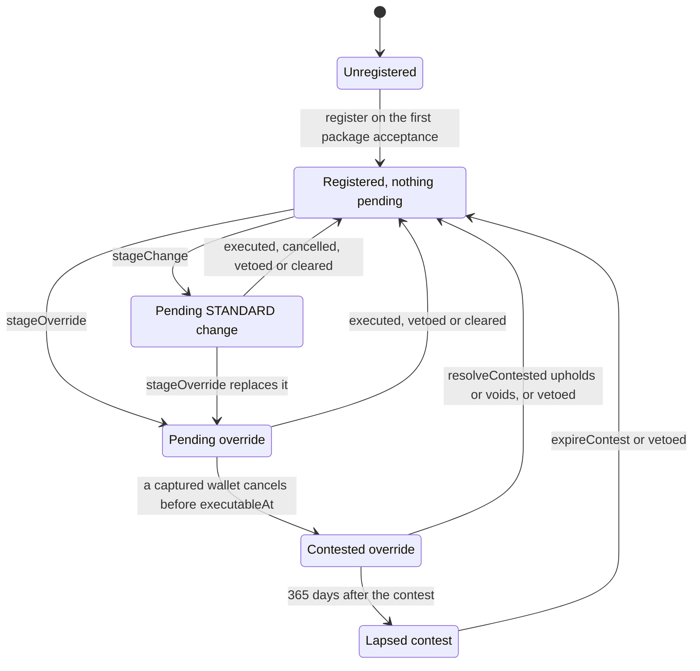
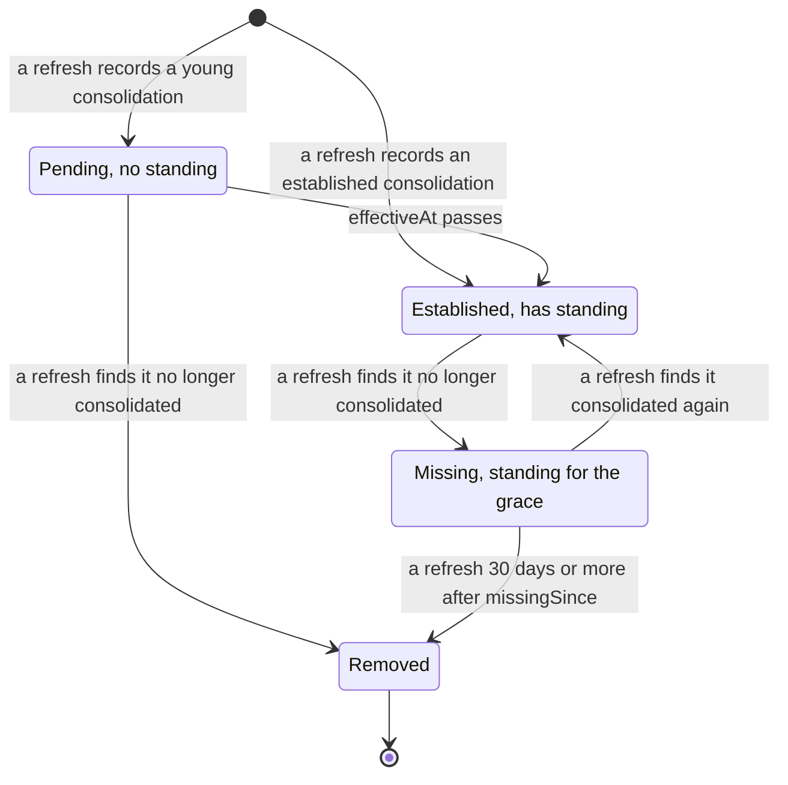
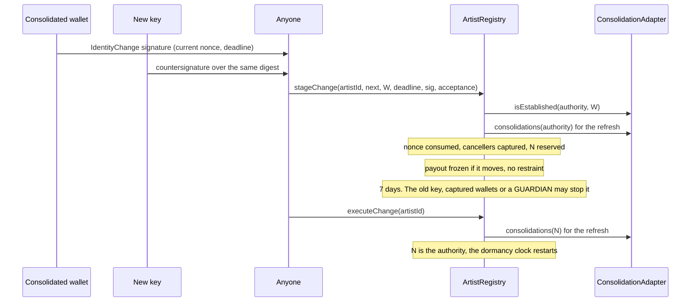
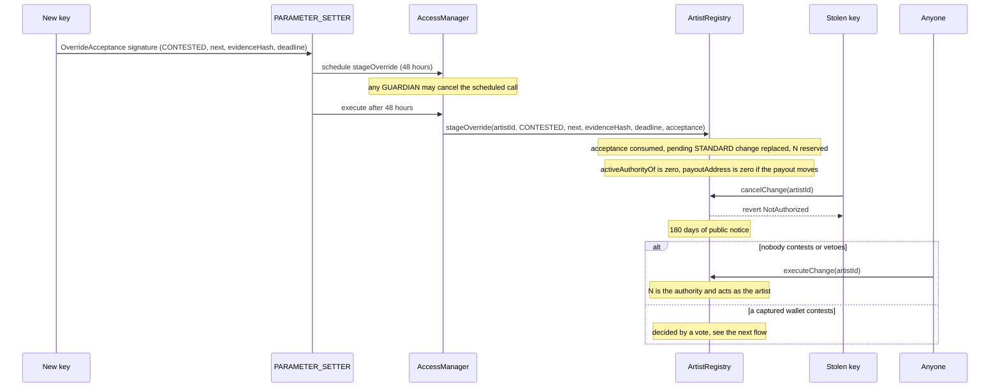
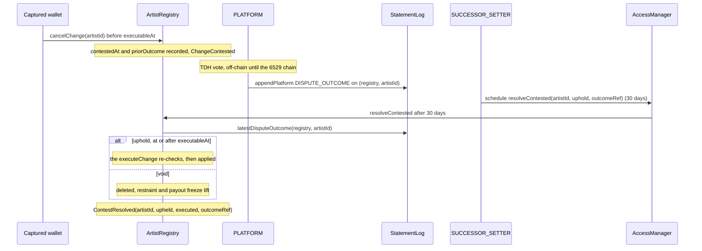
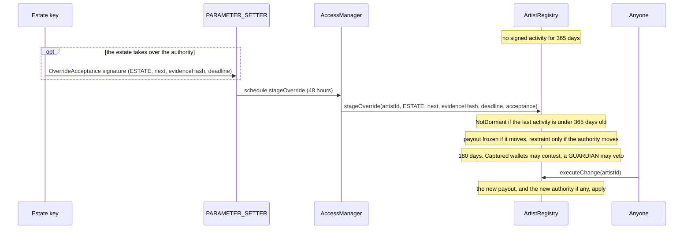
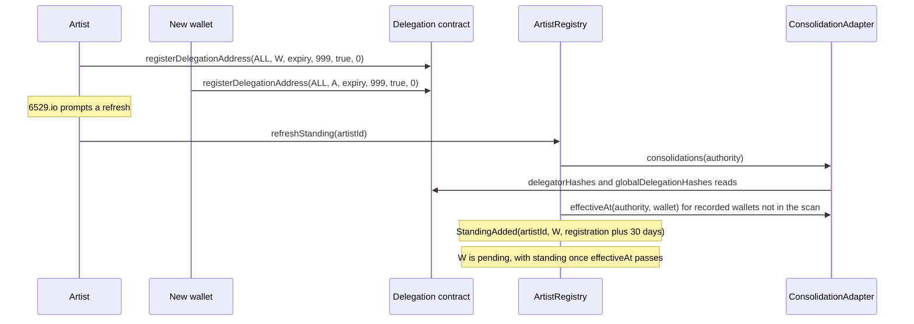
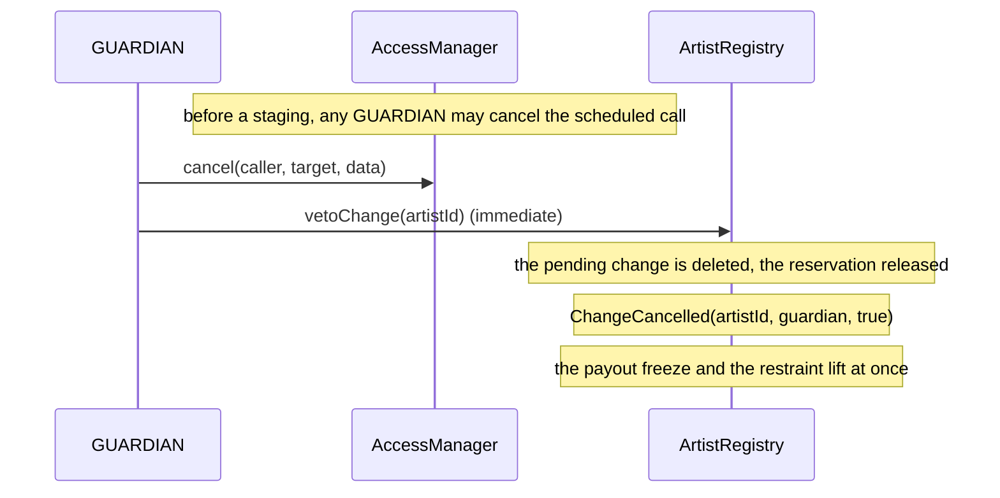

# Identity and recovery

This area gives every artist a stable artist ID, records which key acts for the artist (the
authority) and where the artist's money goes (the payout address), and lets an artist recover
from a lost or stolen key without trusting a single party. Split wallets, the sale adapters,
the package registry, the work records and the statement log all ask it who the artist is.
`ArtistRegistry` holds identities, staged changes, overrides, contests and each artist's
recovery standing; `ConsolidationAdapter` reads 6529 consolidations from the 6529 delegation
contract. This page is for auditors, integrators and whoever operates recovery.

> **Status.** Pre-audit. This page describes `main` at `46941d6` (15 October 2026). The ADRs
> record how the design was decided; this page is how it works now. Where they differ, this
> page follows the code and says so under [Differences from the ADRs](#differences-from-the-adrs).

## Contracts

| Contract | Source | Interface | Responsibility |
| --- | --- | --- | --- |
| `ArtistRegistry` | [`src/identity/ArtistRegistry.sol`](../../src/identity/ArtistRegistry.sol) | [`IArtistRegistry`](../../src/interfaces/IArtistRegistry.sol), which extends [`IArtistRoleResolver`](../../src/interfaces/IArtistRoleResolver.sol) and [`IArtistPayoutResolver`](../../src/economics/interfaces/IArtistPayoutResolver.sol) | Artist IDs, authority, payout and profile fields; STANDARD changes, overrides and contests; the sticky standing snapshot; `isArtist` for the statement log; `payoutAddress` for split wallets. Its address never changes: split wallets pin it, and the consolidation source is swapped inside it. |
| `ConsolidationAdapter` | [`src/identity/ConsolidationAdapter.sol`](../../src/identity/ConsolidationAdapter.sol) | `IConsolidationSource`, declared in [`IArtistRegistry.sol`](../../src/interfaces/IArtistRegistry.sol) | Reads use-case-999, all-collections consolidations, with their age and expiry, from the 6529 delegation contract. Stateless and view-only; fails closed. |

Shared code the registry relies on:

| Code | Source | Used for |
| --- | --- | --- |
| `SignatureVerifier` | [`src/libraries/SignatureVerifier.sol`](../../src/libraries/SignatureVerifier.sol) | Every identity signature: low-s ECDSA in 65-byte or 64-byte ERC-2098 form, EIP-7702 delegated EOAs (ECDSA first, then ERC-1271), and ERC-1271 with a 200,000-gas cap (`ERC1271_GAS_LIMIT`) and an exact 32-byte magic value. Signatures over 4,096 bytes (`MAX_SIGNATURE_LENGTH`) fail. It never tracks replay. |
| `DelegatedEOA` | [`src/libraries/DelegatedEOA.sol`](../../src/libraries/DelegatedEOA.sol) | Refuses EIP-7702 delegated accounts as bindings and as the consolidation source. |
| `BoundedCall` | [`src/libraries/BoundedCall.sol`](../../src/libraries/BoundedCall.sol) | The gas check before each adapter read (`hasSufficientGas` with `CALL_RESERVE`, 1,000 gas), and the bounded `artistResolver()` read in `bindStatementLog`. |
| `ProtocolContracts` | [`src/libraries/ProtocolContracts.sol`](../../src/libraries/ProtocolContracts.sol) | Recognises, by ERC-165, protocol contracts that cannot pull a payout. |
| `Typehashes` | [`src/interfaces/types/Typehashes.sol`](../../src/interfaces/types/Typehashes.sol) | The EIP-712 domain name and the two identity typehashes. |
| Identity types | [`src/interfaces/types/IdentityTypes.sol`](../../src/interfaces/types/IdentityTypes.sol) | `ArtistIdentity`, `ChangeKind`, `PendingChange`, `Standing`. |

## Concepts

Terms used here are defined in the [glossary](../glossary.md). The module README,
[`src/identity/README.md`](../../src/identity/README.md), covers the same ground for
contributors.

### Artist ID, authority and payout

- **Artist ID.** `uint256(uint160(account))` of the account whose first package acceptance
  created the identity (`ArtistRegistry.register`). It is known before any transaction, is the
  same on every chain, fits in 160 bits and never changes when the authority does.
- **Registration.** Only the bound package registry calls `register`, from
  `PackageRegistry.acceptPackage` on an account's first acceptance; anyone may relay that
  acceptance. The identity starts with the account as both authority and payout, the signed
  profile fields, nonce 0, and the block time as its last activity. Registration refuses an
  account that is mapped or reserved (`AccountTaken`) and a zero or refused payout
  (`InvalidIdentity`; see [payout validation](#payout-validation-and-the-payout-freeze)).
- **`artistIdOf(account)`.** The artist ID of an account that is or was an artist's authority,
  otherwise zero. Consumers (the package registry, the work records) take an account's artist
  ID as `artistIdOf(account)` when nonzero, otherwise `uint160(account)`. An old authority
  keeps resolving, so a package naming it still reaches the identity.
- **Authority (`authorityOf`).** The key that identifies the artist. Never zero.
- **Active authority (`activeAuthorityOf`).** The authority, or zero while
  [restrained](#restrained-authority). Every consumer that treats a key as the artist acting
  reads this, not `authorityOf`.
- **Payout address (`payoutAddress`).** Where artist-resolved split payees pay. It starts as
  the first authority, is never zero in the record, and reads as zero for an unknown artist and
  during a [payout freeze](#payout-validation-and-the-payout-freeze). Changing it needs no
  consent from the new payout address.
- **Profile ID and profile document hash.** The artist's claim of a 6529 profile and the hash
  of the profile document. They are bound into every identity signature and every package
  acceptance, but nothing checks them against 6529 profiles: they are unverified claims. A
  registered artist's later package acceptances must carry the recorded values
  (`PackageRegistry.acceptPackage`, `ProfileMismatch`).
- **Change nonce (`changeNonce`).** Per artist. Every staging, STANDARD or override, consumes
  it, and `revokeNonce` burns it.
- **Reservation (`reservedFor`).** A staged change that moves the authority reserves the new
  authority for the artist until the change executes or ends (review finding IDENTITY-2). A
  reserved account cannot be registered or become another artist's authority (`AccountTaken`),
  so the new key's package acceptance cannot create a separate artist and void the change.
- **Last activity.** `artist(artistId)` returns the identity and the time of the last
  [signed activity](#signed-activity-and-dormancy).

### No return to an earlier authority

A change's new authority must be the current authority or an account that has never been an
authority of any artist, and must not be reserved by another artist's pending change
(`ArtistRegistry._taken`, review finding SIGS-3). The registry checks this when a change is
staged (`stageChange`, `stageOverride`) and again when it executes. A rotation A, then B, then
A reverts with `AccountTaken(A)`.

- **Why it holds.** Moves, package acceptances, fixed-price consents, record consents and
  ARTIST statements are checked against the active authority when they are used. A key the
  artist rotated away from is never that again, so every signature it left unused stays void.
  No typehash binds an authority epoch.
- **The trade-off.** An artist can never return to an earlier key or wallet, not even through
  governance. A recovery, or a rotation back from a temporary device, needs a fresh key or
  Safe.
- **The residual.** A new authority that is an ERC-1271 or EIP-7702 wallet and accepts the
  old key's signatures revives them. That is the artist's own configuration of its new
  authority ([ADR 0003](../adr/0003-build-time-decisions.md#identity-and-recovery-amends-adr-0001-11)).
- Changes that keep the authority (payout or profile only) are unaffected. Signed release
  authorizations bind the payout address instead, which may return to an earlier value; see
  [economics and payouts](economics-and-payouts.md).

### Change kinds

One change may be pending per artist (`ArtistRegistry.pendingChange`; kind `NONE` when none).

| Kind | Staged by | Wait before execution | Also needs | Who can stop it |
| --- | --- | --- | --- | --- |
| `STANDARD` | Anyone, relaying the signature of the authority or of an established consolidated wallet (`stageChange`) | 7 days (`CHANGE_DELAY`) | The new authority's countersignature, when the authority moves | The previous authority or a captured wallet cancels (`cancelChange`); a GUARDIAN vetoes (`vetoChange`) |
| `CONTESTED` | PARAMETER_SETTER (`stageOverride`), 48 hours (standard class) | 180 days (`OVERRIDE_DELAY`) | A nonzero evidence hash; the new authority's `OverrideAcceptance`, when the authority moves | A captured wallet contests it; a GUARDIAN vetoes; never the previous authority |
| `ESTATE` | As `CONTESTED` | 180 days | As `CONTESTED`, plus 365 days without signed activity (`DORMANCY`) | As `CONTESTED` |
| `LOST_KEY` | As `CONTESTED` | 180 days | As `ESTATE` | As `CONTESTED` |

- "Override" on this page means any of `CONTESTED`, `ESTATE` and `LOST_KEY`. The code does not
  check the circumstances a kind names: the evidence hash commits to the public record that
  does. `ESTATE` and `LOST_KEY` differ only in their label.
- An override replaces a pending STANDARD change (`ChangeCancelled(artistId, caller, true)`),
  so a key holder cannot block one by keeping a change staged. A STANDARD change cannot be
  staged while anything is pending, and an override cannot be staged while an override is
  pending (`ChangePending`).
- Artist payout changes use the registry's own 7-day wait, not the 14-day funds class, which
  applies to network-level recipients ([ADR 0001 §11](../adr/0001-v1-scope.md#11-artist-identity-and-recovery)).

### Signed payloads

Both payloads use the EIP-712 domain `(name, version, chainId, verifyingContract)` with name
`6529 Works Artist Registry` (`Typehashes.ARTIST_REGISTRY_NAME`), version `1`
(`Typehashes.DOMAIN_VERSION`), the chain ID and the registry's address. The type strings,
exactly as `Typehashes` hashes them:

```text
IdentityChange(uint256 artistId,address authority,address payout,bytes32 profileId,bytes32 profileDocHash,uint256 nonce,uint64 deadline)

OverrideAcceptance(uint256 artistId,uint8 kind,address authority,address payout,bytes32 profileId,bytes32 profileDocHash,bytes32 evidenceHash,uint64 deadline)
```

| Typehash | Value | Digest helper |
| --- | --- | --- |
| `Typehashes.IDENTITY_CHANGE` | `0xa474bd174aa5ecb19efe75995251c1fb8289b62bca04bc6c19e869f254e190f0` | `ArtistRegistry.changeDigest(artistId, next, nonce, deadline)` |
| `Typehashes.OVERRIDE_ACCEPTANCE` | `0xe94c9e2e1a4e3c2652a414f70c177a61fc880d94ede3aaaf03a976666431f9a3` | `ArtistRegistry.overrideDigest(artistId, kind, next, evidenceHash, deadline)` |

The values are pinned by `test_Golden_TypehashesAndSelectors`, and the digests are checked as
standard EIP-712 by `test_Golden_DigestsAreStandardEip712`
([`ArtistRegistry.t.sol`](../../test/identity/ArtistRegistry.t.sol)).

- `authority`, `payout`, `profileId` and `profileDocHash` are the fields of the next
  `ArtistIdentity`. `kind` is the `ChangeKind` value: 2 for `CONTESTED`, 3 for `ESTATE`, 4 for
  `LOST_KEY`.
- **`IdentityChange`** is signed by the staging signer, which must be the authority or a wallet
  established with it at that moment (`IConsolidationSource.isEstablished`, a live check, not
  the snapshot). When the authority moves, the new authority signs the same digest; otherwise
  `stageChange` ignores the countersignature. It binds the current nonce and a deadline. A
  deadline before the block time reverts with `InvalidSignature`; a deadline equal to it is
  accepted.
- **`OverrideAcceptance`** is signed by the new authority, and only when the override moves the
  authority. It binds no nonce, so a key holder cannot void it by burning nonces, and the
  registry consumes it once by digest (`AcceptanceUsed`), whatever the signature's encoding.
  Its deadline is checked when the scheduled `stageOverride` executes, after its 48 hours, so
  the deadline must fall later than that.
- **`revokeNonce`** lets the authority burn its current nonce, voiding every unused
  `IdentityChange` signed for it. Override acceptances are unaffected.
- Replay protection never keys on signature bytes, because `SignatureVerifier` accepts a
  65-byte signature and its ERC-2098 form alike.

### Signed activity and dormancy

`ESTATE` and `LOST_KEY` overrides can be staged only when the artist's last activity is at least
365 days old (`DORMANCY`, `NotDormant`). Only the artist's own signed activity counts:

| Call | Sets the last activity |
| --- | --- |
| `register` (the first package acceptance) | Yes. No `ActivityRecorded` is emitted; `ArtistRegistered` marks it. |
| `stageChange` | Yes |
| `heartbeat`, by the authority or an established wallet | Yes |
| `cancelChange` of a STANDARD change, by the previous authority or a captured wallet | Yes |
| `cancelChange` that contests an override | Yes |
| `cancelChange` of an override that is already contested | No: it does nothing |
| `revokeNonce` | Yes |
| `executeChange`, or a `resolveContested` that upholds and applies | Yes: the clock restarts for the identity installed |
| `stageOverride`, `vetoChange`, a voiding `resolveContested`, `expireContest`, `refreshStanding`, later package acceptances | No |

Dormancy is checked when the override is staged, never when it executes. Activity during the
180-day notice does not stop it (`test_PoC5_HeartbeatDuringALostKeyNoticeDoesNotStopIt`); see
[residual risks](#residual-risks).

### Payout validation and the payout freeze

Artist-resolved split payees are pull-only: only the current payout address, or a signature
from it, can release ([economics and payouts](economics-and-payouts.md)). A payout that cannot
call `release` would strand or stall funds, so `ArtistRegistry._payoutAllowed` refuses:

- the zero address;
- the registry itself;
- the bound package registry;
- 6529 Stream and its Editions, once Stream is bound;
- any split wallet of the bound split factory (`ISplitFactory.isWallet`);
- any contract that declares, by ERC-165, the interface of the revenue escrow, the claim
  router, a sale adapter, a mint target, the artist registry, the package registry or the work
  records (`ProtocolContracts.isProtocolContract`).

The check runs three times:

| When | Effect of a refused payout |
| --- | --- |
| Registration (`register`) | Reverts with `InvalidIdentity` |
| Staging (`stageChange`, `stageOverride`) | Reverts with `InvalidIdentity` |
| Execution (`executeChange`, an upholding `resolveContested`) | The change is cleared, not applied: `ChangeCancelled(artistId, registry, false)`. A stale change cannot keep the payout frozen. |

A split wallet's predicted CREATE2 address has no code before deployment and cannot be told
apart from an empty account. The check at execution catches one deployed while the change waits
(`test_PredictedWalletIsCaughtOnlyOnceDeployed`); tools should also check the factory's
`walletFor` off-chain. Contracts that declare none of these interfaces (the release verifier,
the content store, the statement log, the AccessManager, the renderer) are not recognised.

**The payout freeze.** `payoutAddress(artistId)` returns zero while a pending change of any
kind would move the payout, unless its contest has lapsed. Split wallets then revert with
`PayoutUnresolved(artistId)`, so accrued balances wait for the outcome instead of following a
disputed redirect.

- A change that keeps the payout, including an override that keeps a safe payout, does not
  freeze it (`test_PoC7_RecoveryOverrideKeepsASafePayoutLive`).
- A thief holding a stolen key that is still the payout cannot pull during a recovery override
  that moves the payout, and cannot cancel it
  (`test_Attack_ThiefCannotPullDuringARecoveryOverride`).
- **Trade-off.** The artist's own pulls pause while a payout-moving change is pending. A key
  holder can re-freeze them by staging again after each cancel; a guardian veto and the
  override path end that.

### Restrained authority

While a pending, unlapsed override would move the authority, `activeAuthorityOf` returns zero:
nobody acts as the artist (review finding IDENTITY-1,
[ADR 0003 owner decision 6](../adr/0003-build-time-decisions.md#owner-decisions-11-october-2026)).
The restraint starts at the override's staging and ends when it executes, is vetoed, is voided
by a vote, is cleared at execution, or its contest lapses. A captured wallet's contest does not
end it. `authorityOf` keeps identifying the artist. A STANDARD change, or an override that keeps
the authority (a payout-only override), restrains nothing.

| Power | Contract and function | While restrained |
| --- | --- | --- |
| The sale `creator` | `Stream.primaryTerms`, `Editions.primaryTerms` | Zero |
| Open, consent to or close an edition sale as the artist | `FixedPriceSale`, `DutchSale` (closing in `MintSaleBase`) | `NotSaleManager`; a signed consent fails with `InvalidArtistConsent`. PLATFORM still opens listed FIXED editions at the package terms (MARKET-6) and may close any sale, even one the artist opened. |
| Start an approved, unminted work (the move signature); revoke a move nonce | `PackageRegistry` (`consume`, `revokeMove`) | `InvalidSignature`; `NotAuthority` |
| Accept a package for an existing artist ID | `PackageRegistry.acceptPackage` | `InvalidSignature` |
| Receive a no-bid auction's work | `EnglishAuction.settle` | Reverts with `InvalidRecipient(0)` and moves nothing; the work stays in custody and anyone retries after the outcome |
| Set or finalize a record; add the artist's locators | `WorkRecords.setRecord`, `finalize`, `addLocator` | `NotWorkArtist`; `addLocator` falls through to the AccessManager check |
| Party consents (relicense, royalty-rate change) and the artist's errata repin signature | `WorkRecords` | `InvalidConsent` |
| ARTIST statements | `StatementLog`, through `isArtist` | `NotAuthorized` |

The key being recovered from loses these powers, and the reserved new key gains none until
execution. Identity calls (`heartbeat`, `revokeNonce`) are not creator powers and stay with the
authority. For the statement log this is a permitted exception to the resolver rule: the
restraint makes `isArtist` false for both keys from a 48-hour staging, a withholding the
guardian can veto that never grants or redirects the answer
([`IArtistRoleResolver`](../../src/interfaces/IArtistRoleResolver.sol)).

What is already running continues, and the restraint never reaches back:

- An auction with a bid settles as usual. The bidder gets the work; the artist's share waits in
  the seller wallet under the payout freeze (`test_AuctionWithABidRunningAtStagingSettlesNormally`).
- A no-bid auction's `settle` waits for the outcome. The work then goes to the new authority
  after execution, or to the old one after a veto, void or lapse
  (`test_NoBidAuctionRunningAtStagingWaitsForTheOutcome`,
  `test_NoBidAuctionSettlesToTheOldAuthorityAfterAVeto`).
- An open edition sale keeps selling with its artist share frozen. PLATFORM can close it, even
  one the artist opened, which outside the restraint only the artist may close (MARKET-6,
  `test_PlatformClosesTheArtistsSaleDuringTheNotice`).
- A delivery recorded for the old authority before the staging can still be claimed by it
  (`EnglishAuction.claimDelivery`).

All of these are proven on the real contracts in
[`RecoveryRestraint.t.sol`](../../test/integration/RecoveryRestraint.t.sol).

### Recovery standing

Each artist has a sticky standing snapshot (`standingOf`) of at most 16 consolidated wallets
(`Limits.MAX_CANCELLERS`). Each entry (`Standing`) holds the wallet, its `effectiveAt` (when its
consolidation is or was 30 days old) and `missingSince` (zero, or when a refresh first found it
no longer consolidated). An entry is:

- **pending** while `effectiveAt` is in the future: it has no standing;
- **established** once `effectiveAt` has passed;
- **missing** once a refresh marks it: it keeps standing for 30 days (`STANDING_GRACE`).

These calls refresh the snapshot for the current authority:

| Trigger | When the source cannot read |
| --- | --- |
| `register` | Skips the refresh (`StandingRefreshSkipped`) |
| `stageChange`, `stageOverride` | Reverts (fail closed) |
| `heartbeat` | Reverts |
| `executeChange`, an upholding `resolveContested` (for the authority it installs) | Skips the refresh |
| `refreshStanding(artistId)`: anyone, and not activity | Reverts |

A refresh does this, in order (`ArtistRegistry._refresh`, `_update`):

1. **Scans.** It reads `consolidations(authority)`: up to 32 live two-way consolidations, young
   or established, each with its `effectiveAt`. A longer answer, or arrays of different
   lengths, reverts with `InvalidSource`.
2. **Updates recorded entries.** A recorded wallet absent from the scan is checked directly
   (`effectiveAt(authority, wallet)`), so a wallet still consolidated beyond the bounded scan
   is never marked missing.
   - Still consolidated: a missing entry is restored (`StandingAdded`). A pending entry adopts
     its live `effectiveAt`, later as well as earlier; an established entry's `effectiveAt`
     only moves earlier. These date changes emit no event.
   - No longer consolidated and established: marked missing (`StandingMissing`). It keeps
     standing.
   - No longer consolidated and pending: removed at once (`StandingRemoved`). Its
     consolidation ended before its 30 days, so it never had standing (IDENTITY-3); a later
     consolidation starts a new 30 days.
   - Missing for at least 30 days: removed (`StandingRemoved`).
3. **Records.** It records new consolidations in free slots, established ones before pending
   ones, in delegate-list order (`StandingAdded`).

- **A full snapshot evicts nothing.** Slots free up only as missing entries pass their grace
  and a refresh removes them, so a key holder cannot push recorded wallets out by consolidating
  more. After a rotation the previous authority's wallets stay as missing, with standing, for
  the grace; a full snapshot admits the new authority's wallets only as those age out
  (`test_Standing_PostRotationFullSnapshot`).
- **Captured cancellers.** Each staging refreshes first, then captures the snapshot's entries
  whose `effectiveAt` has passed, missing ones within their grace included, into
  `PendingChange.cancellers` (at most 16). The list never changes for the life of that change:
  a wallet that becomes established after the staging cannot cancel it
  (`test_Cancel_WalletEstablishedAfterStagingCannotCancel`).
- **What the snapshot protects.** Whoever holds the authority key controls the live consolidation
  data: it can revoke the artist's consolidations, reorder the delegate list (revocation is
  swap-and-pop) or add consolidations through a use-case-998 sub-delegate. None of that strips
  a recorded, established wallet of standing, even before a staging. To do so, the key holder
  must let a refresh record the wallet missing (a public event) and then wait 30 days.
- **A wallet no refresh has recorded has no standing.** Artists pay for their own refresh:
  right after an artist links a wallet, 6529.io prompts the artist to call `refreshStanding`.
  A network-paid keeper is an optional, later safety net
  ([ADR 0003 owner decision 4](../adr/0003-build-time-decisions.md#owner-decisions-11-october-2026)).
  One refresh any time after consolidating is enough.
- **Refresh promptly after revoking.** The registry cannot tell when a consolidation ended, only
  when a refresh saw it. An entry first found unconsolidated after its `effectiveAt` is treated
  as an established wallet gone missing and keeps the grace
  (`test_Standing_RevocationObservedOnlyAfterTheThirtyDaysKeepsTheGrace`).

### The consolidation adapter

`ConsolidationAdapter` reads the two public storage getters of the 6529 delegation contract
(`0x2202CB9c00487e7e8EF21e6d8E914B32e709f43d` on mainnet, a constructor argument):
`delegatorHashes` for an account's delegate list and `globalDelegationHashes` for each pair's
registrations and dates. On Sepolia it reads the official NFTDelegation deployment at
`0x8f86c644f845A077999939C69Bc787662377d915`, whose runtime bytecode is identical to mainnet's
([deployments/11155111/README.md](../../deployments/11155111/README.md)).

- **The rule.** `wallet` is consolidated with `account` when each has a live registration of
  the other for all collections (`ALL_COLLECTIONS`, `0x8888…8888`) under use case 999
  (`USE_CASE_CONSOLIDATION`). Live means `expiryDate > now`, the delegation contract's own rule.
  `effectiveAt` is the later side's earliest live registration plus 30 days (`MIN_AGE`), and
  `isEstablished` is true once it has passed. It is zero for an account and itself.
  Specific-collection consolidations and other use cases (997, the primary address) never
  count. A revocation deletes every registration of a pair, so a stored registration has been
  live since its date.
- **Why it walks the dates.** The vendored `checkConsolidationStatus` ignores consolidation age
  and expiry (`test_VendoredCheckIgnoresAgeAndExpiry`).
- **Bounded walks.** At most 32 delegate entries are scanned (`MAX_DELEGATES_SCANNED`, twice
  `Limits.MAX_CANCELLERS`) and 4 registrations read per direction (`MAX_REGISTRATIONS_READ`), so
  one pair costs at most 8 reads. `consolidations` returns every distinct consolidated wallet
  the scan sees, up to 32; `establishedWallets` returns at most 16 established ones. A live
  registration behind four others in its list is not seen
  (`test_IsEstablished_ReadsAtMostFourRegistrations`).
- **A fixed stipend per read.** Each getter call forwards exactly 200,000 gas (`READ_GAS`). A
  caller that cannot forward it in full reverts with `BoundedCallInsufficientGas`, so a caller
  choosing its gas limit cannot truncate a walk. The getters cost at most about 16,000 gas cold
  (contract NatSpec; `test_Reads_PastTheEndRevertsCheaplyWithNoData` bounds the past-the-end
  case under 20,000), and only the gas used is paid.
- **Fail closed.** Only a revert with no data that did not exhaust the stipend ends a walk: that
  is how the deployed getters (solc 0.8.18) answer an index past the end of an array. A read
  that runs out of gas, reverts with data or returns more than expected reverts with
  `IConsolidationSource.DelegationReadFailed`, never "not consolidated", which would mark every
  recorded wallet missing.
- **A live view the account's keys control.** The account's own key, and any use-case-998
  sub-delegate of it, can add consolidations
  (`test_IsEstablished_SubDelegateCanEstablishAWallet`), and a revocation reorders the list.
  The registry's snapshot, not this list, protects the artist's wallets.

**Source outages.** During a repricing, a broken source, or a source whose code no longer
matches its pinned hash, until the source is fixed or swapped:

- staging, heartbeats and `refreshStanding` revert (`DelegationReadFailed` or `InvalidSource`);
- registration and execution go ahead and skip their refresh, emitting
  `StandingRefreshSkipped(artistId)`. Skipping removes nobody's standing: the snapshot keeps
  what it had, and a refresh stops at the first failed read. Only `DelegationReadFailed` and a
  code-hash mismatch are skipped; any other failure still reverts;
- once reads work again, `refreshStanding` for each artist named in a `StandingRefreshSkipped`
  event catches up.

**Swapping the source.** `setConsolidationSource(expected, next, nextCodeHash)` is a
SUCCESSOR_SETTER action, 30 days (successor class), compare-and-set (`ExpectedValueMismatch`).
`next` must have the code hash `nextCodeHash`, answer ERC-165 for `IConsolidationSource` and not
be an EIP-7702 delegated account. The pinned hash (`consolidationSourceCodeHash`) is re-checked
at every use (review finding DEPS-6), which costs about 2,200 gas per call that reads the source
([ADR 0004](../adr/0004-gas-budgets-under-glamsterdam.md#the-table) notes). This is a full-trust
path: the source decides who may sign STANDARD changes and heartbeats, and who gains standing.

### Functions and callers

Roles and delays are the committed genesis policy
([`config/genesis.example.json`](../../config/genesis.example.json)); see
[governance](governance.md) for the classes.

| Function | Caller | Delay |
| --- | --- | --- |
| `register` | The bound package registry | None |
| `stageChange` | Anyone, relaying the signatures | None; executable after 7 days |
| `stageOverride` | PARAMETER_SETTER | 48 hours (standard); executable 180 days after staging |
| `cancelChange` | The previous authority (STANDARD only) or a captured wallet | None; on an override, only before `executableAt` |
| `vetoChange` | GUARDIAN | Immediate |
| `executeChange` | Anyone | Once due and uncontested |
| `resolveContested` | SUCCESSOR_SETTER | 30 days (successor) |
| `expireContest` | Anyone | 365 days after the contest |
| `heartbeat` | The authority or an established wallet | None |
| `revokeNonce` | The authority | None |
| `refreshStanding` | Anyone | None |
| `setConsolidationSource` | SUCCESSOR_SETTER | 30 days (successor) |
| `bindPackageRegistry`, `bindStream`, `bindSplitFactory`, `bindStatementLog` | ADMIN, once each, at genesis | Genesis only |
| `bindFederationRegistry` | ADMIN, once | Deferred to v1.1, as a 30-day ADMIN action |
| `listFederatedContract` | The bound federation registry (v1.1) | None; at most 64 per artist (`MAX_FEDERATED`) |

Bindings are one-shot (`AlreadyBound`) and refuse EIP-7702 delegated targets. The package
registry, Stream and the federation registry must answer ERC-165 for their interfaces; the
split factory and the statement log need code only, and the statement log's `artistResolver()`
must name this registry, read with a 50,000-gas bound (`BIND_READ_GAS`).

## State machine

An artist identity:



"Executed" returns to Registered with the new identity installed. A lapsed contest no longer
freezes the payout or restrains the authority, but it still occupies the pending slot: a new
change waits until someone calls `expireContest` or a guardian vetoes it.

| Transition | Caller (role) | Delay | Function |
| --- | --- | --- | --- |
| Unregistered to Registered | The bound package registry, on the account's first acceptance (anyone relays it) | None | `register`, from `PackageRegistry.acceptPackage` |
| Registered to Pending STANDARD | Anyone, relaying the signer's signature and, for a new authority, its countersignature | None | `stageChange` |
| Registered or Pending STANDARD to Pending override | PARAMETER_SETTER | 48 hours (standard) | `stageOverride` |
| Pending STANDARD to Registered (cancelled) | The previous authority or a captured wallet | Immediate | `cancelChange` |
| Pending to Registered (executed) | Anyone | 7 days (STANDARD) or 180 days (override) after staging | `executeChange` |
| Pending to Registered (cleared at execution) | Anyone; the registry clears it when the payout is refused or the authority taken | At execution | `executeChange`, or an upholding `resolveContested` |
| Pending override to Contested | A captured wallet | Before `executableAt` | `cancelChange` |
| Contested to Registered (upheld) | SUCCESSOR_SETTER | 30 days (successor), and not before `executableAt` | `resolveContested(artistId, true, outcomeRef)` |
| Contested to Registered (voided) | SUCCESSOR_SETTER | 30 days (successor) | `resolveContested(artistId, false, outcomeRef)` |
| Contested to Lapsed | Nobody: time passes | 365 days after `contestedAt` (`CONTEST_TIMEOUT`) | None |
| Lapsed to Registered | Anyone | None | `expireContest` |
| Any pending state to Registered (vetoed) | GUARDIAN | Immediate | `vetoChange` |

A standing entry:



| Transition | Caller | Delay | Function |
| --- | --- | --- | --- |
| Recorded (pending or established) | A refresh: registration, staging, heartbeat, execution, or anyone | None; only into a free slot | `refreshStanding` and the internal refresh |
| Pending to Established | Nobody: time passes | At `effectiveAt`, 30 days after the later side's live registration | None |
| Pending to Removed | A refresh | At once | As above |
| Established to Missing | A refresh | At once; standing kept | As above |
| Missing to Established | A refresh | At once | As above |
| Missing to Removed | A refresh | At least 30 days after `missingSince` (`STANDING_GRACE`) | As above |

## Flows

### Lost key with a consolidated wallet

The authority key is lost, and a wallet has been consolidated with it for at least 30 days.
The wallet stages a STANDARD change to a fresh key.



- **Preconditions.** No change pending. The signer is established with the authority now
  (two-way, all collections, at least 30 days old, unexpired). The new key has never been an
  authority and is not reserved by another artist. The payout is allowed. The deadline has not
  passed.
- **Effects.** `ChangeStaged` carries the whole `PendingChange`, including the captured
  cancellers. At execution `ChangeExecuted` records the previous and next identity, the new
  key maps to the artist ID, and its consolidations are recorded. Accrued balances follow the
  new payout (`test_RecoveryByConsolidatedWalletThenSplitWalletPull`).
- **If the key was stolen, not lost,** the thief is the previous authority and can cancel any
  STANDARD change. Use the override below.
- **Gas.** The adversarial worst case for `stageChange` is about 5.31M gas
  (`test_WorstCase_StageChangeGas`), under half the 16,777,216-gas EIP-7825 transaction cap.

### Stolen key: override and restraint

A thief holds the authority key. The new key signs an acceptance, and governance stages a
`CONTESTED` override with an evidence hash committing to the public record.



- **Preconditions.** No override pending. The evidence hash is nonzero. The acceptance is
  valid, unused and unexpired when the scheduled call executes. The new key passes the
  [no-return rule](#no-return-to-an-earlier-authority).
- **Effects.** From the staging, the thief cannot pull (payout freeze), cannot act as the
  artist (restraint), cannot cancel the override, and cannot stage a STANDARD change
  (`ChangePending`). It can still call `heartbeat` and `revokeNonce`, which do not affect a
  `CONTESTED` override. The override's staging consumes the nonce, voiding the thief's
  pre-signed changes.
- **Guardian monitoring.** A staged override restrains the artist from its 48-hour staging, so
  guardians should watch scheduled `stageOverride` operations and, when vetoing one, also cancel
  any other override queued for the same artist (identity README).
- **Gas.** The worst case for `stageOverride` is about 5.33M gas
  (`test_WorstCase_StageOverrideGas`).
- Proven by `test_Attack_ThiefCannotPullDuringARecoveryOverride`
  ([`ArtistRegistry.t.sol`](../../test/identity/ArtistRegistry.t.sol)),
  `test_PendingNextAuthorityIsReservedUntilTheRecoveryExecutes`
  ([`IdentityRecovery.t.sol`](../../test/integration/IdentityRecovery.t.sol)) and the restraint
  tests in [`RecoveryRestraint.t.sol`](../../test/integration/RecoveryRestraint.t.sol).

### Contest and vote

A thief who held the key for a month may have consolidated a wallet of its own, which a refresh
recorded and the override captured. That wallet's cancel contests the override
([ADR 0003 owner decision 1](../adr/0003-build-time-decisions.md#owner-decisions-11-october-2026)).



- **The contest.** Only a captured wallet contests, and only before `executableAt`
  (`ContestWindowClosed`), so a late contest cannot front-run a due execution. The pending change
  records `contestedAt` and `priorOutcome`, the artist's latest DISPUTE_OUTCOME at that moment.
  Further cancels do nothing, and `executeChange` refuses the override (`OverrideContested`).
  The freeze and the restraint continue.
- **The vote.** PLATFORM records the outcome as a DISPUTE_OUTCOME statement on the subject
  `(registry, artistId)` ([disputes and statements](disputes-and-statements.md)). Until the
  6529 chain exists the vote is off-chain, and the admin Safe is trusted to apply its result.
- **The resolution.** `outcomeRef` must be nonzero and equal
  `latestDisputeOutcome(registry, artistId)` (`OutcomeNotRecorded`), and must differ from
  `priorOutcome` (`OutcomePredatesContest`). Entry hashes are unique, so only a vote recorded
  after this contest qualifies. Upholding applies the override with the same re-checks as
  `executeChange`; `executed` in `ContestResolved` is false for a void and for an uphold the
  re-checks cleared. Voiding emits `ChangeCancelled(artistId, caller, true)` first.
- **Scheduling.** Schedule an uphold no earlier than `executableAt` minus 30 days: it reverts
  with `ChangeNotDue` before `executableAt`, and the AccessManager drops an operation not
  executed within 7 days of maturing. A later DISPUTE_OUTCOME on the same subject invalidates a
  scheduled resolution. A contest falls inside the notice, so the window between `executableAt`
  and the lapse is always at least 185 days (`testFuzz_L3_UpholdWindowAlwaysOpen`).
- **Other ends.** A guardian can still veto a contested override. A contest nobody resolves
  lapses 365 days after `contestedAt`: the freeze and restraint lift at once, and anyone may
  then call `expireContest` (`ContestExpired`, then `ChangeCancelled(artistId, registry,
  false)`).
- Proven on the real contracts by `test_ContestedOverrideUpheldByARecordedVote`
  ([`IdentityRecovery.t.sol`](../../test/integration/IdentityRecovery.t.sol)) and
  `test_PowersReturnWhenAVoteVoidsTheOverride`
  ([`RecoveryRestraint.t.sol`](../../test/integration/RecoveryRestraint.t.sol)).

### Estate or lost key without a wallet

The artist has had no signed activity for 365 days. Governance stages an `ESTATE` (or
`LOST_KEY`) override, either to an estate payout alone or to a new authority that accepts.



- A payout-only override needs no acceptance and restrains nothing
  (`test_Override_PayoutOnlyNeedsNoAcceptance`, `test_PayoutOnlyOverrideDoesNotRestrain`). It
  needs no consent from the artist either: only a captured wallet's contest or a guardian veto
  stops it.
- Activity inside the 48-hour scheduling window makes the staging revert with `NotDormant`; a
  `CONTESTED` override has no dormancy requirement.
- Activity during the 180-day notice does not stop the override (owner option L4 is not
  implemented).

### Refreshing standing

The artist links a new wallet on 6529.io, which then prompts the artist to refresh.



- Anyone may call it, and it is not activity. It fails closed when the source cannot read.
- **Gas.** Recording a further wallet in a snapshot that has one costs about 159,000 Prague gas;
  the first wallet about 130,000
  ([ADR 0004 table](../adr/0004-gas-budgets-under-glamsterdam.md#the-table), which also has the
  Sepolia figures). The adversarial worst case, with every read cold and 16 entries aging out
  while 16 are recorded, is about 4.66M (`test_WorstCase_RefreshStandingGas`).

### Guardian veto



- A veto deletes any pending change: STANDARD, override, contested or lapsed. The guardian has
  no path that writes an identity (`test_Attack_GuardianCannotRedirect`).
- `WorksAccessManager` lets any GUARDIAN holder cancel any scheduled operation, including a
  scheduled `stageOverride`, `resolveContested` or `setConsolidationSource`
  ([governance](governance.md)).

## Rules and invariants

Test files: [`ArtistRegistry.t.sol`](../../test/identity/ArtistRegistry.t.sol) (AR),
[`ArtistRegistryReview.t.sol`](../../test/identity/ArtistRegistryReview.t.sol) (ARR),
[`ContestedOverrides.t.sol`](../../test/identity/ContestedOverrides.t.sol) (CO),
[`ConsolidationAdapter.t.sol`](../../test/identity/ConsolidationAdapter.t.sol) (CA),
[`ArtistRegistry.invariant.t.sol`](../../test/identity/ArtistRegistry.invariant.t.sol) (INV),
[`IdentityRecovery.t.sol`](../../test/integration/IdentityRecovery.t.sol) (IR),
[`RecoveryRestraint.t.sol`](../../test/integration/RecoveryRestraint.t.sol) (RR) and
[`RecipientValidation.t.sol`](../../test/integration/RecipientValidation.t.sol) (RV).

| ID | Rule | Enforced in | Proven by |
| --- | --- | --- | --- |
| ID-1 | An artist ID is `uint160` of its first authority, created only by the bound package registry. | `ArtistRegistry.register` | AR `testFuzz_Register_ArtistIdIsTheFirstAuthority`, `test_Register_RevertsForAnyoneButThePackageRegistry`, `test_Register_RevertsForTakenAccount` |
| ID-2 | Every past authority keeps resolving to its artist and never becomes an authority again, of any artist. | `ArtistRegistry._taken`, `_checkNext`, `_apply`, `register` | AR `test_StageChange_RevertsForAPreviousAuthority`, `test_Register_PastAuthoritiesStayTaken`; IR `test_RotationBackToAPreviousAuthorityIsRefused`; INV `invariant_PastAuthoritiesResolveToTheArtist` |
| ID-3 | A staged authority change reserves exactly its new authority until the change ends, however it ends. | `ArtistRegistry._stage`, `_clear`, `_apply`, `_taken` | AR `test_ExecuteChange_NewAuthorityCannotBeTakenMeanwhile`, `test_Reservation_FollowsThePendingChange`, `test_Reservation_ReleasedWhenExecutionClears`; IR `test_PendingNextAuthorityIsReservedUntilTheRecoveryExecutes`; INV `invariant_OnlyThePendingNextAuthorityIsReserved` |
| ID-4 | At most one change is pending; an override replaces a pending STANDARD change but never another override. | `ArtistRegistry.stageChange`, `stageOverride` | AR `test_StageChange_RevertsWhenPending`, `test_Override_RevertsWhenAnOverrideIsPending`, `test_Override_ReplacesAPendingStandardChange` |
| ID-5 | A STANDARD change needs an unexpired `IdentityChange` signature by the authority or a wallet established now, plus the new authority's countersignature when it moves. | `ArtistRegistry.stageChange`, `_requireSigner` | AR `test_StageChange_ByEstablishedWallet`, `test_StageChange_RevertsForFreshlyConsolidatedWallet`, `test_StageChange_AuthorityChangeNeedsTheNewKey`, `test_StageChange_RevertsForExpiredDeadline`, `test_StageChange_RevertsForTamperedPayload` |
| ID-6 | Every staging consumes the nonce; replay keys on the nonce, never on signature bytes; signatures bind the registry's domain. | `ArtistRegistry._stage`, `changeDigest` | AR `test_Replay_ConsumedNonceRejected`, `test_Replay_CompactFormOfAUsedSignatureRejected`, `test_Replay_OtherRegistryRejected`; INV `invariant_ActivityAndNonceMatchTheModel` |
| ID-7 | Only the authority burns its nonce; that voids unused STANDARD payloads but not override acceptances. | `ArtistRegistry.revokeNonce` | AR `test_RevokeNonce_VoidsAPresignedPayload`, `test_RevokeNonce_RevertsForAnyoneButTheAuthority`, `test_Override_AcceptanceSurvivesANonceBurn` |
| ID-8 | A STANDARD change executes no earlier than 7 days after staging, an override no earlier than 180 days. | `ArtistRegistry.executeChange`, `resolveContested` | AR `test_ExecuteChange_RevertsBeforeSevenDays`, `testFuzz_ExecuteChange_RespectsTheDelay`, `test_Override_ContestedWaits180Days`; INV `invariant_PendingChangeIsWellFormed` |
| ID-9 | A STANDARD change is cancelled by its previous authority or a captured wallet; an override only by a captured wallet's contest, never by the previous authority; standing is fixed at staging. | `ArtistRegistry.cancelChange` | AR `test_Cancel_ByTheOldKey`, `test_Cancel_ByACapturedWallet`, `test_Cancel_WalletEstablishedAfterStagingCannotCancel`, `test_Attack_OldKeyCannotCancelAnOverride` |
| ID-10 | The guardian can delete any pending change and has no path that writes an identity. | `ArtistRegistry.vetoChange`; genesis role map | AR `test_Veto_ByGuardian`, `test_Veto_StopsAnOverride`, `test_Attack_GuardianCannotRedirect`; CO `test_Contest_GuardianVetoVoids` |
| ID-11 | An override needs an override kind and a nonzero evidence hash; `ESTATE` and `LOST_KEY` need 365 days without activity at staging. | `ArtistRegistry.stageOverride` | AR `test_Override_RevertsForInvalidKindOrEvidence`, `test_Override_EstateRevertsBeforeOneYearOfDormancy`, `test_Override_LostKeyBlockedByRecentHeartbeat` |
| ID-12 | An override that moves the authority needs the new authority's unexpired acceptance, consumed once by digest; a payout-only override needs none. | `ArtistRegistry.stageOverride` | AR `test_Override_AuthorityChangeNeedsTheNewAuthority`, `test_Override_AcceptanceIsSingleUseByDigest`, `test_Override_SameAcceptanceCannotBeConsumedTwice`, `test_Override_PayoutOnlyNeedsNoAcceptance` |
| ID-13 | A captured wallet's cancel during the notice contests an override once; later cancels do nothing; a contested override never executes through `executeChange`; a contest after `executableAt` reverts. | `ArtistRegistry.cancelChange`, `executeChange` | CO `test_Contest_ThiefWalletContestsAndThePayoutStaysFrozen`, `test_L3_LateContestIsRefusedAndExecutionProceeds`, `test_Contest_IsActivityOnlyForTheCapturedWallet`; INV `invariant_PendingChangeIsWellFormed` |
| ID-14 | A contest is resolved only by citing the latest DISPUTE_OUTCOME on `(registry, artistId)`, recorded after the contest; an uphold waits for `executableAt` and re-checks. | `ArtistRegistry.resolveContested` | CO `test_Contest_VoteUpholdsAndTheArtistRecovers`, `test_Contest_VoteVoidsAndThePayoutUnfreezes`, `test_M1_StaleOutcomeFromAnEarlierContestIsRejected`, `test_M1_OutcomeRecordedBeforeTheContestIsRejected`, `test_Resolve_RevertsForAMismatchedOrZeroOutcome`, `test_Resolve_RevertsWithoutABoundStatementLog`, `test_Resolve_UpholdRechecksAtExecution`; IR `test_ContestedOverrideUpheldByARecordedVote` |
| ID-15 | A contest lapses 365 days after it began: the freeze and the restraint lift at once, and anyone may delete it. | `ArtistRegistry._lapsed`, `expireContest` | CO `test_Contest_LapsesAfterAYear`, `testFuzz_L3_UpholdWindowAlwaysOpen`; RR `test_PowersReturnWhenAContestLapses` |
| ID-16 | `payoutAddress` is zero exactly while a pending, unlapsed change would move the payout; the payout changes only through an executed change. | `ArtistRegistry.payoutAddress`, `_apply` | AR `test_PayoutFreeze_WhileAPayoutChangeIsPending`, `test_PayoutFreeze_NotForChangesThatKeepThePayout`, `test_PayoutFreeze_OnlyForAnOverrideThatMovesThePayout`, `test_Attack_ThiefCannotPullDuringARecoveryOverride`; ARR `test_PoC4_NoOpOverrideDoesNotFreeze`; INV `invariant_PayoutChangesOnlyThroughExecutedChanges` |
| ID-17 | A payout that cannot pull is refused at registration and staging, and clears the change at execution. | `ArtistRegistry._payoutAllowed`, `register`, `_checkNext`, `_apply` | AR `test_PayoutValidation_RejectsProtocolContractsAndSplitWallets`, `test_PayoutValidation_RegistrationRejectsASplitWallet`, `test_PayoutValidation_RecheckedAtExecution`; RV `test_PayoutRefusesProtocolContractsThatCannotPull`, `test_PredictedWalletIsCaughtOnlyOnceDeployed` |
| ID-18 | `activeAuthorityOf` is zero exactly while a pending, unlapsed override would move the authority; every creator power reads it. | `ArtistRegistry._active`; consumers in the restraint table | AR `test_ActiveAuthority_RestrainedUntilTheOverrideExecutes`, `test_ActiveAuthority_OnlyAnAuthorityMovingOverrideRestrains`; INV `invariant_ActiveAuthorityIsRestrainedOnlyByAnAuthorityMovingOverride`; RR (every test) |
| ID-19 | Only the artist's own signed activity resets the dormancy clock. | `ArtistRegistry._recordActivity` call sites | ARR `test_Activity_OverridesAndVetoesDoNotCount`, `test_Activity_CancelsAndExecutionsCount`, `test_Standing_RefreshAddsButIsNotActivity`; INV `invariant_ActivityAndNonceMatchTheModel` |
| ID-20 | The snapshot holds at most 16 distinct wallets and evicts nothing; free slots go to established wallets before pending ones. | `ArtistRegistry._update` | ARR `test_Standing_BoundedToSixteen`, `test_Standing_FullSnapshotKeepsMissingEntriesAndSkipsNewOnes`, `test_Standing_EstablishedWalletsTakeFreeSlotsBeforePendingOnes`, `test_ResidualRisk_KeyHolderFillsFreeSlots`; INV `invariant_AuthorityAndStandingAreConsistent` |
| ID-21 | A recorded, established wallet loses standing only after a refresh marks it missing and a refresh at least 30 days later removes it; a wallet still consolidated is never marked missing. | `ArtistRegistry._update` | ARR `test_Standing_LostOnlyAfterAPublicThirtyDayGrace`, `test_Standing_CannotBeStrippedInUnderThirtyDays`, `test_PoC1_RevokeThenStageStillCapturesTheWallet`, `test_PoC2_SwapAndPopCannotDisplaceStanding`, `test_N2_StillEstablishedWalletBeyondTheScanKeepsStanding`, `test_N2_DirectCheckBeyondTheNewAuthoritysScan`; IR `test_StickyStandingDefeatsAKeyThief` |
| ID-22 | A pending entry found unconsolidated is removed at once; a pending entry follows its live clock; an established entry's clock only moves earlier. | `ArtistRegistry._update` | ARR `test_Standing_PendingWalletRevokedBeforeThirtyDaysNeverGainsStanding`, `test_Standing_PendingEntryFollowsALaterReRegistration`, `test_Standing_ReConsolidationCannotResetTheClock`, `test_Standing_RotationLowersEffectiveAtToTheOlderPair` |
| ID-23 | The cancellers are the snapshot's effective entries after the staging's own refresh, and never change afterwards. | `ArtistRegistry._stage` | ARR `test_N1_YoungWalletRecordedPendingIsCapturedAfterRevocation`, `test_Standing_StagingAgesOutAMissingWallet`; AR `test_Attack_ThiefRevokingConsolidationsAfterStagingCannotStripCancellers`; INV `invariant_PendingChangeIsWellFormed` |
| ID-24 | A wallet is established only through a live, two-way, all-collections, use-case-999 consolidation at least 30 days old. | `ConsolidationAdapter.effectiveAt`, `_liveSince` | CA `test_IsEstablished_OnlyAfterThirtyDays`, `test_IsEstablished_FalseOnceExpired`, `test_IsEstablished_FalseForOneDirection`, `test_IsEstablished_IgnoresSpecificCollections`, `test_IsEstablished_IgnoresOtherUseCases`, `test_EffectiveAt_FollowsTheLaterSide`, `testFuzz_IsEstablished_MatchesModel` |
| ID-25 | Adapter reads forward exactly 200,000 gas or revert, and fail closed on anything but a cheap no-data revert. | `ConsolidationAdapter._read` | CA `test_Reads_RevertWhenGasCannotBeForwarded`, `test_Reads_PastTheEndRevertsCheaplyWithNoData`, `test_Reads_HeadroomForARepricing`, `test_Reads_FailClosedWhenAGetterRunsOutOfGas`, `test_Reads_FailClosedOnARevertWithDataOrAnOversizedReturn` |
| ID-26 | During a source outage or code-hash mismatch, staging, heartbeats and refreshes revert, while registration and execution proceed and skip their refresh. | `ArtistRegistry._refresh`, `_skipRefresh`, `_source` | AR `test_SourceReadFailure_FailsClosed`, `test_SourceReadFailure_ExecutionSkipsTheRefresh`, `test_SourceReadFailure_OnlyTheOutageErrorIsSkipped`, `test_ConsolidationSource_CodeHashRecheckedAtUse`; RR `test_SourceMismatchDoesNotBlockRecoveryExecution` |
| ID-27 | The source is swapped only by compare-and-set to a contract with the reviewed code hash, ERC-165 support and no EIP-7702 delegation. | `ArtistRegistry.setConsolidationSource`, `_checkSource` | AR `test_SetConsolidationSource`, `test_SetConsolidationSource_RevertsForStaleExpected`, `test_SetConsolidationSource_RevertsForBadSourceOrCodeHash`, `test_SetConsolidationSource_RevertsForNonSetter`, `test_Constructor_RevertsForCodelessSource`, `test_Stage_RevertsWhenTheSourceReturnsTooManyWallets` |
| ID-28 | `isArtist` is true only for the active authority of a Stream work's lead artist, or of an edition's master; false for anything else. | `ArtistRegistry.isArtist` | AR `test_IsArtist_StreamWorksAndEditions`, `test_IsArtist_FalseBeforeTheStreamIsSet`, `test_ActiveAuthority_RestrainedUntilTheOverrideExecutes` |
| ID-29 | Each binding is set once, by ADMIN, to a valid target. | `ArtistRegistry._bind`, `_checkBinding`, `bindStatementLog` | AR `test_Bindings_AreOneShot`, `test_Bindings_RejectInvalidTargets`, `test_Bindings_RevertForNonAdmin`, `test_BindSplitFactory_OneShotAndRequiresCode`; CO `test_BindStatementLog_OneShotAndChecksTheResolver`, `test_BindStatementLog_ResolverReadIsBounded` |

## Events

`ConsolidationAdapter` emits no events. Every event below is declared in
[`IArtistRegistry`](../../src/interfaces/IArtistRegistry.sol) and emitted by `ArtistRegistry`.
For indexing in general, see [events and indexing](../integrators/events-and-indexing.md).

| Event | Contract | Emitted when | Notes |
| --- | --- | --- | --- |
| `ArtistRegistered(artistId, identity)` | `ArtistRegistry` | `register` creates an identity | Also marks the first activity; no `ActivityRecorded` accompanies it. |
| `ChangeStaged(artistId, change)` | `ArtistRegistry` | `stageChange` or `stageOverride` | Carries the whole `PendingChange`: kind, next identity, previous authority, `stagedAt`, `executableAt`, evidence hash and captured cancellers. |
| `ChangeCancelled(artistId, by, vetoed)` | `ArtistRegistry` | A pending change ends without applying | `by` is the canceller with `vetoed` false for `cancelChange` of a STANDARD change; the caller with `vetoed` true for `vetoChange`, a voiding `resolveContested` and an override replacing a STANDARD change (the AccessManager when a scheduled call executes through it); the registry with `vetoed` false when execution clears the change and on `expireContest`. |
| `ChangeExecuted(artistId, previous, next)` | `ArtistRegistry` | `executeChange` or an upholding `resolveContested` applies a change | Followed by the new authority's standing events or `StandingRefreshSkipped`. |
| `ActivityRecorded(artistId, timestamp)` | `ArtistRegistry` | `stageChange`, `heartbeat`, an activity-counting `cancelChange`, `revokeNonce`, an applied change | The dormancy clock. |
| `ConsolidationSourceSet(previous, next)` | `ArtistRegistry` | The constructor (`previous` zero) and `setConsolidationSource` | |
| `Bound(name, target)` | `ArtistRegistry` | A binding is set | `name` is `PACKAGE_REGISTRY`, `STREAM`, `FEDERATION_REGISTRY`, `SPLIT_FACTORY` or `STATEMENT_LOG`. |
| `ChangeContested(artistId, by)` | `ArtistRegistry` | A captured wallet's `cancelChange` contests an override | Guardians watch for it. |
| `ContestResolved(artistId, upheld, executed, outcomeRef)` | `ArtistRegistry` | `resolveContested` | `executed` is false for a void and for an uphold the re-checks cleared. |
| `ContestExpired(artistId)` | `ArtistRegistry` | `expireContest` | Followed by `ChangeCancelled(artistId, registry, false)`. |
| `NonceRevoked(artistId, nonce)` | `ArtistRegistry` | `revokeNonce` | `nonce` is the value burned. |
| `FederatedContractListed(artistId, token)` | `ArtistRegistry` | `listFederatedContract` (v1.1) | |
| `StandingAdded(artistId, wallet, effectiveAt)` | `ArtistRegistry` | A refresh records a wallet, or finds a missing one consolidated again | Later `effectiveAt` changes emit nothing; read `standingOf`. |
| `StandingMissing(artistId, wallet)` | `ArtistRegistry` | A refresh finds an established wallet no longer consolidated | It keeps standing for 30 days. |
| `StandingRemoved(artistId, wallet)` | `ArtistRegistry` | A refresh removes a wallet missing for 30 days, or a pending wallet no longer consolidated | |
| `StandingRefreshSkipped(artistId)` | `ArtistRegistry` | A registration or execution skips its refresh during a source outage or code-hash mismatch | Call `refreshStanding(artistId)` once the source reads again. |

## Failure modes and recovery

| Failure | Effect | Recovery |
| --- | --- | --- |
| The consolidation source cannot read (a repricing, a broken source) | Staging, heartbeats and `refreshStanding` revert with `DelegationReadFailed`; registration and execution go ahead and emit `StandingRefreshSkipped` | Fix or swap the source (`setConsolidationSource`, 30 days), then `refreshStanding` for each skipped artist |
| The source's code no longer matches its pinned hash | As above, with `InvalidSource`; nothing is read from it | As above |
| A source answers more than 32 wallets or mismatched arrays | Every refresh reverts with `InvalidSource`, registration and execution included | Swap the source. The v1 adapter cannot answer this way. |
| A split wallet is deployed at the pending payout while the change waits | Execution clears the change (`ChangeCancelled(artistId, registry, false)`); the payout unfreezes | Stage a new change with a payout that can pull |
| The key is lost and no wallet is established | No STANDARD path | An `ESTATE` or `LOST_KEY` override after 365 days without activity, or a `CONTESTED` override with evidence |
| The key is stolen | The thief can cancel any STANDARD change and can stage changes, freezing the payout each time | A `CONTESTED` override (180 days): the freeze and the restraint hold the thief from its staging; guardians veto the thief's STANDARD changes |
| A thief's captured wallet contests the recovery override | The override waits; the payout stays frozen and the artist restrained | A recorded vote and `resolveContested` (30 days), a guardian veto, or the lapse 365 days after the contest |
| A scheduled `resolveContested` cites an outcome that is no longer the latest | Reverts with `OutcomeNotRecorded` when executed | Schedule a new resolution citing the latest outcome |
| An uphold is scheduled too early | Reverts with `ChangeNotDue`; the AccessManager drops it 7 days after maturing | Schedule no earlier than `executableAt` minus 30 days |
| No statement log is bound | `resolveContested` always reverts with `OutcomeNotRecorded` | Genesis binds it; otherwise a veto or the lapse ends the contest |
| An override acceptance expires during the 48-hour schedule | The staging reverts with `InvalidSignature` | A new acceptance with a later deadline |
| An override acceptance is reused after a veto or contest | `AcceptanceUsed` | A new acceptance; a different deadline or evidence hash gives a new digest |
| Activity lands during the 48-hour scheduling of an `ESTATE` or `LOST_KEY` override | The staging reverts with `NotDormant` | Wait out the dormancy, or stage a `CONTESTED` override |
| A contest lapses | The freeze and restraint lift; the stale entry blocks new changes | Anyone calls `expireContest`, or a guardian vetoes |
| The new key tries to accept a package while its change waits | `register` reverts with `AccountTaken` | Accept after the change executes; the acceptance then resolves to the artist |

### Errors

| Error | Raised by | Meaning |
| --- | --- | --- |
| `UnknownArtist(artistId)` | Most per-artist calls and reads | No identity has this ID. |
| `AccountTaken(account)` | `register`, `stageChange`, `stageOverride` | The account is or was an authority, or another artist's change reserves it. |
| `NotAuthorized(artistId, account)` | `stageChange`, `heartbeat`, `revokeNonce`, `cancelChange` | The signer or caller may not act. |
| `ChangePending(artistId)` | `stageChange`, `stageOverride` | A change (or, for an override, an override) is already pending. |
| `NoPendingChange(artistId)` | `cancelChange`, `vetoChange`, `executeChange` | Nothing is pending. |
| `ChangeNotDue(artistId, executableAt)` | `executeChange`, an upholding `resolveContested` | Too early. |
| `NotDormant(artistId, lastActivity)` | `stageOverride` (`ESTATE`, `LOST_KEY`) | Activity within the last 365 days. |
| `InvalidIdentity()` | `register`, `stageChange`, `stageOverride` | A zero authority, a refused payout, a non-override kind or a zero evidence hash. |
| `InvalidSignature()` | `stageChange`, `stageOverride` | A passed deadline, or a signature, countersignature or acceptance that does not verify. |
| `AcceptanceUsed(digest)` | `stageOverride` | This acceptance was consumed. |
| `AlreadyBound(name)`, `InvalidBinding(target)` | The bindings | One-shot, or an invalid target. |
| `UnboundCaller(caller)` | `register`, `listFederatedContract` | Not the bound contract. |
| `InvalidSource(source)` | Constructor, `setConsolidationSource`, any use of a mismatched source, an oversized scan | The source fails its checks. |
| `ExpectedValueMismatch()` | `setConsolidationSource` | Stale `expected`. |
| `OverrideContested(artistId)` | `executeChange` | The override is contested (lapsed or not). |
| `NotContested(artistId)` | `resolveContested`, `expireContest` | No live contest (for `resolveContested`), or no contest at all. |
| `OutcomeNotRecorded(artistId, outcomeRef)` | `resolveContested` | `outcomeRef` is zero or not the latest outcome. |
| `OutcomePredatesContest(artistId, outcomeRef)` | `resolveContested` | The outcome was already the latest when the contest began. |
| `ContestNotExpired(artistId, expiresAt)` | `expireContest` | The contest has not lapsed. |
| `ContestWindowClosed(artistId, executableAt)` | `cancelChange` | The override's notice has ended. |
| `FederatedListFull(artistId)` | `listFederatedContract` | 64 contracts already listed. |
| `IConsolidationSource.DelegationReadFailed(delegation)` | Adapter reads, surfacing through registry calls | A read failed other than at an array's end. |
| `ConsolidationAdapter.NoDelegationCode(delegation)` | Adapter constructor | The delegation address has no code. |
| `BoundedCall.BoundedCallInsufficientGas(gasLimit)` | Adapter reads, ERC-1271 checks | The caller cannot forward the full stipend. |

### Residual risks

- **Wallets planted with the key.** Anyone who can send one transaction from the authority key,
  or from a use-case-998 sub-delegate of it, can consolidate a wallet of their own. Once a
  refresh records it and the consolidation stays live for 30 days, it is captured as a
  canceller and can contest overrides. A key holder can also fill the snapshot's free slots with
  pending entries, so a genuine wallet consolidated afterwards is not recorded while they are
  held (`test_ResidualRisk_KeyHolderFillsFreeSlots`). After a hijack executes, the thief's
  prepared wallets are recorded for the new authority, while the artist's genuine wallets keep
  standing for 30 days (`test_PoC3_ResidualRiskThiefWalletsCancelOverridesAfterAHijack`). The
  artist removes a planted wallet by revoking its consolidation and refreshing before its 30
  days end. A planted wallet's contest no longer stalls recovery: a vote decides it.
- **Colluding or absent guardians.** Any GUARDIAN holder can veto any pending change, so a
  single colluding guardian Safe can block every change and recovery for an artist until
  governance replaces it. An absent guardian set leaves a rogue override stoppable only by a
  captured wallet's contest; an artist with no recorded wallet then has no stop at all. ADR 0003
  requires three guardian Safes, monitored so at least one can respond within hours
  ([owner decision 3](../adr/0003-build-time-decisions.md#owner-decisions-11-october-2026)).
- **The network abusing recovery freezes the real artist.** A staged override that moves the
  authority restrains the real artist and freezes a moving payout from its 48-hour staging.
  The artist's own captured wallet cannot end a rogue override alone: its cancel only contests.
  The restraint lasts until a guardian veto, a vote that voids it, or the lapse 365 days after
  the contest, so guardians should watch `ChangeContested` events and scheduled
  `stageOverride` and `resolveContested` operations.
- **Owner option L4, not implemented.** Dormancy is not re-checked when an `ESTATE` or
  `LOST_KEY` override executes, so activity during the notice does not void it. Only a captured
  wallet's contest or a guardian veto stops one.
- **The old key after a rotation.** If the old key A and the new authority N stay consolidated,
  A is an established wallet of N and is captured as an override canceller
  (`test_PoC8_OldKeyConsolidatedWithTheNewAuthorityIsCaptured`). The artist should revoke the
  N-to-A consolidation after rotating; A then keeps standing for the 30-day grace.
- **Statements before mint.** `isArtist` is false for pre-mint subjects
  `(address(0), uint256(itemHash))`: the registry cannot map an item hash to its lead artist.
  ARTIST statements start once a work is minted.

## Parameters and limits

| Parameter | Value | Source |
| --- | --- | --- |
| STANDARD change wait | 7 days | `ArtistRegistry.CHANGE_DELAY` |
| Override notice | 180 days | `ArtistRegistry.OVERRIDE_DELAY` |
| Dormancy for `ESTATE` and `LOST_KEY` | 365 days | `ArtistRegistry.DORMANCY` |
| Grace for a missing wallet | 30 days | `ArtistRegistry.STANDING_GRACE` |
| Contest lapse | 365 days after the contest | `ArtistRegistry.CONTEST_TIMEOUT` |
| Minimum uphold window | At least 185 days | `testFuzz_L3_UpholdWindowAlwaysOpen` |
| Federated contracts per artist | 64 | `ArtistRegistry.MAX_FEDERATED` |
| Statement-log resolver read at binding | 50,000 gas | `ArtistRegistry.BIND_READ_GAS` (private) |
| Snapshot entries and captured cancellers | 16 | `Limits.MAX_CANCELLERS` in [`Limits.sol`](../../src/interfaces/types/Limits.sol) |
| Consolidation age | 30 days | `ConsolidationAdapter.MIN_AGE` |
| Delegate entries scanned | 32 | `ConsolidationAdapter.MAX_DELEGATES_SCANNED` |
| Registrations read per direction | 4 | `ConsolidationAdapter.MAX_REGISTRATIONS_READ` |
| Gas forwarded per getter call | 200,000 | `ConsolidationAdapter.READ_GAS` |
| Consolidation use case | 999 | `ConsolidationAdapter.USE_CASE_CONSOLIDATION` |
| All-collections address | `0x8888888888888888888888888888888888888888` | `ConsolidationAdapter.ALL_COLLECTIONS` |
| 6529 delegation contract (mainnet) | `0x2202CB9c00487e7e8EF21e6d8E914B32e709f43d` | `ConsolidationAdapter` NatSpec; constructor argument |
| ERC-1271 gas cap | 200,000 | `SignatureVerifier.ERC1271_GAS_LIMIT` |
| Largest signature considered | 4,096 bytes | `SignatureVerifier.MAX_SIGNATURE_LENGTH` |
| Gas kept for the CALL | 1,000 | `BoundedCall.CALL_RESERVE` |
| `stageOverride` | PARAMETER_SETTER, 48 hours (standard) | [`config/genesis.example.json`](../../config/genesis.example.json) |
| `resolveContested`, `setConsolidationSource` | SUCCESSOR_SETTER, 30 days (successor) | [`config/genesis.example.json`](../../config/genesis.example.json) |
| `vetoChange` | GUARDIAN, immediate | [`config/genesis.example.json`](../../config/genesis.example.json) |
| Scheduled-operation expiry | 7 days after maturing | OpenZeppelin `AccessManager.expiration` |
| EIP-712 domain | `6529 Works Artist Registry`, version `1` | `Typehashes.ARTIST_REGISTRY_NAME`, `DOMAIN_VERSION` |
| Worst-case `stageChange`, `stageOverride`, `refreshStanding` | About 5.31M, 5.33M and 4.66M gas | [`ArtistRegistryReview.t.sol`](../../test/identity/ArtistRegistryReview.t.sol) `test_WorstCase_*`; [`src/identity/README.md`](../../src/identity/README.md) |
| One direct pair check, all cold | About 129,000 gas (8 reads) | `test_WorstCase_DirectCheckBoundedAtEightReads`; [`src/identity/README.md`](../../src/identity/README.md) "Gas" |

## Differences from the ADRs

- **Cancelling an override.** ADR 0001 §11 (Hardening) says captured wallets can cancel the
  180-day override. Now a captured wallet's cancel during the notice only contests it, and a TDH
  vote decides through `resolveContested`
  ([ADR 0003 owner decision 1](../adr/0003-build-time-decisions.md#owner-decisions-11-october-2026)).
  A STANDARD change still dies on a cancel.
- **Who may cancel a STANDARD change.** ADR 0001 §11 says "any established consolidated
  wallet". The code captures the cancellers at staging from the sticky snapshot: entries whose
  `effectiveAt` has passed, including missing wallets within their 30-day grace, at most 16
  ([ADR 0003](../adr/0003-build-time-decisions.md#identity-and-recovery-amends-adr-0001-11),
  "Sticky standing").
- **What the snapshot holds.** ADR 0003 describes a snapshot of established wallets. The code
  also records young consolidations as pending entries, and removes a pending entry at once
  when its consolidation ends (IDENTITY-3, #51).
- **Lost keys "with no consolidation".** ADR 0001 §11 names `LOST_KEY` for lost keys with no
  consolidation. The code does not check for consolidations; `ESTATE` and `LOST_KEY` share one
  rule, 365 days without signed activity.
- **What the registry holds.** ADR 0001 §11 lists the artist ID, authority, profile document
  hash and profile ID. The registry also holds the payout address, the nonce, the last activity,
  the pending change, the standing snapshot, reservations and the v1.1 federated list.
- **Swapping the identity source.** ADR 0001 §11 says the source can be swapped when the 6529
  chain arrives. `setConsolidationSource` is available at any time in the 30-day class, and the
  installed source's code hash is re-checked at every use (DEPS-6, #53).
- **The restraint's end.** ADR 0003 owner decision 6 lists "cancelled" among the ways the
  restraint ends. No cancel ends an override: a captured wallet's cancel contests it and the
  restraint continues (`test_PowersReturnWhenAVoteVoidsTheOverride`). The restraint also ends
  when the execution re-check clears the override.
- **No return to an earlier authority** (SIGS-3, 14 October 2026) and **reservations**
  (IDENTITY-2) were added by the adversarial review and recorded in ADR 0003; ADR 0001 has
  neither.

## References

- Code: [`ArtistRegistry.sol`](../../src/identity/ArtistRegistry.sol),
  [`ConsolidationAdapter.sol`](../../src/identity/ConsolidationAdapter.sol),
  [`IArtistRegistry.sol`](../../src/interfaces/IArtistRegistry.sol),
  [`IArtistRoleResolver.sol`](../../src/interfaces/IArtistRoleResolver.sol),
  [`IArtistPayoutResolver.sol`](../../src/economics/interfaces/IArtistPayoutResolver.sol),
  [`IdentityTypes.sol`](../../src/interfaces/types/IdentityTypes.sol),
  [`Typehashes.sol`](../../src/interfaces/types/Typehashes.sol),
  [`SignatureVerifier.sol`](../../src/libraries/SignatureVerifier.sol),
  [`DelegatedEOA.sol`](../../src/libraries/DelegatedEOA.sol),
  [`BoundedCall.sol`](../../src/libraries/BoundedCall.sol),
  [`ProtocolContracts.sol`](../../src/libraries/ProtocolContracts.sol),
  [`src/identity/README.md`](../../src/identity/README.md).
- ADRs: [ADR 0001 §11](../adr/0001-v1-scope.md#11-artist-identity-and-recovery);
  [ADR 0003, identity and recovery](../adr/0003-build-time-decisions.md#identity-and-recovery-amends-adr-0001-11)
  and [owner decisions 1, 4 and 6](../adr/0003-build-time-decisions.md#owner-decisions-11-october-2026);
  [ADR 0002](../adr/0002-access-manager-hardening.md) for guardian cancellation;
  [ADR 0004](../adr/0004-gas-budgets-under-glamsterdam.md#the-table) for gas;
  [architecture: recovery](../architecture.md#recovery).
- Tests: [`test/identity/`](../../test/identity/),
  [`IdentityRecovery.t.sol`](../../test/integration/IdentityRecovery.t.sol),
  [`RecoveryRestraint.t.sol`](../../test/integration/RecoveryRestraint.t.sol),
  [`RecipientValidation.t.sol`](../../test/integration/RecipientValidation.t.sol),
  [`GasReport.t.sol`](../../test/integration/GasReport.t.sol). How to run them:
  [testing](https://github.com/6529-Collections/6529-works/blob/main/docs/testing/README.md).
- Deployments: [Sepolia](../../deployments/11155111/README.md) and its
  [flows](../../deployments/11155111/flows.md).
- Related pages: [curation](curation.md), [stream and auctions](stream-and-auctions.md),
  [editions and sales](editions-and-sales.md),
  [economics and payouts](economics-and-payouts.md),
  [disputes and statements](disputes-and-statements.md), [governance](governance.md),
  [works and storage](works-and-storage.md); audit pack:
  [trust assumptions](../audit/trust-assumptions.md), [threat model](../audit/threat-model.md),
  [roles](../audit/roles.md), [known limitations](../audit/known-limitations.md); integrators:
  [events and indexing](../integrators/events-and-indexing.md).
