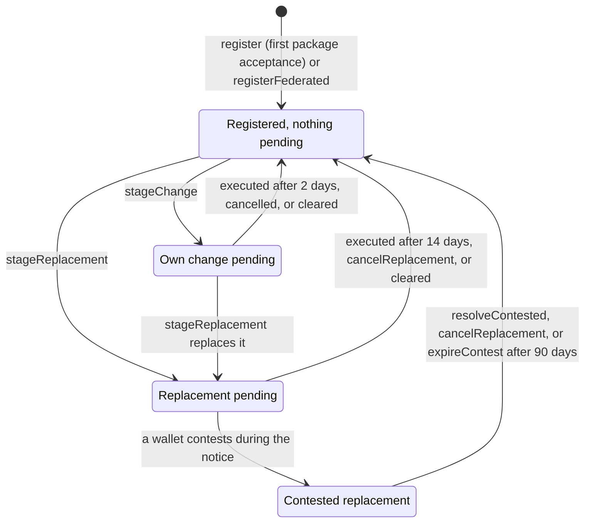

# Identity and recovery

This area answers one question for every other module: who may act for an artist or a
collaborator. An artist is a 6529 consolidated account: one root wallet plus every wallet
consolidated with it, all with the same rights. `ArtistRegistry` records each account (its
root, payout address and profile), runs the account's own changes, the network's replacement
of a root and the network's freeze, and is the permanent directory of federated contracts.
`ConsolidationAdapter` reads 6529 consolidations from the 6529 delegation contract.
This page is for auditors, integrators and whoever operates the network's identity actions.

> Pre-audit. See the [project status](../../README.md#status).

## Contracts

| Contract | Source | Interface | Responsibility |
| --- | --- | --- | --- |
| `ArtistRegistry` | [`src/identity/ArtistRegistry.sol`](../../src/identity/ArtistRegistry.sol) | [`IArtistRegistry`](../../src/interfaces/IArtistRegistry.sol), which extends [`IAccounts`](../../src/interfaces/IAccounts.sol), [`IArtistRoleResolver`](../../src/interfaces/IArtistRoleResolver.sol) and [`IArtistPayoutResolver`](../../src/economics/interfaces/IArtistPayoutResolver.sol) | Accounts, own changes, replacements, freezes, the federation directory, `isArtist` for the statement log and `payoutAddress` for split wallets. Permanent: split wallets pin it, and the consolidation source and federation registry are swapped inside it. |
| `ConsolidationAdapter` | [`src/identity/ConsolidationAdapter.sol`](../../src/identity/ConsolidationAdapter.sol) | `IConsolidationSource`, declared in [`IArtistRegistry.sol`](../../src/interfaces/IArtistRegistry.sol) | Answers `isConsolidated(root, wallet)`: a live two-way, all-collections consolidation (use case 999), no minimum age. Stateless and replaceable. |

Shared code: [`SignatureVerifier`](../../src/libraries/SignatureVerifier.sol) (ECDSA, ERC-2098,
EIP-7702 accounts and ERC-1271), [`BoundedCall`](../../src/libraries/BoundedCall.sol) (the gas
rule for every read of another contract), [`ProtocolContracts`](../../src/libraries/ProtocolContracts.sol)
(payout refusals) and the types in [`IdentityTypes.sol`](../../src/interfaces/types/IdentityTypes.sol)
and [`Typehashes.sol`](../../src/interfaces/types/Typehashes.sol).

## Concepts

### Artist ID, authority and payout

- **Artist ID.** The `uint160` of the account's first root, created by the first package
  acceptance (`register`) or by the federation registry with the wallet's own signature
  (`registerFederated`). Every address that has been the account's root maps to the ID forever
  (`artistIdOf`), so an `accountId` argument may be the ID or any current or past root. An
  address that never registered is its own single-wallet account: an unregistered collaborator
  consents with its own key, as before.
- **Root.** The wallet the consolidation is read from. `authorityOf` returns it;
  `activeAuthorityOf` returns it, or zero while the account is frozen or a replacement is
  pending. It is used where one address is needed (a sale's creator).
- **Wallets.** `isWallet(accountId, wallet)` is true for the root, and for any wallet the
  consolidation source says is consolidated with the root, read live. All are equal: any of
  them signs, cancels or contests. Nobody acts while the account is frozen or a replacement is
  pending (and has not lapsed).
- **Payout.** Where split wallets pay the account's artist-resolved share. It reads zero while
  the account is frozen and while a pending change would move it.
- **Profile.** The claimed 6529 profile ID and profile document hash, unverified (LIM-ID-13).

### Signatures

Every signature an account gives is checked here: `requireSigned(accountId, digest, proof)`,
where `proof` is `abi.encodePacked(wallet, signature)`. The wallet must act for the account now
and must have signed (`SignatureVerifier.InvalidSignature(wallet)` otherwise).
`requireConsent(accountId, what, proof)` checks a signature of
`consentDigest(msg.sender, what)`: the EIP-712 `Consent(address subject,bytes32 what)` in this
registry's domain, good only for the contract that asks. A consent has no deadline and no nonce
(owner, 17 November 2026): it holds until used or until its signing wallet leaves the account
(LIM-ID-24). Replay protection is the caller's.
The package registry checks a move signed by the root itself locally (same answer, less gas)
and asks `requireSigned` for any other wallet.

### Change kinds

| Kind | Who | Wait | Who stops it | Notes |
| --- | --- | --- | --- | --- |
| Own change (`stageChange`) | Anyone relays a wallet's `IdentityChange` signature at the current nonce | 2 days | Any wallet (`cancelChange`); the network (`cancelOwnChange`, no delay) | A new root must already be a wallet of the account, and still be one at execution. |
| Replacement (`stageReplacement`) | The network (24-hour class), with the new root's `ReplacementAcceptance` and an evidence hash | 14 days' notice | The network (`cancelReplacement`, no delay); any wallet contests during the notice | The root must change. A contested replacement runs only if the network upholds it (`resolveContested`, citing a DISPUTE_OUTCOME recorded after the contest) within 90 days of the contest; otherwise it lapses (`expireContest`). It replaces a pending own change. |

One change is pending at a time. `executeChange` is permissionless once due, and refused while
the account is frozen. Every staging consumes the change nonce; `revokeNonce` (any wallet)
burns it. A change that moves the root reserves the new root (`reservedFor`) until it ends.

### Contest and vote

A wallet of the account contests a pending replacement with `cancelChange` before its notice
ends. The network then upholds or voids it with `resolveContested`, citing the account's latest
DISPUTE_OUTCOME statement (subject: this registry and the artist ID), recorded after the
contest. Nobody resolves it within 90 days of the contest: it lapses, holds nothing, and anyone
clears it with `expireContest`.

### Freeze

`freeze(accountId)` (the network, no delay) stops the account at once for 14 days: no wallet
acts, `requireSigned` reverts, the payout reads zero (split wallets hold the money) and no
pending change executes. `unfreeze` ends it early. A freeze cannot be extended while it runs;
it can be placed again once it ended.

### Payout validation and the payout freeze

A payout is never zero, this registry, the package registry, Stream or its Editions, the split
factory or one of its wallets, or a protocol contract that cannot pull (ERC-165 through
`ProtocolContracts`). It is checked at registration, staging and execution; a predicted split
wallet with no code yet passes (LIM-ID-12). While a pending change would move the payout, or
the account is frozen, `payoutAddress` is zero. On a curated work the lead artist is paid only through its account (artist-resolved payee), so a freeze holds its payout. Collaborators may be fixed payees, and a freeze does not hold those. On federated works the freeze holds artist-resolved payees only; fixed payees chosen by the artist are paid as named.

### What the consolidation source decides

The source is replaceable code that answers, live, which wallets act for a permanent account.
That departs from the permanent rule that nothing permanent takes instruction from replaceable
code; it is what the account model needs. Its limits: the root never depends on it (a source
that reverts, answers anything but `true`, or whose code no longer matches its pinned hash is
"no" for every other wallet); replacing it is a network action at the 7-day class; a freeze
stops an account at once. Reads forward all gas: a shortfall reverts, never "no" (ID-9).

### The consolidation adapter

`ConsolidationAdapter.isConsolidated(root, wallet)` is true while each of the two holds a live
registration of the other for all collections under use case 999 (expiry later than now,
registered no later than now), reading at most four registrations per direction. There is no
minimum age. Reads forward all gas; a read that fails for any other reason counts as no
registration.

### Federation directory

- **Listing** (`listFederatedContract`, federation registry only): once per token, with a
  wallet of the account's consent to the exact facts (`FederatedListing`, through
  `requireSigned`). Refused for a delisted account, a listed token, a token without code or
  EIP-7702 delegated, and canonical contracts as token, partner or fee recipient.
- **Status** (`setFederatedStatus`, federation registry only, no artist signature): ACTIVE or
  DELISTED. A federation registry the network installs inherits every listing (C3).
- **Account delisting** (`setFederationDelisted`, the network, 24-hour class): while set, the
  account lists nothing new and every contract it listed reads DELISTED. Identity, payout and
  Stream works are untouched (C5).
- **Fee share** (`lowerFederatedFeeShare`, the network, 24-hour class): recorded at listing and
  only ever lowered; the token uses the smaller of its own share and this one (R8).

### Removed in the second pass

The standing snapshot, refreshes, captured cancellers, dormancy, the heartbeat, the guardian
veto, the governed timers and the three override kinds were removed (16 November 2026 owner
direction). Older links land here:

#### Recovery standing

Removed: every consolidated wallet acts for the account, read live.

#### Signed activity and dormancy

Removed: any wallet acts at any time; there is no dormancy wait.

#### Refreshing standing

Removed: nothing is cached, so nothing is refreshed.

## State machine

A freeze overlays any state: nobody acts and nothing executes until it ends.

| Function | Caller | Class |
| --- | --- | --- |
| `freeze`, `unfreeze`, `cancelReplacement`, `cancelOwnChange` | The network | No delay |
| `stageReplacement`, `resolveContested`, `setFederationDelisted`, `lowerFederatedFeeShare` | The network | 24 hours |
| `setConsolidationSource`, `setPackageRegistry`, `setFederationRegistry` | The network | 7 days |
| `stageChange`, `executeChange`, `expireContest` | Anyone | None |
| `cancelChange`, `revokeNonce` | A wallet of the account | None |
| `bind*` | Genesis configurator | Once |

## Rules and invariants

Test files: [`ArtistRegistry.t.sol`](../../test/identity/ArtistRegistry.t.sol) (AR),
[`AccountsGasRule.t.sol`](../../test/identity/AccountsGasRule.t.sol) (GR),
[`Accounts.invariant.t.sol`](../../test/identity/Accounts.invariant.t.sol) (INV),
[`ConsolidationAdapter.t.sol`](../../test/identity/ConsolidationAdapter.t.sol) (CA),
[`FederationDirectory.t.sol`](../../test/identity/FederationDirectory.t.sol) (FD),
[`SignatureAgility.t.sol`](../../test/identity/SignatureAgility.t.sol) (SA),
[`IdentityRecovery.t.sol`](../../test/integration/IdentityRecovery.t.sol) (IR) and
[`RecipientValidation.t.sol`](../../test/integration/RecipientValidation.t.sol) (RV).

| ID | Rule | Enforced in | Tested by |
| --- | --- | --- | --- |
| ID-1 | An artist ID is the `uint160` of its first root, created only by the bound package registry or, with the wallet's own signature, the bound federation registry. | `register`, `registerFederated`, `_create` | AR `test_Register_*`; FD `test_RegisterFederated_*` |
| ID-2 | A wallet acts for an account exactly when it is the root, or the consolidation source says it has a live two-way consolidation with the root; never while the account is frozen or a replacement is pending and unlapsed. | `isWallet`, `_blocked`, `_consolidated` | AR `test_IsWallet_*`; INV `invariant_RequireSignedPassesExactlyForTheAccountsWallets` |
| ID-3 | `requireSigned` passes only for a wallet of the account that signed the digest; `requireConsent` only for the asking contract. | `requireSigned`, `requireConsent` | AR `test_RequireSigned_*`, `test_RequireConsent_BindsTheCaller`; INV |
| ID-4 | The root never reads the consolidation source; a failing, malformed or changed source is "no" for every other wallet. | `isWallet`, `_consolidated` | AR `test_Accounts_RootNeverDependsOnTheSource`, `test_SetConsolidationSource_SwapsTheSourceWithItsPin`; GR `test_GasRule_TheRootNeverReadsTheSource` |
| ID-5 | An own change is signed by any wallet, waits 2 days, is cancelled by any wallet or by the network at once, uses a nonce once, and moves the root only to a wallet of the account (re-checked at execution). | `stageChange`, `cancelChange`, `cancelOwnChange`, `_apply` | AR `test_OwnChange_*`, `test_CancelOwnChange_ByTheNetwork`, `test_RevokeNonce_AnyWallet` |
| ID-6 | A replacement is staged only by the network with the new root's acceptance (used once), changes the root, waits 14 days, replaces an own change, and the network may withdraw it at once. | `stageReplacement`, `cancelReplacement` | AR `test_Replacement_*`, `test_CancelReplacement_ByTheNetwork` |
| ID-7 | A wallet may contest a replacement only during its notice; a contested replacement runs only if upheld by a vote recorded after the contest, within 90 days; otherwise it lapses and holds nothing. | `cancelChange`, `resolveContested`, `expireContest`, `_lapsed` | AR `test_Contest_*` |
| ID-8 | A freeze lasts 14 days, stops every wallet, zeroes the payout and holds pending changes; it cannot be extended while it runs. | `freeze`, `unfreeze`, `_blocked`, `payoutAddress`, `executeChange` | AR `test_Freeze_*`; IR `test_AFrozenAccountCannotStart` |
| ID-9 | Every read of another contract forwards all gas; a failure that leaves at most 1/8 of the gas held before it reverts with `BoundedCallShortfall`, never "no". | `_consolidated`, `isArtist`, `bindStatementLog`, `ConsolidationAdapter._live` | GR `test_GasRule_*` (the source at 1x to 100x its cost) |
| ID-10 | A payout is never one that cannot pull, checked at registration, staging and execution; `payoutAddress` is zero while frozen or while a pending change would move it. | `_payoutAllowed`, `_apply`, `payoutAddress` | AR `test_PayoutValidation_*`, `test_OwnChange_AnyWalletStagesAndAnyoneRelays`; RV |
| ID-11 | `isArtist` is true only for a wallet of a Stream work's lead account, or of an edition's master's. | `isArtist` | AR `test_IsArtist_AnyWalletOfTheLeadAccount` |
| ID-12 | A directory entry is written once per token by the federation registry, with a wallet of the account's consent to its facts, never for a delisted account or a canonical contract; status changes need no signature. | `listFederatedContract`, `setFederatedStatus` | FD `test_List_*`, `test_Status_*`, `test_Replacement_InheritsListingsWithNoArtistCall` |
| ID-13 | An account delisting covers every contract of the account and blocks new listings; identity and payout are untouched. | `setFederationDelisted`, `federatedListing` | FD `test_AccountDelisting_CoversEveryContractOfTheAccount` |
| ID-14 | A listing's recorded fee share only lowers. | `lowerFederatedFeeShare` | FD `test_FeeShare_LowersAndNeverRises` |
| ID-15 | Bindings are set once; the package registry, the federation registry and the consolidation source are swapped only by the network, compare-and-set, to checked targets. | `bind*`, `set*` | AR `test_Bindings_AreOneShotAndChecked`, `test_SetConsolidationSource_SwapsTheSourceWithItsPin`; FD `test_SetFederationRegistry_*` |
| ID-16 | A wallet can be any account `SignatureVerifier` verifies, including one that pre-approves digests (ERC-1271, EIP-7702). | `SignatureVerifier` | [`SignatureAgility.t.sol`](../../test/identity/SignatureAgility.t.sol) `test_ContractRoot_StagesByPreApproval`, `test_ContractRoot_AcceptsAReplacementByPreApproval`, `test_7702Account_PreApprovalAndECDSABothWork` |

## Events

Every change of an account is evented: `ArtistRegistered`, `ChangeStaged` (the stored change,
with its `executableAt`), `ChangeCancelled`, `ChangeExecuted`, `ChangeContested`,
`ContestResolved`, `ContestExpired`, `NonceRevoked`, `ReplacementAcceptanceConsumed`,
`AccountFrozen` (with its end), `AccountUnfrozen`, `FederatedContractListed`,
`FederatedContractStatus`, `FederationDelistedSet`, `FederatedFeeShareLowered`, and the wiring
events. Who may act also depends on consolidations, which the 6529 delegation contract logs.
A contest's lapse follows from `ChangeContested`'s block time plus 90 days.

## Failure modes and recovery

| Failure | Effect | Recovery |
| --- | --- | --- |
| The consolidation source fails or its code changed | Only roots act; other wallets read "no" | The network swaps the source (7 days) |
| A source needs more gas than a transaction carries | Non-root wallets cannot act (shortfall) | Swap the source; roots are unaffected |
| A root key is lost | Another wallet of the account moves the root to itself (2 days) | Or the network replaces the root (14 days) |
| A root key is stolen | The network freezes the account at once, then replaces the root | Any wallet can cancel the thief's own changes meanwhile |
| A mistaken replacement | The account is held for up to 14 days | The network withdraws it (`cancelReplacement`); a wallet contests it |
| A split wallet is deployed at a pending payout | Execution clears the change | Stage a new change |
