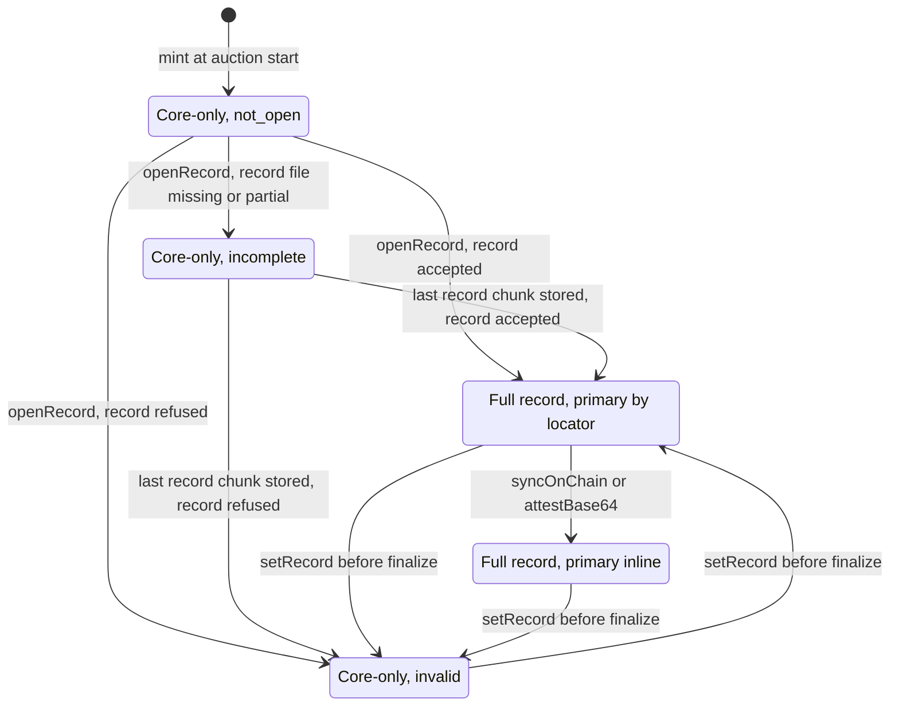
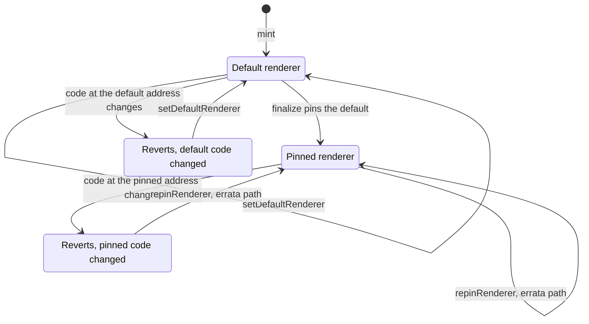
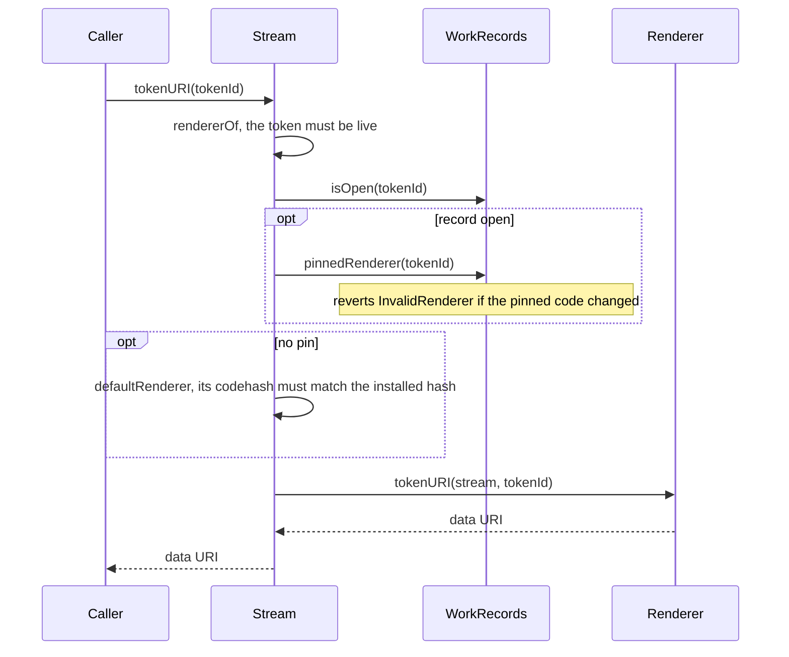
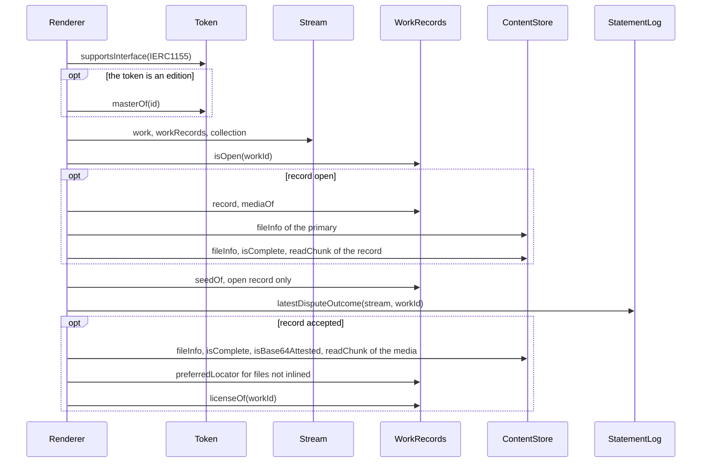
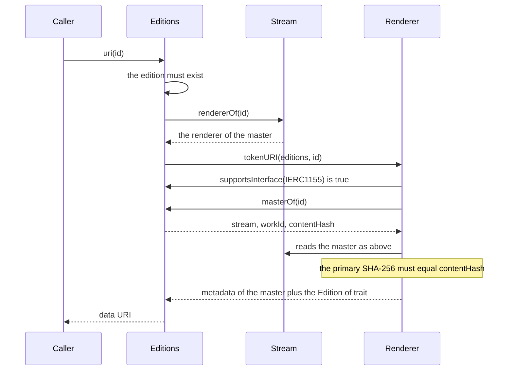
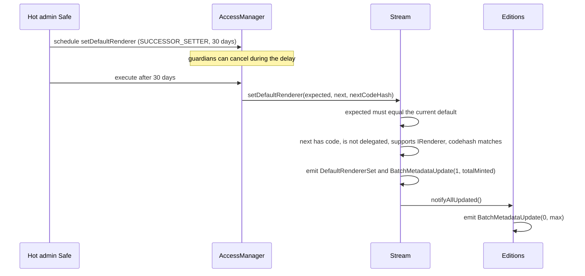

# Rendering and tokenURI

This page specifies how a 6529 Stream work and a 6529 Editions edition get their token
metadata: which renderer serves a token, what the renderer reads and how it bounds every
read, how it turns a work's descriptive record and media into a `data:` URI, when media is
inlined, and when marketplaces are told to refresh. It is written for auditors, contract
developers and anyone building a renderer. `Stream.tokenURI` and `Editions.uri` forward to
an immutable, stateless `Renderer`; `WorkRecords` holds the record, media list, license,
locators and renderer pin it reads; the content store holds the bytes. Integrators who only
read metadata should start with [Reading a work](../integrators/reading-a-work.md).

> **Status.** Pre-audit. This page describes `main` at `46941d6` (15 October 2026). The ADRs
> record how the design was decided; this page is how it works now. Where they differ, this
> page follows the code and says so under [Differences from the ADRs](#differences-from-the-adrs).

## Contracts

| Contract | Source | Interface | Responsibility |
| --- | --- | --- | --- |
| `Renderer` | [`src/content/Renderer.sol`](../../src/content/Renderer.sol) | [`IRenderer`](../../src/interfaces/IRenderer.sol) | Builds `tokenURI` and `fullTokenURI` for Stream works and Editions editions. Immutable and stateless; reads only. |
| `JsonScan` | [`src/content/JsonScan.sol`](../../src/content/JsonScan.sol) | library | Strict RFC 8259 scanner: validates the record and reports where each value sits. Never decodes, never reverts. |
| `DataUri` | [`src/content/DataUri.sol`](../../src/content/DataUri.sol) | library | Percent-escapes `%` and `#`, with a cap on how many. |
| `HtmlScript` | [`src/content/HtmlScript.sol`](../../src/content/HtmlScript.sol) | library | Neutralizes `</script` and `<!--` in a script placed in the renderer's HTML page, with a cap on `<`. |
| `JsonEscape` | [`src/libraries/JsonEscape.sol`](../../src/libraries/JsonEscape.sol) | library | Escapes strings from Stream, a locator or the store for a JSON string. |
| `Utf8` | [`src/libraries/Utf8.sol`](../../src/libraries/Utf8.sol) | library | RFC 3629 UTF-8 validation. |
| `BoundedCall` | [`src/libraries/BoundedCall.sol`](../../src/libraries/BoundedCall.sol) | library | A `staticcall` with a gas cap and a return-size cap; reverts if the caller cannot forward the full cap. |
| `Stream` | [`src/stream/Stream.sol`](../../src/stream/Stream.sol) | [`IStream`](../../src/interfaces/IStream.sol) | `tokenURI` forwarding, `rendererOf`, the default renderer and its code-hash pin, ERC-4906 events for works. |
| `WorkRecords` | [`src/stream/WorkRecords.sol`](../../src/stream/WorkRecords.sol) | [`IWorkRecords`](../../src/interfaces/IWorkRecords.sol) | Record file ID, media list, license, seed, locators and preferred locator; finalize pins the renderer; the errata repin; asks Stream and Editions for ERC-4906. |
| `Editions` | [`src/editions/Editions.sol`](../../src/editions/Editions.sol) | [`IEditions`](../../src/interfaces/IEditions.sol) | `uri` forwarding to the master's renderer, `masterOf`, ERC-4906 events for editions. |
| `ContentStore` | [`src/content/ContentStore.sol`](../../src/content/ContentStore.sol) | [`IContentStore`](../../src/interfaces/IContentStore.sol) | File manifests, chunk reads, completeness, base64 attestation. |
| `StatementLog` | [`src/records/StatementLog.sol`](../../src/records/StatementLog.sol) | [`IStatementLog`](../../src/interfaces/IStatementLog.sol) | `latestDisputeOutcome`, shown as a trait. |

## Concepts

See the [glossary](../glossary.md) for the shared vocabulary.

- **Record.** A work's descriptive record: a JSON object stored as a content-store file
  (`Identity` encoding, at most `Limits.MAX_RECORD_BYTES`, 12,288 bytes, in
  [`src/interfaces/types/Limits.sol`](../../src/interfaces/types/Limits.sol)). `WorkRecords`
  stores only its file ID. The renderer reads members `name`, `description`, `artists`,
  `year`, `medium`, `dimensions`, `attributes` and `dependencies`, validates the whole file,
  and ignores other members.
- **Record status.** Why a work shows core-only metadata: `not_open` (`openRecord` has not
  run), `incomplete` (the record file is not registered or not completely uploaded) or
  `invalid` (the record breaks a rule in [Rules and invariants](#rules-and-invariants)).
- **Core-only metadata.** What a work gets when its record cannot be shown: a name from its
  collection and serial, a fixed description, a `record_status` field and the traits Stream
  knows. Never a revert.
- **Default renderer.** `Stream.defaultRenderer`, installed with a code hash. It serves every
  work that is not finalized (including works whose record is not open) and their editions.
- **Pin.** `finalize` copies the current default renderer into the work's record
  (`RecordInfo.renderer`) and records its code hash. From then on the work's metadata comes
  from that renderer only.
- **Errata repin.** The only way to change a finalized work's pin: the artist's signature plus
  a governed action in the successor class (30 days).
- **Fail closed.** A renderer never returns plausible metadata for a token it cannot read. Every
  external read is bounded; a read that fails reverts the whole call.
- **On-chain complete.** `RecordInfo.onChainComplete`, set once by the permissionless
  `syncOnChain` when every media file is complete in the content store. On-chain bytes are
  permanent, so the flag never clears.
- **Attested.** `ContentStore.isBase64Attested(fileId)`: the store has checked a `Base64` file
  as strict base64 text once, for good (`attestBase64`, permissionless).
- **Cost-weighted size.** The stored length of a file, with an `Identity` file counted eight
  times, because the renderer must base64-encode it (about 80 gas a byte against about 10 for
  copying text that is already base64, per `Renderer._weight`).
- **Inline threshold.** `Renderer.inlineThreshold()`: the largest cost-weighted primary file
  that `tokenURI` inlines. The deployment uses `DEFAULT_INLINE_THRESHOLD`, 262,144 (256 KiB).
- **Preferred locator.** `WorkRecords.preferredLocator(tokenId, fileId)`: the one copy of a
  media file that `tokenURI` serves when it does not inline the file. An `ar://` or
  `ipfs://` content address, or none. See [Works and storage](works-and-storage.md).

## State machine

A token's metadata has two independent states: what its metadata shows, and which renderer
builds it.

### Metadata mode



- "Record refused" and "record accepted" are decided by the renderer on every call, not stored.
  A new renderer (a new default, or an errata repin) can move a work between `Invalid` and the
  full states without any record change.
- A preview image can be inlined in `ByLocator`: the preview needs only to be complete in the
  store, not the whole work on-chain complete (`Renderer._preview`).
- A burn (an upheld dispute, before the primary sale settles) ends every state: `tokenURI`
  then reverts with `UnknownWork`.

| Transition | Caller (role) | Delay | Function |
| --- | --- | --- | --- |
| Mint, core-only `not_open` | the English auction adapter at start | immediate | `Stream.mint` (through `IMintTarget`) |
| Open the record | anyone | immediate | `WorkRecords.openRecord` |
| Complete the record file | anyone | immediate | `ContentStore.registerManifest`, `writeChunk` (no ERC-4906 event) |
| Replace the record, before finalize | the artist (active authority of the lead artist ID) | immediate | `WorkRecords.setRecord` |
| Inline the primary | anyone | immediate | `WorkRecords.syncOnChain`; `ContentStore.attestBase64` for a `Base64` file (no ERC-4906 event) |
| Finalize: the record is fixed | the artist | immediate | `WorkRecords.finalize` |

### Renderer selection



| Transition | Caller (role) | Delay | Function |
| --- | --- | --- | --- |
| New default renderer | hot admin Safe (SUCCESSOR_SETTER) | successor, 30 days | `Stream.setDefaultRenderer` |
| Finalize pins the default | the artist | immediate | `WorkRecords.finalize` |
| Errata repin | hot admin Safe (SUCCESSOR_SETTER) with the artist's `RENDERER_REPIN` signature | successor, 30 days | `WorkRecords.repinRenderer` |
| Code changes at a renderer address | nobody intended; for example a contract recreated at the same CREATE2 address | n/a | detected by `Stream.rendererOf` and `WorkRecords.pinnedRenderer` (DEPS-6) |

The delay classes and role holders are in [Governance](governance.md); the 30-day figure is
`Roles.executionDelay(SUCCESSOR_SETTER)` in
[`src/governance/Roles.sol`](../../src/governance/Roles.sol) and the `setDefaultRenderer` and
`repinRenderer` rows of [`config/genesis.example.json`](../../config/genesis.example.json).

## Flows

### `Stream.tokenURI`: choosing the renderer



- **Preconditions.** The token is live (minted, not burned), else `UnknownWork`.
- **Effects.** None. `tokenURI` is a view and creates no state (asserted by
  `IntegrationBase._tokenUriMatrix` and `TokenUriBudgetTest._cold`).
- `rendererOf` never falls back from a broken pin to the default, or from a broken default to
  anything else: the call reverts (`IStream.InvalidBinding` or `IWorkRecords.InvalidRenderer`).

### Inside the renderer



- For a Stream token, `Token` and `Stream` are the same contract. Before the record is open, a
  VRF seed is read from `Stream.entropyModule()` by item hash instead of `seedOf`.
- Every arrow is one `BoundedCall` with its own gas cap and return cap (see
  [Parameters and limits](#parameters-and-limits)). Before each read the renderer requires
  `gasleft()` to cover the cap, EIP-150's 1/63 retention, `AFTER_GAS` (50,000) and
  `BoundedCall.CALL_RESERVE` (1,000), and reverts with `BoundedCallInsufficientGas` otherwise.
  The media-list read alone needs about 1.07M gas left at that point (`MEDIA_GAS` 1,000,000
  plus 15,874 plus 51,000), so a caller must supply well over the gas the call uses.
  [`deployments/11155111/flows.md`](../../deployments/11155111/flows.md) measured about 1M
  supplied for about 0.3M used on Sepolia, when `mediaOf` still shared the 300,000 cap; the
  dedicated 1,000,000 cap came later, with the adversarial-review fixes (F5).
- Media bytes are read one store chunk at a time (`readChunk`, at most 24,575 bytes and 300,000
  gas each) straight into the single output buffer; each chunk buffer is released once copied.
- **Gas.** `tokenURI` must stay at or under 8M Prague gas for every work the protocol allows
  ([ADR 0004](../adr/0004-gas-budgets-under-glamsterdam.md#the-table), decision 1). The budget
  proof, [`test/integration/TokenUriBudget.t.sol`](../../test/integration/TokenUriBudget.t.sol),
  fills every cap at once on the real stack. Its dearest row, rendered as an edition
  (`test_Budget_Edition_SpacedBefore_Zeros`), is 7.79M, and the highest figure the review of
  the proof found is 7,796,194 gas, about 2.5% under 8M
  ([content README](../../src/content/README.md#renderer), "The budget proof"). The full matrix
  is in that README; this page does not copy it.

### `Editions.uri`



- The edition ID equals the master's Stream token ID, so `rendererOf(id)` is the master's
  renderer: its pin once the master is finalized.
- The renderer recognises an edition only by ERC-165 support for `IERC1155`. It then reads the
  master's record, media, license, collection, seed and dispute status, and adds one trait,
  `Edition of`, whose value is the master's token ID.
- A mismatch between `masterOf`'s content hash and the master's primary file reverts with
  `RendererRecordInvalid` (`test_Edition_ContentHashMustMatchTheMaster`).
- The budget proof measures this path as the dearest (`test_Budget_Edition_SpacedBefore_Zeros`).

### `setDefaultRenderer`



- **Compare-and-set.** A stale `expected` reverts with `ExpectedValueMismatch`
  (`test_setDefaultRenderer_reverts` in [`test/stream/Stream.t.sol`](../../test/stream/Stream.t.sol)).
- **Checks.** `_requireRenderer`: code present, not an EIP-7702 delegated account, ERC-165 for
  `IRenderer`, and `next.codehash == nextCodeHash`; any failure is `InvalidBinding(next)`.
- **Effects.** Every work that is not finalized now renders with `next`. Finalized works keep
  their pin (`test_finalize_pinsDefaultRenderer`). The state hash of every work that is not
  finalized changes, because it commits to the effective renderer
  (`test_stateHash_changesWithDefaultRendererBeforeFinalizeOnly`), so a signature over the old
  state hash (a pending `finalize`, relicense or rate change) no longer applies.
- The batch events are skipped when nothing is minted yet and Editions is not bound
  (`test_setDefaultRenderer_quietBeforeFirstMintAndBinding`).

### Finalize and the errata repin

[Works and storage](works-and-storage.md#set-the-record-and-finalize) specifies `finalize` and
[the errata repin](works-and-storage.md#errata-repin). For rendering they mean:

- `finalize` reads the renderer through `Stream.rendererOf`, so it reverts with
  `InvalidBinding` if the default renderer's code changed
  (`test_FinalizeRefusesADefaultRendererWhoseCodeChanged`). It pins that renderer and records
  its code hash.
- `WorkRecords` keeps one code hash per renderer address, set by the first pin of that address.
  A later pin of the same address with another code hash reverts with `InvalidRenderer`
  (`_pinCode`).
- `finalize` checks the record file's structure, not its JSON. A finalized work whose record
  the pinned renderer refuses stays core-only `invalid` (see
  [Failure modes and recovery](#failure-modes-and-recovery)).
- The errata repin needs the artist's `RendererRepin` signature (`Typehashes.RENDERER_REPIN`),
  checked at execution against the active authority, so its deadline must fall after the 30-day
  delay (the integration test uses 40 days). Repinning the current renderer is a no-op; a work
  that is not finalized reverts with `WorkNotFinalized`.
- Both ask Stream for `MetadataUpdate` and, for a master with an edition, call
  `Editions.notifyMasterUpdated`.

## Rules and invariants

### Output format

The output is `data:application/json;utf8,` followed by one compact JSON object. It is not
base64: inline media is already base64 text, and encoding it again would cost gas and a third
more size. Members appear in this order; a member marked optional is left out when it has no
value.

| Member | Full record | Core-only | Value |
| --- | --- | --- | --- |
| `name` | always | always | The record's `name`; core-only: `<collection name> #<serial>` |
| `description` | always | always | The record's `description`, or `""` when absent; core-only: `The work record is not available.` |
| `image` | optional | never | See [Media selection](#media-selection) |
| `animation_url` | optional | never | See [Media selection](#media-selection) |
| `media_url` | optional | never | The primary file's preferred locator, when the primary is not inlined |
| `record_status` | never | always | `not_open`, `incomplete` or `invalid` |
| `content_type` | always | never | The primary file's MIME type from the store |
| `content_hash` | always | never | The primary's SHA-256 of the decoded media, `0x` and 64 hex digits |
| `license` | always | never | The license's SPDX identifier as stored, in its original case |
| `license_url` | optional | never | See [License fields](#license-fields) |
| `license_text_file` | optional | never | The license text's content-store file ID, `0x` and 64 hex digits |
| `attributes` | always | always | The renderer's traits, then (full record only) the record's own `attributes` elements |

The renderer writes these traits, in this order, each as `{"trait_type":...,"value":...}`:

| Trait | Written when | Value |
| --- | --- | --- |
| `Artist ID` | core-only only | The lead artist ID as a lowercase hex string, whole bytes (`Strings.toHexString(uint256)`) |
| `Artist` | full record, once per element of `artists` | The element, as the record wrote it |
| `Year` | full record with `year` | The number, as the record wrote it |
| `Medium` | full record with a non-empty `medium` | The string |
| `Dimensions` | full record with a non-empty `dimensions` | The string |
| `Collection` | the work has a collection (every Stream work does) | The collection name |
| `Serial` | the same | The serial, a number |
| `Edition of` | the token is an edition | The master's token ID, a number |
| `Seed` | the work is seeded and its seed is readable | `0x` and 64 hex digits |
| `Dispute statement` | the renderer has a statement log and `latestDisputeOutcome` is nonzero | The entry hash, `0x` and 64 hex digits |

Before the record opens, only a VRF seed can be shown (read from the entropy module); an
ARTIST seed is stored by `openRecord` and appears once the record is open, in core-only and
full metadata alike. The fallback name `6529 Works #<id>` exists for a token without a
collection, which Stream never mints (`mint` refuses an unknown collection).

### Media selection

The primary file is the first entry of `mediaOf`, which must have role `PRIMARY`. The preview
is the first `PREVIEW` entry, used only if its MIME type is `image/*`.

The primary is **inlined** when all of these hold:

- the work is on-chain complete (`RecordInfo.onChainComplete`);
- its cost-weighted size is at most the limit (`inlineThreshold()` for `tokenURI`, 1 MiB for
  `fullTokenURI`);
- `isComplete(fileId)` is true;
- its encoding can be served as the media itself:

| Stored encoding | Inlined as |
| --- | --- |
| `Base64`, attested | `data:<mime>;base64,` followed by the stored text, copied as it is |
| `Base64`, not attested | never; served by locator |
| `Identity` (not a script) | `data:<mime>;base64,` followed by the bytes, base64-encoded on-chain (counts eight times) |
| `Identity` script (`text/javascript` or `application/javascript`) | an HTML page around the script (below), as `data:text/html;base64,...`, if the script is at most 8,192 bytes (`SCRIPT_LIMIT`; `fullTokenURI` lifts this to its size limit), valid UTF-8, holds at most 1,024 `<` (`MAX_SCRIPT_LT`) and the record declares no `dependencies` |
| `Base64` or `Gzip` script, `Gzip`, `GzipBase64` | never; served by locator |

A preview is inlined by the same encoding rules when it is complete in the store and its
cost-weighted size is at most `PREVIEW_LIMIT` (65,536); it does not need the work to be on-chain
complete. `WorkRecords.openRecord` caps an `Identity` or `Base64` preview lower, at
`Limits.MAX_PREVIEW_BYTES` (16,384 stored bytes, an `Identity` file counting four times), which
is what keeps the 8M budget.

The three media members are then:

- `media_url`: the primary's preferred locator, whenever the primary is not inlined.
- An image primary (`image/*`) is the `image`: inline if inlined; otherwise the preview if there
  is one (inline or its locator); otherwise the primary's locator.
- Any other primary is the `animation_url` (inline or its locator), and the preview, if any, is
  the `image` (inline or its locator).

A locator is the satellite's `preferredLocator` answer, used as it is. A file whose answer is
kind NONE (no copy) or ONCHAIN (the implicit on-chain copy) has no URL, and the member is left
out; the renderer does not look through the list for another copy. A failed or out-of-gas
`preferredLocator` read reverts the call (decision M1).

### The page around a script

A JavaScript primary is wrapped in a fixed page:

```html
<!doctype html><html lang="en"><head><meta charset="utf-8"><meta name="viewport" content="width=device-width,initial-scale=1"><style>html,body{margin:0;height:100%;overflow:hidden}</style></head><body><script>window.works={v:1,tokenId:7,seed:"0x...64 hex digits"};</script><script>/* the artist's script */</script></body></html>
```

- `window.works` is a public, stable interface: `v` (1), `tokenId` (the rendered ID; for an
  edition, the edition ID, which equals the master's) and `seed` (`0x` hex, or `null` without a
  seed). A change to its fields needs a new `v`, which means a new renderer.
- `HtmlScript.neutralize` inserts a backslash after the `<` of every `</script` (any case) and
  every `<!--` in the artist's script. That is exact inside JavaScript strings, template
  literals and comments, and changes code elsewhere; the
  [content README](../../src/content/README.md#the-page-around-a-script) gives the cases.
- A `text/html` primary is inlined as it is, never rewritten.

### fullTokenURI

`Renderer.fullTokenURI(token, id)` is the same render with the limit raised to
`MAX_INLINE_BYTES` (1,048,576, cost-weighted: a `Base64` file up to 1 MiB, an `Identity` file
up to 128 KiB) and no fallback. It reverts with `RendererNotInlineable` for a core-only work,
and for a primary that is not on-chain complete, not complete, too large, an unattested
`Base64`, `Gzip` or `GzipBase64`, or a script it cannot wrap. It is not on Stream or Editions:
call it on `Stream.rendererOf(id)`. It has no 8M promise: 1 MiB of `Base64` costs about 30M
gas, 512 KiB about 8.4M ([content README](../../src/content/README.md#renderer); measured by
`test_FullForm_1MiB` and `test_FullForm_512KiB` in
[`RendererGas.t.sol`](../../test/content/renderer/RendererGas.t.sol)). It is meant for
`eth_call`.

### License fields

- `license` is `IWorkRecords.licenseOf(workId).spdxId`, always present in full metadata. A work
  with no stored license reads the deployment's CC0 license (`CC0-1.0` with the pinned CC0 text).
- `license_url` is `https://spdx.org/licenses/<id>.html`, in the identifier's own case, for an
  identifier made only of `A-Z a-z 0-9 . + -` that is not a `LicenseRef-` expression in any
  case. For any other license it is the preferred locator of the license text file, if the work
  lists that file among its media; otherwise it is left out.
- `license_text_file` is the license text file ID whenever the license has one.

### Rules

| ID | Rule | Enforced in | Proven by |
| --- | --- | --- | --- |
| RND-1 | A token is served by its pinned renderer once finalized, else by the default renderer; never by any other. | `Stream.rendererOf` | [`Stream.t.sol`](../../test/stream/Stream.t.sol) `test_setDefaultRenderer`; [`WorkRecords.t.sol`](../../test/stream/WorkRecords.t.sol) `test_finalize_pinsDefaultRenderer` |
| RND-2 | A renderer whose code is no longer the code hash it was installed or pinned with is refused at every use; `tokenURI` and `uri` revert instead of falling back (DEPS-6). | `Stream.rendererOf`, `WorkRecords.pinnedRenderer` | [`RendererCodePin.t.sol`](../../test/integration/RendererCodePin.t.sol) `test_DefaultRendererWithChangedCodeIsRefused`, `test_PinnedRendererWithChangedCodeIsRefused` |
| RND-3 | Finalize pins the default only while its code is unchanged; an address is pinned with one code hash for good. | `WorkRecords.finalize`, `_pinCode` | `RendererCodePin.t.sol` `test_FinalizeRefusesADefaultRendererWhoseCodeChanged`, `test_RepinRefusesARendererWhoseCodeChangedSincePinned` |
| RND-4 | A new default renderer must have code, not be an EIP-7702 delegated account, support `IRenderer` by ERC-165 and match the given code hash; the setter is compare-and-set and SUCCESSOR_SETTER (30 days). | `Stream.setDefaultRenderer`, `_requireRenderer` | `Stream.t.sol` `test_setDefaultRenderer_reverts`, `test_constructor_pinsRendererCodeHash` |
| RND-5 | The errata repin needs a finalized work, the same renderer checks, the current state hash, an unexpired deadline and the artist's signature by the active authority, plus SUCCESSOR_SETTER (30 days). | `WorkRecords.repinRenderer` | `WorkRecords.t.sol` `test_repinRenderer_errataPath`, `test_repinRenderer_reverts`, `test_repinRenderer_samePinIsNoOp` |
| RND-6 | Every external read is a bounded `staticcall` with its own gas and return cap; a failed read reverts (`RendererReadFailed`, or `BoundedCallFailed` and `BoundedCallMalformedReturn` for a chunk). | `Renderer._read`, `_copyFile`, `BoundedCall` | [`RendererHostile.t.sol`](../../test/content/renderer/RendererHostile.t.sol) `test_Token_ReturnDataBombsAndGasBurnersFailClosed`, `test_Store_ARevertingOrOversizedChunkReadFailsClosed`; [`Renderer.t.sol`](../../test/content/renderer/Renderer.t.sol) `test_FailsClosed_EveryReadOfTheStreamAndRecords` |
| RND-7 | Too little gas to forward a read's full cap reverts with `BoundedCallInsufficientGas`; it is never reported as a failed or empty read. | `BoundedCall.tryRead` | `RendererHostile.t.sol` `test_NotEnoughGasRevertsInsteadOfMisreporting` |
| RND-8 | A store chunk must have the length the layout rule gives, or the call reverts. | `Renderer._copyFile` | `RendererHostile.t.sol` `test_Store_ChunksOfTheWrongLengthRevert` |
| RND-9 | A record that is not open, not registered or not complete, or not acceptable gives core-only metadata with `record_status`, never a revert; `fullTokenURI` reverts for it. | `Renderer._render`, `_record`, `_coreOnly` | `Renderer.t.sol` `test_CoreOnly_UntilTheRecordIsOpen`, `test_CoreOnly_WhenTheRecordFileIsNotCompleteYet`, `test_Record_NotAFileTheStoreKnowsIsIncomplete`, `test_Record_MalformedRecordsFallBackToCoreOnly` |
| RND-10 | A record is acceptable only if it is `Identity`, at most 12,288 bytes, valid UTF-8, holds at most 512 `%` and `#`, and passes `JsonScan.object` (RFC 8259 object; no backslash in a key; no `\u0000`, lone surrogate or bad hex digit; numbers of at most 24 bytes and two exponent digits; at most 1,024 units and 8 levels; no duplicate of a member the renderer reads). | `Renderer._record`, `JsonScan` | `Renderer.t.sol` `test_Record_MustBeAnIdentityFileWithinTheSizeLimit`, `test_Record_OneByteOverTheLimitIsInvalid`, `test_Record_NestingBeyondTheLimitFallsBack`, `test_Record_DuplicatedMembersFallBack`; [`RendererReview.t.sol`](../../test/content/renderer/RendererReview.t.sol) `test_M3_AKeyWithAnEscapeMakesTheRecordInvalid`, `test_M4_NulAndLoneSurrogatesMakeTheRecordInvalid`, `test_N1_ARecordWithABadHexDigitIsInvalid`, `test_N2_ANumberOutOfRangeIsInvalid`, `test_H2_AtMostTheCapOfJsonValues`, `test_H2_AtMostTheCapOfPercentAndHashEscapes`; [`JsonScan.t.sol`](../../test/content/renderer/JsonScan.t.sol) `testFuzz_AgreesWithSerdeJson` |
| RND-11 | `name` is a non-empty string; `description`, `medium` and `dimensions` are strings if present; `artists` is an array of at most 16 non-empty strings; `year` is an integer of at most six digits with an optional minus. | `Renderer._describe`, `_year` | `Renderer.t.sol` `test_Record_WrongTypesAndMissingNameAreRejected`, `test_Record_TooManyArtistsFallBack`; `RendererReview.t.sol` `test_H2_TheYearIsAnIntegerOfAtMostSixDigits` |
| RND-12 | `attributes` is an array of at most 32 objects with only the keys `trait_type`, `value`, `display_type` and `max_value`, each at most once; `trait_type` is a string and `value` a string or number. | `Renderer._attributes`, `JsonScan.records` | `RendererReview.t.sol` `test_H2_AtMostTheCapOfAttributes`, `test_N3_ADuplicatedAttributeMemberIsInvalid`; `Renderer.t.sol` `test_Record_NumbersAndStringsAsAttributeValues` |
| RND-13 | A record `trait_type` is printable ASCII, has no backslash and no two spaces in a row, and is none of the renderer's ten trait names in any case or spacing (`Artist`, `Artist ID`, `Year`, `Medium`, `Dimensions`, `Collection`, `Serial`, `Edition of`, `Seed`, `Dispute statement`). | `Renderer._reserved` | `RendererReview.t.sol` `test_L2_ARecordCannotUseARendererTraitName`, `test_TraitNames_ReservedInAnyCaseAndSpacing`, `test_TraitNames_ArePrintableAscii`, `test_L2_TheReservedNamesAreExactlyTheOnesTheRendererWrites`; [`RendererOracles.t.sol`](../../test/content/renderer/RendererOracles.t.sol) `test_TraitNamesFollowTheRule` |
| RND-14 | The renderer's traits come first; the record's attributes follow, copied as they are. | `Renderer._tail` | `Renderer.t.sol` `test_Record_AttributesAreCopiedAfterTheRenderersOwnTraits` |
| RND-15 | Record text is copied as validated JSON, never decoded; every string from Stream, a locator or the store is checked as UTF-8 and escaped by `JsonEscape`; the whole output is percent-escaped for `%` and `#`. | `Renderer._record`, `_str`, `DataUri.escape` | `Renderer.t.sol` `test_Record_PercentAndHashInRecordStringsSurviveTheUri`, `test_Escaping_RecordStringsWithSpecials`, `testFuzz_Escaping_AnyValidText`, `test_InvalidUtf8_InLicenseCollectionAndLocator`; `RendererReview.t.sol` `test_E6_PercentAndHashInStreamAndSatelliteStringsAreEscaped` |
| RND-16 | The media list must start with a `PRIMARY` file, and an edition's content hash must be its master's primary SHA-256, or the call reverts with `RendererRecordInvalid`. | `Renderer._loadRecord` | `Renderer.t.sol` `test_FailsClosed_ThePrimaryMediaFileIsRequired`, `test_Edition_ContentHashMustMatchTheMaster` |
| RND-17 | A primary is inlined only when the work is on-chain complete, the file is complete, and its cost-weighted size is at most the limit (inclusive). | `Renderer._primary`, `_weight` | [`RendererMedia.t.sol`](../../test/content/renderer/RendererMedia.t.sol) `test_Locator_NotOnChainCompleteIsNotInlined`, `test_Locator_AMissingChunkFallsBackToTheLocator`, `test_Inline_TheThresholdIsInclusive`, `test_Inline_AnIdentityFileCountsEightTimes` |
| RND-18 | `Base64` text is copied only once attested; `Gzip` and `GzipBase64` are never inlined. | `Renderer._inline` | `RendererMedia.t.sol` `test_Base64_AFileThatIsNotStrictBase64IsNeverCopied`, `test_Base64_AValidFileIsCopiedOnlyOnceAttested`, `test_Base64_AnUnattestedPreviewIsNotInlined`, `test_Locator_GzipFilesAreNeverInlined`; [`ContentToTokenURI.t.sol`](../../test/integration/ContentToTokenURI.t.sol) `test_UnattestedBase64IsNotInlined` |
| RND-19 | A script is wrapped only if `Identity`, UTF-8, within its size limit, at most 1,024 `<`, and without declared `dependencies`; `</script` and `<!--` are neutralized. | `Renderer._inline`, `_shell`, `HtmlScript.neutralize` | `RendererMedia.t.sol` `test_Script_IsWrappedInAPageThatSetsWindowWorks`, `test_Script_NeutralizesScriptEndAndCommentOpen`, `test_Script_MoreThanTheCapOfLtIsServedByLocator`, `test_Script_ADeclaredDependencyIsServedByLocatorNotWrapped`, `test_Script_NotInlinedUnlessIdentityStoredUtf8AndSmall`; `RendererOracles.t.sol` `test_NeutralizeMatchesTheTokenizerCheckedMirror` |
| RND-20 | The preferred locator is used as the satellite answers it; NONE and ONCHAIN give no URL; a failed read reverts. | `Renderer._locator` | `RendererMedia.t.sol` `test_Locator_AnOnChainPreferenceGivesNoUrl`, `test_Locator_KindNoneGivesNoMediaField`, `test_Locator_AFailedReadFailsClosed`; `RendererReview.t.sol` `test_M1_APreferredLocatorThatRunsOutOfGasFailsClosed` |
| RND-21 | `fullTokenURI` inlines up to 1 MiB cost-weighted and reverts instead of falling back. | `Renderer.fullTokenURI`, `_primary` | `RendererMedia.t.sol` `test_Full_InlinesWhatTheCompactFormMustNot`, `test_Full_RevertsWhenThePrimaryCannotBeInlined`, `test_Full_TheOneMebibyteLimitIsInclusive` |
| RND-22 | An edition renders its master's record, media and license, plus `Edition of`; its dispute status is its master's. | `Renderer._load`, `_chainTraits` | `Renderer.t.sol` `test_Edition_RendersTheMastersWorkAsAnEdition`, `test_Dispute_ReadsTheMastersSubjectForAnEdition`; [`MasterEdition.t.sol`](../../test/integration/MasterEdition.t.sol) `test_EditionRendersItsMastersMetadata` |
| RND-23 | The dispute status is `latestDisputeOutcome(stream, workId)`, shown as `Dispute statement` when nonzero; a renderer with no log shows none; a broken log reverts. | `Renderer._chainTraits` | `Renderer.t.sol` `test_Dispute_ShownWhenTheLogHasAnOutcome`, `test_Dispute_NoLogConfiguredMeansNone`, `test_Dispute_ABrokenLogFailsClosed` |
| RND-24 | `license_url` is the SPDX page only for an SPDX identifier that is not `LicenseRef-`; otherwise the text file's locator, if listed among the media. | `Renderer._licenseUrl` | `Renderer.t.sol` `test_License_UrlIsTheSpdxPageInTheOriginalCase`, `test_License_NoUrlForALicenseRefInAnyCaseOrAnEmptyId`; `RendererReview.t.sol` `test_L1_TheLicenseUrlComesOnlyFromAnSpdxIdentifier`, `test_L4_ALicenseRefGivesItsTextFileAndALocatorOfIt`, `test_L4_WithoutAListedFileOrALocatorThereIsNoUrl` |
| RND-25 | The threshold is between 1 and 1,048,576. | `Renderer` constructor | `Renderer.t.sol` `test_Constructor_RejectsBadThresholds` |
| RND-26 | `tokenURI` and `Editions.uri` cost at most 8M Prague gas with every cap at once, and create no state. | the caps above, `Stream.createCollection` (no control characters, `<`, `"` or `\`), `WorkRecords.openRecord` (preview cap) | [`TokenUriBudget.t.sol`](../../test/integration/TokenUriBudget.t.sol) `test_Budget_*`, `test_CollectionName_RefusesBytesThatEscapeLong`, `test_PreviewCap_OpenRecordRefusesALargerPreview`; `RendererGas.t.sol` (`RendererGasBudgetTest`, `RendererGasAdversarialTest`) |
| RND-27 | Every visible change to a work's metadata made through `WorkRecords` or Stream emits ERC-4906 on Stream and, for a master with an edition, on Editions (exceptions under [Events](#events)). | `WorkRecords._refresh`, `_refreshAll`, `Stream.setDefaultRenderer` | `WorkRecords.t.sol` `test_preferenceSetters_eventsAndRefresh`, `test_preferenceSetters_notifyAllEditions`; [`Editions.t.sol`](../../test/editions/Editions.t.sol) `test_NotifyMasterUpdated_EmitsForEditionsOnly`, `test_NotifyAllUpdated_StreamOrWorkRecords`; `Stream.t.sol` `test_emitMetadataUpdate_fromRecords` |

## Events

The renderer emits nothing; it is a view. These events tell indexers and marketplaces that
metadata changed.

| Event | Contract | Emitted when | Notes |
| --- | --- | --- | --- |
| `MetadataUpdate(tokenId)` | Stream | `WorkRecords` asks through `emitMetadataUpdate(id, id)` after `openRecord`, `setRecord`, `finalize`, `syncOnChain` (on completion), `relicense`, a royalty-rate change, `repinRenderer`, `addLocator` and `setFilePreference`; and `linkEdition` | ERC-4906. Only the bound `WorkRecords` may call `emitMetadataUpdate`. |
| `BatchMetadataUpdate(1, totalMinted)` | Stream | `setDefaultRenderer`; `WorkRecords.setPreferredKind` and `setCollectionPreferredKind` | Covers burned IDs too, harmlessly. Not emitted while nothing is minted. A preference change with exactly one token minted emits `MetadataUpdate(1)` instead (`Stream.emitMetadataUpdate`). |
| `MetadataUpdate(editionId)` | Editions | `createEdition`; `notifyMasterUpdated` (from `WorkRecords._refresh`, only if the edition exists); an edition royalty-rate change | ERC-4906 |
| `BatchMetadataUpdate(0, type(uint256).max)` | Editions | `notifyAllUpdated`, from `Stream.setDefaultRenderer` or `WorkRecords._refreshAll` | Every edition |
| `DefaultRendererSet(previous, next, codeHash)` | Stream | constructor and `setDefaultRenderer` | `codeHash` is the pinned hash |
| `WorkFinalized(tokenId, renderer, stateHash)` | WorkRecords | `finalize` | `renderer` is the pin |
| `RendererRepinned(tokenId, previous, next, codeHash)` | WorkRecords | `repinRenderer` | The public event of the errata path |
| `WorkOnChainComplete(tokenId)` | WorkRecords | `syncOnChain` finds every media file complete | Inline media becomes possible |
| `Base64Attested(fileId)` | ContentStore | the last `attestBase64` call for a file | No ERC-4906: the store does not know which works list the file |
| `ChunkWritten(chunkHash, pointer, length)`, `ManifestRegistered(fileId, ...)` | ContentStore | a new chunk is stored; a new manifest is registered | No ERC-4906 |
| `StatementAppended(...)` | StatementLog | a statement is appended | A `DISPUTE_OUTCOME` entry changes the `Dispute statement` trait; no ERC-4906 |

**Metadata that changes without ERC-4906.** Three changes are visible in `tokenURI` but emit no
metadata event, because the contract that changes does not know the works affected:

- a record file or a preview image becoming complete in the store, by its last chunk upload
  or by a manifest registered after its chunks (`incomplete` becomes the full record or
  `invalid`; the preview becomes inline);
- `attestBase64` on a primary or preview file (locator becomes inline, for an on-chain complete
  work);
- a new `DISPUTE_OUTCOME` statement about the token, or about the package item it was minted
  from (`latestDisputeOutcome` falls back to the item subject).

A renderer whose code changed makes `tokenURI` revert, also without an event. See
[Events and indexing](../integrators/events-and-indexing.md) for how an indexer follows these.

## Failure modes and recovery

| Failure | Effect | Recovery |
| --- | --- | --- |
| The default renderer's code changed | Every work that is not finalized, and its edition, reverts with `InvalidBinding(renderer)`; `finalize` reverts too | SUCCESSOR_SETTER installs a new default (`setDefaultRenderer`, 30 days) |
| A finalized work's pinned renderer's code changed | That work's `tokenURI` and its edition's `uri` revert with `InvalidRenderer(renderer)` | Errata repin to a renderer with unchanged code (artist signature plus SUCCESSOR_SETTER, 30 days). If the artist's key is lost, the artist first recovers the authority through the artist registry, then signs |
| A dependency read fails (no code, revert, out of its gas cap, too much return data) | `RendererReadFailed(target, selector)`; a failed chunk read reverts with `BoundedCallFailed` or `BoundedCallMalformedReturn` | The renderer is immutable, and its content store and statement log are fixed at construction: a broken one of those needs a new renderer (a new default, or an errata repin for a finalized work) |
| The caller supplied too little gas | `BoundedCallInsufficientGas(gasLimit)` | Supply more gas (see [Inside the renderer](#inside-the-renderer)) |
| The record is not open | Core-only, `not_open` | Anyone calls `openRecord` with the approved item and media |
| The record file is not registered or not completely uploaded | Core-only, `incomplete` | Anyone registers the manifest and uploads the chunk |
| The record is refused | Core-only, `invalid` | Before finalize, the artist calls `setRecord` with a valid record. After finalize the record is fixed: only an errata repin to a renderer that accepts it changes the output |
| The media list does not start with `PRIMARY`, or an edition's hash is not its master's | Reverts with `RendererRecordInvalid` | Not reachable through `WorkRecords` and `Editions`, which enforce both; a renderer does not paper over a broken invariant |
| A string from Stream, a locator or the store is not UTF-8 | Reverts with `RendererInvalidUtf8` | Not reachable through the deployed contracts: `createCollection` checks UTF-8, locators are ASCII content addresses, MIME types are lowercase ASCII |
| The primary is not inlineable | `tokenURI` serves the preferred locator, and a preview | Anyone uploads the missing chunks and calls `syncOnChain`; anyone attests a `Base64` file; the artist (before finalize) or PLATFORM adds a locator |
| The primary is over the threshold and has no ARWEAVE or IPFS locator | No `image`, `animation_url` or `media_url` for the primary (an on-chain complete file's implicit ONCHAIN locator has no URL) | `fullTokenURI` up to 1 MiB, or the content store's chunked reads; PLATFORM registers a locator |
| `fullTokenURI` cannot inline the work | Reverts with `RendererNotInlineable(token, id)` | Use `tokenURI` and the locator, or read the content store |

## Parameters and limits

| Parameter | Value | Source |
| --- | --- | --- |
| `tokenURI` gas budget | 8,000,000 Prague gas | [ADR 0004](../adr/0004-gas-budgets-under-glamsterdam.md#the-table) decision 1; `TOKEN_URI_BUDGET` in `test/integration/IntegrationBase.sol` |
| Worst measured `tokenURI` | 7,796,194 gas, the highest the review of the budget proof found; the proof's dearest row is `Editions.uri` at 7.79M | `TokenUriBudget.t.sol`; [content README](../../src/content/README.md#renderer) |
| Inline threshold | `DEFAULT_INLINE_THRESHOLD`, 262,144 cost-weighted bytes; the deployment passes it | `Renderer.DEFAULT_INLINE_THRESHOLD`; `RENDERER_INLINE_THRESHOLD` in [`script/DeployV1.sol`](../../script/DeployV1.sol) |
| Allowed thresholds | 1 to 1,048,576 | `Renderer` constructor |
| `Identity` weight | 8 times its stored length | `Renderer._weight` |
| `fullTokenURI` limit | 1,048,576 cost-weighted bytes | `MAX_INLINE_BYTES` (internal) |
| Preview limit, renderer | 65,536 cost-weighted bytes | `PREVIEW_LIMIT` (internal) |
| Preview limit, at `openRecord` | 16,384 stored bytes, `Identity` counting 4 times | `Limits.MAX_PREVIEW_BYTES` |
| Script page size, `tokenURI` | 8,192 stored bytes | `SCRIPT_LIMIT` (internal) |
| `<` in a wrapped script | at most 1,024 | `MAX_SCRIPT_LT` (internal) |
| `window.works` version | 1 | `SHELL_HEAD` |
| Record size | 12,288 bytes, `Identity` | `Limits.MAX_RECORD_BYTES` |
| Artists per record | 16 | `Limits.MAX_ARTISTS` |
| Attributes per record | 32 | `MAX_ATTRIBUTES` (internal) |
| `%` and `#` per record | 512 | `MAX_ESCAPES` (internal) |
| JSON units (values, keys, escapes) | 1,024 | `JsonScan.MAX_VALUES` |
| JSON nesting | 8 levels | `JsonScan.MAX_DEPTH` |
| JSON number | at most 24 bytes, exponent at most 2 digits | `JsonScan` |
| `year` | integer, at most 6 digits, optional minus | `Renderer._year` |
| Media files per work | 32 | `Limits.MAX_MEDIA_FILES` |
| Locators per file | 16 | `Limits.MAX_LOCATORS_PER_FILE` |
| Collection name | 1 to 256 bytes of UTF-8, no control characters, `<`, `"` or `\` | `Stream.MAX_NAME_BYTES`, `createCollection` |
| Read gas caps | 300,000 (`SMALL_GAS`, most reads); 1,000,000 (`MEDIA_GAS`, `mediaOf`); 300,000 (`CHUNK_GAS`, `readChunk`); 700,000 (`COMPLETE_GAS`, `isComplete`) | `Renderer` (private) |
| Gas kept after each read | 50,000 (`AFTER_GAS`) plus 1,000 (`BoundedCall.CALL_RESERVE`) | `Renderer`, `BoundedCall` |
| Return caps | 4,096 bytes (`collection`); 2,304 (`preferredLocator`, `Limits.MAX_URI_BYTES` plus 256); 3,136 (`mediaOf`, 64 plus 96 per file); 512 (`fileInfo`); 288 (`work`); 256 (`record`, `licenseOf`); 96 (`masterOf`); 64 (`seedOf`); 32 (every one-word read); 24,575 (`readChunk`, `SSTORE2.MAX_CHUNK_LENGTH`) | `Renderer` |
| Default renderer and errata repin delay | successor class, 30 days | `Roles.executionDelay(SUCCESSOR_SETTER)` |

## Differences from the ADRs

- **What is inlined.** [ADR 0001 §8](../adr/0001-v1-scope.md#8-works-content-and-storage)
  says media of 256 KB or less is inlined once the work is on-chain complete. The code inlines
  by cost-weighted size: attested `Base64` up to 256 KiB, `Identity` only up to 32 KiB, `Gzip`
  and `GzipBase64` never, and a script only through the HTML page. [ADR 0003, "Rendering
  inline media"](../adr/0003-build-time-decisions.md#token-model-and-storage-amends-adr-0001-4-and-8)
  decided this. A preview image is inlined as soon as the preview file is complete, without the
  work being on-chain complete; neither ADR says so.
- **The bounded read.** ADR 0001 §8 asks for a bounded read that allows at least the inline
  threshold. The code never reads a whole file in one call: it reads one chunk at a time, each
  capped at 24,575 bytes and 300,000 gas, into the output buffer.
- **The mirror URL.** ADR 0001 §8 gives "a mirror URL" between 256 KB and 1 MB. The URL is a
  bare content address (`ar://` or `ipfs://`), per ADR 0003 "Locator kinds", and a file with
  no such locator gets no media member at all.
- **Preferred-location order.** ADR 0001 §8 lists global, collection, file. The renderer uses
  `WorkRecords.preferredLocator`, where the most specific setting wins (file, collection,
  global, first registered, implicit on-chain), as ADR 0003 amended.
- **The escape cap.** [ADR 0003, "Decisions from
  integration"](../adr/0003-build-time-decisions.md#decisions-from-integration-11-october-2026-later)
  says keys, values and escapes share a 1,024-unit budget "with at most 512 escapes". In the
  code the 512 bounds `%` and `#` characters (`MAX_ESCAPES`); JSON backslash escapes count only
  against the 1,024 units.
- **Scripts in `fullTokenURI`.** ADR 0003 says larger scripts are served "in full by
  `fullTokenURI`". The code wraps a script there only up to 128 KiB (an `Identity` file counts
  eight times against 1 MiB), and only if it is UTF-8, has at most 1,024 `<` and declares no
  dependencies; otherwise `fullTokenURI` reverts.
- **The ADR 0004 table.** Its `tokenURI` row ("at most 2,733,567") covers the size matrix
  (`test_Gas_TokenURIBySize`) only. The worst case with every cap at once is the budget proof,
  7.80M, under the same 8M budget.

## References

- Code: [`Renderer.sol`](../../src/content/Renderer.sol),
  [`IRenderer.sol`](../../src/interfaces/IRenderer.sol),
  [`JsonScan.sol`](../../src/content/JsonScan.sol), [`DataUri.sol`](../../src/content/DataUri.sol),
  [`HtmlScript.sol`](../../src/content/HtmlScript.sol),
  [`JsonEscape.sol`](../../src/libraries/JsonEscape.sol), [`Utf8.sol`](../../src/libraries/Utf8.sol),
  [`BoundedCall.sol`](../../src/libraries/BoundedCall.sol),
  [`Stream.sol`](../../src/stream/Stream.sol) (`tokenURI`, `rendererOf`, `setDefaultRenderer`),
  [`WorkRecords.sol`](../../src/stream/WorkRecords.sol) (`finalize`, `pinnedRenderer`,
  `repinRenderer`, `preferredLocator`, `_refresh`),
  [`Editions.sol`](../../src/editions/Editions.sol) (`uri`, `masterOf`, `notifyMasterUpdated`,
  `notifyAllUpdated`), [content README](../../src/content/README.md#renderer).
- ADRs: [ADR 0001 §8](../adr/0001-v1-scope.md#8-works-content-and-storage) and
  [§10](../adr/0001-v1-scope.md#10-permanence);
  [ADR 0003](../adr/0003-build-time-decisions.md#token-model-and-storage-amends-adr-0001-4-and-8);
  [ADR 0004](../adr/0004-gas-budgets-under-glamsterdam.md#the-table).
- Tests: [`test/content/renderer/`](../../test/content/renderer),
  [`TokenUriBudget.t.sol`](../../test/integration/TokenUriBudget.t.sol),
  [`RendererCodePin.t.sol`](../../test/integration/RendererCodePin.t.sol),
  [`ContentToTokenURI.t.sol`](../../test/integration/ContentToTokenURI.t.sol),
  [`MasterEdition.t.sol`](../../test/integration/MasterEdition.t.sol),
  [`RecordAmendments.t.sol`](../../test/integration/RecordAmendments.t.sol).
- Measurements: [`deployments/11155111/flows.md`](../../deployments/11155111/flows.md)
  (`tokenURI` on Sepolia).
- Related pages: [Works and storage](works-and-storage.md),
  [Editions and sales](editions-and-sales.md), [Disputes and statements](disputes-and-statements.md),
  [Governance](governance.md), [Identity and recovery](identity-and-recovery.md),
  [Reading a work](../integrators/reading-a-work.md),
  [Events and indexing](../integrators/events-and-indexing.md).
