# Stream and auctions

6529 Stream is one shared ERC-721, `Stream`, holding every curated 1/1 work; its only primary
sale is one shared English auction, `EnglishAuction`. Anyone may start a work's auction, which
mints the work into the auction's custody for a package item consumed in the same call and opens
its clock (24 hours at launch). Anyone may settle once the clock runs out: the winner receives the
work and the seller wallet and fee recipient are paid; with no bid the work goes to the 6529
Network Museum (D140, [ADR 0005](../adr/0005-stream-editions-auction.md)); any other token's
work, federated or listed, goes to its artist.
For auditors, integrators and contributors.

> Pre-audit. See the [project status](../../README.md#status).

## Contracts

| Contract | Source | Interface | Responsibility |
| --- | --- | --- | --- |
| `Stream` | [`src/stream/Stream.sol`](../../src/stream/Stream.sol) | [`IStream`](../../src/interfaces/IStream.sol), [`IMintTarget`](../../src/interfaces/IMintTarget.sol); ERC-721, ERC-2981, ERC-4906 | The core token, "6529 Stream" (`STREAM`): mints a work per consumed item, token IDs and serials, terms locked at mint, `royaltyInfo`, primary settlement, burn after an upheld dispute, the edition link, marketplace owner and contract URI; forwards `tokenURI` to the work's renderer. |
| `EnglishAuction` | [`src/sales/EnglishAuction.sol`](../../src/sales/EnglishAuction.sol) | [`IEnglishAuction`](../../src/interfaces/IEnglishAuction.sol), [`ISaleAdapter`](../../src/interfaces/ISaleAdapter.sol), `IERC721Receiver` | Permissionless start, bids with an anti-snipe extension, pull credits, settlement with bounded delivery and payouts, the emergency start pause, the per-auction dispute pause, the currency freeze, and the governed auction parameters. |
| `EnglishAuctionLens` | [`src/sales/EnglishAuctionLens.sol`](../../src/sales/EnglishAuctionLens.sol) | (answers the auction's views of `IEnglishAuction` and `ISaleAdapter`) | The auction's read side, created by its constructor (`EnglishAuction.lens()`, immutable): every view the auction does not declare, forwarded to it by the auction's read-only `staticcall` fallback and answered byte for byte as before (AUC-34). |
| `SpdxId` | [`src/stream/SpdxId.sol`](../../src/stream/SpdxId.sol) | none | The license-ID rule Stream applies at mint: 1 to 64 bytes of `[A-Za-z0-9.+-]`. |
| Sale types | [`src/interfaces/types/SaleTypes.sol`](../../src/interfaces/types/SaleTypes.sol) | none | `SaleKind`, `PaymentMethod`, `Payment`, `PrimaryTerms`, `LockedTerms`. |

Collaborators have their own pages: `PackageRegistry` ([Curation](curation.md)); `ArtistRegistry`
([Identity and recovery](identity-and-recovery.md)); `EconomicsResolver`, `SplitFactory`,
`AssetAllowlist` and `RevenueEscrow` ([Economics and payouts](economics-and-payouts.md));
`VrfEntropyModule` ([Entropy](entropy.md)); `StatementLog`
([Disputes and statements](disputes-and-statements.md)).

**Governed dependencies (owner decision 16).** Stream's package registry, artist registry,
economics resolver and entropy module are replaceable by governance: `setDependency(kind,
expected, next)`, SUCCESSOR_SETTER in the 30-day class, compare-and-set, with the
constructor's install checks (code, no EIP-7702 delegation, ERC-165 for the kind's interface;
never zero, so an entropy module can be installed on a Stream deployed without one but never
removed). The genesis contracts stay immutables; a replacement is stored with a bit in the
counter word every mint reads, so a mint with no replacement reads no extra slot. Stream's code and address stay immutable, and existing tokens are unaffected: their
owners, the terms and royalty receiver locked at mint (the split factory stays immutable), a
finalized work's pinned renderer, and a VRF work's seed, which comes from the entropy module the
work minted under (`entropyModuleOf`, [ENT-18](entropy.md#rules-and-invariants)). 6529 Stream
Editions and `WorkRecords` read these pointers from Stream, so they follow at once. Other
contracts hold their own wiring to the same contracts (the package registry's artist registry
and one-shot `bindStream`, the artist registry's `register` caller (governed:
`setPackageRegistry`), the entropy
module's pinned package registry, the English auction's and the edition auction's economics
resolver, the split factory's payout resolver): replacing a dependency in Stream does not reach
them, so a replacement is a set that governance plans with them
([the procedure](../../script/README.md#replacing-one-of-streams-dependencies),
[LIM-GV-16](../audit/known-limitations.md#trust-and-governance)).

## Concepts

The [glossary](../glossary.md) defines the terms this page relies on: [work](../glossary.md#work),
[collection](../glossary.md#collection), [serial](../glossary.md#serial),
[admitted minter](../glossary.md#admitted-minter), [sale ID](../glossary.md#sale-id),
[seller wallet](../glossary.md#seller-wallet), [royalty wallet](../glossary.md#royalty-wallet),
[locked terms](../glossary.md#lockedterms), [opening bid](../glossary.md#opening-bid),
[increment floor](../glossary.md#increment-floor), [anti-snipe](../glossary.md#anti-snipe),
[credit](../glossary.md#credit), [pending delivery](../glossary.md#pending-delivery),
[keeper](../glossary.md#keeper), [active authority](../glossary.md#active-authority),
[restraint](../glossary.md#restraint), [dispute pause](../glossary.md#dispute-pause),
[pause](../glossary.md#pause) and [delay class](../glossary.md#delay-class). What this page
adds:

- **One sale per token, ever.** Token IDs are one chronological global sequence from 1; a burn
  leaves a gap. The sale ID is derived, `saleIdOf(token, tokenId)` =
  `uint256(keccak256(abi.encode(token, tokenId)))`.
- **The minting adapter.** Each admitted adapter gets a permanent index on its first
  admission, and Stream records which adapter minted each work: only that adapter may later
  mark the work's primary sale settled or burn it, even after it is removed.
- **Custody.** The auction mints each work to itself and holds it until settlement delivers
  it. It refuses every other safe transfer; a token sent to it with a plain `transferFrom` is
  stranded (CALLS-5).
- **Locked terms.** The currency, opening bid, increment share and anti-snipe window lock at
  start; the increment floor locks at the first bid; the seller, fee recipient and fee share
  lock in Stream at mint and are read back at settlement. Sales with identical locked values
  share one stored terms record.
- **Reserve.** A bid withdrawn during a pause or freeze stays behind as a reserve: the next
  bid must reach it.
- **Two pauses.** The emergency pause (`pause()`, PAUSER) stops new starts on the whole
  adapter. The dispute pause (`pause(saleId, disputeRef)`, GUARDIAN) stops one live auction.
- **Freeze.** A running or ended, unsettled auction whose locked currency the guardian has
  deprecated on the asset allowlist (MARKET-2). It is not an `AuctionState`: the auction reports
  its usual state, but bids and settlement revert with `AssetNotActive`.
- **Admitting another 1/1 sale adapter** (owner decision 15). Stream admits any sale adapter
  governance admits, in the 30-day class, and mints an item only for one whose kind the item
  names. The museum rule below lives in the English auction, so it binds a later adapter only
  through its review: it must send an unbid work and the 30-day freeze exit's unsold work to
  `IEconomicsResolver.museum()`, read at settlement, never to the artist
  ([ADR 0005](../adr/0005-stream-editions-auction.md#open-items)); governance checks this before
  the admission executes.
- **The museum.** The 6529 Network Museum (D140) is an account the economics resolver names,
  `IEconomicsResolver.museum()`: set at genesis, changed by FUNDS_SETTER in the 14-day class
  ([Economics and payouts](economics-and-payouts.md#products-and-launch-terms), ECO-37). An unbid
  canonical 6529 Stream work goes there; the auction reads it when the sale settles, not at
  start. "Canonical" means 6529 Stream itself, the token the auction is deployed with (its
  constructor's `stream_`), checked in code: any other token, federated or listed later by
  governance, keeps its unbid works with its artist (owner decision 9).

### Callers

The contracts check these callers themselves; the AccessManager governs every other function
(role matrix: [Stream](../audit/roles.md#stream), [EnglishAuction](../audit/roles.md#englishauction)).

| Function | Contract | Caller |
| --- | --- | --- |
| `mint` | Stream | an admitted minter, into its own custody |
| `markPrimarySettled`, `burn` | Stream | the adapter that minted the token |
| `setRoyaltyRate`, `emitMetadataUpdate` | Stream | the bound `WorkRecords` (a rate change is governed there) |
| `linkEdition` | Stream | the bound `Editions` |
| `start`, `startWithBid`, `bid`, `settle`, `claim`, `claimFor` | EnglishAuction | anyone |
| `withdrawBid` | EnglishAuction | the high bidder, while paused or frozen |
| `claimDelivery` | EnglishAuction | the pending recipient, the winning bidder, or (no bid, any token but 6529 Stream) the artist's active authority (AUC-33) |

The auction refuses `unpause()`, `resume` and `cancel` until 48 hours after the pause they end,
whenever they were scheduled (GOV-5). Every governed function on both contracts is non-payable
(`test_stateChangingFunctionsAreNonPayable` in [`Stream.t.sol`](../../test/stream/Stream.t.sol),
`test_GovernedFunctionsRejectEthAndOutsiders` in
[`EnglishAuction.t.sol`](../../test/sales/auction/EnglishAuction.t.sol)).

## State machine

### A Stream token

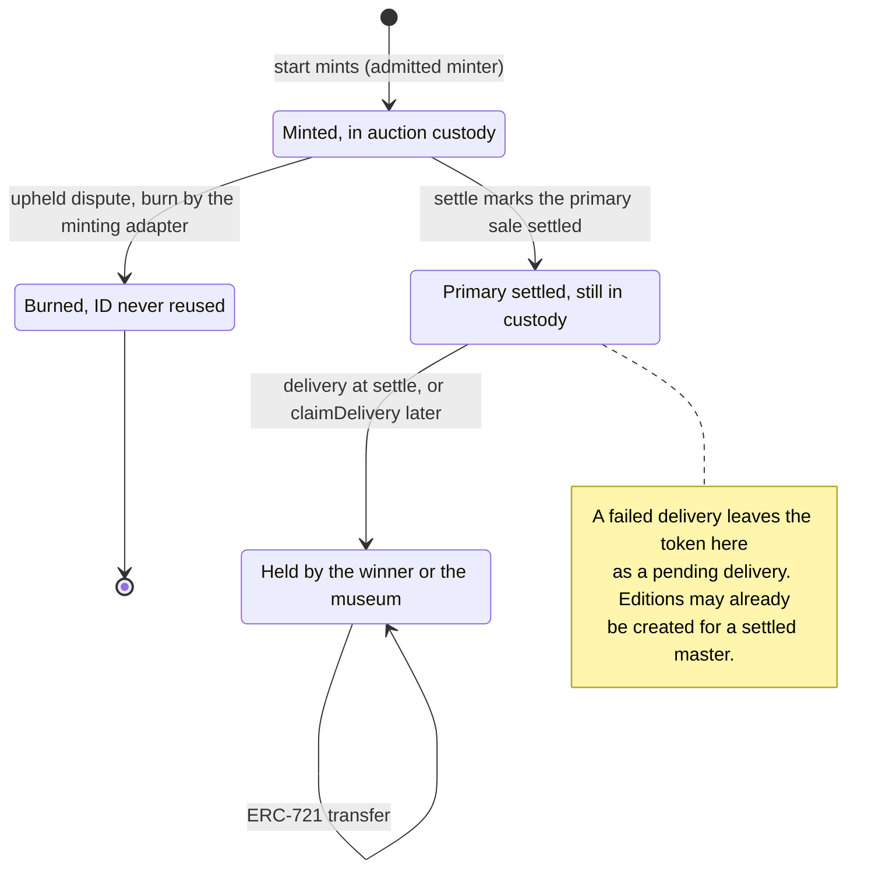

| Transition | Caller (role) | Delay | Function |
| --- | --- | --- | --- |
| Nonexistent to in custody | the auction, inside anyone's start | none | `Stream.mint`, from `EnglishAuction.start` or `startWithBid` |
| In custody to burned | the minting adapter, from the auction's `cancel` (PARAMETER_SETTER) | standard, 48 hours | `Stream.burn` |
| Burned (content released) | PARAMETER_SETTER | standard, 48 hours | `Stream.releaseContent`; the token stays burned and the ID unused |
| In custody to primary settled | the minting adapter, inside anyone's `settle` | none | `Stream.markPrimarySettled` |
| Primary settled to held | the auction at `settle`, or the claimant | none | the token's `safeTransferFrom`, or `EnglishAuction.claimDelivery` |
| Held to held | owner or approved operator | none | standard ERC-721 transfers |

A settled token can never be burned (`SaleAlreadySettled`), and ERC-721 transfers never mark a
sale settled. `primarySaleSettled(tokenId)` reads the flag, which gates
`IEditions.createEdition` and `linkEdition`.

### An auction

`auction(saleId).state` reports `ACTIVE`, `PAUSED`, `ENDED`, `SETTLED` or `CANCELLED`. The
contract stores `NONE` (no sale), `ACTIVE`, `SETTLED` and `CANCELLED`; `PAUSED` (a dispute pause
is live) and `ENDED` (the end has passed) are derived from the clock. `NONE` is never returned:
for a sale ID with no sale, `auction`, `minimumBid` and `lockedTerms` revert with
`UnknownSale(saleId)`, and so do `bid`, `withdrawBid`, `settle`, `pause(saleId, disputeRef)`,
`resume` and `cancel`; `claimDelivery` reverts with `NoPendingDelivery`.

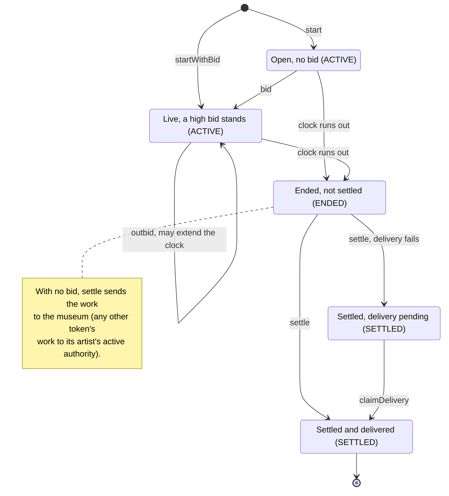

Halts: the dispute pause and the currency freeze.

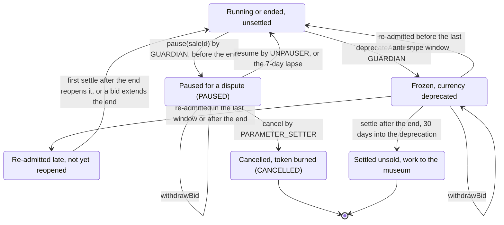

| Transition | Caller (role) | Delay | Function |
| --- | --- | --- | --- |
| None to open | anyone | none | `start` |
| None to live | anyone (the payer is the bidder) | none | `startWithBid` |
| Open to live, live to live | anyone | none | `bid` |
| Open or live to ended | the clock | none | none: `block.timestamp` reaches `endTime` |
| Ended to settled | anyone | none | `settle` |
| Settled, pending to delivered | the pending recipient, the winning bidder, or (no bid, any token but 6529 Stream) the artist | none | `claimDelivery` |
| Running to paused | GUARDIAN | immediate | `pause(saleId, disputeRef)`, once per auction, before its end |
| Paused to running | UNPAUSER | standard, 48 hours, and no earlier than 48 hours after the pause | `resume`; or no call once 7 days have passed |
| Paused to cancelled | PARAMETER_SETTER | standard, 48 hours; between 48 hours and 7 days after the pause | `cancel` |
| Paused or frozen, bid withdrawn | the high bidder | none | `withdrawBid` |
| Running or ended to frozen | GUARDIAN, on the asset allowlist | immediate | `AssetAllowlist.deprecateAsset` |
| Frozen to running | FUNDS_SETTER | funds, 14 days, and no earlier than 14 days after the deprecation | `AssetAllowlist.admitAsset` at time `since`, with `since + extensionWindow <= endTime`: bids resume and `settle` settles normally |
| Frozen to re-admitted late | FUNDS_SETTER | as above | `admitAsset` with `since + extensionWindow > endTime` |
| Re-admitted late to running | anyone | none | the first `settle` after the end reopens it (`_reopenedAfterFreeze`, see the [freeze](#currency-freeze-and-recovery)); a bid before that extends the end past `since + extensionWindow`, so a later `settle` settles normally |
| Frozen to settled unsold | anyone | 30 days after the deprecation | `settle` |
| Ended (delisted federated contract) to settled unsold | anyone | none | `settle` (v1.1 only; v1 installs no federation registry) |

## Flows

### Start

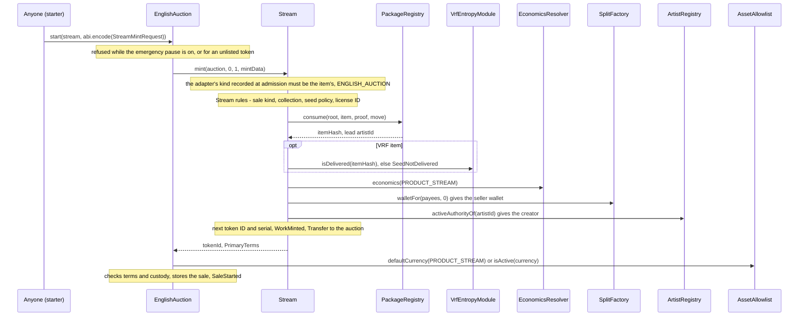

- **The auction refuses** (`EnglishAuction._start`) a token that is not listed by governance
  or (v1.1) active in the federation registry (`TargetNotAllowed`), and a token that already
  has a sale (`InvalidAuctionState`). It requires (`InvalidSaleTerms`) the English-auction sale
  kind, a nonzero seller and creator, a fee share of at most 100,000, a zero price, empty
  parameters, custody in the auction, a token ID below 2^32, a fee recipient for a nonzero fee
  share, and neither seller nor fee recipient equal to the revenue escrow (CALLS-1).
- **Stream checks beyond `consume`** (`Stream.mint`, `_checkItem`, `_quote`): the caller is an
  admitted minter (`NotAdmittedMinter`) minting to itself with `id` 0 and `amount` 1
  (`InvalidMintRequest`) and reporting the item's sale kind (`SaleKindMismatch`); the item
  names a sale kind (`InvalidItemSale`; its currency and params are the adapter's to check, and
  the English auction refuses any params), at least one party and an existing collection; an ARTIST seed policy if and only if the item carries a nonzero seed, and a VRF
  policy only when Stream has an entropy module; a license ID that passes `SpdxId`; a lead
  artist ID that is nonzero and fits 160 bits; a delivered seed for a VRF item
  (`SeedNotDelivered`; the seed is requested before the start, see [Entropy](entropy.md)); and
  usable economics (a royalty rate of at most 100,000, a fee share below 100,000, and for a
  nonzero fee share a fee recipient that is neither zero nor the seller wallet).
- **`consume`** checks the proof, acceptances, payees, the move, single use and content
  uniqueness ([Curation](curation.md)); its errors bubble up unchanged. Media checks do not run
  at mint; the curation signer simulates `openRecord`
  ([trust obligations](curation.md#trust-obligations-of-the-curation-signer)).
- **Effects.** Stream stores two words per work: the seller wallet with the serial, collection,
  a flags byte (item kind, seed policy, settled, edition-linked) and a terms ID; and the item
  hash. The terms (the lead artist ID, royalty rate, fee share, and the indexes of the fee
  recipient and minting adapter) are one word that every work under the same terms shares,
  written by the first start under them (QUALITY-6). It sits at the position its hash names
  (23 bits), or in an overflow range keyed by the full hash when other terms hold that
  position; a re-rate moves the token to the terms with its new rate. The rest is in
  `WorkMinted` and the published package. New slots per start, and the accepted cost of a
  position collision (LIM-GAS-10), are in
  [ADR 0004](../adr/0004-gas-budgets-under-glamsterdam.md#the-table). The auction resolves `CURRENCY_DEFAULT` once, to the
  `PRODUCT_STREAM` default (ETH at launch), or requires the named currency to be active. The
  start never deploys a split wallet.
- **`startWithBid`** runs the start and then [the bid](#bid-and-outbid) in one transaction. A
  Permit2 bid there signs `Typehashes.START_BID_WITNESS` over the token, the hash of
  `mintData`, the recipient, the amount and the deadline, since no sale ID exists before the
  mint.
- **Gas.** AUC-32; other cases in the
  [ADR 0004 table](../adr/0004-gas-budgets-under-glamsterdam.md#the-table).

### Bid and outbid

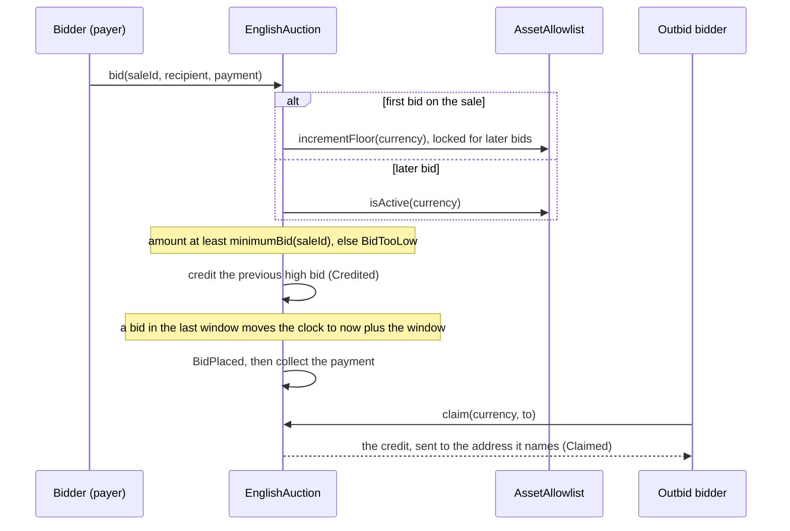

- **Preconditions.** The auction is running, not paused (`InvalidAuctionState`) and not a
  delisted federated contract (`TargetNotAllowed`); its currency is active (`AssetNotActive`);
  the recipient is not the auction (`InvalidRecipient`), and zero means the payer.
- **Minimum bid** (`_minimumBid`): with no standing bid, `max(openingBid, reserve, 1 wei)`
  (LIFECYCLE-1); with a standing bid `high`, `high + max(ceil(high × incrementShare /
  100,000), incrementFloor)`, which at launch in ETH is `max(5%, 0.001 ETH)` above the high
  bid. A bid above `type(uint96).max` base units reverts.
- **Anti-snipe** (AUC-17). The locked `extensionWindow` is 15 minutes at launch. Bids are
  accepted while `block.timestamp < endTime`.
- **Payment** (`_collect`). The payer is the bidder of record: credits go to it, and only it
  may withdraw. The bid is recorded before the pull; the call reverts if the payment does not
  arrive.

  | Currency | Method | Payer | What happens |
  | --- | --- | --- | --- |
  | ETH | `DIRECT` only | `msg.sender` | `msg.value` must equal `amount` (`InvalidPayment`). |
  | ERC-20 | `DIRECT` | `msg.sender` | `TokenTransfer.pullExact` of an allowance granted beforehand. |
  | ERC-20 | `PERMIT` | `msg.sender` | An EIP-2612 permit (65 bytes: `r`, `s`, then `v`), then the same pull. A permit that fails, for example because someone already submitted it, is ignored, and the pull uses the allowance it granted. |
  | ERC-20 | `PERMIT2` | the signer | Permit2's `permitWitnessTransferFrom`, so a relayer may submit it. The witness is `Typehashes.BID_WITNESS` (sale ID, recipient, amount, deadline), or `START_BID_WITNESS`. Refused when the auction was built without Permit2. |

  An ERC-20 bid sends no ETH (`InvalidPayment`); a `PERMIT` or `PERMIT2` payment past its
  deadline reverts with `PaymentExpired`.
- **ERC-20 checks** (AUC-19). Exact balance deltas make fee-on-transfer and rebasing tokens
  fail. The real guard against non-standard tokens is governance admitting only standard ERC-20s
  (`AssetAllowlist.admitAsset`, whose probe is a sanity check, not proof; LIM-SAL-7 in
  [known limitations](../audit/known-limitations.md#sales-and-auctions)).
- **Claims.** `claim(currency, to)` sends all of the caller's credits in that currency to `to`
  (`NothingToClaim`; `InvalidRecipient` for zero; `ClaimFailed` keeps an ETH credit a
  recipient refuses). Claims never read the allowlist, so a deprecated currency never blocks
  them.

### Settle with a bid

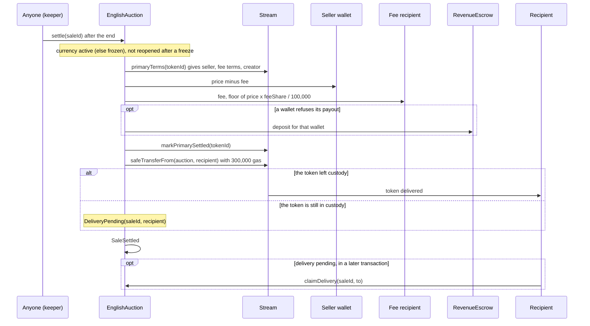

- **Preconditions.** The auction has ended and is not paused (`InvalidAuctionState`); its
  currency is active, or deprecated for at least 30 days (see the
  [freeze](#currency-freeze-and-recovery)). The caller must forward each bounded call's gas in
  full: a shortfall reverts (`DeliveryInsufficientGas`, `PaymentInsufficientGas`) instead of
  forcing the escrow, credit or pending-delivery route.
- **Terms.** Read back from Stream, so a later economics change never reaches a started
  auction. A zero amount is not paid.
- **ETH payouts** forward `PAYOUT_GAS` (100,000) to each wallet; a refusing wallet is
  credited in the revenue escrow (`RevenuePayment.payETH`), which anyone flushes to it later.
- **ERC-20 payouts** (MONEY-1) run in their own 1,000,000-gas frame (`settlePayout`, callable
  only by the auction), where the token's transfer gets 300,000 gas and a refused transfer
  goes to the escrow. If the frame fails even so, the amount is credited to the wallet in the
  auction, and anyone pays it out later with `claimFor(wallet, currency)`, which pays only the
  account itself and refuses ETH (`IRevenueEscrow.InvalidAsset`).
- **Settlement is marked before delivery**, so a winner who never claims cannot hold up the
  master's edition.
- **Delivery** (`_deliver`) gives the token's `safeTransferFrom` exactly `DELIVERY_GAS`
  (300,000) and copies no return data. `claimDelivery(saleId, to)` later delivers a pending
  token to any address but zero and the auction (`InvalidRecipient`), with all remaining gas.
  If neither the recipient nor the winning bidder can call it, the token stays in custody.
- **Keeper gas.** The ERC-20 payout frame must be forwardable in full, so an ERC-20 `settle`
  needs a gas limit of about 1.11M although it uses about 140K
  ([ADR 0004, security impact](../adr/0004-gas-budgets-under-glamsterdam.md#security-impact);
  `test_Settle_SettlerGasLimitVersusGasUsed` in
  [`EnglishAuction.t.sol`](../../test/sales/auction/EnglishAuction.t.sol)).

### Settle with no bid

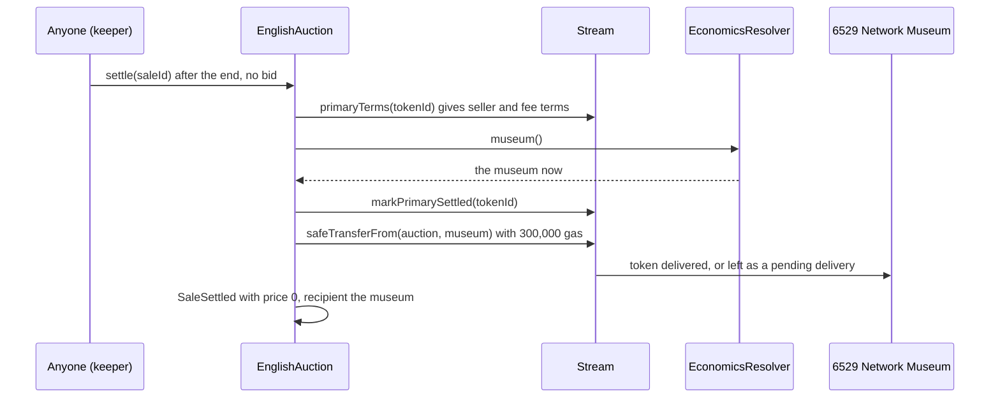

- **The museum** (D140, [ADR 0005](../adr/0005-stream-editions-auction.md)) is read from the economics resolver at
  settlement, so a governed change that lands before the settle redirects the work. The artist
  plays no part: a restrained artist (an override pending) does not hold up the settlement, and
  neither the artist's recorded authority nor its active one can claim the work (AUC-33).
- **Any other token's work** (owner decision 9), federated or listed by governance, goes to its
  artist's active authority, read from the token at settlement: the museum branch is gated in
  code on 6529 Stream, the token the auction was deployed with. A completed recovery redirects
  it, and during a restraint the token
  reports none, so `settle` reverts with `InvalidRecipient(address(0))`, moves nothing, and
  anyone retries once the override's outcome is known
  ([Identity and recovery](identity-and-recovery.md)).
- **A pending delivery.** If the museum's account rejects the token, it is pending for the
  museum, which claims it to an address it names. It stays that museum's even after
  governance names another (ADR 0005).
  Another token's artist claims as the recorded recipient or as the active authority at claim
  time.
- Nothing is paid, even when a withdrawn bid left a reserve. The same outcome ends a frozen sale
  after 30 days (owner decision 10) and a delisted federated contract's sale, after crediting
  the standing bid.

### Currency freeze and recovery

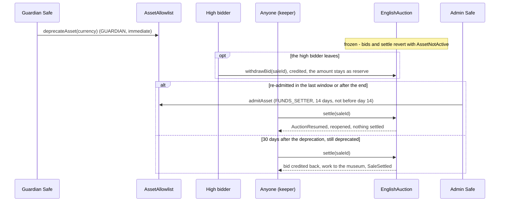

- **Why.** A deprecation freezes the auction, not just its bids, so a standing low bid cannot
  win while nobody else may bid (MARKET-2; LIM-SAL-3 in
  [known limitations](../audit/known-limitations.md#sales-and-auctions)). The high bidder may
  `withdrawBid` at any time, before or after the end.
- **Re-admission** (`_reopenedAfterFreeze`). `admitAsset` refuses to run before day 14
  (`ReadmissionTooEarly`); it has no upper bound, but from day 30 anyone may end the auction
  unsold, so a re-admission saves the sale only if it comes first. A reopening (`since +
  extensionWindow > endTime`) moves the end to now plus the longer of the current governed
  duration and the locked window, and settles nothing.
- Operators follow the runbook's advice before deprecating an auction's currency
  ([`script/README.md`](../../script/README.md)).

### Dispute pause, resume and cancel

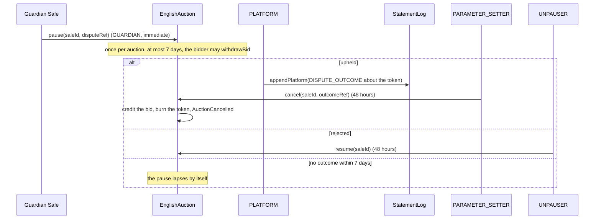

[Disputes and statements](disputes-and-statements.md#upheld-dispute-during-an-auction)
specifies the dispute process; the auction enforces AUC-26 and AUC-27. A pause is live through
`pausedAt + MAX_PAUSE` inclusive. `cancel` cites the token's own latest `DISPUTE_OUTCOME`
(LIFECYCLE-4). On resumption, by `resume` or the lapse, the auction runs at least the longer of
the remaining time, the governed duration and the locked window, even with a standing bid
(LIFECYCLE-1).

### Emergency pause and governed settings

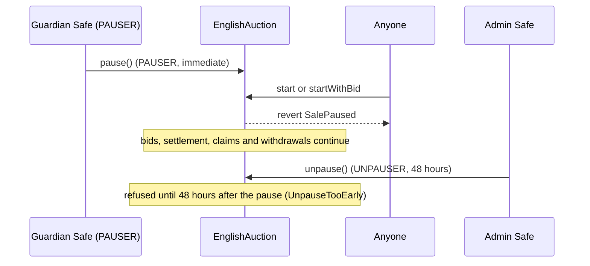

- **Emergency pause.** Running auctions carry on, because stopping one near its end would
  distort its outcome. Pausing twice reverts with `SalePaused`, unpausing while not paused with
  `NotPaused`. The configuration refuses one account holding both PAUSER and UNPAUSER.
- **`setConfig(expected, next)`** is compare-and-set on the whole `AuctionConfig` within the
  bounds under [Parameters and limits](#parameters-and-limits) (`InvalidConfig`). It applies to
  auctions started afterwards, except that a resumption or a reopening reads the current
  duration.
- **`setOpeningBid(currency, expected, next)`** is compare-and-set, moves either way, zero
  included, up to `min(incrementFloor(currency) × OPENING_BID_FLOORS, type(uint96).max)`
  (`OpeningBidAboveCeiling`), for an active currency, for auctions started afterwards.
- **`setTarget(token, listed)`** lists a token contract with code, not EIP-7702 delegated,
  that supports ERC-721 through ERC-165 (`InvalidDependency`). Unlisting stops new starts only.
- **`setFederationRegistry(expected, next)`** installs the v1.1 federation registry:
  compare-and-set, ERC-165 for `IFederationRegistry`, EIP-7702 rejected, code hash pinned (a
  registry whose code later differs serves no token). v1 installs none.

### Royalty read

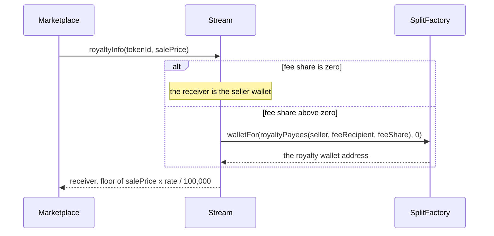

- The rate is stored per work and changes only by agreement of every party plus a governed
  action, through `WorkRecords` ([Works and storage](works-and-storage.md)). The receiver never
  changes after mint.
- The receiver comes from one plain view call to the split factory over the canonical payee
  list `Splits.royaltyPayees`, so it equals the address the economics resolver derives. The call
  can run out of gas and revert, but never returns a zero royalty for lack of gas.
- The amount is `(p / D) × rate + (p % D) × rate / D` with `D` = 100,000: exactly
  `floor(p × rate / D)`, with no overflow for any price.
- A burned or unminted token reverts with `UnknownWork`. The call stays under 50,000 gas
  ([ADR 0004, the table](../adr/0004-gas-budgets-under-glamsterdam.md#the-table)).

### Collections and marketplace metadata

- **`createCollection(name, metadataHash)`** (PLATFORM) creates the next collection ID, from 1.
  The name is 1 to `MAX_NAME_BYTES` (256) bytes of valid UTF-8 without a control character
  (below 0x20, or 0x7F), `<`, `"` or `\` (`InvalidCollectionName`): the name goes into every
  work's metadata, and refusing those characters keeps `tokenURI` within its gas budget.
  `metadataHash` may be zero. `collection(id)` returns the name, the hash and the number minted
  (also the last serial). A guardian can [suspend](governance.md#suspension-of-operational-keys)
  a compromised PLATFORM key at once.
- **`setContractURI(uri)`** sets the ERC-7572 contract URI and emits `ContractURISet` and
  `ContractURIUpdated`.
- **`setOwner(expected, next)`** (compare-and-set) sets the marketplace `owner()`, which
  marketplaces let configure creator earnings. It has no on-chain powers.
- **`bindWorkRecords` and `bindEditions`** bind each satellite once: the target has code, is
  not EIP-7702 delegated, supports its interface through ERC-165, and serves this Stream
  (`stream() == address(this)`). A second bind reverts with `AlreadyBound`.
- **`linkEdition(tokenId, editionId)`** runs once per work, from the bound Editions, for an
  `EDITION_MASTER` whose primary sale settled, with `editionId == tokenId`
  (`EditionLinkInvalid`); `editionOf` then returns the pair
  ([Editions and sales](editions-and-sales.md)).

## Rules and invariants

| ID | Rule | Enforced in | Tested by |
| --- | --- | --- | --- |
| AUC-1 | Only an admitted minter mints, into its own custody, with `id` 0 and `amount` 1. Admission requires code, ERC-165 `ISaleAdapter` and no EIP-7702 delegation. | `Stream.mint`, `Stream.setAdmittedMinter` | [`Stream.t.sol`](../../test/stream/Stream.t.sol): `test_mint_revertsForUnadmittedCaller`, `test_mint_revertsForWrongShape`, `test_setAdmittedMinter`, `test_setAdmittedMinter_reverts` |
| AUC-2 | Stream mints only for an admitted adapter whose sale kind, recorded at its first admission, is the item's, and an item that names a sale kind and has at least one party, an existing collection, a coherent seed policy and a valid license ID. The 1/1 sale method is pluggable (owner decision 15): the English auction is admitted at genesis, a later method by governance (30 days), and `primaryTerms` reports the minting adapter's kind, recorded at its first admission. | `Stream.mint`, `Stream._checkItem`, `Stream.setAdmittedMinter`, `Stream.primaryTerms` | [`Stream.t.sol`](../../test/stream/Stream.t.sol): `test_mint_comparesTheKindRecordedAtAdmission`, `test_mint_revertsForStreamRuleBreaks`, `test_mint_acceptsMixedCaseLicenseId`, `test_mint_refusesALicenseIdTheRecordsWouldRefuse`, `test_saleMethod_aSecondAdapterMintsOnlyItsOwnKind`, `test_saleMethod_kindRecordedAtFirstAdmission`; [`StreamSaleMethods.t.sol`](../../test/integration/StreamSaleMethods.t.sol): `test_ASecondAdmittedAdapterSellsAWorkEndToEnd`, `test_AnUnadmittedAdapterIsRefused` |
| AUC-3 | Every mint consumes its package item in the same call; a registry revert reverts the mint. | `Stream._consume` | [`Stream.t.sol`](../../test/stream/Stream.t.sol): `test_mint_bubblesRegistryRevert`, `testFuzz_mintRequestEncodesAsConsumeArguments`, `test_mint_reentrantRegistryKeepsCountersConsistent` |
| AUC-4 | A VRF item mints only when Stream has an entropy module and the item's seed is delivered. | `Stream.mint`, `Stream._checkItem` | [`Stream.t.sol`](../../test/stream/Stream.t.sol): `test_mint_vrfNeedsDeliveredSeed`, `test_mint_vrfRejectedWithoutEntropyModule`; [`VrfWork.t.sol`](../../test/integration/VrfWork.t.sol): `test_SeedRequestedDeliveredThenStartedAndRendered` |
| AUC-5 | Token IDs are one global sequence from 1, never reused; serials count per collection from 1; `totalSupply` is minted minus burned. | `Stream._store`, `Stream.burn` | [`Stream.t.sol`](../../test/stream/Stream.t.sol): `test_mint_assignsGlobalIdsAndPerCollectionSerials`, `test_burn_leavesGapAndCountsSupply`; [`StreamInvariant.t.sol`](../../test/stream/StreamInvariant.t.sol): `invariant_idsMonotonicAndNeverReused`, `invariant_serialsPerCollection`, `invariant_supplyIsMintedMinusBurned` |
| AUC-6 | A work's seller, fee recipient and fee share are locked at mint; only its royalty rate changes, and only through the bound `WorkRecords`, at most 100,000. | `Stream._store`, `Stream.setRoyaltyRate` | [`StreamInvariant.t.sol`](../../test/stream/StreamInvariant.t.sol): `invariant_royaltyTermsLocked`; [`Stream.t.sol`](../../test/stream/Stream.t.sol): `test_setRoyaltyRate_fromRecords`, `test_hooks_revertBeforeBinding` |
| AUC-7 | `royaltyInfo` returns the seller wallet with no fee, otherwise the split factory's salt-zero wallet for the canonical royalty payees, and exactly `floor(price × rate / 100,000)`; it reverts rather than return zero when gas runs short. | `Stream.royaltyInfo`, `Stream._royaltyReceiver` | [`Stream.t.sol`](../../test/stream/Stream.t.sol): `testFuzz_royaltyInfo_isTheFactoryWallet`, `test_royaltyInfo_noFeeIsTheSeller`, `testFuzz_royaltyInfo_matchesMulDiv`, `testFuzz_royaltyInfo_neverZeroForLackOfGas`; [`StreamEconomics.t.sol`](../../test/stream/StreamEconomics.t.sol): `test_receiverIsTheResolversAndTheFactorys` |
| AUC-8 | Only the adapter that minted a token marks its primary sale settled; transfers never do. | `Stream.markPrimarySettled` | [`Stream.t.sol`](../../test/stream/Stream.t.sol): `test_markPrimarySettled_byMintingAdapterOnly`, `test_transfersDoNotSettle`; [`StreamInvariant.t.sol`](../../test/stream/StreamInvariant.t.sol): `invariant_primarySaleSettledOnlyByMintingAdapter` |
| AUC-9 | Only the adapter that minted a token burns it, while it holds the token and before the primary sale settled, even after the adapter was removed. Removing an adapter stops its new mints only: it still settles, delivers and cancels every sale it started, so a live sale is never stranded (owner decision 15). | `Stream.burn`, `Stream.markPrimarySettled`, `Stream.setAdmittedMinter` | [`Stream.t.sol`](../../test/stream/Stream.t.sol): `test_burn_onlyByMintingAdapter`, `test_burn_byRemovedMintingAdapter`, `test_burn_neverAfterSettlement`, `test_burn_refusesAnAdmittedAdapterThatDidNotMint`, `test_burn_refusedAfterSettlement`, `test_saleMethod_removalStopsNewSalesButNeverStrandsALiveOne`; [`StreamSaleMethods.t.sol`](../../test/integration/StreamSaleMethods.t.sol): `test_RemovingAnAdapterStopsNewSalesButNeverStrandsALiveOne` |
| AUC-10 | `releaseContent` runs only for a burned token. | `Stream.releaseContent` | [`Stream.t.sol`](../../test/stream/Stream.t.sol): `test_releaseContent_reverts`, `test_releaseContent_afterBurnLetsTheRealArtistMint` |
| AUC-11 | Satellites bind once each and must serve this Stream; `linkEdition` runs once, from Editions, for a settled master, with the edition ID equal to the token ID. | `Stream.bindWorkRecords`, `bindEditions`, `linkEdition` | [`Stream.t.sol`](../../test/stream/Stream.t.sol): `test_bind_oncePerTargetWithEvents`, `test_bind_reverts`, `test_linkEdition_reverts`, `test_bind_refusesASatelliteOfAnotherStream`, `test_linkEdition_needsASettledMaster` |
| AUC-12 | Collection names are 1 to 256 bytes of UTF-8 without control characters, `<`, `"` or `\`. | `Stream.createCollection` | [`Stream.t.sol`](../../test/stream/Stream.t.sol): `test_createCollection_reverts` |
| AUC-13 | The emergency pause stops only new starts; unpausing waits 48 hours from the pause. | `EnglishAuction._start`, `pause`, `unpause` | [`EnglishAuction.t.sol`](../../test/sales/auction/EnglishAuction.t.sol): `test_EmergencyPause_StopsOnlyNewStarts`, `test_EmergencyPause_RolesAndStateChecks`; [`Dispute.t.sol`](../../test/integration/Dispute.t.sol): `test_EmergencyPauseBlocksStartsNotBids`; [`PauseWindow.t.sol`](../../test/sales/PauseWindow.t.sol): `test_Unpause_ScheduledBeforeThePauseWaitsTwoDaysAfterIt` |
| AUC-14 | A start refuses unusable terms: the escrow as seller or fee recipient, a zero creator, a zero seller, a fee share above 100,000, a price or parameters, a token not in custody, or a token ID of 2^32 or more. | `EnglishAuction._start` | [`EnglishAuction.t.sol`](../../test/sales/auction/EnglishAuction.t.sol): `test_Start_RevertsOnUnusableTerms`, `test_Start_RefusesTheEscrowAsSellerOrFeeRecipient`, `test_Start_RevertsOnBadMintResult`, `test_Start_TokenIdPackingLimit`; [`RecoveryRestraint.t.sol`](../../test/integration/RecoveryRestraint.t.sol): `test_NobodyStartsAnUnmintedWorkDuringTheNotice` |
| AUC-15 | A sale locks its currency, opening bid, increment share and window at start, and its increment floor at the first bid; later governance changes do not reach it. | `EnglishAuction._lockTerms`, `_bid` | [`EnglishAuction.t.sol`](../../test/sales/auction/EnglishAuction.t.sol): `test_Start_LocksEveryParameter`, `test_Start_ResolvesTheDefaultCurrencyOnce`, `test_IncrementFloorLocksAtTheFirstBid`, `test_Bid_AFloorRaisedAfterTheFirstBidDoesNotApply`; [`AuctionInvariant.t.sol`](../../test/sales/auction/invariant/AuctionInvariant.t.sol): `invariant_StoredTermsMatchWhatEachSaleLocked` |
| AUC-16 | The first bid is at least `max(openingBid, reserve, 1 wei)`; a later bid adds at least `max(ceil(high × share / 100,000), floor)`; a bid fits 96 bits. | `EnglishAuction._minimumBid`, `_bid` | [`EnglishAuction.t.sol`](../../test/sales/auction/EnglishAuction.t.sol): `test_Bid_FirstBidThenIncrements`, `testFuzz_Bid_IncrementIsMaxOfShareAndFloor`, `testFuzz_StepMatchesMulDivCeil`, `test_Bid_RefusesBidsAbove96Bits`; [`AuctionDisputePause.t.sol`](../../test/sales/auction/AuctionDisputePause.t.sol): `test_WithdrawBid_StaysAsTheReserveThroughALapse` |
| AUC-17 | A bid in the last anti-snipe window moves the end to the bid's time plus the window; no bid is accepted at or after the end. | `EnglishAuction._bid`, `_state` | [`EnglishAuction.t.sol`](../../test/sales/auction/EnglishAuction.t.sol): `test_Bid_AntiSnipeExtends`; [`CuratedSale.t.sol`](../../test/integration/CuratedSale.t.sol): `test_StartBidAntiSnipeSettleAndRelease` |
| AUC-18 | Outbid and withdrawn bids are credited to their payer, never pushed, and only the account claims its ETH credits. | `EnglishAuction._credit`, `claim`, `claimFor` | [`EnglishAuction.t.sol`](../../test/sales/auction/EnglishAuction.t.sol): `test_Bid_OutbidBidderIsCreditedAndClaims`; [`EnglishAuctionHostile.t.sol`](../../test/sales/auction/EnglishAuctionHostile.t.sol): `test_RevertingBidderCannotBlockOutbidding`, `test_OutsidersCannotClaimSomeoneElsesCredit`; [`EnglishAuction.t.sol`](../../test/sales/auction/EnglishAuction.t.sol): `test_ClaimFor_RefusesEth` |
| AUC-19 | Every ERC-20 payment is checked by exact balance delta on both sides; the `TokenTransfer` paths also require a call to return exactly `true` (the `PERMIT2` pull checks balances only). A Permit2 witness binds the sale (or token and mint data), recipient, amount and deadline. | `EnglishAuction._collect`; `TokenTransfer` | [`EnglishAuctionHostile.t.sol`](../../test/sales/auction/EnglishAuctionHostile.t.sol): `test_FeeOnTransferBidsFailClosed`, `test_RebasingBidsFailClosed`, `test_NoReturnAndFalseReturningTokensFailClosed` (`DIRECT`); [`EnglishAuction.t.sol`](../../test/sales/auction/EnglishAuction.t.sol): `test_Bid_Permit2WitnessBindsTheSaleAndRecipient`, `test_Bid_Permit2WitnessBindsAmountAndDeadline`; [`EnglishAuctionDisputes.t.sol`](../../test/sales/auction/EnglishAuctionDisputes.t.sol): `test_Permit2Witness_Golden` |
| AUC-20 | The auction holds exactly its live high bids plus its credits, and every sale ends at most once, settled or cancelled, with exact custody. | `EnglishAuction` (all value paths) | [`AuctionInvariant.t.sol`](../../test/sales/auction/invariant/AuctionInvariant.t.sol): `invariant_HeldEqualsLiveBidsPlusCredits`, `invariant_ValueIsConserved`, `invariant_OneOutcomeAndExactCustody`; [`AuctionHaltsInvariant.t.sol`](../../test/sales/auction/invariant/AuctionHaltsInvariant.t.sol): `invariant_BalanceCoversOwed`, `invariant_ExactCustody` |
| AUC-21 | Settlement never depends on the recipient accepting the token: a failed delivery leaves a pending delivery, and the primary sale is marked settled before delivery. | `EnglishAuction.settle`, `_deliver` | [`EnglishAuction.t.sol`](../../test/sales/auction/EnglishAuction.t.sol): `test_Settle_FailedDeliveryLeavesAPendingClaim`, `test_Settle_TokenThatBlocksTransfersLeavesAPendingClaim`, `test_ClaimDelivery_TheWinnerCanRedirect`; [`CuratedSale.t.sol`](../../test/integration/CuratedSale.t.sol): `test_WinnerThatCannotReceiveGetsAPendingDelivery` |
| AUC-22 | A settler that cannot forward the delivery or payout gas in full is refused, so it cannot force the pending, escrow or credit route. | `EnglishAuction._deliver`, `_pay`; `RevenuePayment.payETH` | [`EnglishAuction.t.sol`](../../test/sales/auction/EnglishAuction.t.sol): `test_Settle_RevertsWhenTheCallerStarvesDelivery`, `test_Settle_AStarvedSettleRevertsInsteadOfCrediting` |
| AUC-23 | A refused payout goes to the escrow; an ERC-20 payout that fails even there is credited to its wallet, and `claimFor` pays only that wallet. | `EnglishAuction._pay`, `settlePayout`, `claimFor` | [`EnglishAuction.t.sol`](../../test/sales/auction/EnglishAuction.t.sol): `test_Settle_RefusingWalletIsEscrowed`; [`EnglishAuctionHostile.t.sol`](../../test/sales/auction/EnglishAuctionHostile.t.sol): `test_GasHungryTokenPayoutIsEscrowed`, `test_BlocklistedSellerIsEscrowedAndBlocklistedBidderClaimsElsewhere`; [`AuctionPayoutFailures.t.sol`](../../test/sales/auction/AuctionPayoutFailures.t.sol): `test_Settle_ATokenThatBlocksTheAuctionDoesNotHoldTheWork`, `test_SettlePayout_OnlyTheAuctionRunsAPayoutFrame`, `test_ClaimFor_PaysOnlyTheAccountItself` |
| AUC-24 | With no bid a 6529 Stream work (the token the auction was deployed with) goes to the museum the economics resolver names at settlement, whatever its artist's state (D140); any other token's work, federated or listed, goes to its artist's active authority at settlement, and while that is zero settlement reverts and moves nothing (owner decision 9). A sold settlement makes no museum read. | `EnglishAuction.settle`, `_lockedTerms` | [`EnglishAuction.t.sol`](../../test/sales/auction/EnglishAuction.t.sol): `test_Settle_NoBidsSendsTheTokenToTheMuseum`, `test_Settle_NoBidsFollowsTheMuseumAtSettlement`, `test_Settle_NoBidsReachesTheMuseumWhileTheArtistIsUnresolved`, `test_Settle_ASoldSettlementDoesNotReadTheMuseum`, `test_Settle_AnotherListedTokensUnbidWorkGoesToItsArtist`, `test_Settle_FederatedNoBidsFollowsTheArtistsCurrentAuthority`, `test_Settle_FederatedNoBidsRefusesAnUnresolvedArtist`, `test_Constructor_RejectsAStreamThatIsNotAnErc721`; [`Museum.t.sol`](../../test/integration/Museum.t.sol): `test_UnbidWorkGoesToTheMuseum`, `test_UnbidWorkGoesToTheMuseumNamedAtSettlement`, `test_AnotherListedTokensUnbidWorkGoesToItsArtist`, `test_UnbidFederatedWorkStaysWithItsArtist`; [`RecoveryRestraint.t.sol`](../../test/integration/RecoveryRestraint.t.sol): `test_NoBidAuctionRunningAtStagingGoesToTheMuseumAtOnce`, `test_AuctionWithABidRunningAtStagingSettlesNormally`; [`StreamLifecycleInvariant.t.sol`](../../test/integration/invariant/StreamLifecycleInvariant.t.sol): `invariant_streamLifecycle` (invariant 9) |
| AUC-25 | A deprecated currency freezes the auction: no bid and no settlement until re-admission, and the bidder may withdraw; after a re-admission the first settle reopens the auction only if `since + extensionWindow > endTime`; after 30 days of deprecation the sale ends unsold: the standing bid is credited back and the work goes where an unbid work goes (the museum for 6529 Stream, the artist for any other token; owner decisions 9 and 10). | `EnglishAuction._reopenedAfterFreeze`, `withdrawBid`, `_bid` | [`AuctionCurrencyFreeze.t.sol`](../../test/sales/auction/AuctionCurrencyFreeze.t.sol): `test_Settle_AFrozenAuctionWaitsAndReopensAfterReadmission`, `test_Settle_NothingSettlesWhileFrozen`, `test_Settle_AFrozenSaleEndsUnsoldThirtyDaysIntoTheFreeze`, `test_WithdrawBid_NeedsAPauseOrAFreeze`, `test_Settle_AnAuctionStartedAfterAFreezeSettlesNormally`; [`Museum.t.sol`](../../test/integration/Museum.t.sol): `test_FreezeExitSendsTheWorkToTheMuseumAndCreditsTheBid`, `test_AnotherListedTokensFreezeExitGoesToItsArtist`, `test_FederatedFreezeExitGoesToItsArtist`; [`EnglishAuction.t.sol`](../../test/sales/auction/EnglishAuction.t.sol): `test_Settle_AnotherListedTokensFreezeExitGoesToItsArtist` |
| AUC-26 | A dispute pause is GUARDIAN-only, once per live auction, at most 7 days; `resume` and `cancel` wait 48 hours from the pause; `cancel` cites the token's own outcome recorded after the pause. | `EnglishAuction.pause(uint256,bytes32)`, `resume`, `cancel` | [`EnglishAuctionDisputes.t.sol`](../../test/sales/auction/EnglishAuctionDisputes.t.sol): `test_Pause_OnlyTheGuardian`, `test_Pause_OnlyALiveAuctionOnce`, `test_Pause_EndsByItselfAfterSevenDays`, `test_Cancel_NeedsTheRecordedOutcome`, `test_Cancel_PauseWindowBoundary`; [`PauseWindow.t.sol`](../../test/sales/PauseWindow.t.sol): `test_Resume_ScheduledBeforeThePauseWaitsTwoDaysAfterIt`; [`AuctionDisputeCancel.t.sol`](../../test/sales/auction/AuctionDisputeCancel.t.sol): `test_Cancel_RefusesAnOutcomeRecordedBeforeThePause` |
| AUC-27 | A resumed or reopened auction runs at least the longer of the governed duration and its locked window. | `EnglishAuction._resumedEnd`, `_reopening` | [`EnglishAuctionDisputes.t.sol`](../../test/sales/auction/EnglishAuctionDisputes.t.sol): `test_Resume_GivesAtLeastTheDuration`, `test_Resume_LeavesAtLeastTheWindow`, `test_Resume_ReopeningIsNeverShorterThanTheLockedWindow`; [`AuctionDisputePause.t.sol`](../../test/sales/auction/AuctionDisputePause.t.sol): `test_Pause_WithAStandingBidAlsoReopensForTheDuration` |
| AUC-28 | A federated token sells only while the registry reports it active with its recorded code; a delisted contract takes no bids and settles unsold; its fee goes to the network's federated recipient. | `EnglishAuction.isTarget`, `_delisted`, `_lockedTerms` | [`AuctionFederatedTokens.t.sol`](../../test/sales/auction/AuctionFederatedTokens.t.sol): `test_Bid_ADelistedFederatedAuctionStopsSelling`, `test_Settle_AFederatedAuctionPaysTheNetworksFederatedRecipient`; [`EnglishAuctionFederation.t.sol`](../../test/sales/auction/EnglishAuctionFederation.t.sol): `test_Federation_CodeHashesArePinned` |
| AUC-29 | The auction refuses every safe transfer into it except its own mint during a start. | `EnglishAuction.onERC721Received` | [`AuctionCustody.t.sol`](../../test/sales/auction/AuctionCustody.t.sol): `test_OnERC721Received_RefusesSafeTransfersIntoTheAuction`; [`EnglishAuction.t.sol`](../../test/sales/auction/EnglishAuction.t.sol): `test_OnERC721Received_RejectsUnexpectedTransfers` |
| AUC-30 | Governed parameters stay within bounds and are compare-and-set. | `EnglishAuction.setConfig`, `setOpeningBid` | [`EnglishAuction.t.sol`](../../test/sales/auction/EnglishAuction.t.sol): `test_Constructor_RejectsConfigOutOfBounds`; [`EnglishAuctionDisputes.t.sol`](../../test/sales/auction/EnglishAuctionDisputes.t.sol): `test_SetConfig_CompareAndSet`, `test_SetOpeningBid_MovesBothWaysWithinTheCeiling`, `testFuzz_SetOpeningBid_AnyValueUpToTheCeiling`, `test_SetOpeningBid_CappedAtTheLargestBid` |
| AUC-31 | No reentrant call reaches a value-moving entry point. | `nonReentrant` on `start`, `startWithBid`, `bid`, `withdrawBid`, `settle`, `claimDelivery`, `claim`, `claimFor`, `pause(saleId)`, `resume`, `cancel` | [`EnglishAuctionHostile.t.sol`](../../test/sales/auction/EnglishAuctionHostile.t.sol): `test_ReentrantClaimerIsBlocked`, `test_ReentrantWinnerCannotReenterSettlement`, `test_ReentrantSellerWalletIsBlocked`, `test_CallbackTokenCannotReenter` |
| AUC-32 | Gas: a steady-state ETH start uses at most 350,000 Prague gas and 6 new slots (7 with a bid). A first start under new terms is measured separately; it writes one slot more when its terms' hashed position collides (an accepted limitation, LIM-GAS-10). | measured, not enforced on-chain | [`GasReport.t.sol`](../../test/integration/GasReport.t.sol): `test_Gas_Start_SteadyState`, `test_Gas_StartWithBid_SteadyState`, `test_Gas_StartWithBid_ArtistsFirstWork_TwoParty`, `test_Gas_Table`; [`StreamTermsGrind.t.sol`](../../test/stream/StreamTermsGrind.t.sol): `test_GroundCollisionAddsOneSlotToTheFirstStart`; [`EnglishAuctionGas.t.sol`](../../test/sales/auction/EnglishAuctionGas.t.sol): `test_StartGas_SteadyState` |
| AUC-33 | An unbid 6529 Stream work's pending delivery is claimed only by the museum recorded at settlement (the settlement records `_MUSEUM`): never by its artist, nor by a museum governance names later (ADR 0005). For any other token the artist, recorded or active, may also claim in the recipient's place (L-5). | `EnglishAuction.claimDelivery`, `_unbidClaimant` | [`EnglishAuction.t.sol`](../../test/sales/auction/EnglishAuction.t.sol): `test_ClaimDelivery_NoBidsOnlyTheMuseum`, `test_ClaimDelivery_ANoBidDeliveryStaysWithTheRecordedMuseum`, `test_ClaimDelivery_AnotherListedTokensArtistClaims`, `test_ClaimDelivery_FederatedNoBidsOnlyTheArtist`, `test_ClaimDelivery_ANoBidClaimFollowsTheCurrentAuthority`; [`Museum.t.sol`](../../test/integration/Museum.t.sol): `test_TheMuseumsPendingDeliveryIsItsOwn` |
| AUC-34 | The auction's views are answered by the lens its constructor created, which nothing can replace: its fallback forwards any call it does not declare with a `staticcall`, returns or reverts with the lens's answer unchanged, refuses ETH, and reverts with no data on a selector neither knows. Every moved view answers byte for byte as before the lens. The auction answers `auctionClock` itself (an integration view outside `IEnglishAuction` and ERC-165): exactly `auction`'s state and end, or `auction`'s revert. | `EnglishAuction.fallback`, `lens`, `storageWords`, `auctionClock`; `EnglishAuctionLens` | [`EnglishAuctionLensDifferential.t.sol`](../../test/sales/auction/EnglishAuctionLensDifferential.t.sol): `testFuzz_EveryMovedViewMatchesThePreLensBuild`, `test_EveryMovedViewMatchesThePreLensBuild_LongSequences`; [`EnglishAuctionLens.t.sol`](../../test/sales/auction/EnglishAuctionLens.t.sol): `test_Lens_IsTheAuctionsOwnFixedCreation`, `test_Lens_CannotBeSwapped`, `test_Fallback_RefusesEth`, `test_Fallback_RevertsOnUnknownSelectors`, `test_Fallback_IsAReadOnlyForwarder`, `test_Lens_ReadsTheAuctionsLayout`, `test_AuctionClock_IsAnsweredByTheCoreOutsideErc165`, `test_AuctionClock_MatchesAuctionThroughAPauseAndResume`, `test_Lens_PassesOnTheAuctionsRevert`, `test_Lens_RefusesAnAnswerOfTheWrongLength`, `test_LockedTerms_RefusesAFeeShareAboveTheDenominator`, and the layout pinned to `forge inspect EnglishAuction storageLayout`: `test_Layout_GovernedWordsAreTheCompilers`, `test_Layout_SaleAndTermsWordsAreTheCompilers`, `test_Layout_ALapsedPauseReadsTheWindowAndTheDuration`, `test_Layout_FederatedTermsAreTheCompilers`; [`DeployScript.t.sol`](../../test/deploy/DeployScript.t.sol): `test_VerifyChecksTheAuctionsLens` |

## Events

Event signatures and topic0 values are on the events page, under
[Stream](../integrators/events-and-indexing.md#stream) and
[EnglishAuction](../integrators/events-and-indexing.md#englishauction). `SaleSettled` for a
no-bid settlement has a zero `buyer` and `price` and names the museum as `recipient` (a
federated work's artist), and
`AuctionResumed` also marks a lapsed dispute pause (at the first mutating call after it) and a
reopening after a currency freeze.

## Failure modes and recovery

| Failure | Effect | Recovery |
| --- | --- | --- |
| Start while the emergency pause is on | `SalePaused` | Wait for `unpause` (no earlier than 48 hours after the pause). |
| Token contract not listed (or not active in a registry) | `TargetNotAllowed` | Governance lists it with `setTarget` (30 days). |
| Item breaks a Stream rule, or malformed mint data | The rule's error (`InvalidItemSale`, `InvalidLeadArtist`, `UnknownCollection`, `InvalidSeedPolicy`, `InvalidLicenseId`, `InvalidWorkTerms`, `TermsCapacityExceeded`), or `InvalidMintRequest` for malformed mint data | An item whose own fields break a rule never mints and needs a new package; governance fixes a missing collection or unusable economics. |
| VRF seed not delivered | `SeedNotDelivered` | Request the seed, wait for delivery, then start ([Entropy](entropy.md)). |
| Currency inactive, or no default configured | `AssetNotActive`, `CurrencyNotConfigured` | Wait for admission or for the default to be set. |
| Lead artist restrained by a pending override | `consume` refuses the move signature (`InvalidSignature`); the auction would refuse the zero creator (`InvalidSaleTerms`) | Wait for the override's outcome; then the active authority signs a move. |
| Bid below the minimum, after the end, or while paused | `BidTooLow(required, offered)`, `InvalidAuctionState` | Read `minimumBid(saleId)`; settle instead, or wait for the resumption. |
| Unknown sale ID | `UnknownSale(saleId)` | Derive it with `saleIdOf(token, tokenId)`. |
| Settle while the currency is deprecated | `AssetNotActive`; the bidder may `withdrawBid` | Re-admission (from day 14), then `settle`, which reopens a late re-admission; or `settle` after 30 days ends the sale unsold. |
| No-bid settle of another token's work (federated or listed) while its artist is restrained | `InvalidRecipient(address(0))`; the token stays in custody | Anyone retries after the override's outcome. A 6529 Stream work goes to the museum at once. |
| The museum's account rejects an unbid work | `DeliveryPending(saleId, museum)`; settlement completes | That museum calls `claimDelivery` to another address; neither the artist nor a museum named later can. |
| Settle with too little gas | `DeliveryInsufficientGas` or `PaymentInsufficientGas` | Retry with a higher limit: about 1.11M for an ERC-20 sale. |
| Recipient rejects the token, or runs out of the 300,000 delivery gas | `DeliveryPending`; settlement and payouts complete | The winner or the recipient calls `claimDelivery` to another address. |
| Seller or fee wallet refuses a payout | Credited in the revenue escrow for that wallet | Anyone flushes the escrow to the wallet ([Economics and payouts](economics-and-payouts.md)). |
| ERC-20 payout fails even through the escrow | `Credited` to the wallet in the auction | Anyone calls `claimFor(wallet, currency)` once the token works. |
| A token sent to the auction with a plain `transferFrom` | Stranded: no hook runs and nothing records the sender (CALLS-5) | None. Never send a token to the auction. |
| `cancel` too early, without a fresh outcome, or after the pause lapsed | `UnpauseTooEarly`, `OutcomeNotRecorded`, `InvalidAuctionState` | Record the outcome after the pause and schedule the cancel to land between 48 hours and 7 days after it. |
| Second dispute pause on one auction | `PauseExhausted` | None: one pause per auction. |
| `royaltyInfo` called with too little gas | Reverts (out of gas), never a zero royalty | Call again with more gas. |
| Federated contract delisted mid-auction (v1.1) | Bids revert with `TargetNotAllowed` | `settle` credits the bid back and sends the work to the artist (a federated work never goes to the museum). |

## Parameters and limits

| Parameter | Value | Source |
| --- | --- | --- |
| Auction duration | 24 hours at launch; 1 hour to 7 days | `AUCTION_DURATION` in [`script/Deploy.s.sol`](../../script/Deploy.s.sol); `MIN_DURATION`, `MAX_DURATION` in [`EnglishAuction.sol`](../../src/sales/EnglishAuction.sol) |
| Anti-snipe window and extension | 15 minutes at launch; 1 minute to 1 day, at most the duration | `AUCTION_EXTENSION_WINDOW` in `Deploy.s.sol`; `MIN_EXTENSION_WINDOW`, `MAX_EXTENSION_WINDOW` |
| Increment share | 5,000 (5%) at launch; 1,000 to 100,000 | `AUCTION_INCREMENT_SHARE` in `Deploy.s.sol`; `MIN_INCREMENT_SHARE`, `Splits.DENOMINATOR` |
| ETH increment floor | 0.001 ETH | `ETH_INCREMENT_FLOOR` in `Deploy.s.sol`, set in the `AssetAllowlist` constructor |
| Opening bid | 0 at launch; ceiling `min(floor × 1,000, type(uint96).max)`, so 1 ETH for ETH | `OPENING_BID_FLOORS`; `IEnglishAuction.setOpeningBid` |
| Smallest first bid; largest bid | 1 wei; `type(uint96).max` base units, about 7.9e28 | `_minimumBid`; `SafeCast.toUint96` in `_bid` |
| Dispute pause allowance | 7 days, one pause per auction | `MAX_PAUSE` |
| Earliest `unpause`, `resume`, `cancel` | 48 hours after the pause | `Roles.STANDARD`, `_requireUnpausable` |
| Freeze exit; earliest re-admission | 30 days after the deprecation; 14 days after it | `_FREEZE_EXIT`; `Roles.FUNDS` in `AssetAllowlist.admitAsset` |
| The museum (unbid 6529 Stream works) | Set at genesis (`MUSEUM` in `Deploy.s.sol`); FUNDS_SETTER, 14 days, compare-and-set on its revision | `IEconomicsResolver.museum`, `museumRevision`, `setMuseum` |
| The token whose unbid works go to the museum | 6529 Stream, fixed at deployment | `EnglishAuction` constructor (`stream_`), from `DeployV1` |
| Delivery gas | 300,000, plus a 50,000 reserve after the call | `DELIVERY_GAS`, `DELIVERY_RESERVE` |
| ETH payout gas | 100,000 per wallet; the caller also holds a 40,000 reserve | `PAYOUT_GAS`; `RevenuePayment.ETH_CALL_RESERVE` |
| ERC-20 payout frame | 1,000,000; the token's transfer gets 300,000 inside it | `_ERC20_PAYOUT_GAS`; `RevenuePayment.ERC20_TRANSFER_GAS` |
| Auctioned token IDs and end times | Token IDs below 2^32; end times in 32-bit seconds (starts stop in 2106) | `EnglishAuction._start`, `Sale` |
| Collection name; license ID | 1 to 256 bytes; 1 to 64 bytes of `[A-Za-z0-9.+-]` | `Stream.MAX_NAME_BYTES`; [`SpdxId.sol`](../../src/stream/SpdxId.sol) |
| Royalty rate | at most 100,000; 6,529 (6.529%) at launch | `Splits.DENOMINATOR`; `EconomicsResolver.DEFAULT_ROYALTY_RATE` |
| Network fee share | below 100,000 for Stream works; 25,000 (25%) at launch | `Stream._quote`; `EconomicsResolver.DEFAULT_FEE_SHARE` |
| Distinct fee recipients, distinct admitted minters | at most 65,535 each | 16-bit indexes in `Stream` |
| Interned terms | 2^23 hashed positions, and at most 2^23 − 1 terms in the overflow range | `Stream._termsId` |
| ERC-20 `settle` call gas limit | about 1.11M (uses about 140K) | [ADR 0004, security impact](../adr/0004-gas-budgets-under-glamsterdam.md#security-impact) |

## Differences from the ADRs

See the [register](README.md#differences-from-the-adrs).

## References

- Code: the sources under [Contracts](#contracts),
  [`TokenTransfer.sol`](../../src/economics/TokenTransfer.sol),
  [`RevenuePayment.sol`](../../src/economics/RevenuePayment.sol),
  [`AssetAllowlist.sol`](../../src/economics/AssetAllowlist.sol),
  [`Roles.sol`](../../src/governance/Roles.sol); module READMEs
  [`src/stream/README.md`](../../src/stream/README.md) and
  [`src/sales/README.md`](../../src/sales/README.md).
- ADRs: [ADR 0001](../adr/0001-v1-scope.md) §4, §5, §7 and §12;
  [ADR 0002](../adr/0002-access-manager-hardening.md) (selector classes);
  [ADR 0003](../adr/0003-build-time-decisions.md) (sales and auctions, disputes and statements);
  [ADR 0004](../adr/0004-gas-budgets-under-glamsterdam.md) (the table and security impact).
- Tests: [`test/stream/`](../../test/stream), [`test/sales/auction/`](../../test/sales/auction),
  and the regression and integration files in the rules table. How to run them:
  [testing](../testing/README.md).
- Measurements: [Sepolia flows, section 2](../../deployments/11155111/flows.md#2-the-curated-stream-sale).
- Related pages: [Curation](curation.md), [Works and storage](works-and-storage.md),
  [Editions and sales](editions-and-sales.md), [Economics and payouts](economics-and-payouts.md),
  [Identity and recovery](identity-and-recovery.md),
  [Disputes and statements](disputes-and-statements.md), [Governance](governance.md),
  [Entropy](entropy.md), [Rendering and tokenURI](rendering-and-tokenuri.md); for integrators,
  [Buying, bidding and settling](../integrators/buying-bidding-settling.md) and
  [Events and indexing](../integrators/events-and-indexing.md); for auditors, the
  [invariants](../audit/invariants.md), [roles](../audit/roles.md) and
  [known limitations](../audit/known-limitations.md).
