# Stream and auctions

6529 Stream is one shared ERC-721, `Stream`, holding every curated 1/1 work. Its 1/1s sell
through sale methods governance admits (owner decision 15); the one admitted at genesis is one
shared English auction, `EnglishAuction`. Anyone may start a work's auction, which
mints the work into the auction's custody for a package item consumed in the same call and opens
its clock (24 hours at launch). Anyone may settle once the clock runs out: the winner receives the
work and the seller wallet and fee recipient are paid; with no bid the work goes to the 6529
Network Museum (D140, [ADR 0005](../adr/0005-stream-editions-auction.md)); any other token's
work, federated or listed, goes to its artist.
For auditors, integrators and contributors.

> Pre-audit. See the [project status](../../README.md#status).

## Contracts

| Contract | Source | Interface | Responsibility |
| --- | --- | --- | --- |
| `Stream` | [`src/stream/Stream.sol`](../../src/stream/Stream.sol) | [`IStream`](../../src/interfaces/IStream.sol) (flat: the whole native surface, one ERC-165 id), [`IMintTarget`](../../src/interfaces/IMintTarget.sol); ERC-721, ERC-2981, ERC-4906; [`IStreamViews`](../../src/interfaces/IStreamViews.sol) through its extension | The permanent core token, "6529 Stream" (`STREAM`): mints what its mint policy admits into an admitted adapter's custody, token IDs and serials, terms locked at mint, `royaltyInfo`, primary settlement, burn after an upheld dispute, rescue and museum routing, the edition link, marketplace owner and contract URI; forwards `tokenURI` to the work's renderer. |
| Mint policy | [`IMintPolicy`](../../src/interfaces/IMintPolicy.sol), in v1 [`PackageRegistry`](../../src/curation/PackageRegistry.sol) | `IMintPolicy` | The one replaceable contract that decides what Stream may mint (AUC-38): consent and consume, the item rules, the VRF delivery, the terms quote; answers a record Stream checks. |
| `StreamViews` | [`src/stream/StreamViews.sol`](../../src/stream/StreamViews.sol) | [`IStreamExtension`](../../src/interfaces/IStreamExtension.sol), [`IStreamViews`](../../src/interfaces/IStreamViews.sol) | Stream's genesis read-only extension, deployed by Stream's constructor and reached only by STATICCALL: from Stream's fallback for its views (AUC-40) (`work`, `collection`, `totalSupply`), and directly, with all the gas, from `Stream.createCollection` for the collection-name rule (`isValidCollectionName`, AUC-12). Informational only: nothing permanent or pinned reads it (AUC-49). |
| `EnglishAuction` | [`src/sales/EnglishAuction.sol`](../../src/sales/EnglishAuction.sol) | [`IEnglishAuction`](../../src/interfaces/IEnglishAuction.sol), [`ISaleAdapter`](../../src/interfaces/ISaleAdapter.sol), [`IEnglishAuctionRefusal`](../../src/interfaces/IEnglishAuctionRefusal.sol), `IERC721Receiver` | Permissionless start, bids with an anti-snipe extension, pull credits, settlement with bounded delivery and payouts, the exit for a token that will not settle (AUC-38), the emergency start pause, the per-auction dispute pause, the currency freeze, and the governed auction parameters. |
| `EnglishAuctionLens` | [`src/sales/EnglishAuctionLens.sol`](../../src/sales/EnglishAuctionLens.sol) | (answers the auction's views of `IEnglishAuction` and `ISaleAdapter`) | The auction's read side, deployed on its own before the auction and pinned by its constructor (`EnglishAuction.lens()`, immutable; address, code hash and dependencies checked): every view the auction does not declare, forwarded to it by the auction's read-only `staticcall` fallback and answered byte for byte as before (AUC-34). |
| `SpdxId` | [`src/stream/SpdxId.sol`](../../src/stream/SpdxId.sol) | none | The license-ID rule the v1 mint policy applies at mint: 1 to 64 bytes of `[A-Za-z0-9.+-]`. |
| Sale types | [`src/interfaces/types/SaleTypes.sol`](../../src/interfaces/types/SaleTypes.sol) | none | `SaleKind`, `PaymentMethod`, `Payment`, `PrimaryTerms`, `LockedTerms`. |

Collaborators have their own pages: `PackageRegistry` ([Curation](curation.md)); `ArtistRegistry`
([Identity and recovery](identity-and-recovery.md)); `EconomicsResolver`, `SplitFactory`,
`AssetAllowlist` and `RevenueEscrow` ([Economics and payouts](economics-and-payouts.md));
`VrfEntropyModule` ([Entropy](entropy.md)); `StatementLog`
([Disputes and statements](disputes-and-statements.md)).

**Permanent core and replaceable pieces.** Stream takes no instruction from replaceable code
about existing tokens. Fixed at deployment: the artist registry (`artistRegistry()`, no setter:
`WorkRecords` and 6529 Stream Editions authorize every consent on existing works through it) and
the split factory. Replaceable by governance (owner decision 16): `setDependency(kind, expected,
next)`, SUCCESSOR_SETTER in the 30-day class, compare-and-set, for `PACKAGE_REGISTRY` (the mint
policy, which must name Stream's artist registry, `InvalidBinding` otherwise), `ECONOMICS` (the
resolver whose museum unsold works go to, and which Stream passes to the policy),
`ENTROPY_MODULE` and `EXTENSION` (the read-only view extension). Each replacement passes the
constructor's install checks (code, no EIP-7702 delegation, ERC-165 for the kind's interface;
never zero, so an entropy module can be installed on a Stream deployed without one but never
removed), and, for a replacement that answers `authority()`, Stream's own AccessManager
(`InvalidBinding` otherwise, [GV-35](governance.md#rules-and-invariants)); the probe forwards all
the gas the call has and a shortfall reverts (`BoundedCall.BoundedCallShortfall`). The genesis
contracts stay immutables; a replacement is stored with a bit in the counter word every mint
reads, so a mint with no replacement reads no extra slot. Existing tokens are unaffected: their
owners, the terms and royalty receiver locked at mint, a finalized work's pinned renderer, and a
VRF work's seed, which comes from the entropy module the work minted under (`entropyModuleOf`,
[ENT-18](entropy.md#rules-and-invariants)). 6529 Stream Editions and `WorkRecords` read these
pointers from Stream, so they follow at once. Other contracts hold their own wiring to the same
contracts (the package registry's artist registry and one-shot `bindStream`, the artist
registry's `register` caller (governed: `setPackageRegistry`), the entropy module's pinned
package registry, the English auction's and the edition auction's economics resolver, the split
factory's payout resolver): replacing a dependency in Stream does not reach them, so a
replacement is a set that governance plans with them
([the procedure](../../script/README.md#replacing-one-of-streams-dependencies),
[LIM-GV-16](../audit/known-limitations.md#trust-and-governance)).

## Concepts

The [glossary](../glossary.md) defines the terms this page relies on: [work](../glossary.md#work),
[collection](../glossary.md#collection), [serial](../glossary.md#serial),
[admitted minter](../glossary.md#admitted-minter), [sale ID](../glossary.md#sale-id),
[seller wallet](../glossary.md#seller-wallet), [royalty wallet](../glossary.md#royalty-wallet),
[locked terms](../glossary.md#lockedterms), [opening bid](../glossary.md#opening-bid),
[increment floor](../glossary.md#increment-floor), [anti-snipe](../glossary.md#anti-snipe),
[credit](../glossary.md#credit), [pending delivery](../glossary.md#pending-delivery),
[keeper](../glossary.md#keeper), [active authority](../glossary.md#active-authority),
[restraint](../glossary.md#restraint), [dispute pause](../glossary.md#dispute-pause),
[pause](../glossary.md#pause) and [delay class](../glossary.md#delay-class). What this page
adds:

- **One sale per token, ever.** Token IDs are one chronological global sequence from 1; a burn
  leaves a gap. The sale ID is derived, `saleIdOf(token, tokenId)` =
  `uint256(keccak256(abi.encode(token, tokenId)))`.
- **The minting adapter.** Each admitted adapter gets a permanent index on its first
  admission, and Stream records which adapter minted each work: only that adapter may later
  mark the work's primary sale settled or burn it, even after it is removed.
- **Custody.** The auction mints each work to itself and holds it until settlement delivers
  it. It refuses every other safe transfer; a token sent to it with a plain `transferFrom` is
  stranded (CALLS-5).
- **Locked terms.** The currency, opening bid, increment share and anti-snipe window lock at
  start; the increment floor locks at the first bid; the seller, fee recipient and fee share
  lock in Stream at mint and are read back at settlement. Sales with identical locked values
  share one stored terms record.
- **Reserve.** A bid withdrawn during a pause or freeze stays behind as a reserve: the next
  bid must reach it.
- **Two pauses.** The emergency pause (`pause()`, PAUSER) stops new starts on the whole
  adapter. The dispute pause (`pause(saleId, disputeRef)`, GUARDIAN) stops one live auction.
- **Refused settlement** (AUC-45 to AUC-48). A federated token (uncurated) may fail any call
  `settle` makes into it. `settleOrRefund` attempts the whole settlement in a
  frame of fixed, governed gas, from the sale's end plus a governed delay; if the attempt fails,
  the sale closes with the standing bid credited back and the work left for its artist. A token
  that settles is never affected. See [a token that will not settle](#a-token-that-will-not-settle).
- **Freeze.** A running or ended, unsettled auction whose locked currency the guardian has
  deprecated on the asset allowlist (MARKET-2). It is not an `AuctionState`: the auction reports
  its usual state, but bids and settlement revert with `AssetNotActive`.
- **Admitting another 1/1 sale adapter** (owner decision 15). Stream admits any sale adapter
  governance admits, in the 30-day class, and mints an item only for one whose kind the item
  names. Stream enforces the museum rule below itself (owner decision 17): a later adapter must
  report each sale's true outcome through `settlePrimary`, and Stream moves an UNBID or
  FROZEN_OUT work to `IEconomicsResolver.museum()`, read at settlement, never to the artist
  ([ADR 0005](../adr/0005-stream-editions-auction.md#open-items)); governance checks the
  reporting before the admission executes. Every unsold 6529 Stream 1/1 goes to the museum
  whatever its sale method, with no exceptions (owner decision 22): a sale method that returns
  unsold works to their creators belongs in its own collection, outside 6529 Stream.
- **The museum.** The 6529 Network Museum (D140) is an account the economics resolver names,
  `IEconomicsResolver.museum()`: set at genesis, changed by FUNDS_SETTER in the 14-day class
  ([Economics and payouts](economics-and-payouts.md#products-and-launch-terms), ECO-37). An unbid
  or frozen-out 6529 Stream work goes there: Stream reads it when the sale settles, not at
  start, and moves the work itself (owner decision 17). Any other token, federated or listed
  later by governance, leaves its unsold works to the auction (`holder` zero), which delivers
  them to its artist (owner decision 9).

### Callers

The contracts check these callers themselves; the AccessManager governs every other function
(role matrix: [Stream](../audit/roles.md#stream), [EnglishAuction](../audit/roles.md#englishauction)).

| Function | Contract | Caller |
| --- | --- | --- |
| `mint` | Stream | an admitted minter, into its own custody |
| `settlePrimary`, `burn` | Stream | the adapter that minted the token |
| `setRoyaltyRate`, `emitMetadataUpdate` | Stream | the bound `WorkRecords` (a rate change is governed there) |
| `linkEdition` | Stream | the bound `Editions` |
| `start`, `startWithBid`, `bid`, `settle`, `claim`, `claimFor` | EnglishAuction | anyone |
| `withdrawBid` | EnglishAuction | the high bidder, while paused or frozen |
| `claimDelivery` | EnglishAuction | the winning bidder, to any address; the pending recipient, to itself, or to any address from 30 days after the end (AUC-21); or (no bid, any token but 6529 Stream) the artist's active authority (AUC-33) |

The auction refuses `unpause()`, `resume` and `cancel` until 48 hours after the pause they end,
whenever they were scheduled (GOV-5). Every governed function on both contracts is non-payable
(`test_stateChangingFunctionsAreNonPayable` in [`Stream.t.sol`](../../test/stream/Stream.t.sol),
`test_GovernedFunctionsRejectEthAndOutsiders` in
[`EnglishAuction.t.sol`](../../test/sales/auction/EnglishAuction.t.sol)).

## State machine

### A Stream token

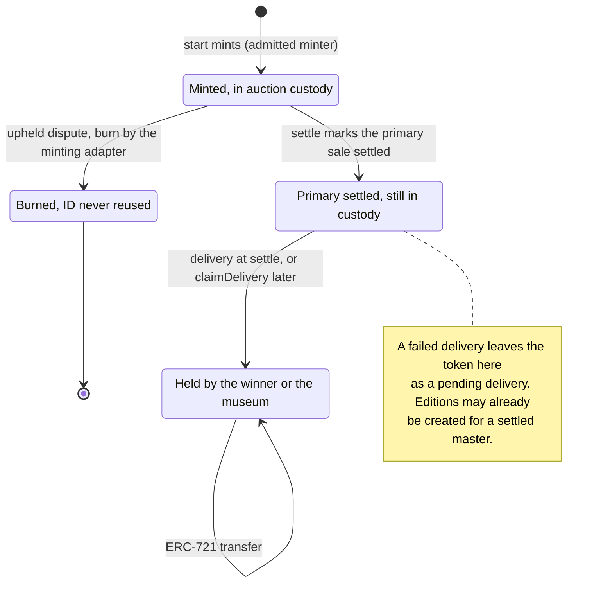

| Transition | Caller (role) | Delay | Function |
| --- | --- | --- | --- |
| Nonexistent to in custody | the auction, inside anyone's start | none | `Stream.mint`, from `EnglishAuction.start` or `startWithBid` |
| In custody to burned | the minting adapter, from the auction's `cancel` (PARAMETER_SETTER) | standard, 48 hours | `Stream.burn` |
| Burned (content released) | PARAMETER_SETTER | standard, 48 hours | `Stream.releaseContent`; the token stays burned and the ID unused |
| In custody to primary settled | the minting adapter, inside anyone's `settle` | none | `Stream.settlePrimary` (SOLD) |
| In custody to the museum | the minting adapter, inside anyone's `settle` | none | `Stream.settlePrimary` (UNBID or FROZEN_OUT): Stream moves the work itself |
| In custody to the museum, rescued | SUCCESSOR_SETTER, 90 days after the minting adapter's removal | 30 days | `Stream.rescueToMuseum` (RESCUED, owner decisions 20 and 28): Stream moves the work itself |
| Primary settled to held | the auction at `settle`, or the claimant | none | the token's `safeTransferFrom`, or `EnglishAuction.claimDelivery` |
| Held to held | owner or approved operator | none | standard ERC-721 transfers |

A settled token can never be burned or settled again (`SaleAlreadySettled`), and ERC-721
transfers never mark a sale settled. `primarySaleSettled(tokenId)` reads the flag, which gates
`IEditions.createEdition` and `linkEdition`; `primarySale(tokenId)` reads the outcome (owner
decisions 17 and 28): SOLD with its currency and price, UNBID, FROZEN_OUT or RESCUED, or NONE
before settlement.

### A work's lifecycle (owner decision 28)

Every 6529 Stream work is in exactly one of these states. Stream decides each from what it
stores: whether the ID was minted (`totalMinted`), whether the token exists (`ownerOf`), its
recorded outcome (`primarySale`), and whether its holder is the adapter that minted it.

| State | What Stream records | Holder |
| --- | --- | --- |
| Never minted | The ID is above `totalMinted()`; `primarySale` is NONE | none (`ownerOf` reverts) |
| In sale | Minted, outcome NONE | the sale adapter that minted it |
| Unsettled, out of custody | Minted, outcome NONE | anyone but the minting adapter |
| Cancelled (burned) | Minted, then burned; outcome NONE | none (`ownerOf` reverts); the ID is never reused |
| Sold | Outcome SOLD, with its currency and price | the minting adapter while its delivery is pending, then the buyer and later owners |
| Unbid | Outcome UNBID | the museum at settlement, then later owners |
| Frozen out | Outcome FROZEN_OUT | the museum at settlement, then later owners |
| Rescued | Outcome RESCUED | the museum at the rescue, then later owners |

NONE is the answer of three states: never minted, in sale (or out of custody) and cancelled.
Stream does not tell them apart in `primarySale`; an indexer or the website's data layer reads
`totalMinted`, `ownerOf` and the `Transfer` events (owner decision 28).

| From | To | Function | Caller | Guard |
| --- | --- | --- | --- | --- |
| Never minted | In sale | `mint` | an admitted sale adapter, inside its own start | The adapter is admitted; the item is approved, unconsumed and of the adapter's sale kind; a VRF item's seed is delivered. The work is minted to the adapter itself (`to == msg.sender`) |
| In sale | Cancelled | `burn` | the minting adapter (the English auction's `cancel`, PARAMETER_SETTER, 48 hours) | The caller holds the work, it is the adapter that minted it (admitted or not), and the sale is unsettled |
| In sale | Sold | `settlePrimary(SOLD)` | the minting adapter, inside its `settle` | Unsettled; a nonzero buyer. The work stays with the adapter until it delivers it |
| In sale | Unbid or frozen out | `settlePrimary(UNBID or FROZEN_OUT)` | the minting adapter, inside its `settle` | Unsettled; no buyer and no price; the adapter holds the work; the museum is not zero. Stream moves the work to the museum |
| In sale | Rescued | `rescueToMuseum` | SUCCESSOR_SETTER, 30 days | Unsettled; the minting adapter holds the work; that adapter was removed at least 90 days earlier and is not admitted; the museum is not zero. Stream moves the work to the museum |
| In sale | Unsettled, out of custody | an ERC-721 transfer by the adapter | the minting adapter | None in the contract (see below) |
| Unsettled, out of custody | In sale | an ERC-721 transfer back to the adapter | the holder | None |
| Unsettled, out of custody | Sold | `settlePrimary(SOLD)` | the minting adapter | Unsettled; a nonzero buyer (a SOLD report does not check the holder) |
| Sold, unbid, frozen out or rescued | the same state | ERC-721 transfers, and the delivery of a sold work | the holder or an approved operator | The outcome never changes |

Nothing else moves a work between these states. Once an outcome is recorded it is final:
`settlePrimary` refuses a settled work (`SaleAlreadySettled`), `burn` refuses it, and
`rescueToMuseum` refuses it (`WorkNotRescuable`). An adapter cannot report NONE or RESCUED
(`InvalidSaleOutcome`), so RESCUED comes from governance only. `StreamStatesInvariant.t.sol`
checks every observed transition against this table on the real stack.

**Unsettled, out of custody** is a state the contract allows and admission review rules out.
Stream does not refuse transfers of unsettled works: refusing them would add about 2,100 gas to
every later transfer of every work, forever. An adapter that moved a work out without settling
it could still report SOLD for it, and the work is out of reach of `burn` and
`rescueToMuseum`. The 30-day review before `setAdmittedMinter` checks that an adapter never
does this ([ADR 0005](../adr/0005-stream-editions-auction.md), the admission requirement).

### A sale method's lifecycle (owner decision 28)

A 1/1 sale adapter is in one of four states in 6529 Stream. Stream keeps them in one word per
adapter: whether it is admitted, its ID (assigned at its first admission and kept for good) and
when it was removed.

| State | What Stream records | May mint | May settle and burn its works | Its unsettled works are rescuable |
| --- | --- | --- | --- | --- |
| Never admitted | No ID | no | no | no |
| Admitted | An ID; admitted | yes | yes | no |
| Removed | An ID; not admitted; the removal time | no | yes | no |
| Rescue-eligible | Removed at least 90 days ago | no | yes | yes, those it still holds |

| From | To | Function | Caller | Guard |
| --- | --- | --- | --- | --- |
| Never admitted | Admitted | `setAdmittedMinter(adapter, true)` | SUCCESSOR_SETTER, 30 days (the English auction at genesis, through the wiring) | Code, no EIP-7702 delegation, ERC-165 `ISaleAdapter`, a nonzero `saleKind()`. Assigns the next ID and records the kind |
| Admitted | Removed | `setAdmittedMinter(adapter, false)` | SUCCESSOR_SETTER, 30 days | Records the removal time |
| Removed | Rescue-eligible | time | none | 90 days after the removal (`block.timestamp >= removedAt + 90 days`) |
| Removed or rescue-eligible | Admitted | `setAdmittedMinter(adapter, true)` | SUCCESSOR_SETTER, 30 days | The admission checks again; the ID and kind are kept; the removal time is cleared |

A call that would change nothing reverts with `AdmissionUnchanged`: admitting an admitted
adapter, or removing one that was never admitted or is already removed. Every
`AdmittedMinterSet(adapter, id, admitted)` is therefore a transition, and the events alone
rebuild every adapter's state; a removal's block timestamp starts its 90-day rescue clock.

### An auction

`auction(saleId).state` reports `ACTIVE`, `PAUSED`, `ENDED`, `SETTLED` or `CANCELLED`. The
contract stores `NONE` (no sale), `ACTIVE`, `SETTLED` and `CANCELLED`; `PAUSED` (a dispute pause
is live) and `ENDED` (the end has passed) are derived from the clock. `NONE` is never returned:
for a sale ID with no sale, `auction`, `minimumBid` and `lockedTerms` revert with
`UnknownSale(saleId)`, and so do `bid`, `withdrawBid`, `settle`, `pause(saleId, disputeRef)`,
`resume` and `cancel`; `claimDelivery` reverts with `NoPendingDelivery`.

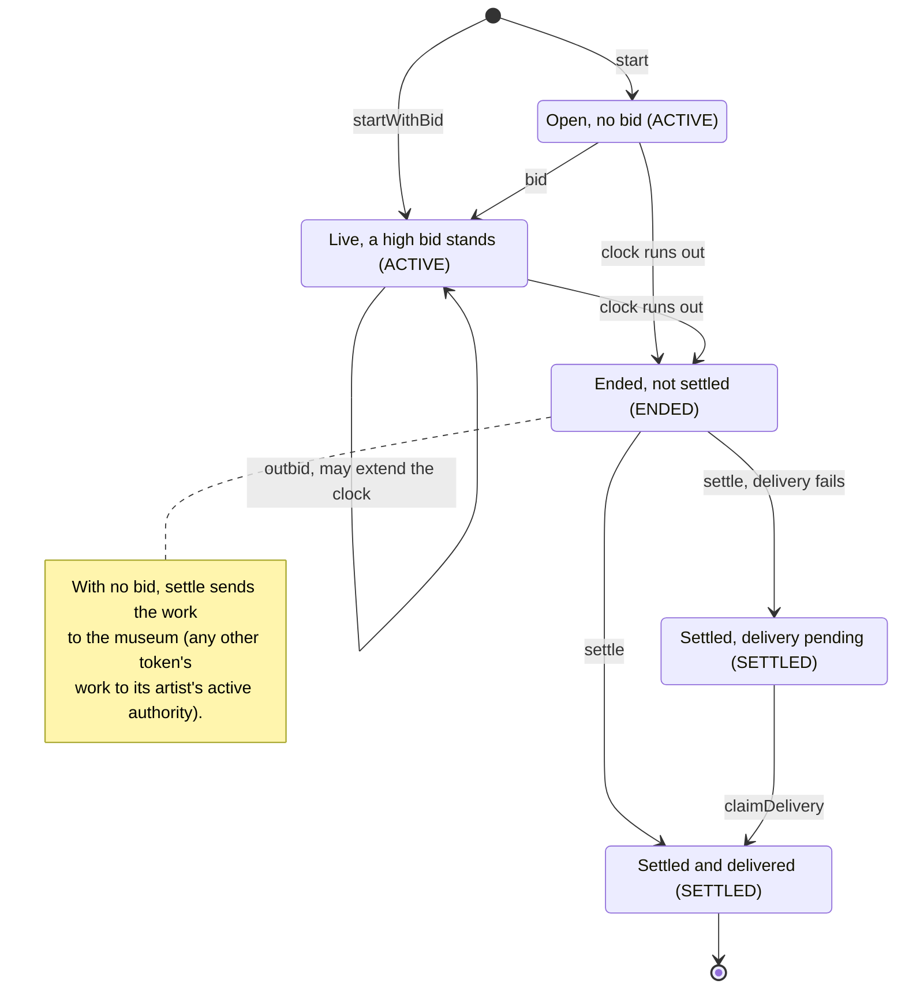

Halts: the dispute pause and the currency freeze.

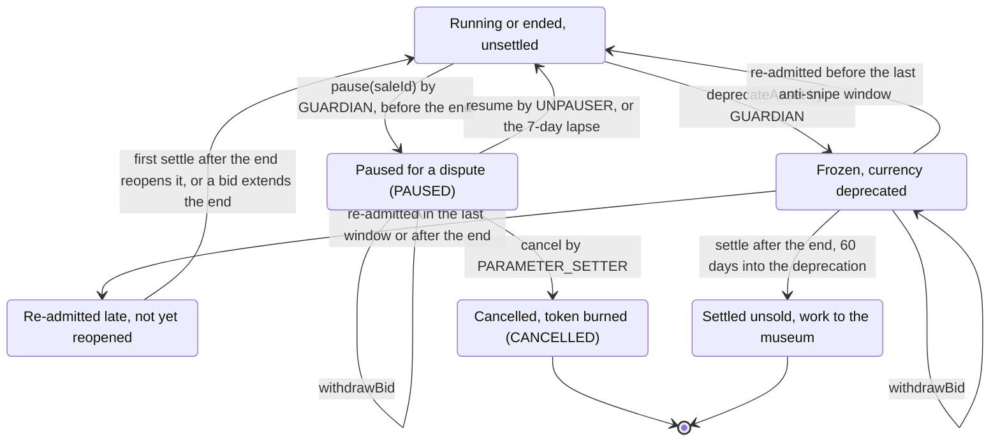

| Transition | Caller (role) | Delay | Function |
| --- | --- | --- | --- |
| None to open | anyone | none | `start` |
| None to live | anyone (the payer is the bidder) | none | `startWithBid` |
| Open to live, live to live | anyone | none | `bid` |
| Open or live to ended | the clock | none | none: `block.timestamp` reaches `endTime` |
| Ended to settled | anyone | none | `settle` |
| Settled, pending to delivered | the winning bidder (any address), the pending recipient (itself; any address from 30 days after the end), or (no bid, any token but 6529 Stream) the artist | none | `claimDelivery` |
| Running to paused | GUARDIAN | immediate | `pause(saleId, disputeRef)`, once per auction, before its end |
| Paused to running | UNPAUSER | standard, 48 hours, and no earlier than 48 hours after the pause | `resume`; or no call once 7 days have passed |
| Paused to cancelled | PARAMETER_SETTER | standard, 48 hours; between 48 hours and 7 days after the pause | `cancel` |
| Paused or frozen, bid withdrawn | the high bidder | none | `withdrawBid` |
| Running or ended to frozen | GUARDIAN, on the asset allowlist | immediate | `AssetAllowlist.deprecateAsset` |
| Frozen to running | FUNDS_SETTER | funds, 14 days, and no earlier than 14 days after the deprecation | `AssetAllowlist.admitAsset` at time `since`, with `since + extensionWindow <= endTime`: bids resume and `settle` settles normally |
| Frozen to re-admitted late | FUNDS_SETTER | as above | `admitAsset` with `since + extensionWindow > endTime` |
| Re-admitted late to running | anyone | none | the first `settle` after the end reopens it (`_reopenedAfterFreeze`, see the [freeze](#currency-freeze-and-recovery)); a bid before that extends the end past `since + extensionWindow`, so a later `settle` settles normally |
| Frozen to settled unsold | anyone | 60 days after the deprecation | `settle` |
| Ended (delisted federated contract) to settled unsold | anyone | none | `settle` (once a federation registry is installed; federation is in v1, specified by a later ADR) |
| Ended to settled, refused (federated sales only) | anyone | the sale's refusal delay after its end (AUC-46) | `settleOrRefund`, when its attempt at `settle` fails (AUC-45) |

#### How a sale ends

Every sale reaches exactly one of these terminal states, each by a permissionless call except a
cancel. The network column is what the network fee recipient receives (AUC-48).

| Terminal state | Reached by | The standing bid | The work | The network receives |
| --- | --- | --- | --- | --- |
| Settled, sold (`SaleSettled` with a buyer) | `settle`, or `settleOrRefund` whose attempt succeeded | Paid: the seller wallet the token names gets the price less the fee (escrowed if it refuses) | Delivered to the recipient, or a pending delivery the winner claims | The fee: price × fee share. For a federated sale both the share (the registry's) and the recipient (the resolver's) are locked at start; for 6529 Stream, its terms locked at mint |
| Settled, unsold (`SaleSettled`, no buyer: UNBID, or FROZEN_OUT after the freeze exit or a delisting) | `settle`, or `settleOrRefund` whose attempt succeeded | None, or credited back to its bidder (frozen out, delisted) | 6529 Stream: the museum. Any other token: its artist (delivered or pending) | Nothing: no sale |
| Settled, rescued close (`RescuedSaleClosed`, AUC-36) | `settle`, when the token already reports an outcome | Credited back | 6529 Stream: already with the museum. A federated token: in custody, a pending delivery its artist claims | Nothing: no sale |
| Settled, refused (`SettlementRefused`, AUC-45; federated sales only) | `settleOrRefund`, from the refusal delay after the end, when its attempt failed | Credited back | In custody, a pending delivery the creator the token reports claims | Nothing: no sale |
| Cancelled (`AuctionCancelled`) | `cancel` (PARAMETER_SETTER) during a dispute pause | Credited back | Burned | Nothing |

A sale whose token reverts or burns gas on `burn` cannot be cancelled; its pause lapses after
7 days and it ends by one of the other rows.

## Flows

### Start

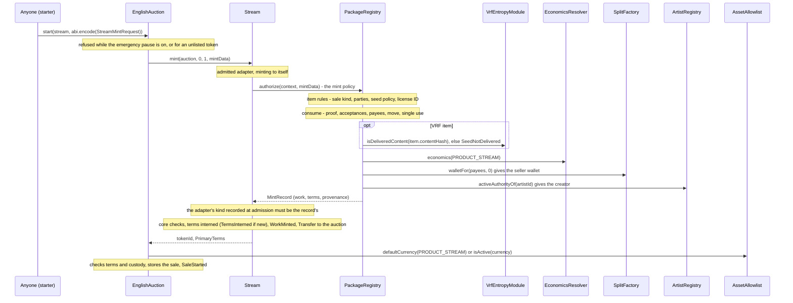

- **The auction refuses** (`EnglishAuction._start`) a token that is not listed by governance
  or (v1.1) active in the federation registry (`TargetNotAllowed`), and a token that already
  has a sale (`InvalidAuctionState`). It requires (`InvalidSaleTerms`) the English-auction sale
  kind, a nonzero seller and creator, a fee share of at most 100,000, a zero price, empty
  parameters, custody in the auction, a token ID below 2^32, a fee recipient for a nonzero fee
  share, and neither seller nor fee recipient equal to the revenue escrow (CALLS-1).
- **The mint policy** (`IMintPolicy.authorize`, v1 the package registry; AUC-38) gets the
  adapter's `mintData` unread, with Stream's economics resolver, entropy module and split
  factory. It checks that the item names a sale kind (`InvalidItemSale`; its currency and params
  are the adapter's to check, and the English auction refuses any params) and at least one party
  (`InvalidLeadArtist`); an ARTIST seed policy if and only if the item carries a nonzero seed,
  and a VRF policy only when Stream has an entropy module (`InvalidSeedPolicy`); a license ID
  that passes `SpdxId` (`InvalidLicenseId`); then consumes the item (the proof, acceptances,
  payees, the move, single use and content uniqueness, [Curation](curation.md); its errors bubble
  up unchanged), checks a VRF item's delivered seed at Stream's entropy module
  (`SeedNotDelivered`; requested before the start, see [Entropy](entropy.md)), and quotes the
  terms (`InvalidWorkTerms` for unusable economics). Media checks do not run at mint; the
  curation signer simulates `openRecord`
  ([trust obligations](curation.md#trust-obligations-of-the-curation-signer)).
- **Stream checks, whatever the policy** (`Stream.mint`, `_authorize`, `_checked`): the caller
  is an admitted minter (`NotAdmittedMinter`) minting to itself with `id` 0 and `amount` 1
  (`InvalidMintRequest`); the policy's answer is a well-formed record (`InvalidMintRequest`);
  the record's sale kind is the adapter's, recorded at its first admission (`SaleKindMismatch`);
  a nonzero item hash, a lead artist ID that is nonzero and fits 160 bits, a kind and seed
  policy of at most 3 (their stored width) (`InvalidMintRequest`); a nonzero seller, a royalty
  rate of at most 100,000, a fee share below 100,000 and, for a nonzero fee share, a fee
  recipient that is neither zero nor the seller (`InvalidWorkTerms`); an existing collection
  (`UnknownCollection`); a content hash no work used, or released content led by its
  beneficiary and not by its tombstoned item (`ContentUsed`, `ContentReserved`; AUC-44).
- **Effects.** Stream stores two words per work: the seller wallet with the serial, collection,
  a flags byte (item kind, seed policy, settled, edition-linked) and a terms ID; and the item
  hash. The terms (the lead artist ID, royalty rate, fee share, and the indexes of the fee
  recipient and minting adapter) are one word that every work under the same terms shares,
  written by the first start under them (QUALITY-6). It sits at the position its hash names
  (23 bits), or in an overflow range keyed by the full hash when other terms hold that
  position; a re-rate moves the token to the terms with its new rate. `TermsInterned`
  announces each new terms word and `WorkMinted` names the work's seller and terms ID with its
  provenance (AUC-43), so the logs alone give every work's locked terms. New slots per start, and the accepted cost of a
  position collision (LIM-GAS-10), are in
  [ADR 0004](../adr/0004-gas-budgets-under-glamsterdam.md#the-table). The auction resolves `CURRENCY_DEFAULT` once, to the
  `PRODUCT_STREAM` default (ETH at launch), or requires the named currency to be active. The
  start never deploys a split wallet.
- **`startWithBid`** runs the start and then [the bid](#bid-and-outbid) in one transaction. A
  Permit2 bid there signs `Typehashes.START_BID_WITNESS` over the token, the hash of
  `mintData`, the recipient, the amount and the deadline, since no sale ID exists before the
  mint.
- **Gas.** AUC-32; other cases in the
  [ADR 0004 table](../adr/0004-gas-budgets-under-glamsterdam.md#the-table).

### Bid and outbid

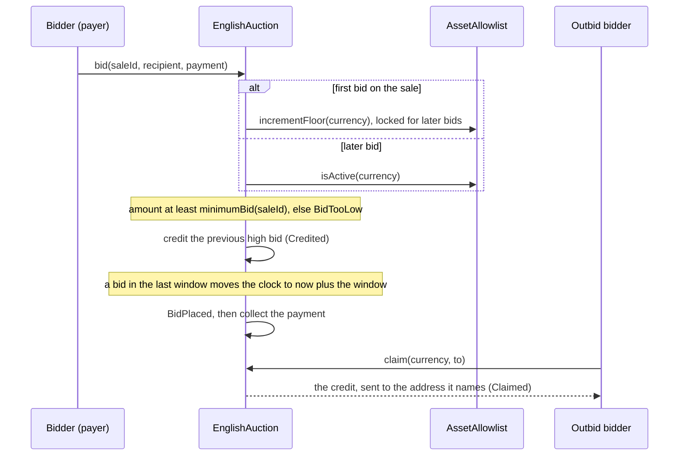

- **Preconditions.** The auction is running, not paused (`InvalidAuctionState`) and not a
  delisted federated contract (`TargetNotAllowed`); its currency is active (`AssetNotActive`);
  the recipient is not the auction (`InvalidRecipient`), and zero means the payer.
- **Minimum bid** (`_minimumBid`): with no standing bid, `max(openingBid, reserve, 1 wei)`
  (LIFECYCLE-1); with a standing bid `high`, `high + max(ceil(high × incrementShare /
  100,000), incrementFloor)`, which at launch in ETH is `max(5%, 0.001 ETH)` above the high
  bid. A bid above `type(uint96).max` base units reverts.
- **Anti-snipe** (AUC-17). The locked `extensionWindow` is 15 minutes at launch. Bids are
  accepted while `block.timestamp < endTime`.
- **Payment** (`_collect`). The payer is the bidder of record: credits go to it, and only it
  may withdraw. The bid is recorded before the pull; the call reverts if the payment does not
  arrive.

  | Currency | Method | Payer | What happens |
  | --- | --- | --- | --- |
  | ETH | `DIRECT` only | `msg.sender` | `msg.value` must equal `amount` (`InvalidPayment`). |
  | ERC-20 | `DIRECT` | `msg.sender` | `TokenTransfer.pullExact` of an allowance granted beforehand. |
  | ERC-20 | `PERMIT` | `msg.sender` | An EIP-2612 permit (65 bytes: `r`, `s`, then `v`), then the same pull. A permit that fails, for example because someone already submitted it, is ignored, and the pull uses the allowance it granted. |
  | ERC-20 | `PERMIT2` | the signer | Permit2's `permitWitnessTransferFrom`, so a relayer may submit it. The witness is `Typehashes.BID_WITNESS` (sale ID, recipient, amount, deadline), or `START_BID_WITNESS`. Refused when the auction was built without Permit2. |

  An ERC-20 bid sends no ETH (`InvalidPayment`); a `PERMIT` or `PERMIT2` payment past its
  deadline reverts with `PaymentExpired`.
- **ERC-20 checks** (AUC-19). Exact balance deltas make fee-on-transfer and rebasing tokens
  fail. The real guard against non-standard tokens is governance admitting only standard ERC-20s
  (`AssetAllowlist.admitAsset`, whose probe is a sanity check, not proof; LIM-SAL-7 in
  [known limitations](../audit/known-limitations.md#sales-and-auctions)).
- **Claims.** `claim(currency, to)` sends all of the caller's credits in that currency to `to`
  (`NothingToClaim`; `InvalidRecipient` for zero; `ClaimFailed` keeps an ETH credit a
  recipient refuses). Claims never read the allowlist, so a deprecated currency never blocks
  them.

### Settle with a bid

```mermaid
sequenceDiagram
    participant Keeper as Anyone (keeper)
    participant Auction as EnglishAuction
    participant Stream as Stream
    participant Seller as Seller wallet
    participant Fee as Fee recipient
    participant Escrow as RevenueEscrow
    participant Winner as Recipient
    Keeper->>Auction: settle(saleId) after the end
    Note over Auction: currency active (else frozen), not reopened after a freeze
    Auction->>Stream: settlePrimary(tokenId, SOLD, bidder, currency, price)
    Note over Stream: records SOLD, currency and price; PrimarySaleSettled names the buyer
    Stream-->>Auction: seller and fee terms
    Auction->>Seller: price minus fee
    Auction->>Fee: fee, floor of price x feeShare / 100,000
    opt a wallet refuses its payout
        Auction->>Escrow: deposit for that wallet
    end
    Auction->>Stream: safeTransferFrom(auction, recipient) with 300,000 gas
    alt the token left custody
        Stream->>Winner: token delivered
    else the token is still in custody
        Note over Auction: DeliveryPending(saleId, recipient)
    end
    Auction->>Auction: SaleSettled
    opt delivery pending, in a later transaction
        Winner->>Auction: claimDelivery(saleId, to)
    end
```

- **Preconditions.** The auction has ended and is not paused (`InvalidAuctionState`); its
  currency is active, or deprecated for at least 60 days (see the
  [freeze](#currency-freeze-and-recovery)). The caller must forward each bounded call's gas in
  full: a shortfall reverts (`DeliveryInsufficientGas`, `PaymentInsufficientGas`) instead of
  forcing the escrow, credit or pending-delivery route.
- **Terms.** Returned by Stream's `settlePrimary`, from the terms locked at mint, so a later
  economics change never reaches a started auction. A zero amount is not paid.
- **ETH payouts** forward `PAYOUT_GAS` (100,000) to each wallet; a refusing wallet is
  credited in the revenue escrow (`RevenuePayment.payETH`), which anyone flushes to it later.
- **ERC-20 payouts** (MONEY-1) run in their own 1,000,000-gas frame (`settlePayout`, callable
  only by the auction), where the token's transfer gets 300,000 gas and a refused transfer
  goes to the escrow. If the frame fails even so, the amount is credited to the wallet in the
  auction, and anyone pays it out later with `claimFor(wallet, currency)`, which pays only the
  account itself and refuses ETH (`IRevenueEscrow.InvalidAsset`).
- **Settlement is recorded before delivery**, so a winner who never claims cannot hold up the
  master's edition.
- **Delivery** (`_deliver`) gives the token's `safeTransferFrom` exactly `DELIVERY_GAS`
  (300,000) and copies no return data. `claimDelivery(saleId, to)` later delivers a pending
  token, with all remaining gas: the winning bidder (the payer of the high bid) names any
  address but zero and the auction, at any time. The recipient it named claims to itself at
  any time, and to another address only from 30 days after the auction's stored end
  (`_REDIRECT_DELAY`, counted after any pause; `InvalidRecipient` before then) (AUC-21). The
  bidder chose the recipient, so for 30 days only the bidder sends the token elsewhere, and a
  recipient contract that forwards calls cannot redirect it first; after that a recipient
  contract that can make calls but cannot receive the token, named by a bidder that cannot
  call, is not left holding the work forever. If neither the recipient nor the winning bidder
  can call it, the token stays in custody.
- **Keeper gas.** The ERC-20 payout frame must be forwardable in full, so an ERC-20 `settle`
  needs a gas limit of about 1.11M although it uses about 140K
  ([ADR 0004, security impact](../adr/0004-gas-budgets-under-glamsterdam.md#security-impact);
  `test_Settle_SettlerGasLimitVersusGasUsed` in
  [`EnglishAuction.t.sol`](../../test/sales/auction/EnglishAuction.t.sol)).

### Settle with no bid

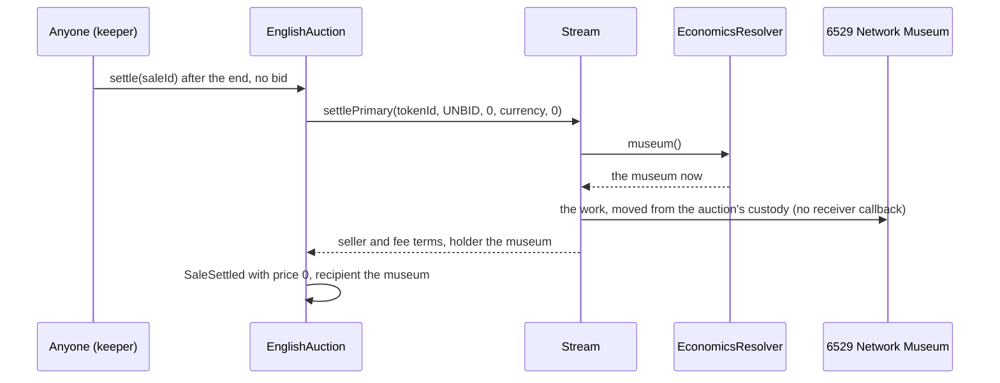

- **The museum** (D140, [ADR 0005](../adr/0005-stream-editions-auction.md)) is read by Stream
  from its economics resolver at settlement, so a governed change that lands before the settle
  redirects the work, and Stream moves the work there itself (owner decision 17), for this
  auction and for every other admitted 1/1 adapter. The artist plays no part: a restrained
  artist (an override pending) does not hold up the settlement, and nothing is left pending
  for anyone to claim (AUC-33).
- **Any other token's work** (owner decision 9), federated or listed by governance, goes to its
  artist's active authority, read from the token at settlement: such a token leaves the work
  to the auction (`holder` zero), which delivers it. A completed recovery redirects
  it, and during a restraint the token
  reports none, so `settle` reverts with `InvalidRecipient(address(0))`, moves nothing, and
  anyone retries once the override's outcome is known
  ([Identity and recovery](identity-and-recovery.md)).
- **A pending delivery.** Never for a 6529 Stream work: Stream moves it with no receiver
  callback, so a museum account that would reject a safe transfer still receives it. Another
  token's artist whose account rejects the token claims it as the recorded recipient or as the
  active authority at claim time.
- Nothing is paid, even when a withdrawn bid left a reserve. The same outcome ends a frozen sale
  after 60 days (owner decision 10) and a delisted federated contract's sale, after crediting
  the standing bid; the auction reports those FROZEN_OUT, and a sale with no bid UNBID.

### A token that will not settle

`settle` calls into the token it sells: the outcome view `primarySale` (AUC-36), `settlePrimary`,
`ownerOf` (with no bid, and after each delivery attempt), `primaryTerms` (the artist an unsold
work goes to) and the delivery, and it pays the wallets the token names. A federated token (an
artist's own, uncurated contract built from a network template) may revert, burn the gas it is
given, answer malformed or hostile values, re-enter, or change behaviour between calls. Any of
these makes `settle` revert, which on its own would hold the standing bid and the work for good.
The exit is for federated sales only (`SaleNotRefusable` otherwise). A listed token, 6529 Stream
and any token governance lists after review, settles only through `settle`: its settlement is
curated not to fail. 6529 Stream's can fail only if governance breaks one of its dependencies
(an economics resolver whose `museum()` reverts fails an unbid or frozen-out sale); the sale then
waits for governance's repair, as before, and is never refused, so the artist cannot take an
unsold work and a master's edition sale is never stranded
([`StreamSaleNeverRefused.t.sol`](../../test/integration/StreamSaleNeverRefused.t.sol)).

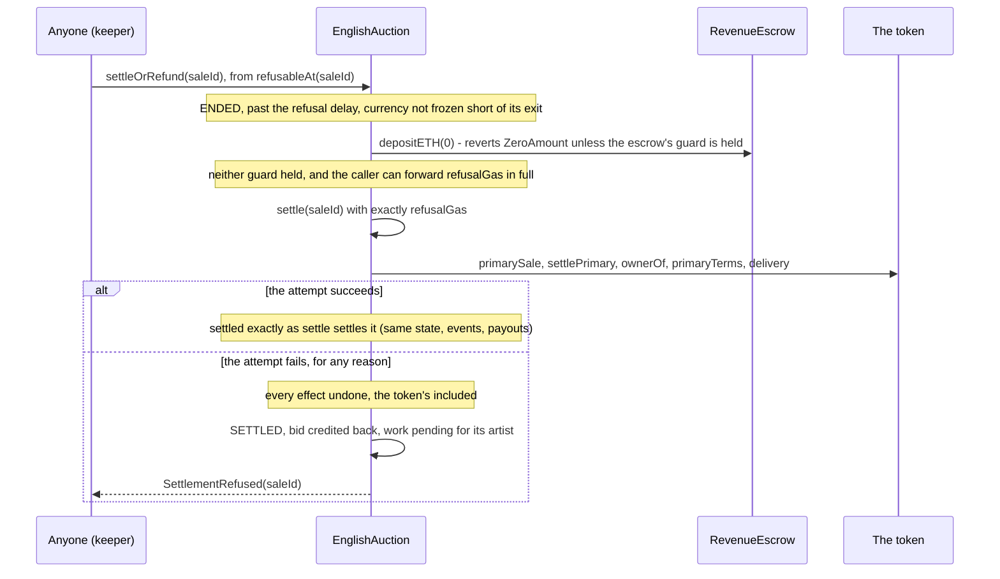

- **Who and when.** Anyone, for a federated sale, from `refusableAt(saleId)`: the sale's end
  (after any dispute pause) plus the refusal delay it locked at start, 7 days at launch (AUC-46). Before then `RefusalTooEarly(saleId,
  allowedAt)`. While its currency is frozen short of the 60-day exit the call waits like `settle`
  (`AssetNotActive`): a freeze is the auction's own wait, not the token's refusal.
- **The attempt is `settle` itself**, called by the auction on itself with exactly `refusalGas`
  (4,000,000 at launch, AUC-47), returning nothing it copies. If it succeeds, nothing else
  happens: the outcome, the events and the payouts are exactly `settle`'s, so the exit cannot be
  used to escape a sale whose token cooperates. If it fails, the frame's revert undoes everything
  it did, the token's own record of the sale included, and the sale closes as refused.
- **A shortfall is never a refusal** (AUC-47). The attempt's gas is fixed: a caller that cannot
  forward it in full under EIP-150 is refused before anything happens
  (`BoundedCall.BoundedCallInsufficientGas(refusalGas)`), and after a failed attempt the close runs
  on the 1/63 the call retained; a caller that left too little runs out of gas and the whole call
  reverts. The token sees the same gas whatever the caller sends, so no caller chooses the outcome
  by its gas limit. Refusal gas is the bound the rule allows for gas-burning callees: forwarding
  all gas would make a gas burner indistinguishable from a caller's shortfall, so the sale could
  never close.
- **No other context can fail the attempt.** The call is refused inside any of the auction's
  guarded calls and inside the escrow's (`ReentrancyGuardReentrantCall`): a token re-entering from
  its own settlement could otherwise make another sale's attempt fail on the auction's guard, and
  a caller running inside the escrow's `flush` (paid to its own contract) could make any attempt
  that escrows a refused payout fail on the escrow's guard. Every other call in the attempt either
  belongs to the token or already absorbs its failure: the delivery is bounded and leaves a
  pending delivery, a refusing wallet's ETH is escrowed with bounded gas, and an ERC-20 payout runs
  in its own frame with a credit fallback.
- **The close** (`_closeWithRefund`) makes no external call: SETTLED, the standing bid credited to
  its bidder (`Credited`), the recipient cleared, and the delivery marked pending with no
  recipient, so only the artist the token reports (`primaryTerms(tokenId).creator`, the no-bid path
  of `claimDelivery`) can take the work out, to any address. The former bidder cannot. If the
  token blocks that call or its transfers too, the work stays in custody: it is the token's own
  ledger.

#### Why this is sound

The previous attempt at an exit (RFX-SAL-3, withdrawn) closed a sale whose `settlePrimary` failed
in a fixed 1,000,000-gas frame from 60 days after its end, and credited an ETH payout to a wallet
the escrow refuses. It was unsound: it covered `settlePrimary` only, so a token reverting in
`ownerOf`, burning gas in `primarySale`, or naming an unpayable seller still held the bid, and a
delisted or unbid sale had no exit; a payout credited to the zero address or the escrow could never
be claimed, so the seller's part was held forever; its gas bound was a compiled constant, and
it wrapped 6529 Stream's own settlement after 60 days, so a canonical sale that needed more could
close as refused with its work stranded in a live adapter. The design here instead wraps the whole
settlement, every call and every payout in it, in one atomic attempt with governed gas, and only
ever credits a bid back to the bidder that paid it.

| Case | What happens | Who bears it, and why |
| --- | --- | --- |
| The token reverts, burns its gas or answers malformed data in any settlement call (with or without a bid; delisted or frozen out) | `settle` reverts; from the refusal delay `settleOrRefund` closes the sale as refused | The artist who deployed the token loses the sale and the network its fee; the bidder gets its bid back in full and bears only the wait, at most the refusal delay. The artist chose the token; the bidder chose to bid on it |
| The token names a seller no payout reaches (zero, the escrow) | The attempt fails at the payout and the sale closes as refused: no one is paid, the work stays in custody | As above. No outcome hands over the work with the seller paid and the network not |
| The token names a seller wallet that refuses ETH or burns its gas | The sale completes: the seller's part is escrowed for that wallet (bounded call), the network's fee is paid in full, the buyer gets the work | The seller, who must flush the escrow. The network's part is a separate payout to a recipient the auction locked |
| The token cooperates selectively: for some buyers, with some gas, before or after some time, for some calls | The sale either completes in full or closes as refused; the attempt's gas is fixed, so gas cannot steer it to anything else | The token's deployer can always refuse a sale; refusing a low price gives the seller a free option that costs the bidder at most the refusal delay. Only uncurated tokens can do this |
| A bidder colludes with the token | The bidder gets back exactly its bid; where the work goes afterwards is the token's own choice (the creator it reports) | The token's deployer and the network forgo the sale; no one else loses. The auction never hands the work to a refunded bidder by its own decision |
| The seller colludes with the token | As selective cooperation: a full sale or a refund | The network's fee cannot be redirected: for a federated sale its share and recipient were locked at start, never read from the token (AUC-48) |
| A third party | Cannot turn a cooperating token's sale into a refusal: the gas is fixed, the auction's and the escrow's guards are checked, a recipient's or wallet's failure is absorbed | No one. A third party that can make the token's own dependencies fail is the token's risk (residual below) |
| The token re-enters | Every value-moving entry point and `settleOrRefund` refuse it; the lens's views are read-only | Only the token's own sale can fail |
| A listed token, 6529 Stream included | `settleOrRefund` refuses it (`SaleNotRefusable`); it settles only through `settle` | No change for 6529 Stream: same outcomes and events. If governance breaks one of its dependencies, an unbid or frozen-out sale waits for the repair (at least 30 days) and is never refused, so no artist takes an unsold work and no edition sale is stranded (`StreamSaleNeverRefused.t.sol`) |
| Governance | The refusal gas only rises (at most doubling per step), never below the auction's own floor; the delay is bounded and every refusable sale keeps the one it locked; no setting reaches a listed token's sale | A raise helps a cooperating token that needs more gas; it cannot be undone (LIM-SAL-17) |

**Residual risk.** (1) The auction trusts the token's ledger: a token that reports a delivery it
did not make (an `ownerOf` that lies) keeps the price while the buyer holds nothing. This is
inherent to buying any NFT; for a federated token the registry binds its code hash to a reviewed
template. (2) A token whose cooperating settlement needs more than the refusal gas, less the
auction's own share, can be closed as refused by anyone after the delay; keepers settle with
`settle` first, and governance raises the refusal gas. (3) A template whose settlement depends on
a contract whose reentrancy guard a third party can hold while running its own code (as the
escrow's `flush` does) could have its sales refused by that third party; templates must not.
(4) Under the EIP-8037 draft a transaction above 2^24 gas carries a state-gas reservoir, so a
token whose settlement writes more state than the refusal gas pays for can settle for one keeper
and be refused for another (CALLS-3, LIM-GAS-2); keepers send at most 2^24. (5) After a refused
close the token's own record still says the sale never settled. (6) A token governance lists
other than 6529 Stream has no exit: if its settlement fails, its standing bid is held until it is
repaired, as before this change. None is listed at launch (genesis lists only 6529 Stream, and
`setTarget` is a 30-day action whose review must prove the token's settlement cannot fail).

### What a federated template must guarantee

A federated token is uncurated: the auction defends a bidder's funds, the network's fee and every
other sale against anything it does (the analysis above). What it cannot defend is the sale itself:
a template that breaks one of these rules lets its artist, a bidder or a third party choose a
refusal, or lets a buyer pay for a work it does not get. The federation lane builds its templates
to them, and governance checks them before it publishes a template version.

1. **Gas.** Its whole settlement (`primarySale`, `settlePrimary`, `ownerOf`, `primaryTerms` and
   the delivery's transfer) runs within the refusal gas less the auction's own worst case
   (2,434,325 measured; AUC-47), in regular gas, state gas included, with no EIP-8037 reservoir:
   a keeper sends at most 2^24 gas.
2. **Outcome view.** `primarySale(tokenId)` answers NONE until the adapter settles the sale; any
   other answer closes the sale with refunds (AUC-36).
3. **No third-party guards.** Its settlement never depends on a contract whose reentrancy guard a
   third party can hold while running its own code (the escrow's `flush`, a split wallet's
   release, a vault's withdrawal).
4. **No buyer or recipient code.** `settlePrimary`, `ownerOf` and `primaryTerms` never call code
   the buyer, its recipient or any other bidder controls (a hook, a companion mint to the buyer)
   outside a call whose failure they absorb: otherwise a bidder could force a refusal.
5. **No identity dependency for a sale.** A SOLD settlement never depends on identity state such
   as the artist's active authority being nonzero: a pending recovery override must not fail a
   sale. An unsold settlement may: the work then waits for the artist (AUC-24).
6. **Locked payees.** The seller wallet and every other term `settlePrimary` returns are fixed at
   mint; the artist cannot change them after the sale starts, and they are never zero, the escrow
   or the auction (AUC-48: a payout to one fails the settlement, which then closes as refused,
   giving the artist a free option until the delay ends).
7. **An honest ledger.** `ownerOf` reports the true holder, and the delivery's `safeTransferFrom`
   moves the token: the auction trusts both for delivery (residual 1).
8. **One settlement, by its adapter.** Only the adapter that minted a token settles its primary
   sale, once; transfers never settle it. The holder `settlePrimary` returns depends on the
   outcome: for SOLD it is zero, so the adapter delivers (IMintTarget); for UNBID and FROZEN_OUT
   the v1 template moves the work into its own custody with no receiver call and returns itself,
   so the adapter records it as taken and delivers nothing ([Federation](federation.md),
   FED-17).
9. **Fixed code.** No proxy and no delegatecall: the code hash the registry records is the code
   that runs at settlement (AUC-28).

### Currency freeze and recovery

```mermaid
sequenceDiagram
    participant Guardian as Guardian Safe
    participant Allowlist as AssetAllowlist
    participant Bidder as High bidder
    participant Keeper as Anyone (keeper)
    participant Auction as EnglishAuction
    participant Admin as Admin Safe
    Guardian->>Allowlist: deprecateAsset(currency) (GUARDIAN, immediate)
    Note over Auction: frozen - bids and settle revert with AssetNotActive
    opt the high bidder leaves
        Bidder->>Auction: withdrawBid(saleId), credited, the amount stays as reserve
    end
    alt re-admitted in the last window or after the end
        Admin->>Allowlist: admitAsset (FUNDS_SETTER, 14 days, not before day 14)
        Keeper->>Auction: settle(saleId)
        Auction-->>Keeper: AuctionResumed, reopened, nothing settled
    else 60 days after the deprecation, still deprecated
        Keeper->>Auction: settle(saleId)
        Auction-->>Keeper: bid credited back, work to the museum, SaleSettled
    end
```

- **Why.** A deprecation freezes the auction, not just its bids, so a standing low bid cannot
  win while nobody else may bid (MARKET-2; LIM-SAL-3 in
  [known limitations](../audit/known-limitations.md#sales-and-auctions)). The high bidder may
  `withdrawBid` at any time, before or after the end.
- **Re-admission** (`_reopenedAfterFreeze`). `admitAsset` refuses to run before day 14
  (`ReadmissionTooEarly`); it has no upper bound, but from day 60 anyone may end the auction
  unsold, so a re-admission saves the sale only if it comes first. Sixty days exceed one
  guardian's removal (30 days, which it cannot cancel) plus a re-admission after it (14 days),
  so a single guardian that deprecates a currency and vetoes every re-admission cannot run out
  the sales in it before governance removes it and re-admits the currency. A reopening (`since +
  extensionWindow > endTime`) moves the end to now plus the longer of the current governed
  duration and the locked window, and settles nothing.
- Operators follow the runbook's advice before deprecating an auction's currency
  ([`script/README.md`](../../script/README.md)).

### Dispute pause, resume and cancel

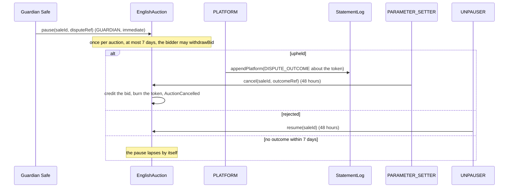

[Disputes and statements](disputes-and-statements.md#upheld-dispute-during-an-auction)
specifies the dispute process; the auction enforces AUC-26 and AUC-27. A pause is live through
`pausedAt + MAX_PAUSE` inclusive. `cancel` cites the token's own latest `DISPUTE_OUTCOME`
(LIFECYCLE-4). On resumption, by `resume` or the lapse, the auction runs at least the longer of
the remaining time, the governed duration and the locked window, even with a standing bid
(LIFECYCLE-1).

### Emergency pause and governed settings

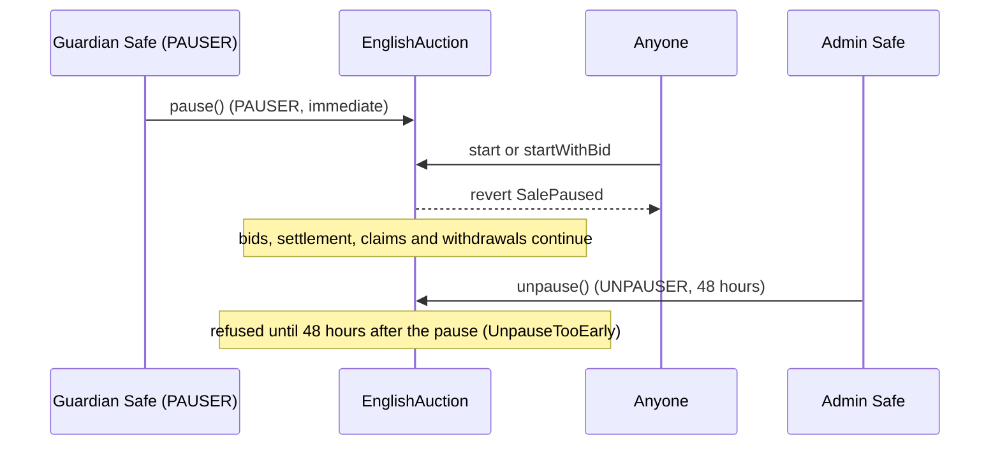

- **Emergency pause.** Running auctions carry on, because stopping one near its end would
  distort its outcome. Pausing twice reverts with `SalePaused`, unpausing while not paused with
  `NotPaused`. The configuration refuses one account holding both PAUSER and UNPAUSER.
- **`setConfig(expected, next)`** is compare-and-set on the whole `AuctionConfig` within the
  bounds under [Parameters and limits](#parameters-and-limits) (`InvalidConfig`). It applies to
  auctions started afterwards, except that a resumption or a reopening reads the current
  duration.
- **The opening bid is the asset allowlist's** ([ADR 0007](../adr/0007-permanence.md)):
  `AssetAllowlist.setOpeningBid(asset, expectedRevision, bid)` (PARAMETER_SETTER, 48 hours) is
  compare-and-set on the asset's revision, moves either way, zero included, up to
  `min(incrementFloor(asset) × OPENING_BID_FLOORS, type(uint96).max)`
  (`OpeningBidAboveCeiling`), for an active asset, for auctions started afterwards. The bid
  shares the asset's status word, so a start reads the currency's status and opening bid in one
  call (`activeOpeningBid`, or `defaultCurrencyOpeningBid` for `CURRENCY_DEFAULT`); the auction's
  `openingBid(currency)` answers from the allowlist. Genesis wires ETH's at 0.05 ETH (owner
  decision 19, a genesis wiring call at ETH's revision 1), which an `ETH_INCREMENT_FLOOR` below
  0.00005 ETH would put above the ceiling.
- **`setTarget(token, listed)`** lists a token contract with code, not EIP-7702 delegated,
  that supports ERC-721 through ERC-165 (`InvalidDependency`). Unlisting stops new starts only.
- **`setFederationRegistry(expected, next)`** installs the v1.1 federation registry:
  compare-and-set, ERC-165 for `IFederationRegistry`, EIP-7702 rejected, code hash pinned (a
  registry whose code later differs serves no token). v1 installs none.

### Royalty read

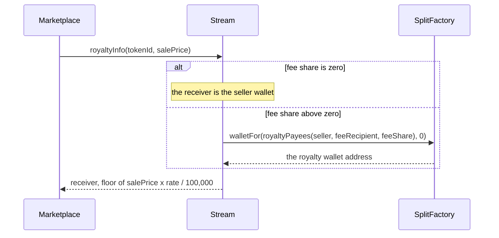

- The rate is stored per work and changes only by agreement of every party plus a governed
  action, through `WorkRecords` ([Works and storage](works-and-storage.md)). The receiver never
  changes after mint.
- The receiver comes from one plain view call to the split factory over the canonical payee
  list `Splits.royaltyPayees`, so it equals the address the economics resolver derives. The call
  can run out of gas and revert, but never returns a zero royalty for lack of gas.
- The amount is `(p / D) × rate + (p % D) × rate / D` with `D` = 100,000: exactly
  `floor(p × rate / D)`, with no overflow for any price.
- A burned or unminted token reverts with `UnknownWork`. The call stays under 50,000 gas
  ([ADR 0004, the table](../adr/0004-gas-budgets-under-glamsterdam.md#the-table)).

### An edition master's 1/1 beside its editions

An `EDITION_MASTER`'s 1/1 sells in this auction while its copies sell in the edition auction
beside it (D140, D141). The edition auction only reads this auction: nothing here waits for the
editions, and the 1/1's rules are unchanged. The edition rules are `EA-1` to `EA-16` in
[Editions and sales](editions-and-sales.md#timing-alongside-the-11); its offsets and windows are
under [its parameters](editions-and-sales.md#the-edition-auction).

```mermaid
sequenceDiagram
    participant Keeper as Anyone (keeper)
    participant Auction as EnglishAuction (the 1/1)
    participant EA as UniformEditionAuction (the copies)
    participant Ed as Editions
    Keeper->>Auction: start(stream, mintData)
    Keeper->>EA: open(editions, workId, abi.encode(item)), in the same batch
    Note over Auction,EA: both take bids; the edition close is the 1/1 end plus closeOffset
    Note over Auction: a 1/1 bid in its anti-snipe window extends the 1/1 end
    Note over EA: the edition close moves with it; late edition bids add the soft close
    Keeper->>Auction: settle(saleId): to the high bidder; unbid, Stream moves it to the museum
    Keeper->>Ed: createEdition(workId, item)
    Keeper->>EA: settle(editionSaleId, order), once its own end has passed
```

- **The 1/1 closes first.** The edition close is the 1/1's current end plus the offset, so a
  1/1 extended by anti-snipe or resumed after a dispute pause moves it; edition bids never move
  the 1/1.
- **The editions settle second.** Edition settlement waits for the 1/1 to be SETTLED, so the
  1/1's end is final, and, when copies sold, for the edition to exist; `createEdition` needs the
  settled master ([AUC-11](#rules-and-invariants)).
- **Independent outcomes.** Copies sell whether or not the 1/1 drew a bid: an unbid 1/1 goes to
  the museum ([settle with no bid](#settle-with-no-bid)) and its editions settle all the same. A
  1/1 dispute pause lets edition bids placed or last raised before the pause's minute be withdrawn, and a cancel voids the edition auction with
  full refunds.

### Collections and marketplace metadata

- **`createCollection(name, metadataHash)`** (PLATFORM) creates the next collection ID, from 1.
  The name is 1 to `MAX_NAME_BYTES` (256) bytes of valid UTF-8 without a control character
  (below 0x20, or 0x7F), `<`, `"` or `\` (`InvalidCollectionName`): the name goes into every
  work's metadata, and refusing those characters keeps `tokenURI` within its gas budget.
  `metadataHash` may be zero. `collection(id)` returns the name, the hash and the number minted
  (also the last serial). A guardian can [suspend](governance.md#suspension-of-operational-keys)
  a compromised PLATFORM key at once.
- **`setContractURI(uri)`** sets the ERC-7572 contract URI and emits `ContractURISet` and
  `ContractURIUpdated`.
- **`setOwner(expected, next)`** (compare-and-set) sets the marketplace `owner()`, which
  marketplaces let configure creator earnings. It has no on-chain powers.
- **`bindWorkRecords` and `bindEditions`** bind each satellite once: the target has code, is
  not EIP-7702 delegated, supports its interface through ERC-165, and serves this Stream
  (`stream() == address(this)`). A second bind reverts with `AlreadyBound`.
- **`linkEdition(tokenId, editionId)`** runs once per work, from the bound Editions, for an
  `EDITION_MASTER` whose primary sale settled, with `editionId == tokenId`
  (`EditionLinkInvalid`); `editionOf` then returns the pair
  ([Editions and sales](editions-and-sales.md)).

## Rules and invariants

| ID | Rule | Enforced in | Tested by |
| --- | --- | --- | --- |
| AUC-1 | Only an admitted minter mints, into its own custody, with `id` 0 and `amount` 1. Admission requires code, ERC-165 `ISaleAdapter` and no EIP-7702 delegation. | `Stream.mint`, `Stream.setAdmittedMinter` | [`Stream.t.sol`](../../test/stream/Stream.t.sol): `test_mint_revertsForUnadmittedCaller`, `test_mint_revertsForWrongShape`, `test_setAdmittedMinter`, `test_setAdmittedMinter_reverts` |
| AUC-2 | Stream mints only for an admitted adapter whose sale kind, recorded at its first admission, is the record's, into an existing collection; the v1 mint policy admits only an item that names a sale kind and has at least one party, a coherent seed policy and a valid license ID. The 1/1 sale method is pluggable (owner decision 15): the English auction is admitted at genesis, a later method by governance (30 days), and `primaryTerms` reports the minting adapter's kind, recorded at its first admission. | `Stream.mint`, `Stream._checked`, `PackageRegistry._checkItem`, `Stream.setAdmittedMinter`, `Stream.primaryTerms` | [`Stream.t.sol`](../../test/stream/Stream.t.sol): `test_mint_comparesTheKindRecordedAtAdmission`, `test_mint_revertsForStreamRuleBreaks`, `test_mint_acceptsMixedCaseLicenseId`, `test_mint_refusesALicenseIdTheRecordsWouldRefuse`, `test_saleMethod_aSecondAdapterMintsOnlyItsOwnKind`, `test_saleMethod_kindRecordedAtFirstAdmission`; [`StreamSaleMethods.t.sol`](../../test/integration/StreamSaleMethods.t.sol): `test_ASecondAdmittedAdapterSellsAWorkEndToEnd`, `test_AnUnadmittedAdapterIsRefused` |
| AUC-3 | Every mint is admitted by the mint policy in the same call (v1: the item is consumed); a policy revert reverts the mint, with the policy's revert data. | `Stream._authorize`, `PackageRegistry.authorize` | [`Stream.t.sol`](../../test/stream/Stream.t.sol): `test_mint_bubblesRegistryRevert`, `test_mint_reentrantRegistryKeepsCountersConsistent`; [`StreamPolicySafety.t.sol`](../../test/stream/StreamPolicySafety.t.sol): `test_MP1_RevertBurnAndMalformedAnswersMintNothing` |
| AUC-4 | A VRF item mints only when Stream has an entropy module and the seed of the item's content is delivered there (`isDeliveredContent`, one word; a content hash is consumed once, CUR-12): the v1 mint policy checks it at the module Stream passes, which `entropyModuleOf` reports for the work. | `PackageRegistry.authorize`, `Stream._context` | [`Stream.t.sol`](../../test/stream/Stream.t.sol): `test_mint_vrfNeedsDeliveredSeed`, `test_mint_vrfRejectedWithoutEntropyModule`; [`VrfWork.t.sol`](../../test/integration/VrfWork.t.sol): `test_SeedRequestedDeliveredThenStartedAndRendered` |
| AUC-5 | Token IDs are one global sequence from 1, never reused; serials count per collection from 1; `totalSupply` is minted minus burned. | `Stream._store`, `Stream.burn` | [`Stream.t.sol`](../../test/stream/Stream.t.sol): `test_mint_assignsGlobalIdsAndPerCollectionSerials`, `test_burn_leavesGapAndCountsSupply`; [`StreamInvariant.t.sol`](../../test/stream/StreamInvariant.t.sol): `invariant_idsMonotonicAndNeverReused`, `invariant_serialsPerCollection`, `invariant_supplyIsMintedMinusBurned` |
| AUC-6 | A work's seller and fee recipient are locked at mint. Its royalty rate changes only through the bound `WorkRecords` (every party's consent plus the network's action), up or down (R10), never above 100,000 (`InvalidRoyaltyRate`), whatever the satellite checked. Its fee share changes only through `lowerFeeShare` (AUC-50), and only downwards. There is no royalty ceiling below 100% at mint. | `Stream._store`, `Stream.setRoyaltyRate`, `Stream.lowerFeeShare` | [`StreamInvariant.t.sol`](../../test/stream/StreamInvariant.t.sol): `invariant_royaltyTermsLocked`; [`Stream.t.sol`](../../test/stream/Stream.t.sol): `test_setRoyaltyRate_fromRecords`, `test_hooks_revertBeforeBinding`; [`StreamTerms.t.sol`](../../test/stream/StreamTerms.t.sol): `test_Terms_ReRateMovesOnlyThatToken` |
| AUC-7 | `royaltyInfo` returns the seller wallet with no fee, otherwise the split factory's salt-zero wallet for the canonical royalty payees, and exactly `floor(price × rate / 100,000)`; it reverts rather than return zero when gas runs short. | `Stream.royaltyInfo`, `Stream._royaltyReceiver` | [`Stream.t.sol`](../../test/stream/Stream.t.sol): `testFuzz_royaltyInfo_isTheFactoryWallet`, `test_royaltyInfo_noFeeIsTheSeller`, `testFuzz_royaltyInfo_matchesMulDiv`, `testFuzz_royaltyInfo_neverZeroForLackOfGas`; [`StreamEconomics.t.sol`](../../test/stream/StreamEconomics.t.sol): `test_receiverIsTheResolversAndTheFactorys` |
| AUC-8 | Only the adapter that minted a token settles its primary sale, once, with a coherent outcome (owner decision 17): SOLD with a buyer, or UNBID or FROZEN_OUT with no buyer and no price; Stream records the outcome, and for SOLD the currency and price, and names the buyer in `PrimarySaleSettled`. Transfers never settle. | `Stream.settlePrimary`, `Stream.primarySale` | [`Stream.t.sol`](../../test/stream/Stream.t.sol): `test_settlePrimary_soldRecordsTheSale`, `test_settlePrimary_unsoldGoesToTheMuseumNamedNow`, `test_settlePrimary_refusesAnIncoherentReport`, `test_settlePrimary_saturatesAPriceAbove96Bits`, `test_transfersDoNotSettle`; [`StreamInvariant.t.sol`](../../test/stream/StreamInvariant.t.sol): `invariant_primarySaleSettledOnlyByMintingAdapter`; [`Museum.t.sol`](../../test/integration/Museum.t.sol): `test_ASoldWorkStillGoesToItsWinner`; [`EnglishAuction.t.sol`](../../test/sales/auction/EnglishAuction.t.sol): `test_Settle_ReportsThePayerAsTheBuyer`, `test_Settle_Erc20` |
| AUC-9 | Only the adapter that minted a token burns it, while it holds the token and before the primary sale settled, even after the adapter was removed. Removing an adapter stops its new mints only: it still settles, delivers and cancels every sale it started, so a live sale is never stranded (owner decision 15). | `Stream.burn`, `Stream.settlePrimary`, `Stream.setAdmittedMinter` | [`Stream.t.sol`](../../test/stream/Stream.t.sol): `test_burn_onlyByMintingAdapter`, `test_burn_byRemovedMintingAdapter`, `test_burn_neverAfterSettlement`, `test_burn_refusesAnAdmittedAdapterThatDidNotMint`, `test_burn_refusedAfterSettlement`, `test_saleMethod_removalStopsNewSalesButNeverStrandsALiveOne`, `test_settlePrimary_byARemovedAdapter`; [`StreamSaleMethods.t.sol`](../../test/integration/StreamSaleMethods.t.sol): `test_RemovingAnAdapterStopsNewSalesButNeverStrandsALiveOne` |
| AUC-10 | `releaseContent` runs only for a burned token, once, for its own content, naming a registered artist (AUC-44). | `Stream.releaseContent` | [`Stream.t.sol`](../../test/stream/Stream.t.sol): `test_releaseContent_reverts`, `test_releaseContent_afterBurnLetsTheRealArtistMint` |
| AUC-11 | Satellites bind once each and must serve this Stream; `linkEdition` runs once, from Editions, for a settled master, with the edition ID equal to the token ID. | `Stream.bindWorkRecords`, `bindEditions`, `linkEdition` | [`Stream.t.sol`](../../test/stream/Stream.t.sol): `test_bind_oncePerTargetWithEvents`, `test_bind_reverts`, `test_linkEdition_reverts`, `test_bind_refusesASatelliteOfAnotherStream`, `test_linkEdition_needsASettledMaster` |
| AUC-12 | A collection name is stored only if the view extension accepts it (`IStreamExtension.isValidCollectionName`; `InvalidCollectionName` otherwise): for the genesis extension, 1 to 256 bytes of UTF-8 without control characters, `<`, `"` or `\`, which today's renderers can escape within the `tokenURI` budget. The rule moves with the renderers, not with the core. `createCollection` calls the extension directly (a STATICCALL with all the gas, outside the fallback), so an extension that refuses, reverts, burns its gas or answers malformed data stops new collections until it is replaced and touches no existing collection or work (LIM-GV-25). | `Stream.createCollection`, `StreamViews.isValidCollectionName` | [`Stream.t.sol`](../../test/stream/Stream.t.sol): `test_createCollection_reverts`; [`StreamDependencies.t.sol`](../../test/integration/StreamDependencies.t.sol): `test_createCollection_aRefusingExtensionBlocksOnlyNewCollections` |
| AUC-13 | The emergency pause stops only new starts; unpausing waits 48 hours from the pause. | `EnglishAuction._start`, `pause`, `unpause` | [`EnglishAuction.t.sol`](../../test/sales/auction/EnglishAuction.t.sol): `test_EmergencyPause_StopsOnlyNewStarts`, `test_EmergencyPause_RolesAndStateChecks`; [`Dispute.t.sol`](../../test/integration/Dispute.t.sol): `test_EmergencyPauseBlocksStartsNotBids`; [`PauseWindow.t.sol`](../../test/sales/PauseWindow.t.sol): `test_Unpause_ScheduledBeforeThePauseWaitsTwoDaysAfterIt` |
| AUC-14 | A start refuses unusable terms: the escrow as seller or fee recipient, a zero creator, a zero seller, a fee share above 100,000, a price or parameters, a token not in custody, or a token ID of 2^32 or more. | `EnglishAuction._start` | [`EnglishAuction.t.sol`](../../test/sales/auction/EnglishAuction.t.sol): `test_Start_RevertsOnUnusableTerms`, `test_Start_RefusesTheEscrowAsSellerOrFeeRecipient`, `test_Start_RevertsOnBadMintResult`, `test_Start_TokenIdPackingLimit`; [`RecoveryRestraint.t.sol`](../../test/integration/RecoveryRestraint.t.sol): `test_NobodyStartsAnUnmintedWorkDuringTheNotice` |
| AUC-15 | A sale locks its currency, opening bid, increment share and window at start, and its increment floor at the first bid; later governance changes do not reach it. | `EnglishAuction._lockTerms`, `_bid` | [`EnglishAuction.t.sol`](../../test/sales/auction/EnglishAuction.t.sol): `test_Start_LocksEveryParameter`, `test_Start_ResolvesTheDefaultCurrencyOnce`, `test_IncrementFloorLocksAtTheFirstBid`, `test_Bid_AFloorRaisedAfterTheFirstBidDoesNotApply`; [`AuctionInvariant.t.sol`](../../test/sales/auction/invariant/AuctionInvariant.t.sol): `invariant_StoredTermsMatchWhatEachSaleLocked` |
| AUC-16 | The first bid is at least `max(openingBid, reserve, 1 wei)`, where genesis wires ETH's `openingBid` at 0.05 ETH (owner decision 19); a later bid adds at least `max(ceil(high × share / 100,000), floor)`; a bid fits 96 bits. | `EnglishAuction._minimumBid`, `_bid` | [`EnglishAuction.t.sol`](../../test/sales/auction/EnglishAuction.t.sol): `test_Bid_FirstBidThenIncrements`, `testFuzz_Bid_IncrementIsMaxOfShareAndFloor`, `testFuzz_StepMatchesMulDivCeil`, `test_Bid_RefusesBidsAbove96Bits`; [`AuctionDisputePause.t.sol`](../../test/sales/auction/AuctionDisputePause.t.sol): `test_WithdrawBid_StaysAsTheReserveThroughALapse`; [`Museum.t.sol`](../../test/integration/Museum.t.sol): `test_ASelfBidMustMeetTheOpeningBidAndShowsAsSold` |
| AUC-17 | A bid in the last anti-snipe window moves the end to the bid's time plus the window; no bid is accepted at or after the end. | `EnglishAuction._bid`, `_state` | [`EnglishAuction.t.sol`](../../test/sales/auction/EnglishAuction.t.sol): `test_Bid_AntiSnipeExtends`; [`CuratedSale.t.sol`](../../test/integration/CuratedSale.t.sol): `test_StartBidAntiSnipeSettleAndRelease` |
| AUC-18 | Outbid and withdrawn bids are credited to their payer, never pushed, and only the account claims its ETH credits. | `EnglishAuction._credit`, `claim`, `claimFor` | [`EnglishAuction.t.sol`](../../test/sales/auction/EnglishAuction.t.sol): `test_Bid_OutbidBidderIsCreditedAndClaims`; [`EnglishAuctionHostile.t.sol`](../../test/sales/auction/EnglishAuctionHostile.t.sol): `test_RevertingBidderCannotBlockOutbidding`, `test_OutsidersCannotClaimSomeoneElsesCredit`; [`EnglishAuction.t.sol`](../../test/sales/auction/EnglishAuction.t.sol): `test_ClaimFor_RefusesEth` |
| AUC-19 | Every ERC-20 payment is checked by exact balance delta on both sides; the `TokenTransfer` paths also require a call to return exactly `true` (the `PERMIT2` pull checks balances only). A Permit2 witness binds the sale (or token and mint data), recipient, amount and deadline. | `EnglishAuction._collect`; `TokenTransfer` | [`EnglishAuctionHostile.t.sol`](../../test/sales/auction/EnglishAuctionHostile.t.sol): `test_FeeOnTransferBidsFailClosed`, `test_RebasingBidsFailClosed`, `test_NoReturnAndFalseReturningTokensFailClosed` (`DIRECT`); [`EnglishAuction.t.sol`](../../test/sales/auction/EnglishAuction.t.sol): `test_Bid_Permit2WitnessBindsTheSaleAndRecipient`, `test_Bid_Permit2WitnessBindsAmountAndDeadline`; [`EnglishAuctionDisputes.t.sol`](../../test/sales/auction/EnglishAuctionDisputes.t.sol): `test_Permit2Witness_Golden` |
| AUC-20 | The auction holds exactly its live high bids plus its credits, and every sale ends at most once, settled or cancelled, with exact custody. | `EnglishAuction` (all value paths) | [`AuctionInvariant.t.sol`](../../test/sales/auction/invariant/AuctionInvariant.t.sol): `invariant_HeldEqualsLiveBidsPlusCredits`, `invariant_ValueIsConserved`, `invariant_OneOutcomeAndExactCustody`; [`AuctionHaltsInvariant.t.sol`](../../test/sales/auction/invariant/AuctionHaltsInvariant.t.sol): `invariant_BalanceCoversOwed`, `invariant_ExactCustody` |
| AUC-21 | Settlement never depends on the recipient accepting the token: a failed delivery leaves a pending delivery, and the primary sale is settled with Stream before delivery. With a bid, the winning bidder may claim a pending delivery to any address at any time; the recipient it named claims to itself, and to another address only from 30 days after the auction's stored end (`InvalidRecipient` before then), so the bidder acts first and a recipient that can call but cannot receive the token does not hold it forever. | `EnglishAuction.settle`, `_deliver`, `claimDelivery` | [`EnglishAuction.t.sol`](../../test/sales/auction/EnglishAuction.t.sol): `test_Settle_FailedDeliveryLeavesAPendingClaim`, `test_Settle_TokenThatBlocksTransfersLeavesAPendingClaim`, `test_ClaimDelivery_TheWinnerCanRedirect`, `test_ClaimDelivery_AForwardingRecipientCannotSendTheTokenElsewhere`, `test_ClaimDelivery_TheRecipientClaimsToItself`, `test_ClaimDelivery_TheRecipientRedirectsOnlyAfterThirtyDays`, `test_ClaimDelivery_TheRedirectDelayCountsFromTheTolledEnd`, `testFuzz_ClaimDelivery_TheBidderRedirectsAtAnyTime`, `test_ClaimDelivery_ANoBidArtistNamesAnyAddressAtOnce`; [`StreamLifecycleInvariant.t.sol`](../../test/integration/invariant/StreamLifecycleInvariant.t.sol): `invariant_streamLifecycle`; [`CuratedSale.t.sol`](../../test/integration/CuratedSale.t.sol): `test_WinnerThatCannotReceiveGetsAPendingDelivery` |
| AUC-22 | A settler that cannot forward the delivery or payout gas in full is refused, so it cannot force the pending, escrow or credit route. | `EnglishAuction._deliver`, `_pay`; `RevenuePayment.payETH` | [`EnglishAuction.t.sol`](../../test/sales/auction/EnglishAuction.t.sol): `test_Settle_RevertsWhenTheCallerStarvesDelivery`, `test_Settle_AStarvedSettleRevertsInsteadOfCrediting` |
| AUC-23 | A refused payout goes to the escrow; an ERC-20 payout that fails even there is credited to its wallet, and `claimFor` pays only that wallet. | `EnglishAuction._pay`, `settlePayout`, `claimFor` | [`EnglishAuction.t.sol`](../../test/sales/auction/EnglishAuction.t.sol): `test_Settle_RefusingWalletIsEscrowed`; [`EnglishAuctionHostile.t.sol`](../../test/sales/auction/EnglishAuctionHostile.t.sol): `test_GasHungryTokenPayoutIsEscrowed`, `test_BlocklistedSellerIsEscrowedAndBlocklistedBidderClaimsElsewhere`; [`AuctionPayoutFailures.t.sol`](../../test/sales/auction/AuctionPayoutFailures.t.sol): `test_Settle_ATokenThatBlocksTheAuctionDoesNotHoldTheWork`, `test_SettlePayout_OnlyTheAuctionRunsAPayoutFrame`, `test_ClaimFor_PaysOnlyTheAccountItself` |
| AUC-24 | With no bid a 6529 Stream work goes to the museum Stream's economics resolver names at settlement, whatever its artist's state (D140): Stream moves it itself when the auction reports UNBID (owner decision 17); any other token's work, federated or listed, goes to its artist's active authority at settlement, and while that is zero settlement reverts and moves nothing (owner decision 9). A sold settlement makes no museum read. | `EnglishAuction.settle`, `_settleWithToken`; `Stream.settlePrimary` | [`EnglishAuction.t.sol`](../../test/sales/auction/EnglishAuction.t.sol): `test_Settle_NoBidsSendsTheTokenToTheMuseum`, `test_Settle_NoBidsFollowsTheMuseumAtSettlement`, `test_Settle_NoBidsReachesTheMuseumWhileTheArtistIsUnresolved`, `test_Settle_ASoldSettlementDoesNotReadTheMuseum`, `test_Settle_AnotherListedTokensUnbidWorkGoesToItsArtist`, `test_Settle_FederatedNoBidsFollowsTheArtistsCurrentAuthority`, `test_Settle_FederatedNoBidsRefusesAnUnresolvedArtist`; [`Museum.t.sol`](../../test/integration/Museum.t.sol): `test_UnbidWorkGoesToTheMuseum`, `test_UnbidWorkGoesToTheMuseumNamedAtSettlement`, `test_AnotherListedTokensUnbidWorkGoesToItsArtist`, `test_UnbidFederatedWorkStaysWithItsArtist`; [`RecoveryRestraint.t.sol`](../../test/integration/RecoveryRestraint.t.sol): `test_NoBidAuctionRunningAtStagingGoesToTheMuseumAtOnce`, `test_AuctionWithABidRunningAtStagingSettlesNormally`; [`StreamLifecycleInvariant.t.sol`](../../test/integration/invariant/StreamLifecycleInvariant.t.sol): `invariant_streamLifecycle` (invariant 9) |
| AUC-25 | A deprecated currency freezes the auction: no bid and no settlement until re-admission, and the bidder may withdraw; after a re-admission the first settle reopens the auction only if `since + extensionWindow > endTime`; after 60 days of deprecation (longer than one guardian's 30-day removal plus a 14-day re-admission; a removal another guardian strikes waits the escalated lane, 30 + 60 to 730 days, so colluding guardians can reach the exit first at any seat count: an accepted, safe outcome, LIM-SAL-15, review D L-4) the sale ends unsold: the standing bid is credited back and the work goes where an unbid work goes (the museum for 6529 Stream, the artist for any other token; owner decisions 9 and 10), reported FROZEN_OUT (owner decision 17). | `EnglishAuction._reopenedAfterFreeze`, `withdrawBid`, `_bid` | [`AuctionCurrencyFreeze.t.sol`](../../test/sales/auction/AuctionCurrencyFreeze.t.sol): `test_Settle_AFrozenAuctionWaitsAndReopensAfterReadmission`, `test_Settle_NothingSettlesWhileFrozen`, `test_Settle_AFrozenSaleEndsUnsoldSixtyDaysIntoTheFreeze`, `test_Settle_GovernanceReadmitsBeforeTheExitDespiteAGuardianVeto`, `test_Settle_AnEscalatedGuardianRemovalLandsAfterTheExitAndNothingIsLost`, `test_WithdrawBid_NeedsAPauseOrAFreeze`, `test_Settle_AnAuctionStartedAfterAFreezeSettlesNormally`; [`Museum.t.sol`](../../test/integration/Museum.t.sol): `test_FreezeExitSendsTheWorkToTheMuseumAndCreditsTheBid`, `test_AnotherListedTokensFreezeExitGoesToItsArtist`, `test_FederatedFreezeExitGoesToItsArtist`; [`EnglishAuction.t.sol`](../../test/sales/auction/EnglishAuction.t.sol): `test_Settle_AnotherListedTokensFreezeExitGoesToItsArtist` |
| AUC-26 | A dispute pause is GUARDIAN-only, once per live auction, at most 7 days; `resume` and `cancel` wait 48 hours from the pause; `cancel` cites the token's own outcome recorded after the pause. | `EnglishAuction.pause(uint256,bytes32)`, `resume`, `cancel` | [`EnglishAuctionDisputes.t.sol`](../../test/sales/auction/EnglishAuctionDisputes.t.sol): `test_Pause_OnlyTheGuardian`, `test_Pause_OnlyALiveAuctionOnce`, `test_Pause_EndsByItselfAfterSevenDays`, `test_Cancel_NeedsTheRecordedOutcome`, `test_Cancel_PauseWindowBoundary`; [`PauseWindow.t.sol`](../../test/sales/PauseWindow.t.sol): `test_Resume_ScheduledBeforeThePauseWaitsTwoDaysAfterIt`; [`AuctionDisputeCancel.t.sol`](../../test/sales/auction/AuctionDisputeCancel.t.sol): `test_Cancel_RefusesAnOutcomeRecordedBeforeThePause` |
| AUC-27 | A resumed or reopened auction runs at least the longer of the governed duration and its locked window. | `EnglishAuction._resumedEnd`, `_reopening` | [`EnglishAuctionDisputes.t.sol`](../../test/sales/auction/EnglishAuctionDisputes.t.sol): `test_Resume_GivesAtLeastTheDuration`, `test_Resume_LeavesAtLeastTheWindow`, `test_Resume_ReopeningIsNeverShorterThanTheLockedWindow`; [`AuctionDisputePause.t.sol`](../../test/sales/auction/AuctionDisputePause.t.sol): `test_Pause_WithAStandingBidAlsoReopensForTheDuration` |
| AUC-28 | A federated token sells only while the registry reports it active with its recorded code; a delisted contract takes no bids and settles unsold; its fee goes to the network's federated recipient, locked at start (AUC-48). | `EnglishAuction.isTarget`, `_delisted`, `_lockedTerms` | [`AuctionFederatedTokens.t.sol`](../../test/sales/auction/AuctionFederatedTokens.t.sol): `test_Bid_ADelistedFederatedAuctionStopsSelling`, `test_Settle_AFederatedAuctionPaysTheNetworksFederatedRecipient`; [`EnglishAuctionFederation.t.sol`](../../test/sales/auction/EnglishAuctionFederation.t.sol): `test_Federation_CodeHashesArePinned` |
| AUC-29 | The auction refuses every safe transfer into it except its own mint during a start. | `EnglishAuction.onERC721Received` | [`AuctionCustody.t.sol`](../../test/sales/auction/AuctionCustody.t.sol): `test_OnERC721Received_RefusesSafeTransfersIntoTheAuction`; [`EnglishAuction.t.sol`](../../test/sales/auction/EnglishAuction.t.sol): `test_OnERC721Received_RejectsUnexpectedTransfers` |
| AUC-30 | Governed parameters stay within bounds and are compare-and-set; the refusal gas is raise-only, at most doubled per step (AUC-47). | `EnglishAuction.setConfig`, `AssetAllowlist.setOpeningBid` | [`EnglishAuction.t.sol`](../../test/sales/auction/EnglishAuction.t.sol): `test_Constructor_RejectsConfigOutOfBounds`; [`EnglishAuctionDisputes.t.sol`](../../test/sales/auction/EnglishAuctionDisputes.t.sol): `test_SetConfig_CompareAndSet`, `test_SetOpeningBid_MovesBothWaysWithinTheCeiling`, `testFuzz_SetOpeningBid_AnyValueUpToTheCeiling`, `test_SetOpeningBid_CappedAtTheLargestBid` |
| AUC-31 | No reentrant call reaches a value-moving entry point. | `nonReentrant` on `start`, `startWithBid`, `bid`, `withdrawBid`, `settle`, `claimDelivery`, `claim`, `claimFor`, `pause(saleId)`, `resume`, `cancel` | [`EnglishAuctionHostile.t.sol`](../../test/sales/auction/EnglishAuctionHostile.t.sol): `test_ReentrantClaimerIsBlocked`, `test_ReentrantWinnerCannotReenterSettlement`, `test_ReentrantSellerWalletIsBlocked`, `test_CallbackTokenCannotReenter` |
| AUC-32 | Gas: a steady-state ETH start uses at most 350,000 Prague gas and 6 new slots (7 with a bid); the suite holds every genesis start row 5,000 under the budget (`START_MARGIN`; the tightest row measures 344,980 after the permanence integration and its review fixes, ADR 0007). A first start under new terms is measured separately; it writes one slot more when its terms' hashed position collides (an accepted limitation, LIM-GAS-10). | measured, not enforced on-chain | [`GasReport.t.sol`](../../test/integration/GasReport.t.sol): `test_Gas_Start_SteadyState`, `test_Gas_StartWithBid_SteadyState`, `test_Gas_StartWithBid_ArtistsFirstWork_TwoParty`, `test_Gas_Table`; [`StreamTermsGrind.t.sol`](../../test/stream/StreamTermsGrind.t.sol): `test_GroundCollisionAddsOneSlotToTheFirstStart`; [`EnglishAuctionGas.t.sol`](../../test/sales/auction/EnglishAuctionGas.t.sol): `test_StartGas_SteadyState` |
| AUC-33 | An unbid 6529 Stream work is never pending: Stream moves it to the museum with no receiver callback (owner decision 17), so neither its artist nor a museum governance names later, nor anyone else, can claim it, and a museum account that would reject a safe transfer still receives it. For any other token the artist, recorded or active, may also claim a pending delivery in the recipient's place, to any address (L-5). | `Stream.settlePrimary`, `EnglishAuction.claimDelivery`, `_unbidClaimant` | [`EnglishAuction.t.sol`](../../test/sales/auction/EnglishAuction.t.sol): `test_ClaimDelivery_NoBidsNothingToClaim`, `test_ClaimDelivery_TheMuseumNamedAtSettlementKeepsTheWork`, `test_Settle_NoBidMuseumThatWouldRejectStillReceivesTheWork`, `test_ClaimDelivery_AnotherListedTokensArtistClaims`, `test_ClaimDelivery_FederatedNoBidsOnlyTheArtist`, `test_ClaimDelivery_ANoBidClaimFollowsTheCurrentAuthority`; [`Museum.t.sol`](../../test/integration/Museum.t.sol): `test_AMuseumThatWouldRejectStillReceivesTheWork` |
| AUC-34 | The auction's views are answered by the lens its constructor pinned (deployed in its own transaction, F8: the address, its code hash and the auction's five dependencies are checked, else `InvalidDependency`), which nothing can replace. The lens is stateless and reads its caller, so a direct call from anyone else changes nothing. The auction's fallback forwards any call it does not declare with a `staticcall`, returns or reverts with the lens's answer unchanged, refuses ETH, and reverts with no data on a selector neither knows. Every moved view answers byte for byte as before the lens. The auction answers `auctionClock` itself (an integration view outside `IEnglishAuction` and ERC-165): exactly `auction`'s state, end and pause start (`pausedAt`), or `auction`'s revert. | `EnglishAuction.fallback`, `lens`, `storageWords`, `auctionClock`; `EnglishAuctionLens` | [`EnglishAuctionLensDifferential.t.sol`](../../test/sales/auction/EnglishAuctionLensDifferential.t.sol): `testFuzz_EveryMovedViewMatchesThePreLensBuild`, `test_EveryMovedViewMatchesThePreLensBuild_LongSequences`; [`EnglishAuctionLens.t.sol`](../../test/sales/auction/EnglishAuctionLens.t.sol): `test_Lens_IsPinnedWithTheAuctionsDependencies`, `test_Constructor_PinsTheLens`, `test_Lens_ADirectCallFromAThirdPartyChangesNothing`, `test_Lens_CannotBeSwapped`, `test_Fallback_RefusesEth`, `test_Fallback_RevertsOnUnknownSelectors`, `test_Fallback_IsAReadOnlyForwarder`, `test_Lens_ReadsTheAuctionsLayout`, `test_AuctionClock_IsAnsweredByTheCoreOutsideErc165`, `test_AuctionClock_MatchesAuctionThroughAPauseAndResume`, `test_Lens_PassesOnTheAuctionsRevert`, `test_Lens_RefusesAnAnswerOfTheWrongLength`, `test_LockedTerms_RefusesAFeeShareAboveTheDenominator`, and the layout pinned to `forge inspect EnglishAuction storageLayout`: `test_Layout_GovernedWordsAreTheCompilers`, `test_Layout_SaleAndTermsWordsAreTheCompilers`, `test_Layout_ALapsedPauseReadsTheWindowAndTheDuration`, `test_Layout_FederatedTermsAreTheCompilers`; [`DeployScript.t.sol`](../../test/deploy/DeployScript.t.sol): `test_VerifyChecksTheAuctionsLens` |
| AUC-35 | Governance moves a stranded work to the museum, and nothing else (owner decision 20, `rescueToMuseum`, PARAMETER_SETTER, the network at 24 hours). A work is stranded only while its primary sale never settled (`primarySale` NONE), the sale adapter that minted it still holds it, and that adapter was removed at least the rescue delay earlier and not admitted again (its removal time is kept in its minter word; the delay is AUC-41's 14 days). The destination is the economics resolver's museum, read then, never a caller's choice. The work is then settled as RESCUED (owner decision 28: `PrimarySaleSettled` with RESCUED, then its `Transfer`, then `WorkRescued`), so the stranded adapter can neither settle nor burn it; a collector's work, a settled work (a sold one awaiting delivery included) and a work in a live adapter's custody are refused (`WorkNotRescuable`). The rescue cannot see the adapter's sale, so it is for an adapter that cannot settle: a sale the adapter can still settle is settled first ([LIM-SAL-14](../audit/known-limitations.md#sales-and-auctions)). | `Stream.rescueToMuseum`, `Stream.setAdmittedMinter` | [`StrandedWorkRescue.t.sol`](../../test/integration/StrandedWorkRescue.t.sol): `test_Rescue_MovesAStrandedWorkToTheMuseum`, `test_Rescue_RefusesAnAdapterRemovedLessThan90DaysAgo`, `test_Rescue_RefusesAnAdapterNeverRemovedOrAdmittedAgain`, `test_Rescue_CountsFromTheRemovalThatTookTheAdapterOut`, `test_Rescue_RefusesSettledAndSoldWorks`, `test_Rescue_RefusesAWorkNotHeldByItsAdapter`, `test_Rescue_RefusesAWorkHeldByAnotherRemovedAdapter`, `test_Rescue_CannotSeeTheAdaptersSale`, `test_Rescue_GoesToTheMuseumOnly`, `test_Rescue_AZeroMuseumIsRefusedNotBurned`, `test_Rescue_IsTheSuccessorClass` |
| AUC-36 | A sale whose work 6529 Stream already records as settled, which only a rescue does before the minting adapter settles (owner decision 20), closes with refunds only: the English auction's `settle` reads the outcome from the token (`primarySale`, not NONE), credits the standing bid back to its bidder, reports nothing to the token, pays no seller or fee, mints and delivers nothing, and marks the auction SETTLED (`RescuedSaleClosed`), so the edition sale of a master can settle. A token without that view, or a NONE, short or reverting answer, settles as before. The close never asks where the work is, so a later holder who sends a rescued work back to the adapter with a plain transfer cannot re-strand the bid. Any other token that reports an outcome there before its sale settles gets the same close and leaves its work in the adapter's custody, so a token listed or federated later answers NONE until the adapter settles its sale. | `EnglishAuction.settle`, `_rescued` | [`RescuedSaleClose.t.sol`](../../test/integration/RescuedSaleClose.t.sol): `test_RescuedWorkWithAWinningBidClosesWithARefundAndFreesTheEdition`, `test_RescuedWorkWithNoBidClosesWithNothingToCredit`, `test_AWorkNotRescuedSettlesAsBefore`, `test_ARescuedWorkSentBackToTheAuctionStillCloses`; [`EnglishAuction.t.sol`](../../test/sales/auction/EnglishAuction.t.sol): `test_Settle_ATokenReportingTheWorkSettledClosesWithARefundOnly`, `test_Settle_OnlyARecordedOutcomeClosesWithRefunds`, `test_Settle_ARecordedOutcomeClosesWithoutWaitingOutAFreeze` |
| AUC-37 | Stream's work and sale-method lifecycles are the tables above (owner decision 28): every work is in one state of the work table and changes state only by one of its rows, a recorded outcome (SOLD, UNBID, FROZEN_OUT or RESCUED) never changes, and an adapter changes state only by a row of the sale-method table. RESCUED is recorded only by `rescueToMuseum`, which emits `PrimarySaleSettled` with it; `settlePrimary` refuses it from an adapter. `setAdmittedMinter` refuses a call that changes nothing (`AdmissionUnchanged`), and `AdmittedMinterSet` carries the adapter's ID. | `Stream.settlePrimary`, `burn`, `rescueToMuseum`, `setAdmittedMinter`, `primarySale` | [`StreamStatesInvariant.t.sol`](../../test/integration/invariant/StreamStatesInvariant.t.sol): `invariant_streamStatesFollowTheTables`, `test_EveryTransitionIsReached`; [`StrandedWorkRescue.t.sol`](../../test/integration/StrandedWorkRescue.t.sol): `test_Rescue_MovesAStrandedWorkToTheMuseum`, `test_Rescue_CountsFromTheRemovalThatTookTheAdapterOut`; [`Stream.t.sol`](../../test/stream/Stream.t.sol): `test_setAdmittedMinter`, `test_settlePrimary_refusesAnIncoherentReport` |
| AUC-38 | The mint policy decides new mints only (MP-1). Stream hands it the adapter's request unread on the one call a mint makes and checks its own invariants on the record it answers (AUC-2, the start flow); the policy has no write function into Stream. Whatever a policy answers, reverts, burns or re-enters, no existing token's owner, terms, royalty, renderer, entropy answer, sale outcome or the record pointers change, and nothing is minted outside an admitted adapter's custody. Content uniqueness is Stream's own (AUC-44), so no policy can mint a used content hash again. | `Stream.mint`, `_authorize`, `_checked`, `setDependency` | [`StreamPolicySafety.t.sol`](../../test/stream/StreamPolicySafety.t.sol): `test_MP1_AnyAnswerLeavesExistingTokensUnchanged`, `test_MP1_ReentryReachesNothing`, `test_MP1_RevertBurnAndMalformedAnswersMintNothing`, `test_MP1_CoreChecksEveryRecord`, `test_MP1_NoMintOutsideAnAdmittedAdaptersCustody`, `testFuzz_MP1_RecordsNeverRewriteExistingTerms`, `invariant_MP1_ExistingTokensNeverChange`; [`StreamDependencies.t.sol`](../../test/integration/StreamDependencies.t.sol): `test_APolicyRoundTripNeverReconsumesAnItem` |
| AUC-39 | The artist registry and the split factory are fixed at deployment: no setter, and `setDependency("ARTIST_REGISTRY")` reverts (`UnknownDependency`); a replacement mint policy must name the same registry, and a replacement economics resolver the same split factory (`InvalidBinding`), so every existing work's seller and royalty wallets stay the ones its sales deploy and pay. | `Stream` constructor, `setDependency` | [`Stream.t.sol`](../../test/stream/Stream.t.sol): `test_setDependency_replacesEachDependency`, `test_setDependency_refusesAPolicyWithAnotherArtistRegistry`; [`StreamDependencies.t.sol`](../../test/integration/StreamDependencies.t.sol): `test_AReplacementResolverMustNameStreamsSplitFactory`; [`StreamCorePolicy.t.sol`](../../test/integration/StreamCorePolicy.t.sol): `test_ArtistRegistry_IsPermanent` |
| AUC-40 | `IStream`'s ERC-165 id covers Stream's whole native surface (the interface is flat; ERC-721's functions keep ERC-721's ids); the three informational views the extension serves (`work`, `collection`, `totalSupply`) have their own id, `IStreamViews`, and Stream answers both; every extension `setDependency` accepts answers `IStreamExtension`, whose flat id covers those views and the name rule, so the claim is true of any. The fallback forwards only those three selectors to the extension by STATICCALL and passes its answer or revert on unchanged; any other undeclared selector reverts with no data, so no extension answers a receiver hook, ERC-1271, `owner()` or anything else for Stream. `owner()` and `contractURI()` are native (what `setOwner` and `setContractURI` set, as their events say), because marketplaces trust them. The fallback is not payable. No contract may authorize by an extension-served view. | `Stream.supportsInterface`, `fallback`, `extension`, `owner`, `contractURI`, `setDependency`; `StreamViews` | [`StreamInterfaceIds.t.sol`](../../test/interfaces/StreamInterfaceIds.t.sol): `test_IStreamIdIsTheWholeNativeSurface`, `test_IStreamViewsId`, `test_IMintPolicyAndExtensionIds`, `test_selectorsMatchTheDeclarations`; [`StreamCorePolicy.t.sol`](../../test/integration/StreamCorePolicy.t.sol): `test_SupportsBothInterfaceIds`, `test_Extension_ServesInformationalViews`, `test_Extension_LongCollectionNameRoundTrips`, `test_Extension_UnknownSelectorReverts`; [`StreamDependencies.t.sol`](../../test/integration/StreamDependencies.t.sol): `test_TheFallbackForwardsOnlyTheViews`, `test_AnExtensionMustCoverTheViews` |
| AUC-41 | The rescue delay is a compiled 14 days (C12; the number is the guarantee), the same for every removal; nothing can change it. `rescueDelay()` returns it. | `Stream.rescueDelay`, `rescueToMuseum` | [`Stream.t.sol`](../../test/stream/Stream.t.sol): `test_rescueDelay_isAFixed14Days`; [`StrandedWorkRescue.t.sol`](../../test/integration/StrandedWorkRescue.t.sol) |
| AUC-42 | `rendererOf` reads the work's pin from `WorkRecords` with all the gas the call has (the gas rule): only "no pin" and `RecordNotOpen` serve the default renderer; any other revert is passed on, a malformed answer reverts with `RendererPinUnreadable`, and a shortfall reverts with `BoundedCallShortfall`. A shortfall or a fault never serves another renderer. | `Stream.rendererOf`, `_pinnedRenderer` | [`Stream.t.sol`](../../test/stream/Stream.t.sol): `test_rendererOf_failsClosedOnARecordsFault`, `test_GasRule_rendererOf`; [`StreamCorePolicy.t.sol`](../../test/integration/StreamCorePolicy.t.sol): `test_RendererOf_FaultFailsClosed`, `test_RendererOf_MalformedAnswerFailsClosed`, `test_RendererOf_ShortGasFailsClosed` |
| AUC-43 | Logs alone reconstruct what a work locks at mint: `WorkMinted` names the token, collection and lead artist (indexed), the item hash, serial, flags (the kind in bits 0-1 and the seed policy in bits 2-3, as `coreOf` returns them), package root, content hash, media hash, record file, seller wallet and terms ID; `TermsInterned` announces each new terms word (royalty rate, fee share, fee-recipient index, minting adapter's ID) before the first event that uses it, `FeeRecipientRegistered` each fee-recipient index, and `AdmittedMinterSet` each adapter's ID and sale kind. A re-rate emits `TermsInterned` (if the terms are new) before `RoyaltyRateChanged`. The license, the seed itself and the parties are `WorkRecords`' `RecordOpened` (records lane). | `Stream._store`, `_emitMinted`, `_termsId`, `_feeRecipientId`, `setAdmittedMinter`, `setRoyaltyRate` | [`Stream.t.sol`](../../test/stream/Stream.t.sol): `test_mint_storesWorkAndReturnsTerms`, `test_setRoyaltyRate_fromRecords`; [`StreamPolicySafety.t.sol`](../../test/stream/StreamPolicySafety.t.sol): `test_MP1_WorkMintedCarriesTheKindAndSeedPolicy`; [`StreamCorePolicy.t.sol`](../../test/integration/StreamCorePolicy.t.sol): `test_Mint_EmitsTermsOnceAndWorkMintedWithTermsId` |
| AUC-44 | Content uniqueness is held by Stream, whatever mint policy is installed: a content hash mints once (`ContentUsed`, naming the item that holds it); the governed `releaseContent` reserves a burned work's content for the rightful artist (`ContentReserved` for any other lead) and tombstones the burned item (`ContentUsed` if it claims the released content again; the tombstone is read only on that claim, so no start pays a read for it, and an item hash that commits to its content, as every genesis item hash does, never mints again; a successor policy must answer only such item hashes, since the core holds content uniqueness, not item-identifier uniqueness across policies); it compares only the released bit and the token that holds the content, so a content released, minted again and burned again can be released again, and the same burn only once. Stream writes the record in the mint (the one new slot the package registry wrote before, so start slot counts and gas stay as they were), and the registry keeps no copy: its `consumedItemOf`, `releasedTo` and `isReleased` answer from Stream's views of the same names, and Editions reads Stream's `consumedItemOf` directly (ED-3). A burn leaves the record; only `releaseContent` changes it. | `Stream._claimContent`, `releaseContent`, `consumedItemOf`, `releasedTo`, `isReleased` | [`Stream.t.sol`](../../test/stream/Stream.t.sol): `test_mint_contentMintsOnce`, `test_releaseContent_afterBurnLetsTheRealArtistMint`, `test_releaseContent_reverts`; [`StreamPolicySafety.t.sol`](../../test/stream/StreamPolicySafety.t.sol): `test_MP1_AnAlreadyMintedContentIsRefused`, `test_MP1_ABlankPolicyCannotReMintExistingContent`, `test_MP1_AContentCanBeReleasedAgainAfterARemint`, `test_MP1_TheCoreHoldsContentNotItemIdentifiers`, `test_MP1_AWrappingParamsOffsetOrLengthIsRefused`, `invariant_MP1_ExistingTokensNeverChange`; [`Dispute.t.sol`](../../test/integration/Dispute.t.sol): `test_UpheldDisputeCancelsBurnsReleasesAndTheRightfulArtistMints`; [`StreamDependencies.t.sol`](../../test/integration/StreamDependencies.t.sol): `test_APolicyRoundTripNeverReconsumesAnItem` |
| AUC-45 | `settleOrRefund(saleId)` is for federated sales only (`SaleNotRefusable` for any listed token's, 6529 Stream's included). It is permissionless from the sale's end plus its refusal delay (`RefusalTooEarly`), for an ENDED sale whose currency is not frozen short of the freeze exit (`AssetNotActive`), outside every guarded call of the auction and of its escrow (`ReentrancyGuardReentrantCall`). It calls `settle(saleId)` on the auction with exactly the refusal gas, which the caller must be able to forward in full (`BoundedCallInsufficientGas`). If the call succeeds, the sale settled (or reopened after a late re-admission) exactly as `settle` settles it. If it fails, every effect of the attempt is undone, the token's included, and the sale closes as refused: SETTLED, the standing bid credited to its bidder, nothing reported, paid or delivered, and the work in custody as a pending delivery only the creator the token reports may claim, to any address (`SettlementRefused`). A token that settles is never refused. | `EnglishAuction.settleOrRefund`, `_closeWithRefund` | [`AuctionRefusedSettlement.t.sol`](../../test/sales/auction/AuctionRefusedSettlement.t.sol): `test_EachFailureWithABidClosesTheSaleAsRefused`, `test_EachFailureWithNoBidClosesTheSaleAsRefused`, `test_ACooperatingTokenSettlesExactlyAsSettle`, `test_SoftFailuresStillSettle`, `test_RefusedBeforeTheDelay`, `test_OnlyAnEndedSale`, `test_AFrozenCurrencyWaitsForItsExit`, `test_AReentrantTokenCannotTouchAnotherSale`, `test_ACallerInsideTheEscrowIsRefused`, `test_ATokenRefusingOneBuyerAffectsOnlyThatSale`, `test_ATokenSteeringByGasPicksOnlyBetweenSaleAndRefund`, `test_ATokenChangingBehaviourBetweenCalls`, `test_ABidderColludingWithTheTokenGetsOnlyItsBidBack`, `test_ADelistedFederatedTokenThatRefusesReleasesTheBid`, `test_AListedTokensSaleIsNeverRefused`, `test_ATokenSteeringByOriginPicksOnlyBetweenSaleAndRefund`, `test_AZeroCreatorLeavesTheWorkWaitingForItsArtist`, `test_ALyingOwnerOfOnTheUnbidPathOnlyStrandsItsOwnWork`, `test_AThirdPartyHoldingAWalletOrRecipientGuardCannotForceARefusal`, `testFuzz_AnyFailureCombinationEndsTheSaleWithEverythingConserved`; [`StreamSaleNeverRefused.t.sol`](../../test/integration/StreamSaleNeverRefused.t.sol): `test_AnUnbidMasterWhoseDependencyFailsIsNeverRefused`, `test_AGasStarvedCallCannotRefuseAStreamSale`; [`AuctionRefusalInvariant.t.sol`](../../test/sales/auction/invariant/AuctionRefusalInvariant.t.sol): `invariant_HeldEqualsCreditsPlusLiveBids`, `invariant_ValueIsConserved`, `invariant_TheBuyerHoldsTheWorkOnlyIfItPaid`, `afterInvariant` (every sale reaches a terminal state) |
| AUC-46 | The refusal delay is governed (`AuctionConfig.refusalDelay`, 1 to 30 days, `setConfig`). A federated sale locks the value current at its start, with its network fee recipient, in its terms record. `refusableAt(saleId)` is the sale's end, as `auction` reports it, plus that delay, and reverts with `SaleNotRefusable` for a listed token's sale. | `EnglishAuction._lockTerms`, `settleOrRefund`, `_setConfig`; `EnglishAuctionLens.refusableAt` | [`AuctionRefusedSettlement.t.sol`](../../test/sales/auction/AuctionRefusedSettlement.t.sol): `test_TheRefusalDelayIsLockedForAFederatedSale`, `test_RefusedBeforeTheDelay`, `test_SetConfig_RefusalBoundsAndRaiseOnly` |
| AUC-47 | The refusal gas is governed (`AuctionConfig.refusalGas`): nonzero at construction, then kept or raised, at most doubled per step, between a floor and a ceiling in code. The floor, 3,000,000, covers the auction's own worst case in one settlement, both ERC-20 payout frames spending their whole allowance and the delivery its 300,000, measured at 2,434,325 with a cooperating token; the governed value must also cover the token's own settlement. The ceiling, 15,000,000, keeps the attempt and the close within the EIP-7825 cap. A raise cannot be undone: if a fork lowered the cap below the attempt, the exit would stop working until a new adapter is deployed (LIM-SAL-17). The attempt gets exactly this gas whatever the caller sends; a caller that cannot forward it is refused before anything happens, and a close left without gas reverts the whole call, so a shortfall never closes a sale. | `EnglishAuction.settleOrRefund`, `_setConfig` | [`AuctionRefusedSettlement.t.sol`](../../test/sales/auction/AuctionRefusedSettlement.t.sol): `test_TheCallerMustForwardTheRefusalGas`, `test_AShortfallNeverClosesASale`, `test_TheAttemptGetsExactlyTheRefusalGas`, `test_SetConfig_RefusalBoundsAndRaiseOnly`, `test_TheFloorCoversTheAuctionsWorstCase`, `test_TheExitRunsAtTheCeiling` |
| AUC-48 | A federated sale's network fee is the registry's fee share and the resolver's federated fee recipient, both locked when the sale starts, never an answer of the token: the token's reported fee terms are ignored. The fee is paid in the same atomic settlement as the token's report, the seller's payout and the delivery, so no terminal state gives the buyer the work and the seller the price without the network's fee; a seller wallet that refuses or burns gas is escrowed with bounded gas, and one no payout reaches (zero, the escrow or the auction itself, in any currency) makes the settlement fail and the sale close as refused; a start refuses such terms outright. | `EnglishAuction._lockTerms`, `_termsId`, `_lock`; `EnglishAuctionLens.lockedTerms` | [`AuctionRefusedSettlement.t.sol`](../../test/sales/auction/AuctionRefusedSettlement.t.sol): `test_TheFederatedFeeIsTheOneLockedAtStart`, `test_ARefusingSellerWalletCannotTouchTheNetworksPart`, `test_ATokenNamingAnUnpayableSellerIsRefused`, `test_TheAuctionItselfIsNeverASeller`; [`AuctionRefusalInvariant.t.sol`](../../test/sales/auction/invariant/AuctionRefusalInvariant.t.sol): `invariant_TheNetworkIsPaidOnEverySoldSale`; [`EnglishAuctionLens.t.sol`](../../test/sales/auction/EnglishAuctionLens.t.sol): `test_Layout_FederatedTermsAreTheCompilers` |
| AUC-49 | Nothing permanent or pinned reads the replaceable view extension for a fact of an existing work. Every such fact is native: `coreOf` (item hash, lead artist, collection, kind, seed policy, royalty rate), `ownerOf`, `royaltyInfo`, `primarySale`, `editionOf`, `rendererOf`, `entropyModuleOf`, and `extsload` at the slots `StreamLayout` names, which are part of the permanent interface and never move: the token word `keccak256(abi.encode(tokenId, 18))` (seller bits 0-159, serial 160-191, collection 192-223, flags 224-231, terms ID 232-255) with the item hash in the next slot; the collection at `keccak256(abi.encode(collectionId, 17))` (exists bits 0-7, minted 8-39), its metadata hash at `+ 1` and its name, a storage string that never changes, at `+ 2`; the counters at 11, the marketplace owner at 12 and the contract URI at 13. Replacing the extension through governance leaves every existing work's permanent facts and metadata byte for byte the same (the renderer reads `coreOf` and these slots). | `Stream.coreOf`, `extsload`; `StreamLayout` | [`StreamLayout.t.sol`](../../test/stream/StreamLayout.t.sol): `test_TokenWordsAreAtTheirPermanentSlots`, `test_CollectionWordsAreAtTheirPermanentSlots`, `test_CountsOwnerAndContractUriAreAtTheirPermanentSlots`; [`StreamDependencies.t.sol`](../../test/integration/StreamDependencies.t.sol): `test_ReplacingTheExtensionWithAHostileOneLeavesEveryExistingWorkUnchanged`, `test_ReplacingEachDependencyLeavesExistingTokensUnchanged` |
| AUC-50 | The network may lower a work's fee share, never raise it (R9): `lowerFeeShare` (PARAMETER_SETTER, the network at 24 hours) refuses a share that is not below the current one (`InvalidFeeShare`), moves the token to the terms that differ only by the share (announced by `TermsInterned` when new), and emits `FeeShareLowered`. The royalty receiver follows (the seller at a share of zero) and so does the share a later `settlePrimary` reports; the fee recipient stays the one recorded at mint (the network moves where its fee vault pays instead). | `Stream.lowerFeeShare`, `_termsId`, `_royaltyReceiver` | [`Stream.t.sol`](../../test/stream/Stream.t.sol): `test_lowerFeeShare_movesTheReceiverAndTheSettlementShare`, `test_lowerFeeShare_neverRaises`, `testFuzz_lowerFeeShare_onlyEverFalls`; [`StreamInvariant.t.sol`](../../test/stream/StreamInvariant.t.sol): `invariant_royaltyTermsLocked` |

## Events

Event signatures and topic0 values are on the events page, under
[Stream](../integrators/events-and-indexing.md#stream) and
[EnglishAuction](../integrators/events-and-indexing.md#englishauction). `SaleSettled` for a
no-bid settlement has a zero `buyer` and `price` and names the museum as `recipient` (a
federated work's artist), and
`AuctionResumed` also marks a lapsed dispute pause (at the first mutating call after it) and a
reopening after a currency freeze.

## Failure modes and recovery

| Failure | Effect | Recovery |
| --- | --- | --- |
| Start while the emergency pause is on | `SalePaused` | Wait for `unpause` (no earlier than 48 hours after the pause). |
| Token contract not listed (or not active in a registry) | `TargetNotAllowed` | Governance lists it with `setTarget` (30 days). |
| Item breaks a mint-policy or Stream rule, or malformed mint data or record | The rule's error (`InvalidItemSale`, `InvalidLeadArtist`, `UnknownCollection`, `InvalidSeedPolicy`, `InvalidLicenseId`, `InvalidWorkTerms`, `TermsCapacityExceeded`), or `InvalidMintRequest` for malformed mint data or a malformed record | An item whose own fields break a rule never mints and needs a new package; governance fixes a missing collection or unusable economics. |
| VRF seed not delivered | `SeedNotDelivered` | Request the seed, wait for delivery, then start ([Entropy](entropy.md)). |
| Currency inactive, or no default configured | `AssetNotActive`, `CurrencyNotConfigured` | Wait for admission or for the default to be set. |
| Lead artist restrained by a pending override | `consume` refuses the move signature (`InvalidSignature`); the auction would refuse the zero creator (`InvalidSaleTerms`) | Wait for the override's outcome; then the active authority signs a move. |
| Bid below the minimum, after the end, or while paused | `BidTooLow(required, offered)`, `InvalidAuctionState` | Read `minimumBid(saleId)`; settle instead, or wait for the resumption. |
| Unknown sale ID | `UnknownSale(saleId)` | Derive it with `saleIdOf(token, tokenId)`. |
| Settle while the currency is deprecated | `AssetNotActive`; the bidder may `withdrawBid` | Re-admission (from day 14), then `settle`, which reopens a late re-admission; or `settle` after 60 days ends the sale unsold. |
| No-bid settle of another token's work (federated or listed) while its artist is restrained | `InvalidRecipient(address(0))`; the token stays in custody | Anyone retries after the override's outcome. A 6529 Stream work goes to the museum at once. |
| The museum's account rejects an unbid work | `DeliveryPending(saleId, museum)`; settlement completes | That museum calls `claimDelivery` to another address; neither the artist nor a museum named later can. |
| Settle with too little gas | `DeliveryInsufficientGas` or `PaymentInsufficientGas` | Retry with a higher limit: about 1.11M for an ERC-20 sale. |
| Recipient rejects the token, or runs out of the 300,000 delivery gas | `DeliveryPending`; settlement and payouts complete | The winning bidder calls `claimDelivery` to any address; the recipient to itself, or to another address from 30 days after the end. |
| Seller or fee wallet refuses a payout | Credited in the revenue escrow for that wallet | Anyone flushes the escrow to the wallet ([Economics and payouts](economics-and-payouts.md)). |
| ERC-20 payout fails even through the escrow | `Credited` to the wallet in the auction | Anyone calls `claimFor(wallet, currency)` once the token works. |
| A token sent to the auction with a plain `transferFrom` | Stranded: no hook runs and nothing records the sender (CALLS-5) | None. Never send a token to the auction. |
| `cancel` too early, without a fresh outcome, or after the pause lapsed | `UnpauseTooEarly`, `OutcomeNotRecorded`, `InvalidAuctionState` | Record the outcome after the pause and schedule the cancel to land between 48 hours and 7 days after it. |
| Second dispute pause on one auction | `PauseExhausted` | None: one pause per auction. |
| `royaltyInfo` called with too little gas | Reverts (out of gas), never a zero royalty | Call again with more gas. |
| Federated contract delisted mid-auction (v1.1) | Bids revert with `TargetNotAllowed` | `settle` credits the bid back and sends the work to the artist (a federated work never goes to the museum); if the token refuses that settlement, `settleOrRefund` after the refusal delay. |
| A federated token's settlement fails (reverts, burns gas, malformed or unpayable answers) | `settle` reverts; nothing moves | Anyone calls `settleOrRefund(saleId)` from `refusableAt(saleId)`: the bid is credited back and the artist may claim the work (AUC-45). |
| `settleOrRefund` on a listed token's sale (6529 Stream's included) | `SaleNotRefusable(saleId)` | Use `settle`; a 6529 Stream sale that cannot settle waits for governance to repair the failing dependency. |
| `settleOrRefund` before the refusal delay | `RefusalTooEarly(saleId, allowedAt)` | Wait until `allowedAt`, or `settle` if the token cooperates. |
| `settleOrRefund` with too little gas | `BoundedCall.BoundedCallInsufficientGas(refusalGas)`, or out of gas; nothing changes | Retry with a gas limit above the refusal gas plus 1/63 of it and the close (about 4.2M at launch, at most 2^24). |
| `settleOrRefund` inside a guarded call of the auction or the escrow | `ReentrancyGuardReentrantCall` | Call it from outside them. |

## Parameters and limits

| Parameter | Value | Source |
| --- | --- | --- |
| Auction duration | 24 hours at launch; 1 hour to 7 days | `AUCTION_DURATION` in [`script/Deploy.s.sol`](../../script/Deploy.s.sol); `MIN_DURATION`, `MAX_DURATION` in [`EnglishAuction.sol`](../../src/sales/EnglishAuction.sol) |
| Anti-snipe window and extension | 15 minutes at launch; 1 minute to 1 day, at most the duration | `AUCTION_EXTENSION_WINDOW` in `Deploy.s.sol`; `MIN_EXTENSION_WINDOW`, `MAX_EXTENSION_WINDOW` |
| Increment share | 5,000 (5%) at launch; 1,000 to 100,000 | `AUCTION_INCREMENT_SHARE` in `Deploy.s.sol`; `MIN_INCREMENT_SHARE`, `Splits.DENOMINATOR` |
| ETH increment floor | 0.001 ETH | `ETH_INCREMENT_FLOOR` in `Deploy.s.sol`, set in the `AssetAllowlist` constructor |
| Opening bid | 0.05 ETH for ETH at genesis (wired); ceiling `min(floor × 1,000, type(uint96).max)`, so 1 ETH for ETH | `AssetAllowlist.OPENING_BID_FLOORS`; `IAssetAllowlist.setOpeningBid` |
| Smallest first bid; largest bid | 1 wei; `type(uint96).max` base units, about 7.9e28 | `_minimumBid`; `SafeCast.toUint96` in `_bid` |
| Dispute pause allowance | 7 days, one pause per auction | `MAX_PAUSE` |
| Earliest `unpause`, `resume`, `cancel` | 48 hours after the pause | `Roles.STANDARD`, `_requireUnpausable` |
| Freeze exit; earliest re-admission | 60 days after the deprecation; 14 days after it | `_FREEZE_EXIT`; `Roles.FUNDS` in `AssetAllowlist.admitAsset` |
| Refusal delay | 7 days at launch; 1 to 30 days; locked at start by each federated sale (the only refusable sales) | `AUCTION_REFUSAL_DELAY` in `Deploy.s.sol`; `_MIN_REFUSAL_DELAY`, `_MAX_REFUSAL_DELAY` |
| Refusal gas | 4,000,000 at launch; raise-only, at most double per step, and never lowered again: raise only to a measured need, and check a fork's transaction cap first (LIM-SAL-17); floor 3,000,000 (the auction's own worst case measured at 2,434,325), ceiling 15,000,000 | `AUCTION_REFUSAL_GAS` in `Deploy.s.sol`; `_MIN_REFUSAL_GAS`, `_MAX_REFUSAL_GAS` |
| Recipient's redirect delay | 30 days after the auction's stored end; the winning bidder redirects at any time | `_REDIRECT_DELAY` |
| The museum (unbid 6529 Stream works) | Set at genesis (`MUSEUM` in `Deploy.s.sol`); FUNDS_SETTER, 14 days, compare-and-set on its revision | `IEconomicsResolver.museum`, `museumRevision`, `setMuseum` |
| The token whose unbid works go to the museum | 6529 Stream, fixed at deployment | `EnglishAuction` constructor (`stream_`), from `DeployV1` |
| Delivery gas | 300,000, plus a 50,000 reserve after the call | `DELIVERY_GAS`, `DELIVERY_RESERVE` |
| ETH payout gas | 100,000 per wallet; the caller also holds a 40,000 reserve | `PAYOUT_GAS`; `RevenuePayment.ETH_CALL_RESERVE` |
| ERC-20 payout frame | 1,000,000; the token's transfer gets 300,000 inside it | `_ERC20_PAYOUT_GAS`; `RevenuePayment.ERC20_TRANSFER_GAS` |
| Auctioned token IDs and end times | Token IDs below 2^32; end times in 32-bit seconds (starts stop in 2106) | `EnglishAuction._start`, `Sale` |
| Collection name; license ID | 1 to 256 bytes (the genesis view extension's rule, a safety bound for the renderers); 1 to 64 bytes of `[A-Za-z0-9.+-]` (the v1 mint policy's rule) | `StreamViews.MAX_NAME_BYTES`; [`SpdxId.sol`](../../src/stream/SpdxId.sol) |
| Rescue delay | 14 days, compiled, for every removal | `Stream.rescueDelay` |
| Royalty rate | at most 100,000; 6,529 (6.529%) at launch | `Splits.DENOMINATOR`; `EconomicsResolver.DEFAULT_ROYALTY_RATE` |
| Network fee share | below 100,000 for Stream works; 25,000 (25%) at launch | `Stream._checked`; `EconomicsResolver.DEFAULT_FEE_SHARE` |
| Distinct fee recipients, distinct admitted minters | at most 16,777,215 each | 24-bit indexes in `Stream` |
| Item kind, seed policy | stored as given by the mint policy, up to 3 each (0 and 1, and 0 to 2, defined today) | `Stream._checked`, two bits each in the token word |
| Interned terms | 2^23 hashed positions, and at most 2^23 − 1 terms in the overflow range | `Stream._termsId` |
| ERC-20 `settle` call gas limit | about 1.11M (uses about 140K) | [ADR 0004, security impact](../adr/0004-gas-budgets-under-glamsterdam.md#security-impact) |

## Differences from the ADRs

See the [register](README.md#differences-from-the-adrs).

## References

- Code: the sources under [Contracts](#contracts),
  [`TokenTransfer.sol`](../../src/economics/TokenTransfer.sol),
  [`RevenuePayment.sol`](../../src/economics/RevenuePayment.sol),
  [`AssetAllowlist.sol`](../../src/economics/AssetAllowlist.sol),
  [`Roles.sol`](../../src/governance/Roles.sol); module READMEs
  [`src/stream/README.md`](../../src/stream/README.md) and
  [`src/sales/README.md`](../../src/sales/README.md).
- ADRs: [ADR 0001](../adr/0001-v1-scope.md) §4, §5, §7 and §12;
  [ADR 0002](../adr/0002-access-manager-hardening.md) (selector classes);
  [ADR 0003](../adr/0003-build-time-decisions.md) (sales and auctions, disputes and statements);
  [ADR 0004](../adr/0004-gas-budgets-under-glamsterdam.md) (the table and security impact).
- Tests: [`test/stream/`](../../test/stream), [`test/sales/auction/`](../../test/sales/auction),
  and the regression and integration files in the rules table. How to run them:
  [testing](../testing/README.md).
- Measurements: [Sepolia flows, section 2](../../deployments/11155111/flows.md#2-the-curated-stream-sale).
- Related pages: [Curation](curation.md), [Works and storage](works-and-storage.md),
  [Editions and sales](editions-and-sales.md), [Economics and payouts](economics-and-payouts.md),
  [Identity and recovery](identity-and-recovery.md),
  [Disputes and statements](disputes-and-statements.md), [Governance](governance.md),
  [Entropy](entropy.md), [Rendering and tokenURI](rendering-and-tokenuri.md); for integrators,
  [Buying, bidding and settling](../integrators/buying-bidding-settling.md) and
  [Events and indexing](../integrators/events-and-indexing.md); for auditors, the
  [invariants](../audit/invariants.md), [roles](../audit/roles.md) and
  [known limitations](../audit/known-limitations.md).
