# Stream and auctions

6529 Stream is one shared ERC-721, `Stream`, that holds every curated 1/1 work, and its only
primary sale is one shared English auction, `EnglishAuction`. Anyone may start a work's
auction: the start mints the work into the auction's custody for an approved package item
that the package registry consumes in the same call, and opens its clock (24 hours at launch). Bidders
outbid each other, and outbid bidders are credited, never pushed. Anyone may settle once the
clock runs out: the winner receives the work, the seller wallet and the network fee
recipient are paid, and with no bid the work goes to the artist. This page specifies both
contracts for auditors, integrators and contributors: what each function checks, who may
call it and with which delay, and what happens when a step fails. The records satellite
(`WorkRecords`), rendering, 6529 Editions, payouts after the sale and the dispute process have
their own pages, linked under [References](#references).

> **Status.** Pre-audit. This page describes `main` at `c4b3355` (15 October 2026). The ADRs
> record how the design was decided; this page is how it works now. Where they differ, this
> page follows the code and says so under [Differences from the ADRs](#differences-from-the-adrs).

## Contracts

| Contract | Source | Interface | Responsibility |
| --- | --- | --- | --- |
| `Stream` | [`src/stream/Stream.sol`](../../src/stream/Stream.sol) | [`IStream`](../../src/interfaces/IStream.sol), [`IMintTarget`](../../src/interfaces/IMintTarget.sol); ERC-721, ERC-2981, ERC-4906 | The core token, named "6529 Stream" (`STREAM`). Mints a work for each consumed package item, assigns token IDs and collection serials, keeps collections, stores the terms locked at mint, answers `royaltyInfo`, records primary settlement, burns after an upheld dispute, records the edition link, holds the marketplace owner and contract URI, and forwards `tokenURI` to the work's renderer. |
| `EnglishAuction` | [`src/sales/EnglishAuction.sol`](../../src/sales/EnglishAuction.sol) | [`IEnglishAuction`](../../src/interfaces/IEnglishAuction.sol), [`ISaleAdapter`](../../src/interfaces/ISaleAdapter.sol), `IERC721Receiver` | The shared English auction. Permissionless start, bids with an anti-snipe extension, pull credits, settlement with bounded delivery and payouts, the emergency start pause, the per-auction dispute pause, the currency freeze, and the governed auction parameters. |
| `SpdxId` | [`src/stream/SpdxId.sol`](../../src/stream/SpdxId.sol) | none | The license-ID rule Stream applies at mint: 1 to 64 bytes of `[A-Za-z0-9.+-]`. |
| Sale types | [`src/interfaces/types/SaleTypes.sol`](../../src/interfaces/types/SaleTypes.sol) | none | `SaleKind`, `PaymentMethod`, `Payment`, `PrimaryTerms`, `LockedTerms`. |

Both contracts call collaborators that are specified elsewhere:

| Collaborator | Called for | Specified in |
| --- | --- | --- |
| `PackageRegistry` | `consume` at every start; `releaseContent` after an upheld-dispute burn | [Curation](curation.md) |
| `ArtistRegistry` | `activeAuthorityOf` (the creator at start and settlement), `artistIdOf` (the mint preview) | [Identity and recovery](identity-and-recovery.md) |
| `EconomicsResolver` | `economics(PRODUCT_STREAM)` at mint; `assetAllowlist` at construction; `networkFeeRecipient` for federated sales | [Economics and payouts](economics-and-payouts.md) |
| `SplitFactory` | `walletFor`: the seller wallet at mint and the royalty wallet in `royaltyInfo` | [Economics and payouts](economics-and-payouts.md) |
| `AssetAllowlist` | `defaultCurrency`, `isActive`, `incrementFloor`, `statusClock` | [Economics and payouts](economics-and-payouts.md) |
| `RevenueEscrow` | `depositETH`, `depositERC20` when a payout is refused | [Economics and payouts](economics-and-payouts.md) |
| `VrfEntropyModule` | `isDelivered(itemHash)` at the start of a VRF work | [Entropy](entropy.md) |
| `StatementLog` | `disputeOutcomeOf(token, tokenId)` at a dispute pause and cancel | [Disputes and statements](disputes-and-statements.md) |
| `WorkRecords` | calls Stream's `setRoyaltyRate` and `emitMetadataUpdate` | [Works and storage](works-and-storage.md) |
| `Editions` | calls Stream's `linkEdition` from `createEdition` | [Editions and sales](editions-and-sales.md) |

## Concepts

Terms used here are defined in the [glossary](../glossary.md); the ones this page depends on:

- **Work.** A Stream token and its record. Each work is minted for one package item, at its
  start, and is never re-minted: token IDs are one chronological global sequence from 1, and
  a burn leaves a gap.
- **Collection and serial.** A collection is a named grouping inside Stream, possibly with
  several artists. Each collection numbers its works from 1 (the serial).
- **Admitted minter.** A sale adapter in Stream's admitted-minter mapping. Only an admitted
  minter may mint. Each adapter gets a permanent index on its first admission, and Stream
  records which adapter minted each work: only that adapter may later mark the work's primary
  sale settled or burn it, even after it is removed.
- **Custody.** The auction mints each work to itself and holds it until settlement delivers
  it. It refuses every other safe transfer; a token sent to it with a plain `transferFrom` is
  stranded (CALLS-5).
- **Sale ID.** Derived, not counted: `saleIdOf(token, tokenId)`, which is
  `uint256(keccak256(abi.encode(token, tokenId)))`. One sale per token, ever.
- **Seller wallet.** The split factory's salt-zero wallet for the item's payee list,
  predicted at mint and usually not deployed yet. It receives the seller's part of the price.
- **Royalty wallet.** The ERC-2981 receiver. With a zero fee share it is the seller wallet;
  otherwise it is the salt-zero split wallet of two fixed payees, the seller wallet and the
  network fee recipient. Stream derives it on every `royaltyInfo` call and never stores it.
- **Locked terms.** What a sale cannot change after it starts: the currency, opening bid,
  increment share and anti-snipe window (locked at start), the increment floor (locked by the
  first bid), and the seller, fee recipient and fee share (locked by Stream at mint and read
  back at settlement). The auction stores identical locked values once, as a shared terms
  record, and each sale refers to it.
- **Opening bid and reserve.** The first bid is at least `max(openingBid, 1 wei)`. A bid that
  is withdrawn during a pause or freeze stays behind as a reserve: the next bid must reach it.
- **Credit.** An amount the auction owes an account in one currency, claimed with `claim`
  (or `claimFor`, for ERC-20 credits). Outbid and withdrawn bids are credits.
- **Pending delivery.** A settled sale whose token is still in custody because delivery
  failed. The winner (or the recipient, or the artist with no bid) claims it to any address.
- **Active authority and restraint.** The artist's active authority (`activeAuthorityOf`) is
  the key that acts as the artist. While an override that would move the authority is
  pending, it is zero (restraint): no work of that artist can start, and a no-bid settlement
  waits. See [Identity and recovery](identity-and-recovery.md).
- **Emergency pause and dispute pause.** Two different pauses. The emergency pause
  (`pause()`, PAUSER) stops new starts on the whole adapter. The dispute pause
  (`pause(saleId, disputeRef)`, GUARDIAN) stops one live auction for a filed dispute.
- **Freeze.** A running or ended, unsettled auction whose locked currency the guardian has
  deprecated on the asset allowlist (MARKET-2). It is not an `AuctionState`: the auction
  reports its usual state, but bids and settlement revert with `AssetNotActive`.
- **Delay classes.** Immediate; standard, 48 hours; funds, 14 days; successor, 30 days
  ([`Roles`](../../src/governance/Roles.sol)). A governed function's AccessManager role
  carries its class delay; see [Governance](governance.md).

### Callers and roles

The role mapping is the committed genesis policy,
[`config/genesis.example.json`](../../config/genesis.example.json); the generated matrix is in
[the audit pack](../audit/roles.md).

| Function | Contract | Caller | Delay |
| --- | --- | --- | --- |
| `mint` | Stream | an admitted minter, into its own custody | none |
| `markPrimarySettled`, `burn` | Stream | the adapter that minted the token | none |
| `setAdmittedMinter` | Stream | SUCCESSOR_SETTER (genesis wiring admits the auction) | successor, 30 days |
| `createCollection` | Stream | PLATFORM | immediate |
| `releaseContent` | Stream | PARAMETER_SETTER | standard, 48 hours |
| `setContractURI` | Stream | PARAMETER_SETTER | standard, 48 hours |
| `setOwner` | Stream | FUNDS_SETTER | funds, 14 days |
| `setDefaultRenderer` | Stream | SUCCESSOR_SETTER ([Rendering](rendering-and-tokenuri.md)) | successor, 30 days |
| `bindWorkRecords`, `bindEditions` | Stream | genesis wiring only, once each | none at genesis |
| `setRoyaltyRate`, `emitMetadataUpdate` | Stream | the bound `WorkRecords` | none here; a rate change is governed in `WorkRecords` |
| `linkEdition` | Stream | the bound `Editions` | none |
| `start`, `startWithBid`, `bid`, `settle`, `claim`, `claimFor` | EnglishAuction | anyone | none |
| `withdrawBid` | EnglishAuction | the high bidder, while paused or frozen | none |
| `claimDelivery` | EnglishAuction | the pending recipient, the winning bidder, or (no bid) the artist | none |
| `pause()` | EnglishAuction | PAUSER | immediate |
| `unpause()` | EnglishAuction | UNPAUSER | standard, 48 hours; refused until 48 hours after the pause |
| `pause(saleId, disputeRef)` | EnglishAuction | GUARDIAN | immediate |
| `resume(saleId)` | EnglishAuction | UNPAUSER | standard, 48 hours; refused until 48 hours after the pause |
| `cancel(saleId, outcomeRef)` | EnglishAuction | PARAMETER_SETTER | standard, 48 hours; refused until 48 hours after the pause |
| `setConfig`, `setOpeningBid` | EnglishAuction | PARAMETER_SETTER | standard, 48 hours |
| `setTarget`, `setFederationRegistry` | EnglishAuction | SUCCESSOR_SETTER (genesis wiring lists Stream) | successor, 30 days |

Every governed function on both contracts is non-payable
(`test_stateChangingFunctionsAreNonPayable` in [`Stream.t.sol`](../../test/stream/Stream.t.sol),
`test_GovernedFunctionsRejectEthAndOutsiders` in
[`EnglishAuction.t.sol`](../../test/sales/auction/EnglishAuction.t.sol)).

## State machine

### A Stream token

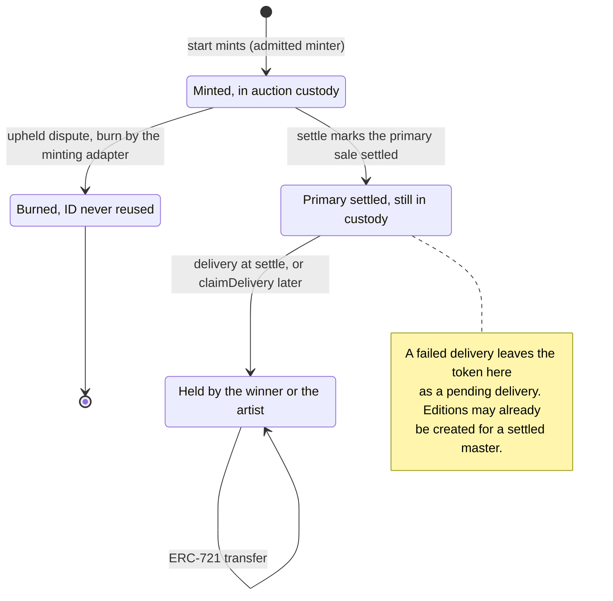

| Transition | Caller (role) | Delay | Function |
| --- | --- | --- | --- |
| Nonexistent to in custody | the auction, inside anyone's start | none | `Stream.mint`, from `EnglishAuction.start` or `startWithBid` |
| In custody to burned | the minting adapter, from the auction's `cancel` (PARAMETER_SETTER) | standard, 48 hours | `Stream.burn` |
| Burned (content released) | PARAMETER_SETTER | standard, 48 hours | `Stream.releaseContent`; the token stays burned and the ID unused |
| In custody to primary settled | the minting adapter, inside anyone's `settle` | none | `Stream.markPrimarySettled` |
| Primary settled to held | the auction at `settle`, or the claimant | none | the token's `safeTransferFrom`, or `EnglishAuction.claimDelivery` |
| Held to held | owner or approved operator | none | standard ERC-721 transfers |

A settled token can never be burned (`SaleAlreadySettled`), and ERC-721 transfers never mark a
sale settled. `primarySaleSettled(tokenId)` reads the flag, which gates
`IEditions.createEdition` and `linkEdition`.

### An auction

`auction(saleId).state` reports one of `NONE`, `ACTIVE`, `PAUSED`, `ENDED`, `SETTLED` and
`CANCELLED`. Only `NONE`, `ACTIVE`, `SETTLED` and `CANCELLED` are stored; `PAUSED` (a dispute
pause is live) and `ENDED` (the end has passed) are derived from the clock. The diagrams name
the finer states a reader needs.

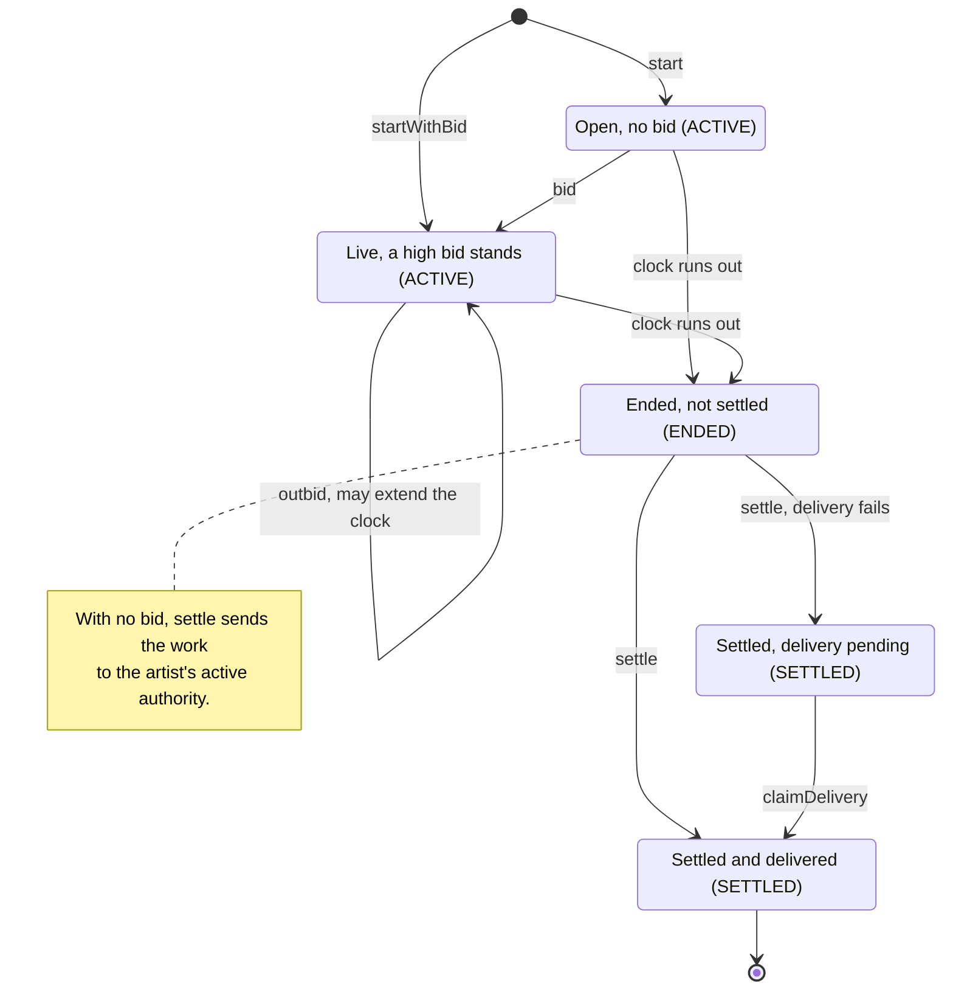

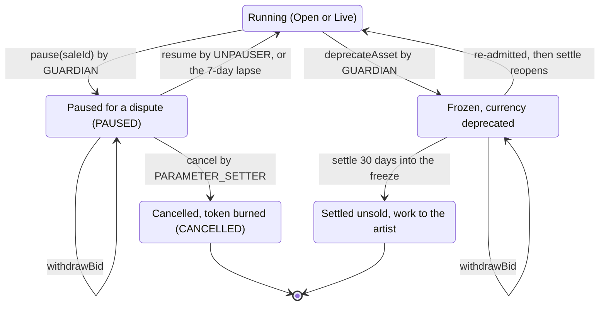

| Transition | Caller (role) | Delay | Function |
| --- | --- | --- | --- |
| None to open | anyone | none | `start` |
| None to live | anyone (the payer is the bidder) | none | `startWithBid` |
| Open to live, live to live | anyone | none | `bid` |
| Open or live to ended | the clock | none | none: `block.timestamp` reaches `endTime` |
| Ended to settled | anyone | none | `settle` |
| Settled, pending to delivered | the pending recipient, the winning bidder, or the artist | none | `claimDelivery` |
| Running to paused | GUARDIAN | immediate | `pause(saleId, disputeRef)`, once per auction |
| Paused to running | UNPAUSER | standard, 48 hours, and no earlier than 48 hours after the pause | `resume`; or no call once 7 days have passed |
| Paused to cancelled | PARAMETER_SETTER | standard, 48 hours; between 48 hours and 7 days after the pause | `cancel` |
| Paused or frozen, bid withdrawn | the high bidder | none | `withdrawBid` |
| Running or ended to frozen | GUARDIAN, on the asset allowlist | immediate | `AssetAllowlist.deprecateAsset` |
| Frozen to running | FUNDS_SETTER re-admits, then anyone settles | funds, 14 days, and no earlier than 14 days after the deprecation | `AssetAllowlist.admitAsset`, then `settle` |
| Frozen to settled unsold | anyone | 30 days after the deprecation | `settle` |
| Ended (delisted federated contract) to settled unsold | anyone | none | `settle` (v1.1 only; v1 installs no federation registry) |

## Flows

### Start

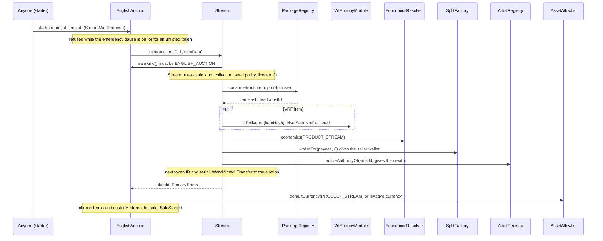

- **Preconditions on the auction** (`EnglishAuction._start`):
  - the emergency pause is off (`SalePaused`);
  - the token is listed by governance, or (v1.1) active in the federation registry
    (`TargetNotAllowed`);
  - the token reports the English-auction sale kind, a nonzero seller, a nonzero creator, a
    fee share of at most 100,000, a zero price, empty parameters, custody in the auction, and
    a token ID below 2^32; neither the seller nor the fee recipient is the revenue escrow, and a
    nonzero fee share has a fee recipient (`InvalidTerms`; the escrow rule is CALLS-1);
  - the token has no sale yet (`InvalidAuctionState`).
- **What Stream checks beyond `consume`** (`Stream.mint`, `_checkItem`, `_quote`):
  - the caller is an admitted minter (`NotAdmittedMinter`) minting to itself with `id` 0 and
    `amount` 1 (`InvalidMintRequest`);
  - the calling adapter's `saleKind()` is `SaleKind.ENGLISH_AUCTION` (`SaleKindMismatch`);
  - the item's sale kind is `ENGLISH_AUCTION` with empty parameters, it lists at least one
    party, and its collection exists;
  - the seed policy is coherent: an ARTIST policy if and only if the item carries a nonzero
    seed, and a VRF policy only when Stream has an entropy module;
  - the license ID follows the `SpdxId` rule `WorkRecords` applies at relicense;
  - the lead artist ID returned by `consume` is nonzero and fits 160 bits;
  - a VRF item's seed is delivered (`SeedNotDelivered`): the seed is requested before the
    start ([Entropy](entropy.md)), so the start never waits on randomness;
  - the economics are usable: a royalty rate of at most 100,000, a fee share below 100,000,
    and, for a nonzero fee share, a fee recipient that is neither zero nor the seller wallet.
- **What `consume` checks** (the proof, the parties' acceptances, the payees, the lead
  artist's move signature, single use and content uniqueness) is specified on
  [Curation](curation.md). Its errors bubble up unchanged. `openRecord`'s media checks are not
  visible at mint, so the curation signer's tooling simulates `openRecord` for every item
  before attesting it: a trust obligation, not an on-chain check
  ([`src/stream/README.md`](../../src/stream/README.md#core-token)).
- **Effects.**
  - Stream assigns the next token ID and the collection's next serial, and stores, per work:
    the seller wallet, serial, collection, item kind, seed policy, the primary-settled and
    edition-linked flags, the lead artist ID, royalty rate, fee share, an index of the fee
    recipient, an index of the minting adapter, and the item hash. The royalty receiver is not
    stored. Everything else is in `WorkMinted` and in the published package.
  - The auction resolves `CURRENCY_DEFAULT` once, to the allowlist's default for
    `PRODUCT_STREAM` (ETH at launch), or requires the named currency to be active. It locks the
    currency, the opening bid for that currency, the increment share and the anti-snipe window,
    and sets the end to the start plus the governed duration.
  - Anyone may start, and the network is not obliged to: the artist, a bidder or the network
    pays the gas. The start never deploys a split wallet.
- **`startWithBid`** runs the same start and then [the bid](#bid-and-outbid) in one
  transaction. A Permit2 bid signs `Typehashes.START_BID_WITNESS` over the token, the hash of
  `mintData`, the recipient, the amount and the deadline, since no sale ID exists before the
  mint.
- **Gas.** A steady-state ETH `start` is budgeted at 350,000 Prague gas and at most 6 new
  storage slots, `startWithBid` at 350,000 and 7; measured 291,808 and 333,883 Prague gas
  ([ADR 0004, the table](../adr/0004-gas-budgets-under-glamsterdam.md#the-table)). Under
  Glamsterdam the same steady-state transactions cost 846,963 and 982,312 gas on Sepolia
  ([flows, section 2](../../deployments/11155111/flows.md#2-the-curated-stream-sale)). ERC-20
  starts by Permit2, first works, and first bids under new sale terms are listed separately in
  the ADR 0004 table.

### Bid and outbid

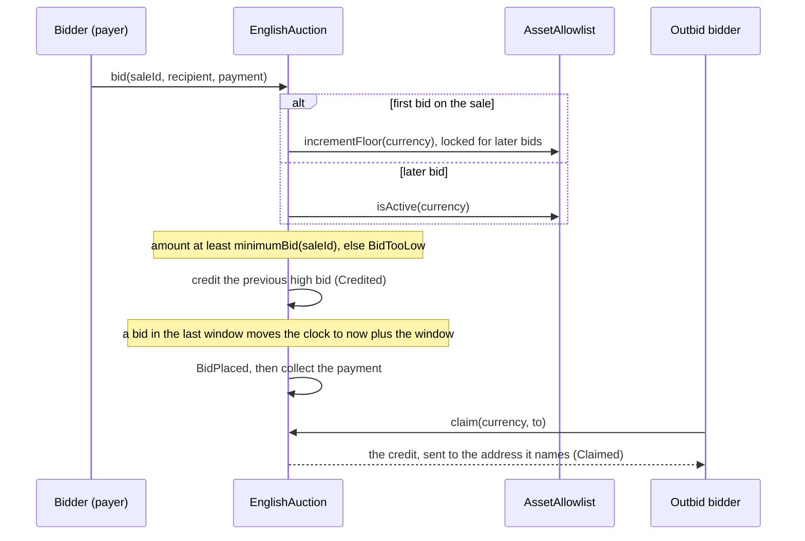

- **Preconditions.** The auction is running: not ended, not paused (`InvalidAuctionState`),
  and not a delisted federated contract (`TargetNotAllowed`). The locked currency is active
  (`AssetNotActive`; the first bid reads the floor, which also requires it). The recipient is
  not the auction itself (`InvalidRecipient`); a zero recipient means the payer.
- **Minimum bid** (`_minimumBid`, decision D12 in the code):
  - with no standing bid: `max(openingBid, reserve, 1 wei)`, where the reserve is a withdrawn
    bid's amount (LIFECYCLE-1) and zero otherwise;
  - with a standing bid `high`: `high + max(ceil(high × incrementShare / 100,000),
    incrementFloor)`. At launch, in ETH, that is `max(5%, 0.001 ETH)` above the high bid.
  - A bid is at most `type(uint96).max` base units (about 7.9e28); a larger one reverts.
- **Anti-snipe.** If a bid lands when less than the locked `extensionWindow` remains, the end
  moves to the bid's timestamp plus the window (15 minutes at launch). Bids are accepted while
  `block.timestamp < endTime`.
- **Payment** (`_collect`). The payer is the bidder of record: refunds and credits go to it,
  and only it may withdraw. Every ERC-20 movement is checked by exact balance delta on both
  sides, so fee-on-transfer, rebasing, no-return and false-returning tokens revert.

  | Currency | Method | Payer | What happens |
  | --- | --- | --- | --- |
  | ETH | `DIRECT` only | `msg.sender` | `msg.value` must equal `amount` (`InvalidPayment`). |
  | ERC-20 | `DIRECT` | `msg.sender` | A pull of an allowance granted beforehand. |
  | ERC-20 | `PERMIT` | `msg.sender` | An EIP-2612 permit (a 65-byte signature: `r`, `s`, then `v`), then the pull. A permit that fails, for example because someone already submitted it, is ignored, and the pull uses the allowance it granted. |
  | ERC-20 | `PERMIT2` | the signer | Permit2's `permitWitnessTransferFrom`, so a relayer may submit it. The witness is `Typehashes.BID_WITNESS` (sale ID, recipient, amount, deadline), or `START_BID_WITNESS` for `startWithBid`. Refused when the auction was built without Permit2. |

  An ERC-20 bid sends no ETH (`InvalidPayment`), and a `PERMIT` or `PERMIT2` payment past its
  deadline reverts with `PaymentExpired`. `start` takes no payment and is not payable.
- **Effects.** The previous high bid, the bidder's own included, is credited to its payer
  (`Credited`). The bid is recorded before the payment is pulled, and the whole call reverts if
  the payment does not arrive. Every value-moving entry point is non-reentrant.
- **Claims.** `claim(currency, to)` sends all of the caller's credits in that currency to `to`
  (`NothingToClaim`, `InvalidRecipient` for zero; `ClaimFailed` keeps an ETH credit a recipient
  refuses). Claims never read the allowlist, so a deprecated currency never blocks them.
- **Gas.** A bid that outbids costs 73,464 Prague gas and writes 1 new slot
  ([ADR 0004, the table](../adr/0004-gas-budgets-under-glamsterdam.md#the-table)); 168,932
  on Sepolia ([flows, section 2](../../deployments/11155111/flows.md#2-the-curated-stream-sale)).

### Settle with a bid

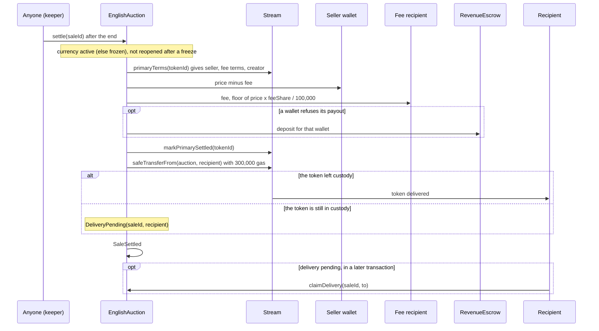

- **Preconditions.** The auction has ended and is not paused (`InvalidAuctionState`). Its
  currency is active, or has been deprecated for at least 30 days (see the
  [freeze](#currency-freeze-and-recovery)). The caller forwards enough gas for each bounded call
  in full: a shortfall reverts (`DeliveryInsufficientGas`, `PaymentInsufficientGas`) instead of
  forcing the escrow, credit or pending-delivery route.
- **Terms.** The seller wallet, fee recipient and fee share are read back from Stream, where
  they were locked at mint, so a later economics change never reaches a started auction. The
  fee is `floor(price × feeShare / 100,000)`, with a fee share of 25,000 (25%) at launch
  (`EconomicsResolver.DEFAULT_FEE_SHARE`); the seller wallet gets the rest. A zero amount is
  not paid at all.
- **ETH payouts** forward `PAYOUT_GAS` (100,000) to each wallet. A wallet that refuses is
  credited in the revenue escrow instead (`RevenuePayment.payETH`), and anyone flushes it to the
  wallet later. Split wallets receive with an empty `receive`.
- **ERC-20 payouts** (MONEY-1) run in their own call frame of 1,000,000 gas
  (`settlePayout`, callable only by the auction itself). Inside it the token's transfer gets
  300,000 gas, and a refused transfer goes to the revenue escrow. If the frame fails even so,
  because the token changed behavior or blocks the auction, the amount is credited to the
  wallet in the auction (`Credited`), and anyone pays it out later with
  `claimFor(wallet, currency)`, which only ever pays the account itself and refuses ETH
  (`IRevenueEscrow.InvalidAsset`). Delivery never waits on a payout.
- **Settlement is marked before delivery.** The auction calls `Stream.markPrimarySettled`
  while the token is still in custody, so a winner who never claims cannot hold up the master's
  edition.
- **Delivery** (`_deliver`) gives the token's `safeTransferFrom` exactly `DELIVERY_GAS`
  (300,000) and copies no return data. If the token is still in the auction's custody
  afterwards (the recipient rejected it, ran out of gas, or the token blocked the transfer), the
  sale records a pending delivery (`DeliveryPending`).
- **`claimDelivery(saleId, to)`** may be called by the pending recipient or by the winning
  bidder (the payer), to any address except zero and the auction (`InvalidRecipient`). It
  forwards all remaining gas. If neither can make the call, the token stays in custody: that
  is the consequence of the winner's choice of recipient.
- **Gas and keepers.** Settlement is permissionless and needs no role: a keeper is any funded
  account. An ETH `settle` with a bid costs 143,063 Prague gas, and the first payout to a new
  seller wallet creates that account
  ([ADR 0004, the table](../adr/0004-gas-budgets-under-glamsterdam.md#the-table)); on Sepolia
  that first payout made the settle cost 441,363 gas
  ([flows, section 2](../../deployments/11155111/flows.md#2-the-curated-stream-sale)). Because
  the ERC-20 payout frame must be forwardable in full, an ERC-20 `settle` needs a call gas limit
  of about 1.11M although it uses about 140K, and an ETH `settle` about 460K
  ([ADR 0004, security impact](../adr/0004-gas-budgets-under-glamsterdam.md#security-impact);
  `test_MONEY1_SettlerGasLimitVersusGasUsed` in
  [`EnglishAuctionFollowUp.t.sol`](../../test/sales/auction/EnglishAuctionFollowUp.t.sol)).
  Keepers set the limit explicitly, or estimate it.

### Settle with no bid

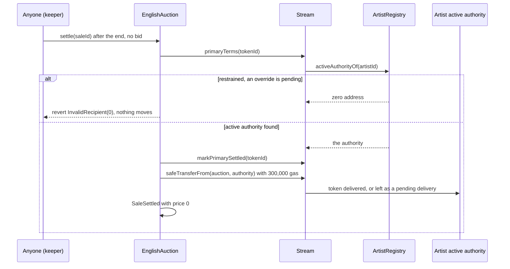

- The work goes to the lead artist's active authority as resolved at settlement, not at
  start, so a completed recovery redirects it. While a restraint is in force, `settle` reverts
  and the token stays in custody; anyone retries once the override executes, is vetoed or
  voided, or lapses ([Identity and recovery](identity-and-recovery.md)).
- The artist is recorded as the sale's recipient. If the artist's account rejects the token,
  the delivery is pending, and the artist may claim it, either as the recorded recipient or as
  the active authority the token reports at claim time.
- Nothing is paid: with no bidder the price is zero, even when a withdrawn bid left a reserve.
- The same no-bid outcome ends a frozen sale after 30 days and a delisted federated contract's
  sale: the standing bid is credited back first.
- **Gas.** On Sepolia a no-bid settle cost 226,281 to 335,817 gas, the most when the artist
  held no Stream token yet
  ([flows, section 2](../../deployments/11155111/flows.md#2-the-curated-stream-sale)).

### Currency freeze and recovery

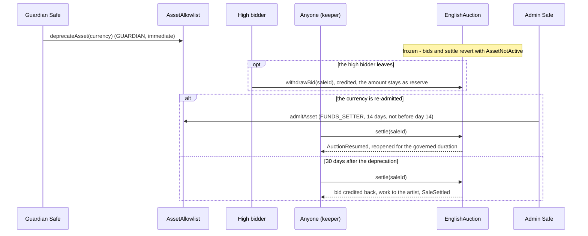

- **Why.** Deprecating a currency is an immediate tightening by the guardian. MARKET-2 makes it
  freeze the auction, not just its bids, so a standing low bid cannot win while nobody else may
  bid ([ADR 0003, disputes and statements](../adr/0003-build-time-decisions.md#disputes-and-statements-amends-adr-0001-12)).
- **While frozen** (`_reopenedAfterFreeze`, `withdrawBid`): nothing settles, sold or unsold,
  and new bids revert. The high bidder may `withdrawBid` at any time during the freeze, before or
  after the end; the withdrawn amount stays as the reserve.
- **Re-admission.** `AssetAllowlist.admitAsset` is a funds-class action and refuses to run
  earlier than 14 days after the deprecation (`ReadmissionTooEarly`). It has no upper bound, but
  from day 30 anyone may end a frozen auction unsold, so a re-admission saves the sale only if it
  comes before someone does. After it, the first `settle` of an ended auction reopens it when
  the re-admission came within the auction's last anti-snipe window or after its end: the end
  moves to now plus the longer of the current governed duration and the sale's locked window
  (`AuctionResumed`), and the call settles nothing. An auction whose currency came back earlier
  than that settles normally.
- **The 30-day exit.** Once the currency has been deprecated for 30 days, anyone may settle the
  ended sale: the standing bid is credited back to its bidder and the work goes to the artist,
  exactly as with no bid. A currency that never returns cannot hold a work.
- An auction started after the currency's return settles normally.
- Operators follow the runbook's advice on deprecating an auction's currency
  ([`script/README.md`](../../script/README.md)).

### Dispute pause, resume and cancel

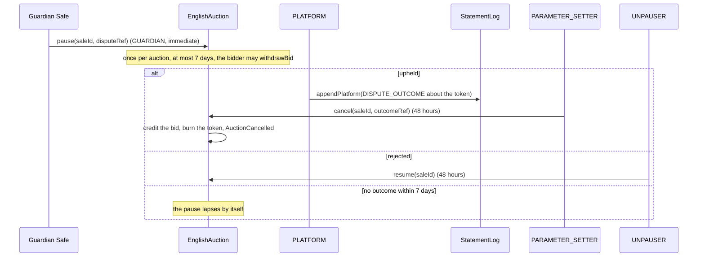

This page summarizes; [Disputes and statements](disputes-and-statements.md) specifies the
dispute process, the statement log and `releaseContent`.

- The guardian pauses a live auction (not an ended one) once (`PauseExhausted`). The pause is
  live through `pausedAt + MAX_PAUSE` (7 days) inclusive; while it is live, bids and settlement
  revert and the high bidder may withdraw.
- `resume` and `cancel` are refused until 48 hours after the pause (`UnpauseTooEarly`), even
  when scheduled before it (GOV-5), so the guardians always have the standard window to cancel
  either.
- `cancel` cites the token's own latest `DISPUTE_OUTCOME`, recorded after the pause
  (`OutcomeNotRecorded` otherwise; LIFECYCLE-4). It credits the high bid back and burns the
  token through `Stream.burn`. PARAMETER_SETTER then calls `Stream.releaseContent` for the
  burned work, naming the rightful artist.
- On resumption, by `resume` or by the lapse, the auction runs for the longer of its remaining
  time at the pause and the governed duration (or the locked anti-snipe window, if longer),
  even with a standing bid (LIFECYCLE-1). The first mutating call after a lapse writes the
  resumption down and emits `AuctionResumed`.

### Emergency pause and governed settings

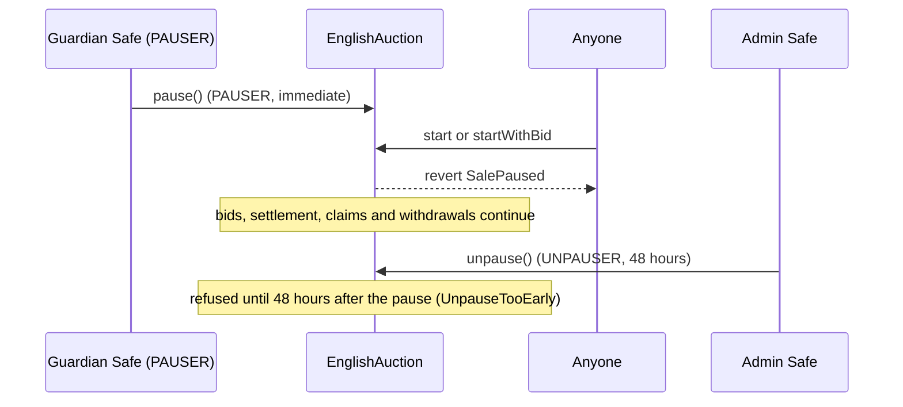

- **Emergency pause.** `pause()` stops only `start` and `startWithBid`. Running auctions carry
  on, because stopping one near its end would distort its outcome. Pausing twice reverts with
  `SalePaused` and unpausing while not paused with `NotPaused`. Pause and unpause have separate
  holders; the configuration refuses one account holding both.
- **`setConfig(expected, next)`** (PARAMETER_SETTER, 48 hours) is compare-and-set on the whole
  `AuctionConfig` and enforces its bounds: a duration of 1 hour to 7 days, an anti-snipe window
  of 1 minute to 1 day and at most the duration, and an increment share of 1,000 to 100,000
  (`InvalidConfig`). It applies to auctions started afterwards, except that a resumption or a
  reopening reads the current duration.
- **`setOpeningBid(currency, expected, next)`** (PARAMETER_SETTER, 48 hours) is
  compare-and-set, moves either way, zero included, and is capped at
  `min(incrementFloor(currency) × OPENING_BID_FLOORS, type(uint96).max)`
  (`OpeningBidAboveCeiling`): 1 ETH for ETH at the launch floor. The currency must be active.
  It applies to auctions started afterwards.
- **`setTarget(token, listed)`** (SUCCESSOR_SETTER, 30 days) lists a token contract with code,
  not EIP-7702 delegated, that supports ERC-721 through ERC-165 (`InvalidTarget`). Unlisting
  stops new starts only; running sales finish.
- **`setFederationRegistry(expected, next)`** (SUCCESSOR_SETTER, 30 days) installs the v1.1
  federation registry: compare-and-set, ERC-165 for `IFederationRegistry`, EIP-7702 rejected,
  code hash pinned. A registry whose code later differs serves no token. v1 installs none.

### Royalty read

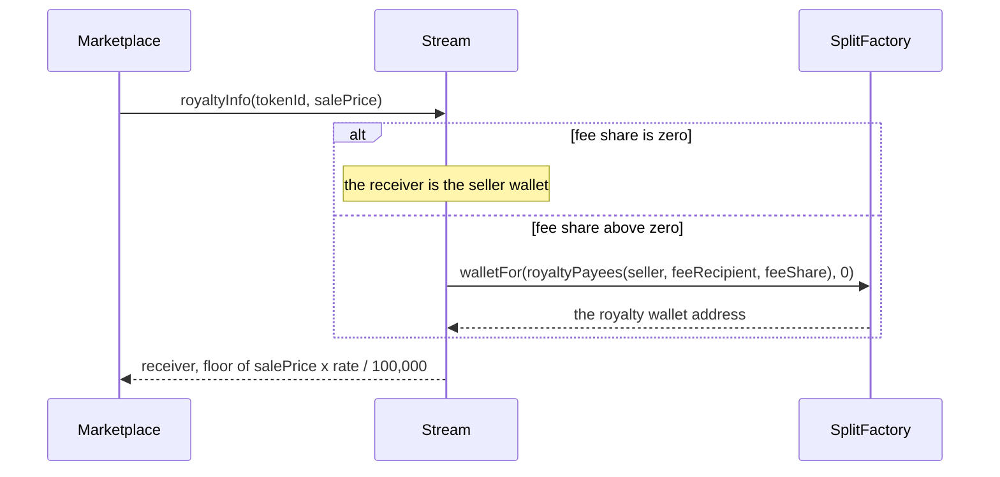

- The rate is stored per work (6,529, that is 6.529%, at launch:
  `EconomicsResolver.DEFAULT_ROYALTY_RATE`) and changes only by agreement of every party plus a
  governed action, through `WorkRecords` ([Works and storage](works-and-storage.md)). The payees,
  and so the receiver, never change after mint.
- The receiver is derived by one plain view call to the split factory, over the canonical payee
  list `Splits.royaltyPayees` (the two fixed payees in address order), so it equals the address
  the economics resolver derives. The call can run out of gas and revert, but `royaltyInfo`
  never returns a zero royalty for lack of gas.
- The amount is computed as `(p / D) × rate + (p % D) × rate / D` with `D` = 100,000, which is
  exactly `floor(p × rate / D)` and cannot overflow for any price.
- A burned or unminted token reverts with `UnknownWork`.
- **Gas.** 41,325 Prague gas for the whole call, under a ceiling of 50,000 gas of execution
  ([ADR 0004, the table](../adr/0004-gas-budgets-under-glamsterdam.md#the-table)); reads are not
  repriced by Glamsterdam.

### Collections and marketplace metadata

- **`createCollection(name, metadataHash)`** (PLATFORM, immediate) creates the next collection
  ID, from 1. The name is 1 to `MAX_NAME_BYTES` (256) bytes of valid UTF-8 without a control
  character (below 0x20, or 0x7F), `<`, `"` or `\` (`InvalidCollectionName`): the name goes into
  every work's metadata, and refusing those characters keeps `tokenURI` within its gas budget.
  `metadataHash` may be zero. `collection(id)` returns the name, the hash and the number minted
  (also the last serial).
- **`setContractURI(uri)`** (PARAMETER_SETTER, 48 hours) sets the ERC-7572 contract URI and
  emits `ContractURISet` and `ContractURIUpdated`.
- **`setOwner(expected, next)`** (FUNDS_SETTER, 14 days, compare-and-set) sets the marketplace
  `owner()`, which marketplaces let configure creator earnings. It has no on-chain powers.
- **`bindWorkRecords` and `bindEditions`** bind each satellite once, at genesis: the target has
  code, is not EIP-7702 delegated, supports its interface through ERC-165, and serves this
  Stream (`stream() == address(this)`). A second bind reverts with `AlreadyBound`.
- **`linkEdition(tokenId, editionId)`** is callable only by the bound Editions, once per work,
  for an `EDITION_MASTER` whose primary sale settled, with `editionId == tokenId`
  (`EditionLinkInvalid`); `editionOf` then returns the pair
  ([Editions and sales](editions-and-sales.md)).

## Rules and invariants

| ID | Rule | Enforced in | Proven by |
| --- | --- | --- | --- |
| AUC-1 | Only an admitted minter mints, into its own custody, with `id` 0 and `amount` 1. Admission requires code, ERC-165 `ISaleAdapter` and no EIP-7702 delegation. | `Stream.mint`, `Stream.setAdmittedMinter` | [`Stream.t.sol`](../../test/stream/Stream.t.sol): `test_mint_revertsForUnadmittedCaller`, `test_mint_revertsForWrongShape`, `test_setAdmittedMinter`, `test_setAdmittedMinter_reverts` |
| AUC-2 | Stream mints only for an English-auction adapter and an English-auction item with empty parameters, at least one party, an existing collection, a coherent seed policy and a valid license ID. | `Stream.mint`, `Stream._checkItem` | [`Stream.t.sol`](../../test/stream/Stream.t.sol): `test_mint_revertsForWrongAdapterKind`, `test_mint_revertsForStreamRuleBreaks`, `test_mint_acceptsMixedCaseLicenseId`; [`ReviewRegressions.t.sol`](../../test/stream/ReviewRegressions.t.sol): `test_unopenableLicenseIdNeverMints` |
| AUC-3 | Every mint consumes its package item in the same call; a registry revert reverts the mint. | `Stream._consume` | [`Stream.t.sol`](../../test/stream/Stream.t.sol): `test_mint_bubblesRegistryRevert`, `testFuzz_mintRequestEncodesAsConsumeArguments`, `test_mint_reentrantRegistryKeepsCountersConsistent` |
| AUC-4 | A VRF item mints only when Stream has an entropy module and the item's seed is delivered. | `Stream.mint`, `Stream._checkItem` | [`Stream.t.sol`](../../test/stream/Stream.t.sol): `test_mint_vrfNeedsDeliveredSeed`, `test_mint_vrfRejectedWithoutEntropyModule`; [`VrfWork.t.sol`](../../test/integration/VrfWork.t.sol): `test_SeedRequestedDeliveredThenStartedAndRendered` |
| AUC-5 | Token IDs are one global sequence from 1, never reused; serials count per collection from 1; `totalSupply` is minted minus burned. | `Stream._store`, `Stream.burn` | [`Stream.t.sol`](../../test/stream/Stream.t.sol): `test_mint_assignsGlobalIdsAndPerCollectionSerials`, `test_burn_leavesGapAndCountsSupply`; [`StreamInvariant.t.sol`](../../test/stream/StreamInvariant.t.sol): `invariant_idsMonotonicAndNeverReused`, `invariant_serialsPerCollection`, `invariant_supplyIsMintedMinusBurned` |
| AUC-6 | A work's seller, fee recipient and fee share are locked at mint; only its royalty rate changes, and only through the bound `WorkRecords`, at most 100,000. | `Stream._store`, `Stream.setRoyaltyRate` | [`StreamInvariant.t.sol`](../../test/stream/StreamInvariant.t.sol): `invariant_royaltyTermsLocked`; [`Stream.t.sol`](../../test/stream/Stream.t.sol): `test_setRoyaltyRate_fromRecords`, `test_hooks_revertBeforeBinding` |
| AUC-7 | `royaltyInfo` returns the seller wallet with no fee, otherwise the split factory's salt-zero wallet for the canonical royalty payees, and exactly `floor(price × rate / 100,000)`; it reverts rather than return zero when gas runs short. | `Stream.royaltyInfo`, `Stream._royaltyReceiver` | [`Stream.t.sol`](../../test/stream/Stream.t.sol): `testFuzz_royaltyInfo_isTheFactoryWallet`, `test_royaltyInfo_noFeeIsTheSeller`, `testFuzz_royaltyInfo_matchesMulDiv`, `testFuzz_royaltyInfo_neverZeroForLackOfGas`; [`StreamEconomics.t.sol`](../../test/stream/StreamEconomics.t.sol): `test_receiverIsTheResolversAndTheFactorys` |
| AUC-8 | Only the adapter that minted a token marks its primary sale settled; transfers never do. | `Stream.markPrimarySettled` | [`Stream.t.sol`](../../test/stream/Stream.t.sol): `test_markPrimarySettled_byMintingAdapterOnly`, `test_transfersDoNotSettle`; [`StreamInvariant.t.sol`](../../test/stream/StreamInvariant.t.sol): `invariant_primarySaleSettledOnlyByMintingAdapter` |
| AUC-9 | Only the adapter that minted a token burns it, while it holds the token and before the primary sale settled, even after the adapter was removed. | `Stream.burn` | [`Stream.t.sol`](../../test/stream/Stream.t.sol): `test_burn_onlyByMintingAdapter`, `test_burn_byRemovedMintingAdapter`, `test_burn_neverAfterSettlement`; [`ReviewRegressions.t.sol`](../../test/stream/ReviewRegressions.t.sol): `test_nonMintingAdmittedAdapterCannotBurn`, `test_burnAfterSettlementRefused` |
| AUC-10 | `releaseContent` runs only for a burned token. | `Stream.releaseContent` | [`Stream.t.sol`](../../test/stream/Stream.t.sol): `test_releaseContent_reverts`, `test_releaseContent_afterBurnLetsTheRealArtistMint` |
| AUC-11 | Satellites bind once each and must serve this Stream; `linkEdition` runs once, from Editions, for a settled master, with the edition ID equal to the token ID. | `Stream.bindWorkRecords`, `bindEditions`, `linkEdition` | [`Stream.t.sol`](../../test/stream/Stream.t.sol): `test_bind_oncePerTargetWithEvents`, `test_bind_reverts`, `test_linkEdition_reverts`; [`ReviewRegressions.t.sol`](../../test/stream/ReviewRegressions.t.sol): `test_bindRefusesSatelliteOfAnotherStream`, `test_linkEditionNeedsSettledMaster` |
| AUC-12 | Collection names are 1 to 256 bytes of UTF-8 without control characters, `<`, `"` or `\`. | `Stream.createCollection` | [`Stream.t.sol`](../../test/stream/Stream.t.sol): `test_createCollection_reverts` |
| AUC-13 | The emergency pause stops only new starts; unpausing waits 48 hours from the pause. | `EnglishAuction._start`, `pause`, `unpause` | [`EnglishAuction.t.sol`](../../test/sales/auction/EnglishAuction.t.sol): `test_EmergencyPause_StopsOnlyNewStarts`, `test_EmergencyPause_RolesAndStateChecks`; [`Dispute.t.sol`](../../test/integration/Dispute.t.sol): `test_EmergencyPauseBlocksStartsNotBids`; [`Gov5Regression.t.sol`](../../test/adv/Gov5Regression.t.sol): `test_GOV5_UnpauseScheduledBeforeThePauseWaitsTwoDaysAfterIt` |
| AUC-14 | A start refuses unusable terms: the escrow as seller or fee recipient, a zero creator, a zero seller, a fee share above 100,000, a price or parameters, a token not in custody, or a token ID of 2^32 or more. | `EnglishAuction._start` | [`EnglishAuction.t.sol`](../../test/sales/auction/EnglishAuction.t.sol): `test_Start_RevertsOnUnusableTerms`, `test_CALLS1_StartRefusesTheEscrowAsSellerOrFeeRecipient`, `test_Start_RevertsOnBadMintResult`; [`EnglishAuctionReview.t.sol`](../../test/sales/auction/EnglishAuctionReview.t.sol): `test_TokenIdPackingLimit`; [`RecoveryRestraint.t.sol`](../../test/integration/RecoveryRestraint.t.sol): `test_NobodyStartsAnUnmintedWorkDuringTheNotice` (on the real stack, `consume` refuses the restrained artist's move first) |
| AUC-15 | A sale locks its currency, opening bid, increment share and window at start, and its increment floor at the first bid; later governance changes do not reach it. | `EnglishAuction._lockTerms`, `_bid` | [`EnglishAuction.t.sol`](../../test/sales/auction/EnglishAuction.t.sol): `test_Start_LocksEveryParameter`, `test_Start_ResolvesTheDefaultCurrencyOnce`, `test_IncrementFloorLocksAtTheFirstBid`; [`EnglishAuctionReview.t.sol`](../../test/sales/auction/EnglishAuctionReview.t.sol): `test_Killer_I5_FloorLockedForLaterBids`; [`AuctionInvariant.t.sol`](../../test/sales/auction/invariant/AuctionInvariant.t.sol): `invariant_StoredTermsMatchWhatEachSaleLocked` |
| AUC-16 | The first bid is at least `max(openingBid, reserve, 1 wei)`; a later bid adds at least `max(ceil(high × share / 100,000), floor)`; a bid fits 96 bits. | `EnglishAuction._minimumBid`, `_bid` | [`EnglishAuction.t.sol`](../../test/sales/auction/EnglishAuction.t.sol): `test_Bid_FirstBidThenIncrements`, `testFuzz_Bid_IncrementIsMaxOfShareAndFloor`; [`EnglishAuctionFollowUp.t.sol`](../../test/sales/auction/EnglishAuctionFollowUp.t.sol): `testFuzz_StepMatchesMulDivCeil`; [`EnglishAuctionReview.t.sol`](../../test/sales/auction/EnglishAuctionReview.t.sol): `test_L4_BidAbove96BitsReverts`; [`Lifecycle1Regression.t.sol`](../../test/adv/Lifecycle1Regression.t.sol): `test_LIFECYCLE1_WithdrawnBidStaysAsReserveThroughALapse` |
| AUC-17 | A bid in the last anti-snipe window moves the end to the bid's time plus the window; no bid is accepted at or after the end. | `EnglishAuction._bid`, `_state` | [`EnglishAuction.t.sol`](../../test/sales/auction/EnglishAuction.t.sol): `test_Bid_AntiSnipeExtends`; [`CuratedSale.t.sol`](../../test/integration/CuratedSale.t.sol): `test_StartBidAntiSnipeSettleAndRelease` |
| AUC-18 | Outbid and withdrawn bids are credited to their payer, never pushed, and only the account claims its ETH credits. | `EnglishAuction._credit`, `claim`, `claimFor` | [`EnglishAuction.t.sol`](../../test/sales/auction/EnglishAuction.t.sol): `test_Bid_OutbidBidderIsCreditedAndClaims`; [`EnglishAuctionHostile.t.sol`](../../test/sales/auction/EnglishAuctionHostile.t.sol): `test_RevertingBidderCannotBlockOutbidding`, `test_OutsidersCannotClaimSomeoneElsesCredit`; [`EnglishAuctionFollowUp.t.sol`](../../test/sales/auction/EnglishAuctionFollowUp.t.sol): `test_L5_ClaimForRefusesEth` |
| AUC-19 | Every ERC-20 payment is checked by exact balance delta; nonstandard tokens fail closed. A Permit2 witness binds the sale (or token and mint data), recipient, amount and deadline. | `EnglishAuction._collect` | [`EnglishAuctionHostile.t.sol`](../../test/sales/auction/EnglishAuctionHostile.t.sol): `test_FeeOnTransferBidsFailClosed`, `test_RebasingBidsFailClosed`, `test_NoReturnAndFalseReturningTokensFailClosed`; [`EnglishAuction.t.sol`](../../test/sales/auction/EnglishAuction.t.sol): `test_Bid_Permit2WitnessBindsTheSaleAndRecipient`, `test_Bid_Permit2WitnessBindsAmountAndDeadline`; [`EnglishAuctionDisputes.t.sol`](../../test/sales/auction/EnglishAuctionDisputes.t.sol): `test_Permit2Witness_Golden` |
| AUC-20 | The auction holds exactly its live high bids plus its credits, and every sale ends at most once, settled or cancelled, with exact custody. | `EnglishAuction` (all value paths) | [`AuctionInvariant.t.sol`](../../test/sales/auction/invariant/AuctionInvariant.t.sol): `invariant_HeldEqualsLiveBidsPlusCredits`, `invariant_ValueIsConserved`, `invariant_OneOutcomeAndExactCustody`; [`AuctionHaltsInvariant.t.sol`](../../test/sales/auction/invariant/AuctionHaltsInvariant.t.sol): `invariant_BalanceCoversOwed`, `invariant_ExactCustody` |
| AUC-21 | Settlement never depends on the recipient accepting the token: a failed delivery leaves a pending delivery, and the primary sale is marked settled before delivery. | `EnglishAuction.settle`, `_deliver` | [`EnglishAuction.t.sol`](../../test/sales/auction/EnglishAuction.t.sol): `test_Settle_FailedDeliveryLeavesAPendingClaim`, `test_Settle_TokenThatBlocksTransfersLeavesAPendingClaim`, `test_ClaimDelivery_TheWinnerCanRedirect`; [`CuratedSale.t.sol`](../../test/integration/CuratedSale.t.sol): `test_WinnerThatCannotReceiveGetsAPendingDelivery` |
| AUC-22 | A settler that cannot forward the delivery or payout gas in full is refused, so it cannot force the pending, escrow or credit route. | `EnglishAuction._deliver`, `_pay`; `RevenuePayment.payETH` | [`EnglishAuction.t.sol`](../../test/sales/auction/EnglishAuction.t.sol): `test_Settle_RevertsWhenTheCallerStarvesDelivery`; [`EnglishAuctionFollowUp.t.sol`](../../test/sales/auction/EnglishAuctionFollowUp.t.sol): `test_MONEY1_AStarvedSettleRevertsInsteadOfCrediting` |
| AUC-23 | A refused payout goes to the escrow; an ERC-20 payout that fails even there is credited to its wallet, and `claimFor` pays only that wallet. | `EnglishAuction._pay`, `settlePayout`, `claimFor` | [`EnglishAuction.t.sol`](../../test/sales/auction/EnglishAuction.t.sol): `test_Settle_RefusingWalletIsEscrowed`; [`EnglishAuctionHostile.t.sol`](../../test/sales/auction/EnglishAuctionHostile.t.sol): `test_GasHungryTokenPayoutIsEscrowed`, `test_BlocklistedSellerIsEscrowedAndBlocklistedBidderClaimsElsewhere`; [`Money1Regression.t.sol`](../../test/adv/Money1Regression.t.sol): `test_MONEY1_ATokenThatBlocksTheAuctionDoesNotHoldTheWork`, `test_MONEY1_OnlyTheAuctionRunsAPayoutFrame`, `test_MONEY1_ClaimForPaysOnlyTheAccountItself` |
| AUC-24 | With no bid the work goes to the artist's active authority at settlement; while it is zero, settlement reverts and moves nothing. | `EnglishAuction.settle` | [`EnglishAuction.t.sol`](../../test/sales/auction/EnglishAuction.t.sol): `test_Settle_NoBidsSendsTheTokenToTheArtist`, `test_Settle_NoBidsFollowsTheArtistsCurrentAuthority`, `test_Settle_NoBidsRefusesAnUnresolvedArtist`; [`RecoveryRestraint.t.sol`](../../test/integration/RecoveryRestraint.t.sol): `test_NoBidAuctionRunningAtStagingWaitsForTheOutcome`, `test_AuctionWithABidRunningAtStagingSettlesNormally` |
| AUC-25 | A deprecated currency freezes the auction: no bid and no settlement until re-admission, the bidder may withdraw, the first settle after a late re-admission reopens it, and after 30 days the sale ends unsold. | `EnglishAuction._reopenedAfterFreeze`, `withdrawBid`, `_bid` | [`Market2Regression.t.sol`](../../test/adv/Market2Regression.t.sol): `test_MARKET2_FrozenAuctionWaitsAndReopensAfterReadmission`, `test_MARKET2_NothingSettlesWhileFrozen`, `test_MARKET2_AFrozenSaleEndsUnsoldThirtyDaysIntoTheFreeze`, `test_MARKET2_WithdrawalNeedsAPauseOrAFreeze`, `test_MARKET2_AnAuctionStartedAfterAFreezeSettlesNormally` |
| AUC-26 | A dispute pause is GUARDIAN-only, once per live auction, at most 7 days; `resume` and `cancel` wait 48 hours from the pause; `cancel` cites the token's own outcome recorded after the pause. | `EnglishAuction.pause(uint256,bytes32)`, `resume`, `cancel` | [`EnglishAuctionDisputes.t.sol`](../../test/sales/auction/EnglishAuctionDisputes.t.sol): `test_Pause_OnlyTheGuardian`, `test_Pause_OnlyALiveAuctionOnce`, `test_Pause_EndsByItselfAfterSevenDays`, `test_Cancel_NeedsTheRecordedOutcome`, `test_Cancel_PauseWindowBoundary`; [`Gov5Regression.t.sol`](../../test/adv/Gov5Regression.t.sol): `test_GOV5_ResumeScheduledBeforeThePauseWaitsTwoDaysAfterIt`; [`Lifecycle4AuctionRegression.t.sol`](../../test/adv/Lifecycle4AuctionRegression.t.sol): `test_LIFECYCLE4_OutcomeBeforeThePauseCannotCancel` |
| AUC-27 | A resumed or reopened auction runs at least the longer of the governed duration and its locked window. | `EnglishAuction._resumedEnd`, `_reopening` | [`EnglishAuctionDisputes.t.sol`](../../test/sales/auction/EnglishAuctionDisputes.t.sol): `test_Resume_GivesAtLeastTheDuration`, `test_Resume_LeavesAtLeastTheWindow`; [`EnglishAuctionFollowUp.t.sol`](../../test/sales/auction/EnglishAuctionFollowUp.t.sol): `test_L7_ReopeningIsNeverShorterThanTheLockedWindow`; [`Lifecycle1Regression.t.sol`](../../test/adv/Lifecycle1Regression.t.sol): `test_LIFECYCLE1_APauseWithAStandingBidAlsoReopensForTheDuration` |
| AUC-28 | A federated token sells only while the registry reports it active with its recorded code; a delisted contract takes no bids and settles unsold; its fee goes to the network's federated recipient. | `EnglishAuction.isTarget`, `_delisted`, `_lockedTerms` | [`Market5Regression.t.sol`](../../test/adv/Market5Regression.t.sol): `test_MARKET5_DelistedFederatedAuctionStopsSelling`; [`Market3Regression.t.sol`](../../test/adv/Market3Regression.t.sol): `test_MARKET3_FederatedAuctionPaysTheNetworksFederatedRecipient`; [`EnglishAuctionReview.t.sol`](../../test/sales/auction/EnglishAuctionReview.t.sol): `test_L6_FederationCodeHashesArePinned` |
| AUC-29 | The auction refuses every safe transfer into it except its own mint during a start. | `EnglishAuction.onERC721Received` | [`Calls5Regression.t.sol`](../../test/adv/Calls5Regression.t.sol): `test_CALLS5_SafeTransfersIntoTheAuctionAreRefused`; [`EnglishAuction.t.sol`](../../test/sales/auction/EnglishAuction.t.sol): `test_OnERC721Received_RejectsUnexpectedTransfers` |
| AUC-30 | Governed parameters stay within bounds and are compare-and-set. | `EnglishAuction.setConfig`, `setOpeningBid` | [`EnglishAuction.t.sol`](../../test/sales/auction/EnglishAuction.t.sol): `test_Constructor_RejectsConfigOutOfBounds`; [`EnglishAuctionDisputes.t.sol`](../../test/sales/auction/EnglishAuctionDisputes.t.sol): `test_SetConfig_CompareAndSet`, `test_SetOpeningBid_MovesBothWaysWithinTheCeiling`, `testFuzz_SetOpeningBid_AnyValueUpToTheCeiling`; [`EnglishAuctionReview.t.sol`](../../test/sales/auction/EnglishAuctionReview.t.sol): `test_PR33_OpeningBidCappedAtTheLargestBid` |
| AUC-31 | No reentrant call reaches a value-moving entry point. | `nonReentrant` on `start`, `startWithBid`, `bid`, `withdrawBid`, `settle`, `claimDelivery`, `claim`, `claimFor`, `pause(saleId)`, `resume`, `cancel` | [`EnglishAuctionHostile.t.sol`](../../test/sales/auction/EnglishAuctionHostile.t.sol): `test_ReentrantClaimerIsBlocked`, `test_ReentrantWinnerCannotReenterSettlement`, `test_ReentrantSellerWalletIsBlocked`, `test_CallbackTokenCannotReenter` |
| AUC-32 | Gas: a steady-state ETH start uses at most 350,000 Prague gas and 6 new slots (7 with a bid). | measured, not enforced on-chain | [`GasReport.t.sol`](../../test/integration/GasReport.t.sol): `test_Gas_Start_SteadyState`, `test_Gas_StartWithBid_SteadyState`, `test_Gas_Table`; [`EnglishAuctionGas.t.sol`](../../test/sales/auction/EnglishAuctionGas.t.sol): `test_StartGas_SteadyState` |

## Events

| Event | Contract | Emitted when | Notes |
| --- | --- | --- | --- |
| `WorkMinted(tokenId, collectionId, itemHash, serial, artistId, kind, packageRoot, contentHash, mediaHash, recordFileId)` | Stream | A start mints a work | With the published package, the source record of the mint. The content hash is public here, not stored. |
| `Transfer` | Stream | Mint (to the auction), delivery, claims, transfers, burn | Standard ERC-721. |
| `AdmittedMinterSet(adapter, admitted)` | Stream | An adapter is admitted or removed | |
| `PrimarySaleSettled(tokenId)` | Stream | The minting adapter marks settlement | Once per token; a repeat is a no-op. |
| `CollectionCreated(collectionId, name, metadataHash)` | Stream | `createCollection` | |
| `RoyaltyRateChanged(tokenId, previous, next)` | Stream | `WorkRecords` changes a work's rate | Payees never change. |
| `EditionLinked(tokenId, editions, editionId)` | Stream | `linkEdition` | Followed by `MetadataUpdate(tokenId)`. |
| `MetadataUpdate`, `BatchMetadataUpdate` | Stream | ERC-4906 refreshes requested by `WorkRecords`, an edition link, or a default-renderer change | |
| `Bound(name, target)` | Stream | `bindWorkRecords` or `bindEditions` | `name` is `WORK_RECORDS` or `EDITIONS`. |
| `OwnershipTransferred(previousOwner, newOwner)` | Stream | Construction and `setOwner` | The event marketplaces index for `owner()`. |
| `ContractURISet(previous, next)`, `ContractURIUpdated()` | Stream | `setContractURI` | ERC-7572. |
| `SaleStarted(saleId, token, tokenId, saleKind, currency, price, startTime, endTime)` | EnglishAuction | A start | `price` is the locked opening bid; the first bid is still at least 1 wei. |
| `BidPlaced(saleId, bidder, recipient, amount, endTime)` | EnglishAuction | Every bid, `startWithBid`'s included | `bidder` is the payer; `endTime` includes any extension. |
| `Credited(account, currency, saleId, amount)` | EnglishAuction | An outbid, a withdrawal, a refund at cancel or at an unsold end, or a failed ERC-20 payout | Claimable with `claim` (or `claimFor`). |
| `Claimed(account, currency, to, amount)` | EnglishAuction | `claim` or `claimFor` | |
| `BidWithdrawn(saleId, bidder, amount)` | EnglishAuction | `withdrawBid` | The amount stays as the reserve. |
| `SaleSettled(saleId, token, tokenId, buyer, recipient, quantity, currency, price, seller, sellerProceeds, feeRecipient, fee)` | EnglishAuction | `settle` | `buyer` and `price` are zero with no bid; `recipient` is then the artist. |
| `DeliveryPending(saleId, recipient)` | EnglishAuction | Delivery at settlement failed | |
| `DeliveryClaimed(saleId, recipient, to)` | EnglishAuction | `claimDelivery` | |
| `AuctionPaused(saleId, disputeRef)` | EnglishAuction | A dispute pause | |
| `AuctionResumed(saleId, endTime)` | EnglishAuction | `resume`, the first mutating call after a lapsed pause, or a `settle` that reopens a frozen auction | |
| `AuctionCancelled(saleId, outcomeRef)` | EnglishAuction | `cancel` | The token was burned and the bid credited. |
| `ConfigSet(previous, next)` | EnglishAuction | Construction and `setConfig` | |
| `OpeningBidSet(currency, previous, next)` | EnglishAuction | `setOpeningBid` | |
| `TargetSet(token, listed)` | EnglishAuction | Construction targets and `setTarget` | |
| `FederationRegistrySet(previous, next)` | EnglishAuction | `setFederationRegistry` | |
| `Paused(account)`, `Unpaused(account)` | EnglishAuction | The emergency `pause()` and `unpause()` | |

Indexers find more on ordering and reconstruction in
[Events and indexing](../integrators/events-and-indexing.md).

## Failure modes and recovery

| Failure | Effect | Recovery |
| --- | --- | --- |
| Start while the emergency pause is on | `SalePaused` | Wait for `unpause` (no earlier than 48 hours after the pause). |
| Token contract not listed (or not active in a registry) | `TargetNotAllowed` | Governance lists it with `setTarget` (30 days). |
| Item breaks a Stream rule, or malformed mint data | `InvalidMintRequest` | Fix the request. An item whose own fields break a rule (sale kind, parties, seed, license ID) never mints and needs a new package; a missing collection or unusable economics is fixed by governance. |
| Adapter not admitted, or the wrong sale kind | `NotAdmittedMinter`, `SaleKindMismatch` | Use the admitted auction. |
| VRF seed not delivered | `SeedNotDelivered` | Call `requestSeed`, wait for delivery (anyone repeats it after `retryDelay`, 3 to 30 days), then start ([Entropy](entropy.md)). |
| Currency inactive, or no default configured | `AssetNotActive`, `CurrencyNotConfigured` | Wait for admission or for the default to be set. |
| Lead artist restrained by a pending override | The start reverts: `consume` refuses the move signature (`InvalidSignature`), and the auction would refuse the zero creator (`InvalidTerms`) | Wait until the override executes, is vetoed or voided, or lapses; then the active authority signs a move. |
| Bid below the minimum | `BidTooLow(required, offered)` | Read `minimumBid(saleId)` and bid at least that. |
| Bid after the end, or while paused | `InvalidAuctionState` | Settle instead, or wait for the resumption. |
| ETH amount, method or payer mismatch; expired permit | `InvalidPayment`, `PaymentExpired` | Resend with matching values. |
| Settle before the end | `InvalidAuctionState` | Wait for `endTime`. |
| Settle while the currency is deprecated | `AssetNotActive`; the bidder may `withdrawBid` | Re-admission (from day 14), then `settle` reopens; or `settle` after 30 days ends the sale unsold. |
| No-bid settle while the artist is restrained | `InvalidRecipient(address(0))`; the token stays in custody | Anyone retries after the override's outcome. |
| Settle with too little gas | `DeliveryInsufficientGas` or `PaymentInsufficientGas` | Retry with a higher limit: about 1.11M for an ERC-20 sale. |
| Recipient rejects the token, or runs out of the 300,000 delivery gas | `DeliveryPending`; settlement and payouts complete | The winner or the recipient calls `claimDelivery` to another address. |
| Seller or fee wallet refuses a payout | Credited in the revenue escrow for that wallet | Anyone flushes the escrow to the wallet ([Economics and payouts](economics-and-payouts.md)). |
| ERC-20 payout fails even through the escrow | `Credited` to the wallet in the auction | Anyone calls `claimFor(wallet, currency)` once the token works. |
| ETH claim refused by its destination | `ClaimFailed`; the credit is kept | Claim to another address. |
| A token sent to the auction with a plain `transferFrom` | Stranded: no hook runs and nothing records the sender (CALLS-5) | None. Never send a token to the auction. |
| `cancel` too early, without a fresh outcome, or after the pause lapsed | `UnpauseTooEarly`, `OutcomeNotRecorded`, `InvalidAuctionState` | Record the outcome after the pause and schedule the cancel to land between 48 hours and 7 days after it. |
| Second dispute pause on one auction | `PauseExhausted` | None: one pause per auction. |
| `royaltyInfo` called with too little gas | Reverts (out of gas), never a zero royalty | Call again with more gas (about 41K for the whole call). |
| Burn after settlement, or by another adapter | `SaleAlreadySettled`, `NotAdmittedMinter`, `ERC721IncorrectOwner` | None: after a sale nothing is confiscated; a dispute yields a statement. |
| `releaseContent` for a live token | `NotBurned` | None. |
| Federated contract delisted mid-auction (v1.1) | Bids revert with `TargetNotAllowed` | `settle` credits the bid back and sends the work to the artist. |

## Parameters and limits

| Parameter | Value | Source |
| --- | --- | --- |
| Auction duration | 24 hours at launch; 1 hour to 7 days | `AUCTION_DURATION` in [`script/Deploy.s.sol`](../../script/Deploy.s.sol); `MIN_DURATION`, `MAX_DURATION` in [`EnglishAuction.sol`](../../src/sales/EnglishAuction.sol) |
| Anti-snipe window and extension | 15 minutes at launch; 1 minute to 1 day, at most the duration | `AUCTION_EXTENSION_WINDOW` in `Deploy.s.sol`; `MIN_EXTENSION_WINDOW`, `MAX_EXTENSION_WINDOW` |
| Increment share | 5,000 (5%) at launch; 1,000 to 100,000 | `AUCTION_INCREMENT_SHARE` in `Deploy.s.sol`; `MIN_INCREMENT_SHARE`, `Splits.DENOMINATOR` |
| ETH increment floor | 0.001 ETH | `ETH_INCREMENT_FLOOR` in `Deploy.s.sol`, set in the `AssetAllowlist` constructor |
| Opening bid | 0 at launch; ceiling `min(floor × 1,000, type(uint96).max)`, so 1 ETH for ETH | `OPENING_BID_FLOORS`; `IEnglishAuction.setOpeningBid` |
| Smallest first bid | 1 wei | `_minimumBid` |
| Largest bid | `type(uint96).max` base units, about 7.9e28 | `IEnglishAuction.bid`; `SafeCast.toUint96` in `_bid` |
| Dispute pause allowance | 7 days, one pause per auction | `MAX_PAUSE` |
| Earliest `unpause`, `resume`, `cancel` | 48 hours after the pause | `Roles.STANDARD`, `_requireUnpausable` |
| Freeze exit | 30 days after the deprecation | `_FREEZE_EXIT` |
| Earliest re-admission | 14 days after the deprecation | `Roles.FUNDS` in `AssetAllowlist.admitAsset` |
| Delivery gas | 300,000, plus a 50,000 reserve after the call | `DELIVERY_GAS`, `DELIVERY_RESERVE` |
| ETH payout gas | 100,000 per wallet; the caller also holds a 40,000 reserve | `PAYOUT_GAS`; `RevenuePayment.ETH_CALL_RESERVE` |
| ERC-20 payout frame | 1,000,000; the token's transfer gets 300,000 inside it | `_ERC20_PAYOUT_GAS`; `RevenuePayment.ERC20_TRANSFER_GAS` |
| Auctioned token IDs and end times | Token IDs below 2^32; end times in 32-bit seconds (starts stop in 2106) | `EnglishAuction._start`, `Sale` |
| Collection name | 1 to 256 bytes | `Stream.MAX_NAME_BYTES` |
| License ID | 1 to 64 bytes of `[A-Za-z0-9.+-]` | [`SpdxId.sol`](../../src/stream/SpdxId.sol) |
| Royalty rate | at most 100,000; 6,529 (6.529%) at launch | `Splits.DENOMINATOR`; `EconomicsResolver.DEFAULT_ROYALTY_RATE` |
| Network fee share | below 100,000 for Stream works; 25,000 (25%) at launch | `Stream._quote`; `EconomicsResolver.DEFAULT_FEE_SHARE` |
| Distinct fee recipients, distinct admitted minters | at most 65,535 each | 16-bit indexes in `Stream` |
| Start budget | 350,000 Prague gas, 6 new slots (7 with a bid), steady state, ETH | [ADR 0004](../adr/0004-gas-budgets-under-glamsterdam.md#the-table) |
| `royaltyInfo` | under 50,000 gas of execution | `test_Gas_RoyaltyInfo` in [`GasReport.t.sol`](../../test/integration/GasReport.t.sol) |
| ERC-20 `settle` call gas limit | about 1.11M (uses about 140K) | [ADR 0004, security impact](../adr/0004-gas-budgets-under-glamsterdam.md#security-impact) |

## Differences from the ADRs

- **Adapters are admitted per token, not through the MINTER role.** ADR 0001 §5 says a new
  sale type "receives the minter role through a timelocked AccessManager action". Stream keeps
  its own admitted-minter mapping, written by `setAdmittedMinter` (SUCCESSOR_SETTER, 30 days),
  because a mapping read is cheaper on the start path than an AccessManager hop; no selector
  maps to `Roles.MINTER`. Decided in
  [ADR 0003, governance](../adr/0003-build-time-decisions.md#governance-extends-adr-0002).
- **The opening bid moves both ways.** ADR 0001 §5 has a starting bid of 0 "that can be
  raised". The opening bid is compare-and-set, moves either way under a ceiling, and the first
  bid is at least 1 wei so a zero bid cannot claim a work
  ([ADR 0003, sales and auctions](../adr/0003-build-time-decisions.md#sales-and-auctions-amends-adr-0001-5-6-and-9)).
- **`royaltyInfo` makes one external call.** ADR 0001 §7 asks that royalty terms be read
  directly by Core "so `royaltyInfo` needs no fragile external call", with its own completion
  buffer. The receiver is derived through the pinned split factory, one view call with no
  buffer, which reverts rather than return zero when gas runs short. ADR 0003 accepts the
  deviation
  ([ADR 0003, economics](../adr/0003-build-time-decisions.md#economics-amends-adr-0001-7)).
- **A resumed auction gets at least the governed duration.** ADR 0001 §12 resumes "with its
  remaining time". The code resumes for the longer of the remaining time and the governed
  duration (or the locked window, if longer), even with a standing bid (LIFECYCLE-1,
  [ADR 0003, disputes and statements](../adr/0003-build-time-decisions.md#disputes-and-statements-amends-adr-0001-12)).
- **An upheld dispute is a governed 48-hour cancel.** ADR 0001 §12 says the auction is
  cancelled when a dispute is upheld. The guardian only pauses; `cancel` is PARAMETER_SETTER
  (48 hours), cites the recorded `DISPUTE_OUTCOME` (ADR 0003), must cite the token's own latest
  outcome recorded after the pause (LIFECYCLE-4), and is refused before 48 hours after the
  pause (GOV-5). The last two came with the sales review fixes merged in `c4b3355` (PR #57).
- **A currency deprecation can end a live auction.** Beyond ADR 0001 §12's pause, MARKET-2
  freezes an auction whose currency is deprecated and lets anyone end it unsold after 30 days
  ([ADR 0003, disputes and statements](../adr/0003-build-time-decisions.md#disputes-and-statements-amends-adr-0001-12)).
  The code reopens the auction after a re-admission only when the re-admission came within the
  last anti-snipe window or after the end.
- **The emergency unpause waits for the pause, not for the schedule.** ADR 0003 assigns the
  emergency pause to PAUSER and UNPAUSER. AccessManager counts UNPAUSER's 48 hours from
  scheduling, so the auction also refuses `unpause` and `resume` until 48 hours after the pause
  (GOV-5, PR #57).
- **The no-bid recipient is the active authority.** ADR 0003 sends an unsold work to the
  artist's "current authority". Since ADR 0003 owner decision 6 (IDENTITY-1) it is the active
  authority, which is zero during a restraint, so the settlement waits
  ([ADR 0003, owner decisions](../adr/0003-build-time-decisions.md#owner-decisions-11-october-2026)).
- **Failed ERC-20 payouts are credited.** ADR 0001 §5 has wallet payments fall back to the
  escrow. An ERC-20 payout that fails even through the escrow is now credited to its wallet in
  the auction and paid with `claimFor` (MONEY-1,
  [ADR 0004, security impact](../adr/0004-gas-budgets-under-glamsterdam.md#security-impact)).
- **The start budget is Prague gas with slot maxima.** ADR 0003's 350K steady-state gate and
  its measured table (start about 276K, settle about 176K) are superseded by ADR 0004: 350,000
  Prague gas and at most 6 new slots (7 with a bid), measured in
  [the ADR 0004 table](../adr/0004-gas-budgets-under-glamsterdam.md#the-table).

## References

- Code: [`src/stream/Stream.sol`](../../src/stream/Stream.sol),
  [`src/stream/SpdxId.sol`](../../src/stream/SpdxId.sol),
  [`src/sales/EnglishAuction.sol`](../../src/sales/EnglishAuction.sol),
  [`src/interfaces/IStream.sol`](../../src/interfaces/IStream.sol),
  [`src/interfaces/IMintTarget.sol`](../../src/interfaces/IMintTarget.sol),
  [`src/interfaces/IEnglishAuction.sol`](../../src/interfaces/IEnglishAuction.sol),
  [`src/interfaces/ISaleAdapter.sol`](../../src/interfaces/ISaleAdapter.sol),
  [`src/interfaces/types/SaleTypes.sol`](../../src/interfaces/types/SaleTypes.sol),
  [`src/economics/RevenuePayment.sol`](../../src/economics/RevenuePayment.sol),
  [`src/economics/AssetAllowlist.sol`](../../src/economics/AssetAllowlist.sol),
  [`src/governance/Roles.sol`](../../src/governance/Roles.sol); module READMEs
  [`src/stream/README.md`](../../src/stream/README.md) and
  [`src/sales/README.md`](../../src/sales/README.md).
- ADRs: [ADR 0001](../adr/0001-v1-scope.md) §4, §5, §7 and §12;
  [ADR 0002](../adr/0002-access-manager-hardening.md) (selector classes);
  [ADR 0003](../adr/0003-build-time-decisions.md) (sales and auctions, disputes and statements,
  decisions from integration); [ADR 0004](../adr/0004-gas-budgets-under-glamsterdam.md) (the
  table and security impact).
- Tests: [`test/stream/`](../../test/stream), [`test/sales/auction/`](../../test/sales/auction)
  (including [`invariant/`](../../test/sales/auction/invariant)), [`test/adv/`](../../test/adv)
  (`Market2`, `Market3`, `Market5`, `Lifecycle1`, `Lifecycle4Auction`, `Money1`, `Calls5`,
  `Gov5` regressions), and in [`test/integration/`](../../test/integration): `CuratedSale.t.sol`,
  `Dispute.t.sol`, `RecoveryRestraint.t.sol`, `VrfWork.t.sol`, `GasReport.t.sol`. How to run
  them: [testing](https://github.com/6529-Collections/6529-works/blob/main/docs/testing/README.md).
- Measurements: [Sepolia flows, section 2](../../deployments/11155111/flows.md#2-the-curated-stream-sale).
- Related pages: [Curation](curation.md), [Works and storage](works-and-storage.md),
  [Editions and sales](editions-and-sales.md), [Economics and payouts](economics-and-payouts.md),
  [Identity and recovery](identity-and-recovery.md),
  [Disputes and statements](disputes-and-statements.md), [Governance](governance.md),
  [Entropy](entropy.md), [Rendering and tokenURI](rendering-and-tokenuri.md); for integrators,
  [Buying, bidding and settling](../integrators/buying-bidding-settling.md); for auditors, the
  [invariants](../audit/invariants.md) and [roles](../audit/roles.md).
