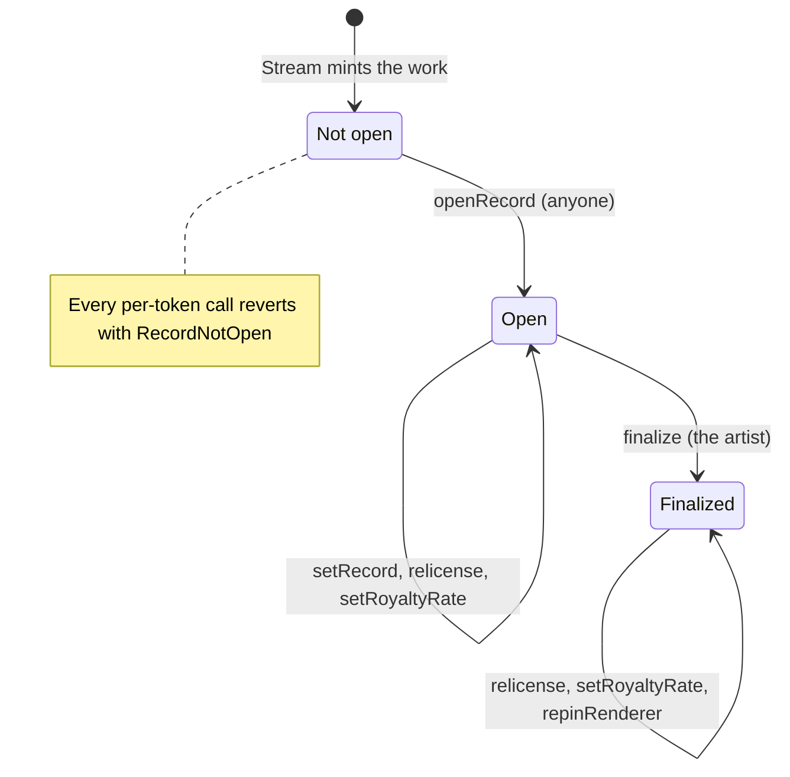
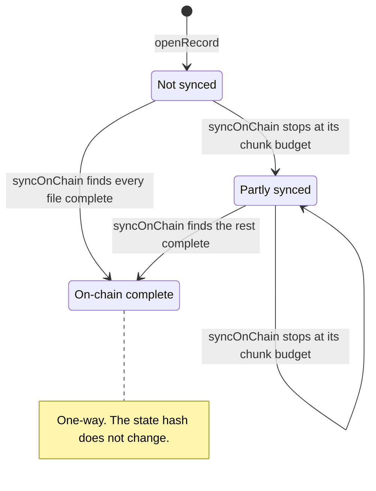
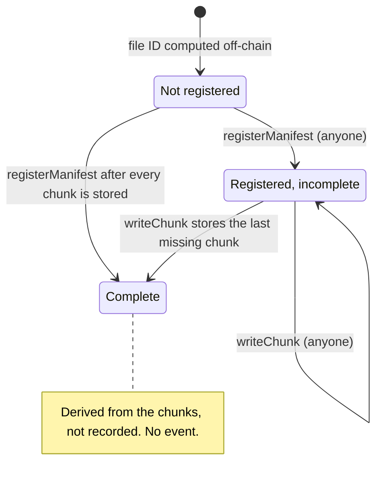
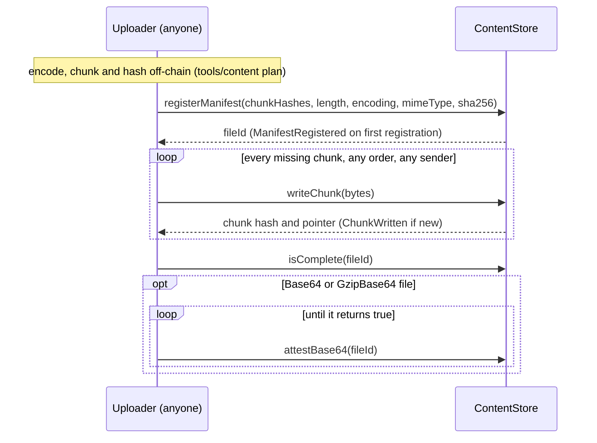
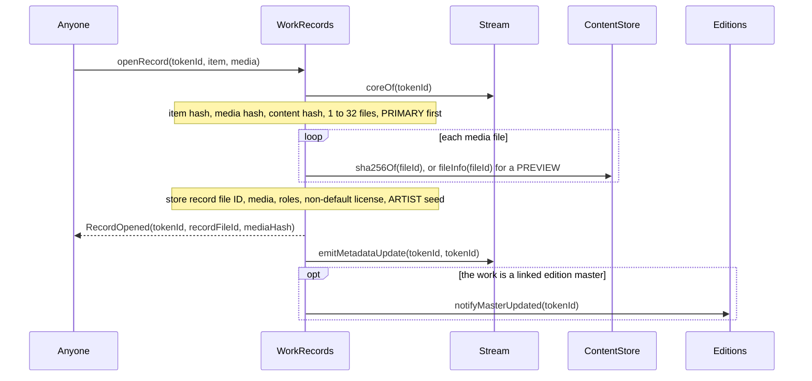
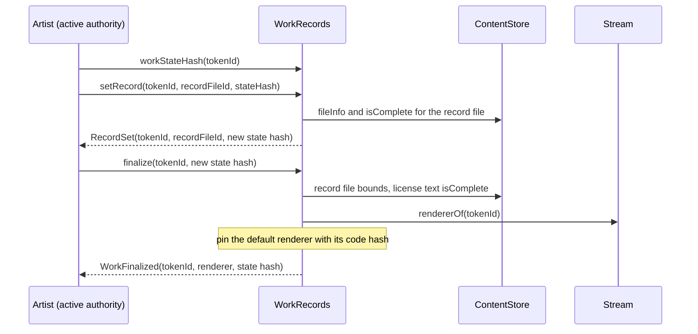
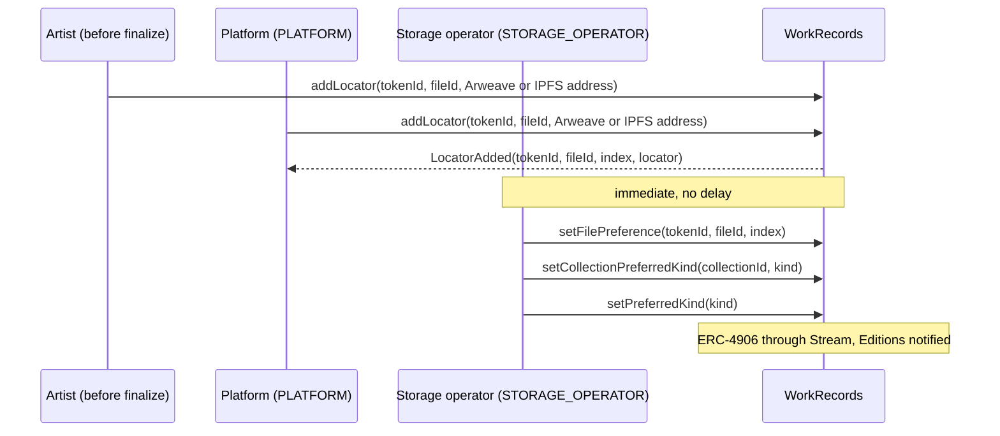
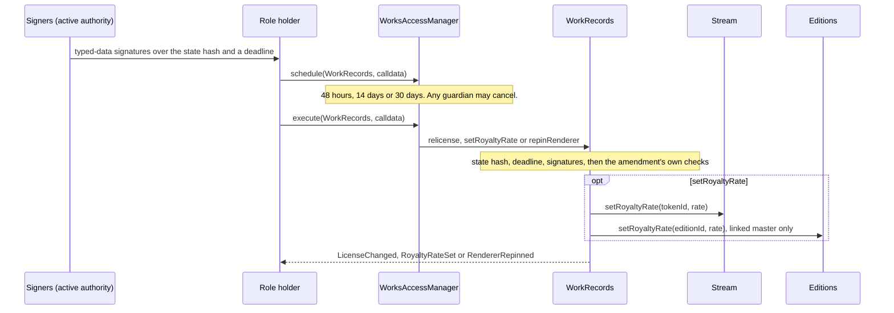
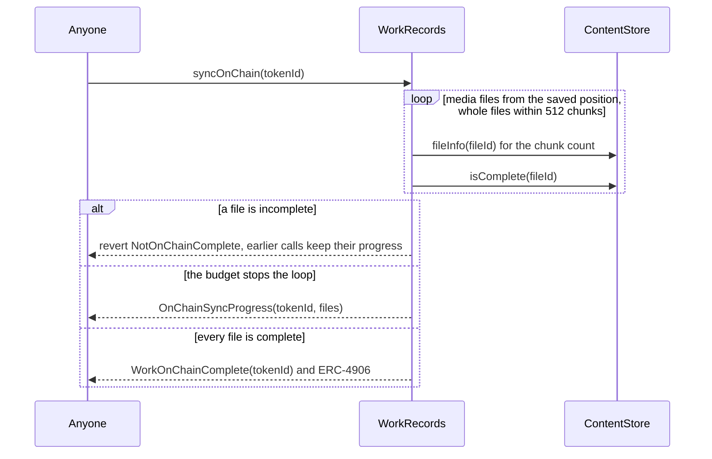

# Works and storage

A 6529 Stream work is a token in the Stream core plus everything that describes it: a
descriptive record, an ordered list of media files, a license, a renderer pin, and the places
where copies of its bytes live. This page specifies that second half and the storage under it.
It is written for auditors, artists' and curators' tooling, the platform and storage operator,
and integrators who read or verify a work's bytes. Three contracts implement it: `WorkRecords`,
the records satellite of 6529 Stream; `ContentStore`, permissionless content-addressed storage
in SSTORE2 chunks; and `DependencyRegistry`, the governed map of pinned libraries for generative
works. How metadata is built from these records is specified in
[Rendering and tokenURI](rendering-and-tokenuri.md).

> Pre-audit. See the [project status](../../README.md#status).

## Contracts

| Contract | Source | Interface | Responsibility |
| --- | --- | --- | --- |
| `WorkRecords` | [`src/stream/WorkRecords.sol`](../../src/stream/WorkRecords.sol) | [`IWorkRecords`](../../src/interfaces/IWorkRecords.sol) | Opens each work's record from its approved item; the record file pointer, media list, license and ARTIST seed; the state hash and version; finalize and the renderer pin; on-chain completeness; amendments (relicense, royalty rate, errata repin); locators and preferred location. Governed through AccessManager. |
| `SpdxId` (library) | [`src/stream/SpdxId.sol`](../../src/stream/SpdxId.sol) | none | The license-ID rule: 1 to 64 bytes of `[A-Za-z0-9.+-]`, original case kept. Stream applies it at mint, `WorkRecords` at deployment and relicense. |
| `ContentStore` | [`src/content/ContentStore.sol`](../../src/content/ContentStore.sol) | [`IContentStore`](../../src/interfaces/IContentStore.sol) | Chunks, manifests, completeness, verified chunk and range reads, base64 attestation. No owner, no governance, no payable function. |
| `Base64Validator` (library) | [`src/content/Base64Validator.sol`](../../src/content/Base64Validator.sol) | none | The strict RFC 4648 alphabet check behind `attestBase64`, 32 bytes per step. |
| `SSTORE2` (library) | [`src/libraries/SSTORE2.sol`](../../src/libraries/SSTORE2.sol) | none | Stores a chunk as the code of a CREATE2 contract (`0x00 ‖ data`, salt `keccak256(data)`) and reads it back verified. |
| `DependencyRegistry` | [`src/content/DependencyRegistry.sol`](../../src/content/DependencyRegistry.sol) | [`IDependencyRegistry`](../../src/interfaces/IDependencyRegistry.sol) | `(name, version)` to a complete content-store file, forever. Registration and deprecation are governed. |

Shared types and constants: [`ContentTypes.sol`](../../src/interfaces/types/ContentTypes.sol)
(`FileRole`, `LocatorKind`, `MediaFile`, `Locator`), [`Limits.sol`](../../src/interfaces/types/Limits.sol),
[`WorksHashing.sol`](../../src/interfaces/types/WorksHashing.sol) and
[`Typehashes.sol`](../../src/interfaces/types/Typehashes.sol).

### Who calls `WorkRecords`, and what it calls

`WorkRecords` is bound once into 6529 Stream (`IStream.bindWorkRecords`: ERC-165, not EIP-7702
delegated, and the satellite's `stream()` must be that Stream) and into 6529 Editions
(`IEditions.bindWorkRecords`: only the satellite Stream bound). Its constructor reads Stream's
`artistRegistry` and `entropyModule` once. "The artist" below is the lead artist's active
authority, read through Stream's `artistOf` and the artist registry's `activeAuthorityOf`; a
governed function first asks the AccessManager's `canCall`.

| Function | Who may call | Calls out to |
| --- | --- | --- |
| `openRecord` | Anyone | Stream `coreOf`; content store `sha256Of` (`fileInfo` for a `PREVIEW`) |
| `setRecord`, `finalize` | The artist | Content store `fileInfo`, `isComplete`; `finalize` also Stream `rendererOf` |
| `syncOnChain` | Anyone | Content store `fileInfo`, `isComplete` |
| `relicense` | PARAMETER_SETTER (48 hours), with every party's signature | Artist registry `artistIdOf`, `activeAuthorityOf`; content store `sha256Of` or `isComplete` |
| `setRoyaltyRate` | FUNDS_SETTER (14 days), with every party's signature | Artist registry; Stream `setRoyaltyRate`; for a linked master, Editions `setRoyaltyRate` |
| `repinRenderer` | SUCCESSOR_SETTER (30 days), with the artist's signature | The new renderer's ERC-165 |
| `addLocator` | The artist before finalize; anyone else only as the AccessManager allows (PLATFORM, immediate at genesis) | For a caller other than the artist, the AccessManager's `canCall` |
| `setPreferredKind`, `setCollectionPreferredKind`, `setFilePreference` | STORAGE_OPERATOR, immediate | `setCollectionPreferredKind`: Stream `collectionCount` |
| `setAuthority` | The current AccessManager (OpenZeppelin `AccessManaged`) | None |
| Views: `isOpen`, `record`, `mediaOf`, `licenseOf`, `workStateHash`, `pinnedRenderer`, `seedOf`, `locators`, `preferredLocator`, `preferredKind`, `collectionPreferredKind`, `filePreference`, `stream` | Anyone. Stream reads `stream` at binding and `isOpen` and `pinnedRenderer` in `rendererOf`; the renderer reads `isOpen`, `record`, `mediaOf`, `preferredLocator`, `licenseOf` and `seedOf`; Editions reads `licenseOf` | Stream `coreOf`; `workStateHash` also Stream `defaultRenderer`; `mediaOf` the content store's `sha256Of`; `seedOf` the entropy module's `seedOf` |

Per-token functions also read Stream's `coreOf` and `editionOf`. Every change that alters
metadata ends with Stream `emitMetadataUpdate(id, id)` and, for a master with an edition, Editions
`notifyMasterUpdated`; a global or collection preference instead reads Stream `totalMinted` and
`editions` and calls `emitMetadataUpdate(1, totalMinted)` and Editions `notifyAllUpdated`. Stream
and Editions accept these calls and `setRoyaltyRate` only from the bound `WorkRecords` (Editions
also takes `notifyAllUpdated` from Stream).

## Concepts

The [record](../glossary.md#record), [record status](../glossary.md#record-status),
[content hash](../glossary.md#content-hash), [media hash](../glossary.md#media-hash),
[file ID](../glossary.md#file-id), [chunk](../glossary.md#chunk),
[manifest](../glossary.md#manifest), [encoding](../glossary.md#encoding),
[locator](../glossary.md#locator), [preferred locator](../glossary.md#preferred-locator),
[on-chain complete](../glossary.md#on-chain-complete), [finalize](../glossary.md#finalize),
[pin](../glossary.md#pin), [errata repin](../glossary.md#errata-repin),
[state hash](../glossary.md#state-hash), [license key](../glossary.md#license-key),
[active authority](../glossary.md#active-authority) and [restraint](../glossary.md#restraint)
are defined in the glossary. What this page adds:

**Work and record.** The core token holds the owner, the item hash, the lead artist ID, the
collection, the royalty rate and the seed policy. Nothing in `WorkRecords` is written at mint, so
none of it costs the auction start; the record opens later with the permissionless `openRecord`
(WS-1).

**Record file.** A UTF-8 JSON object (RFC 8785 canonical) stored as a content-store file, with
keys `name`, `description`, `artists`, `year`, `medium`, `dimensions`, `attributes`,
`dependencies` and `files` (relative paths to media indexes). `WorkRecords` stores only its file
ID and checks only its structure, in O(1): registered, `Identity`, at most
`Limits.MAX_RECORD_BYTES` (12,288 bytes, one chunk) and complete. The renderer validates the JSON.

**Media list.** One to `Limits.MAX_MEDIA_FILES` (32) `MediaFile` entries, each a file ID, the
SHA-256 of the decoded file, and a role: `PRIMARY` (exactly one, first), `PREVIEW` (a small still
image) or `AUXILIARY` (scripts, textures, audio, large previews). No function changes it, before
or after finalize.

**Five hashes.** They must not be confused.

| Name | Definition | Where it lives |
| --- | --- | --- |
| Chunk hash | `keccak256(chunk bytes)` | `ContentStore.chunkHash`, `chunkPointer` |
| File ID | `keccak256(abi.encode(bytes32[] chunkHashes, uint256 length, uint8 encoding, string mimeType, bytes32 sha256))` | `ContentStore.manifestId`, `MediaFile.fileId` |
| Declared SHA-256 | SHA-256 of the fully decoded file (base64-decoded, then gunzipped, as the encoding requires); never recomputed on-chain | `ContentStore.fileInfo`, `sha256Of`, `MediaFile.sha256Hash` |
| Content hash | The `PRIMARY` file's declared SHA-256; the product's uniqueness key | `PackageItem.contentHash` |
| Media hash | `keccak256(abi.encode(MEDIA_DOMAIN, media))`, the commitment to the ordered media list | `PackageItem.mediaHash`, `RecordInfo.mediaHash` |

**Signatures.** Amendment consents are EIP-712 in the domain
`("6529 Works Records", "1", chainId, WorkRecords)`, as 65-byte or 64-byte (ERC-2098) ECDSA or
through ERC-1271 ([`SignatureVerifier`](../../src/libraries/SignatureVerifier.sol)).

**State hash and version.** `workStateHash(tokenId)` is
`keccak256(abi.encode(keccak256("6529WORKS_WORK_STATE_V1"), tokenId, version, recordFileId,
licenseKey, licenseTextFileId, royaltyRate, renderer))`, where `renderer` is the pinned renderer
once finalized and Stream's current default renderer before. Every applied change bumps the
version. `setRecord`, `finalize` and every consent bind the state hash, so nothing applies twice
or to a state its signer did not see. `syncOnChain`, `addLocator` and preference changes never
change it.

**License.** An SPDX-style identifier in its original case plus the file ID of the full text,
compared by license key (`keccak256` of the ASCII-lowercased identifier). The default is CC0
(`CC0-1.0` with the CC0 legal code as `cc0TextFileId`, both immutable in `WorkRecords`); a license
is stored per work only when it differs. A CC0 dedication is irrevocable, and a CC0 license always
names `cc0TextFileId`. The governed default license for new packages is a different setting
([Economics and payouts](economics-and-payouts.md)).

**Pin.** `finalize` pins Stream's current default renderer with its code hash (WS-9, WS-16); only
the errata repin changes a pin.

**On-chain complete and `ONCHAIN`.** The flag covers media only and is one-way, because
on-chain bytes are permanent. `ONCHAIN` is the content store itself as a copy: implicit for an
on-chain complete work, never registered as a locator.

**Chunk layout.** A chunk is at most `CHUNK_SIZE` (24,575) bytes stored as contract code, and
every chunk but the last holds exactly that many (the layout rule), so the same bytes always give
the same chunks and file ID. The encodings are `Identity`, `Gzip` (RFC 1952), `Base64` (RFC 4648
section 4, `=` padding, no line breaks) and `GzipBase64`. The file ID names one encoded stream,
so the same media as `Identity` and as `Base64` are two files: uniqueness keys on the decoded
SHA-256, never on the file ID.

**Dependency.** A library such as p5.js, registered once as a `(name, version)` pair of `bytes32`
labels pointing at a complete content-store file.

## State machine

A work's record has a lifecycle and, orthogonal to it, an on-chain completeness flag.

A burn (only by the minting adapter, before the primary sale settles, after an upheld dispute)
ends both machines: every per-token call then reverts with Stream's `UnknownWork`.

A content-store file (its base64 attestation, for a `Base64` or `GzipBase64` file, runs 48
chunks per `attestBase64` call until it reaches the end, once per file ID):

A dependency version is registered (PARAMETER_SETTER, 48 hours) and may be deprecated
(GUARDIAN, immediate): a one-way flag; the version stays resolvable and readable.

Delay classes (immediate, standard 48 hours, funds 14 days, successor 30 days) are mapped in
[`config/genesis.example.json`](../../config/genesis.example.json); the selector matrix is
[roles.md](../audit/roles.md). Any GUARDIAN may cancel a scheduled call during its delay
([Governance](governance.md)).

| Transition | Caller (role) | Delay | Function |
| --- | --- | --- | --- |
| Not open to Open | Anyone | None | `WorkRecords.openRecord` |
| Open: new record file | The artist | None | `WorkRecords.setRecord` |
| Open to Finalized | The artist | None | `WorkRecords.finalize` |
| Open or Finalized: new license | PARAMETER_SETTER, plus every party's `Relicense` signature | Standard, 48 hours | `WorkRecords.relicense` |
| Open or Finalized: new royalty rate | FUNDS_SETTER, plus every party's `RoyaltyRateChange` signature | Funds, 14 days | `WorkRecords.setRoyaltyRate` |
| Finalized: new renderer pin (errata) | SUCCESSOR_SETTER, plus the artist's `RendererRepin` signature | Successor, 30 days | `WorkRecords.repinRenderer` |
| Not synced to Partly synced or On-chain complete | Anyone | None | `WorkRecords.syncOnChain` |
| Locator appended (no state change) | The artist before finalize; PLATFORM at any time | Immediate | `WorkRecords.addLocator` |
| Preference changed (no state change) | STORAGE_OPERATOR | Immediate | `WorkRecords.setPreferredKind`, `setCollectionPreferredKind`, `setFilePreference` |
| File: Not registered to Registered | Anyone | None | `ContentStore.registerManifest` |
| File: to Complete | Anyone | None | `ContentStore.writeChunk` |
| File: Not attested to Attested | Anyone | None | `ContentStore.attestBase64` |
| Dependency: to Registered | PARAMETER_SETTER | Standard, 48 hours | `DependencyRegistry.register` |
| Dependency: Registered to Deprecated | GUARDIAN | Immediate | `DependencyRegistry.deprecate` |

## Flows

### Upload and register a file

- **Preconditions.** None: any account, any order, before or after the work is minted. The file
  ID depends only on the manifest, so a package can commit to it before anything is deployed.
- **Effects.** A new chunk deploys one SSTORE2 contract; repeats are no-ops. Completion is
  derived (`isComplete`, `missingChunks`) and has no event.
- **Off-chain proof.** The uploader in [`tools/content`](../../tools/content/README.md) proves
  the encoded stream reproduces every chunk hash and the declared SHA-256 before any transaction
  is emitted, and refuses base64 text that `attestBase64` would reject. For `Gzip`, `Base64` and
  `GzipBase64` files, the encoded stream itself must also be published (Arweave or IPFS): the
  file ID names those exact bytes, and gzip output depends on the compressor.
- **Gas.** About 1,548 gas per stored byte on Sepolia under Glamsterdam, so one full chunk fits a
  transaction ([`flows.md`](../../deployments/11155111/flows.md#1-content); the rest in the
  [content module](../../src/content/README.md#upload-flow)).

### Open a record

- **Checks.** WS-2, WS-3 and WS-5; the media chunks need not be uploaded. The record file and a
  non-CC0 license text are stored as approved (WS-4), so neither can freeze a minted work;
  `finalize` enforces both.
- **Trust obligation.** These checks do not run at mint, so a mis-committed item mints and can
  never open; the curation signer's tooling must simulate `openRecord`
  ([Curation](curation.md)).

### Set the record and finalize

- **`setRecord`.** WS-7 and WS-8 (`UnknownRecordFile` for a bad file). Pointing at the current
  file is a no-op.
- **`finalize`.** It re-applies the record-file bounds (the approved file may never have been
  checked), requires the license text complete on-chain (the default CC0 text included), and pins
  the renderer Stream's `rendererOf` returns, which checks the default renderer's code. Because
  the state hash includes the default renderer before finalize, a new default installed after
  the artist read the state hash makes `finalize` revert with `StateHashMismatch`: the artist
  pins only the renderer they saw.
- **Not checked: the JSON.** A record the renderer refuses can be finalized and then shows
  core-only metadata for good. Artist tooling should render the record first.
- **After finalize.** Delivery routing stays operable: PLATFORM adds locators and
  STORAGE_OPERATOR chooses among them (ADR 0001 §10 carve-out). Relicensing, re-rating and the
  errata repin remain possible.

### Add a locator and switch the preferred location

- **Rules.** WS-18 to WS-22; after finalize the artist's call fails with
  `AccessManagedUnauthorized`. The most specific preference wins; `ONCHAIN` matches only an
  on-chain complete work, read from the stored flag, never from a content-store scan. The storage
  operator cannot add, remove or change a locator.
- **Suspension.** A guardian can [suspend](governance.md#suspension-of-operational-keys) the
  PLATFORM or STORAGE_OPERATOR key at once: its calls then revert with
  `AccessManagedUnauthorized` in the same block, while the artist's own `addLocator` before
  finalize stays open. Preferences already set stay in force.

### Relicense, royalty rate and errata repin

| Amendment | Signers and typed data (`Typehashes`) | Own checks |
| --- | --- | --- |
| `relicense` | Every party of `item` (checked against Stream's item hash), in order: `Relicense(tokenId, licenseKey, textFileId, stateHash, deadline)`, so the key, not the identifier's case | Leaving CC0 reverts with `LicenseIrrevocable`; a CC0 license with another text, or an invalid identifier, with `InvalidLicense`; the new text is registered, and complete for a finalized work (WS-5, WS-12, WS-13) |
| `setRoyaltyRate` | Every party: `RoyaltyRateChange(tokenId, rate, stateHash, deadline)` | Stream refuses a rate above its denominator (`InvalidRoyaltyRate`); payees never change (WS-14) |
| `repinRenderer` | The artist only: `RendererRepin(tokenId, renderer, rendererCodeHash, stateHash, deadline)` | A finalized work; the renderer has code, is not EIP-7702 delegated, has the signed code hash and supports `IRenderer` (WS-15, WS-16) |

- Signatures are checked against the active authorities at execution, so the deadline must
  cover the delay, and an authority that changed or is restrained fails (`InvalidConsent`). The
  current license, rate or renderer is a no-op.
- Whether a new license is more permissive is not checked: that judgement rests with the parties
  and the governed action. How the rate applies is in
  [Economics and payouts](economics-and-payouts.md).

### Mark a work on-chain complete

A file of up to `MAX_CHUNKS` (512) always fits one call's budget. A full call of 512 cold
chunks stays under 30% of the 16,777,216-gas transaction cap in Prague gas
([`SyncOnChainResume.t.sol`](../../test/integration/SyncOnChainResume.t.sol)).

## Rules and invariants

| ID | Rule | Enforced in | Tested by |
| --- | --- | --- | --- |
| WS-1 | Every per-token view and mutator of `WorkRecords` except `isOpen` reverts with `RecordNotOpen` until `openRecord` has run. | `WorkRecords._open` | [`WorkRecords.t.sol`](../../test/stream/WorkRecords.t.sol) `test_views_revertBeforeOpen` |
| WS-2 | `openRecord` is permissionless and opens only the committed item and media: Stream's item hash, the media hash, the content hash, 1 to 32 files with the `PRIMARY` first and alone, each declared SHA-256 equal to the content store's, each inlinable `PREVIEW` within `MAX_PREVIEW_BYTES`. | `WorkRecords.openRecord`, `_previewSha` | [`WorkRecords.t.sol`](../../test/stream/WorkRecords.t.sol) `test_openRecord_permissionless`, `test_openRecord_rejectsMismatches`, `test_openRecord_previewCap`; [`ReviewRegressions.t.sol`](../../test/stream/ReviewRegressions.t.sol) `test_mediaCommitmentIsACurationObligation` |
| WS-3 | A record opens once (`RecordAlreadyOpen`), and only for a live token (Stream's `UnknownWork`). | `WorkRecords.openRecord`, `_core` | [`WorkRecords.t.sol`](../../test/stream/WorkRecords.t.sol) `test_openRecord_rejectsMismatches` |
| WS-4 | The approved record file and a non-CC0 license are stored as approved, unchecked, so neither can keep a minted work from opening. | `WorkRecords.openRecord` | [`WorkRecords.t.sol`](../../test/stream/WorkRecords.t.sol) `test_openRecord_storesUnknownRecordFile`, `test_openRecord_storesUnregisteredLicenseText`; [`ReviewRegressions.t.sol`](../../test/stream/ReviewRegressions.t.sol) `test_twoChunkRecordOpensAndIsFixable`, `test_unregisteredLicenseTextOpensAndIsFixable` |
| WS-5 | A license whose key is CC0 names the deployment's CC0 text, at `openRecord` and at relicense. | `WorkRecords.openRecord`, `_relicenseKey` | [`ReviewRegressions.t.sol`](../../test/stream/ReviewRegressions.t.sol) `test_cc0TextMustBeTheDeploymentText`; [`ContentReviewRegressions.t.sol`](../../test/integration/ContentReviewRegressions.t.sol) `test_Cc0_AnApprovedCc0LicenseMustNameThePinnedText`; [`WorkRecords.t.sol`](../../test/stream/WorkRecords.t.sol) `test_relicense_cc0TextOnlyToTheDeploymentText` |
| WS-6 | The media list never changes after `openRecord`. | Structural: `openRecord` is the only writer of the media list | Code review; [`WorkRecords.t.sol`](../../test/stream/WorkRecords.t.sol) `test_openRecord_multiFileWithRoles` reads it back |
| WS-7 | Only the artist calls `setRecord` and `finalize`, only before finalize, each against the current state hash; a restrained authority cannot. | `WorkRecords._onlyArtist`, `_checkState` | [`WorkRecords.t.sol`](../../test/stream/WorkRecords.t.sol) `test_setRecord_reverts`, `test_setRecord_followsCurrentAuthority`, `test_finalize_reverts`; [`RecoveryRestraint.t.sol`](../../test/integration/RecoveryRestraint.t.sol) `test_RestrainedKeyCannotAmendTheRecord` |
| WS-8 | `setRecord` and `finalize` accept a record file only if it is registered, `Identity`, at most `MAX_RECORD_BYTES` and complete. | `WorkRecords._checkRecordFile` | [`WorkRecords.t.sol`](../../test/stream/WorkRecords.t.sol) `test_recordBounds_rejectStructuralBreaks`, `test_recordBounds_acceptCompleteSingleChunk`, `test_finalize_needsCompleteRecordFile` |
| WS-9 | `finalize` requires the license text complete on-chain, pins the default renderer with its code hash, and happens once. | `WorkRecords.finalize`, `_requireLicenseText`, `_pinCode` | [`WorkRecords.t.sol`](../../test/stream/WorkRecords.t.sol) `test_finalize_needsStoredLicenseText`, `test_finalize_pinsDefaultRenderer`, `test_finalize_reverts`; [`ReviewRegressions.t.sol`](../../test/stream/ReviewRegressions.t.sol) `test_finalizedLicenseTextIsStored`; [`RendererCodePin.t.sol`](../../test/integration/RendererCodePin.t.sol) `test_FinalizeRefusesADefaultRendererWhoseCodeChanged` |
| WS-10 | The state hash commits to the token ID, version, record file, license key, license text, royalty rate and effective renderer (the default renderer before finalize). | `WorkRecords.workStateHash` | [`WorkRecords.t.sol`](../../test/stream/WorkRecords.t.sol) `test_stateHash_golden`, `test_stateHash_changesWithDefaultRendererBeforeFinalizeOnly`, `test_finalize_compareAndSetCatchesRendererChange` |
| WS-11 | Every applied change bumps the version; identical re-publishes are no-ops; permissionless actions and preferences never change the state hash. No consent applies twice. | `WorkRecords.setRecord`, `finalize`, `relicense`, `setRoyaltyRate`, `repinRenderer` | [`WorkRecords.t.sol`](../../test/stream/WorkRecords.t.sol) `test_setRecord_identicalIsNoOp`, `test_setRoyaltyRate_identicalIsNoOp`, `test_repinRenderer_samePinIsNoOp`, `test_stateHash_ignoresPermissionlessActions`; [`ReviewRegressions.t.sol`](../../test/stream/ReviewRegressions.t.sol) `test_rateRoundTripReplayBlocked` |
| WS-12 | CC0 is irrevocable: a relicense from the CC0 key to any other key reverts, whatever the identifier's case. | `WorkRecords._relicenseKey` | [`WorkRecords.t.sol`](../../test/stream/WorkRecords.t.sol) `test_relicense_cc0IsIrrevocableInAnyCase`; [`RecordAmendments.t.sol`](../../test/integration/RecordAmendments.t.sol) `test_RelicenseToCc0WithConsentAndGovernance`; [`ContentReviewRegressions.t.sol`](../../test/integration/ContentReviewRegressions.t.sol) `test_Cc0_TheTextNeverChanges` |
| WS-13 | A relicense needs PARAMETER_SETTER and every party's `Relicense` signature by its active authority before the deadline; the new text is registered, and complete for a finalized work; the identifier is valid. | `WorkRecords.relicense`, `_checkConsents`, `_requireLicenseText` | [`WorkRecords.t.sol`](../../test/stream/WorkRecords.t.sol) `test_relicense_withEveryConsent`, `test_relicense_rejectsMissingOrBadConsent`, `test_relicense_needsGovernance`, `test_relicense_consentFollowsCurrentAuthority`, `test_relicense_rejectsInvalidNext`; [`RecordAmendments.t.sol`](../../test/integration/RecordAmendments.t.sol) `test_FinalizedWorkNeedsAnOnChainLicenseText` |
| WS-14 | A royalty-rate change needs FUNDS_SETTER and every party's `RoyaltyRateChange` signature, and applies to Stream and a linked edition. | `WorkRecords.setRoyaltyRate`, `_applyRate` | [`WorkRecords.t.sol`](../../test/stream/WorkRecords.t.sol) `test_setRoyaltyRate_withEveryConsent`, `test_setRoyaltyRate_reverts`, `test_setRoyaltyRate_followsToLinkedEdition`; [`ReviewRegressions.t.sol`](../../test/stream/ReviewRegressions.t.sol) `test_coreOfReportsCurrentRate`; [`RecoveryRestraint.t.sol`](../../test/integration/RecoveryRestraint.t.sol) `test_PreSignedRoyaltyConsentRefusedWhileRestrained` |
| WS-15 | The errata repin needs a finalized work, SUCCESSOR_SETTER and the artist's `RendererRepin` signature binding the code hash; the renderer has code, is not EIP-7702 delegated, matches the hash and supports `IRenderer`. | `WorkRecords.repinRenderer` | [`WorkRecords.t.sol`](../../test/stream/WorkRecords.t.sol) `test_repinRenderer_errataPath`, `test_repinRenderer_reverts`; [`RecordAmendments.t.sol`](../../test/integration/RecordAmendments.t.sol) `test_NewDefaultRendererAndTheErrataRepin` |
| WS-16 | A renderer address is pinned with one code hash forever. `pinnedRenderer` reverts with `InvalidRenderer` once the code differs, so `tokenURI` fails closed; pinning it again with another hash reverts. | `WorkRecords._pinCode`, `pinnedRenderer` | [`RendererCodePin.t.sol`](../../test/integration/RendererCodePin.t.sol) `test_PinnedRendererWithChangedCodeIsRefused`, `test_RepinRefusesARendererWhoseCodeChangedSincePinned`, `test_DefaultRendererWithChangedCodeIsRefused` |
| WS-17 | `syncOnChain` is permissionless, one-way and resumable: whole files within 512 chunks per call, a revert at the first incomplete file keeps earlier progress, a repeat after completion emits nothing, and the state hash is unchanged. | `WorkRecords.syncOnChain` | [`WorkRecords.t.sol`](../../test/stream/WorkRecords.t.sol) `test_syncOnChain`; [`SyncOnChainResume.t.sol`](../../test/integration/SyncOnChainResume.t.sol) `test_SyncOnChain_ResumesAcrossCalls`, `test_SyncOnChain_KeepsItsPlaceUntilAFileCompletes`; [`ReviewRegressions.t.sol`](../../test/stream/ReviewRegressions.t.sol) `test_onChainNeedsEveryFile` |
| WS-18 | A locator is `ar://` and a 43-character base64url transaction ID whose last character has zero padding bits (48 bytes), or `ipfs://` and a 59-character base32 CIDv1 starting `bafkrei` or `bafybei`, then `a`–`h`, with zero padding bits in the last character (66 bytes). Nothing else, and never kind `NONE` or `ONCHAIN`. | `WorkRecords._checkUri` | [`ContentReviewRegressions.t.sol`](../../test/integration/ContentReviewRegressions.t.sol) `test_Locator_OnlyContentAddressesAreAccepted`, `test_Locator_OneSpellingPerAddress`; [`WorkRecords.t.sol`](../../test/stream/WorkRecords.t.sol) `test_addLocator_reverts` |
| WS-19 | Before finalize, 8 locators per file from the artist and 8 from the platform; a URI already registered for the file is refused; after finalize only PLATFORM adds, up to 16 in all. | `WorkRecords.addLocator` | [`WorkRecords.t.sol`](../../test/stream/WorkRecords.t.sol) `test_addLocator_byArtistAndPlatform`, `test_addLocator_rejectsDuplicateUri`, `test_addLocator_platformTakesTheArtistsUnusedSlotsAfterFinalize`; [`ReviewRegressions.t.sol`](../../test/stream/ReviewRegressions.t.sol) `test_locatorQuotasAndSharedDuplicateSet`; [`ContentReviewRegressions.t.sol`](../../test/integration/ContentReviewRegressions.t.sol) `test_Locator_ArtistCannotAddAfterFinalize` |
| WS-20 | Locators are append-only and belong to one of the work's media files (`FileNotInWork`). | `WorkRecords.addLocator`, `_requireMedia`; no removal function exists | [`WorkRecords.t.sol`](../../test/stream/WorkRecords.t.sol) `test_addLocator_reverts`, `test_preferenceSetters_reverts` |
| WS-21 | The preferred locator is the file's index, else the collection kind, else the global kind, else the first registered, else the implicit `ONCHAIN` copy of an on-chain complete work, else the empty locator (kind `NONE`, index `type(uint256).max`). | `WorkRecords.preferredLocator`, `_firstOfKind` | [`PreferredLocation.t.sol`](../../test/stream/PreferredLocation.t.sol) `testFuzz_preferredLocator_matchesModel`; [`WorkRecords.t.sol`](../../test/stream/WorkRecords.t.sol) `test_preferredLocator_mostSpecificWins`, `test_preferredLocator_implicitOnchainFallback` |
| WS-22 | The storage operator can only choose among copies registered for that file, or its on-chain bytes. | `WorkRecords.setFilePreference`, `preferredLocator` | [`PreferredLocation.t.sol`](../../test/stream/PreferredLocation.t.sol) `testFuzz_preferredLocator_staysWithinFile`; [`WorkRecords.t.sol`](../../test/stream/WorkRecords.t.sol) `test_preferenceSetters_reverts` |
| WS-23 | Every visible change emits ERC-4906 through Stream and notifies Editions for a master; a global or collection preference change refreshes every token and edition. | `WorkRecords._refresh`, `_refreshAll` | [`WorkRecords.t.sol`](../../test/stream/WorkRecords.t.sol) `test_preferenceSetters_eventsAndRefresh`, `test_preferenceSetters_notifyAllEditions`, `test_editionMaster_notifiesEditions` |
| WS-24 | A chunk is at most `CHUNK_SIZE` bytes; writing is idempotent and its pointer depends only on the bytes and the store. | `ContentStore.writeChunk`, `SSTORE2.write` | [`ContentStore.t.sol`](../../test/content/ContentStore.t.sol) `test_WriteChunk_AcceptsMaxAndRejectsOneMore`, `test_WriteChunk_IsIdempotent`, `testFuzz_WriteChunk_IsCallerIndependent` |
| WS-25 | The file ID commits to the whole manifest and to nothing else (no chain ID, no address); registering again is a no-op; a different claim about the same chunks is a different file. | `ContentStore.manifestId`, `registerManifest` | [`ContentStore.t.sol`](../../test/content/ContentStore.t.sol) `test_FileId_CommitsToWholeManifest`, `test_FileId_IsChainAndDeploymentIndependent`, `test_RegisterManifest_IsIdempotent` |
| WS-26 | A manifest has 1 to 512 chunks, a length with `(count − 1) × CHUNK_SIZE < length ≤ count × CHUNK_SIZE`, a nonzero SHA-256, a valid MIME type and one of four encodings. | `ContentStore.registerManifest`, `_requireMime` | [`ContentStore.t.sol`](../../test/content/ContentStore.t.sol) `test_RegisterManifest_ChunkCountBounds`, `testFuzz_RegisterManifest_LengthFitsIffInRange`, `test_RegisterManifest_RejectsZeroDigest`, `test_RegisterManifest_AcceptsExactlyTheFourEncodings` |
| WS-27 | A chunk counts only at the length the layout rule requires; a manifest that breaks the rule, or lists a chunk that cannot exist, never completes and never reads. | `ContentStore._present`, `_readChunk`, `_expectedLength` | [`ContentStore.t.sol`](../../test/content/ContentStore.t.sol) `test_WrongLengthChunkNeverCompletesOrReads`, `test_OverLongFinalChunkNeverCompletesOrReads`, `test_ZeroChunkHashIsAcceptedButNeverCompletes` |
| WS-28 | Reads fail closed: every touched chunk is read whole and checked against its keccak256; a missing chunk reverts; no read returns partial data. | `ContentStore.read`, `readChunk`, `SSTORE2.readVerified` | [`ContentStore.t.sol`](../../test/content/ContentStore.t.sol) `test_ReadsDetectTamperedChunkCode`, `testFuzz_Read_MatchesReference`, `test_UnknownFileRevertsEverywhere` |
| WS-29 | Uploads are permissionless and in any order; chunks are shared by hash across files; nothing accepts value. | `ContentStore` (no access control, no payable function) | [`ContentStore.t.sol`](../../test/content/ContentStore.t.sol) `test_RegisterManifest_BeforeChunksExist`, `test_OutOfOrderUploads_CompleteTheFile`, `test_SharedChunksServeEveryFileThatListsThem`, `test_NothingAcceptsValue` |
| WS-30 | The declared SHA-256 is never recomputed on-chain; `sha256Of` returns it and reverts for an unknown file. | `ContentStore.sha256Of` | [`ContentStore.t.sol`](../../test/content/ContentStore.t.sol) `test_Sha256Of_IsTheDeclaredDigest`, `testFuzz_Sha256Of_MatchesFileInfo` |
| WS-31 | `attestBase64` accepts only `Base64` and `GzipBase64` files of a length divisible by 4 whose bytes are `[A-Za-z0-9+/]` except a final `=` or `==`; it checks at most 48 chunks per call, resumes, and is one-time per file ID. | `ContentStore.attestBase64`, `_validateBase64`, `_padding`, `Base64Validator.isAlphabet` | [`Base64Attest.t.sol`](../../test/content/Base64Attest.t.sol) `test_EveryByteValueInEveryLane`, `testFuzz_ArbitraryBytesMatchTheOracle`, `test_Attest_RejectsEqualsWhereverItIsNotTheLastOneOrTwoBytes`, `test_Attest_LengthMustBeAMultipleOfFour`, `test_Attest_LargeFileTakesSeveralCalls`, `test_Attest_IsOneTimeAndIdempotent` |
| WS-32 | The store's constants are fixed, and its worst transactions fit the EIP-7825 cap in Prague gas: a 512-chunk registration and every attestation call. | `ContentStore` constants | [`ContentStore.t.sol`](../../test/content/ContentStore.t.sol) `test_Constants_ArePinned`, `test_RegisterManifest_AtMaxChunksFitsTheTransactionGasCap`; [`Base64Attest.t.sol`](../../test/content/Base64Attest.t.sol) `test_Attest_AtMaxChunksEveryCallFitsTheTransactionGasCap` |
| WS-33 | The uploader's file IDs, chunk hashes, calldata and attestation verdicts equal the contract's. | `tools/content` against `ContentStore` | [`UploaderGolden.t.sol`](../../test/content/tooling/UploaderGolden.t.sol) `test_Inline_ChunkHashesFileIdAndCalldataMatch`, `test_Generated_ChunkingFileIdAndCalldataMatch`; [`UploaderAttest.t.sol`](../../test/content/tooling/UploaderAttest.t.sol) `test_GoldenCases_StoreReachesThePythonVerdictForBothBase64Encodings` |
| WS-34 | A dependency label is 1 to 32 bytes of `[a-z0-9._-]`, left-aligned, then only zero bytes; a `(name, version)` maps to one complete file forever. | `DependencyRegistry.register`, `_requireLabel` | [`DependencyRegistry.t.sol`](../../test/content/DependencyRegistry.t.sol) `test_Register_LabelExamples`, `testFuzz_Register_LabelValidity`, `test_Register_VersionsAreImmutable`, `test_Register_RequiresCompleteContent` |
| WS-35 | Deprecation is a one-way flag: nothing is deleted and the version still resolves. Both functions are restricted. | `DependencyRegistry.deprecate`, `resolve` | [`DependencyRegistry.t.sol`](../../test/content/DependencyRegistry.t.sol) `test_Deprecate_IsAFlagOnly`, `test_Deprecate_Guards`, `test_Register_OnlyTheRegistrarRole` |
| WS-36 | The governed selectors of `WorkRecords` and `DependencyRegistry` map to the roles and delays in this page, and the genesis configuration installs them. | [`config/genesis.example.json`](../../config/genesis.example.json), `GovernanceConfigurator` | [`GenesisConfig.t.sol`](../../test/governance/GenesisConfig.t.sol) `test_JsonMatchesTheCompiledSelectors`, `test_EveryEntryMatchesItsSignatureAndClassDelay`, `test_GenesisConfigurationInstallsWiresAndReadsBack` |

The whole path, from upload and attestation through `openRecord`, `finalize` and `syncOnChain` to
inline rendering, runs on the real stack in
[`ContentToTokenURI.t.sol`](../../test/integration/ContentToTokenURI.t.sol)
`test_AttestOpenFinalizeSyncThenInline`.

## Events

Signatures and topic0 are under [WorkRecords](../integrators/events-and-indexing.md#workrecords),
[ContentStore](../integrators/events-and-indexing.md#contentstore) and
[DependencyRegistry](../integrators/events-and-indexing.md#dependencyregistry). A file's
completion in the content store has no event: derive it from `ManifestRegistered` and
`ChunkWritten`, or read `isComplete`.

## Failure modes and recovery

| Failure | Effect | Recovery |
| --- | --- | --- |
| A media file's manifest is not registered | `openRecord` reverts with the store's `ContentFileUnknown`; core-only metadata (`not_open`). | Anyone registers the committed manifest, then calls `openRecord`. |
| A mis-committed item (any WS-2 or WS-5 check fails) | `openRecord` reverts with `InvalidRecordData` or `InvalidLicense` for good; core-only metadata. | None on-chain. Prevention is the curation signer's `openRecord` simulation. |
| The approved record file is unregistered, incomplete, too large, not `Identity`, or invalid JSON | The record opens; core-only metadata (`incomplete` or `invalid`), for good once finalized. | Anyone completes the upload, or the artist calls `setRecord` with a valid file before finalize. |
| The license text is not registered or not complete | `finalize` reverts (`ContentFileUnknown` or `InvalidLicense`). | Anyone uploads the text, then the artist finalizes. |
| A chunk is missing | Reads touching it revert (`ContentChunkMissing`); `syncOnChain` reverts (`NotOnChainComplete`); the renderer serves the preferred locator. | Anyone writes the chunk (`missingChunks` lists them); `syncOnChain` resumes where it stopped. |
| A manifest breaks the layout rule or lists an impossible chunk | Accepted but never completes or reads (WS-27); its work never becomes on-chain complete. | None for that file ID; served by locator. Tooling refuses such manifests. |
| A `Base64` file is not yet attested | Never inlined; served by locator. | Anyone calls `attestBase64` until it returns true. |
| Base64 text breaks the strict alphabet | `attestBase64` reverts with `ContentBase64Invalid(fileId, index)` forever. | None for that file ID. Tooling refuses such text before upload. |
| A pinned renderer's code no longer matches its pinned hash | `pinnedRenderer` reverts with `InvalidRenderer`, so `tokenURI` fails closed. | The errata repin (30 days). An unfinalized work's changed default renderer is replaced by `Stream.setDefaultRenderer` (30 days). |
| The artist's key is lost | No `setRecord`, `finalize`, repin or artist consent; locators by PLATFORM, preferences and `syncOnChain` still work. | Recover the authority through the artist registry ([Identity and recovery](identity-and-recovery.md)), then sign. While an authority-moving override is pending, nobody acts as the artist. |
| The state changed between signing and execution, or a consent expired or lost its authority | `StateHashMismatch` or `InvalidConsent(tokenId, partyIndex)` at execution. | Read the new state hash, collect new signatures with a deadline past the delay, schedule again. |
| A locator names the wrong content or goes dark | Not detected on-chain; `tokenURI` may serve it. | STORAGE_OPERATOR at once prefers another registered copy; the off-chain monitor re-pins or re-uploads. |
| The PLATFORM or STORAGE_OPERATOR key is compromised | Junk locators (up to its quota) or preferences pointing at a bad copy. | A guardian suspends the key; governance replaces it (30 days, then the 48-hour grant delay); the new operator restores the preferences. |
| A file's locator quota is used up | `addLocator` reverts with `InvalidLocator`. | Before finalize the other side's quota remains; after finalize PLATFORM may use all 16 slots. |
| A wrong file was registered as a dependency version | The entry can never change. | GUARDIAN deprecates it at once; PARAMETER_SETTER registers a new version label (48 hours). |

## Parameters and limits

| Parameter | Value | Source |
| --- | --- | --- |
| Chunk size | 24,575 bytes (EIP-170's 24,576 minus the STOP byte) | `ContentStore.CHUNK_SIZE`, `SSTORE2.MAX_CHUNK_LENGTH` |
| Chunks per file | 1 to 512 (12,582,400 bytes) | `ContentStore.MAX_CHUNKS` |
| MIME type | At most 64 bytes, lowercase `type/subtype` from `[a-z0-9+._-]`, one interior slash | `ContentStore.MAX_MIME_LENGTH`, `_requireMime` |
| Chunks per attestation call | 48 | `ContentStore.ATTEST_CHUNKS_PER_CALL` |
| Encodings | `Identity` 0, `Gzip` 1, `Base64` 2, `GzipBase64` 3 (part of the file ID) | `IContentStore.Encoding` |
| Media files per work | 1 to 32 | `Limits.MAX_MEDIA_FILES` |
| Record file | At most 12,288 bytes, `Identity`, one chunk | `Limits.MAX_RECORD_BYTES` |
| Inlinable `PREVIEW` file | At most 16,384 stored bytes, an `Identity` file counting four times | `Limits.MAX_PREVIEW_BYTES` |
| License identifier | 1 to 64 bytes of `[A-Za-z0-9.+-]` | `Limits.MAX_LICENSE_ID_BYTES`, `SpdxId` |
| CC0 license key | `keccak256("cc0-1.0")` | `WorksHashing.CC0_LICENSE_KEY` |
| CC0 legal code | 7,048 bytes, `text/plain`, SHA-256 `0xa2010f34…0499` | [`script/README.md`](../../script/README.md#6-the-cc0-license-text) (`DeployV1.CC0_LEGALCODE_SHA256`) |
| Locators per file | 16 in all; 8 by the artist and 8 by the platform before finalize | `Limits.MAX_LOCATORS_PER_FILE`, `WorkRecords.LOCATOR_QUOTA` |
| Locator URI | 48 bytes (Arweave) or 66 bytes (IPFS) | `WorkRecords._checkUri` |
| Chunks per `syncOnChain` call | 512, in whole files | `WorkRecords.SYNC_CHUNKS` |
| EIP-712 domain | `"6529 Works Records"`, version `"1"` | `Typehashes.WORK_RECORDS_NAME`, `DOMAIN_VERSION` |
| Dependency label | 1 to 32 bytes of `[a-z0-9._-]`, left-aligned, zero-padded | `DependencyRegistry._requireLabel` |
| Storage cost on Sepolia (Glamsterdam) | About 1,548 gas per stored byte (Prague about 218) | [`flows.md`](../../deployments/11155111/flows.md#1-content), [ADR 0004](../adr/0004-gas-budgets-under-glamsterdam.md#consequences) |

## Differences from the ADRs

See the [register](README.md#differences-from-the-adrs).

## References

- **Code:** [`WorkRecords.sol`](../../src/stream/WorkRecords.sol),
  [`IWorkRecords.sol`](../../src/interfaces/IWorkRecords.sol),
  [`SpdxId.sol`](../../src/stream/SpdxId.sol),
  [`ContentStore.sol`](../../src/content/ContentStore.sol),
  [`IContentStore.sol`](../../src/interfaces/IContentStore.sol),
  [`Base64Validator.sol`](../../src/content/Base64Validator.sol),
  [`SSTORE2.sol`](../../src/libraries/SSTORE2.sol),
  [`DependencyRegistry.sol`](../../src/content/DependencyRegistry.sol),
  [`IDependencyRegistry.sol`](../../src/interfaces/IDependencyRegistry.sol),
  [`ContentTypes.sol`](../../src/interfaces/types/ContentTypes.sol),
  [`Limits.sol`](../../src/interfaces/types/Limits.sol).
- **Module READMEs:** [stream, records satellite](../../src/stream/README.md#records-satellite),
  [content store, attestation and dependency registry](../../src/content/README.md),
  [uploader tooling](../../tools/content/README.md).
- **ADRs:** [ADR 0001 §8](../adr/0001-v1-scope.md#8-works-content-and-storage) and
  [§10](../adr/0001-v1-scope.md#10-permanence);
  [ADR 0002](../adr/0002-access-manager-hardening.md) decision 7;
  [ADR 0003, token model and storage](../adr/0003-build-time-decisions.md#token-model-and-storage-amends-adr-0001-4-and-8)
  and [decisions from integration](../adr/0003-build-time-decisions.md#decisions-from-integration-11-october-2026-later);
  [ADR 0004](../adr/0004-gas-budgets-under-glamsterdam.md#the-table) for gas.
- **Tests:** [`test/stream/`](../../test/stream) (`WorkRecords.t.sol`, `PreferredLocation.t.sol`,
  `ReviewRegressions.t.sol`), [`test/content/`](../../test/content) (`ContentStore.t.sol`,
  `Base64Attest.t.sol`, `DependencyRegistry.t.sol`, `tooling/`), and in
  [`test/integration/`](../../test/integration) `RecordAmendments.t.sol`,
  `SyncOnChainResume.t.sol`, `ContentReviewRegressions.t.sol`, `ContentToTokenURI.t.sol`,
  `RendererCodePin.t.sol`, `RecoveryRestraint.t.sol`.
- **Deployment evidence:** [`deployments/11155111/flows.md`](../../deployments/11155111/flows.md).
- **Related pages:** [Rendering and tokenURI](rendering-and-tokenuri.md),
  [Curation](curation.md), [Economics and payouts](economics-and-payouts.md),
  [Identity and recovery](identity-and-recovery.md), [Governance](governance.md),
  [Storage guide for integrators](../integrators/storage.md),
  [Reading a work](../integrators/reading-a-work.md), [Glossary](../glossary.md).
