# Works and storage

A 6529 Stream work is a token in the Stream core plus everything that describes it: a
descriptive record, an ordered list of media files, a license, a renderer pin, and the places
where copies of its bytes live. This page specifies that second half and the storage under it.
It is written for auditors, artists' and curators' tooling, the platform and storage operator,
and integrators who read or verify a work's bytes. Three contracts implement it: `WorkRecords`,
the records satellite of 6529 Stream; `ContentStore`, permissionless content-addressed storage
in SSTORE2 chunks; and `DependencyRegistry`, the governed map of pinned libraries for generative
works. How metadata is built from these records (`tokenURI`, the renderer, inline rules) is
specified in [Rendering and tokenURI](rendering-and-tokenuri.md).

> **Status.** Pre-audit. This page describes `main` at `c4b3355` (15 October 2026). The ADRs
> record how the design was decided; this page is how it works now. Where they differ, this
> page follows the code and says so under [Differences from the ADRs](#differences-from-the-adrs).

## Contracts

| Contract | Source | Interface | Responsibility |
| --- | --- | --- | --- |
| `WorkRecords` | [`src/stream/WorkRecords.sol`](../../src/stream/WorkRecords.sol) | [`IWorkRecords`](../../src/interfaces/IWorkRecords.sol) | Opens each work's record from its approved item; the record file pointer, media list, license and ARTIST seed; the state hash and version; finalize and the renderer pin; on-chain completeness; amendments (relicense, royalty rate, errata repin); locators and preferred location. Governed through AccessManager. |
| `SpdxId` (library) | [`src/stream/SpdxId.sol`](../../src/stream/SpdxId.sol) | none | The license-ID rule: 1 to 64 bytes of `[A-Za-z0-9.+-]`, original case kept. Stream applies it at mint, `WorkRecords` at deployment and relicense. |
| `ContentStore` | [`src/content/ContentStore.sol`](../../src/content/ContentStore.sol) | [`IContentStore`](../../src/interfaces/IContentStore.sol) | Chunks, manifests, completeness, verified chunk and range reads, base64 attestation. No owner, no governance, no payable function. |
| `Base64Validator` (library) | [`src/content/Base64Validator.sol`](../../src/content/Base64Validator.sol) | none | The strict RFC 4648 alphabet check behind `attestBase64`, 32 bytes per step. Internal, not linked. |
| `SSTORE2` (library) | [`src/libraries/SSTORE2.sol`](../../src/libraries/SSTORE2.sol) | none | Stores a chunk as the code of a CREATE2 contract (`0x00 ‖ data`, salt `keccak256(data)`) and reads it back verified. |
| `DependencyRegistry` | [`src/content/DependencyRegistry.sol`](../../src/content/DependencyRegistry.sol) | [`IDependencyRegistry`](../../src/interfaces/IDependencyRegistry.sol) | `(name, version)` to a complete content-store file, forever. Registration and deprecation are governed. |

Shared types and constants: [`ContentTypes.sol`](../../src/interfaces/types/ContentTypes.sol)
(`FileRole`, `LocatorKind`, `MediaFile`, `Locator`), [`Limits.sol`](../../src/interfaces/types/Limits.sol),
[`WorksHashing.sol`](../../src/interfaces/types/WorksHashing.sol) and
[`Typehashes.sol`](../../src/interfaces/types/Typehashes.sol).

`WorkRecords` is bound once into 6529 Stream (`IStream.bindWorkRecords`) and into 6529 Editions
(`IEditions.bindWorkRecords`) at genesis. Stream checks ERC-165, rejects EIP-7702 delegated
accounts and requires the satellite's `stream()` to be itself; Editions accepts only the
satellite Stream bound. Stream reads `isOpen` and `pinnedRenderer` from `rendererOf`.
`WorkRecords` calls Stream for `coreOf`, `artistOf`, `editionOf`, `setRoyaltyRate` and
`emitMetadataUpdate`, and Editions for `notifyMasterUpdated`, `notifyAllUpdated` and
`setRoyaltyRate`.

## Concepts

Terms are defined in the [glossary](../glossary.md); this section adds what a reader of this
page needs first.

**Work and record.** The core token holds the owner, the item hash, the lead artist ID, the
collection, the royalty rate and the seed policy. Nothing in `WorkRecords` is written at mint, so
none of it costs the auction start. A work's record opens later with the permissionless
`openRecord`, which checks the approved item and media against the item hash the core stored.
Until then every per-token function of `WorkRecords` reverts with `RecordNotOpen` (only `isOpen`
answers), and the renderer serves core-only metadata.

**Record file.** The descriptive record is a UTF-8 JSON object (RFC 8785 canonical) stored as a
content-store file: keys `name`, `description`, `artists`, `year`, `medium`, `dimensions`,
`attributes`, `dependencies` and `files` (relative paths to media indexes). `WorkRecords`
stores only its file ID. On-chain checks are structural and O(1): registered, `Identity`
encoding, at most `Limits.MAX_RECORD_BYTES` (12,288 bytes, one chunk) and complete. The JSON is
validated by the renderer, which shows core-only metadata with a record status for a record it
refuses; see [Rendering and tokenURI](rendering-and-tokenuri.md).

**Media list.** One to `Limits.MAX_MEDIA_FILES` (32) `MediaFile` entries, each a file ID, the
SHA-256 of the decoded file, and a role: `PRIMARY` (exactly one, first), `PREVIEW` (a small still
image) or `AUXILIARY` (scripts, textures, audio, large previews). The list is fixed by approval:
no function changes it, before or after finalize.

**Hashes.** Five different hashes name a work's bytes or commit to them. They must not be
confused.

| Name | Definition | Where it lives |
| --- | --- | --- |
| Chunk hash | `keccak256(chunk bytes)` | `ContentStore.chunkHash`, `chunkPointer` |
| File ID | `keccak256(abi.encode(bytes32[] chunkHashes, uint256 length, uint8 encoding, string mimeType, bytes32 sha256))` | `ContentStore.manifestId`, `MediaFile.fileId` |
| Declared SHA-256 | SHA-256 of the fully decoded file (base64-decoded, then gunzipped, as the encoding requires); never recomputed on-chain | `ContentStore.fileInfo`, `sha256Of`, `MediaFile.sha256Hash` |
| Content hash | The `PRIMARY` file's declared SHA-256; the product's uniqueness key | `PackageItem.contentHash` |
| Media hash | `keccak256(abi.encode(MEDIA_DOMAIN, media))`, the commitment to the ordered media list | `PackageItem.mediaHash`, `RecordInfo.mediaHash` |

**The artist.** The active authority of the work's lead artist ID
(`IArtistRegistry.activeAuthorityOf`). It is zero while an authority-moving recovery override is
pending (the restraint), so then nobody acts as the artist; see
[Identity and recovery](identity-and-recovery.md).

**Parties.** The accounts in the approved item's `parties`. Amendments need a consent from every
party, in item order, each verified against that party's active authority. Signatures are
EIP-712 in the domain `("6529 Works Records", "1", chainId, WorkRecords)`
(`Typehashes.WORK_RECORDS_NAME`, `DOMAIN_VERSION`), as 65-byte or 64-byte (ERC-2098) ECDSA or
through ERC-1271 ([`SignatureVerifier`](../../src/libraries/SignatureVerifier.sol)).

**State hash and version.** `workStateHash(tokenId)` is
`keccak256(abi.encode(keccak256("6529WORKS_WORK_STATE_V1"), tokenId, version, recordFileId,
licenseKey, licenseTextFileId, royaltyRate, renderer))`, where `renderer` is the pinned renderer
once finalized and Stream's current default renderer before. Every applied change bumps the
version. `setRecord`, `finalize` and every consent bind the state hash, so nothing applies twice
or to a state its signer did not see. `syncOnChain` (permissionless), `addLocator` (the artist
before finalize, or PLATFORM) and preference changes never change it.

**License.** A `License` is an SPDX-style identifier in its original case plus the file ID of the
full license text. Comparisons use the license key, `keccak256` of the ASCII-lowercased
identifier. The deployment's default is CC0 (`CC0-1.0` with the CC0 legal code as
`cc0TextFileId`, both immutable in `WorkRecords`); a license is stored per work only when it
differs from that default. A CC0 dedication is irrevocable, and a license whose key is CC0 always
names `cc0TextFileId`. The governed default license for new packages is a different setting,
`IEconomicsResolver.setDefaultLicense`; see [Economics and payouts](economics-and-payouts.md).

**Finalize and pin.** `finalize` makes the record immutable and pins Stream's current default
renderer, recording that renderer's code hash. From then on Stream renders the work with the
pinned renderer, and `pinnedRenderer` refuses it if its code no longer matches the pinned hash.
The errata repin is the only way to change a pin.

**On-chain complete.** A flag on the work, set by the permissionless `syncOnChain` once every
media file is complete in the content store. On-chain bytes are permanent, so the flag is
one-way. It covers media only: the record file must be complete for `setRecord` and
`finalize`, and the license text for `finalize`.

**Locator and preferred locator.** A locator is a registered copy of one media file: `ar://` and
an Arweave transaction ID, or `ipfs://` and a CIDv1 of the fixed profile, in one canonical
spelling with nothing after it. Locators are append-only and are not verified on-chain. The
preferred locator is the copy `tokenURI` serves for a file, chosen by the most specific setting
of the STORAGE_OPERATOR role; `ONCHAIN` is the content store itself, implicit for an on-chain
complete work and never registered.

**Chunk, manifest and encoding.** A chunk is at most `CHUNK_SIZE` (24,575) bytes stored as
contract code. A manifest (the content-store file manifest) is the ordered chunk hashes, the
stored length, an encoding, a MIME type and the declared SHA-256. The encoding is `Identity`,
`Gzip` (RFC 1952), `Base64` (RFC 4648 section 4, `=` padding, no line breaks) or `GzipBase64`.
Every chunk except the last holds exactly `CHUNK_SIZE` bytes (the layout rule), so the same bytes
always give the same chunks and the same file ID. The file ID names one encoded stream: the same
media as `Identity` and as `Base64` are two files, so uniqueness is keyed on the decoded SHA-256,
never on the file ID.

**Dependency.** A library such as p5.js or three.js, registered once as a `(name, version)` pair
of `bytes32` labels pointing at a complete content-store file.

## State machine

A work's record has a lifecycle and, orthogonal to it, an on-chain completeness flag.

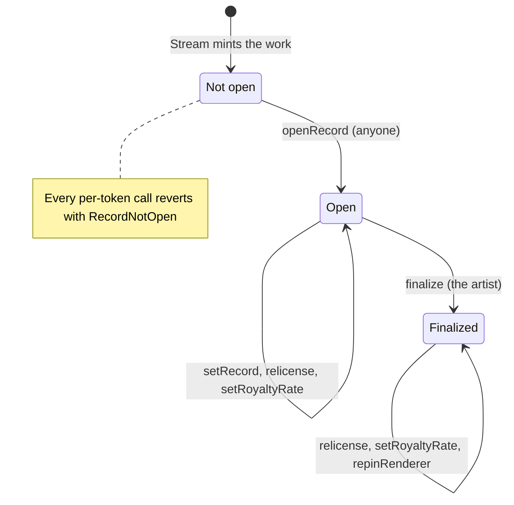

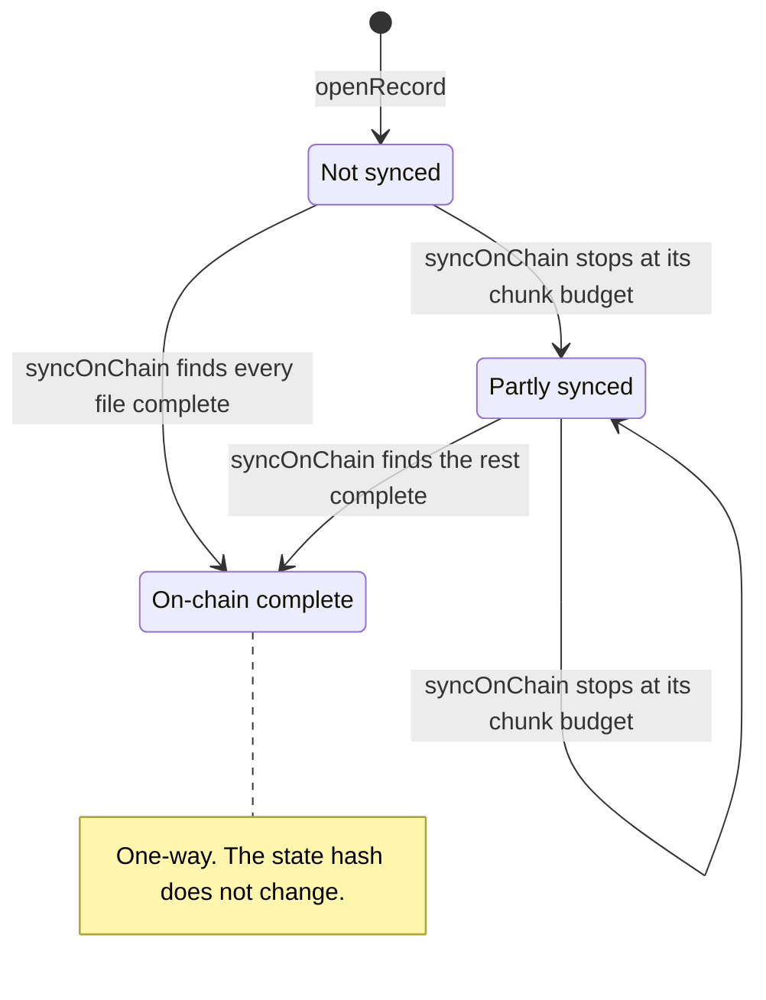

A burn (only by the minting adapter, before the primary sale settles, after an upheld dispute)
ends both machines: every per-token call then reverts with Stream's `UnknownWork`. See
[Stream and auctions](stream-and-auctions.md).

A content-store file and its base64 attestation:

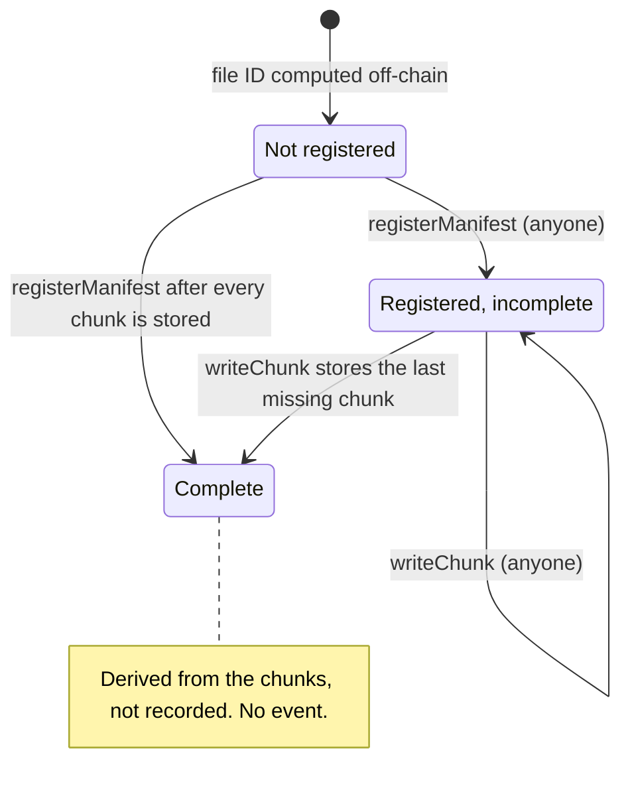

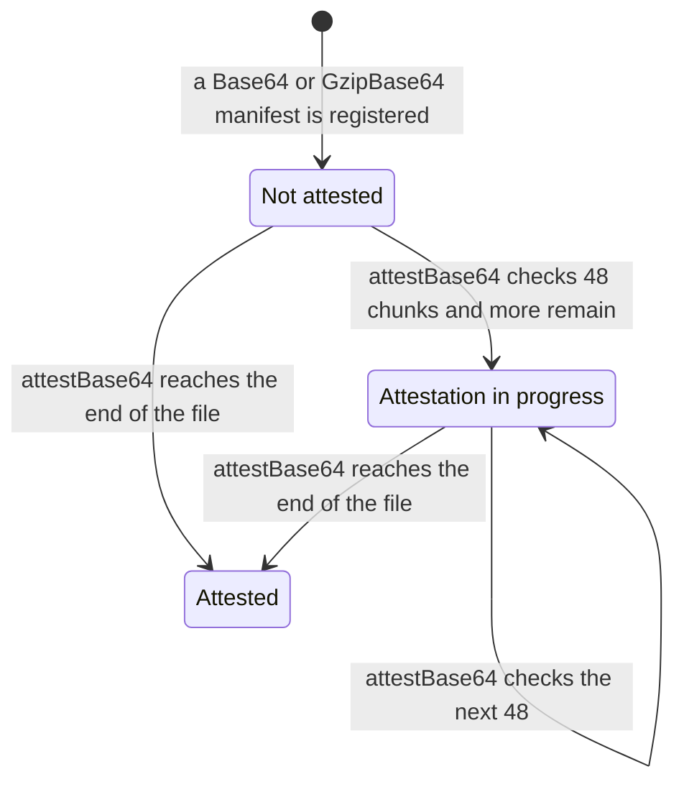

A dependency version:

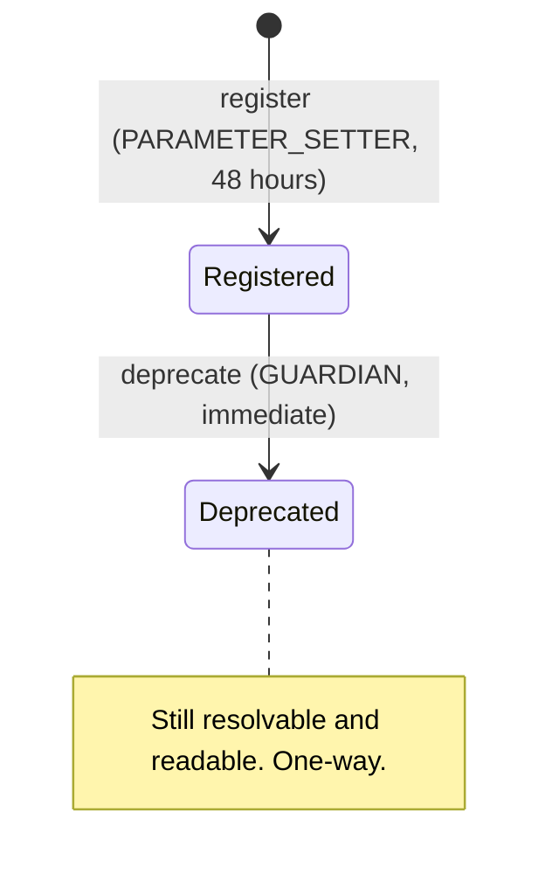

Delay classes are those of [ADR 0002](../adr/0002-access-manager-hardening.md) as mapped in
[`config/genesis.example.json`](../../config/genesis.example.json): immediate, standard (48
hours), funds (14 days) and successor (30 days). A governed call with a delay is scheduled
through the `WorksAccessManager`, executed by the same holder after the delay, and may be
cancelled by any GUARDIAN meanwhile; see [Governance](governance.md).

| Transition | Caller (role) | Delay | Function |
| --- | --- | --- | --- |
| Not open to Open | Anyone | None | `WorkRecords.openRecord` |
| Open: new record file | The artist | None | `WorkRecords.setRecord` |
| Open to Finalized | The artist | None | `WorkRecords.finalize` |
| Open or Finalized: new license | PARAMETER_SETTER, plus every party's `Relicense` signature | Standard, 48 hours | `WorkRecords.relicense` |
| Open or Finalized: new royalty rate | FUNDS_SETTER, plus every party's `RoyaltyRateChange` signature | Funds, 14 days | `WorkRecords.setRoyaltyRate` |
| Finalized: new renderer pin (errata) | SUCCESSOR_SETTER, plus the artist's `RendererRepin` signature | Successor, 30 days | `WorkRecords.repinRenderer` |
| Not synced to Partly synced or On-chain complete | Anyone | None | `WorkRecords.syncOnChain` |
| Locator appended (no state change) | The artist before finalize; PLATFORM at any time | Immediate | `WorkRecords.addLocator` |
| Preference changed (no state change) | STORAGE_OPERATOR | Immediate | `WorkRecords.setPreferredKind`, `setCollectionPreferredKind`, `setFilePreference` |
| File: Not registered to Registered | Anyone | None | `ContentStore.registerManifest` |
| File: to Complete | Anyone | None | `ContentStore.writeChunk` |
| File: Not attested to Attested | Anyone | None | `ContentStore.attestBase64` |
| Dependency: to Registered | PARAMETER_SETTER | Standard, 48 hours | `DependencyRegistry.register` |
| Dependency: Registered to Deprecated | GUARDIAN | Immediate | `DependencyRegistry.deprecate` |

## Flows

### Upload and register a file

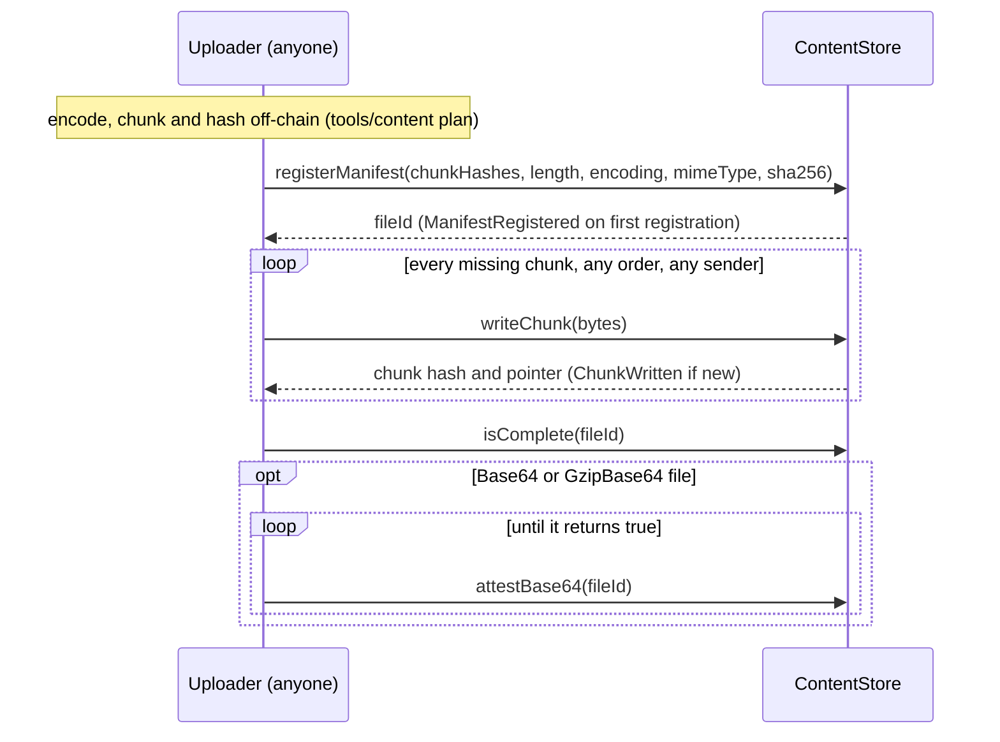

- **Preconditions.** None. Anyone may register a manifest or write a chunk at any time, before or
  after the work is minted, in any order and from any account. The file ID depends only on the
  manifest, so a package can commit to it before anything is deployed.
- **Effects.** A new chunk deploys one SSTORE2 contract; writing bytes already stored is a no-op
  returning the same pointer. Registering a manifest again is a no-op. Completion is derived:
  `isComplete` and `missingChunks` read it, and there is no completion event.
- **Off-chain proof.** The uploader in [`tools/content`](../../tools/content/README.md) proves
  the encoded stream reproduces every chunk hash and the declared SHA-256 before any transaction
  is emitted, and refuses base64 text that `attestBase64` would reject. For `Gzip`, `Base64` and
  `GzipBase64` files, the encoded stream itself must also be published (Arweave or IPFS): the
  file ID names those exact bytes, and gzip output depends on the compressor.
- **Gas.** On Sepolia under Glamsterdam, storage costs about 1,548 gas per stored byte, so one
  full chunk (about 38.4M gas) fits a transaction
  ([`flows.md`](../../deployments/11155111/flows.md#1-content)); under Prague, two. See
  [ADR 0004](../adr/0004-gas-budgets-under-glamsterdam.md#the-table) and the
  [content module](../../src/content/README.md#upload-flow) for the rest.

### Open a record

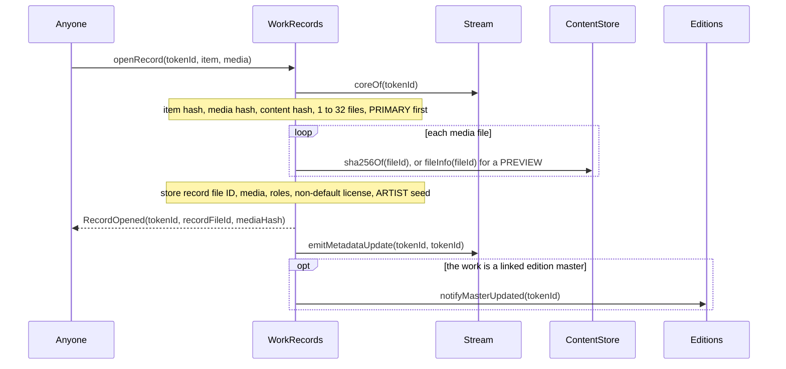

- **Preconditions.** The token is minted and not burned. `item` hashes to the item hash Stream
  stored; `media` hashes to `item.mediaHash`; it has 1 to 32 files; the `PRIMARY` file is first
  and is the only one; its SHA-256 equals `item.contentHash`; every file is registered in the
  content store with exactly the committed SHA-256; every `PREVIEW` stored as `Identity` or
  `Base64` is within `Limits.MAX_PREVIEW_BYTES` (16,384 stored bytes, an `Identity` file counting
  four times). A license whose key is CC0 must name `cc0TextFileId`.
- **Not checked here.** The record file and a non-CC0 license text are stored as approved, so
  neither can freeze a minted work: an unusable record renders core-only metadata until the
  artist sets a valid one, and `finalize` enforces both. The media chunks need not be uploaded.
- **Trust obligation.** The media checks are not visible at mint, so a mis-committed item mints
  and can never open. The curation signer's tooling must simulate `openRecord` for every item
  before attesting it (`IWorkRecords.openRecord` NatSpec; see [Curation](curation.md)).
- **Gas.** 505,752 on Sepolia for one file (Prague 159,172), with 4 new slots
  ([`flows.md`](../../deployments/11155111/flows.md#7-records-and-transfers)).

### Set the record and finalize

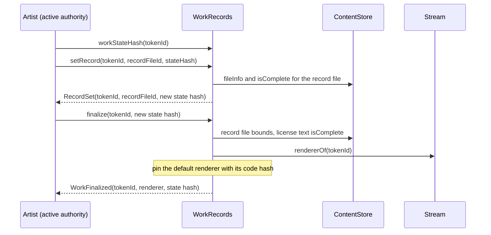

- **`setRecord`.** The artist only, before finalize, against the current state hash. The new
  record file must be registered, `Identity`, at most 12,288 bytes and complete
  (`UnknownRecordFile` otherwise). Pointing at the current file is a no-op. Media never changes.
- **`finalize`.** The artist only, once. It re-applies the record-file bounds (the approved file
  may never have been checked), requires the license text to be complete on-chain (the default
  CC0 text included), reads the renderer through Stream's `rendererOf` (which checks the default
  renderer's code against the hash it was installed with), records that code hash, and bumps the
  version. Because the state hash includes the default renderer before finalize, a new default
  renderer installed after the artist read the state hash makes `finalize` revert with
  `StateHashMismatch`: the artist pins only the renderer they saw.
- **What finalize does not check.** The JSON. A record that passes the structural bounds but
  that the renderer refuses can be finalized, and then shows core-only metadata for good. Artist
  tooling should render the record before finalizing.
- **After finalize.** The record file and license text are permanent and readable on-chain.
  Delivery routing stays operable: PLATFORM adds locators and STORAGE_OPERATOR chooses among
  them (ADR 0001 §10 carve-out). Relicensing, re-rating and the errata repin remain possible.
- **Gas.** `finalize` has not been run on Sepolia yet
  ([`flows.md`](../../deployments/11155111/flows.md#pending)).

### Add a locator and switch the preferred location

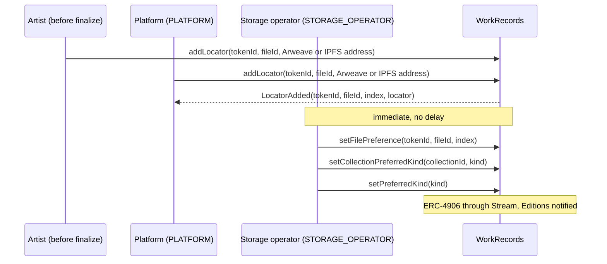

- **Who adds.** Before finalize, the artist (by direct call) and the PLATFORM role (through
  AccessManager's `canCall`, zero delay). After finalize, PLATFORM only: the artist's call is
  then `AccessManagedUnauthorized`.
- **Quotas.** Before finalize, at most 8 locators per file from the artist and 8 from the
  platform (`Limits.MAX_LOCATORS_PER_FILE / 2`), so neither can exhaust the other's. After
  finalize the platform may fill the file's 16 slots, the artist's unused ones included. A URI
  already registered for the file is refused (exact bytes, one set shared by both sides).
- **Shape.** Checked on-chain, content not checked; see [rule WS-18](#rules-and-invariants) and
  the [storage guide](../integrators/storage.md) for the exact rules.
- **Preferred location.** `preferredLocator(tokenId, fileId)` takes the first match of: the
  file's preferred index; the first locator of the collection's preferred kind; the first of the
  global preferred kind; the first registered locator; the implicit `ONCHAIN` copy if the work
  is on-chain complete. Otherwise it returns the empty locator (kind `NONE`, index
  `type(uint256).max`). A kind of `ONCHAIN` matches only an on-chain complete work, read from
  the stored flag, never from a content-store scan.
- **The storage operator** chooses only among copies registered for that file. It cannot add,
  remove or change a locator, and nothing it does changes the state hash.
- **Effects.** Each call asks Stream for ERC-4906. A global or collection change refreshes every
  minted token (`BatchMetadataUpdate(1, totalMinted)`) and every edition.

### Relicense

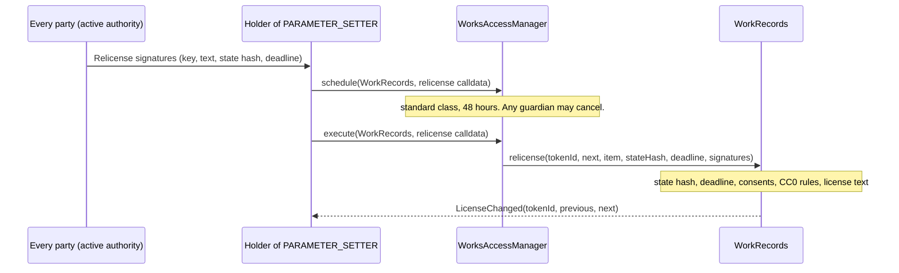

- **Consents.** Every party of `item` (checked against Stream's item hash), in order, signs
  `Relicense(tokenId, licenseKey, textFileId, stateHash, deadline)`. The signature binds the
  license key, not the identifier's case. The deadline must cover the 48-hour delay.
- **Checks at execution.** A license with the current key and text is a no-op. Leaving CC0
  reverts with `LicenseIrrevocable`; a CC0 license naming any text but `cc0TextFileId`, or an
  invalid identifier, reverts with `InvalidLicense`. The new text must be registered, and
  complete on-chain if the work is finalized. Whether the new license is more permissive is not
  checked: that judgement rests with the parties and the governed action.
- **Effects.** The license is stored (or cleared, if it is the default), the version bumps,
  ERC-4906 is emitted.

### Royalty-rate amendment

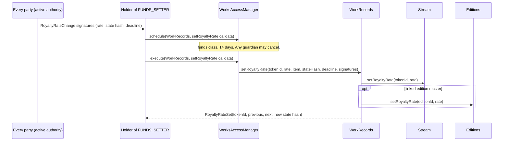

- An unchanged rate is a no-op. Payees never change. Stream refuses a rate above its
  denominator (`InvalidRoyaltyRate`) and emits `RoyaltyRateChanged`; a linked edition's rate
  follows its master's. The version bumps before the external calls. See
  [Economics and payouts](economics-and-payouts.md) for how the rate is applied.

### Errata repin

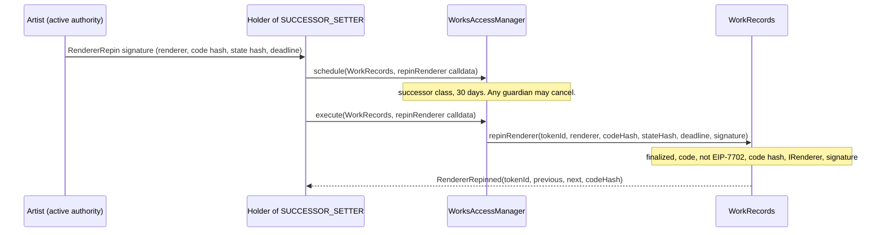

- Only a finalized work; re-pinning the current renderer is a no-op. The renderer must have
  code, not be an EIP-7702 delegated account, have exactly `rendererCodeHash` as its code hash
  and support `IRenderer` by ERC-165. The lead artist's signature is checked against the active
  authority at execution, so it fails if the authority changed or is restrained during the 30
  days. A renderer address already pinned with another code hash is refused.

### Mark a work on-chain complete

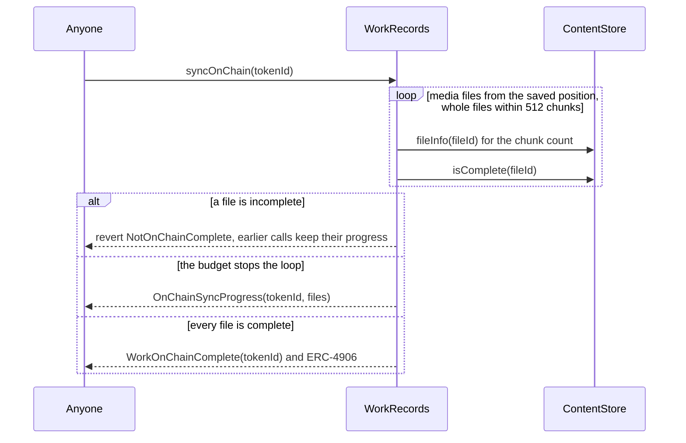

- Permissionless and one-way. Each call resumes at the first file not yet found complete, checks
  whole files in media order while their chunks fit a budget of 512 (a file of up to
  `MAX_CHUNKS`, 512, always fits), stores its place in the record and returns. A repeat after
  completion is a no-op with no event. The state hash never changes.
- **Gas.** 58,821 on Sepolia for a one-file work
  ([`flows.md`](../../deployments/11155111/flows.md#7-records-and-transfers)). A full call of
  512 cold chunks stays under 30% of the 16,777,216-gas transaction cap in Prague gas
  ([`SyncOnChainResume.t.sol`](../../test/integration/SyncOnChainResume.t.sol)).

## Rules and invariants

| ID | Rule | Enforced in | Proven by |
| --- | --- | --- | --- |
| WS-1 | Every per-token view and mutator of `WorkRecords` except `isOpen` reverts with `RecordNotOpen` until `openRecord` has run. | `WorkRecords._open` | [`WorkRecords.t.sol`](../../test/stream/WorkRecords.t.sol) `test_views_revertBeforeOpen` |
| WS-2 | `openRecord` is permissionless and opens only the committed item and media: Stream's item hash, the media hash, the content hash, 1 to 32 files with the `PRIMARY` first and alone, each declared SHA-256 equal to the content store's, each inlinable `PREVIEW` within `MAX_PREVIEW_BYTES`. | `WorkRecords.openRecord`, `_previewSha` | [`WorkRecords.t.sol`](../../test/stream/WorkRecords.t.sol) `test_openRecord_permissionless`, `test_openRecord_rejectsMismatches`, `test_openRecord_rejectsBadMediaFacts`, `test_openRecord_previewCap`; [`ReviewRegressions.t.sol`](../../test/stream/ReviewRegressions.t.sol) `test_mediaCommitmentIsACurationObligation` |
| WS-3 | A record opens once (`RecordAlreadyOpen`), and only for a live token (Stream's `UnknownWork`). | `WorkRecords.openRecord`, `_core` | [`WorkRecords.t.sol`](../../test/stream/WorkRecords.t.sol) `test_openRecord_rejectsMismatches` |
| WS-4 | The approved record file and a non-CC0 license are stored as approved, unchecked, so neither can keep a minted work from opening. | `WorkRecords.openRecord` | [`WorkRecords.t.sol`](../../test/stream/WorkRecords.t.sol) `test_openRecord_storesUnknownRecordFile`, `test_openRecord_storesUnregisteredLicenseText`; [`ReviewRegressions.t.sol`](../../test/stream/ReviewRegressions.t.sol) `test_twoChunkRecordOpensAndIsFixable`, `test_gzipRecordOpensAndIsFixable`, `test_unregisteredLicenseTextOpensAndIsFixable` |
| WS-5 | A license whose key is CC0 names the deployment's CC0 text, at `openRecord` and at relicense. | `WorkRecords.openRecord`, `_relicenseKey` | [`ReviewRegressions.t.sol`](../../test/stream/ReviewRegressions.t.sol) `test_cc0TextMustBeTheDeploymentText`; [`ContentReviewRegressions.t.sol`](../../test/integration/ContentReviewRegressions.t.sol) `test_Cc0_AnApprovedCc0LicenseMustNameThePinnedText`, `test_Cc0_ARelicenseToCc0TakesThePinnedText`; [`WorkRecords.t.sol`](../../test/stream/WorkRecords.t.sol) `test_relicense_cc0TextOnlyToTheDeploymentText` |
| WS-6 | The media list never changes after `openRecord`. | Structural: `openRecord` is the only writer of the media list | Code review; [`WorkRecords.t.sol`](../../test/stream/WorkRecords.t.sol) `test_openRecord_multiFileWithRoles` reads it back |
| WS-7 | Only the artist calls `setRecord` and `finalize`, only before finalize, each against the current state hash; a restrained authority cannot. | `WorkRecords._onlyArtist`, `_checkState` | [`WorkRecords.t.sol`](../../test/stream/WorkRecords.t.sol) `test_setRecord_reverts`, `test_setRecord_followsCurrentAuthority`, `test_finalize_reverts`; [`RecoveryRestraint.t.sol`](../../test/integration/RecoveryRestraint.t.sol) `test_RestrainedKeyCannotAmendTheRecord` |
| WS-8 | `setRecord` and `finalize` accept a record file only if it is registered, `Identity`, at most `MAX_RECORD_BYTES` and complete. | `WorkRecords._checkRecordFile` | [`WorkRecords.t.sol`](../../test/stream/WorkRecords.t.sol) `test_recordBounds_rejectStructuralBreaks`, `test_recordBounds_acceptCompleteSingleChunk`, `test_finalize_needsCompleteRecordFile` |
| WS-9 | `finalize` requires the license text complete on-chain, pins the default renderer with its code hash, and happens once. | `WorkRecords.finalize`, `_requireLicenseText`, `_pinCode` | [`WorkRecords.t.sol`](../../test/stream/WorkRecords.t.sol) `test_finalize_needsStoredLicenseText`, `test_finalize_pinsDefaultRenderer`, `test_finalize_reverts`; [`ReviewRegressions.t.sol`](../../test/stream/ReviewRegressions.t.sol) `test_finalizedLicenseTextIsStored`; [`RendererCodePin.t.sol`](../../test/integration/RendererCodePin.t.sol) `test_FinalizeRefusesADefaultRendererWhoseCodeChanged` |
| WS-10 | The state hash commits to the token ID, version, record file, license key, license text, royalty rate and effective renderer (the default renderer before finalize). | `WorkRecords.workStateHash` | [`WorkRecords.t.sol`](../../test/stream/WorkRecords.t.sol) `test_stateHash_golden`, `test_stateHash_changesWithDefaultRendererBeforeFinalizeOnly`, `test_finalize_compareAndSetCatchesRendererChange` |
| WS-11 | Every applied change bumps the version; identical re-publishes are no-ops; permissionless actions and preferences never change the state hash. No consent applies twice. | `WorkRecords.setRecord`, `finalize`, `relicense`, `setRoyaltyRate`, `repinRenderer` | [`WorkRecords.t.sol`](../../test/stream/WorkRecords.t.sol) `test_setRecord_identicalIsNoOp`, `test_relicense_identicalIsNoOp`, `test_setRoyaltyRate_identicalIsNoOp`, `test_repinRenderer_samePinIsNoOp`, `test_stateHash_ignoresPermissionlessActions`; [`ReviewRegressions.t.sol`](../../test/stream/ReviewRegressions.t.sol) `test_rateRoundTripReplayBlocked` |
| WS-12 | CC0 is irrevocable: a relicense from the CC0 key to any other key reverts, whatever the identifier's case. | `WorkRecords._relicenseKey` | [`WorkRecords.t.sol`](../../test/stream/WorkRecords.t.sol) `test_relicense_cc0IsIrrevocableInAnyCase`; [`RecordAmendments.t.sol`](../../test/integration/RecordAmendments.t.sol) `test_RelicenseToCc0WithConsentAndGovernance`, `test_Cc0WorkKeepsThePinnedText`; [`ContentReviewRegressions.t.sol`](../../test/integration/ContentReviewRegressions.t.sol) `test_Cc0_TheTextNeverChanges` |
| WS-13 | A relicense needs PARAMETER_SETTER and every party's `Relicense` signature by its active authority before the deadline; the new text is registered, and complete for a finalized work; the identifier is valid. | `WorkRecords.relicense`, `_checkConsents`, `_requireLicenseText` | [`WorkRecords.t.sol`](../../test/stream/WorkRecords.t.sol) `test_relicense_withEveryConsent`, `test_relicense_rejectsMissingOrBadConsent`, `test_relicense_needsGovernance`, `test_relicense_consentFollowsCurrentAuthority`, `test_relicense_rejectsInvalidNext`, `test_relicense_acceptsCompactSignatures`; [`RecordAmendments.t.sol`](../../test/integration/RecordAmendments.t.sol) `test_FinalizedWorkNeedsAnOnChainLicenseText` |
| WS-14 | A royalty-rate change needs FUNDS_SETTER and every party's `RoyaltyRateChange` signature, and applies to Stream and a linked edition. | `WorkRecords.setRoyaltyRate`, `_applyRate` | [`WorkRecords.t.sol`](../../test/stream/WorkRecords.t.sol) `test_setRoyaltyRate_withEveryConsent`, `test_setRoyaltyRate_reverts`, `test_setRoyaltyRate_followsToLinkedEdition`; [`ReviewRegressions.t.sol`](../../test/stream/ReviewRegressions.t.sol) `test_coreOfReportsCurrentRate`; [`RecoveryRestraint.t.sol`](../../test/integration/RecoveryRestraint.t.sol) `test_PreSignedRoyaltyConsentRefusedWhileRestrained` |
| WS-15 | The errata repin needs a finalized work, SUCCESSOR_SETTER and the artist's `RendererRepin` signature binding the code hash; the renderer has code, is not EIP-7702 delegated, matches the hash and supports `IRenderer`. | `WorkRecords.repinRenderer` | [`WorkRecords.t.sol`](../../test/stream/WorkRecords.t.sol) `test_repinRenderer_errataPath`, `test_repinRenderer_reverts`; [`RecordAmendments.t.sol`](../../test/integration/RecordAmendments.t.sol) `test_NewDefaultRendererAndTheErrataRepin` |
| WS-16 | A renderer address is pinned with one code hash forever. `pinnedRenderer` reverts with `InvalidRenderer` once the code differs, so `tokenURI` fails closed; pinning it again with another hash reverts. | `WorkRecords._pinCode`, `pinnedRenderer` | [`RendererCodePin.t.sol`](../../test/integration/RendererCodePin.t.sol) `test_PinnedRendererWithChangedCodeIsRefused`, `test_RepinRefusesARendererWhoseCodeChangedSincePinned`, `test_DefaultRendererWithChangedCodeIsRefused` |
| WS-17 | `syncOnChain` is permissionless, one-way and resumable: whole files within 512 chunks per call, a revert at the first incomplete file keeps earlier progress, a repeat after completion emits nothing, and the state hash is unchanged. | `WorkRecords.syncOnChain` | [`WorkRecords.t.sol`](../../test/stream/WorkRecords.t.sol) `test_syncOnChain`; [`SyncOnChainResume.t.sol`](../../test/integration/SyncOnChainResume.t.sol) `test_SyncOnChain_ResumesAcrossCalls`, `test_SyncOnChain_KeepsItsPlaceUntilAFileCompletes`; [`ReviewRegressions.t.sol`](../../test/stream/ReviewRegressions.t.sol) `test_onChainNeedsEveryFile` |
| WS-18 | A locator is `ar://` and a 43-character base64url transaction ID whose last character has zero padding bits (48 bytes), or `ipfs://` and a 59-character base32 CIDv1 starting `bafkrei` or `bafybei`, then `a`–`h`, with zero padding bits in the last character (66 bytes). Nothing else, and never kind `NONE` or `ONCHAIN`. | `WorkRecords._checkUri` | [`ContentReviewRegressions.t.sol`](../../test/integration/ContentReviewRegressions.t.sol) `test_Locator_OnlyContentAddressesAreAccepted`, `test_Locator_OneSpellingPerAddress`; [`WorkRecords.t.sol`](../../test/stream/WorkRecords.t.sol) `test_addLocator_reverts` |
| WS-19 | Before finalize, 8 locators per file from the artist and 8 from the platform; a URI already registered for the file is refused; after finalize only PLATFORM adds, up to 16 in all. | `WorkRecords.addLocator` | [`WorkRecords.t.sol`](../../test/stream/WorkRecords.t.sol) `test_addLocator_byArtistAndPlatform`, `test_addLocator_separateQuotas`, `test_addLocator_rejectsDuplicateUri`, `test_addLocator_platformTakesTheArtistsUnusedSlotsAfterFinalize`; [`ReviewRegressions.t.sol`](../../test/stream/ReviewRegressions.t.sol) `test_locatorQuotasAndSharedDuplicateSet`; [`ContentReviewRegressions.t.sol`](../../test/integration/ContentReviewRegressions.t.sol) `test_Locator_ArtistCannotAddAfterFinalize`, `test_Locator_ArtistBeforeAndPlatformAfterFinalizeAreServed` |
| WS-20 | Locators are append-only and belong to one of the work's media files (`FileNotInWork`). | `WorkRecords.addLocator`, `_requireMedia`; no removal function exists | [`WorkRecords.t.sol`](../../test/stream/WorkRecords.t.sol) `test_addLocator_reverts`, `test_preferenceSetters_reverts` |
| WS-21 | The preferred locator is the file's index, else the collection kind, else the global kind, else the first registered, else the implicit `ONCHAIN` copy of an on-chain complete work, else the empty locator. | `WorkRecords.preferredLocator`, `_firstOfKind` | [`PreferredLocation.t.sol`](../../test/stream/PreferredLocation.t.sol) `testFuzz_preferredLocator_matchesModel`; [`WorkRecords.t.sol`](../../test/stream/WorkRecords.t.sol) `test_preferredLocator_mostSpecificWins`, `test_preferredLocator_onchainOnlyWhenSynced`, `test_preferredLocator_implicitOnchainFallback` |
| WS-22 | The storage operator can only choose among copies registered for that file, or its on-chain bytes. | `WorkRecords.setFilePreference`, `preferredLocator` | [`PreferredLocation.t.sol`](../../test/stream/PreferredLocation.t.sol) `testFuzz_preferredLocator_staysWithinFile`; [`WorkRecords.t.sol`](../../test/stream/WorkRecords.t.sol) `test_preferenceSetters_reverts` |
| WS-23 | Every visible change emits ERC-4906 through Stream and notifies Editions for a master; a global or collection preference change refreshes every token and edition. | `WorkRecords._refresh`, `_refreshAll` | [`WorkRecords.t.sol`](../../test/stream/WorkRecords.t.sol) `test_preferenceSetters_eventsAndRefresh`, `test_preferenceSetters_notifyAllEditions`, `test_editionMaster_notifiesEditions` |
| WS-24 | A chunk is at most `CHUNK_SIZE` bytes; writing is idempotent and its pointer depends only on the bytes and the store. | `ContentStore.writeChunk`, `SSTORE2.write` | [`ContentStore.t.sol`](../../test/content/ContentStore.t.sol) `test_WriteChunk_AcceptsMaxAndRejectsOneMore`, `testFuzz_WriteChunk_RejectsOversize`, `test_WriteChunk_IsIdempotent`, `testFuzz_WriteChunk_IsCallerIndependent` |
| WS-25 | The file ID commits to the whole manifest and to nothing else (no chain ID, no address); registering again is a no-op; a different claim about the same chunks is a different file. | `ContentStore.manifestId`, `registerManifest` | [`ContentStore.t.sol`](../../test/content/ContentStore.t.sol) `test_FileId_CommitsToWholeManifest`, `test_FileId_IsChainAndDeploymentIndependent`, `test_RegisterManifest_IsIdempotent` |
| WS-26 | A manifest has 1 to 512 chunks, a length with `(count − 1) × CHUNK_SIZE < length ≤ count × CHUNK_SIZE`, a nonzero SHA-256, a valid MIME type and one of four encodings. | `ContentStore.registerManifest`, `_requireMime` | [`ContentStore.t.sol`](../../test/content/ContentStore.t.sol) `test_RegisterManifest_ChunkCountBounds`, `test_RegisterManifest_LengthMustFitChunkCount`, `testFuzz_RegisterManifest_LengthFitsIffInRange`, `test_RegisterManifest_RejectsZeroDigest`, `test_RegisterManifest_MimeValidation`, `testFuzz_RegisterManifest_RejectsMimeWithForbiddenByte`, `test_RegisterManifest_AcceptsExactlyTheFourEncodings`, `testFuzz_RegisterManifest_RejectsUnknownEncoding` |
| WS-27 | A chunk counts only at the length the layout rule requires; a manifest that breaks the rule, or lists a chunk that cannot exist, never completes and never reads. | `ContentStore._present`, `_readChunk`, `_expectedLength` | [`ContentStore.t.sol`](../../test/content/ContentStore.t.sol) `test_WrongLengthChunkNeverCompletesOrReads`, `test_OverLongFinalChunkNeverCompletesOrReads`, `test_ZeroChunkHashIsAcceptedButNeverCompletes` |
| WS-28 | Reads fail closed: every touched chunk is read whole and checked against its keccak256; a missing chunk reverts; no read returns partial data. | `ContentStore.read`, `readChunk`, `SSTORE2.readVerified` | [`ContentStore.t.sol`](../../test/content/ContentStore.t.sol) `test_ReadsDetectTamperedChunkCode`, `test_Read_AcrossChunkBoundaries`, `testFuzz_Read_MatchesReference`, `testFuzz_Read_OutOfBoundsReverts`, `test_UnknownFileRevertsEverywhere`, `test_ChunkIndexOutOfBoundsReverts` |
| WS-29 | Uploads are permissionless and in any order; chunks are shared by hash across files; nothing accepts value. | `ContentStore` (no access control, no payable function) | [`ContentStore.t.sol`](../../test/content/ContentStore.t.sol) `test_RegisterManifest_BeforeChunksExist`, `test_OutOfOrderUploads_CompleteTheFile`, `test_SharedChunksServeEveryFileThatListsThem`, `test_NothingAcceptsValue` |
| WS-30 | The declared SHA-256 is never recomputed on-chain; `sha256Of` returns it and reverts for an unknown file. | `ContentStore.sha256Of` | [`ContentStore.t.sol`](../../test/content/ContentStore.t.sol) `test_Sha256Of_IsTheDeclaredDigest`, `test_Sha256Of_IndependentOfMimeType`, `testFuzz_Sha256Of_MatchesFileInfo` |
| WS-31 | `attestBase64` accepts only `Base64` and `GzipBase64` files of a length divisible by 4 whose bytes are `[A-Za-z0-9+/]` except a final `=` or `==`; it checks at most 48 chunks per call, resumes, and is one-time per file ID. | `ContentStore.attestBase64`, `_validateBase64`, `_padding`, `Base64Validator.isAlphabet` | [`Base64Attest.t.sol`](../../test/content/Base64Attest.t.sol) `test_EveryByteValueInEveryLane`, `test_EveryAdjacentPairOfBytes`, `testFuzz_ArbitraryBytesMatchTheOracle`, `test_Attest_RejectsEveryInvalidByteClass`, `test_Attest_RejectsEqualsWhereverItIsNotTheLastOneOrTwoBytes`, `test_Attest_PaddingAcrossTheChunkBoundary`, `test_Attest_RequiresBase64Encoding`, `test_Attest_LengthMustBeAMultipleOfFour`, `test_Attest_LargeFileTakesSeveralCalls`, `test_Attest_IsOneTimeAndIdempotent`, `test_Attest_AttestationFollowsTheFileIdNotTheBytes` |
| WS-32 | The store's constants are fixed, and its worst transactions fit the EIP-7825 cap in Prague gas: a 512-chunk registration and every attestation call. | `ContentStore` constants | [`ContentStore.t.sol`](../../test/content/ContentStore.t.sol) `test_Constants_ArePinned`, `test_RegisterManifest_AtMaxChunksFitsTheTransactionGasCap`; [`Base64Attest.t.sol`](../../test/content/Base64Attest.t.sol) `test_Constants_ArePinned`, `test_Attest_AtMaxChunksEveryCallFitsTheTransactionGasCap` |
| WS-33 | The uploader's file IDs, chunk hashes, calldata and attestation verdicts equal the contract's. | `tools/content` against `ContentStore` | [`UploaderGolden.t.sol`](../../test/content/tooling/UploaderGolden.t.sol) `test_Inline_ChunkHashesFileIdAndCalldataMatch`, `test_Generated_ChunkingFileIdAndCalldataMatch`, `test_HashOnly_FileIdAndRegistrationMatch`; [`UploaderAttest.t.sol`](../../test/content/tooling/UploaderAttest.t.sol) `test_GoldenCases_StoreReachesThePythonVerdictForBothBase64Encodings`, `test_EveryByteValue_FirstAndLast` |
| WS-34 | A dependency label is 1 to 32 bytes of `[a-z0-9._-]`, left-aligned, then only zero bytes; a `(name, version)` maps to one complete file forever. | `DependencyRegistry.register`, `_requireLabel` | [`DependencyRegistry.t.sol`](../../test/content/DependencyRegistry.t.sol) `test_Register_LabelExamples`, `testFuzz_Register_LabelValidity`, `testFuzz_Register_RejectsABadByteAtAnyIndex`, `testFuzz_Register_AcceptsWellFormedLabels`, `test_Register_VersionsAreImmutable`, `test_Register_RequiresCompleteContent`, `test_Register_UnknownFileReverts`, `test_Register_NamesAndVersionsAreIndependent` |
| WS-35 | Deprecation is a one-way flag: nothing is deleted and the version still resolves. Both functions are restricted. | `DependencyRegistry.deprecate`, `resolve` | [`DependencyRegistry.t.sol`](../../test/content/DependencyRegistry.t.sol) `test_Deprecate_IsAFlagOnly`, `test_Deprecate_Guards`, `test_Register_OnlyTheRegistrarRole`, `test_Register_ResolvesWithManifestFlags`, `test_Resolve_UnknownReverts` |
| WS-36 | The governed selectors of `WorkRecords` and `DependencyRegistry` map to the roles and delays in this page, and the genesis configuration installs them. | [`config/genesis.example.json`](../../config/genesis.example.json), `GovernanceConfigurator` | [`GenesisConfig.t.sol`](../../test/governance/GenesisConfig.t.sol) `test_JsonMatchesTheCompiledSelectors`, `test_EveryEntryMatchesItsSignatureAndClassDelay`, `test_GenesisConfigurationInstallsWiresAndReadsBack` |

The whole path, from upload and attestation through `openRecord`, `finalize` and `syncOnChain` to
inline rendering, runs on the real stack in
[`ContentToTokenURI.t.sol`](../../test/integration/ContentToTokenURI.t.sol)
`test_AttestOpenFinalizeSyncThenInline`.

## Events

| Event | Contract | Emitted when | Notes |
| --- | --- | --- | --- |
| `RecordOpened(tokenId, recordFileId, mediaHash)` | `WorkRecords` | `openRecord` succeeds | `tokenId` indexed. Start indexing a work's record here. |
| `RecordSet(tokenId, recordFileId, stateHash)` | `WorkRecords` | The artist points the work at a new record file | Carries the new state hash. Not emitted for an identical re-publish. |
| `WorkFinalized(tokenId, renderer, stateHash)` | `WorkRecords` | `finalize` | `renderer` is the pinned renderer. |
| `WorkOnChainComplete(tokenId)` | `WorkRecords` | `syncOnChain` finds the last media file complete | Emitted once. |
| `OnChainSyncProgress(tokenId, files)` | `WorkRecords` | `syncOnChain` stops at its chunk budget | `files` is how many leading media files are complete so far. |
| `LicenseChanged(tokenId, previous, next)` | `WorkRecords` | `relicense` applies a new license | Both `License` structs in full. |
| `RoyaltyRateSet(tokenId, previous, next, stateHash)` | `WorkRecords` | `setRoyaltyRate` applies a new rate | Stream also emits `RoyaltyRateChanged`, and a linked edition its own `RoyaltyRateChanged`. |
| `RendererRepinned(tokenId, previous, next, codeHash)` | `WorkRecords` | The errata repin | The public event ADR 0001 §10 requires. |
| `LocatorAdded(tokenId, fileId, index, locator)` | `WorkRecords` | `addLocator` | `tokenId` and `fileId` indexed. `index` is the registration index used by `setFilePreference`. |
| `PreferredKindSet(previous, next)` | `WorkRecords` | `setPreferredKind` | Emitted even when the kind is unchanged. |
| `CollectionPreferredKindSet(collectionId, previous, next)` | `WorkRecords` | `setCollectionPreferredKind` | `collectionId` indexed. |
| `FilePreferenceSet(tokenId, fileId, previous, next)` | `WorkRecords` | `setFilePreference` | `type(uint256).max` means no preference. |
| `AuthorityUpdated(authority)` | `WorkRecords`, `DependencyRegistry` | Construction, and `setAuthority` by the current manager | Inherited from OpenZeppelin `AccessManaged`. |
| `ChunkWritten(chunkHash, pointer, length)` | `ContentStore` | A new chunk is stored | Not emitted when the same bytes are written again. |
| `ManifestRegistered(fileId, length, chunkCount, encoding, sha256Hash, mimeType)` | `ContentStore` | A new manifest is registered | `fileId` indexed. Not emitted for a repeat. Completion has no event. |
| `Base64Progress(fileId, chunksValidated)` | `ContentStore` | An `attestBase64` call validates chunks and more remain | Emitted instead of `Base64Attested` while the file is longer than one call. |
| `Base64Attested(fileId)` | `ContentStore` | `attestBase64` validates the end of the file | Emitted once per file ID. |
| `DependencyRegistered(name, version, fileId)` | `DependencyRegistry` | `register` | All three indexed. |
| `DependencyDeprecated(name, version)` | `DependencyRegistry` | `deprecate` | |

`WorkRecords` also causes events on other contracts: Stream's ERC-4906 `MetadataUpdate` (one
token) or `BatchMetadataUpdate` (a global or collection preference change), and 6529 Editions'
`MetadataUpdate` for a master or `BatchMetadataUpdate(0, type(uint256).max)`. `EIP712` declares
`EIP712DomainChanged` through ERC-5267, but the domain is fixed and it is never emitted. See
[Events and indexing](../integrators/events-and-indexing.md).

## Failure modes and recovery

| Failure | Effect | Recovery |
| --- | --- | --- |
| A media file's manifest is not registered | `openRecord` reverts with the store's `ContentFileUnknown`; the work shows core-only metadata (`not_open`). | Anyone registers the committed manifest, then anyone calls `openRecord`. |
| A mis-committed item (wrong content hash, a declared SHA-256 that differs from the manifest's, the `PRIMARY` not first or not alone, more than 32 files, an oversize `PREVIEW`, a CC0 license with another text) | `openRecord` reverts with `InvalidRecordData` or `InvalidLicense` for good; the work keeps core-only metadata. | None on-chain. Prevention is the curation signer's obligation to simulate `openRecord` before attesting. |
| The approved record file is unregistered, incomplete, too large, not `Identity`, or invalid JSON | The record opens; the renderer shows core-only metadata with `record_status` `incomplete` or `invalid`. | Anyone completes the upload, or the artist calls `setRecord` with a valid file before finalize. |
| A record finalized with JSON the renderer refuses | Core-only metadata for good: the record is immutable. | None for the record. Prevention: render the record before finalizing. |
| The license text is not registered or not complete | `finalize` reverts (`ContentFileUnknown` or `InvalidLicense`). | Anyone uploads the text, then the artist finalizes. |
| A chunk is missing | Reads touching it revert with `ContentChunkMissing`; `syncOnChain` reverts with `NotOnChainComplete`; the renderer serves the preferred locator instead of inlining. | Anyone writes the chunk (`missingChunks` lists them); `syncOnChain` resumes where it stopped. |
| A manifest that breaks the layout rule, or lists a chunk that cannot exist | Accepted but never completes or reads. As a work's media, the work can never be on-chain complete. | None for that file ID; the file is served by locator. Uploader and curation tooling refuse such manifests. |
| A `Base64` file not yet attested | Never inlined; served by locator. | Anyone calls `attestBase64` until it returns true. |
| Base64 text that breaks the strict alphabet | `attestBase64` reverts with `ContentBase64Invalid(fileId, index)` forever; never inlined. | None for that file ID. Tooling refuses such text before upload. |
| A pinned renderer's code no longer matches its pinned hash | `pinnedRenderer` reverts with `InvalidRenderer`, so Stream's `tokenURI` reverts (fails closed). | The errata repin to a sound renderer: the artist's signature plus SUCCESSOR_SETTER, 30 days. A changed default renderer (unfinalized works) is replaced by `Stream.setDefaultRenderer`, also 30 days. |
| The artist's key is lost before finalize | No `setRecord`, `finalize`, repin or artist consent. Locators by PLATFORM, preferences and `syncOnChain` still work. | Recover the authority through the artist registry (a staged change or a governed override). While an authority-moving override is pending, nobody acts as the artist. See [Identity and recovery](identity-and-recovery.md). |
| The artist's key is lost after finalize while the pinned renderer is broken | The work has no metadata until a repin, which needs the artist's signature. | Recover the authority first, then sign the repin. |
| The state changed between signing and execution (a new record file, rate, license or default renderer) | `StateHashMismatch` at execution. | Read the new state hash, collect new signatures, schedule again. |
| A consent's deadline passed during the delay, or a party's authority changed or is restrained | `InvalidConsent(tokenId, partyIndex)`. | New signatures from the current authorities with a deadline that covers the delay. |
| A locator names the wrong content or goes dark | Not detected on-chain; `tokenURI` may serve it. Locators cannot be removed. | STORAGE_OPERATOR, immediately, points the file, collection or global preference at another registered copy; the off-chain monitor re-pins or re-uploads from a surviving copy. |
| A file's locator quota is used up | `addLocator` reverts with `InvalidLocator`. | Before finalize, the other side's quota remains. After finalize, PLATFORM may use all 16 slots. |
| A wrong file was registered as a dependency version | The entry can never change. | GUARDIAN deprecates it immediately; PARAMETER_SETTER registers a new version label (48 hours). |

## Parameters and limits

| Parameter | Value | Source |
| --- | --- | --- |
| Chunk size | 24,575 bytes (EIP-170's 24,576 minus the STOP byte) | `ContentStore.CHUNK_SIZE`, `SSTORE2.MAX_CHUNK_LENGTH` |
| Chunks per file | 1 to 512 (12,582,400 bytes) | `ContentStore.MAX_CHUNKS` |
| MIME type | At most 64 bytes, lowercase `type/subtype` from `[a-z0-9+._-]`, one interior slash | `ContentStore.MAX_MIME_LENGTH`, `_requireMime` |
| Chunks per attestation call | 48 | `ContentStore.ATTEST_CHUNKS_PER_CALL` |
| Encodings | `Identity` 0, `Gzip` 1, `Base64` 2, `GzipBase64` 3 (part of the file ID) | `IContentStore.Encoding` |
| Media files per work | 1 to 32 | `Limits.MAX_MEDIA_FILES` |
| Record file | At most 12,288 bytes, `Identity`, one chunk | `Limits.MAX_RECORD_BYTES` |
| Inlinable `PREVIEW` file | At most 16,384 stored bytes, an `Identity` file counting four times | `Limits.MAX_PREVIEW_BYTES` |
| License identifier | 1 to 64 bytes of `[A-Za-z0-9.+-]` | `Limits.MAX_LICENSE_ID_BYTES`, `SpdxId` |
| CC0 license key | `keccak256("cc0-1.0")` | `WorksHashing.CC0_LICENSE_KEY` |
| CC0 legal code | 7,048 bytes, `text/plain`, SHA-256 `0xa2010f34…0499` | [`script/README.md`](../../script/README.md#6-the-cc0-license-text) (`DeployV1.CC0_LEGALCODE_SHA256`) |
| Locators per file | 16 in all; 8 by the artist and 8 by the platform before finalize | `Limits.MAX_LOCATORS_PER_FILE`, `WorkRecords.LOCATOR_QUOTA` |
| Locator URI | 48 bytes (Arweave) or 66 bytes (IPFS) | `WorkRecords._checkUri` |
| Chunks per `syncOnChain` call | 512, in whole files | `WorkRecords.SYNC_CHUNKS` |
| EIP-712 domain | `"6529 Works Records"`, version `"1"` | `Typehashes.WORK_RECORDS_NAME`, `DOMAIN_VERSION` |
| Dependency label | 1 to 32 bytes of `[a-z0-9._-]`, left-aligned, zero-padded | `DependencyRegistry._requireLabel` |
| `relicense` | PARAMETER_SETTER, standard, 48 hours | [`config/genesis.example.json`](../../config/genesis.example.json) |
| `setRoyaltyRate` | FUNDS_SETTER, funds, 14 days | `config/genesis.example.json` |
| `repinRenderer` | SUCCESSOR_SETTER, successor, 30 days | `config/genesis.example.json` |
| `addLocator` | PLATFORM, immediate (the artist directly, before finalize) | `config/genesis.example.json`, `WorkRecords.addLocator` |
| `setPreferredKind`, `setCollectionPreferredKind`, `setFilePreference` | STORAGE_OPERATOR, immediate | `config/genesis.example.json` |
| `DependencyRegistry.register` | PARAMETER_SETTER, standard, 48 hours | `config/genesis.example.json`, ADR 0002 decision 7 |
| `DependencyRegistry.deprecate` | GUARDIAN, immediate | `config/genesis.example.json`, ADR 0002 decision 7 |
| Storage cost on Sepolia (Glamsterdam) | About 1,548 gas per stored byte (Prague about 218) | [`flows.md`](../../deployments/11155111/flows.md#1-content), [ADR 0004](../adr/0004-gas-budgets-under-glamsterdam.md#consequences) |

## Differences from the ADRs

- **Preferred-location order.** ADR 0001 §8 lists global, then collection, then file, then the
  next registered locator. The code takes the most specific first: file, collection, global,
  first registered, then the implicit `ONCHAIN` copy. ADR 0003 ("Token model and storage")
  records the reversal; the `ONCHAIN` fallback is in neither list.
- **When `ONCHAIN` is served.** ADR 0003 says on-chain copies are served once "the file" is
  complete. The code serves `ONCHAIN` only once the whole work is on-chain complete
  (`syncOnChain`'s stored flag), never from a per-file completeness scan.
- **Hash-equal copies.** ADR 0001 §8 says the storage operator switches among registered
  locators "that share the same hash". No hash is stored or checked for a locator: the operator
  chooses among the copies registered for that file, and the off-chain monitor verifies them.
- **Who registers locators.** ADR 0001 §8 allows the artist or platform roles. ADR 0003 amends
  it as the code does: bare content addresses only (HTTPS dropped), 8 per side per file, and only
  PLATFORM after finalize.
- **Editing before finalize.** ADR 0001 §8 says the artist can edit the record until finalizing
  and the content hashes are immutable after that. In the code the media list, and so every
  content hash, is fixed at approval; only the record file pointer changes before finalize.
- **Who consents to a relicense.** ADR 0001 §8 and §10 speak of the artist's agreement. The code
  requires a signature from every party of the item; the errata repin needs only the lead
  artist.
- **"More permissive".** ADR 0001 §8 allows a license change only toward more permissive terms.
  The code enforces only CC0 irrevocability, on the license key, and a CC0 license always names
  the deployment's CC0 text (adversarial review, recorded in ADR 0003). Other judgements rest on
  the consents and the governed action.
- **The governed default license.** ADR 0001 §8 makes the default license a governed setting.
  `WorkRecords`' CC0 default is immutable; the governed per-product default for new packages is
  `IEconomicsResolver.setDefaultLicense`.
- **Opening never fails.** ADR 0003 ("Decisions from integration") says opening a record never
  fails. It stores the record and license as approved, but still refuses a mis-committed media
  list, an oversize preview, and a CC0 license with another text.
- **Where the structural checks run.** ADR 0003 lists "complete, one `Identity` chunk, within the
  bound, licence text registered" for `setRecord`, `finalize` and `relicense`. In the code
  `setRecord` checks the record file only; `finalize` checks the record file and requires the
  license text complete, not just registered; `relicense` requires the new text registered, and
  complete for a finalized work.
- **Size and MIME type.** ADR 0001 §8 lists each file's size and MIME type in the media list.
  They live in the content-store manifest (`fileInfo`); the media list holds the file ID, the
  SHA-256 and the role.
- **Transaction sizes and costs.** ADR 0001 §8's "72 KB per transaction" and "0.23 ETH per MB
  per gwei" predate Glamsterdam. ADR 0003 corrected the first to two chunks (Prague), and
  [ADR 0004](../adr/0004-gas-budgets-under-glamsterdam.md#superseded-or-amended) to one full chunk
  per transaction and about 1.65 ETH per MiB at 1 gwei on Sepolia.
- **Record size.** ADR 0003 lowered `MAX_RECORD_BYTES` from 24,575 to 12,288 bytes; the code
  follows.

## References

- **Code:** [`WorkRecords.sol`](../../src/stream/WorkRecords.sol),
  [`IWorkRecords.sol`](../../src/interfaces/IWorkRecords.sol),
  [`SpdxId.sol`](../../src/stream/SpdxId.sol),
  [`ContentStore.sol`](../../src/content/ContentStore.sol),
  [`IContentStore.sol`](../../src/interfaces/IContentStore.sol),
  [`Base64Validator.sol`](../../src/content/Base64Validator.sol),
  [`SSTORE2.sol`](../../src/libraries/SSTORE2.sol),
  [`DependencyRegistry.sol`](../../src/content/DependencyRegistry.sol),
  [`IDependencyRegistry.sol`](../../src/interfaces/IDependencyRegistry.sol),
  [`ContentTypes.sol`](../../src/interfaces/types/ContentTypes.sol),
  [`Limits.sol`](../../src/interfaces/types/Limits.sol),
  [`WorksHashing.sol`](../../src/interfaces/types/WorksHashing.sol),
  [`Typehashes.sol`](../../src/interfaces/types/Typehashes.sol).
- **Module READMEs:** [stream, records satellite](../../src/stream/README.md#records-satellite),
  [content store, attestation and dependency registry](../../src/content/README.md),
  [uploader tooling](../../tools/content/README.md).
- **ADRs:** [ADR 0001 §8](../adr/0001-v1-scope.md#8-works-content-and-storage) and
  [§10](../adr/0001-v1-scope.md#10-permanence);
  [ADR 0002](../adr/0002-access-manager-hardening.md) decision 7;
  [ADR 0003, token model and storage](../adr/0003-build-time-decisions.md#token-model-and-storage-amends-adr-0001-4-and-8)
  and [decisions from integration](../adr/0003-build-time-decisions.md#decisions-from-integration-11-october-2026-later);
  [ADR 0004](../adr/0004-gas-budgets-under-glamsterdam.md#the-table) for gas.
- **Tests:** [`test/stream/`](../../test/stream) (`WorkRecords.t.sol`, `PreferredLocation.t.sol`,
  `ReviewRegressions.t.sol`), [`test/content/`](../../test/content) (`ContentStore.t.sol`,
  `Base64Attest.t.sol`, `DependencyRegistry.t.sol`, `tooling/`), and in
  [`test/integration/`](../../test/integration) `RecordAmendments.t.sol`,
  `SyncOnChainResume.t.sol`, `ContentReviewRegressions.t.sol`, `ContentToTokenURI.t.sol`,
  `RendererCodePin.t.sol`, `RecoveryRestraint.t.sol`.
- **Deployment evidence:** [`deployments/11155111/flows.md`](../../deployments/11155111/flows.md).
- **Related pages:** [Rendering and tokenURI](rendering-and-tokenuri.md),
  [Curation](curation.md), [Economics and payouts](economics-and-payouts.md),
  [Identity and recovery](identity-and-recovery.md), [Governance](governance.md),
  [Storage guide for integrators](../integrators/storage.md),
  [Reading a work](../integrators/reading-a-work.md), [Glossary](../glossary.md).
