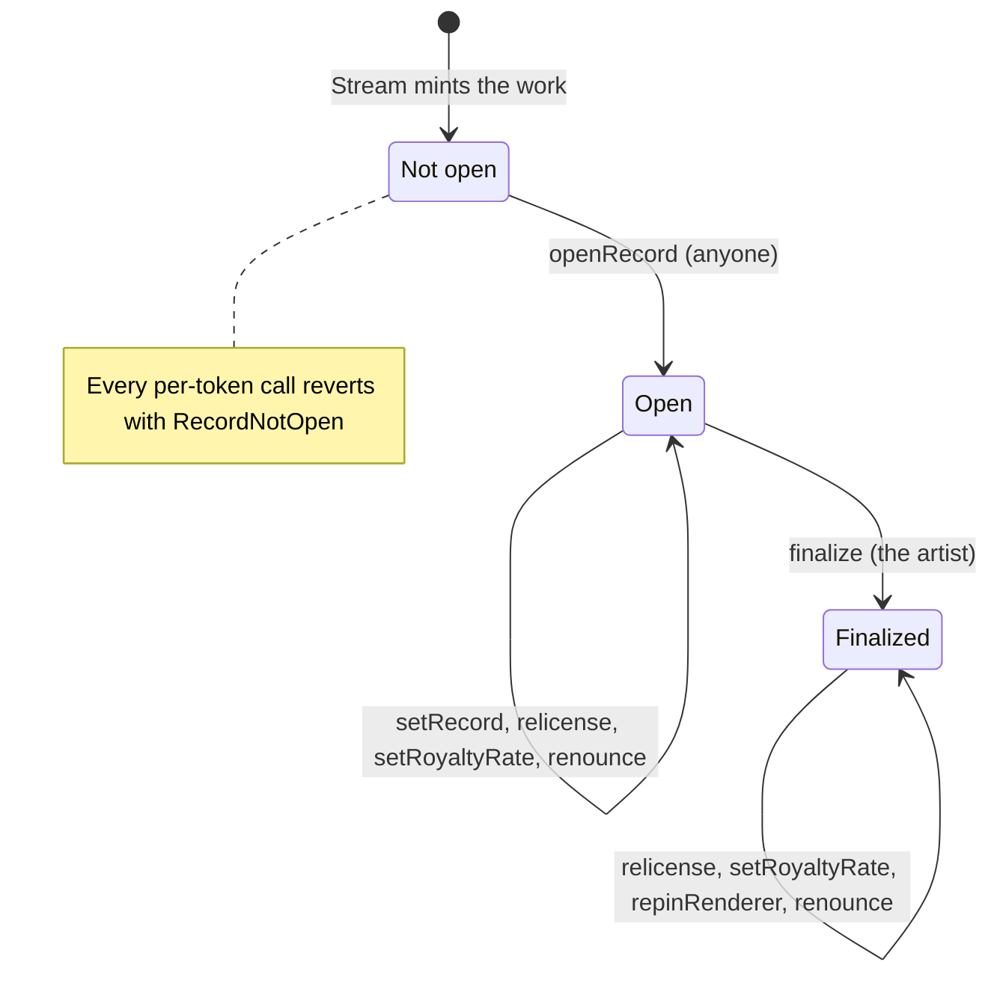
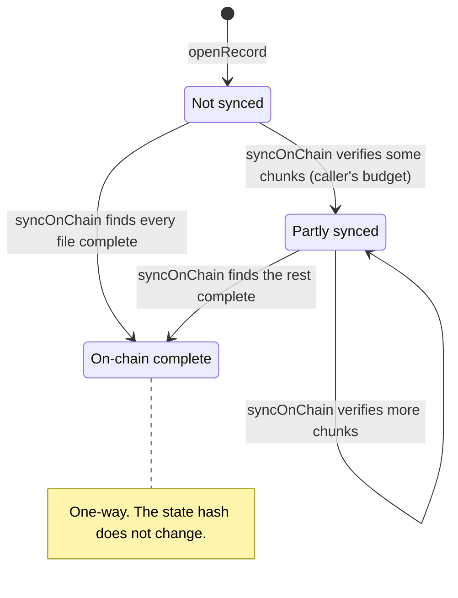
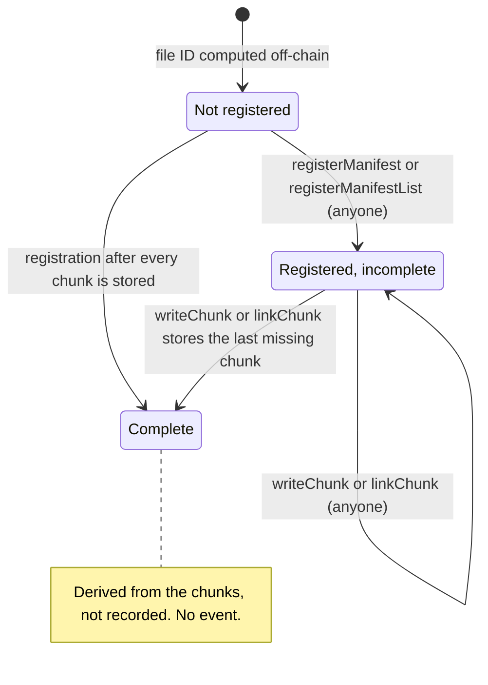
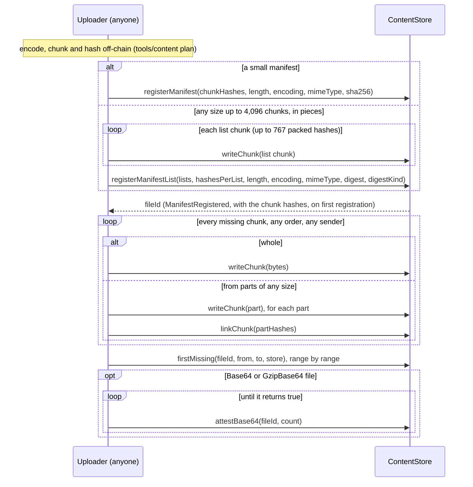
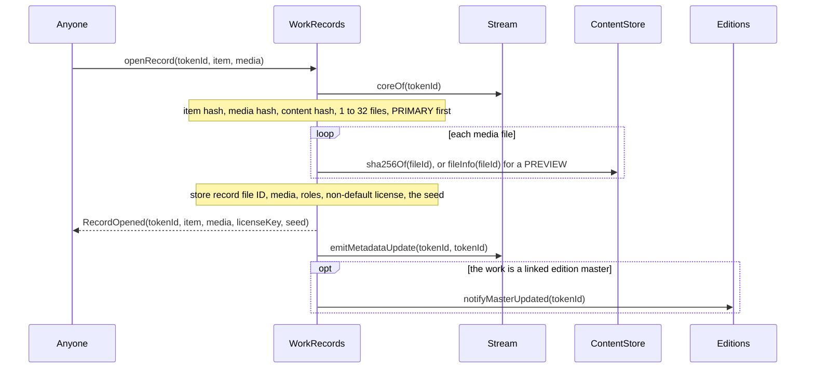
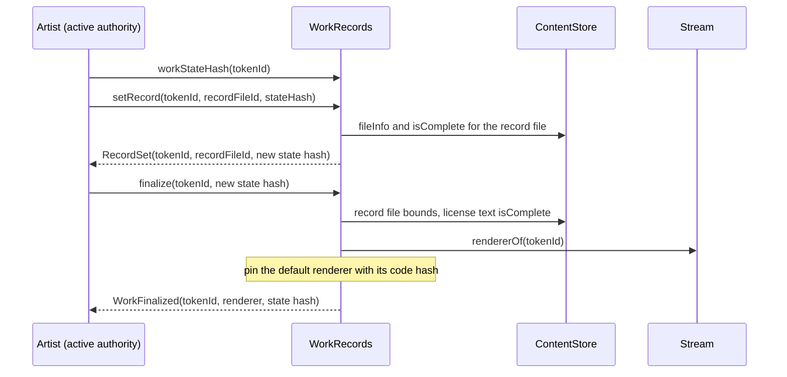
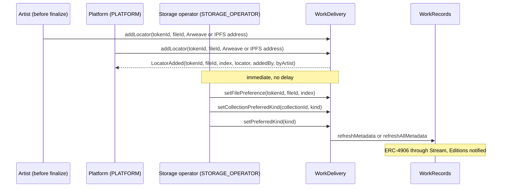
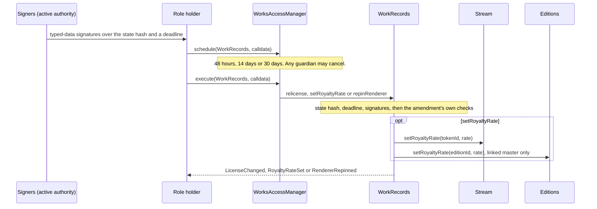
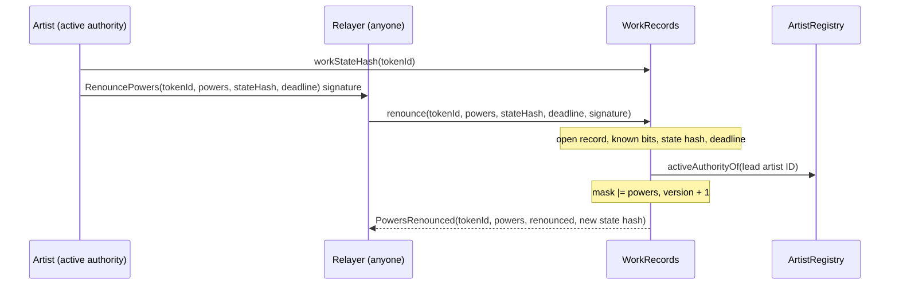
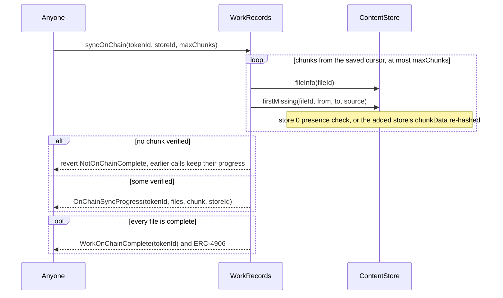

# Works and storage

A 6529 Stream work is a token in the Stream core plus everything that describes it: a
descriptive record, an ordered list of media files, a license, a renderer pin, and the places
where copies of its bytes live. This page specifies that second half and the storage under it,
for auditors, artist and curator tooling, the platform and storage operator, and integrators
who verify a work's bytes. `WorkRecords` is the records satellite of 6529 Stream,
`ContentStore` permissionless content-addressed storage in SSTORE2 chunks, and
`DependencyRegistry` the governed map of pinned libraries. Metadata is built in
[Rendering and tokenURI](rendering-and-tokenuri.md).

> Pre-audit. See the [project status](../../README.md#status).

## Contracts

| Contract | Source | Interface | Responsibility |
| --- | --- | --- | --- |
| `WorkRecords` | [`src/stream/WorkRecords.sol`](../../src/stream/WorkRecords.sol) | [`IWorkRecords`](../../src/interfaces/IWorkRecords.sol), [`IWorkPowers`](../../src/interfaces/IWorkPowers.sol) | Permanent. Opens each work's record from its approved item; the record file pointer, media list, license and seed; the state hash and version; finalize and the renderer pin; on-chain completeness and each media file's store; amendments (relicense, a lower royalty rate, errata repin); the lead artist's renounced powers; the governed pointers to the delivery contract and the store set. Governed through AccessManager. |
| `WorkDelivery` | [`src/stream/WorkDelivery.sol`](../../src/stream/WorkDelivery.sol) | [`IWorkDelivery`, `IWorkLocators`](../../src/interfaces/IWorkDelivery.sol) | Replaceable (WS-39). Locators, locator kinds, preferences and the URI grammar; deployed by `WorkRecords`' constructor as the first delivery contract. No authority over any fact. |
| `SpdxId` (library) | [`src/stream/SpdxId.sol`](../../src/stream/SpdxId.sol) | none | The license-ID rule: 1 to 64 bytes of `[A-Za-z0-9.+-]`, original case kept. Stream applies it at mint, `WorkRecords` at deployment and relicense. |
| `ContentStore` | [`src/content/ContentStore.sol`](../../src/content/ContentStore.sol) | [`IContentStore`](../../src/interfaces/IContentStore.sol) | Chunks, manifests, completeness, verified chunk and range reads, base64 attestation. No owner, no governance, no payable function. |
| `Base64Validator` (library) | [`src/content/Base64Validator.sol`](../../src/content/Base64Validator.sol) | none | The strict RFC 4648 alphabet check behind `attestBase64`, 32 bytes per step. |
| `SSTORE2` (library) | [`src/libraries/SSTORE2.sol`](../../src/libraries/SSTORE2.sol) | none | Stores a chunk as the code of a CREATE2 contract (`0x00 ‖ data`, salt `keccak256(data)`) and reads it back verified. |
| `DependencyRegistry` | [`src/content/DependencyRegistry.sol`](../../src/content/DependencyRegistry.sol) | [`IDependencyRegistry`](../../src/interfaces/IDependencyRegistry.sol) | `(name, version)` to a complete content-store file, forever. Registration and deprecation are governed. |

Shared types and constants: [`ContentTypes.sol`](../../src/interfaces/types/ContentTypes.sol)
(`FileRole`, `LocatorKind`, `MediaFile`, `Locator`), [`Limits.sol`](../../src/interfaces/types/Limits.sol),
[`WorksHashing.sol`](../../src/interfaces/types/WorksHashing.sol) and
[`Typehashes.sol`](../../src/interfaces/types/Typehashes.sol).

### Who calls `WorkRecords`, and what it calls

`WorkRecords` is bound once into 6529 Stream and 6529 Stream Editions
([bindings](governance.md#one-shot-bindings-instead-of-a-system-role)); it reads Stream's
`artistRegistry` on every use and, at `openRecord`, the entropy module the work minted under
(`entropyModuleOf`), so a governed replacement in Stream (owner decision 16) applies at once and
never changes an existing work's seed. "The artist" below is the lead artist's
active authority (Stream's `artistOf`, then the artist registry's `activeAuthorityOf`).

| Function | Who may call | Calls out to |
| --- | --- | --- |
| `openRecord` | Anyone | Stream `coreOf`; content store `sha256Of` (`fileInfo` for a `PREVIEW`) |
| `setRecord`, `finalize` | The artist | Content store `fileInfo`, `isComplete`; `finalize` also Stream `rendererOf` |
| `syncOnChain` | Anyone with the content store (0); only the work's artist with an added store (WS-43) | Content store `fileInfo`, `firstMissing` with the store as `source` (which calls an added store's `chunkData`, chunk by chunk, WS-42); for an added store, the artist registry's `activeAuthorityOf` |
| `relicense` | PARAMETER_SETTER (48 hours), with every party's signature | Artist registry `artistIdOf`, `activeAuthorityOf`; content store `sha256Of` or `isComplete` |
| `setRoyaltyRate` | FUNDS_SETTER (14 days), with every party's signature | Artist registry; Stream `setRoyaltyRate`; for a linked master, Editions `setRoyaltyRate` |
| `repinRenderer` | SUCCESSOR_SETTER (30 days), with the artist's signature, until `RENDERER_REPIN` is renounced | The new renderer's ERC-165 |
| `setDelivery`, `addStore` | SUCCESSOR_SETTER (30 days) | The new contract's ERC-165, `records`, `predecessor` (`setDelivery`); its code hash (`addStore`) |
| `refreshMetadata`, `refreshAllMetadata` | The current delivery contract only | Stream `emitMetadataUpdate`; Editions |
| `renounce` | Anyone, with the artist's signature (not restricted, so no role) | Artist registry `activeAuthorityOf` |
| `WorkDelivery.addLocator` | The artist before finalize; anyone else only as the AccessManager allows (PLATFORM, immediate at genesis) | `WorkRecords` `record`, `mediaIndex`, `refreshMetadata`; for a caller other than the artist, the AccessManager's `canCall` |
| `WorkDelivery.setPreferredKind`, `setCollectionPreferredKind`, `setFilePreference` | STORAGE_OPERATOR, immediate | `WorkRecords` refresh hooks; `setCollectionPreferredKind`: Stream `collectionCount` |
| `setAuthority` | The current AccessManager (OpenZeppelin `AccessManaged`) | None |
| Views: `isOpen`, `record`, `mediaOf`, `mediaIndex`, `mediaStore`, `licenseOf`, `workStateHash`, `pinnedRenderer`, `seedOf`, `renouncedPowers`, `preferredLocator` (forwarded, WS-40), `delivery`, `store`, `stream` | Anyone; Stream reads `stream`, `isOpen` and `pinnedRenderer`, Editions `licenseOf`, and the renderer the rest it needs | Stream `coreOf`; `workStateHash` also Stream `defaultRenderer`; `mediaOf` the content store's `sha256Of`; `openRecord` Stream's `entropyModuleOf`, then that module's `seedOf` (a VRF seed is stored at open) |

Per-token functions also read Stream's `coreOf` and `editionOf`. Metadata refreshes follow
WS-23: `emitMetadataUpdate(id, id)` and `notifyMasterUpdated` per token, or
`emitMetadataUpdate(1, totalMinted)` and `notifyAllUpdated` for a global or collection
preference; Stream and Editions accept them only from the bound `WorkRecords`.

## Concepts

The [record](../glossary.md#record), [record status](../glossary.md#record-status),
[content hash](../glossary.md#content-hash), [media hash](../glossary.md#media-hash),
[file ID](../glossary.md#file-id), [chunk](../glossary.md#chunk),
[manifest](../glossary.md#manifest), [encoding](../glossary.md#encoding),
[locator](../glossary.md#locator), [preferred locator](../glossary.md#preferred-locator),
[on-chain complete](../glossary.md#on-chain-complete), [finalize](../glossary.md#finalize),
[pin](../glossary.md#pin), [errata repin](../glossary.md#errata-repin),
[state hash](../glossary.md#state-hash), [license key](../glossary.md#license-key),
[active authority](../glossary.md#active-authority) and [restraint](../glossary.md#restraint)
are defined in the glossary. What this page adds:

**Work and record.** The core token holds the owner, the item hash, the lead artist ID, the
collection, the royalty rate and the seed policy. Nothing in `WorkRecords` is written at mint, so
none of it costs the auction start; the record opens later with the permissionless `openRecord`
(WS-1).

**Record file.** A UTF-8 JSON object (RFC 8785 canonical) stored as a content-store file, with
keys `name`, `description`, `artists`, `year`, `medium`, `dimensions`, `attributes`,
`dependencies` and `files` (relative paths to media indexes). `WorkRecords` stores only its file
ID and checks only its structure, in O(1) (WS-8); the renderer validates the JSON.

**Media list.** One to `Limits.MAX_MEDIA_FILES` (32) `MediaFile` entries, each a file ID, the
SHA-256 of the decoded file, and a role: `PRIMARY` (exactly one, first), `PREVIEW` (a small still
image) or `AUXILIARY` (scripts, textures, audio, large previews). No function changes it, before
or after finalize.

**Five hashes.** They must not be confused.

| Name | Definition | Where it lives |
| --- | --- | --- |
| Chunk hash | `keccak256(chunk bytes)` | `ContentStore.chunkHash`, `chunkPointer` |
| File ID | `keccak256(abi.encode(bytes32[] chunkHashes, uint256 length, uint8 encoding, string mimeType, bytes32 sha256))`; a manifest whose digest kind is not 0 appends `uint8 digestKind` | `ContentStore.manifestId`, `registerManifestList`, `MediaFile.fileId` |
| Declared SHA-256 | SHA-256 of the fully decoded file (base64-decoded, then gunzipped, as the encoding requires); never recomputed on-chain | `ContentStore.fileInfo`, `sha256Of`, `MediaFile.sha256Hash` |
| Content hash | The `PRIMARY` file's declared SHA-256; the product's uniqueness key | `PackageItem.contentHash` |
| Media hash | `keccak256(abi.encode(MEDIA_DOMAIN, media))`, the commitment to the ordered media list | `PackageItem.mediaHash`, `RecordInfo.mediaHash` |

**Signatures.** Amendment consents are EIP-712 in the domain
`("6529 Works Records", "1", chainId, WorkRecords)`, as 65-byte or 64-byte (ERC-2098) ECDSA or
through ERC-1271 ([`SignatureVerifier`](../../src/libraries/SignatureVerifier.sol)).

**State hash and version.** `workStateHash(tokenId)` is
`keccak256(abi.encode(keccak256("6529WORKS_WORK_STATE_V1"), tokenId, version, recordFileId,
licenseKey, licenseTextFileId, royaltyRate, renderer))`, where `renderer` is the pinned renderer
once finalized and Stream's current default renderer before. `setRecord`, `finalize` and every
consent bind it, so nothing applies twice or to a state its signer did not see (WS-11). The
renounced powers are not in the hash; a renunciation bumps the version, which is.

**Renounced powers.** The lead artist may give up, for one work and for good, any further
royalty-rate change, any further relicense and, once the work is finalized, any further errata
repin (`IWorkPowers`, [ADR 0006](../adr/0006-work-powers-and-conventions.md), amended by the owner
on 15 November 2026). They are bits of a `uint16` mask (`WorkPowers.ROYALTY_RATE` 1,
`RELICENSE` 2, `RENDERER_REPIN` 4) kept in the last two bytes of the record's first storage word,
so no slot is added; bits are only ever added (WS-37, WS-38). **Limitation:** once
`RENDERER_REPIN` is renounced, a pinned renderer that a later protocol change breaks (a gas
repricing, a change to code hashes, a dependency that stops answering) can never be repaired for
that work; its `tokenURI` may revert or show less for good. The media, record and license stay
on-chain and readable by any other renderer off-chain.

**Delivery.** Where copies of a work's media are served from (locators, kinds, preferences and
the URI grammar) is a replaceable contract behind `WorkRecords.delivery` (WS-39): "Final fixes
the content and output format, not the URL" (ADR 0001 §10). The delivery contract can never
change a fact: media, hashes, records, licenses, rates, powers, pins or completeness. Every
successor names its predecessor and must keep serving its locators (`IWorkDelivery`).

**Stores.** Store 0 is the content store; governance may add stores (adapters serving chunk
bytes by their keccak256) for good, so a future medium can count as on-chain complete (WS-41 to
WS-43). Completing a work in the content store stays open to anyone; an added store is the
work's artist's choice, on a walk of its own that never touches the content store's. Each media
file records which store it is complete in (`MediaFileComplete`), and a file complete in an
added store may later complete in the content store (an upgrade, never undone); completeness is
never lost. A store's code is pinned, not what it serves: a file complete in an added store that
stops serving stays recorded there, by store ID, so the fact says where it was verified.

**License.** An SPDX-style identifier in its original case plus the file ID of the full text,
compared by license key (`keccak256` of the ASCII-lowercased identifier). The default is CC0
(`CC0-1.0` with the CC0 legal code as `cc0TextFileId`, both immutable in `WorkRecords`); a license
is stored per work only when it differs; CC0 is irrevocable and names that text (WS-5, WS-12).
The governed default license for new packages is a different setting
([Economics and payouts](economics-and-payouts.md)).

**On-chain complete and `ONCHAIN`.** The flag covers media only and is one-way, because
verified bytes are permanent. `ONCHAIN` is the content store itself as a copy: implicit for an
on-chain complete work, never registered as a locator.

**Chunk layout.** A chunk is at most `CHUNK_SIZE` (24,575) bytes stored as contract code, and
every chunk but the last holds exactly that many (the layout rule), so the same bytes always give
the same chunks and file ID. The encodings are `Identity`, `Gzip` (RFC 1952), `Base64` (RFC 4648
section 4, `=` padding, no line breaks) and `GzipBase64`. The file ID names one encoded stream,
so the same media as `Identity` and as `Base64` are two files: uniqueness keys on the decoded
SHA-256, never on the file ID.

## State machine

A work's record has a lifecycle and, orthogonal to it, an on-chain completeness flag.

A burn after an upheld dispute ([Disputes](disputes-and-statements.md)) ends both machines:
every per-token call then reverts with Stream's `UnknownWork`.

A content-store file (base64 attestation, WS-31, is a separate one-time flag):

Delays are the [governance](governance.md) classes (selectors in [roles.md](../audit/roles.md));
any GUARDIAN may cancel a scheduled call.

| Transition | Caller (role) | Delay | Function |
| --- | --- | --- | --- |
| Not open to Open | Anyone | None | `WorkRecords.openRecord` |
| Open: new record file | The artist | None | `WorkRecords.setRecord` |
| Open to Finalized | The artist | None | `WorkRecords.finalize` |
| Open or Finalized: new license | PARAMETER_SETTER, plus every party's `Relicense` signature | Standard, 48 hours | `WorkRecords.relicense` |
| Open or Finalized: lower royalty rate | FUNDS_SETTER, plus every party's `RoyaltyRateChange` signature | Funds, 14 days | `WorkRecords.setRoyaltyRate` |
| Open or Finalized: powers renounced (one-way) | Anyone, with the artist's `RenouncePowers` signature | None | `WorkRecords.renounce` |
| Finalized: new renderer pin (errata), until `RENDERER_REPIN` is renounced | SUCCESSOR_SETTER, plus the artist's `RendererRepin` signature | Successor, 30 days | `WorkRecords.repinRenderer` |
| New delivery contract (no state change of any work) | SUCCESSOR_SETTER | Successor, 30 days | `WorkRecords.setDelivery` |
| New store (no state change of any work) | SUCCESSOR_SETTER | Successor, 30 days | `WorkRecords.addStore` |
| Not synced to Partly synced or On-chain complete | Anyone | None | `WorkRecords.syncOnChain` |
| Locator appended (no state change) | The artist before finalize; PLATFORM at any time | Immediate | `WorkDelivery.addLocator` |
| Preference changed (no state change) | STORAGE_OPERATOR | Immediate | `WorkDelivery.setPreferredKind`, `setCollectionPreferredKind`, `setFilePreference` |
| File: Not registered to Registered | Anyone | None | `ContentStore.registerManifest`, or `registerManifestList` after `writeChunk` of its list chunks |
| File: to Complete | Anyone | None | `ContentStore.writeChunk`, `linkChunk` |
| File: Not attested to Attested | Anyone | None | `ContentStore.attestBase64` |
| Dependency: to Registered | PARAMETER_SETTER | Standard, 48 hours | `DependencyRegistry.register` |
| Dependency: Registered to Deprecated | GUARDIAN | Immediate | `DependencyRegistry.deprecate` |

## Flows

### Upload and register a file

- **Preconditions.** None: any account, any order, before or after the work is minted. The file
  ID depends only on the manifest, so a package can commit to it before anything is deployed.
- **Effects.** A new chunk deploys one SSTORE2 contract; repeats are no-ops. A link records one
  word and one pointer per part. Completion is derived (`isComplete`, `firstMissing`,
  `missingChunks`) and has no event; every write's event carries what it recorded, so the index
  is rebuilt from logs alone (WS-50, WS-51).
- **Pieces.** Every step is the caller's size: parts of any size, list chunks of 1 to 767
  hashes, attestation of any count, completeness by range. No step grows with the file beyond a
  bounded memory copy in `registerManifestList` (about 0.4 MB at 4,096 chunks).
- **Off-chain proof.** The uploader in [`tools/content`](../../tools/content/README.md) proves
  the encoded stream reproduces every chunk hash and the declared SHA-256 before any transaction
  is emitted, and refuses base64 text that `attestBase64` would reject. For `Gzip`, `Base64` and
  `GzipBase64` files, the encoded stream itself must also be published (Arweave or IPFS): the
  file ID names those exact bytes, and gzip output depends on the compressor.
- **Gas.** One full chunk fits a transaction under Glamsterdam; parts keep each write smaller if
  code is ever repriced or capped per transaction
  ([Parameters and limits](#parameters-and-limits); [uploader](../../tools/content/README.md#glamsterdam)).

### Open a record

- **Checks.** WS-2, WS-3, WS-5, WS-45 and WS-46; the media chunks need not be uploaded.
- **Event.** `RecordOpened` carries the whole item (parties, payees with shares, license, seed
  policy), the media list, the license key and the seed (WS-44). `openRecord` is off the
  auction-start path. A logs-only reader learns a work's parties at `RecordOpened`, not at
  mint (`WorkMinted` does not carry them). Anyone may open a record, at any time after mint;
  nothing forces it, so a work can stay unopened indefinitely. The keeper should open it in the
  start batch, right after `start`: nothing prevents that, since the curation signer must
  already have simulated `openRecord` (so every media manifest is registered) before attesting
  the item. The record file and a
  non-CC0 license text are stored as approved (WS-4), so neither can freeze a minted work;
  `finalize` enforces both.
- **Trust obligation.** These checks do not run at mint, so a mis-committed item mints and can
  never open; the curation signer's tooling must simulate `openRecord`
  ([Curation](curation.md)).

### Set the record and finalize

- **`setRecord`.** WS-7 and WS-8 (`UnknownRecordFile` for a bad file). Pointing at the current
  file is a no-op.
- **`finalize`.** It re-applies the record-file bounds (the approved file may never have been
  checked), requires the license text complete on-chain (CC0 included) and pins the renderer
  `rendererOf` returns (WS-9). A new default installed after the artist read the state hash
  makes it revert with `StateHashMismatch`, so the artist pins only the renderer they saw.
- **Not checked: the JSON.** A record the renderer refuses can be finalized and then shows
  core-only metadata for good. Artist tooling should render the record first.
- **After finalize.** Delivery routing stays operable: PLATFORM adds locators and
  STORAGE_OPERATOR chooses among them (ADR 0001 §10 carve-out).

### Add a locator and switch the preferred location

- **Rules.** WS-18 to WS-22 (the first delivery contract's; a successor may differ, WS-39);
  after finalize the artist's call fails with
  `AccessManagedUnauthorized`. The URIs registered for a file are one set, so whichever of the
  artist and the platform registers a URI first holds it against its own quota. `ONCHAIN` matches only an on-chain complete work, read from the
  stored flag, never from a content-store scan.
- **Who decides what is served.** The kind and first-registered fallbacks (WS-21) consider only
  the artist's locators, recorded per file as a bit per index beside the quota counts (no extra
  storage slot). A PLATFORM locator is listed and refreshes the metadata like any other, but is
  served only once STORAGE_OPERATOR selects it with `setFilePreference`. A file with only
  PLATFORM locators therefore resolves, until then, to the implicit `ONCHAIN` copy if the work
  is synced, otherwise to the empty locator, for which the renderer serves no URL.
- **Suspension.** A [suspended](governance.md#suspension-of-operational-keys) PLATFORM or
  STORAGE_OPERATOR key reverts with `AccessManagedUnauthorized` at once; the artist's own
  `addLocator` before finalize and existing preferences are unaffected.
- **The IPFS profile.** ADR 0001 §8's fixed profile is pinned as CIDv1, sha2-256, raw leaves, a
  262,144-byte fixed chunker and the balanced UnixFS layout of at most 174 links per node
  (kubo's default import): a file of one chunk or less is a raw block (`bafkrei...`), a larger
  one a dag-pb root (`bafybei...`). IPIP-0499's 1 MiB, 1,024-link profile gives different CIDs
  for the same bytes. The contract checks only the CID's shape (WS-18); the reference
  implementation is the uploader's `cid` command (`python -m tools.content cid FILE`, added in
  [PR #62](https://github.com/6529-Collections/6529-works/pull/62)); see the
  [storage guide](../integrators/storage.md).

### Relicense, royalty rate and errata repin

| Amendment | Signers and typed data (`Typehashes`) | Own checks |
| --- | --- | --- |
| `relicense` | Every party of `item` (checked against Stream's item hash), in order: `Relicense(tokenId, licenseKey, textFileId, stateHash, deadline)`, so the key, not the identifier's case | Leaving CC0 reverts with `LicenseIrrevocable`; a CC0 license with another text, or an invalid identifier, with `InvalidLicense`; the new text is registered, and complete for a finalized work; reverts with `PowerRenounced` once relicensing is renounced (WS-5, WS-12, WS-13, WS-38) |
| `setRoyaltyRate` | Every party: `RoyaltyRateChange(tokenId, rate, stateHash, deadline)` | Lower-only: a rate above the current one reverts with `RoyaltyRateNotLowered` (so Stream's `InvalidRoyaltyRate` above its denominator is a second guard); reverts with `PowerRenounced` once the royalty power is renounced; payees never change (WS-14, WS-38) |
| `repinRenderer` | The artist only: `RendererRepin(tokenId, renderer, rendererCodeHash, stateHash, deadline)` | A finalized work; the renderer has code, is not EIP-7702 delegated, has the signed code hash and supports `IRenderer` (WS-15, WS-16) |

- Signatures are checked against the active authorities at execution, so the deadline must
  cover the delay (`SignatureExpired`); re-applying the current value is a no-op.
- Whether a new license is more permissive is not checked: that judgement rests with the parties
  and the governed action. How the rate applies is in
  [Economics and payouts](economics-and-payouts.md).
- **The rate only goes down.** The rate a work mints with is the economics resolver's, which
  governance sets for new works; after mint, a consented change can only lower it, and a linked
  edition follows its master. Re-applying the current rate stays a no-op.

### Renounce a power

- **Who.** The lead artist's active authority alone, as for the errata repin: it is party 0 of
  every item, so each renounceable power already needs its signature, and renouncing removes
  nothing a collaborator could do without it. While an authority-moving override is pending the
  registry reports no active authority, so nobody renounces; a former authority's signature,
  one made before the move included, no longer verifies (WS-37).
- **When.** Any time the record is open, before or after finalize. A work in dispute is not
  treated differently: no dispute state is kept on the work, as for every other amendment, and an
  upheld dispute that burns the work ends the record (`UnknownWork`).
- **Effects.** The mask gains the signed bits and the version bumps, so the signature can never
  apply again and every consent collected for the work lapses. No metadata event: `tokenURI` does
  not show the mask. Renouncing only bits already renounced, or none, is a no-op: it still
  needs an open record and known bits, but checks no state hash, deadline or signature, since
  there is nothing left to authorize.
- **Editions.** A linked edition's rate follows its master (`IEditions.setRoyaltyRate` is called
  only by `setRoyaltyRate` here) and its license is the master's (`Editions.licenseOf`), so a
  renunciation on the master fixes both for the edition.

### Mark a work on-chain complete

The caller chooses the budget, so a work completes in pieces whatever the gas schedule: one
chunk per call always progresses. The content store's walk never calls an added store, so no
added store, whatever it does, can keep a work whose chunks are all in the content store from
completing there; it passes over a file another store already completed when the content store
lacks its bytes, so files spread across stores never stall each other; an added store's chunks are checked one at a time, so a store that reverts for
a chunk it lacks keeps the progress before it. A call of 512 cold content-store chunks stays under 30% of
the 16,777,216-gas transaction cap in Prague gas
([`SyncOnChainResume.t.sol`](../../test/integration/SyncOnChainResume.t.sol)).

### Replace the delivery contract, add a store

SUCCESSOR_SETTER schedules `setDelivery(expected, next)` or `addStore(store, codeHash)`; after
30 days, unless a guardian cancelled, it executes. `setDelivery` refreshes every token's
metadata. A store, once added, is never removed; a work verified against it stays complete. Its
review must establish that it keeps serving what it served (`IChunkStore`): nothing on-chain can.

## Rules and invariants

| ID | Rule | Enforced in | Tested by |
| --- | --- | --- | --- |
| WS-1 | Every per-token view and mutator of `WorkRecords` except `isOpen` reverts with `RecordNotOpen` until `openRecord` has run. | `WorkRecords._open` | [`WorkRecords.t.sol`](../../test/stream/WorkRecords.t.sol) `test_views_revertBeforeOpen` |
| WS-2 | `openRecord` is permissionless and opens only the committed item and media: Stream's item hash, the media hash, the content hash, 1 to 32 files with the `PRIMARY` first and alone, each declared SHA-256 equal to the content store's (digest kind 0). A `PREVIEW` has no bound here beyond the store's own; the renderer decides what it inlines. | `WorkRecords.openRecord` | [`WorkRecords.t.sol`](../../test/stream/WorkRecords.t.sol) `test_openRecord_permissionless`, `test_openRecord_rejectsMismatches`, `test_openRecord_previewIsNotBoundedHere`, `test_openRecord_previewsOfEveryLengthOpen`, `test_openRecord_aMisCommittedItemMintsButNeverOpens` |
| WS-3 | A record opens once (`RecordAlreadyOpen`), and only for a live token (Stream's `UnknownWork`). | `WorkRecords.openRecord`, `_core` | [`WorkRecords.t.sol`](../../test/stream/WorkRecords.t.sol) `test_openRecord_rejectsMismatches` |
| WS-4 | The approved record file and a non-CC0 license are stored as approved, unchecked, so neither can keep a minted work from opening. | `WorkRecords.openRecord` | [`WorkRecords.t.sol`](../../test/stream/WorkRecords.t.sol) `test_openRecord_storesUnknownRecordFile`, `test_openRecord_storesUnregisteredLicenseText`, `test_openRecord_aTwoChunkRecordOpensAndIsFixable`, `test_openRecord_anUnregisteredLicenseTextOpensAndIsFixable` |
| WS-5 | A license whose key is CC0 names the deployment's CC0 text, at `openRecord` and at relicense. | `WorkRecords.openRecord`, `_relicenseKey` | [`WorkRecords.t.sol`](../../test/stream/WorkRecords.t.sol) `test_openRecord_cc0TextMustBeTheDeploymentText`, `test_relicense_cc0TextOnlyToTheDeploymentText`; [`WorkRecordsStack.t.sol`](../../test/integration/WorkRecordsStack.t.sol) `test_Cc0_AnApprovedCc0LicenseMustNameThePinnedText` |
| WS-6 | The media list never changes after `openRecord`. | Structural: `openRecord` is the only writer of the media list | Code review; [`WorkRecords.t.sol`](../../test/stream/WorkRecords.t.sol) `test_openRecord_multiFileWithRoles` reads it back |
| WS-7 | Only the artist calls `setRecord` and `finalize`, only before finalize, each against the current state hash; a restrained authority cannot. | `WorkRecords._onlyArtist`, `_checkState` | [`WorkRecords.t.sol`](../../test/stream/WorkRecords.t.sol) `test_setRecord_reverts`, `test_setRecord_followsCurrentAuthority`, `test_finalize_reverts`; [`RecoveryRestraint.t.sol`](../../test/integration/RecoveryRestraint.t.sol) `test_RestrainedKeyCannotAmendTheRecord` |
| WS-8 | `setRecord` and `finalize` accept a record file only if it is registered, `Identity` with a SHA-256 digest, one chunk (at most 24,575 bytes, a structural bound keeping every check O(1)) and complete. No renderer budget: the pinned renderer decides what it shows. | `WorkRecords._checkRecordFile` | [`WorkRecords.t.sol`](../../test/stream/WorkRecords.t.sol) `test_recordBounds_rejectStructuralBreaks`, `test_recordBounds_acceptCompleteSingleChunk`, `test_finalize_needsCompleteRecordFile`; [`WorkRecordsFuture.t.sol`](../../test/stream/WorkRecordsFuture.t.sol) `test_recordBound_isOneChunk` |
| WS-9 | `finalize` requires the license text complete on-chain in at most 16 chunks (a safety bound: the check is bounded whatever the text) and a stored license's ID valid by the mint rule (`SpdxId`, which `openRecord` does not apply), pins the default renderer with its code hash, and happens once. Renouncing RELICENSE checks the same ID, so no work freezes a license the renderer cannot show. | `WorkRecords.finalize`, `renounce`, `_frozenLicense`, `_requireLicenseText`, `_pinCode` | [`WorkRecords.t.sol`](../../test/stream/WorkRecords.t.sol) `test_finalize_needsStoredLicenseText`, `test_finalize_pinsDefaultRenderer`, `test_finalize_reverts`, `test_finalize_andRelicenseNeedAStoredLicenseText`; [`WorkRecordsFreeze.t.sol`](../../test/stream/WorkRecordsFreeze.t.sol) `test_aLicenseTheRendererCannotShowNeverFreezes`, `test_aPermanentLicenseTextIsBounded`; [`RendererCodePin.t.sol`](../../test/integration/RendererCodePin.t.sol) `test_FinalizeRefusesADefaultRendererWhoseCodeChanged` |
| WS-10 | The state hash commits to the token ID, version, record file, license key, license text, royalty rate and effective renderer (the default renderer before finalize). | `WorkRecords.workStateHash` | [`WorkRecords.t.sol`](../../test/stream/WorkRecords.t.sol) `test_stateHash_golden`, `test_stateHash_changesWithDefaultRendererBeforeFinalizeOnly`, `test_finalize_compareAndSetCatchesRendererChange` |
| WS-11 | Every applied change bumps the version, including `renounce`, which anyone may submit but only with the artist's signature, so it is the artist's change; identical re-publishes are no-ops; locators, `syncOnChain` and file preferences never change the state hash. No consent applies twice. | `WorkRecords.setRecord`, `finalize`, `relicense`, `setRoyaltyRate`, `repinRenderer`, `renounce` | [`WorkRecords.t.sol`](../../test/stream/WorkRecords.t.sol) `test_setRecord_identicalIsNoOp`, `test_setRoyaltyRate_identicalIsNoOp`, `test_repinRenderer_samePinIsNoOp`, `test_stateHash_ignoresPermissionlessActions`, `test_setRoyaltyRate_aRoundTripDoesNotReplayConsents`, `test_relicense_aRoundTripDoesNotReplayConsents` |
| WS-12 | CC0 is irrevocable: a relicense from the CC0 key to any other key reverts, whatever the identifier's case. | `WorkRecords._relicenseKey` | [`WorkRecords.t.sol`](../../test/stream/WorkRecords.t.sol) `test_relicense_cc0IsIrrevocableInAnyCase`; [`RecordAmendments.t.sol`](../../test/integration/RecordAmendments.t.sol) `test_RelicenseToCc0WithConsentAndGovernance`; [`WorkRecordsStack.t.sol`](../../test/integration/WorkRecordsStack.t.sol) `test_Cc0_TheTextNeverChanges` |
| WS-13 | A relicense needs PARAMETER_SETTER and every party's `Relicense` signature by its active authority before the deadline; the new text is registered, and complete for a finalized work; the identifier is valid. | `WorkRecords.relicense`, `_checkConsents`, `_requireLicenseText` | [`WorkRecords.t.sol`](../../test/stream/WorkRecords.t.sol) `test_relicense_withEveryConsent`, `test_relicense_rejectsMissingOrBadConsent`, `test_relicense_needsGovernance`, `test_relicense_consentFollowsCurrentAuthority`, `test_relicense_rejectsInvalidNext`; [`RecordAmendments.t.sol`](../../test/integration/RecordAmendments.t.sol) `test_FinalizedWorkNeedsAnOnChainLicenseText` |
| WS-14 | A royalty-rate change needs FUNDS_SETTER and every party's `RoyaltyRateChange` signature, only lowers the rate (`RoyaltyRateNotLowered` above the current one; the current one is a no-op), and applies to Stream and a linked edition. The rate at mint is the economics resolver's and is not affected. | `WorkRecords.setRoyaltyRate`, `_applyRate` | [`WorkPowers.t.sol`](../../test/stream/WorkPowers.t.sol) `test_setRoyaltyRate_lowersTheRate`, `test_setRoyaltyRate_refusesAHigherRate`, `test_setRoyaltyRate_anEqualRateChangesNothing`, `test_setRoyaltyRate_aLowerRateFollowsToTheLinkedEdition`, `test_setRoyaltyRate_theMintRateIsUnaffected`; [`WorkPowersInvariant.t.sol`](../../test/stream/WorkPowersInvariant.t.sol) `invariant_royaltyRateNeverRises`; [`WorkPowersStack.t.sol`](../../test/stream/WorkPowersStack.t.sol) `test_EditionFollowsTheMastersLowerRate`; [`WorkRecords.t.sol`](../../test/stream/WorkRecords.t.sol) `test_setRoyaltyRate_withEveryConsent`, `test_setRoyaltyRate_reverts`, `test_setRoyaltyRate_followsToLinkedEdition`; [`Stream.t.sol`](../../test/stream/Stream.t.sol) `test_coreOf_reportsTheCurrentRate`; [`RecoveryRestraint.t.sol`](../../test/integration/RecoveryRestraint.t.sol) `test_PreSignedRoyaltyConsentRefusedWhileRestrained` |
| WS-15 | The errata repin needs a finalized work, SUCCESSOR_SETTER and the artist's `RendererRepin` signature binding the code hash; the renderer has code, is not EIP-7702 delegated, matches the hash and supports `IRenderer`. | `WorkRecords.repinRenderer` | [`WorkRecords.t.sol`](../../test/stream/WorkRecords.t.sol) `test_repinRenderer_errataPath`, `test_repinRenderer_reverts`; [`RecordAmendments.t.sol`](../../test/integration/RecordAmendments.t.sol) `test_NewDefaultRendererAndTheErrataRepin` |
| WS-16 | A renderer address is pinned with one code hash forever. `pinnedRenderer` reverts with `DependencyCodeChanged` once the code differs, so `tokenURI` fails closed; pinning it again with another hash reverts. | `WorkRecords._pinCode`, `pinnedRenderer` | [`RendererCodePin.t.sol`](../../test/integration/RendererCodePin.t.sol) `test_PinnedRendererWithChangedCodeIsRefused`, `test_RepinRefusesARendererWhoseCodeChangedSincePinned`, `test_DefaultRendererWithChangedCodeIsRefused` |
| WS-17 | `syncOnChain` is one-way and resumable per chunk: a call verifies at most the caller's `maxChunks` from its walk's saved cursor (the content store's in the record's spare bits; an added store's in one slot per work), keeps its progress up to a missing chunk, reverts with `NotOnChainComplete` only when it verified nothing; zero chunks, a work complete in the content store, and an added store once the work is on-chain complete are no-ops; the state hash is unchanged. After on-chain completion each content-walk call that upgrades a file refreshes the metadata (ERC-4906). | `WorkRecords.syncOnChain`, `_advance`, `_verify` | [`SyncOnChainResume.t.sol`](../../test/integration/SyncOnChainResume.t.sol) `test_SyncOnChain_ResumesAcrossCalls`, `test_SyncOnChain_TheCursorIsPerChunk`, `test_SyncOnChain_OneChunkACallAlwaysProgresses`, `test_SyncOnChain_KeepsItsPlaceAtAMissingChunk`, `test_SyncOnChain_ZeroBudgetAndUnknownStore`; [`WorkRecords.t.sol`](../../test/stream/WorkRecords.t.sol) `test_syncOnChain`, `test_syncOnChain_needsEveryFile` |
| WS-18 | (First delivery contract.) A locator is `ar://` and a 43-character base64url transaction ID whose last character has zero padding bits (48 bytes), or `ipfs://` and a 59-character base32 CIDv1 starting `bafkrei` or `bafybei`, then `a`–`h`, with zero padding bits in the last character (66 bytes). Nothing else, and never kind `NONE` or `ONCHAIN`. | `WorkDelivery._checkUri` | [`WorkRecordsStack.t.sol`](../../test/integration/WorkRecordsStack.t.sol) `test_Locator_OnlyContentAddressesAreAccepted`, `test_Locator_OneSpellingPerAddress`; [`WorkRecords.t.sol`](../../test/stream/WorkRecords.t.sol) `test_addLocator_reverts` |
| WS-19 | (First delivery contract.) Before finalize, 8 locators per file from the artist and 8 from the platform; a URI already registered for the file is refused; after finalize only PLATFORM adds, up to 16 in all. | `WorkDelivery.addLocator` | [`WorkRecords.t.sol`](../../test/stream/WorkRecords.t.sol) `test_addLocator_byArtistAndPlatform`, `test_addLocator_rejectsDuplicateUri`, `test_addLocator_platformTakesTheArtistsUnusedSlotsAfterFinalize`, `test_addLocator_separateQuotasShareOneDuplicateSet`; [`WorkRecordsStack.t.sol`](../../test/integration/WorkRecordsStack.t.sol) `test_Locator_ArtistCannotAddAfterFinalize` |
| WS-20 | (First delivery contract.) Locators are append-only and belong to one of the work's media files (`FileNotInWork`). | `WorkDelivery.addLocator`, `WorkRecords.mediaIndex`; no removal function exists | [`WorkRecords.t.sol`](../../test/stream/WorkRecords.t.sol) `test_addLocator_reverts`, `test_preferenceSetters_reverts` |
| WS-21 | (First delivery contract.) The preferred locator is the file's index, else the collection kind, else the global kind, else the first registered, else the implicit `ONCHAIN` copy of an on-chain complete work, else the empty locator (kind `NONE`, index `type(uint256).max`). The kind and first-registered tiers consider only the locators the artist added; a locator PLATFORM added is served only through the storage operator's file index. | `WorkDelivery.preferredLocator`, `_firstOfKind`, `LocatorCounts.byArtist` | [`PreferredLocation.t.sol`](../../test/stream/PreferredLocation.t.sol) `testFuzz_preferredLocator_matchesModel`; [`WorkRecords.t.sol`](../../test/stream/WorkRecords.t.sol) `test_preferredLocator_mostSpecificWins`, `test_preferredLocator_implicitOnchainFallback`, `test_preferredLocator_fallbacksConsiderOnlyTheArtistsLocators`, `test_preferredLocator_aPlatformOnlyKindFallsThroughToTheArtist`, `test_preferredLocator_platformOnlyLocatorsNeedTheOperatorsPick`, `test_preferredLocator_platformLocatorsAfterFinalizeNeedTheOperatorsPick` |
| WS-22 | (First delivery contract.) The storage operator can only choose among copies registered for that file, or its on-chain bytes. | `WorkDelivery.setFilePreference`, `preferredLocator` | [`PreferredLocation.t.sol`](../../test/stream/PreferredLocation.t.sol) `testFuzz_preferredLocator_staysWithinFile`; [`WorkRecords.t.sol`](../../test/stream/WorkRecords.t.sol) `test_preferenceSetters_reverts` |
| WS-23 | Every visible change emits ERC-4906 through Stream and notifies Editions for a master; a global or collection preference change refreshes every token and edition. | `WorkRecords._refresh`, `_refreshAll` | [`WorkRecords.t.sol`](../../test/stream/WorkRecords.t.sol) `test_preferenceSetters_eventsAndRefresh`, `test_preferenceSetters_notifyAllEditions`, `test_editionMaster_notifiesEditions` |
| WS-24 | A chunk is at most `CHUNK_SIZE` bytes; writing is idempotent (the store deduplicates by `chunkPointer`); the pointer is the address CREATE2 returned, with code of exactly the data plus the STOP byte, and no read or write recomputes an address. | `ContentStore.writeChunk`, `SSTORE2.write` | [`ContentStore.t.sol`](../../test/content/ContentStore.t.sol) `test_WriteChunk_AcceptsMaxAndRejectsOneMore`, `test_WriteChunk_IsIdempotent`, `testFuzz_WriteChunk_IsCallerIndependent`; [`SSTORE2.t.sol`](../../test/libraries/SSTORE2.t.sol) `test_WriteNeverAdoptsCodeAtThePredictedAddress`, `testFuzz_WriteReturnsTheCreatedContract` |
| WS-25 | The file ID commits to the whole manifest and to nothing else (no chain ID, no address); registering again, by either function, is a no-op; a different claim about the same chunks is a different file. | `ContentStore.manifestId`, `registerManifest`, `registerManifestList` | [`ContentStore.t.sol`](../../test/content/ContentStore.t.sol) `test_FileId_CommitsToWholeManifest`, `test_FileId_IsChainAndDeploymentIndependent`, `test_RegisterManifest_IsIdempotent` |
| WS-26 | A manifest has 1 to `MAX_CHUNKS` (4,096) chunks, a length with `(count − 1) × CHUNK_SIZE < length ≤ count × CHUNK_SIZE`, a nonzero digest and a valid MIME type; any `uint8` encoding and digest kind (WS-54). | `ContentStore._record`, `_requireMime` | [`ContentStore.t.sol`](../../test/content/ContentStore.t.sol) `test_RegisterManifest_ChunkCountBounds`, `testFuzz_RegisterManifest_LengthFitsIffInRange`, `test_RegisterManifest_RejectsZeroDigest`, `testFuzz_RegisterManifest_RecordsAnyEncodingId`; [`ContentStorePermanence.t.sol`](../../test/content/ContentStorePermanence.t.sol) `test_List_Reverts`, `test_List_RefusesMoreThanMaxChunksBeforeCopying` |
| WS-27 | A chunk, whole or linked, counts only at the length the layout rule requires; a manifest that breaks the rule, or lists a chunk that cannot exist, never completes and never reads. | `ContentStore._parts`, `_readChunk`, `_expectedLength` | [`ContentStore.t.sol`](../../test/content/ContentStore.t.sol) `test_WrongLengthChunkNeverCompletesOrReads`, `test_OverLongFinalChunkNeverCompletesOrReads`, `test_ZeroChunkHashIsAcceptedButNeverCompletes` |
| WS-28 | Reads fail closed: every touched chunk, whole or linked, is read whole and checked against its keccak256; a missing chunk reverts; no read returns partial data; no read path holds a gas figure, and a reader can always go chunk by chunk. | `ContentStore.read`, `readChunk`, `chunkData`, `_load`, `SSTORE2.readVerified` | [`ContentStore.t.sol`](../../test/content/ContentStore.t.sol) `test_ReadsDetectTamperedChunkCode`, `testFuzz_Read_MatchesReference`, `test_UnknownFileRevertsEverywhere` |
| WS-29 | Uploads are permissionless and in any order; chunks are shared by hash across files; nothing accepts value. | `ContentStore` (no access control, no payable function) | [`ContentStore.t.sol`](../../test/content/ContentStore.t.sol) `test_RegisterManifest_BeforeChunksExist`, `test_OutOfOrderUploads_CompleteTheFile`, `test_SharedChunksServeEveryFileThatListsThem`, `test_NothingAcceptsValue` |
| WS-30 | The declared digest is never recomputed on-chain; `sha256Of` returns it, reverts for an unknown file, and reverts with `ContentDigestNotSha256` for a digest kind other than 0. | `ContentStore.sha256Of` | [`ContentStore.t.sol`](../../test/content/ContentStore.t.sol) `test_Sha256Of_IsTheDeclaredDigest`, `testFuzz_Sha256Of_MatchesFileInfo` |
| WS-31 | `attestBase64` accepts only `Base64` and `GzipBase64` files of a length divisible by 4 whose bytes are `[A-Za-z0-9+/]` except a final `=` or `==`; each call checks up to the caller's count of chunks, resumes, and is one-time per file ID. | `ContentStore.attestBase64`, `_validateBase64`, `_padding`, `Base64Validator.isAlphabet` | [`Base64Attest.t.sol`](../../test/content/Base64Attest.t.sol) `test_EveryByteValueInEveryLane`, `testFuzz_ArbitraryBytesMatchTheOracle`, `test_Attest_RejectsEqualsWhereverItIsNotTheLastOneOrTwoBytes`, `test_Attest_LengthMustBeAMultipleOfFour`, `test_Attest_LargeFileTakesSeveralCalls`, `test_Attest_TheCallerChoosesTheCount`, `test_Attest_IsOneTimeAndIdempotent` |
| WS-32 | The store's constants are fixed safety bounds (`CHUNK_SIZE`, `MAX_CHUNKS` 4,096, `MAX_PARTS` 256, `MAX_MIME_LENGTH` 64), and every operation has a form whose transaction fits the EIP-7825 cap in Prague gas: a part or list chunk of the caller's size, a link, a 4,096-chunk list registration, a one-call registration of 512 chunks, an attestation call of 48. | `ContentStore` constants | [`ContentStore.t.sol`](../../test/content/ContentStore.t.sol) `test_Constants_ArePinned`, `test_RegisterManifest_OneCallOf512FitsTheTransactionGasCap`; [`ContentStorePermanence.t.sol`](../../test/content/ContentStorePermanence.t.sol) `test_Gas_RegisterListOf4096`, `test_Gas_LinkThreeParts`; [`Base64Attest.t.sol`](../../test/content/Base64Attest.t.sol) `test_Attest_AtMaxChunksEveryCallFitsTheTransactionGasCap` |
| WS-33 | The uploader's file IDs, chunk hashes, calldata and attestation verdicts equal the contract's. | `tools/content` against `ContentStore` | [`UploaderGolden.t.sol`](../../test/content/tooling/UploaderGolden.t.sol) `test_Inline_ChunkHashesFileIdAndCalldataMatch`, `test_Generated_ChunkingFileIdAndCalldataMatch`; [`UploaderAttest.t.sol`](../../test/content/tooling/UploaderAttest.t.sol) `test_GoldenCases_StoreReachesThePythonVerdictForBothBase64Encodings` |
| WS-34 | A dependency label is 1 to 32 bytes of `[a-z0-9._-]`, left-aligned, then only zero bytes; a `(name, version)` maps to one complete file forever. | `DependencyRegistry.register`, `_requireLabel` | [`DependencyRegistry.t.sol`](../../test/content/DependencyRegistry.t.sol) `test_Register_LabelExamples`, `testFuzz_Register_LabelValidity`, `test_Register_VersionsAreImmutable`, `test_Register_RequiresCompleteContent` |
| WS-35 | Deprecation is a one-way flag: nothing is deleted and the version still resolves. Both functions are restricted. | `DependencyRegistry.deprecate`, `resolve` | [`DependencyRegistry.t.sol`](../../test/content/DependencyRegistry.t.sol) `test_Deprecate_IsAFlagOnly`, `test_Deprecate_Guards`, `test_Register_OnlyTheRegistrarRole` |
| WS-36 | The governed selectors of `WorkRecords` and `DependencyRegistry` map to the roles and delays in this page, and the genesis configuration installs them. | [`config/genesis.example.json`](../../config/genesis.example.json), `GovernanceConfigurator` | [`GenesisConfig.t.sol`](../../test/governance/GenesisConfig.t.sol) `test_JsonMatchesTheCompiledSelectors`, `test_EveryEntryMatchesItsSignatureAndClassDelay`, `test_GenesisConfigurationInstallsWiresAndReadsBack` |
| WS-37 | `renounce` needs an open record, known bits only (`UnknownPower`), a finalized work for `RENDERER_REPIN` (`WorkNotFinalized`), the current state hash and the signature of the lead artist's active authority before its deadline; nobody renounces while the authority is restrained. Bits are only added; renouncing nothing new is a no-op. | `WorkRecords.renounce`, `_checkArtistConsent` | [`WorkPowers.t.sol`](../../test/stream/WorkPowers.t.sol) `test_renounce_onlyTheLeadArtistSigns`, `test_renounce_aFormerAuthorityCannot`, `test_renounce_nobodyWhileTheAuthorityIsRestrained`, `test_renounce_refusesAnExpiredSignature`, `test_renounce_refusesAStaleStateHash`, `test_renounce_aSignatureNeverAppliesTwice`, `test_renounce_refusesUnknownBits`, `test_renounce_twiceIsAHarmlessNoOp`, `test_renounce_needsAnOpenRecord`, `test_renounce_emitsPowersRenouncedAndBumpsTheVersion`, `test_renounce_beforeAndAfterFinalize`, `test_renounce_rendererRepinOnlyAfterFinalizeThenRepinRevertsForGood`; [`WorkPowersStack.t.sol`](../../test/stream/WorkPowersStack.t.sol) `test_NobodyRenouncesWhileTheArtistIsRestrained`; [`WorkPowersInvariant.t.sol`](../../test/stream/WorkPowersInvariant.t.sol) `invariant_renouncedMaskNeverLosesABit` |
| WS-38 | Once a power is renounced its function always reverts with `PowerRenounced` for that work, a no-op included: `setRoyaltyRate` for `ROYALTY_RATE`, `relicense` for `RELICENSE`, `repinRenderer` for `RENDERER_REPIN`. A linked edition follows its master. | `WorkRecords._checkPower` | [`WorkPowers.t.sol`](../../test/stream/WorkPowers.t.sol) `test_renounce_royaltyRateThenEveryRateChangeReverts`, `test_renounce_relicenseThenEveryRelicenseReverts`, `test_renounce_bothAtOnce`, `test_renounce_rendererRepinOnlyAfterFinalizeThenRepinRevertsForGood`, `test_renounce_theLinkedEditionFollowsTheMaster`; [`WorkPowersStack.t.sol`](../../test/stream/WorkPowersStack.t.sol) `test_RenouncingOnTheMasterFixesItsEdition`; [`WorkPowersInvariant.t.sol`](../../test/stream/WorkPowersInvariant.t.sol) `invariant_aRenouncedPowerNeverSucceedsAgain` |
| WS-39 | Delivery is a replaceable contract behind `delivery`. `setDelivery(expected, next)` is SUCCESSOR_SETTER and compare-and-set (`DeliveryMismatch`); `next` declares `IWorkDelivery` by ERC-165, is not an EIP-7702 account, serves this contract (`records`) and names the current contract as `predecessor`, which it must keep serving the locators of. Every token's metadata is refreshed. The delivery contract's only calls into `WorkRecords` are the refresh hooks (`NotDelivery` for anyone else). | `WorkRecords.setDelivery`, `refreshMetadata`, `refreshAllMetadata` | [`WorkDelivery.t.sol`](../../test/stream/WorkDelivery.t.sol) `test_setDelivery_swapsAndRefreshesEveryToken`, `test_setDelivery_refusals`, `test_refreshHooks_onlyTheDelivery`, `test_successor_keepsThePredecessorsLocators`, `test_aHostileDeliveryChangesNoFact` |
| WS-40 | `preferredLocator` is fail-soft: the delivery contract's answer is served only when it is the canonical encoding of `(Location, uint256)` with a URI of at most `Limits.MAX_URI_BYTES` bytes, each printable ASCII (`0x21` to `0x7e`) but `"` and `\` (no space, control byte or byte from `0x80`: percent-encoding spells the rest, so the URI is UTF-8 and JSON-safe by construction), non-empty for every kind but NONE and ONCHAIN, empty with index `type(uint256).max` for those two, and ONCHAIN only for an on-chain complete work. A refusal or anything else yields the work's own answer: the implicit ONCHAIN copy of a synced work, else the empty locator; never another locator. A delivery call that runs short of gas reverts with `BoundedCallShortfall` (so a delivery contract that burns all gas makes locator-served `tokenURI` revert until it is replaced: LIM row). Kinds are `uint8` labels; kinds `LocatorKind` does not name pass through. | `WorkRecords.preferredLocator`, `_isLocation` | [`WorkDelivery.t.sol`](../../test/stream/WorkDelivery.t.sol) `test_preferredLocator_failSoftOnEveryMalformedAnswer`, `test_preferredLocator_passesWellFormedAnswersThrough`, `test_GasRule_preferredLocatorForwarding`, `test_GasRule_aBurningDeliveryRevertsNeverFallsBack`; [`WorkRecordsFreeze.t.sol`](../../test/stream/WorkRecordsFreeze.t.sol) `test_preferredLocator_onlyPrintableAsciiIsServed` |
| WS-41 | Store 0 is the content store. `addStore(store, codeHash)` is SUCCESSOR_SETTER, append-only (IDs 1 to 15, never reused or removed), and pins the store's code hash, checked at each use (`UnknownStore` after a change). | `WorkRecords.addStore`, `_storeOf` | [`WorkStores.t.sol`](../../test/stream/WorkStores.t.sol) `test_addStore_isGovernedAppendOnlyAndPinned`, `test_syncOnChain_aStoreWhoseCodeChanged` |
| WS-42 | `syncOnChain` verifies every store through the content store's `firstMissing(fileId, from, to, source)` (WS-52): a ranged presence check for the content store; for an added store one chunk per call, forward-all, counting a chunk only if the bytes it returns for the manifest's chunk hash hash to it and have the layout length. Wrong bytes and a refusal (revert, or empty bytes) are a missing chunk, so the progress before it stands; running short of gas reverts (`BoundedCallShortfall`), never reads as missing. The content store's walk never calls an added store. | `WorkRecords._verify`; `ContentStore.firstMissing` | [`WorkStores.t.sol`](../../test/stream/WorkStores.t.sol) `test_syncOnChain_throughAnAdapter`, `test_syncOnChain_adapterBytesAreVerified`, `test_syncOnChain_aStoreThatRevertsForAMissingChunkKeepsProgress`, `test_syncOnChain_aStoreThatGoesBadNeverHoldsAFile`, `test_GasRule_adapterReads` |
| WS-43 | Two walks. The content store's: anyone, every file in order not yet complete there, a file complete in an added store included (it then completes in the content store, an upgrade); it passes over a file already complete in an added store when the content store lacks a chunk of it, so a work whose every file is complete in some store always completes, in either order of calls (review E, N-3). Once the work is on-chain complete it goes round again, verifying only the files still complete only in an added store, so an upgrade stays possible; a file it passed over restarts at chunk 0, and its upgrade waits for that round. An added store's: only the work's artist (`NotWorkArtist`), until the work is on-chain complete; restarted at the content walk's cursor when the artist names another store; it skips files already complete in any store. Neither moves the other's cursor. A file's completion is recorded with its store (`MediaFileComplete`, `mediaStore`), never undone, and moves only to the content store; the work is on-chain complete once every file is complete in some store, never unmarked, and no governance action alters what `tokenURI` inlines for it. | `WorkRecords.syncOnChain`, `_advance`, `mediaStore` | [`WorkStores.t.sol`](../../test/stream/WorkStores.t.sol) `test_syncOnChain_anAddedStoreIsTheArtistsChoice`, `test_syncOnChain_walksNeverTouchEachOther`, `test_syncOnChain_upgradeToTheContentStore`, `test_syncOnChain_aContentStoreFileNeverMoves`, `test_N3_MixedPlacementCompletesInEitherOrder`, `test_N3_APassedFileIsUpgradedLater`; [`WorkRecordsGovernanceInvariant.t.sol`](../../test/stream/WorkRecordsGovernanceInvariant.t.sol) `invariant_tokenUriOfACompleteWorkNeverChanges`, `invariant_aCompleteWorksFactsNeverChange` |
| WS-44 | Logs only: `RecordOpened` carries the item (whose item hash is the core's), the media list, the license key and the seed; `RecordSet`, `WorkFinalized`, `LicenseChanged`, `RoyaltyRateSet`, `RendererRepinned` and `PowersRenounced` carry the new state hash; `MediaFileComplete` the store each file is complete in (the latest per file), `OnChainSyncProgress` the cursor (files, chunk) a keeper resumes from on that store's walk; `DeliverySet` and `StoreAdded` the governed pointers (the store count is the number of `StoreAdded` plus one). A finalized work's pinned code hash is the default renderer's from Stream's `DefaultRendererSet`, or `RendererRepinned`'s. Parties appear in logs only at `RecordOpened`. | `WorkRecords` events | [`WorkRecordsFuture.t.sol`](../../test/stream/WorkRecordsFuture.t.sol) `test_recordOpened_carriesEveryFactOfTheOpen`; [`WorkRecords.t.sol`](../../test/stream/WorkRecords.t.sol) `test_relicense_withEveryConsent`, `test_repinRenderer_errataPath` |
| WS-45 | Item kinds, seed policies, party roles and media roles are open `uint8`s in the shared `PackageItem` and `MediaFile` (the enums name today's values; the ABI, item hash and selectors are unchanged), so an item a future mint policy defines still opens; a seed policy other than NONE and VRF keeps the item's seed. Media roles are capped at 0 to 15 for good (four bits each, a storage-layout bound): an item with a higher role never opens, so a mint policy must refuse one. | `WorkRecords.openRecord` | [`WorkRecordsFuture.t.sol`](../../test/stream/WorkRecordsFuture.t.sol) `test_openRecord_itemValuesTodaysEnumsDoNotName`, `testFuzz_workItemHashesAsPackageItem`; [`WorkRecordsFreeze.t.sol`](../../test/stream/WorkRecordsFreeze.t.sol) `test_mediaRolesStopAtFifteen` |
| WS-46 | Constraint on future mint policies: `openRecord` interprets seed policy 0 (NONE), 1 (ARTIST, the item's seed) and 2 (VRF, the entropy module the work minted under, by content); any other value stores the item's committed seed. A future policy whose seed is delivered from outside the item cannot have it read at open: its renderer must read it itself (for example from `Stream.entropyModuleOf(tokenId)`), or the policy must commit the seed in the item. | `WorkRecords.openRecord` | [`WorkRecordsFuture.t.sol`](../../test/stream/WorkRecordsFuture.t.sol) `test_openRecord_itemValuesTodaysEnumsDoNotName` |
| WS-50 | A linked chunk is the concatenation of 1 to `MAX_PARTS` whole chunks, recorded under the keccak256 of the concatenated bytes (at most `CHUNK_SIZE`), re-checked on every read; it counts and reads exactly as the same bytes written whole. Linking is a no-op when the chunk is held whole or linked from as many parts or fewer; only a link from fewer parts replaces one, and a whole write replaces any link (anyone may make either, so a chunk's part count only falls). `maxParts(fileId)` is the largest part count of any chunk of a complete file (1 when all are whole, 0 when incomplete), the figure a reader with a budget bounds (RND-26). Parts are never linked chunks. Every link emits `ChunkLinked` with its parts. | `ContentStore.linkChunk`, `_load`, `_parts`, `maxParts` | [`ContentStorePermanence.t.sol`](../../test/content/ContentStorePermanence.t.sol) `test_MaxParts_TheLargestLinkAndOnlyFalling`, `test_Link_IsTheSameChunkAsAWholeWrite`, `testFuzz_Link_AnySplitGivesTheSameChunk`, `test_Link_IsANoOpWhenTheChunkIsHeldWhole`, `test_Link_OnlyFewerPartsReplaceALink`, `test_Link_Reverts`, `test_Link_MaxPartsBuildAFullChunk`, `test_Link_ReadsDetectTamperedParts`, `test_EveryWriteEmitsWhatItRecorded` |
| WS-51 | `registerManifestList` reads the chunk-hash list from list chunks (stored whole, `hashesPerList` 1 to 767 hashes each, the last 1 to that many) and registers the same file ID, fields and hashes as `registerManifest`; `ManifestRegistered` carries every chunk hash. More list chunks than `(MAX_CHUNKS - 1) / hashesPerList + 1` are refused (`ContentListInvalid(0)`) before any is read or anything allocated. | `ContentStore.registerManifestList`, `_loadList`, `_hashAt` | [`ContentStorePermanence.t.sol`](../../test/content/ContentStorePermanence.t.sol) `test_List_GivesTheSameFileAsOneCall`, `test_List_APartlyFilledLastListChunk`, `test_List_AfterOneCallIsANoOp`, `testFuzz_List_AnyStrideGivesTheSameFileId`, `test_List_Reverts`, `test_List_RefusesTooManyListsBeforeReadingThem` |
| WS-52 | `firstMissing(fileId, from, to, source)` returns the first index in the caller's range (capped at the chunk count) that `source` does not serve: for the store itself, held whole or linked at the layout length; for another `IChunkStore`, read with all the gas the call may forward and at most one chunk's ABI encoding copied, bytes whose keccak256 and length are the manifest's. A source that refuses (reverts, or answers more or other than that encoding) does not serve the chunk; a read that left at most 1/8 of the gas reverts with `BoundedCallShortfall`, never read as an answer. | `ContentStore.firstMissing`, `_served` | [`ContentStorePermanence.t.sol`](../../test/content/ContentStorePermanence.t.sol) `test_FirstMissing_RangesAndCursor`, `test_Source_AnotherContentStoreServesTheFile`, `test_Source_WrongBytesAreFoundNotTrusted`, `test_Source_AnOversizedAnswerIsNotServedAndNotCopied`, `test_Source_ForwardsAllGasAndNeverAnswersOnShortfall` |
| WS-53 | `chunkData(chunkHash)` (`IChunkStore`) returns a chunk's verified bytes, whole or linked, and reverts with `ContentChunkUnknown` for one not held. | `ContentStore.chunkData` | [`ContentStorePermanence.t.sol`](../../test/content/ContentStorePermanence.t.sol) `test_ChunkData_RevertsForAnUnknownChunk`, `test_Link_IsTheSameChunkAsAWholeWrite` |
| WS-54 | Encodings and digest kinds are open `uint8` ids: any value is recorded and is part of the file ID; the store interprets only encodings 2 and 3 (attestation) and digest kind 0 (`sha256Of`, and the file ID without the kind). | `ContentStore.registerManifest`, `registerManifestList`, `attestBase64`, `sha256Of` | [`ContentStore.t.sol`](../../test/content/ContentStore.t.sol) `testFuzz_RegisterManifest_RecordsAnyEncodingId`, `test_UnknownEncodingIdIsStoredAndRead`; [`ContentStorePermanence.t.sol`](../../test/content/ContentStorePermanence.t.sol) `testFuzz_List_DigestKinds` |

The whole path, from upload and attestation through `openRecord`, `finalize` and `syncOnChain` to
inline rendering, runs on the real stack in
[`ContentToTokenURI.t.sol`](../../test/integration/ContentToTokenURI.t.sol)
`test_AttestOpenFinalizeSyncThenInline`.

## Events

Signatures and topic0 are under [WorkRecords](../integrators/events-and-indexing.md#workrecords),
[ContentStore](../integrators/events-and-indexing.md#contentstore) and
[DependencyRegistry](../integrators/events-and-indexing.md#dependencyregistry). A file's
completion in the content store has no event: derive it from `ManifestRegistered` and
`ChunkWritten`, or read `isComplete`.

## Failure modes and recovery

| Failure | Effect | Recovery |
| --- | --- | --- |
| A media file's manifest is not registered | `openRecord` reverts with the store's `ContentFileUnknown`; core-only metadata (`not_open`). | Anyone registers the committed manifest, then calls `openRecord`. |
| A mis-committed item (any WS-2 or WS-5 check fails) | `openRecord` reverts with `InvalidRecordData` or `InvalidLicense` for good; core-only metadata. | None on-chain. Prevention is the curation signer's `openRecord` simulation. |
| The approved record file is unregistered, incomplete, too large, not `Identity`, or invalid JSON | The record opens; core-only metadata (`incomplete` or `invalid`), for good once finalized. | Anyone completes the upload, or the artist calls `setRecord` with a valid file before finalize. |
| The license text is not registered or not complete | `finalize` reverts (`ContentFileUnknown` or `InvalidLicense`). | Anyone uploads the text, then the artist finalizes. |
| A chunk is missing | Reads touching it revert (`ContentChunkMissing`); `syncOnChain` reverts (`NotOnChainComplete`); the renderer serves the preferred locator. | Anyone writes the chunk (`missingChunks` lists them); `syncOnChain` resumes where it stopped. |
| A manifest breaks the layout rule or lists an impossible chunk | Accepted but never completes or reads (WS-27); its work never becomes on-chain complete. | None for that file ID; served by locator. Tooling refuses such manifests. |
| A `Base64` file is not yet attested | Never inlined; served by locator. | Anyone calls `attestBase64` until it returns true. |
| Base64 text breaks the strict alphabet | `attestBase64` reverts with `ContentBase64Invalid(fileId, index)` forever. | None for that file ID. Tooling refuses such text before upload. |
| A pinned renderer's code no longer matches its pinned hash | `pinnedRenderer` reverts with `DependencyCodeChanged`, so `tokenURI` fails closed. | The errata repin (30 days), unless `RENDERER_REPIN` was renounced: then none, for good. An unfinalized work's changed default renderer is replaced by `Stream.setDefaultRenderer` (30 days). |
| The delivery contract reverts or answers malformed data | `preferredLocator` serves the work's own answer (ONCHAIN for a synced work, else none), WS-40. | SUCCESSOR_SETTER replaces it (30 days); the successor must keep its predecessor's locators. |
| The delivery contract burns all the gas it is given | `preferredLocator` reverts (shortfall), and so does `tokenURI` for works served by locator; inlined works are unaffected. | Replace it (30 days). |
| An added store stops serving bytes | Works it completed stay complete (the flag and the file's store are permanent); readers that inline from it fail. | None on-chain for those files; that persistence is the trust governance accepted when adding the store. |
| The artist's key is lost | No `setRecord`, `finalize`, repin or artist consent; locators by PLATFORM, preferences and `syncOnChain` still work. | Recover the authority through the artist registry ([Identity and recovery](identity-and-recovery.md)), then sign. |
| A power was renounced in error, or by an authority later found to be the wrong one | The power's function reverts for that work for good (WS-38); the work keeps its current rate and license. | None on-chain, by design: renunciation is permanent. The errata repin stays available unless `RENDERER_REPIN` itself was renounced. |
| The state changed between signing and execution, or a consent expired or lost its authority | `StateHashMismatch`, `SignatureExpired(deadline)` or `InvalidConsent(tokenId, partyIndex)` at execution. | Read the new state hash, collect new signatures with a deadline past the delay, schedule again. |
| A locator names the wrong content or goes dark | Not detected on-chain; `tokenURI` may serve it. | STORAGE_OPERATOR at once prefers another registered copy; the off-chain monitor re-pins or re-uploads. |
| The PLATFORM or STORAGE_OPERATOR key is compromised | Junk locators (up to its quota), which no fallback serves (WS-21), or preferences pointing at a bad copy. | A guardian suspends the key; governance replaces it (30 days, then the 48-hour grant delay); the new operator restores the preferences. |
| A wrong file was registered as a dependency version | The entry can never change. | GUARDIAN deprecates it at once; PARAMETER_SETTER registers a new version label (48 hours). |

## Parameters and limits

| Parameter | Value | Source |
| --- | --- | --- |
| Chunk size | 24,575 bytes (EIP-170's 24,576 minus the STOP byte) | `ContentStore.CHUNK_SIZE`, `SSTORE2.MAX_CHUNK_LENGTH` |
| Chunks per file | 1 to 4,096 (100,659,200 bytes); a safety bound on whole-file loops and on the list registration's memory | `ContentStore.MAX_CHUNKS` |
| Parts per linked chunk | 1 to 256; a safety bound on the work of one chunk read | `ContentStore.MAX_PARTS` |
| Hashes per list chunk | 1 to 767 (`CHUNK_SIZE / 32`), chosen per manifest | `ContentStore.registerManifestList` |
| MIME type | At most 64 bytes, lowercase `type/subtype` from `[a-z0-9+._-]`, one interior slash | `ContentStore.MAX_MIME_LENGTH`, `_requireMime` |
| Chunks per attestation call | The caller's choice (`maxChunks`); the uploader sends 48 | `ContentStore.attestBase64` |
| Encodings | Open `uint8` ids (part of the file ID); defined: `Identity` 0, `Gzip` 1, `Base64` 2, `GzipBase64` 3 | `IContentStore.Encoding` |
| Digest kinds | Open `uint8` ids; 0 is SHA-256 of the decoded file, the only kind `sha256Of` and `WorkRecords` accept | `IContentStore.FileInfo.digestKind` |
| Media files per work | 1 to 32 | `Limits.MAX_MEDIA_FILES` |
| Record file | One chunk (at most 24,575 bytes), `Identity`, SHA-256 digest; the renderer decides what it shows (today's renderer: 12,288 bytes) | `WorkRecords.CHUNK`; `Renderer.MAX_RECORD_BYTES` |
| `PREVIEW` file | No bound in `WorkRecords` beyond the store's (at most `MAX_CHUNKS` chunks, read chunk by chunk); the renderer inlines only what its budget covers (it must apply `Limits.MAX_PREVIEW_BYTES`, an `Identity` file counting four times) | `Renderer.PREVIEW_LIMIT` |
| License identifier | 1 to 64 bytes of `[A-Za-z0-9.+-]` | `Limits.MAX_LICENSE_ID_BYTES`, `SpdxId` |
| CC0 license key | `keccak256("cc0-1.0")` | `WorksHashing.CC0_LICENSE_KEY` |
| CC0 legal code | 7,048 bytes, `text/plain`, SHA-256 `0xa2010f34…0499` | [`script/README.md`](../../script/README.md#6-the-cc0-license-text) (`DeployV1.CC0_LEGALCODE_SHA256`) |
| Locators per file (first delivery contract) | 16 in all; 8 by the artist and 8 by the platform before finalize | `Limits.MAX_LOCATORS_PER_FILE`, `WorkDelivery.LOCATOR_QUOTA` |
| Chunks per `syncOnChain` call | The caller's `maxChunks` (no compiled number) | `WorkRecords.syncOnChain` |
| Stores | The content store (0) and up to 15 added | `WorkRecords.MAX_STORES` (four bits per file) |
| Delivery answer copied | At most `0xa0 + Limits.MAX_URI_BYTES` bytes | `WorkRecords.LOCATION_RETURN` |
| EIP-712 domain | `"6529 Works Records"`, version `"1"` | `Typehashes.WORK_RECORDS_NAME`, `DOMAIN_VERSION` |
| Renounceable powers | `ROYALTY_RATE` 1, `RELICENSE` 2, `RENDERER_REPIN` 4 (only after finalize) (mask `ALL` 7); any other bit is refused | `WorkPowers` in `IWorkPowers.sol` |
| Storage cost on Sepolia (Glamsterdam) | About 1,548 gas per stored byte (Prague about 218) | [`flows.md`](../../deployments/11155111/flows.md#1-content), [ADR 0004](../adr/0004-gas-budgets-under-glamsterdam.md#consequences) |

## Differences from the ADRs

See the [register](README.md#differences-from-the-adrs).

## References

- **Code:** [`WorkRecords.sol`](../../src/stream/WorkRecords.sol),
  [`IWorkRecords.sol`](../../src/interfaces/IWorkRecords.sol),
  [`WorkDelivery.sol`](../../src/stream/WorkDelivery.sol),
  [`IWorkDelivery.sol`](../../src/interfaces/IWorkDelivery.sol),
  [`IWorkPowers.sol`](../../src/interfaces/IWorkPowers.sol),
  [`SpdxId.sol`](../../src/stream/SpdxId.sol),
  [`ContentStore.sol`](../../src/content/ContentStore.sol),
  [`IContentStore.sol`](../../src/interfaces/IContentStore.sol),
  [`Base64Validator.sol`](../../src/content/Base64Validator.sol),
  [`SSTORE2.sol`](../../src/libraries/SSTORE2.sol),
  [`DependencyRegistry.sol`](../../src/content/DependencyRegistry.sol),
  [`IDependencyRegistry.sol`](../../src/interfaces/IDependencyRegistry.sol),
  [`ContentTypes.sol`](../../src/interfaces/types/ContentTypes.sol),
  [`Limits.sol`](../../src/interfaces/types/Limits.sol).
- **Module READMEs:** [stream](../../src/stream/README.md),
  [content](../../src/content/README.md),
  [uploader tooling](../../tools/content/README.md).
- **ADRs:** [ADR 0001 §8](../adr/0001-v1-scope.md#8-works-content-and-storage) and
  [§10](../adr/0001-v1-scope.md#10-permanence);
  [ADR 0002](../adr/0002-access-manager-hardening.md) decision 7;
  [ADR 0003, token model and storage](../adr/0003-build-time-decisions.md#token-model-and-storage-amends-adr-0001-4-and-8)
  and [decisions from integration](../adr/0003-build-time-decisions.md#decisions-from-integration-11-october-2026-later);
  [ADR 0004](../adr/0004-gas-budgets-under-glamsterdam.md#the-table) for gas;
  [ADR 0006](../adr/0006-work-powers-and-conventions.md) for lower-only royalty changes and
  renounceable powers.
- **Tests:** [`test/stream/`](../../test/stream), [`test/content/`](../../test/content) and
  [`test/integration/`](../../test/integration), as cited per rule.
- **Deployment evidence:** [`deployments/11155111/flows.md`](../../deployments/11155111/flows.md).
- **Related pages:** [Rendering and tokenURI](rendering-and-tokenuri.md),
  [Curation](curation.md), [Economics and payouts](economics-and-payouts.md),
  [Identity and recovery](identity-and-recovery.md), [Governance](governance.md),
  [Storage guide for integrators](../integrators/storage.md),
  [Reading a work](../integrators/reading-a-work.md), [Glossary](../glossary.md).
